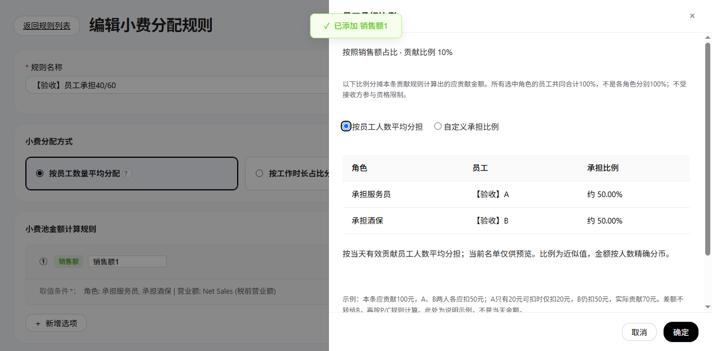
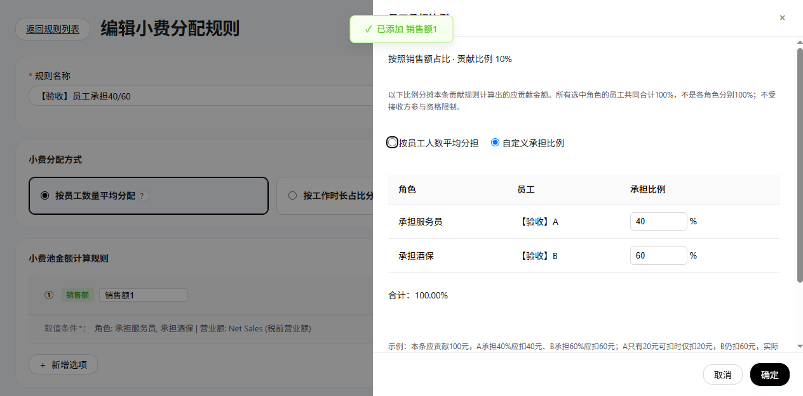

# TipOut 小费分配系统—权威产品需求文档（PRD）

## 第二批页面缺口：明细上下文与员工每日日期（TIPOUT-DETAIL-GAPS-20261023-01）


图注：2026-10-23／main基线44ca8723＋未提交实现／65115独立演示；手工权重2，询问期间仍为原日期。完整切店、继续编辑及放弃结果见个人版T01／T02。

| 字段／操作 | 定义与结果 |
| --- | --- |
| 切门店／日期 | 仅真实未保存修改触发页面内确认。询问期间恢复原上下文；继续编辑保留输入，明确放弃才清除本页草稿并切目标。无草稿不提示；保存中不允许离开。 |
| 首次确认来源 | 首次无人工调整按system保存；首次人工调整按manual保存，以便后续系统重分配正确识别覆盖。既有结果重新确认仍按系统重建。函数专项测试通过，首次确认浏览器结果尚待补证，不能记为全链路完成。 |
| 草稿广播 | 本页编辑标记指纹相同、基础快照未变化且未锁定时，仅忽略自身通知，不关闭当前确认框；外部变化／锁定仍处理，不扩大忽略范围。 |
| 跨菜单离开 | 仍是验收缺口。当前浏览器分支未成功阻止跳转，不以切店／切日图代替。不得宣称已实现全路由保护。 |


图注：同一功能预览／员工每日页；开始晚于结束，保留上次有效查询范围，不静默将输入改成同日。清空、越界及恢复见个人版P01。

| 字段／操作 | 定义与结果 |
| --- | --- |
| 开始／结束日期 | 必填ISO日历日期字符串，单位日；默认继承员工汇总快照范围。两端均须在来源周期内，开始≤结束，同日合法且含当日。空值不代表全量。 |
| 无效输入 | 不改写输入；字段标记错误并显示可访问提示。停止读取新范围，保留旧行及六项统计，提示旧范围，不能显示为新范围计算成功。 |
| 有效恢复 | 校验通过后按当前员工及既有筛选重算展示，解除错误；只读查询，不生成确认快照。 |
| 导出入口 | 收集数据、打开菜单及邮件动作重复校验；无效返回空结果／中止，不携带错误周期。实际文件、投递未验收。 |
| 算例 | 来源9/23—10/23；10/22—10/20提示倒置，不改为10/22同日；9/22越界；10/20—10/20合法，更新为当天。 |

验证范围：切日取消／确认、切店确认、员工每日空值／倒置／越界／修复有实际截图；函数回归覆盖保存保护、日期导出守卫与首次人工来源。T08员工替换、T14首次确认、R22迁移、CSV／PDF及共用并发／权限等缺口不关闭。未提交、合并、推送或上线。

最新维护：TIPOUT-CONTRIBUTOR-SHARE-MODES-20261023-01。[产品V4.12](PRD_产品需求文档.md)／[研发V3.12](小费分配业务规格说明书（研发交付版）.md)／[个人V2.10](小费管理需求文档（个人规范版）.md)配对。员工承担仅平均／自定义，新建默认平均，历史无配置不迁移。共同基线main@745d7030＋65124独立功能分支。


## 角色贡献规则：员工承担比例（TIPOUT-CONTRIBUTOR-SHARES-20261023-01）

实现修复记录（TIPOUT-SHARES-DRAWER-FIX-20261023-01）：修复680px员工比例抽屉沿用公共400px关闭偏移而残露的问题。关闭状态完全隐藏且不可操作；仅点击有效入口后显示并解除inert，确定／取消后恢复隐藏。未配置比例仍沿用旧扣除方式，不自动展开、不自动启用配置。门店／角色未选时入口保持禁用；不改变既有业务、字段、版本及计算口径。基线main@05775454，独立功能预览65123已验证默认隐藏、点击打开、两员工40/60确定后关闭及摘要更新；不代表规则持久化或全部场景重新验收。


图注：编辑规则／取消员工比例输入后，仍为沿用原方式；main@03afacb8＋未提交功能分支，65122隔离浏览器。专用验收人员A销售200、小费20，B销售800、小费1000；不是真实员工或付款记录。固定身份仅由验收脚本显式创建，不向普通名单自动加人。

用途：先按取值条件算本条贡献项应承担的总额，再配置由哪些员工按什么比例承担。它与小费池预算P、接收组占比、员工接收权重和参与资格是不同层级；一条贡献项可以选多个角色，所有命中员工共同合计100%，不是每个角色各100%。

| 元素／操作 | 定义及联动 |
| --- | --- |
| 原贡献比例 | 例如10%，计算本条取值总基数的10%。启用自定义承担时须大于0、不超过100%，最多两位百分数小数。不是员工承担比例，也不是角色固定分得小费池P的10%。 |
| 设置员工承担比例 | 位于每条贡献卡片的取值条件下方；未选门店或角色时禁用，提示先设置范围。点击打开右侧抽屉，仅作用于本卡片。 |
| 默认摘要 | 新添加贡献项默认平均分担；历史无配置显示“员工承担：未设置”，不改变旧算法或快照。打开默认平均，只有确定才应用转换；取消不迁移。 |
| 已配置摘要 | 平均显示“按员工人数平均分担（按当天有效员工人数计算）”；自定义显示“A 40%、B 60%”，超过3人显示人数。点击修改可查看完整名单。 |
| 范围变化 | 自定义：门店、角色或有效员工名单改变须重设，不静默归一化。平均：明确修改门店／角色后更新范围，按计算当天有效贡献员工动态均分；抽屉打开期间名单变化仍须取消重开。 |

### 员工承担比例抽屉



图注：65124隔离验收／main@745d7030＋本次修改；两位验收员工只读约50%，非真实交易。



图注：同一抽屉切换自定义，40/60合计100%；取消后保留已保存平均。以下旧版含勾选框的截图仅为历史状态参考，当前已替换为两项单选。

| 字段／操作 | 定义、默认及约束 |
| --- | --- |
| 上下文 | 只读当前贡献依据及贡献比例，明确是在分摊本条应贡献额；不显示虚构当天试算金额。 |
| 员工承担方式 | 必选单选：按员工人数平均分担／自定义承担比例，无沿用旧方式选项。新建默认平均；已配置按保存方式回填，旧自定义缺mode按custom回填。确定仅更新草稿，页面保存才落盘；取消／关闭不应用切换或输入。 |
| 角色 | 当前门店有效员工目录中的角色，只读；按所选角色顺序分组展示。不是另一个百分比分母。 |
| 员工 | 按稳定employeeId引用和去重，不用姓名作主键。命中多个角色只配置一次，不受接收方打卡资格限制，零小费余额员工仍可以出现在名单。 |
| 承担比例 | 平均只读“约100/N%”，两位小数仅供预览，不固化员工百分比、不用近似值反算金额。自定义每行必填0—100、最多两位小数，初次空值不自动填均分；切换保留本次自定义输入，取消丢弃。 |
| 合计 | 自定义全角色员工共同100%，不足／超过均拦截。平均展示动态人数说明，不累加近似百分比显示99.99%。 |
| 确定 | 再核对打开时门店、角色及名单未变化；校验通过才更新本页规则草稿和摘要，不直接写规则或分配记录。 |
| 取消／关闭／遮罩／Esc | 丢弃本次抽屉输入，不改此前草稿或有效规则；重开按已应用草稿回填。标题关闭／取消／Esc返回入口焦点；Tab循环在抽屉控件中。 |
| 页面保存规则 | 按既有必填、引用和状态校验，并重验自定义份额及范围。成功写deductConfig对应卡片，失败保留草稿。仅查看抽屉不改变业务。 |

### 比例错误、取消与草稿应用


图注：40%＋50%，点击确定仍留在抽屉，提示必须100%；有效规则尚无employeeShares。取消后的无写入结果见入口图。


图注：确定40%／60%后，卡片摘要已变，但存储尚无员工比例；不等于规则已保存。

### 保存后编辑回填


图注：实际点击页面保存规则，随后重新编辑并打开抽屉；输入为40／60，合计100%。接收方使用验收Chef人员，本贡献名单与其独立。未改历史分配结果。

### 计算定义与字段

| 字段／对象 | 研发定义及例子 |
| --- | --- |
| deductConfig条目 | 保留salesPct／personalSalesPct／tipIncome原结构；每张卡片可选追加employeeShares，无该字段的旧规则走原计算路径。 |
| employeeShares.version／mode | version整数1；mode为average／custom，新建默认average。历史mode缺省兼容custom，非法值拒绝；没有employeeShares仍保留旧算法，不视为默认平均。 |
| employeeShares.store | 设置时门店字符串，编辑器保存时校验与当前门店一致；员工ID还须属于当前角色名单。 |
| employeeShares.roles | 角色字符串数组，去重集合须等于贡献项角色；custom变化须重设。average在用户明确修改取值角色时同步范围，之后计算按该范围动态取当天员工。 |
| employeeShares.employees | custom必填数组：employeeId和pct，覆盖角色全部有效员工且无重复／失效。average不保存该数组；计算当天按角色取facts、employeeId去重排序；无有效员工报错，不除以0或静默返回零。 |
| 应贡献额D | 汇总所选员工符合取值条件的基数B，计算D＝B×原贡献比例。销售额／个人销售额／小费收入保留各自基数与筛选约束，不借承担比例扩大来源范围。 |
| 员工应扣dᵢ | average：D转整数美分，N人等权split，每人floor(D分/N)，余分按稳定员工ID补1分。custom：D×pctᵢ÷100，最大余数分币。先分应扣再各自余额封顶，所有应扣之和等于D。 |
| 可扣余额aᵢ | 当天原始可扣小费减此前贡献项／池已实际扣除金额，不含接收分得金额；不因本次应扣不足变成负数。 |
| 实际扣除cᵢ／少扣sᵢ | cᵢ＝min(dᵢ,aᵢ)，sᵢ＝dᵢ−cᵢ。只封顶本人，不转给其他员工或重新归一化承担比例。 |
| 同日顺序 | 沿用规则池计算顺序；同池按既有口径顺序salesPct、personalSalesPct、tipIncome，同口径按数组顺序消耗余额。新增配置不授权重排其他规则。 |
| C与实际可分配 | C为所有贡献项实际扣除之和，不是应扣之和；实际可分配max(P,C)，老板补足max(P−C,0)。 |
| contributionRules | 逐项快照增加shareMode=average/custom；custom历史布尔字段表示显式员工承担路径。average的pct为100/N展示依据，应扣按等权分币校验；保存当时人员与金额，不用现在人员重写历史。旧快照缺shareMode保留原custom校验。 |
| 贡献员工快照 | employeeId／name／role／pct／due／available／amount／shortfall；pct在沿用项为null，其他金额为应扣／扣前余额／实扣／少扣，保留确认时值，不用现行角色或名字重写历史。 |
| 守恒检查 | 贡献项员工应扣、实扣、少扣分别汇总；项实扣合计等于C，员工实扣合计与贡献流水及员工统计相等。无效或不守恒拒绝生成新确认结果。 |

算例：角色范围销售基数1,000元×10%＝应贡献100元；A承担40%应扣40、余额20实际扣20；B承担60%应扣60、余额1,000实际扣60。C＝80，少扣20。P＝100时实际分100、老板补20；P＝50时实际分80、老板补0，仍少扣20，不能把少扣直接等同于补足。

### 分配明细：贡献方及少扣提示

平均算例（本次新增）：D＝100元，A/B/C三人应扣33.34／33.33／33.33元（相同尾差按稳定ID）；A仅20元可扣，实际20／33.33／33.33，C＝86.66，P＝100时老板补13.34。新增有效贡献员工D且基数仍1000元时四人各应扣25元。所有选中角色共同分担，与接收方打卡资格无关；已发放快照不重算。

当前验证：两项单选、平均只读、保存规则后重开回填average、自定义40/60合计100、取消保留已存average已做浏览器验证；三人尾差、人数变化、少扣与快照守恒为自动测试。新建默认平均／历史无配置打开取消及范围变化的完整操作截图尚待补，不据此宣称逐操作全覆盖。其余原兼容限制不扩展。


图注：10/23确认快照／本条贡献应扣100、实扣80；A40→20、B60→60。仅本条是上述数字，同一天其他旧规则的扣款仍可能计入员工当天合计，不能把本条60当作全天唯一扣款。

| 字段／操作 | 定义及可见条件 |
| --- | --- |
| 贡献方规则区 | 在对应小费池／规则金额区下方、接收方表前显示本规则的各贡献项；新自定义路径保留员工承担、应扣、余额、实扣。旧快照无逐项元数据时不猜测补算。 |
| 试算／确认 | 未确认使用“预计”标签；确认后读取保存的contributionRules，不用当前规则重算。人工保存沿用既有有效快照替换流程，已发放仍只读。 |
| 应扣总额 | 当前贡献项按条件及比例算出的D，不是整个小费池P。 |
| 实际扣除 | 当前项员工实际扣除之和，是该项对C的贡献；不是最终接收金额。 |
| 少扣金额 | 当前项应扣−实扣，只有大于0才额外强调，不等于老板补足。 |
| 蓝色提示 | 有员工余额不足才显示“可扣余额不足，少扣 $金额”，不阻止正常分配；不同贡献项分别判断，无少扣不显示此提示。 |
| 问号 | 点击展开逐位不足员工的应扣、余额和实扣，说明不转嫁、C按实扣、补足仍按P/C；收起仅隐藏说明，不写数据。原C＞P／C＜P提示独立保留。 |


图注：同日同规则／点击蓝色问号后，A应扣40、余额20、实扣20；单人不足仅列该人，多人不足逐人列出，B不会被追加扣20。

### 已发放快照


图注：隔离演示登记已发放后，贡献表及少扣提示仍按原确认快照显示，不修改旧发放或执行实际转账。原演示取消例外不因本次改变。

### 支持与交付边界

- 本期实现普通、非时段角色贡献配置及上述三种取值依据；旧funding、计提、逐笔时段路径遇自定义承担明确拦截，不默默忽略或退回全天。此为实现兼容边界，不替用户重新定义这些模式的业务。
- 同池启用自定义后，如包含旧salesPct项，必须为这些销售额贡献项均明确配置承担比例；否则保存与计算拦截，避免把旧按预算归集算法静默转换。未配置任何员工承担的旧规则不迁移。
- 仅在规则草稿保存后影响后续计算；已有确认／已发放快照不自动改写。旧无metadata快照继续原样展示，不补造历史比例。
- 本次不新增导出列、权限或支付接口。现有统计仍用实际扣除；新增字段的导出格式不在本次范围。
- 已验：90%拦截、取消不应用、确定仅草稿、保存后回填40/60、确认与已发放明细、少扣展开；函数覆盖多项／跨池余额、尾差、失效／重复ID、0比例及P/C。新建未选角色禁用、门店／角色／名单变化、恢复原方式、多人不足、键盘和故障等全部分支的页面图尚未齐全，其他历史缺口不关闭。

## 小费池计算模式默认折叠（TIPOUT-MODE-COLLAPSE-20261023-01）


图注：新增规则／默认收起，main@440289d5＋未提交分支，65121隔离演示；原默认模式legacy_pool保留，非已保存记录。

| 元素／字段 | 定义与行为 |
| --- | --- |
| 标题与箭头 | 红框内显示“小费池计算模式”和展开箭头；整条标题点击可切换，聚焦后Enter／Space使用原生summary交互。 |
| 默认展开状态 | 新建、编辑首次进入均为收起（details无open）；仅当前页临时布尔状态，不入库、不跨页面记忆，不新增配置字段。不是默认修改计算模式。 |
| 隐藏范围 | 收起时隐藏下方两个模式单选项及说明，其他卡片不随之折叠；保留红框。展开后原选项、说明、联动和校验恢复可操作。 |
| 计算模式取值 | 新建仍默认legacy_pool；编辑按已有allocationMode回填，包括order_tip_then_residual。收起不清空／禁用单选项、不重置为默认，保存继续读取当前选值。 |
| 保存及失败 | 仅展开／收起无业务写入、不构成人工业务调整；修改选项才走既有规则草稿。保存校验、成功／失败／取消和金额计算均沿用原定义。 |


图注：同页同版本，展开后两个选项可见；Enter再次收起，选值仍legacy_pool。默认、展开与键盘关闭有真实浏览器验证；既有计提模式编辑回填、离开重新进入的独立截图待补，不能据此宣称全链路验收。前批“计算模式区块红框”图展示的是展开态，不再代表首次默认状态。

## 规则编辑页红框视觉补充（TIPOUT-RULE-OUTLINE-20261023-01）


图注：新增规则／默认计算模式，main@07f8dd36＋未提交独立分支，65120隔离演示；不作为真实规则保存记录。仅样式补充，三文档保持产品V4.9／研发V3.9／个人V2.7，无业务版本变更。

| 元素 | 视觉定义与边界 |
| --- | --- |
| 小费池计算模式区块 | 红框沿用。默认仅显示可操作标题与箭头；展开后两个单选项和说明位于框内；重新点击标题收起。红框不是校验失败或选中状态。 |
| 在岗员工选项 | “仅限小费产生时在岗员工”单选项、文字及问号整体使用1px红框、8px圆角；框宽随内容，不框住整个参与资格区。默认未选与已选都显示红框，文字、打卡条件与选中逻辑不变。 |


图注：同页同版本／选中在岗资格并点击问号，说明浮层可正常展开；边框不裁切说明，原工时联动沿用。框不是整行点击的新入口，不改禁用、保存及算法。本轮未保存规则；其他历史截图及验收缺口保持原状态。

## 取消已发放分配（演示重置，TIPOUT-CANCEL-PAID-20261023-01）


图注：日期汇总10/21—10/23，23日已发放、21日待发放、22日未营业；origin/main@649225c3＋未提交功能分支，65118隔离演示，非真实交易。当前原生页面生效；旧dist/TipOut/index.html静态原型未升级该业务，不作为本次入口。

| 字段／操作 | 定义及结果 |
| --- | --- |
| 测试场景清单 | 复用btn-danger红色边框，位置、点击行为不变。 |
| 取消分配 | 同样红框；范围为当前门店、起止日期（含两端）的正常营业日，不按状态筛选缩小范围。已发放也可取消；未营业、范围外、其他门店、原始订单／考勤不改。门店必选，日期必须有效。 |
| 无记录／异常 | 无有效记录不写入或重复归档；损坏或发放依据异常拦截，不强行解锁。 |
| 锁定例外 | 仅本演示取消可重置已发放；普通编辑、更新、分配、底层cancel仍遵守锁定，不新增支付撤回接口。 |

### 页面内取消确认


图注：同版本／点击红框取消入口；页面对话框，不调用浏览器confirm。

| 字段／操作 | 定义及结果 |
| --- | --- |
| 标题／范围 | “取消分配？”；只读门店及日期。打开时冻结范围及各日快照／发放／更新指纹，外部变化不静默改变目标。 |
| 警示 | “取消后将恢复为待分配，已发放标记也将撤销。此操作不会撤回实际付款。” |
| 保留分配／关闭／Esc／遮罩 | 不写入，关闭返回焦点；提交期间阻止关闭及重复提交。框外主内容inert，Tab在框内循环。 |
| 确认取消分配 | 先检查整个范围及指纹一致，再逐日Web Lock内复核；confirmed=true和expectedFingerprint必填。过期确认失败，需关闭后重新检查。 |
| 成功 | 归档旧数据后清有效快照、已分配索引、发放标记及未确认更新。正常日回未分配／待发放；已分配金额归零，未分配金额按现行试算展示；刷新汇总及冻结周期Payroll。 |
| 失败 | 每日五项写失败恢复原值；回滚也失败明确提示停止操作。范围逐日执行，非全范围原子；中断报已完成天数，剩余不动。薪资失败明确取消已写入、同步失败，可经原员工数据更新流程重试同步，不假报全成功。 |

### 保留分配


图注：同范围点击保留，23日仍已发放、21日已分配待发放、22日仍未营业。

### 确认后结果及历史


图注：同范围确认后，23／21日恢复未分配、待发放，22日仍无需分配／无需发放。实际归档2条，23日含原发放记录，21日payout为空。

| 字段／对象 | 定义、来源、默认与约束 |
| --- | --- |
| cancelFingerprint | 已分配索引、快照、发放、未确认更新的JSON字符串，用于锁内并发比较；非金额，不展示。 |
| 历史存储 | tipout-allocation-cancel-history-v1，JSON数组，默认空；实际取消才追加，不参与有效汇总。损坏拦截。 |
| recordId／canceledAt | 系统唯一ID字符串／ISO当前时间字符串，必填不可编辑。 |
| storeId／businessDate／source | 必填字符串：冻结门店、ISO营业日、固定summary-demo-reset。 |
| snapshot／payout／unconfirmedUpdate | 完整撤销前对象或null；保留快照ID、版本、hash、金额及原发放时间、确认人、请求ID。不删除订单／人员／规则。暂不新增历史查看页。 |
| 写入 | 锁内归档→快照→索引→发放→未确认更新；保留五项原始值并逐项回滚，只成功后通知其他视角。历史不是退款流水。 |
| 发放确认警示 | 本操作仅记录发放状态，不执行转账。确认后分配结果锁定；仅可通过汇总页“取消分配”演示重置，撤销标记不会撤回实际付款。 |

验收：23日已发放、21日未发放、22日闭店；保留不写，确认归档2条、清有效状态，范围外不动。重复取消幂等，过期指纹拦截，五项故障回滚、普通cancel仍锁定有函数测试；默认、确认、保留和成功有截图。并发、故障、薪资失败、焦点循环的页面截图仍待补，原历史缺口不关闭。旧“已发放取消跳过”图片仅为历史，不代表当前规则。


上批维护（历史）：TIPOUT-FUNDING-EXCESS-20261023-01（2026-10-23）。[产品V4.6](PRD_产品需求文档.md)／[研发V3.6](小费分配业务规格说明书（研发交付版）.md)／[个人规范V2.4](小费管理需求文档（个人规范版）.md)配对。明细金额对照、蓝色贡献超计划标识及展开说明，新增隔离演示门店“计划10·贡献20·按20分配”。普通池明确个人小费／个人销售额贡献配置已接入试算与确认；角色无独立公式、salesPct、旧funding、计提及时段资金的兼容边界仍保留，非全部资金契约完成。代码及文档未提交。

上批维护（历史）：TIPOUT-FUNDING-DEFINITION-20261023-01（2026-10-23）。[产品V4.5](PRD_产品需求文档.md)／[研发V3.5](小费分配业务规格说明书（研发交付版）.md)／[个人规范V2.3](小费管理需求文档（个人规范版）.md)配对。明确贡献≤计划金额按计划分配、贡献>计划按实际贡献分配；补符号映射、等于／零值及20对10算例。只更新资金业务定义，不改代码、页面或历史快照；实现状态与原待确认项保留。基线为本地main@fb78f5e7（含尚未推送提交）。

上批维护（历史）：TIPOUT-DETAIL-GAPS-20261023-01（2026-10-23）。[产品V4.4](PRD_产品需求文档.md)／[研发V3.4](小费分配业务规格说明书（研发交付版）.md)／[个人规范V2.2](小费管理需求文档（个人规范版）.md)配对。第二批补明细切店／切日的页面内草稿确认、首次人工结果来源标记及员工每日日期校验。功能基线44ca8723＋65115未提交实现；跨菜单离开、首次确认和员工替换仍有浏览器验收缺口，不声称全部完成。

上批维护（保留）：TIPOUT-DATE-VALIDATION-20261023-01（2026-10-23）。[产品V4.3](PRD_产品需求文档.md)／[研发V3.3](小费分配业务规格说明书（研发交付版）.md)／[个人规范V2.1](小费管理需求文档（个人规范版）.md)配对。第一批实现汇总日期空值／倒置反馈、结果保留、操作拦截与修复恢复，补10张真实截图；资金、算法、资格和历史快照不变。其余缺口继续分批，不代表全部实现。

上轮文档维护：TIPOUT-DOC-HISTORY-20261023-01（2026-10-23）。产品V4.2／[研发V3.2](小费分配业务规格说明书（研发交付版）.md)／[个人规范V2.0](小费管理需求文档（个人规范版）.md)共同承接已有业务，不新增算法、状态、权限或页面。个人版补齐历史页面逐字段及操作说明，原V1.5近期保存与覆盖确认保留；[逐操作清单](小费管理逐操作覆盖清单.md)记录截图与未决缺口，不代表图片完整或资金新契约已实现。

上轮2026-10-23截图补充（当时业务版本不变）：新增125张真实界面图，来自main基线44ca8723的65114独立演示；已在个人规范版按页面／操作就近内嵌。99项清单操作已关联所示状态，仍有7项操作及部分异常分支缺图。仅本地演示生成快照／登记发放锁，无转账；不改用户原会话或业务代码。CSV／PDF未取得文件、邮件未发送；历史兼容与待实现界面仍保留缺口。见[逐操作覆盖清单](小费管理逐操作覆盖清单.md)及[图片溯源清单](assets/tips-operations-20261023/capture-manifest.json)。本轮截图说明当前实现，不覆盖已确认待实现的产品定义。


有效口径说明：本轮个人版不机械复制本文早期旧句。接收以§24为准，资金以§22为准；日期去池列、未确认已分配=0／未分配=入池、员工确认＋预计贡献、六项员工每日统计、工时按规则查看及已移除发放记录入口，按研发§6.1 CF04—CF08中已确认后续要求承接。本文旧段落仍需结合该对照阅读，不因补文档重新生效；本次不重写全部历史章节。Q01—Q14／Q16原状态保留，Q15仍关闭。


## 日期分配汇总：人工结果覆盖确认（TIPOUT-BATCH-COPY-20261022-01）


图注：2026-10-23／44ca8723基线／65114隔离演示，仅1个人工日；下方2026-10-22图片保留为历史专项证据。


图注：2026-10-22，功能分支codex/tips-overwrite-copy-20261022，基线为已合并但未推送的本地main e52b31a8，端口65113；演示数据仅用于验证提示，不是生产数据。

用途／入口：日期分配汇总底部“重新分配小费／批量分配小费”→选择门店和起止日期→“分配小费”。起止同日即单日，范围含首尾日期；不按汇总表当前营业／分配／发放筛选缩小选择范围。

| 字段／操作 | 逻辑说明 |
| --- | --- |
| 人工结果识别 | 读取所选门店每个可分配日的有效快照，allocationSource===manual表示人工保存；system及历史缺字段不据此推断人工。未营业、已发放或锁定日不实际覆盖，不列入人工提示清单。 |
| 首次分配按钮 | 校验门店和日期后读取范围；不存在可覆盖人工日则按既有覆盖说明进入系统分配。有至少一天人工日时不写入，原选择弹框进入二次确认阶段。 |
| 页面内二次确认 | 标题“重新分配小费？”。第一段“所选日期中有 N 天已手动调整：YYYY/MM/DD、YYYY/MM/DD。”，天数加粗；第二段“重新分配将按系统规则计算，覆盖手动调整结果。”，覆盖后果加粗。去掉重复的门店和起止日期范围；底部按钮“取消／重新分配”。人工天数、日期集合及重算范围不变。 |
| 范围冻结 | 二次确认阶段隐藏并禁用原门店及日期选择字段，不再重复显示范围摘要；保留内部不可变范围和快照指纹。确认时范围、资格或已保存结果变化则恢复选择并要求重新检查；不因省略摘要而改变实际操作范围。 |
| 重新分配（覆盖确认主按钮） | 明确点击后先预生成并校验全部可执行日期的系统快照；复用明细系统重建，不加载旧人工公式、人员调整、权重或手工工时为新系统结果。提交后来源为system，统计读取新快照。不能只写已分配日期标记。 |
| 取消／关闭／Esc／遮罩 | 均取消该次覆盖，不写分配结果，不清除人工快照；下一次操作重新识别人工日期。关闭后焦点返回汇总分配入口。 |
| 执行及失败 | 执行期间按钮禁用，阻止重复提交。全部日期先校验，计算失败不写任何日期；实际存储沿用按日原子提交及乐观冲突检查，后续日提交失败则停止，已成功日保留并报告已保存天数，不谎报全部成功。此为本次本地实现边界，不自动关闭原Q11跨日生产事务决策。 |
| 薪资与统计 | 全部日期成功后刷新范围与汇总并调用既有薪资桥接；薪资失败明确已保存但同步失败。已发放锁定仍受日期写锁保护，不被重新分配。 |

### 单日覆盖确认


同一确认页面按实际数据展示1天和日期，不使用另一套规则。本次文案精简的专项断言覆盖两个人工日期的YYYY/MM/DD格式、标题、主按钮及加粗节点；实际浏览器核对单日与范围含一个人工日时的两段正文和取消，截图为本次精简后的真实页面。重新分配范围、指纹和写入实现未变。

### 可验收算例

范围10/19—10/21中，10/19人工比例60/40已保存，10/20系统50/50，10/21人工70/30已保存：提示2天（10/19、10/21）；取消后三天快照均不变。确认后所有可执行日按系统规则重算，不保留60/40和70/30。如果10/21已发放，则跳过、提示清单仅含10/19，并反馈跳过数量。

验证状态：专项覆盖单日、范围、多人工日、混合系统日、未营业、已锁定及指纹变化；范围预计算、真实快照提交与并发参数检查。实际浏览器：10/19与10/21人工v2，取消后均不变；10/19—10/21确认后两日均为system v3，10/20为system v1，10/19公式由人工100恢复系统200。单日二次确认显示1天及10/19。类型检查、既有保存／页面弹框／存储专项通过。不表示生产上线、Q11闭合或全套历史脚本通过。

## 小费分配明细：保存与系统重分配（TIPOUT-DIALOG-20261022-01）


图注：基础明细截图来自2026-10-22、基线f5940cbd的功能预览65110，仅用于定位保存按钮。下方弹框截图来自本次基线ae7443e9、codex/tips-page-dialogs-20261022、端口65111；计算与保存定义未变。

用途／入口：当前门店、营业日明细底部。“保存当前分配”位于“重新确认分配”右侧；规则筛选只控制可见区块，两操作均处理当天全部规则。已发放仍锁定，不改变资金、人员及金额校验。

| 字段／操作 | 逻辑说明 |
| --- | --- |
| 共用页面内对话框 | 使用项目modal-overlay/modal样式，不调用浏览器alert/confirm；notice/save/reallocate三个类型。打开默认聚焦主按钮，Tab／Shift+Tab循环限定在弹框按钮内；关闭回到触发按钮。确认前不提交，重复打开不重复执行。取消、右上角关闭、遮罩或Esc均返回取消；弹框期间门店、日期或基准快照变化时不执行原确认。同日外部状态变化自动取消弹框，再按既有状态处理。 |
| 手动调整标记 | 员工、权重、工时、比例、角色占比、公式等既有可编辑项发生手动输入或增删即标记；改回原值仍视为已操作。筛选、查看不标记；更新小费数据的系统草稿不单独算人工调整。首次手工录入无快照仍沿用“确认分配”。 |
| 保存当前分配 | 已有系统分配且有未保存人工调整时启用；无人工调整时置灰、aria-disabled=true但可点击原因提示，不写入。保存成功清除未保存人工标记并置灰。执行中、无已分配结果、不可分配日或锁定时真正禁用。 |
| 保存确认 | 提示“已手动调整过小费分配数据，将按照手动调整后的分配数据进行统计”；确认后校验并保存页面当前全部规则结果，不重建系统默认值。取消不写入并保留草稿。 |
| 重新确认分配 | 已分配未锁定日期可主动重算。有未保存人工调整或上次快照为人工来源时提示“已手动调整过小费分配数据，将按照系统小费规则进行重新分配，分配后会覆盖手动调整的数据”；无人工调整保留原覆盖提示。 |
| 系统重算 | 确认后使用当前门店全部有效规则、系统事实及默认工时，忽略当天人工调整、手工工时；新快照校验与提交成功后才替换页面。取消不变；失败保留原草稿与旧有效快照。 |
| 提交保护 | 沿用日期锁、快照哈希冲突、金额与人员校验。执行中阻止重复操作、编辑及离开；失败不清草稿。统计只读取最新成功保存快照，不使用草稿；薪资同步失败明确提示已保存但同步失败，不回滚快照。 |
| allocationSource | 快照可选字符串 manual/system，人工保存写 manual，系统自动或重分配写 system，随完整快照保存。重开人工快照仍提示覆盖人工数据；旧快照无此字段不推断来源、不自动迁移重算。 |

### 未调整提示框


图注：2026-10-23／44ca8723基线／65114隔离演示，本轮实际页面弹框；下方旧图保留原来源。


点击灰色保存，仅提示“当前系统分配数据未进行手动调整”；关闭不改变统计或快照版本。 页面内标题“提示”，按钮“知道了”，右上角可关闭；不调用浏览器alert。

### 人工保存确认框


图注：2026-10-23／44ca8723基线／65114隔离演示，本轮实际页面弹框；下方旧图保留原来源。


提示采用上表原文。页面内标题“保存当前分配？”，底部“取消／保存当前分配”；确认才保存，取消、关闭、遮罩或Esc保留草稿和旧统计。

### 覆盖人工数据确认框


图注：2026-10-23／44ca8723基线／65114隔离演示，本轮实际页面弹框；下方旧图保留原来源。


提示采用上表原文。页面内标题“重新确认分配？”，底部“取消／重新确认分配”；确认才重算，取消、关闭、遮罩或Esc不覆盖。无人工调整时的原覆盖提示同样使用此页面内弹框。

### 验收算例

预算 $100，A/B 权重均为1、工时均4h，系统各分 $50。人工比例改为60%/40%，保存确认后统计为 $60/$40；取消保存仍统计 $50/$50并保留草稿。重新确认分配并确认覆盖后按4h:4h恢复 $50/$50。未调整点灰色保存只提示；失败和并发冲突不覆盖草稿；已发放不能保存或重分配。

验证状态：保存/重算专项、页面弹框专项、确认/自动分配回归及类型检查通过。隔离浏览器验证三种页面弹框、Esc保留草稿、Tab循环及焦点返回、取消不写入；确认人工保存生成manual快照v2（公式100），页面确认系统重算生成system快照v3（公式200）。三个弹框实截图已就近嵌入。不宣称生产发布或全套历史回归通过；既有payout-ui和detail-rounding旧测试缺口保留。

## 版本记录

| 版本 | 日期 | 修改内容 |
| --- | --- | --- |
| V4.12 | 2026-10-23 | TIPOUT-CONTRIBUTOR-SHARE-MODES-20261023-01：仅平均／自定义，新建默认平均，动态人数精确分币，历史无配置不迁移 | 产品V4.12／研发V3.12／个人V2.10 |
| V4.11 | 2026-10-23 | TIPOUT-CONTRIBUTOR-SHARES-20261023-01：跨角色员工承担100%、余额封顶不转嫁、逐项快照与少扣提示、抽屉及实证 | 产品V4.11／研发V3.11／个人V2.9 |
| V4.10 | 2026-10-23 | TIPOUT-MODE-COLLAPSE-20261023-01：计算模式默认折叠、原生键盘展开、保留选值及截图 | 产品V4.10／研发V3.10／个人V2.8 |
| V4.9 | 2026-10-23 | TIPOUT-CANCEL-PAID-20261023-01：演示取消归档并重置已发放／已分配，页面确认、红框及截图 | 产品V4.9／研发V3.9／个人V2.7 |
| V4.8 | 2026-10-23 | TIPOUT-DAILY-SHORTFALL-20261023-01：不足对照与老板补足问号说明；每日10/5数据及截图 | 产品V4.8／研发V3.8／个人V2.6 |
| V4.7 | 2026-10-23 | TIPOUT-DAILY-EXCESS-20261023-01：仅超额规则显示资金对照；当前默认门店每日演示；半美分口径对齐与截图 | 产品V4.7／研发V3.7／个人V2.5 |
| V4.6 | 2026-10-23 | TIPOUT-FUNDING-EXCESS-20261023-01：贡献超计划金额对照与展开说明；独立个人贡献资金联动及10/20演示；历史和未支持路径不自动迁移 | 产品V4.6／研发V3.6／个人V2.4 |
| V4.5 | 2026-10-23 | TIPOUT-FUNDING-DEFINITION-20261023-01：贡献与预算取较大值为分配基数；明确符号映射、等于与零值、20/10算例；仅文档 | 产品V4.5／研发V3.5／个人V2.3 |
| V4.4 | 2026-10-23 | TIPOUT-DETAIL-GAPS-20261023-01：明细草稿页面内确认、人工来源及员工每日日期错误反馈；产品V4.4／研发V3.4／个人V2.2；保留未验收分支 |
| V4.3 | 2026-10-23 | TIPOUT-DATE-VALIDATION-20261023-01：共用汇总日期错误、结果保留、操作拦截及恢复；产品V4.3／研发V3.3／个人V2.1；第一批日期校验，其他缺口继续分批 |
| V4.2 | 2026-10-23 | TIPOUT-DOC-HISTORY-20261023-01：同步个人规范V2.0历史页面承接入口、有效口径对照及逐操作截图缺口；配对研发V3.2；仅文档修订，不新增业务决策 |
| V4.1 | 2026-10-22 | TIPOUT-BATCH-COPY-20261022-01：覆盖提示精简为两段，去掉门店与范围重复信息，突出天数和覆盖后果；配对产品V4.1、研发V3.1、个人V1.5，计算不变 |
| V4.0 | 2026-10-22 | TIPOUT-BATCH-20261022-01：日期汇总单日／范围重分配增加人工快照覆盖确认，真正重建系统结果；配对产品V4.0、研发V3.0、个人V1.4 |
| V3.9 | 2026-10-22 | TIPOUT-DIALOG-20261022-01：保存提示及系统重分配确认改用页面内对话框，补充取消、Esc、焦点及截图；配对产品V3.9、研发V2.9、个人V1.3 |
| V3.8 | 2026-10-22 | TIPOUT-SAVE-20261022-01：人工保存与系统重分配分离，三提示、来源及草稿保护；配对产品 V3.8、研发 V2.8、个人规范 V1.2 |
| V3.7 | 2026-10-15 | TIPOUT-NAV-20261015-02：删除分配页规则管理与规则列表返回小费分配按钮；仅保留侧栏切换，计算及编辑行为不变；配对研发 V2.7、个人规范 V1.1 |
| V3.6 | 2026-10-15 | TIPOUT-NAV-20261015-01：小费管理下钻为小费分配／分配规则，规则快捷入口统一进列表，列表保留侧栏；配对研发 V2.6、个人规范 V1.0 |
| V3.5 | 2026-10-14 | TIPOUT-PERF-20261014-01：修复小费汇总进入慢；首次仅渲染一次，同次渲染复用门店日事实，退出后清理；业务和金额口径不变，配对研发版 V2.5 |
| V3.4 | 2026-10-10 | TIPOUT-COPY-20261010-01：底部首次分配入口更名“批量分配小费”，其他文案及行为不变；配对研发版 V2.4 |
| V3.3 | 2026-09-30 | TIPOUT-PAYOUT-COPY-20260930-02：删除两入口线下核对说明，保留加粗锁定警示；配对研发版 V2.3；仅文案展示调整 |
| V3.2 | 2026-09-30 | TIPOUT-PAYOUT-COPY-20260930-01：简化两入口发放确认标题，移除金额说明行，独立加粗不可逆提示；配对研发版 V2.2。仅展示变更，不改变整日范围、金额或锁定规则 |
| V3.1 | 2026-09-30 | TIPOUT-FUNDING-20260930-02：员工贡献超过池预算时全额入池分配、按人实扣；统一 P=max(T,D)、老板补足 E=max(T−D,0)，关闭 Q15；配对研发版 V2.1，待开发 |
| V3.0 | 2026-09-30 | TIPOUT-FUNDING-20260930-01：池预算与员工贡献独立计算；员工贡献不足允许老板补足，取消仅因贡献不足阻止分配；调整资金来源、守恒与验收，配对研发版 V2.0；待开发 |
| V2.16 | 2026-09-30 | DOC-GOV-20260930-01：建立产品 PRD／研发交付版双权威维护规则，与研发版 V1.1 配对；明确同步更新、冲突处理与交付检查；本次不改变业务算法或批准既有待确认项 |
| V2.15 | 2026-09-29 | 统一三种小费分配方式的接收侧计算契约：接收组占比、跨角色共同分配、员工权重、三种参与资格、工时及比例调整；补充公式、算例和验收矩阵。已接入共同接收组、平均参与名单、份额校验及自动分摊精度修正；验证与支持边界见 24.10 |
| V2.14 | 2026-09-28 | 确认按小费发生时段判定接收员工在岗资格：订单小费以完成支付时间为准，手动上报记录实际发生时间；逐笔匹配打卡区间，再按所选员工分配方式计算；缺失时间或考勤不静默按整日分配。本版方案待开发 |
| V2.13 | 2026-09-28 | 确认动态应入池金额 → 员工贡献归集 → 接收分配的统一方案；确定贡献分摊、完整归集、跨池余额、试算、原子保存和对账要求；本版方案已确认、待开发 |
| V2.12 | 2026-09-28 | 员工分配方式前置；参与资格支持仅打卡员工／不限打卡状态；明确平均、工时、订单笔数分配关系、手动补录与快照保护，修正原打卡唯一门槛 |
| V2.11 | 2026-09-23 | 接入当前员工统一演示事实（考勤、订单、销售额和小费）；新增近月只读测试场景清单及 CSV；新分配快照保存场景事实，历史快照不自动迁移 |
| V2.10 | 2026-09-23 | 实现分配明细员工“打卡／未打卡”标签及快照保存；新计算中未打卡员工从池分得为 0；规则编辑仅允许打卡设置，历史规则不自动迁移 |
| V2.9 | 2026-09-23 | 实现符合条件进入明细即自动分配并保存；已有快照回显，修改后重新确认；补充未确认修改的离开提示、发放拦截及保存失败保护 |
| V2.8 | 2026-09-23 | 实现日期行单日快捷分配：纯打卡规则原地分配，含手工录入规则进入明细；完整快照保存、员工汇总同步、防重复及发放锁定保护 |
| V2.7 | 2026-09-23 | 确认本期整日发放范围；保留纯打卡自动分配；统一线下结清提示，新增两入口只读发放记录；部分发放及现金抵扣延期 |
| V2.6 | 2026-09-22 | 基于 V2.5 追加美国多业态业务、交互、视觉与扩展性评审；记录风险、优化路线和待决策项。新增建议不代表已实现，不覆盖原有功能定义 |
| V2.5 | 2026-09-16 | 简化员工工时展示：打卡工时仅显示原始累计值；分配工时显示单一值或“多口径（N）”，点击查看小费池/规则/来源/采用工时明细；补充 POS 修正、最大工时、手工工时与导出口径 |
| V2.4 | 2026-09-16 | 员工汇总与员工每日小费新增打卡工时、分配工时双口径；移除班次与上下班时间展示；补充多池规则、快照、导出及差异高亮规则 |
| V2.3 | 2026-09-15 | 保留员工权重原始逻辑；新增权重换算百分比展示；明确换算值不参与存储和分配计算 |
| V2.2 | 2026-09-15 | 更新小费数据增加覆盖确认；补充全量重算、未确认更新及发放保护规则 |
| V2.1 | 2026-09-15 | 小费分配明细新增“确认已发放”入口；复用发放确认弹窗；补充发放后的结果锁定、幂等与多页面同步规则 |
| V2.0 | 2026-09-15 | 以当前真实实现重建页面、字段与状态口径；纳入日期/员工双汇总、确认分配、营业与发放锁定；统一规则、角色、员工及工时数据来源 |
| V1.1 | 2026-02-27 | 补充分配、明细、规则和规则编辑页面需求及公共数据模型 |
| V1.0 | 2026-02-27 | 首次创建 |

## 0. 文档信息

| 项目 | 内容 |
| --- | --- |
| 产品模块 | 团队管理—小费管理 |
| 产品名称 | TipOut 小费分配系统 |
| 文档状态 | V4.6明细贡献超计划对照及普通池明确个人贡献资金路径已实现并在65116隔离演示验证，未提交或上线；其余兼容资金路径仍保留缺口，第23、24章资格及算法继续适用，待确认项不自动关闭。 |
| 适用对象 | 产品、设计、前端、后端、测试、实施与培训 |
| 本期事实源 | 当前 `src/team/tips` 页面模板、运行逻辑和验证脚本；已确认设计方案用于解释产品意图 |
| 权威性规则 | 本文档是小费管理产品口径的统一入口；后续产品设计与验收以最新已确认章节为准。当前代码是实现状态证据，不能覆盖已确认但待开发的需求；历史专项文档保留追溯，不作为新开发依据 |
| 配对研发权威 | [《小费分配业务规格说明书（研发交付版）》](小费分配业务规格说明书（研发交付版）.md)；本文 V4.12，对应 V3.12，共同变更编号 TIPOUT-CONTRIBUTOR-SHARE-MODES-20261023-01 |
| 页面元素说明 | [《小费管理需求文档（个人规范版）》](小费管理需求文档（个人规范版）.md) V2.1；已补历史页面字段、计算、操作及近期保存／覆盖确认；截图与兼容未决分支见[逐操作覆盖清单](小费管理逐操作覆盖清单.md)，不宣称全量验收 |
| 同步维护规则 | 遵循[项目规则](../../../AGENTS.md)“产品 PRD 与研发交付版双权威文档维护”；每次新增或变更需求，在同一次交付中同步更新两份正文、版本记录和配对信息 |
| 双文档分工 | 本文定义产品需求、用户行为、业务规则与验收；研发版展开字段、状态、计算、异常及算例。两者不独立决定业务；有冲突且无明确确认依据时必须登记待确认，不默认为任一文档胜出 |

> 当前接收侧计算契约以第 24 章（V2.15）为准，第 21 章保留 V2.12 的背景与兼容说明。前文“打卡规则／不打卡规则”的工时与自动分配描述若未区分新资格，仅代表旧 `clock`／`noclock` 基线，不得将新“不限打卡状态”解释为旧“全部手动录入工时”。

> V3.1 资金口径：第 22 章统一为“预算 T 与员工贡献 D 独立计算，老板补足 E=max(T−D,0)，实际池金额 P=D+E=max(T,D)”。预算不是分配上限；贡献超预算不截断、不截留、不自动退回，也不产生负老板出资。

> V2.14 优先级：接收员工是否参与某笔小费，以第 23 章的小费发生时间与在岗区间交集为准；第 21 章“当天有打卡即可参与”的既有实现不适用于已启用按时段参与的规则。第 22 章资金归集、守恒、确认与快照保护不变。

> V2.15 优先级：第 24 章统一“接收组份额 → 参与名单 → 分配基数 × 员工权重”的计算定义。前文“同角色均分／按角色数拆分”等表述不能覆盖同一接收行多角色共同分配的定义；不在岗只将该笔有效分配基数置零，不修改员工配置权重。本次不变更页面交互、业务代码及历史快照，已知实现差异必须单独验收。

## 1. 背景与目标

TipOut 用于连锁品牌和餐饮门店配置小费池规则，按门店和营业日计算、确认并发放员工小费，同时提供日期和员工维度的追溯能力。早期 PRD 仍按旧静态页面描述，无法覆盖当前双汇总、自动分配、发放锁定及统一人员数据源。

- **本期只解决**：把当前真实实现且已确认的产品逻辑、字段定义、状态语义和边界条件收敛为单一权威文档。
- **成功标准**：页面名称和字段与当前界面一致；同一状态在汇总、明细和员工对账中含义一致；分配、发放和锁定边界可直接形成测试用例。
- **不做**：本文不承诺真实 POS、Payroll 或邮件服务已接通；演示环境的本地存储、合成数据和模拟发送不等同于生产服务契约。

## 2. 上下文与范围：产品结构与共用上下文

### 2.1 页面与入口

| 页面 | 当前名称 | 主要任务 |
| --- | --- | --- |
| P1 | 日期分配汇总 | 按日期查看营业、分配、发放与小费池结果，执行批量分配、取消分配、确认发放和导出 |
| P2 | 员工分配汇总 | 按员工和角色汇总选定周期内的小费结果，并进入员工逐日明细 |
| P3 | 小费分配明细 | 查看当天适用规则和小费池，录入或调整人员、工时及比例并确认分配 |
| P4 | 员工分配明细 | 查看单个员工在选定周期内的考勤、工时和逐日小费结果 |
| P5 | 分配规则 | 查看、筛选、复制、删除或新建规则 |
| P6 | 新增/编辑规则 | 先选择员工分配方式，再配置小费池来源、计算模式、贡献方、接收方与参与资格 |

### 2.2 共用筛选上下文


图注：2026-10-23，codex/tips-summary-date-validation-20261023，起始main@44ca8723＋本次未提交实现，65115隔离演示；开始晚于结束，字段报错，原金额保留，非生产数据。


图注：2026-10-23，codex/tips-summary-date-validation-20261023，起始main@44ca8723＋本次未提交实现，65115隔离演示；修正为10/19—10/23，错误清除并更新，非生产数据。

| 字段／操作 | 逻辑说明 |
| --- | --- |
| 开始日期 | 日期，必填；默认最近一个月起点。为空提示“请选择开始日期”；非法日历日提示“请输入有效的开始日期”。保留输入、标红字段，不保存错误查询历史。 |
| 结束日期 | 日期，必填；默认当天。为空提示“请选择结束日期”；非法日历日提示“请输入有效的结束日期”。同日范围合法，含首尾。 |
| 日期先后 | 开始晚于结束提示“开始日期不能晚于结束日期”，定位开始字段；不交换日期、不静默查询为空。 |
| 页面提示 | 日期区下方显示错误，追加“当前仍显示上次有效查询结果（YYYY/MM/DD—YYYY/MM/DD），修正日期后更新。”；无有效结果时追加“修正日期后查询。”。不用系统对话框。 |
| 原查询结果 | 无效范围不读事实、不重绘为零或空列表；保留原日期／员工列表、角色卡与金额。筛选、排序和后台刷新不能绕过校验。提示所示为上次有效查询，不是错误范围统计。 |
| 操作保护 | 错误时拦截日期／员工页签、日期／员工明细、行内分配、发放入口、批量入口、取消分配、导出菜单、CSV／PDF和邮箱入口／发送；定位字段，不写账，不打开目标界面。已打开弹框的独立范围和冻结规则不变。 |
| 修正与恢复 | 保留错误输入供修改；合法后清除红框和提示，失效缓存、刷新当前视角一次，保留其他筛选／排序，记录合法查询历史。离开不保存错误日期；重新进入沿用既有合法历史或默认范围。 |
| 真实空态 | 合法查询无匹配结果仍按既有空态；本批仅补日期输入校验，不声明其他读取失败、并发等异常已全部实现。 |

| 场景 | 可验收结果 |
| --- | --- |
| 10/19—10/23 | 5行；本地演示原始773.97、入池430.16、已分配0、未分配430.16。数值只是测试事实。 |
| 开始改10/24 | 倒置报错，仍保留原5行及金额；历史开始仍10/19；分配／取消／导出／明细／页签均拦截；账本未变。 |
| 清空起止 | 分别提示开始／结束必填并定位，不将旧结果清零。 |
| 修复／同日 | 改回10/19清除提示；10/20—10/20合法，只显示一天。 |
| 员工视角 | 有效10/20切员工汇总；开始改10/21报错，角色卡与员工列表保留；改回10/20恢复。 |
本批验证（2026-10-23）：日期专项、页签切换性能、入口性能、批量人工覆盖及TypeScript无输出检查通过；65115实际浏览器验证上述正常／错误／恢复，分配账本不变。日期排序专项因旧CSS选择器断言失败，在未改实现的44ca8723基线上同样失败，未将其报为通过。未执行生产发放、发布或CI部署。


小费管理以“门店 + 日期范围”为业务上下文。门店独立位于首行，日期范围位于门店右侧；日期分配汇总和员工分配汇总共用该上下文。默认日期范围为今天往前一个月（含今天）。

切换汇总 Tab、进入明细再返回时，系统保留门店、日期范围、当前视图、筛选条件、排序和返回行定位。重新进入员工明细时，日期排序始终重置为倒序，不继承上次在明细页切换的顺序。

### 2.3 统一数据来源

| 数据 | 权威来源 | 约束 |
| --- | --- | --- |
| 门店 | 当前品牌/组织可用门店与规则适用门店 | 汇总、明细和规则使用同一规范化门店标识 |
| 角色 | “角色与员工”目录 | 规则编辑器不得维护另一套孤立角色枚举 |
| 员工 | “角色与员工”目录中的门店员工 | 员工按门店及角色联动；Busser、Runner、Host 等演示员工也来自该目录 |
| 打卡工时 | 考勤/打卡记录 | 员工原始有效考勤工时；不受小费分配明细中的人工调整影响 |
| 分配工时 | 当前分配草稿或确认/发放快照 | 按 `poolId + ruleId` 保存小费规则实际采用的有效工时，可能经过人工调整或封顶 |
| 手动工时 | 日期分配明细按“小费池 + 规则 + 日期 + 员工”录入的记录 | 不打卡规则只显示工时，不拼接规则名称；参与计算前必须为非负有效值 |
| 小费分配规则 | 当前门店有效规则集合 | 汇总、明细和计算使用同一规则快照 |
| 已确认分配结果 | 门店 + 营业日维度的分配快照 | 员工汇总、日期汇总、明细和 Payroll 同步均从该结果派生 |
| 发放结果 | 已确认分配快照对应的发放记录 | 一旦确认已发放，分配结果锁定且只能查看审计快照 |

角色或员工被停用、删除或移出适用门店后，引用它们的规则视为失效。系统必须阻止该规则继续分配，并提示用户先修正规则；不得静默改用同名人员或自动删除引用。

## 3. 核心字段与金额口径

### 3.1 日期维度金额

| 字段 | 定义 | 未分配时 | 已分配时 | 未营业时 |
| --- | --- | --- | --- | --- |
| 原始小费 | 当天进入 TipOut 计算前的原始小费；多个规则引用同一来源时按来源去重 | 展示 | 展示快照值 | `$0.00` |
| 入池金额 | 当天所有适用小费池按规则计算得到的可分配金额 | 展示预计值 | 展示快照值 | `$0.00` |
| 已分配 | 已确认分配到员工的金额合计 | `—` | 展示金额 | `—` |
| 未分配 | 入池金额减已分配金额，精确到分 | `—` | 展示金额 | `—` |
| 小费池 | 当天适用的小费池数量 | 列表展示 | 列表展示 | `0 个` |

日期汇总顶部只展示“原始小费、入池金额、已分配、未分配”，不展示“小费池数量”。未确认分配前即可看到原始小费和入池金额，但不得用预计分配结果冒充已确认结果。

### 3.2 员工维度金额

| 字段 | 定义 | 公式/展示规则 |
| --- | --- | --- |
| 分配前小费 | 员工参与扣除与接收前持有的小费 | 汇总只统计已确认且校验通过的日期；逐日待分配行仍可展示该日分配前小费 |
| 贡献入池 | 员工作为扣除方被扣入小费池的金额 | 已确认后展示为负向金额；待分配行展示 `—` |
| 从池分得 | 员工作为接收方从小费池获得的金额 | 已确认后展示为正向金额；待分配行展示 `—` |
| 分配后小费/实际获得 | 员工最终获得的小费 | `分配前小费 − 贡献入池 + 从池分得`；待分配行展示 `—` |

汇总采用“结果优先”口径：只有门店和日期匹配、已确认、规则集合一致且校验通过的结果才进入员工金额汇总。周期内同时存在已分配和待分配日期时，只汇总已确认部分，并在员工行提示“已确认部分”。

### 3.3 工时、比例和精度

员工核对使用两个独立工时口径：打卡工时是首次打卡形成的原始值，不随 POS 后续考勤修正变化；分配工时是规则计算实际采用值。打卡规则先取 POS 当前有效考勤，再应用规则最大工时封顶；不打卡且按工时分配的规则读取该规则手工录入值。有效值最多保留两位小数并带 `h`；合法零值显示 `0 h`，缺失或非法值显示 `—`。

员工列表和逐日列表不直接展开规则明细。全部有效规则结果相同时显示单一工时；存在多个不同有效值时显示 `多口径（N）`，其中 N 为规范化后不同数值数量；非工时规则及缺失值不计入 N。点击分配工时打开明细弹框，按小费池和规则展示工时来源与实际采用值。日期范围弹框按 `poolId + ruleId` 跨日累计，每日弹框展示当天各规则；同一规则跨日来源不一致时标记“混合来源”。

待分配读取当前考勤与当前草稿；已分配读取最近一次确认快照；存在未确认更新时，员工页面及导出展示当前草稿工时，但金额与发放保护仍沿用既有状态规则；已发放读取锁定快照。旧快照只能从同一快照内的数据重建，禁止用当前实时考勤补写历史值。

- 工时必须为有限、非负数；打卡规则使用有效考勤工时，不打卡规则使用手动工时。
- 按工时分配时，仅正工时员工参与；员工比例按个人有效工时占同角色有效总工时计算。
- 平均分配时，同一角色下符合条件的员工平均分配角色金额。
- 员工比例必须为有限、非负数；同一分配组的尾差由最后一项承接，确保员工金额合计与角色/小费池金额一致。
- 所有货币结果按美分精度处理并以两位小数展示。

## 4. 状态模型

三个状态维度主体不同，必须分栏展示，不得合并为一个“状态”。

| 状态维度 | 主体 | 可选值 | 影响范围 |
| --- | --- | --- | --- |
| 营业状态 | 门店营业日 | 正常营业、未营业 | 决定能否查看明细和执行分配 |
| 分配状态 | 日期或员工周期 | 日期：已分配、未分配、无需分配；员工：已完成、部分待分配、待分配 | 决定结果金额、操作及员工汇总状态 |
| 发放状态 | 已确认分配结果 | 待发放、已发放、无需发放 | 决定是否可修改、重分配或取消 |

### 4.1 营业状态

- 当前演示判定基于当天的小费、销售或有效打卡事实；存在任一有效营业事实即为“正常营业”，否则为“未营业”。
- 最近一个月演示数据必须同时包含正常营业和未营业日期。
- 未营业日期的原始小费、入池金额和小费池数量均为 0，分配状态为“无需分配”，发放状态为“无需发放”。
- 未营业日期不可执行分配；点击查看明细时停留在汇总页并 Toast 提示“当天未营业，无法查看分配明细”。

### 4.2 分配状态

- **未分配**：当天尚无确认快照。原始小费和入池金额可展示，结果金额展示 `—`。
- **已分配**：当天存在校验通过的确认快照。日期、员工和角色汇总同步读取该快照。
- **无需分配**：当天未营业，不生成分配结果。
- 员工周期内全部参与日期已分配为“已完成”；已分配和未分配并存为“部分待分配”；全部未分配为“待分配”。标题统一使用“分配状态”。
- 取消分配用于演示重置：当前门店、日期范围经页面确认后归档正常营业日原快照及发放记录，清除有效分配／发放／未确认更新，包含已发放；未营业、范围外不改。刷新汇总与薪资，不撤回付款。

### 4.3 发放状态与锁定

- **待发放**：正常营业日期尚未确认发放。未分配日期也显示“待发放”，但只有存在确认快照时才允许“确认已发放”。
- **已发放**：用户对确认快照执行“确认已发放”成功，该日期立即进入不可变状态。
- **无需发放**：未营业日期。
- 当前产品不向用户暴露“发放数据异常”筛选项；内部异常按保护性只读处理。
- 已发放日期禁止直接重新分配、更新小费、修改人员/工时/比例或重新确认；批量操作跳过已发放日期并反馈数量。
- 已发放明细仅展示确认发放时保存的快照及审计信息，包括发放时间和确认人。

## 5. 功能模块：日期分配汇总


图注：2026-10-23／44ca8723基线／65114隔离演示；默认最近一个月与有效门店。仅说明当前实现画面；逐操作结果与剩余缺口见个人规范版及覆盖清单。

**模块目的**：按门店和日期识别可分配任务、未营业日、待发放结果和已锁定结果。

性能修复 TIPOUT-PERF-20261014-01：首次进入仅执行一次完整汇总渲染；同一次同步渲染内，同一门店、同一天的事实只生成一次，供员工数据及考勤读取复用。筛选、再次进入、切店和业务数据变更后的新渲染重新读取数据；不跨渲染保留事实，不改变营业状态、贡献预计、快照优先级及计算结果。渲染异常时释放缓存，避免重试使用旧数据。验收：日期与员工视图切换后金额一致；名单变更后读取新名单；不新增业务写入。

门店与日期范围位于第一行；“日期分配汇总 / 员工分配汇总”Tab 与视图筛选位于同一白色工具栏，Tab 在左、筛选在右。

| 筛选项 | 选项 | 默认值 |
| --- | --- | --- |
| 营业状态 | 全部状态、正常营业、未营业 | 全部状态 |
| 分配状态 | 全部状态、已分配、未分配 | 全部状态 |
| 发放状态 | 全部状态、待发放、已发放、无需发放 | 全部状态 |
| 展示顺序 | 日期倒序、日期顺序 | 日期倒序 |

日期列标题可点击切换顺序，并与“展示顺序”双向联动。用户选择的汇总日期顺序可记忆；相同日期或异常数据保持稳定顺序。

列表字段依次为：日期、营业状态、分配状态、发放状态、原始小费、入池金额、已分配、未分配、小费池、操作。

| 条件 | 用户操作 | 系统行为 | 用户反馈 |
| --- | --- | --- | --- |
| 正常营业 | 点击日期或“查看明细” | 打开该门店、该日期的分配明细 | 明细回填门店和日期 |
| 未营业 | 点击“查看明细” | 阻止跳转 | Toast 提示当天未营业 |
| 已分配且待发放 | 点击“确认已发放” | 展示门店、日期、金额和员工数确认框；确认后锁定 | 状态变为已发放 |
| 已发放 | 批量分配／演示取消 | 分配仍跳过；演示取消确认后归档重置 | 不撤回付款；异常及并发变化拦截 |

批量分配规则：

- 点击底部“批量分配小费/重新分配小费”后，在弹窗内再次确认门店、开始日期和结束日期。首次渲染及筛选刷新均使用新文案；日期行“分配”、弹窗选择范围含人工保存日时按本次覆盖确认章节二次确认，日期行首次分配行为不变。
- 缺少门店或日期、开始日期晚于结束日期时显示字段错误，不执行写入。
- 无有效规则时引导先创建规则；规则引用失效角色或员工时阻止分配并指出规则名称。
- 仅处理正常营业且未锁定日期，跳过未营业和已发放日期，并分别反馈数量。
- 写入结果后同步刷新日期汇总、员工汇总和 Payroll 桥接；结果已保存但 Payroll 同步失败时明确提示仅同步失败。
- 取消分配用于演示重置：当前门店、日期范围经页面确认后归档正常营业日原快照及发放记录，清除有效分配／发放／未确认更新，包含已发放；未营业、范围外不改。刷新汇总与薪资，不撤回付款。

## 6. 员工分配汇总


图注：2026-10-23／44ca8723基线／65114隔离演示；员工汇总及角色卡默认待分配。仅说明当前实现画面；逐操作结果与剩余缺口见个人规范版及覆盖清单。

**模块目的**：按员工及实际参与角色汇总周期结果，回答“每位员工最终拿到多少钱”。

员工汇总保留首行共用日期范围，只展示角色、员工和分配状态筛选。角色为单选；员工为支持全选的多选下拉。选择角色后，员工选项只保留该角色下员工，并清理不再适用的已选员工。

员工列表上方展示角色汇总卡片，按确认结果中的实际参与角色统计。每张卡展示：角色、员工人数、分配前小费、贡献入池、从池分得、分配后小费和角色分配状态。

- 员工人数按稳定员工标识去重；角色和员工筛选同时约束角色卡。
- 角色同时包含确认和待分配记录时为“部分”；全部确认时为“已完成”；全部待分配时为“待分配”。
- 员工列表字段依次为：员工、角色、打卡工时、分配工时、分配前小费、贡献入池、从池分得、分配后小费、分配状态、明细入口；不展示班次。
- 打卡工时累计当前筛选范围内有效原始工时，只展示 `N h`，不展示“X/Y 天有记录”；全部缺失显示 `—`。排序入口仅位于打卡工时列，缺失始终排末尾。
- 分配工时不跨规则求和：同值显示单一值，不同值显示 `多口径（N）`；点击后按 `poolId + ruleId` 查看跨日累计、来源和实际采用工时。
- 同一员工跨日或跨角色记录按稳定员工 ID 合并，角色列展示实际参与角色集合。
- 默认按分配后小费倒序；支持按员工、工时、分配后小费切换升降序。
- 没有确认结果时，四项员工金额显示 `—`；只确认部分日期时显示已确认部分合计及“已确认部分”。
- 不展示“当前筛选员工数、已确认最终获得合计、已完成人数、待确认人数”等重复统计条。

## 7. 员工分配明细


图注：2026-10-23／44ca8723基线／65114隔离演示；员工每日考勤及预计贡献。仅说明当前实现画面；逐操作结果与剩余缺口见个人规范版及覆盖清单。

**模块目的**：追溯单个员工在周期内每一天的考勤、工时和确认小费结果。

| 筛选/排序 | 规则 |
| --- | --- |
| 日期范围 | 继承员工汇总门店和周期，可在明细调整；开始日期不得晚于结束日期 |
| 考勤状态 | 全部状态、已打卡、未打卡、打卡异常、手动工时、混合工时 |
| 分配状态 | 全部状态、已分配、待分配 |
| 日期排序 | 默认倒序；点击日期列切换；每次重新进入均重置为倒序 |

顶部汇总字段：打卡工时、分配工时、手动工时记录、分配前、贡献入池、从池分得、实际获得。逐日字段：日期、考勤、打卡工时、分配工时、分配前、贡献入池、从池分得、实际获得、分配状态；不展示班次、上班时间和下班时间。

顶部与逐日行的分配工时均可点击查看明细；无有效工时的 `—` 不可点击。弹框字段为小费池、规则、工时来源、分配工时，支持关闭按钮、取消、遮罩点击及 Esc 关闭，关闭后焦点回到触发入口。

- “手动工时记录”显示参与的小费池数量和记录数；工时字段只展示工时值，不拼接规则名称。
- 待分配日期仅展示分配前小费；贡献入池、从池分得和实际获得显示 `—`。
- 顶部金额只统计当前筛选范围内已分配日期。
- 支持导出 PDF、CSV 和发送至邮箱；当前邮箱发送为模拟行为，必须明确反馈。

## 8. 小费分配明细


图注：2026-10-23／44ca8723基线／65114隔离演示；当天已分配系统结果。仅说明当前实现画面；逐操作结果与剩余缺口见个人规范版及覆盖清单。

**模块目的**：确认前查看并调整当天每个规则/小费池的员工、工时、比例和金额。

门店位于日期左侧。规则名称为多选下拉，默认全选，支持全选、取消全选、部分选择态及键盘关闭；下拉必须浮层展示，不得撑高筛选区。规则筛选只控制可见规则区块，不改变确认必须覆盖的完整规则集合。

页面金额概览展示原始小费、入池金额、已分配、未分配和小费池数量；前两项在确认前即可展示。页面不再展示旧的“小费池执行结果”重复列表区块。

| 条件 | 系统行为 | 用户反馈 |
| --- | --- | --- |
| 未分配且全部为打卡规则 | 进入明细后使用考勤工时自动构建并确认完整结果 | “已根据打卡规则自动完成分配” |
| 存在任一不打卡规则 | 不自动分配，保留人工录入 | 补充员工和工时后点击“确认分配” |
| 未分配 | 修改员工、工时或比例时即时重算，但不改变状态 | 点击“确认分配”后写入快照并变为已分配 |
| 已分配且未发放 | 二次确认后覆盖原快照 | “重新分配成功” |
| 已发放 | 展示只读快照，隐藏更新、筛选和分配操作 | “已发放 · 分配结果已锁定” |

确认前必须校验：门店和日期有效；存在适用规则；确认时规则集合未变化；小费池金额有效；员工标识、姓名和角色存在；工时、比例和金额均为有限非负值。失败时保留当前页面，不得写入部分结果。

### 8.1 明细内确认已发放


图注：2026-10-23／44ca8723基线／65114隔离演示；明细整日发放确认。仅说明当前实现画面；逐操作结果与剩余缺口见个人规范版及覆盖清单。

**改动目的**：允许用户在核对完当天分配结果后，直接从小费分配明细确认员工小费已经发放，并立即锁定该日结果。

| 条件 / 状态 | 用户操作 | 系统行为 | UI 反馈 |
| --- | --- | --- | --- |
| 正常营业、分配状态为“已分配”、发放状态为“待发放”，且结果未锁定 | 查看页面底部操作区 | 在“重新确认分配”左侧展示“确认已发放”按钮 | 两个动作并列展示，“确认已发放”位于左侧 |
| 满足确认条件 | 点击“确认已发放” | 打开与日期分配汇总一致的发放确认弹窗，不立即改变状态 | 弹窗展示门店、日期、已分配金额、去重员工人数及不可撤销提示 |
| 发放确认弹窗已打开 | 点击弹窗中的确认按钮 | 以当前已确认分配快照为发放依据，写入发放记录；同一请求重复提交不得重复发放 | 成功提示“已确认发放”，页面发放状态更新为“已发放” |
| 已确认发放成功 | 继续停留或重新进入明细 | 当前日期的分配快照进入只读锁定；隐藏“确认已发放”和“重新确认分配”，禁止修改员工、工时、比例、金额及更新小费 | 展示“已发放 · 分配结果已锁定”及确认人、确认时间 |
| 弹窗打开后，其他页面或标签页已先完成发放 | 再次确认 | 重新校验最新发放状态，不重复写入；加载并展示已发放快照 | 提示该结果已发放，页面切换为只读状态 |
| 分配快照不存在、已失效或与当前门店/日期不一致 | 点击确认 | 阻止发放，不写入发放记录 | 保留页面并提示先重新确认分配结果 |
| 发放写入失败 | 点击确认 | 不改变原分配与发放状态，允许用户重试 | 明确提示确认发放失败，不展示成功状态 |

该入口与日期分配汇总中的“确认已发放”复用同一发放状态、确认弹窗、分配快照和锁定规则，不创建第二套发放记录。发放成功后，日期分配汇总、员工分配汇总、员工分配明细及小费分配明细必须同步读取“已发放”状态。

### 8.2 更新小费数据的覆盖确认


图注：2026-10-23／44ca8723基线／65114隔离演示；更新小费覆盖确认。仅说明当前实现画面；逐操作结果与剩余缺口见个人规范版及覆盖清单。

点击“更新小费数据”时不得直接刷新。系统先展示“确认更新小费数据？”对话框，并明确说明：更新会重新获取当前有效的小费规则和原始小费，清除当前手工新增员工、手工工时、人工分配比例及其调整结果，以新的计算结果覆盖当前草稿；如仍需手工调整，须在更新后重新录入。

| 条件 / 状态 | 用户操作 | 系统行为 | UI 反馈 |
| --- | --- | --- | --- |
| 正常营业、未发放且可编辑 | 点击“更新小费数据” | 仅打开确认框，确认前不读取新规则、不修改数据 | 展示“取消”和“确认更新” |
| 确认框打开 | 取消或关闭 | 不读取、不清除、不重算 | 页面数据保持不变 |
| 确认框打开 | 点击“确认更新” | 获取最新有效规则和原始小费；清除手工员工、工时、比例和临时金额；完整重算成功后原子替换当前草稿 | “小费数据已更新，请重新检查并补充需要的手工调整。” |
| 更新成功且该日已有确认分配快照 | 查看操作区 | 保留旧确认快照作为保护，但将新草稿标记为“存在未确认更新” | “确认已发放”保持展示但禁用，提示“请先重新确认分配后再确认发放” |
| 存在未确认更新 | 点击“重新确认分配”并成功 | 新草稿成为最新确认快照，清除未确认更新标记 | 恢复“确认已发放”入口 |
| 已发放或其他只读锁定状态 | 尝试更新 | 阻止更新 | 提示结果已锁定，无法修改 |
| 任一步骤失败或上下文已变化 | 已确认更新 | 丢弃临时结果，不提交部分数据 | 保留更新前完整数据并提示重新尝试 |

更新计算必须在临时对象中完成，最终提交前再次校验门店、日期、规则指纹、原始小费指纹、草稿或确认快照版本及发放锁定状态。刷新页面后，“存在未确认更新”仍须生效，并同步到其他标签页；发放领域守卫必须拒绝绕过 UI 对旧快照执行发放。更新操作本身不等于确认分配。

## 9. 分配规则与规则编辑

### 9.1 小费管理入口与规则列表


图注：2026-10-23／44ca8723基线／65114隔离演示；分配规则列表。仅说明当前实现画面；逐操作结果与剩余缺口见个人规范版及覆盖清单。


图注：2026-10-15 原生预览 65024，TIPOUT-DIALOG-20261022-01；分配规则当前项高亮，示例规则只用于说明位置。

小费管理复用 NAV-20261014-01 公共覆盖滑层，整行点击仅下钻，不自动改变业务页；同层只显示“小费分配”和“分配规则”，分别进入既有 `/team/tips/distribution` 和 `/team/tips/rules`。日期／员工汇总仍为分配页面内页签；日期明细、员工明细、规则编辑不单列菜单。返回上一级只恢复团队管理导航，不跳转业务地址。

小费分配与分配规则统一通过左侧“小费管理”子导航切换；移除分配页“规则管理”和规则列表“返回小费分配”按钮，不保留页面内重复跳转入口。规则列表保留主导航及账号栏；新增／编辑继续使用现有全屏编辑。既有权限、订阅和预设过滤沿用；不新增权限键、不改变计算、保存或下发规则。

规则列表支持按门店筛选，展示规则与门店、池类型与摘要、分配说明及操作，并支持新增、编辑、复制和删除。“新增规则”先打开池类型选择弹框，下一步进入编辑页；取消不创建规则。空列表提示使用同名“新增规则”入口；列表标识失效角色/员工引用并阻止其参与分配。弹框和编辑字段逐项说明见个人规范版；两个入口必须落在同一列表，不保留空列表自动跳编辑的旧分支。

验收：父行空白可点击下钻、只显示两个叶子、叶子打开后子层保留并高亮；规则列表直达保留主导航；两类汇总页签不变；两个页面均无重复跨页按钮，侧栏入口正常；取消编辑按原离开确认返回列表；原明细路由和权限仍可用。

### 9.2 既有规则配置


图注：2026-10-23／44ca8723基线／65114隔离演示；既有规则编辑默认。仅说明当前实现画面；逐操作结果与剩余缺口见个人规范版及覆盖清单。

| 字段 | 必填 | 说明 |
| --- | --- | --- |
| 规则名称 | 是 | 用于明细筛选和审计快照 |
| 门店 | 是 | 规则适用门店 |
| 小费池类型 | 是 | 小费或加收服务费，决定可配置贡献项 |
| 参与资格 | 是 | 仅打卡员工（默认）、不限打卡状态、仅限小费产生时在岗员工；决定参与范围及时间边界，见第 24.6 节 |
| 小费分配方式 | 是 | 按员工数量平均分配、按工作时长占比分配、按订单占比分配（员工有效订单笔数）；统一公式见第 24 章 |
| 小费池计算模式 | 是 | 小费池汇总分配或计提小费占比分配，与员工分配方式是独立配置 |

小费池贡献来源支持销售额、按个人销售额、小费、加收服务费、手动上报小费和自定义小费。常用取值条件包括营业额类型、菜单范围、角色、员工、支付方式、星期和班次。角色与员工条件互斥时在添加阶段阻止；支付方式营业额不支持菜单条件时，切换后移除不兼容条件并提示。

- 扣除方式支持销售额占比、个人销售额占比和小费收入占比；销售额占比与个人销售额占比互斥。
- 接收方按接收组配置占比；同一行可选择多个角色，组内符合资格的员工共同按人数、有效工时或有效订单笔数及员工权重分配。子组占比相对父组计算；目标契约与当前支持边界见第 24.3、24.10 节。
- 角色和员工来自统一目录。选择角色后，员工下拉只展示当前门店、该角色下有效员工并支持全选。
- 接收方角色行可打开“设置员工小费权重”。弹窗按角色、员工姓名、员工权重、权重换算百分比四列展示；换算百分比为只读派生信息，帮助用户直观理解权重大小。
- 保存时校验规则名称、门店、至少一个有效贡献来源及适用模式所需的接收方配置。
- 角色或员工引用失效时保留原引用用于定位问题，但规则不可执行；修正并重新保存后才恢复。

### 9.1 员工权重与换算百分比


图注：2026-10-23／44ca8723基线／65114隔离演示；接收组员工权重弹框。仅说明当前实现画面；逐操作结果与剩余缺口见个人规范版及覆盖清单。

员工权重继续作为规则配置与分配计算的原始值，本次不改变既有权重算法。权重换算百分比只用于解释当前权重，计算口径为 `员工权重 × 100%`，不表示员工最终分配比例，也不要求同一角色或规则内的换算结果合计为 100%。

本节保留 V2.3 的展示定义；员工权重如何与人数、工时、订单数相乘，以及明细调整优先级，以第 24.4–24.7 节为准。

| 场景/输入 | 系统行为 | 用户可见结果 |
| --- | --- | --- |
| 打开“设置员工小费权重” | 使用当前员工权重计算派生展示 | `1` 显示 `100%`；`0.5` 显示 `50%`；`1.1` 显示 `110%` |
| 修改员工权重 | 仅更新当前员工所在行的换算结果 | 无需保存即可实时看到最新百分比 |
| 权重为有限且不小于 0 的数值 | 权重乘以 100，最多保留两位小数并去除末尾无效 0 | `0.3333` 显示 `33.33%`；`0.125` 显示 `12.5%`；`0` 显示 `0%` |
| 权重为空、负数、非数值或无穷值 | 不生成可误解的百分比 | 显示 `—` |
| 历史员工缺少单独权重 | 延续既有默认权重 `1` | 输入框显示 `1`，换算结果显示 `100%` |
| 点击确认保存 | 仅保存原始员工权重 | 换算百分比不形成独立字段，不改变规则摘要与分配计算结果 |

#### 9.1.1 字段定义与数据边界

| 名称 | 数据属性 | 可编辑 | 持久化 | 用途 |
| --- | --- | --- | --- | --- |
| 员工权重 | 原始规则数据，来源为规则中的 `employeeWeights` | 是 | 是 | 参与既有员工权重分配计算 |
| 权重换算百分比 | 由当前员工权重实时换算的展示值 | 否 | 否 | 帮助用户理解权重；不参与任何计算或校验 |
| 员工分配比例 | 分配明细基于实际参与员工和分配规则归一化后的结果 | 按既有明细规则 | 随分配快照 | 表示员工在本次实际分配中的占比，与权重换算百分比不是同一字段 |

新增、编辑、复制规则及再次打开权重弹窗时，均以 `employeeWeights` 为唯一事实源。系统不得保存 `weightPercentage` 或其他派生百分比字段，也不得用换算百分比覆盖员工权重。输入控件的步进值只用于操作便利，不得据此拒绝历史高精度的有限非负权重。

## 10. 关键跨模块规则

1. **快照一致性**：一次确认覆盖确认时该门店、该日期的完整有效规则集合；日期汇总、员工汇总、员工明细和发放读取同一快照。
2. **未确认不算结果**：预计入池金额可提前展示；贡献入池、从池分得、已分配、未分配和最终获得只有确认后才是结果字段。
3. **发放不可逆**：确认已发放后，所有会改变该日快照的入口同时锁定。
4. **人员目录唯一**：规则、明细、汇总和筛选按稳定员工 ID 关联；姓名只用于展示，角色来自实际参与记录。
5. **状态同步**：确认、重新确认或取消后，日期汇总、员工汇总、员工明细与 Payroll 桥接必须同步刷新。
6. **可访问性**：Tab、下拉、日期排序、列表行和弹窗支持键盘操作；弹窗打开后控制焦点，关闭后焦点返回触发按钮。

## 11. 异常与恢复

| 异常 | 系统处理 | 用户反馈/恢复 |
| --- | --- | --- |
| 没有规则 | 不执行分配 | 引导进入规则列表或新建规则 |
| 规则引用失效 | 阻止分配 | 指明失效规则，修正后重试 |
| 无效金额、工时、比例或员工 | 不写入结果 | 保留录入并提示检查数据 |
| 确认时规则集合变化 | 不覆盖旧结果 | 提示刷新后重新确认 |
| 未营业 | 不进明细、不分配 | Toast 说明当天未营业 |
| 已发放 | 不直接修改或重分配，演示取消确认后归档重置 | 展示只读快照或反馈跳过数量 |
| 结果写入失败 | 不宣称成功 | 提示分配未完整完成，检查后重试 |
| Payroll 同步失败 | 保留已写入结果 | 说明结果已保存，仅同步失败 |
| 员工明细快照缺失或不匹配 | 不展示错误员工数据 | 返回员工汇总重新进入 |
| 筛选无结果 | 展示空态 | 保留条件，允许调整 |

## 12. 导出、演示与生产边界


图注：2026-10-23／44ca8723基线／65114隔离演示；导出格式菜单。仅说明当前实现画面；逐操作结果与剩余缺口见个人规范版及覆盖清单。

员工分配汇总与员工分配明细的 CSV、PDF、邮件导出均删除班次、上班时间、下班时间及旧单一“工时”字段，按顺序输出“打卡工时”“分配工时”。打卡工时不输出 X/Y 覆盖文案；多规则分配工时在同一单元格内分行，保留“小费池名称 · 规则名称”、中文来源及实际采用值。既有考勤备注和手动工时明细继续保留。

- 日期和员工汇总按当前视图、筛选及排序导出；员工明细按当前日期、考勤、分配状态和排序导出。
- 支持 PDF、CSV 和发送至邮箱；当前原型邮箱发送为模拟提交，不表述为真实送达。
- 演示数据覆盖角色、员工、打卡/不打卡、正常营业/未营业、已分配/待分配和已发放状态。
- Busser、Runner、Host 演示员工必须先存在于“角色与员工”目录，再被规则引用。
- 未营业演示日期的原始小费、入池金额和小费池数量为 0；取消分配保留为演示重置入口。
- 本地存储、合成销售/小费数据及模拟 Payroll/邮件行为是原型实现；生产需以服务端权限、审计、幂等和并发控制替换。

## 13. 当前实现验收清单

- 员工汇总不显示班次，员工明细不显示班次及上下班时间，两个页面均展示打卡工时与分配工时。
- 打卡 5 小时、分配调整为 6 小时时分别显示 `5 h` 与高亮 `6 h`；无有效打卡、手工录入 4 小时时显示 `—` 与高亮 `4 h`。
- 同一天多个小费池或同池多规则逐行显示，按 `(poolId, ruleId)` 独立累计；平均分配等非工时规则显示 `—`。
- 确认分配后读取确认快照；人工保存当前分配或系统重新确认成功后更新。确认已发放后读取锁定快照且保持不可编辑。
- 页面、CSV、PDF 和邮件使用同一双工时映射，筛选、日期排序、金额、确认分配和发放锁定无回归。

- [ ] 默认进入日期分配汇总，门店与最近一个月日期范围位于首行。
- [ ] 日期汇总仅展示营业、分配、发放和排序筛选；员工汇总仅展示角色、员工和分配状态筛选。
- [ ] 日期排序默认倒序且列标题与筛选联动；员工明细每次进入默认倒序。
- [ ] 未分配日期展示原始小费和入池金额，结果字段显示 `—`。
- [ ] 未营业日期金额为 0、不可查看明细、不可分配且无需发放。
- [ ] 纯打卡规则进入未分配明细后自动分配；含不打卡规则时等待人工确认。
- [ ] 确认分配后日期汇总、员工汇总和员工明细同步更新。
- [ ] 员工待分配行不展示贡献入池、从池分得和实际获得。
- [ ] 员工列表上方按当前筛选展示角色汇总卡片。
- [ ] 规则名称多选下拉默认全选、支持全选和部分选择，且不破坏筛选区布局。
- [ ] 失效角色或员工阻止规则执行，修正后方可恢复。
- [ ] 员工权重弹窗展示“权重换算百分比”只读列，修改权重时仅联动当前行。
- [ ] 权重 `1`、`0.5`、`1.1` 分别显示 `100%`、`50%`、`110%`；结果最多保留两位小数且去除末尾无效 0。
- [ ] 无效权重显示 `—`；历史缺失权重继续按 `1` 处理并显示 `100%`。
- [ ] 保存、复制和重新编辑规则只读写原始 `employeeWeights`；换算百分比不持久化、不改变规则摘要和分配结果。
- [ ] 权重换算百分比与分配明细中的员工分配比例保持概念隔离，前者不要求合计为 100%。
- [ ] 已分配且待发放的明细页，在“重新确认分配”左侧展示“确认已发放”，并复用日期汇总的发放确认弹窗。
- [ ] 明细确认发放成功后，各汇总与明细同步为已发放；重复确认不产生重复发放记录。
- [ ] 点击“更新小费数据”先展示覆盖确认；确认前不读取规则或原始小费，取消和失败不改变任何数据。
- [ ] 确认更新后清除手工员工、手工工时、人工比例和临时金额，并按最新规则完整重算。
- [ ] 已分配日期更新后持续标记“存在未确认更新”，刷新及跨标签页仍禁止发放；重新确认分配成功后才恢复。
- [ ] 确认已发放后，明细编辑、更新、重分配和取消全部锁定。
- [ ] 批量分配/取消遇到已发放或未营业日期时跳过并正确反馈数量。
- [ ] 汇总顶部不展示小费池数量和重复员工统计条。

## 14. 实现映射（维护者参考）

| 范围 | 当前实现位置 |
| --- | --- |
| 页面入口与壳层 | `src/team/tips-page.ts`、`src/team/tips/tips-navigation.ts`、`src/team/tips/tips-context.ts` |
| 日期/员工汇总 | `src/team/tips/templates/distribution.html`、`src/team/tips/programs/distribution.js.txt` |
| 日期分配明细 | `src/team/tips/templates/details.html`、`src/team/tips/programs/details.js.txt` |
| 员工分配明细 | `src/team/tips/templates/employee-reconciliation.html`、`src/team/tips/programs/employee-reconciliation.js.txt` |
| 规则列表与编辑 | `src/team/tips/templates/rules.html`、`rule-editor.html` 及对应 `programs/*.js.txt` |
| 分配结果与锁定 | `src/team/tips/legacy/tipout-allocation-results-store.js.txt`、`tipout-date-state-store.js.txt` |
| 营业状态与人员目录 | `tipout-business-status.js.txt`、`tipout-roster-directory.js.txt` |
| 工时与计算 | `tipout-manual-hours-store.js.txt`、`attendanceMock.js.txt`、`tipAllocation.js.txt` |
| 回归验证 | `scripts/verify-team-tips-*.mjs`、`scripts/verify-team-tips-*.ts` |

## 15. V2.6 美国多业态业务与产品评审

### 15.1 评审范围、结论与生效边界

本章将 2026-09-22 的评审结果追加到原权威 PRD，不另建替代文档。依据为本地 main 的 V2.5 文档、`src/team/tips` 静态实现及已有页面截图。视觉结论不等于重新完成浏览器全流程验收；POS、Payroll、支付及邮件生产连接未获验证。

**结论**：当前方案适合作为单店小费分配原型及连锁后台基础。门店/日期共用上下文、日期/员工双视图、角色汇总、确认快照、发放锁定和工时追溯方向合理。进入美国真实、多业态结算前，必须补齐金额归属与支付口径、参与资格、结果版本一致性和调整闭环，不能以页面功能齐全代替生产就绪。

状态约定：前文保留既有功能基线；本章“建议”均待产品定案、实施及验收。“静态发现”说明代码路径风险，不等于全部场景已复现。“待核实”不得直接作为已确定缺陷或上线承诺。与前文冲突的建议不自动替换现行行为，须在后续版本明确修改对应正文与测试。

### 15.2 风险与改进优先级

P0 为真实结算上线前必须解决的风险；P1 为业务扩展前优先补齐的能力，不表示已发生线上事故。

| 优先级 | 当前行为或风险 | 建议与验收方向 |
| --- | --- | --- |
| P0 | §8 纯打卡规则进入明细即自动确认，可能连带 Payroll 同步 | 浏览与结算写入分离；默认自动生成草稿，显式确认。自动审批如保留，应独立配置并以关账、数据完整和校验通过为前提 |
| P0 | 分配后小费/实际获得容易被理解为尚需支付金额 | 区分收入归属与资金发放；单列员工已持现金、已发放、剩余应发，不把分配结果直接当支付指令 |
| P0 | 有效员工/角色不等于可合法接收池内小费 | 建立门店政策及人员资格约束；管理权限与参与资格分开 |
| P0 | 自愿小费与强制服务费可能进入同一展示和导出链路 | 来源、计算结果、导出及 Payroll 保留分类，不用一个 tip 字段混合表达 |
| P0 | §3.3 允许未确认草稿工时与既有结果金额并列 | 正式金额、工时、规则必须来自同一确认版本；草稿另列对比，不冒充正式结果 |
| P1 | 已发放完全锁定，但没有生产纠错闭环 | 原快照不可改；通过关联原批次的补发/调整记录纠错，负向追回须另行确定政策 |
| P1 | 没有销售、小费或打卡事实即推断未营业 | 营业状态与数据完整性分离；缺数据、同步失败不自动判定未营业 |
| P1 | 门店+日期是主要结算单位 | 扩展营业日、班段和活动批次，支持跨午夜及同日不同人员池 |

### 15.3 金额与发放口径建议

保留分配链路：`分配后小费 = 分配前小费 − 贡献入池金额 + 从池分得`。其中贡献入池金额按非负数参与公式，界面可展示负号；避免把已带负号的值再次相减。“扣除”建议改为“贡献入池”或“转入小费池”，说明这是员工之间的分配，不是雇主扣款。

另建支付链路：分配后应得、员工已持有现金、此前已发放、剩余应发。例：原始小费 $100，其中员工已持现金 $40、门店持有卡小费 $60；贡献 $20、从池分得 $10，则应得 $90，若无其他支付，剩余应发 $50。现金交回、历史补发、退款和负余额需要独立账项，不能只凭此简化公式覆盖所有场景。

“确认已发放”应明确是登记已完成的线下或外部支付，不等于系统执行转账。未来“发起支付”是另一动作，需渠道、回执、幂等键与失败处理。建议支付记录以员工为粒度，日期状态由员工支付结果汇总，支持部分发放；不得将“待分配”和“待发放”混作一个状态。该建议扩展 §4.3，当前版本仍按原三态运行。

### 15.4 美国业务及合规边界

以下是产品约束研究，不构成法律意见或合规认证；投产前须按目标州、地方规则、薪资政策与实际岗位职责确认。

- 管理者/主管通常不得接收其他员工贡献的小费池；本人直接且独立提供服务所得小费存在特定例外。资格不能仅按角色名称判断。分别建模“本人直接小费、向池贡献、接收池分配、管理审批”。参见 [DOL Fact Sheet 15B](https://www.dol.gov/agencies/whd/fact-sheets/15b-managers-supervisors-tips-flsa)。
- 是否使用 tip credit 会影响联邦允许的池参与范围；不使用 tip credit、支付完整现金最低工资的情形与传统池不同，且州法可能更严格。不能默认所有门店的厨师、洗碗工均可参与，也不能一律排除。参见 [DOL Fact Sheet 15](https://www.dol.gov/agencies/whd/fact-sheets/15-tipped-employees-flsa)。
- 联邦税务下，强制服务费分给员工通常属于非小费工资，应与自愿小费区分；州劳动法对服务费性质还可能依具体事实认定。参见 [IRS Topic 761](https://www.irs.gov/taxtopics/tc761)、[California DLSE Tips FAQ](https://www.dir.ca.gov/dlse/FAQ_TipsAndGratuities.htm)。
- 州政策须覆盖 tip credit、信用卡手续费及支付期限等差异，例如加州不允许 tip credit 或从小费扣信用卡处理费。不得将某州政策直接当全国默认。参见 [California DLSE](https://www.dir.ca.gov/dlse/FAQ_TipsAndGratuities.htm)。
- IRS 的 allocated tips 是特定税务申报概念，不应与本产品普通池分配同名映射；小费所得税扣除政策也不代表免除所有工资税与申报义务。参见 [IRS Tip Recordkeeping](https://www.irs.gov/businesses/small-businesses-self-employed/tip-recordkeeping-and-reporting)、[IRS Publication 15](https://www.irs.gov/publications/p15)。

以上来源核验日期为 2026-09-22。建议政策版本记录适用辖区、有效期、来源与审核责任人，不把静态法规常量写死在 UI。

### 15.5 不同业态的适配

下表为典型需求假设，需客户验证，不是所有同类门店的统一规则。

| 业态 | 典型分配场景 | 需要补齐的能力 |
| --- | --- | --- |
| 正餐、中餐、火锅 | 服务员按销售/小费贡献给跑菜、清台、酒吧 | 酒水/菜单销售基数、角色时间切片、贡献不足处理 |
| 咖啡、茶饮、快餐 | 现金与电子小费按工时或积分共享 | 简化模板、班段池、现金核对 |
| 酒吧 | Bartender/Barback 按班次、积分或有效工时 | 跨午夜营业日、交接班、重叠班段 |
| 自助餐 | 多来源收入、清台支持人员 | 服务费独立分类、实际班段参与资格 |
| 宴会/活动 | 活动服务费、临时员工、跨日活动 | 活动批次、临时人员资格、独立服务费账项 |
| 外带/配送 | 柜台、备餐、司机及第三方渠道 | 渠道归属、第三方已支付金额，防止重复发放 |
| 跨州连锁 | 品牌统一规则与门店差异并存 | 品牌模板、辖区约束、门店覆盖、版本审批与批量检查 |

架构建议采用“统一计算引擎 + 业态模板 + 门店政策约束”，不要为每种业态复制独立计算链路。品牌统一配置不得越过门店所在地限制。

### 15.6 工时、权重与静态实现核查

继续保留不跨规则相加工时的原则：同一员工 8 小时同时用于两个池，不等于工作 16 小时。相同分配工时显示单值；不同值建议将“多口径（N）”优化为“各规则不同 · 查看”，弹框解释原始打卡、POS 修正、规则封顶与采用值。

例：原始打卡 8 h → POS 当前有效考勤 10 h → 规则上限 5 h → 分配采用 5 h。小费规则封顶不能反向改变工资考勤。手动规则之间可有不同输入，按规则独立展示；手动值是否受上限约束需明确统一政策后实施。

权重 1=100%、1.1=110% 只是换算，不是最终份额。建议优先标为系数 1.0×、1.1×，并单独解释最终比例；若采用加权工时，同工时下两人权重 1 和 1.1，比例为约 47.62% 和 52.38%。这不是对现有算法已贯通所有权重路径的确认。

| 核查对象 | 静态发现/疑点 | 后续验证与修正方向 |
| --- | --- | --- |
| `programs/distribution.js.txt`：`attachAttendance` | 工时展示判断读取 `distributionMethod/method`，与引擎 `distribution` 字段存在不一致风险 | 统一规则规范化入口，验证平均/工时模式的展示、计算和导出 |
| `legacy/tipout-summary-ui.js.txt`：`resolveRuleAllocationHours` | 手动工时分支提前返回，未走后续封顶路径 | 明确手动规则上限政策，增加边界测试 |
| `legacy/tipAllocation.js.txt`：`distributeRoleAmountsToEmployees` | 工时总和为 0 的路径可能落入平均分配 | 工时分配无有效接收工时时阻止确认，不静默改算法 |
| 同一计算文件 | 部分映射按姓名关联；检查路径主要按有效工时计算 | 同名员工测试；统一稳定 ID；追踪权重从配置到结果的完整链路 |
| 结果存储 `validate` | 所检查函数侧重标量非负校验 | 补充守恒、重复人员、重复来源校验；不据此断言全系统不存在其他校验 |
| `programs/details.js.txt`：自动分配路径 | 进入明细可进入确认与同步链路 | 用只读浏览测试验证副作用，再按独立审批策略调整 |
| `programs/employee-reconciliation.js.txt`：顶部汇总 | 分配前可能累计全部行，与 §7 仅已分配口径存在冲突 | 同范围混合状态验算；统一口径或显式标注不同统计范围 |

上述项目为待复现、待修正清单，不宣称本次已修改代码。金额建议统一使用整数美分，明确稳定的尾差分摊策略；覆盖大量小额、零接收人、重复来源及多池情形，保证无负尾差且分配守恒。

### 15.7 交互与视觉建议

1. 保留门店/日期上下文及日期/员工 Tab。规则入口以 9.1 节用户已确认方案为准：小费管理下设置“小费分配、分配规则”，两页面仅通过侧栏切换；早期“不继续增加平级导航”的建议不再约束本次已确认结构。
2. 更新小费数据在现有覆盖确认基础上增加变化摘要：订单/小费、考勤、规则、失效人工调整及受影响员工。先比较草稿，再确认；人工调整仅在校验兼容后选择性复用，不无条件回填。
3. 规则筛选只改变可见区块时，确认按钮明确范围，例如“确认全部 3 条规则，当前显示 1 条”，避免认为只提交可见规则。
4. 校验错误在具体规则/员工行保留提示，并提供错误汇总定位；Toast 只作短反馈，不作为唯一恢复线索。
5. 已发放结果保持只读，后续纠错入口指向调整记录，而非解锁覆盖历史。
6. 员工、分配后结果和状态为第一层；贡献与获得为解释层；工时为追溯层。角色汇总紧凑、可折叠，不抢占整屏。
7. 金额右对齐并用等宽数字；`0`、缺失 `—`、待确认有不同语义。待处理用中性/提示色，错误才用红色，不仅靠颜色传达状态。
8. 宽表在笔记本屏幕提供横向滚动、固定员工/日期和关键结果列，避免靠 11px 小字压缩；长名称支持完整查看。
9. 工时弹框保留员工、门店、日期上下文，明确每条规则来源与采用值；继续遵守焦点、键盘与关闭回焦要求。

### 15.8 扩展模型与工程边界

建议稳定的数据链路为：`来源记录 → 规则版本 → 分配批次 → 员工结果 → 发放记录`，调整记录关联原批次/结果，不覆盖历史。

- 来源记录区分订单、支付、现金、自愿小费、服务费、退款；设置稳定来源 ID，防止跨池重复贡献。
- 规则版本记录生效时间、适用门店、政策资格、优先级和变更差异；历史批次不读取最新规则重解释。
- 分配批次固定来源版本、规则版本、采用工时、结果及确认人；并发确认使用版本检查和幂等控制。
- 发放记录区分现金、Payroll、外部支付，保留渠道回执；分配成功与外部同步成功独立记录和重试。
- 门店时区、夏令时和营业日截点必须明确；退款、迟到订单和跨结算期修正进入调整链路。
- 区分配置、复核、确认、登记发放权限；员工自助核对只读取本人授权结果。
- 当前本地存储与动态运行时适合原型，不作为生产权限、事务或审计保障；逐步抽离可测试、带类型的领域模型与服务端契约，无需为本次文档更新重写 UI。

### 15.9 实施顺序与建议验收

**阶段一：计算可信。** 统一 ID、规则字段和工时/权重映射；处理零工时、重复来源、尾差；统一草稿/确认版本，分离查看与确认。

**阶段二：结算闭环。** 补齐现金持有、部分发放、调整记录、来源税务分类、资格政策、规则历史、营业日及数据完整性。

**阶段三：多业态与效率。** 增加班段/活动模板、品牌与门店配置继承、差异复核、员工自助及视觉密度优化。

以下为后续目标验收，不是当前已通过项：

- [ ] 打开待分配日期不隐式写入确认结果；自动审批仅在独立配置条件满足时触发。
- [ ] 同名员工不会串账；每条记录可追溯稳定员工 ID。
- [ ] 按工时分配总工时为 0 时不能确认，不退化为平均分配。
- [ ] 正式金额、工时、规则与导出属于同一确认版本；草稿变化单独展示。
- [ ] 发放后只能新增可追溯调整，不能覆盖原快照。
- [ ] 相同输入版本的重复计算结果确定且金额守恒，重复提交不重复发放。
- [ ] POS 数据缺失/同步失败不被自动视为未营业。
- [ ] 剩余应发考虑员工已持现金和历史支付，与分配后应得区分。
- [ ] 自愿小费/强制服务费分类贯通导出与 Payroll，资格受门店有效政策限制。
- [ ] 跨午夜、夏令时、角色换班及迟到数据有明确测试样例。

### 15.10 待决策事项与就绪判断

仍需确定：首批上线州及地方法规范围、各门店是否使用 tip credit、现金持有/交回流程、实际发放渠道、是否需要部分发放、首期班段/活动范围、手动规则工时上限、权重算法适用模式、自动审批策略及调整审批权限。

本次同意记录评审结果不等于以上选项已定案。原型优化可按风险逐项推进；在 P0 金额与资格口径、版本一致性和生产服务契约明确并通过验收前，不应宣称已具备美国多业态真实结算上线条件。后续实施须在本文原章节增量更新定义、标记落地版本，并将本章对应事项更新为已验证，避免建议长期与现行规则并存而无状态说明。

## 16. V2.7 整日发放最终方案（2026-09-23）

本章记录可视化方案讨论后的最终范围，覆盖第 15 章相关待选建议。实际实现仍为本地原型，不代表已接通支付、POS 或生产 Payroll。

- 保留日期/员工双汇总，不新增独立发放工作台。未分配且全部为打卡规则时，进入明细仍自动计算并确认；含不打卡规则时等待人工补充与确认。第 15 章自动草稿替代方案本期不采用。
- 本期仅整日确认发放，不支持员工勾选、部分发放或单员工分次领取；相关能力列入后续，不增加对应状态及筛选。
- 本期不增加现金抵扣、员工已持现金或剩余应发字段；现金及其他实际支付由门店线下核对。分配后小费不是剩余应发金额。
- 日期汇总和分配明细沿用原“确认已发放”入口，确认框标题统一为“确认小费已发放？”，展示门店、日期、已分配金额（参考）及涉及人数。人数按员工标识跨池去重，参考金额沿用确认快照的 allocatedAmount，不改计算定义。移除金额下方“以上为整日分配结果参考金额，不是剩余应发金额。”说明行；删除展示不改变参考金额口径或整日确认范围。
- 删除“请在线下核对现金及其他已支付金额，确认当天员工小费均已结清。”普通说明，不留空段落。仅保留有背景色及边框的警示区域，完整加粗“本操作仅记录发放状态，不执行转账。确认后分配结果锁定；仅可通过汇总页“取消分配”演示重置，撤销标记不会撤回实际付款。”两入口一致，整日确认范围、参考金额含义和支付行为不变。
- 取消确认框不写入发放记录；提交仍校验快照及未确认更新，复用原有请求幂等与锁定保护，不创建支付账或第二套发放记录。
- 已发放日期在汇总提供“查看发放记录”；明细在锁定提示下提供相同入口。记录只读，展示门店、日期、参考金额、去重人数、确认人、确认时间、记录编号与快照编号，均来自既有发放记录和锁定快照，不取实时规则重算。损坏或未发放状态拒绝展示伪造记录。
- 记录弹框支持关闭按钮、遮罩、Esc、Tab 焦点循环，关闭后返回触发按钮；从日期行中的按钮操作不触发行跳转。

### 16.1 验证与边界

- V3.3 展示验收：两个确认弹框标题一致、旧金额说明及线下核对说明不显示、警示整段使用 strong 加粗并保留原警示背景与边框；取消不写入，确认行为不变。本次不执行真实发放确认，不视为生产发放验收；原资金规则待开发及其他未闭合事项保持不变。

- `verify-tipout-day-payout.mjs`：确认文案、两入口、快照读数、员工去重、未发放/异常记录拒绝。
- `verify-tipout-day-payout-browser.cjs`：两个真实模板中的共享记录弹框、文本安全、键盘焦点和关闭；测试使用隔离演示快照，不冒充完整生产结算验收。
- 既有 payout-ui、payout-lock、clock-rule-auto-allocation、detail-confirm-allocation 回归继续有效。
- 本期未改变第 15 章其他风险判断，尤其参与资格、服务费分类和生产接口就绪状态；后续独立评审与实施。

## 17. V3.1 日期行快捷分配（已实现）

### 17.1 入口与展示

- 日期分配汇总每行右侧“操作”列，在“查看明细”旁新增“分配”按钮，仅作用于当前门店、该行营业日，不是整个筛选日期范围。
- 仅“正常营业 + 未分配 + 未发放”的日期展示按钮；未营业、无需分配、已分配、已发放日期不展示。点击时重新校验资格，不能仅依赖页面展示状态。
- 保留“查看明细”入口。按钮点击及键盘激活不触发整行跳转。

### 17.2 分配路径

| 当天规则条件 | 点击“分配”后的行为 |
| --- | --- |
| 全部为打卡规则，数据及规则引用有效 | 留在汇总页，复用明细完整计算和确认流程，为当天生成并保存完整分配快照 |
| 含任意未打卡/手工录入规则，包括混合规则 | 进入当天小费分配明细，提示“当天包含需手动录入的规则，请补全明细后确认分配”；不在列表直接确认分配 |
| 无适用规则或数据校验失败 | 显示具体原因，不写入已分配状态，不生成伪造结果 |

快捷分配不自动确认发放，不覆盖已确认或已锁定结果；重新分配继续使用既有独立流程。手工录入路径保留原汇总门店、日期范围、筛选和排序，便于返回。

### 17.3 保存、同步与反馈

- 处理中按钮显示“分配中…”并禁用，阻止重复点击；同一门店同一日期并发提交须在保存锁内重新校验未分配及未发放状态。
- 必须复用明细的规则、员工、工时上限、权重、金额与精度口径，保存员工级和小费池级结果快照后，才能将状态更新为“已分配”。禁止仅写已分配日期标记。
- 成功后提示“当天小费分配成功”，刷新该日金额、分配状态及操作入口，发放状态仍为“待发放”；员工、角色汇总和员工每日明细使用同一快照同步更新。
- 不改变当前门店、日期范围、其他筛选、日期排序及列表位置，不重新计算其他日期。
- 校验或保存失败时恢复按钮并提示原因，不能留下只有状态没有结果的半成品。若分配已保存但 Payroll 同步失败，明确提示“分配已保存，Payroll 同步失败”，不得误报分配失败或再次分配。

### 17.4 验收条件

1. 正常营业未分配行出现按钮，已分配、未营业和已发放行不出现。
2. 纯打卡规则点击后原地生成完整结果，金额与明细相同口径，员工汇总同步；其他日期不变。
3. 手工或混合规则进入对应日期明细，不自动写入分配状态。
4. 连续点击、键盘激活及多页面同时提交不会重复保存、覆盖已确认结果或绕过发放锁。
5. 无规则、人员引用无效、保存失败有明确提示，状态不误变；成功后原筛选及排序保留。

实现复用隔离详情运行时生成完整快照，通过 `commit(snapshot, { onlyIfUnallocated: true })` 在日期锁内阻止重复覆盖。浏览器回归 `scripts/verify-tipout-quick-allocation-browser.cjs` 覆盖真实运行时单日快照、原地刷新、员工汇总金额与状态、手工规则跳转；存储回归覆盖并发首次提交及发放锁拒绝。TypeScript 检查及 Vite 构建通过。本地演示验证不代表生产接口或生产发布完成。

## 18. V3.1 自动分配与修改后重新确认（用户已确认）

明确区分首次分配、查看已保存结果和编辑后重新确认。“已分配”以完整有效快照保存成功为依据，不以用户是否手动点击确认按钮为依据。本章补充并统一第 5 章及第 17 章的相关口径。

### 18.1 明细行为与按钮

| 条件 | 系统行为 | 页面及返回结果 |
| --- | --- | --- |
| 尚未分配，符合自动分配条件 | 进入明细时自动计算并保存完整分配快照；无需手动点击确认分配 | 保存成功后即为已分配，返回日期汇总同步显示已分配，员工及角色汇总读取该快照 |
| 尚未分配，不符合自动分配条件 | 不自动确认；需要手工录入的规则在补全数据并校验通过后首次保存 | 提供“确认分配”；保存前维持未分配，不能将预览金额当成已保存结果 |
| 已有分配快照，未修改且未发放 | 展示最近已保存结果，不自动覆盖 | 重新确认分配可用；保存当前分配置灰但可点击原因提示；原已分配状态不变 |
| 已有快照，修改员工、工时、比例等分配明细数据 | 修改为未保存人工草稿，不自动覆盖 | 启用保存当前分配；重新确认分配需覆盖确认，原已分配状态不回退 |
| 点击“重新确认分配” | 确认后按系统规则重建结果，覆盖人工调整，不是保存草稿 | 提交成功才替换快照及统计；失败／取消保留草稿，详见本次保存与重分配章节 |
| 已发放 | 展示发放时锁定快照 | 不允许编辑、更新、重新分配或重新确认 |

自动分配条件沿用既有规则：门店及日期有效、正常营业、存在适用规则、全部为打卡规则、数据及人员引用校验通过、尚无已确认分配结果且未发放。混合规则中存在需手工录入的规则时，不执行首次自动确认。

### 18.2 草稿与快照保护

- 未确认草稿不替代已保存分配金额；汇总和发放仍以最近有效快照为基础，不把明细预览误认为已确认结果。
- 存在未确认修改时，阻止“确认已发放”；先保存当前人工分配，或按系统规则重新确认分配，避免按旧快照发放。
- 返回汇总、切换门店或日期以及其他离开明细操作前，提示“存在未保存的修改”：允许继续编辑，或明确放弃修改后离开；不得静默覆盖快照或自动确认草稿。
- 首次自动保存失败时仍为未分配，并展示失败原因及重试入口；重新确认失败时保留原有效快照和当前修改，提示失败原因，不能误报成功。
- 确认提交期间防止重复操作；保存时再次校验发放锁，不能覆盖已发放结果。
- “更新小费数据”继续遵守既有覆盖确认流程；更新产生的未确认结果同样需重新确认，不能绕过上述发放保护。

### 18.3 文档与实现边界

本地实现已补充结构化规则、公式输入和员工结果回显；手工工时编辑不直接覆盖正式数据。旧快照若缺少历史公式输入，仅回显已有分配结果并提示历史公式不可用，不能拿当前公式冒充历史；需要更新时执行既有“更新小费数据”确认流程。

浏览器回归已覆盖首次进入自动保存、无修改重复进入、草稿金额隔离、取消离开、日期切换拦截、放弃修改、重新确认成功及存储失败保留修改、未确认修改禁用发放。既有发放锁定、自动分配、快照存储回归及类型检查通过。关闭或刷新使用浏览器原生未保存提示；保存时再次校验快照版本，拒绝覆盖其他页面已修改的结果。以上为本地演示实现验证，不代表生产接口发布。

## 19. V2.10 员工打卡标签与参与分配（本地已实现）

### 19.1 分配明细中的员工标签

在“小费分配明细”每个小费池的员工姓名旁展示考勤标签，文字和颜色同时表达状态，不仅依赖颜色。

| 当天员工考勤 | 标签 | 颜色 | 分配口径 |
| --- | --- | --- | --- |
| 有打卡记录 | 打卡 | 绿色 | 有效打卡工时用于参与分配，并遵守规则的最大工时限制 |
| 无打卡记录 | 未打卡 | 灰色 | 保留真实标签；默认工时为 0。是否分得小费取决于参与资格、有效订单及明确手动补录，见第 21 章 |

- 标签依据“门店 + 营业日 + 员工”的实际考勤记录，不根据分配金额、分配工时或手工调整值反推。
- 同一门店、同一天、同一员工在不同小费池中的标签保持一致；修改分配数据不能将“未打卡”变为“打卡”。
- “从池分得为 0”不代表“分配后小费为 0”；分配后小费仍按“分配前小费 − 贡献入池 + 从池分得”计算。
- 有打卡记录但记录异常，与完全无打卡记录不同；标签不能用于证明考勤完整或工时有效。异常工时的处理继续遵守考勤校验，不凭标签补造工时。
- 考勤数据读取失败显示“考勤未知”，不能冒充“未打卡”。仅打卡资格下新确认保存须拒绝未知考勤；不限打卡状态不能因缺少考勤而伪造工时，订单分配仍须有有效订单。新快照保存考勤标签依据；历史快照缺少该字段时显示“考勤未知”，不补写历史。已发放快照不重新计算或覆盖。

### 19.2 规则设置与自动分配边界

- V2.10 的“仅支持打卡设置”已由 V2.12 替代：三种员工分配方式均可选择“仅打卡员工”或“不限打卡状态”。
- 自动计算不要求每位员工都有打卡；未打卡员工依据第 21 章确定是否参与。进入明细自动保存、后续修改重新确认及发放锁定继续遵守第 18 章；新增资格与旧手工规则的区别见第 21.5 节。
- 历史“不打卡”规则如何迁移尚未确认；此前提出的“统一转为打卡规则”是建议，不视为本次已获授权的迁移操作。历史快照继续保留，已发放结果继续锁定。

### 19.3 验证与交付边界

实现验收应覆盖：打卡与未打卡员工同屏展示；未打卡员工为 0 且不阻断其他员工；分配数据调整不改变标签；跨池标签一致；考勤异常和读取失败不误标；已发放快照不被覆盖。

本节原验收对应 V2.10。V2.12 已开放“不限打卡状态”，旧 `noclock` 仍隐藏并禁用；编辑历史规则须明确选择新的参与资格后保存。历史规则未被批量改写，已保存分配结果不会因本次升级自动重算。

验证：`verify-tipout-attendance-label.mjs` 覆盖标签依赖打卡记录而非工时数值、读取失败未知状态及规则编辑保存限制；`verify-tipout-quick-allocation-browser.cjs` 覆盖混合考勤员工、未打卡工时与金额为 0、标签回显和原快照编辑流程。类型检查与构建通过。当前考勤仍来自项目既有演示数据接口，不代表已接通生产 POS 考勤。

## 20. 当前员工统一测试事实（V2.11）

本节增量说明本地演示数据，不表示已接入真实 POS、订单或支付系统。日期汇总、未分配员工汇总、分配明细来源及由员工汇总打开的每日页面共用当前门店员工日事实；不创建虚构员工。事实按场景版本、门店、员工 ID 和固定日期生成，刷新、跨天及其他员工增删不重排同一员工日数据。

### 20.1 基础场景及工时

八种基础组合为“有/无打卡 × 有/无订单 × 有/无小费”。无订单有小费的来源为直接上报小费，不伪造订单；订单销售额和订单小费可按明细求和。V2.12 起，未打卡员工是否参与按第 21 章判断：“仅打卡员工”默认排除；“不限打卡状态＋订单分配”允许有有效订单的未打卡员工参与。

工时数据包含单段、多段、缺下班卡及原始 8 小时/POS 修正 10 小时。原始打卡工时与有效工时分别保存；最大工时仍由现有规则处理，数据初始化不改写规则。未营业日期覆盖基础场景为全零，并在清单说明原因。因此基础生成器覆盖八种组合，不意味着未营业或已有历史快照的页面也必须呈现八种组合。

### 20.2 测试场景清单

汇总切换区新增“测试场景清单”入口，展示当前门店全部在用员工最近一个月（含今天）的日期、员工、角色、场景编号、考勤、订单数、分配前小费、原始与有效工时及预期说明。清单不受角色或员工筛选限制，支持只读查看、关闭和 CSV 导出，不提供清空或重置功能。有快照标记“已有快照，以历史结果为准”，不适用接收规则的员工标记“未参与规则”。

### 20.3 快照保护及验证范围

新保存的分配快照附带 `scenarioFacts`，员工汇总从该快照员工金额计算从池分得，员工每日页面继承汇总口径。旧快照不自动迁移或覆盖，旧员工金额投影仍走兼容路径；不能将新生成的清单事实宣称为旧快照的原始事实。仅访问清单不写入员工、分配或发放存储。同名员工的旧姓名接口遇到歧义时拒绝选择，不能静默归到另一员工。

已验证：40 名测试员工近月基础组合、日期边界、身份隔离、金额合计、来源在规则间一致；隔离浏览器中清单只读、快捷分配、未打卡归零、快照回显、修改与保存失败保护；发放锁定回归、类型检查及构建。尚未完成原设计中的全部扩展覆盖报告（如专门的 0.01 多人尾差矩阵、全员无打卡整日矩阵）；本次页面接入不代表所有扩展用例已验收。

## 21. V2.12 员工分配方式与参与资格（历史基线）

本章记录 V2.12 的方案和当时验证结果；当前三种资格、跨角色接收组及权重计算统一见第 24 章。第 21.6 节“已实现”不代表所有后续计算路径已经保持一致，当前差异见第 24.10 节。

### 21.1 概念与配置顺序

参与资格决定哪些员工自动参与，员工分配方式决定同一角色内如何计算份额。两项独立配置，三种算法均不在数学上要求必须通过 POS 打卡；工时算法必须有有效工时，订单算法必须有可归属员工的有效订单笔数。

V2.12 已实现的编辑页按以下顺序组织；V2.13 待开发的替代顺序见第 22.2 节：

1. 基础信息：规则名称、门店。
2. 员工分配方式：平均、工时、订单三张单选卡片，包含说明及金额示例。
3. 小费池贡献来源与“小费池计算模式”。
4. 贡献方与接收方配置，确定角色范围及角色份额。
5. 参与资格；选择工时分配时展示分配工时设置。

界面先选择分配方式，计算时仍先筛选资格再分配。竞品“全天／订单／班次”属于分配周期，不能等同于本系统“按订单笔数占比分配”；本次未新增订单关闭时点或班次分配周期。

### 21.2 参与资格选项

| 选项 | 默认 | 定义 |
| --- | --- | --- |
| 仅打卡员工 | 是 | 自动纳入接收范围内的打卡员工；漏打卡员工需在当日明细中明确手动补录 |
| 不限打卡状态 | 否 | 打卡与未打卡员工均可参与，但仍须满足接收角色范围及对应算法的数据要求 |

两项为单选，不使用“打卡／不打卡”复选框。“不限”不表示所有在职员工每天自动参与；休息员工不能仅因属于接收角色而自动获得平均分配。

### 21.3 三种算法与资格矩阵

| 员工分配方式 | 仅打卡员工 | 不限打卡状态 | 缺少分配依据 |
| --- | --- | --- | --- |
| 按员工数量平均分配 | 同角色打卡员工默认均分；漏打卡需手动补录 | 打卡员工自动参与；未打卡员工手动加入当天参与名单 | 未明确加入的未打卡员工默认比例、金额为 0 |
| 按工作时长占比分配 | 自动读取有效考勤工时，可手动调整或补录 | 打卡员工自动取工时；未打卡员工手动补录工时 | 工时为 0 不获得分配；该角色无正工时则保留未分配金额 |
| 按订单占比分配 | 打卡且有有效订单的员工按笔数分配 | 有有效订单即按笔数参与，不要求打卡 | 订单数为 0 不获得分配；该角色总订单数为 0 则保留未分配金额 |

订单分配基数为员工有效订单笔数，不是销售额，也不是订单小费金额。例如同角色分配金额 $100，A 有 3 单、B 有 2 单：不限打卡时 A 分 $60、B 分 $40；如果 B 未打卡且选择仅打卡员工，B 默认不参与，A 分 $100。

角色之间先按接收方规则形成角色金额，再在角色内计算员工份额。按订单分配已补齐笔数算法，不再回退平均分配。当前订单输入来自本地演示日事实；真实 POS 对退款、作废、跨日及多人归属订单的有效性接口仍需另行定义，不能视为已上线。

### 21.4 工时调整、标签与快照

- 自动工时读取 POS 当前有效考勤，再应用规则最大工时：原始 8 小时修正为 10 小时则采用 10；有效 8 小时且上限 5 小时则采用 5。
- 工时分配的明细中，打卡与未打卡员工均可手动调整分配工时和员工比例。明确手动填入 8 小时可覆盖规则 5 小时上限，作为当次调整。
- 修改工时后重算同角色比例；随后允许手动修改比例，金额按最终比例计算。再次修改工时将重新生成比例。
- 工时及比例最多两位小数；工时非负；同角色最终比例合计低于 100% 时保留未分配余额，超过 100% 不允许确认，不自动归一化。
- 手动补录不改变考勤事实，“未打卡”标签继续保留。手动参与标记随编辑快照保存及回填。
- 人工调整后通过“保存当前分配”替换有效快照；“重新确认分配”按系统规则覆盖人工值；已发放结果继续锁定。仅查看规则或升级代码不重算历史快照。
- 更新小费数据按既有覆盖确认流程执行，手动调整可能被新计算覆盖，仍需提醒用户重新补录。

### 21.5 数据兼容及自动分配

`clockin: clock` 表示仅打卡员工；新值 `unrestricted` 表示不限打卡状态。历史 `noclock` 表示原有手动工时模式，与新选项不同，不批量迁移历史规则或快照。

当前自动分配守卫仍检查门店、营业日、有效规则及人员、分配快照和发放状态；历史 `noclock` 规则继续进入手工确认流程。新 `unrestricted` 不因名称中包含“不限打卡”而阻止首次自动保存：先保存自动可计算结果，默认零值的未打卡员工可随后手工补录并重新确认。不保证首次自动保存已经包含尚未录入的手工参与人员。

### 21.6 实现状态与验收

已实现并推送 GitHub main：方式卡片前置、计算模式更名、资格选项及动态提示、保存资格校验、平均分配排除默认未打卡人员、订单笔数算法、手动参与标记快照回填。功能提交 `607a4346`，合并推送提交 `6fa719f2`。

已执行验证：`verify-tipout-participation.mjs`、`verify-tipout-attendance-label.mjs`、`verify-team-tips-native-views.mjs`、`verify-tipout-day-payout.mjs`、`verify-tipout-quick-allocation-browser.cjs`、`verify-tipout-manual-detail-browser.cjs` 及 TypeScript 检查通过。覆盖资格切换提示、零订单、打卡门槛、手动工时、快照和快捷分配；不代表所有生产边界均已验收。

已补充默认“按订单占比”演示规则及可归属订单笔数差异数据，覆盖零订单和未打卡但有订单的员工；演示数据不代表真实 POS 订单接口。尚未完成：保存前独立试算预览及真实 POS 有效订单接口。上述事项不得仅因页面出现订单选项而标记完成。

## 22. 动态池预算、员工贡献与老板补足（V3.1 已确认、待开发）

### 22.1 业务关系与金额定义

一条规则描述完整流程：**独立计算动态预算 T 和员工实际贡献 D → 老板补足 E=max(T−D,0) → 按实际入池 P=D+E=max(T,D) 分配**。“贡献池”指员工实际贡献合计，不是另一套接收预算；T 是计划分配基准，不是资金上限。贡献超过 T 时，全部实际贡献进入 P，各贡献者按各自实扣金额扣除小费。

| 模块 | 解决的问题 | 输出 |
| --- | --- | --- |
| 入池金额计算规则 | 今天需要拿出多少小费进行分配 | 动态应入池金额 |
| 贡献入池规则 | 哪些角色或员工按什么规则扣除其已有小费 | 员工应贡献、实际贡献合计 D；不要求 D 等于池预算 |
| 接收分配规则 | 池预算由哪些员工参与，如何分配 | 接收结果和未分配余额；不因员工贡献不足缩小预算 |

应入池金额不是规则中的固定金额字段。规则保存计算依据、筛选条件和比例，每个营业日代入实际数据计算。例如“符合条件的酒水销售额 × 5%”：第一天销售额 $20,000，应入池 $1,000；第二天销售额 $12,000，应入池 $600。$1,000 只是第一天计算结果，不是每天固定归集额度。

销售额属于池预算计算依据，不表示自动从营业收入划款。员工实际贡献来自其已有可归属小费；老板补足为独立资金来源，不归为员工小费、不虚构员工扣款。池预算与贡献方公式分别计算，不能为了填满池而多扣员工。记录老板出资不表示系统已执行支付或资金到账。

### 22.2 页面结构与命名

**实施交互约束（2026-09-28 用户确认）：本轮不调整现有规则编辑、分配明细的页面结构、字段、按钮及操作顺序，只变更这些现有控件背后的业务计算与确认校验。**下述分区与命名是后续界面优化方向，不是本轮改版要求。现有“小费池公式”继续计算动态应入池金额；现有“扣除方”界定贡献员工范围；现有“接收方”及工时、比例编辑继续决定从池分得。计算和贡献是两套独立条件，不能把销售额直接当成可扣小费。

规则编辑采用单页分区，依次为：

1. 基础信息：规则名称、适用门店。
2. 入池金额计算规则：数据来源、筛选条件、计算比例。
3. 贡献入池规则：贡献角色或员工、可贡献小费范围、承担方式。
4. 接收分配规则：接收角色或员工、角色份额；区域内先选择员工分配方式，再展示参与资格及适用条件。
5. 试算结果：选择营业日，查看来源、贡献、接收及差额。

原“扣除方”在新配置界面统一称“贡献方”，栏目称“贡献入池规则”；原用于计算池额度的“小费池贡献规则”改为“入池金额计算规则”。员工账目仍使用“贡献入池”“从池分得”。旧字段名仅作为兼容存储事实，不用于解释新业务含义。

### 22.3 入池金额计算规则

每项公式包含计算依据、适用筛选条件与计算比例。筛选维度沿用现有能力，包括角色、员工、订单区域、订单类型、商品范围、支付方式、时间等，仅展示当前数据来源可支持的条件。营业日使用本次试算或分配日期。

- 根据过滤后的实际数据计算每项金额，多个公式相加形成当天应入池金额。
- 支持展开各项取值明细，解释数据范围、基数、比例及结果。
- 同一来源数据命中多个公式时展示重叠提示及叠加结果，不静默当作两个独立资金来源。
- 不增设固定“目标金额”作为本方案入口。历史自定义金额与其他计算模式必须经明确兼容设计后接入，不自动转换。
- 区域说明：“以下条件用于计算当日要分配的池金额；员工贡献按贡献方规则独立计算，不足部分由老板补足。”（业务语义；具体展示形式另行对齐，不改变本轮页面交互。）

### 22.4 贡献入池规则

| 字段 | 已确认设计 |
| --- | --- |
| 贡献人员范围 | 按角色选择或指定员工；同一员工命中多个范围时去重，以稳定员工身份确定归属 |
| 可贡献小费范围 | 明确纳入的小费类型和营业日，与应入池金额的计算依据独立 |
| 贡献计算规则 | 根据贡献方配置的适用基数、比例和人员范围独立计算，不默认按池预算倒推员工扣款 |
| 指定组／分摊比例 | 若采用组内分摊，须明确其独立贡献基数；比例不是必须承担池预算的比例；旧配置转换见 Q06 |

员工计划贡献按贡献方规则得到，再校验真实剩余可贡献余额；不得超扣或生成负小费。余额不足部分不转嫁其他员工，而进入老板补足计算。比如服务员已有小费 $2,000，贡献规则为该小费的 25%，员工贡献 $500；池预算 $1,000，则老板补 $500，即使员工尚有余额也不提高其扣款。

同一员工命中同一贡献集合应去重；跨池只用剩余原始小费余额，本轮接收不循环投入。销售额比例、个人销售额比例、小费比例等旧配置必须保留各自实际含义，不能一律迁移成“承担池额度的比例”，旧规则映射见 Q06。

贡献范围不继承接收方的打卡资格。未打卡但有真实小费归属的员工可以按贡献规则扣款，这不自动赋予其接收资格。

### 22.5 接收分配规则

接收方选择角色或员工；先以实际池金额 P=max(T,D) 按组份额确定预算，再按第 24 章资格、平均／工时／订单及权重计算员工金额。D<T 时老板补足；D>T 时按 D 分配，不按 T 截断；资格不因池扩大而放宽。

同一员工可以既贡献又接收，两笔流水分别记录：

`分配后小费 = 分配前小费 − 贡献入池 + 从池分得`

本轮从池分得不计入其他池的可贡献余额，避免循环归集。无合格接收人员、无有效工时或无有效订单时，相关金额保留为池内未分配余额，不丢弃、不虚构接收员工。

### 22.6 员工贡献不足、老板补足与跨池余额

**统一口径（TIPOUT-FUNDING-DEFINITION-20261023-01）**：讨论中的“P＝小费池计划金额、C＝员工贡献金额”，对应本文“动态预算T、员工实际贡献合计D”；本文原字段P仍表示确认实际池金额，不更名、不混用。

- C≤计划P：以计划P作为分配基数，老板补足计划P−C；员工只扣C。
- C＞计划P：以C作为分配基数，员工扣C，老板补足为0；超出部分全额入池，不截断、不截留。
- 对应正式公式：实际池P=max(T,D)，老板补足E=max(T−D,0)，员工实际扣款合计=D。预计阶段使用Ĉ，不能把预计显示成已扣款。
- “按该金额分配”是确定接收计算基数，不保证全部分完；无人符合资格或有效基数为0时，按接收规则保留未分配余额。
- 真实贡献0可参与上述计算；数据缺失、读取失败或计算异常不等于0，仍阻止错误确认。规则保存不因当天贡献与预算不相等而被拒绝，其他合法性校验保留。

| 场景 | 预算T（讨论中的计划P） | 贡献D（讨论中的C） | 实际池P／分配基数 | 老板补足E | 员工合计扣款 |
| --- | --- | --- | --- | --- | --- |
| 贡献少于预算 | 10 | 5 | 10 | 5 | 5 |
| 贡献等于预算 | 10 | 10 | 10 | 0 | 10 |
| 贡献超过预算 | 10 | 20 | 20 | 0 | 20 |
| 贡献为0 | 10 | 0 | 10 | 10 | 0 |
| 预算为0但有贡献 | 0 | 20 | 20 | 0 | 20 |
| 二者均为0 | 0 | 0 | 0 | 0 | 0 |

示例单位均为同一币种，正式金额按既有货币精度处理；二者均0只确认金额结果，不新增“必须生成0元分配记录”的要求，具体操作条件仍见Q08。老板出资独立记账，不伪造员工贡献，不代表已付款；资金渠道、凭证及实际结算仍见Q16。本轮仅明确资金定义，未修改程序或补造历史快照。

- 不为了填满池而自动扩大员工扣款、不产生员工负小费、不将老板出资伪装为员工原始小费。
- 试算阶段为预计员工贡献、预计老板补足；确认成功时保存该版本的员工实扣、老板承担额、接收及余额。老板承担额不是银行到账事实，也不新设“先到账才可分配”的门槛。
- 多池共用一份员工剩余可贡献余额，并采用稳定执行次序。后池可扣少于其计划时，老板补足相应池差额，不从前池新接收款循环扣除。
- 其他错误仍拦截：事实缺失、非法比例、身份歧义、重复扣款、接收额超过实际池金额 P、已发放锁定或写入失败。失败时保留原有效结果，整日不留下部分正式结果。
- D>T 时按实际贡献全额入池并分配（Q15 已确认）：每名贡献者实扣其贡献额，不按 T 等比压缩、不退差额、不把超出部分留在池外。员工实际贡献仍不得超过其有效可扣余额，也不得重复扣款。
- 老板出资的实际结算渠道、审批、凭证及剩余资金归属见 Q16，不从“允许分配”推断“已经付款”。

### 22.7 试算与每日明细

### 贡献超计划：明细金额对照与提示（TIPOUT-FUNDING-EXCESS-20261023-01）

#### 当前显示条件与每日演示（TIPOUT-DAILY-SHORTFALL-20261023-01）

本次产品V4.8／研发V3.8／个人V2.6同一业务基线，取代前次“C≤P隐藏”的显示约定；历史版本记录保留。


图注：明细10/25确认后，main@aff91c4c＋未提交功能分支，65117隔离演示，非真实资金记录。

| 字段／操作 | 定义及示例 |
| --- | --- |
| 不足标识 | C＜P显示蓝色“老板补足 $差额”，不是异常拦截。差额＝P−C，单位元，展示两位小数。 |
| 实际可分配 | max(P,C)；老板补足max(P−C,0)。P来自规则公式，C来自实际贡献，仅有有效资金元数据才展示，不猜测旧快照。 |
| 问号 | 点击展开页面内说明，再点收起；不修改数据或触发付款。说明员工仅扣C，差额由老板承担，补足记录不代表已付款。 |
| 不足算例 | P10、C5：实际分10，员工扣5，老板补5，后厨60%得6、打杂40%得4。C0、P10则老板补10；C=P含0/0隐藏。 |
| 每日测试规则 | Golden默认门店新增“【演示】每日不足·计划10／贡献5”；独立不足贡献员工销售100、小费5、8h，销售10%算P10，个人小费100%贡献5。接收沿用演示后厨／打杂；原每日超额10/20规则不变。 |
| 历史及闭店 | marker防重复；新增事实影响未筛员工的演示汇总。正常营业日固定可复算，闭店全零不强造营业。历史结果不自动改写；未发放按原显式更新／重分配，已发放锁定。 |


图注：同页同版本，点击问号后；收起仅隐藏说明，无业务写入。旧funding、计提、时段兼容边界保留。


图注：2026-10-23／codex/tips-daily-excess-20261023／main基线aff91c4c＋未提交实现／65117隔离演示。Golden默认门店10/23的新确认结果，演示池计划10、贡献20、实际20、老板0、后厨12／打杂8；非生产扣款。


图注：同门店切到另一个正常营业日10/24，仍按当日数据生成10/20；不携带前一天金额或修改前一天结果。


图注：同一版本，前图为10/23的非超额规则，不展示额外资金对照；后图10/22未营业、原始与入池均0，无超额提示。仅证明所示状态。

| 字段／操作 | 最新定义 |
| --- | --- |
| 额外金额对照区 | 按整数美分比较，C≠计划P时显示计划、员工贡献、实际可分配、老板补足四项。C＞P展示超额；C＜P展示老板补足；C＝P（含0＝0）整体隐藏。原公式和接收表不变，各规则独立判断。 |
| 比较与符号 | 讨论C对应资金contributed／文档D，计划P对应target／文档T；比较整数美分，不用已格式化文本或浮点小数差直接判断。正式actual／文档P仍=max(T,D)，本批不改资金公式。 |
| 蓝色标识及问号 | 只在超额对照内显示，差额D−T。点击展开／收起原已确认说明，只改变阅读状态，不重新计算或写入。 |
| 预计／确认／发放 | 使用各自当前草稿或保存快照的资金元信息，执行相同显示判断；旧快照缺字段不反算或伪造。已发放继续只读，不因本批提示而解除锁定。 |
| 每日演示规则 | 默认Golden／上海陆家嘴别名门店新增一条“【演示】每日超额·计划10／贡献20”，标记daily-excess-golden-v1，明确演示身份与独立角色。每日事实：销售100×10%=计划10；员工原始小费20×100%=贡献20；接收60%／40%=12／8。 |
| 数据范围及隔离 | 本次只为默认门店追加3个演示身份及规则，原人员逐笔事实不变；演示原始小费增加20，未筛人员的公式可能同时引用新增演示事实，属于演示口径变化，不是生产归集。规则置于演示归集首位，避免贡献先被其他池占用。旧funding模式门店不自动植入。 |
| 重复进入／自定义 | 标记防重复植入；不覆盖已存在人员ID、用户编辑过的规则或分配结果；已删演示规则不自动恢复。身份冲突提示并停止，不替换原人员。 |
| 未营业日 | 仍由原营业状态和来源适配统一清零，P=C=0，不展示超额、不制造交易／考勤来变为营业。故“每日”指每天有可用演示规则，超额事实适用于正常营业日。 |
| 既有结果 | 新规则不会补进已确认／已发放的历史快照。未发放且需重算时，沿用“更新小费数据”和系统重新确认及覆盖确认；已发放不可重算。不静默清空记录。 |
| 金额精度 | 页面池公式沿用资金校验的整数美分四舍五入，例460.50×3%=13.815→13.82，不再用二进制浮点toFixed产生13.81而阻止确认；不更改已保存金额。 |

验证：31天覆盖26营业日与5闭店；不足计划10、贡献5、老板5、接收6/4，超额10/20、接收12/8。同日两规则守恒、重复种子、历史保留、相等隐藏专项通过；其他历史缺口不关闭。


图注：2026-10-23，codex/tips-funding-definition-20261023，main基线fb78f5e7＋未提交实现，65116隔离浏览器；演示门店10/20场景，非生产扣款或转账。


图注：同一已确认快照，点击蓝色超计划标识／问号展开；再次点击收起，键盘Enter／空格可操作，不保存或重算分配。


图注：同会话将计算基数100改为50，计划从10变5，贡献仍20；预计实际池仍20、超计划15。仅草稿，原确认快照计划仍10，不因查看或展开写入。

| 字段／操作 | 逻辑说明 |
| --- | --- |
| 小费池计算金额 | 原公式区域保留基数×比例及可编辑输入，结果表示计划T，不再把实际池金额放入公式等号左侧；对照区重复显示计划用于比较，不可单独编辑。 |
| 员工贡献金额 | 当前规则员工实扣D之和。未确认／编辑草稿前缀“预计”；确认后取对应版本快照。不能用员工原始小费合计冒充贡献。 |
| 实际可分配金额 | max(T,D)，接收组预算和员工分得以此为基数；预计与确认分别标记。10/20得到20，不截断为10。 |
| 老板补足金额 | max(T−D,0)，独立于员工贡献。10/20为0；10/5为5。金额承担不代表完成支付。 |
| 贡献超出计划标识 | D>T时显示蓝色“贡献超出计划 $差额”，差额D−T；相等或不足不显示。正常业务标识，不用红色错误样式，不阻止确认。 |
| 问号／展开说明 | 点击标识或问号展开“员工实际贡献超过小费池计算金额，本次按实际贡献 $金额 分配，超出部分全部参与分配，老板无需补足。”；取当前展示版本金额。展开／收起只影响阅读。 |
| 接收金额 | 沿用组占比、资格、方式、工时／订单及权重。实际池20，后厨60%得12、打杂40%得8；调整资金基数不自动放宽资格，不将余额强制分完。 |
| 顶部概览 | 入池以实际池计；已分配按实际接收合计，未分配=实际池−接收合计。超计划10本身不是未分配余额。 |
| 保存与重新进入 | 已确认按快照回显，公式结果取快照target、接收池取actual。人工保存不重算／缩放人工接收比例；系统重确认重建当前规则资金。已发放只读也展示已记录的资金对照。 |
| 缺失历史字段 | 没有version2资金元信息的历史快照不反算贡献、补足、超额，不补造标识或改写历史。旧模式继续原有展示／校验。 |

演示入口：小费分配／分配规则选择“【演示】贡献超计划验收门店”，规则“【演示】计划10·贡献20·按20分配”。专属确定性事实：贡献服务员销售100、小费20，池公式销售10%，个人小费贡献100%；后厨及打杂打卡8小时、权重1、接收60%／40%。其他预置人员在该专属门店生成零事实，不影响10/20。普通门店数据不改写；已保存快照不自动替换。

**实施边界**：本批实现普通池中明确个人小费收入tipIncome及个人销售额personalSalesPct的独立贡献；按剩余可扣余额封顶，同一员工本轮接收不回流。旧角色无独立公式、salesPct组承担、旧funding配置及计提／时段兼容未自动迁移，相关Q06／Q07等待确认项不关闭。过滤依据缺失须报错，不能按0或忽略条件。新资金元信息version2；外层fundingVersion仍1，沿用员工身份账本及薪资接口。单元覆盖不足／相等／超额／0及守恒；本批浏览器已验证10/20确认、展开及草稿，不宣称所有兼容模式完成。

| 指标 | 定义 |
| --- | --- |
| 应入池金额／池预算 T | 当日实际数据按金额计算规则得到的计划分配额度 |
| 确认池金额 P（原实际入池字段） | 员工实际贡献 D＋老板出资 E，即 max(T,D)；不代表支付到账事实 |
| 老板补足金额 E（替代旧入池缺口语义） | max(T−D,0)；贡献达到或超过预算时为 0，预计与确认区分 |
| 已分配金额 | 本次实际入池资金中分给接收员工的金额；未确认时标记试算 |
| 未分配余额 | 实际入池金额减接收金额；表示资金已归集但尚未分配 |

老板补足与池内未分配余额必须独立：前者解释资金由谁承担，后者解释尚未分给员工的预算。不得共用字段，也不得把老板补足加进员工贡献总额。试算不写正式贡献、老板承担额、结果或发放状态。

每条规则的每日明细包含：

- 顶部五项金额指标。
- 入池计算区：当天取值、比例、结果及可展开的来源明细。
- 贡献表：员工、角色、分配前小费、可贡献余额、应贡献、实际贡献。
- 接收表：员工、角色、参与依据、分配比例、从池分得。

同一员工可出现在两张表中，员工汇总按同一快照合并对账。试算和正式结果须清晰区分，不能把预览显示成已扣除或已发放。

### 22.8 确认保存、快照与对账

员工贡献流水、老板出资承担记录、接收结果、池余额及规则／来源快照必须在同一次确认中完整保存。任一校验或写入失败全部保持原有效结果，不留下只扣员工或只记老板出资的中间状态。

每个池保存时必须满足：

`员工实际贡献合计 D + 老板出资 E = 确认池金额 P = 员工从池分得合计 + 池内未分配余额`

纳入老板出资的当日整体对账须满足：

`员工分配前小费合计 + 老板出资合计 = 员工分配后小费合计 + 本次新增池内未分配余额`

例如服务员 A 原有 $2,000，规则扣 25% 即 $500；老板补 $500，池 $1,000 由后厨 B、打杂 C 各得 $500。A 分配后 $1,500，B/C 各 $500，员工合计 $2,500＝原始 $2,000＋老板 $500；池余额为 0。这是计算示例，不替代岗位参与资格或政策审核。

未分配余额保留员工贡献与老板出资的来源解释，不能全部视为员工可退小费。重新确认基于原始事实替换员工贡献、老板承担及接收记录，不重复扣款或重复补足；余额退回／承担冲销的实际结算策略见 Q16。

已确认快照不随源数据和规则变化自动改变；更新后须重新计算并确认，已发放快照继续锁定。已有旧规则和旧快照不自动按新语义重解释；旧配置须明确转换并试算后启用。

### 22.9 实施状态、边界与验收清单

状态：V4.6已实现普通池明确个人小费／个人销售额贡献的资金试算、确认及明细超额对照；对应元信息version2。旧角色无独立公式、salesPct组承担、旧funding配置、计提、时段及导出全量兼容仍有待实现／待确认边界，见本章金额对照实施边界；不能仅因本批通过而认定资金契约全部完成。旧快照不自动重算，生产来源及验证限制保留。

普通池按本章新资金契约处理；计提／剩余／服务费的老板出资分摊及兼容边界需按 Q07 单独确认，不自动套用。历史确认或发放快照不补造老板出资。

开发验收至少覆盖：

1. 相同规则不同日期按实际数据生成不同应入池金额；销售额仅作计算依据，不增加资金。
2. 池预算 $1,000，A/B 原始小费 $1,200/$800，独立贡献规则为各自小费 50%，扣 $600/$400，老板出资为 0。
3. 池预算 $1,000、员工贡献 $500，老板出资 $500，可确认并按 $1,000 分配；员工贡献 0 时老板补 $1,000；不得擅自加扣员工。
4. 指定组不足不自动转嫁；贡献人员重叠去重；零余额不除零、不产生负值。
5. 多池共用余额不超扣，执行顺序稳定；本轮接收金额不能再次贡献。
6. 未打卡但有小费的员工可按贡献范围出资；接收资格独立判断；同一员工可同时贡献和接收。
7. 无接收依据的金额保留池余额及来源；老板出资不等于未分配余额，不能合并到员工贡献。
8. 多人分钱尾差、多个公式重叠、规则/源数据变更均有可解释结果；金额以最小货币单位校验守恒。
9. 试算无业务写入；重复提交不重复扣记；保存失败、取消及重算不留半成品、不重复消耗余额。
10. T=$1,000，A/B 原始小费 $2,000/$1,000，各贡献 50%，实扣 $1,000/$500，P=$1,500、E=0；接收方两人等权各 $750。贡献不得压缩至 $1,000，整日员工前后合计仍为 $3,000。
11. 历史快照保持原结果，发放锁定生效；所有汇总、明细与导出读取同一有效结果版本。

### 22.10 关联待确认项

- **Q06**：旧贡献公式向独立贡献规则的映射及组分摊的基数，不把旧“按池预算承担”默认延续为全量扣款。
- **Q13**：未确认主值按预计实际池 max(T,Ĉ)，确认主值按 P；不再把 T 当上限。明细筛选后概览范围仍待确认。
- **Q15 已关闭（V3.1）**：D>T（含 T=0、D>0）按 D 全额入池分配，各人实扣各自实际贡献额；不截断、不截留、不产生负老板出资。
- **Q16**：老板出资的主体、权限、凭证、线下结算、余额归属及撤销／重算后的实际结算；确认分配不等于真实付款。

本轮只同步业务契约，不定义新增 UI 布局或付款功能。后续研发需覆盖员工贡献为 0、少于、等于和超过池预算，以及老板承担记录的幂等与历史保护。

## 23. V2.14 按小费发生时段确定在岗接收员工（已确认、待开发）

上述状态为 V2.14 确认时记录。当前演示路径已接入按事件时间匹配在岗员工的计算；接收组、员工权重、工时设置和未统一项以第 24 章为准，不据此认定真实 POS 接口及全部生产边界已验收。

### 23.1 目标与适用边界

同一营业日内员工上下班时间不同。某笔小费只允许其发生时正在工作的合格接收员工参与，不允许仅因员工当天某时打过卡，就参与其未在岗时产生的小费。**时段参与资格**与“按员工数量平均／按工作时长占比／按订单占比”是正交维度：先确定某笔小费的可参与员工集合，再在该集合内按规则所选方式计算份额。本章约束接收侧，不把打卡资格自动施加给第 22 章的贡献方。

规则需明确启用“按小费发生时段在岗参与”后才采用本章口径；它是接收方参与资格的时间限制，不是第四种员工分配算法。旧规则、旧资格选项和既有快照不自动切换到新口径。

本章属于新增方案，不表示现有按日试算、快捷分配及演示事实已经具备逐笔时段归属能力。启用时段参与的规则不得在缺少必要时间数据时静默回退到“当天打过卡即可参与”。既有快照不自动重算或迁移。

### 23.2 时间事实与匹配口径

- POS 订单小费以**订单完成支付时间**作为小费发生时间；不使用下单、开单、关闭页面或营业日零点代替。手动上报小费须记录实际发生时间。所有时间保留完整日期、时分及门店时区；营业日用于归档，不替代发生时间。
- 员工在岗区间使用有效打卡上班至打卡下班的区间；经确认的考勤修正可形成新有效区间，但不能由当日工时总数推断任意时段在岗。休息、无效打卡及未覆盖发生时间的区间不计入。边界统一采用 `[上班时间, 下班时间)`，恰好在交接时点产生的小费只属于新开始的区间；跨午夜班段按完整日期时间匹配。
- 对每笔入池来源先应用原有公式与筛选条件，再用该笔来源的发生时间匹配接收员工的在岗区间和接收角色／员工范围。手动补录参与或更正时段必须记录操作依据，并随结果快照保存；不篡改原始打卡事实。
- 金额计算依据若是销售额等非小费事件，也须保留可追溯的订单级时间与该项产生的应入池金额。只有整日汇总金额而无可追溯发生时间的来源，不能直接用于逐笔时段分配；须补齐事件归属后计算。

### 23.3 分配顺序与示例

计算顺序：**筛选并计算逐笔应入池金额 → 按第 22 章计算员工贡献、老板补足与池预算校验 → 按各笔发生时间确定在岗接收员工 → 在各笔的合格员工内应用平均、工时或订单笔数算法 → 汇总员工、规则和营业日结果**。分配消耗包含员工贡献与老板补足的确认池预算，逐笔分配额、员工从池分得和池内未分配余额须按最小货币单位对账；同一来源不得因跨多个打卡区间而重复分配。

例如 6:00–7:00 A、B、C 在岗，7:00–9:00 B、C 在岗，9:00–10:00 仅 C 在岗；三个时段分别产生 $30、$40、$20 小费。假设三人属于同一个接收分配组、这些金额均已归集且选择“按员工数量平均分配”，则第一段三人各 $10，第二段 B、C 各 $20，第三段 C 得 $20；合计 A $10、B $30、C $50。此例用于说明时间资格，不覆盖规则另行配置的接收方角色份额。

| 员工分配方式 | 每笔小费内的计算依据 |
| --- | --- |
| 按员工数量平均分配 | 仅在该笔发生时在岗且符合接收范围的员工之间均分；不在岗员工权重为 0 |
| 按工作时长占比分配 | 只在该笔所属的计算时段内使用合格员工的有效在岗时长或明确手动调整值；不得拿全天总工时为其他时段的小费赋权 |
| 按订单占比分配 | 只统计该笔所属计算时段内、可归属合格员工的有效订单笔数；时段外订单和时段外员工不参与该笔金额 |

计算时段由相邻的员工上下班边界划定，小费事件按发生时间归入对应时段，不强制按整点切分；上述小时区间仅为易读示例。若某笔有发生时间、但无合格接收员工或所选算法的有效权重全为 0，该笔金额留在池内未分配余额并标明原因，不转给时段外员工。

### 23.4 异常、追溯与验收

- 小费来源缺少发生时间、手动上报未填实际发生时间，或需要考勤区间但区间缺失／无法确定时，标记为**待处理**，显示涉及来源与金额，阻止将其按整日规则自动确认为已分配；不伪造在岗员工。补齐时间或考勤后重新试算。
- 退款、撤销、延迟入账及跨营业日修正须引用原始小费事件及其分配版本；不能把迟到的数据按处理当天在岗名单重新归属。具体 POS 接口与冲回流程在生产接入时细化。
- 明细应能从员工金额追溯至规则、来源事件、发生时间、当时有效打卡区间、参与名单、权重及每笔金额；日期汇总仍显示整日合计。确认快照须保存这些时间事实和计算版本，重算采用新快照替换，已发放结果保持锁定。
- 验收至少覆盖本节 A/B/C 三时段示例、交接边界、跨午夜、无在岗员工、工时／订单权重只计所属时段、缺少发生时间与打卡区间、多人分分钱尾差、重复事件去重、手动更正、退款及历史快照不变。每个测试均需验证第 22 章资金守恒与未分配余额。

## 24. V2.15 三种分配方式、接收组占比、员工权重与参与资格（统一计算契约）

### 24.1 适用范围与状态

本章整理用户确认的接收侧业务定义，用于产品说明、开发及验收。主要适用于“小费池汇总分配”的平均、工时和订单三种方式；“计提小费占比分配”及剩余小费模式的金额形成仍遵循各自契约，不直接套用普通池预算公式。本次只更新文档，不更改现有页面结构、按钮交互或计算代码，不自动修改历史规则及快照。

**产品目标定义与现有实现分开记录**：第 24.2–24.9 节是统一计算要求和示例；第 24.10 节列出本次核查发现的实现差异及支持边界。不得将本章算例直接宣传为所有现有计算路径均已通过的结果。

### 24.2 四个概念与计算顺序

| 概念 | 回答的问题 | 对金额的影响 |
| --- | --- | --- |
| 接收角色／员工范围 | 哪些员工是候选接收人？ | 限定候选集合，不直接决定员工金额 |
| 接收组占比 | 这组接收人共分池内多少金额？ | 先划定组预算，不能因组内员工权重增加而扩大预算 |
| 参与资格 | 哪些候选人在当天或该笔小费发生时可以参与？ | 先过滤参与名单；不符合资格者不进入该次自动分配分母 |
| 员工权重 | 相同人数、工时或订单依据下，该员工相对分几份？ | 默认 1；与所选方式的基础值相乘，再在同组内归一化 |

业务计算顺序：

`动态计算池预算 → 独立计算员工贡献与老板补足 → 资金校验 → 按接收组占比确定预算 → 筛选参与资格 → 基础值 × 员工权重 → 计算员工金额 → 按员工及营业日汇总`

界面先选择“小费分配方式”，不代表计算时先分钱再检查资格。贡献侧与接收侧资格独立：有小费可贡献，不等于有资格接收；一名员工可以同时贡献和接收。

### 24.3 接收组、角色占比与多角色关系

**一个接收方配置行定义一个接收组。**该行只选一个角色时可称“角色占比”；选择多个角色时，占比属于这些角色组成的整个接收组，不是每个角色各享有该占比，也不是自动按角色数量均分该组预算。同组内同一员工不能因命中多个角色被重复计入。

设实际入池金额为 `P`，接收组占比为 `p_g`，则该组预算 `G_g = P × p_g`，百分数计算前须除以 100。完整的接收组份额配置以合计 100% 为校验目标；这不等同于员工权重合计 100%，也不等同于每日手动员工比例必须用满 100%。现有各入口的校验差异见第 24.10 节。

**示例一：组预算独立。**实际入池 $1,000，Server 组 60%、Busser 组 40%，两组预算分别为 $600、$400。调整某位 Server 的员工权重，只改变 Server 组内 $600 的分法，不增加该组预算，也不挤占 Busser 的 $400。

**示例二：同一行多角色与拆成多行不同。**实际入池 $120，Server 下有 A、B，Busser 下有 C；三人均符合资格、权重均为 1，采用平均分配：

| 接收方配置 | 组预算 | A | B | C |
| --- | --- | --- | --- | --- |
| 同一行选择 Server + Busser，占比 100% | 三人共同分 $120 | $40 | $40 | $40 |
| 两行分别配置 Server 50%、Busser 50% | Server 分 $60；Busser 分 $60 | $30 | $30 | $60 |

上述同组口径也适用于工时与订单方式：分母为该组全部合格员工的加权工时／加权订单数，不先按角色数拆钱。

若配置父组与子组，子组百分比相对父组：父组 60%、子组 70%，则子组预算为 `P × 60% × 70% = P × 42%`。父组只作为预算容器，不能与其子组再次重复分配。此为嵌套份额解释，不表示当前资金归集 v1 已支持嵌套接收行。

### 24.4 统一公式与员工权重

对一个接收组、一个计算范围（按日或按事件所属时段），设合格参与集合为 `E`，员工 `i` 的员工权重为 `w_i`，所选方式的基础值为 `x_i`：

```text
有效分配基数 b_i = x_i × w_i                 （i 属于 E）
有效分配基数 b_i = 0                         （i 不属于 E）
自动员工分配比例 r_i = b_i ÷ Σ(E 中员工 b)
自动员工分得金额 a_i = 接收组预算 G × r_i
```

分母为 0 时不执行除法，该组预算留为未分配。上述为自动计算公式；普通按工时规则的明确手动比例调整按第 24.7 节执行。

| 小费分配方式 | 基础值 `x_i` | 加入权重后的分配依据 |
| --- | --- | --- |
| 按员工数量平均分配 | 每位合格员工计 1 份 | `1 × 员工权重` |
| 按工作时长占比分配 | 有效分配工时 | `有效分配工时 × 员工权重` |
| 按订单占比分配 | 有效且可归属该员工的订单笔数 | `有效订单笔数 × 员工权重` |

员工权重的统一解释：

- 缺省值为 1，支持修改；0 是合法值，自动分配基数为 0。非数值、负数和无穷值不可参与计算；当前输入支持范围为 0 至 1,000,000。
- 权重是相对倍数，不是最终金额比例；权重 2 不表示分池金额的 2% 或 200%。同组权重不要求合计为 1 或 100。
- “权重换算百分比”仍为 `权重 × 100%` 的解释性展示，不是归一化后的员工分配比例，不作为独立计算或存储字段。
- 平均分配在所有员工权重相同时才是金额均分；权重不同时是按人数份额加权。
- 自动计算中，0 工时 × 任意有效权重仍为 0，0 订单 × 任意有效权重仍为 0；增加权重不能补足缺失的工时、订单或参与资格。
- 在岗资格不符合时，只将本次有效分配基数置零，不把员工的配置权重永久改为 0。
- 规则中权重作为新计算的默认值；每日明细的权重调整只影响当天本规则的对应接收组，随本次结果快照保存，不反写规则默认值。

### 24.5 三种方式的完整算例

以下均假设接收组预算为 $600，A、B、C 已符合本次参与资格，且没有手动修改最终员工比例。

| 员工 | 员工权重 | 有效分配工时 | 有效订单笔数 |
| --- | --- | --- | --- |
| A | 1 | 6 h | 4 单 |
| B | 2 | 3 h | 2 单 |
| C | 1 | 3 h | 2 单 |

| 分配方式 | A／B／C 的有效分配基数 | A 分得 | B 分得 | C 分得 |
| --- | --- | --- | --- | --- |
| 平均分配 | 1／2／1；合计 4 | $600 × 1/4 = $150 | $600 × 2/4 = $300 | $600 × 1/4 = $150 |
| 工时占比 | 6×1／3×2／3×1，即 6／6／3；合计 15 | $240 | $240 | $120 |
| 订单占比 | 4×1／2×2／2×1，即 4／4／2；合计 10 | $240 | $240 | $120 |

若三人权重都改为 1，平均分配为各 $200；工时分配为 $300／$150／$150；订单分配为 $300／$150／$150。权重只改变相对份额，三种方式的组内金额合计都不能超过 $600。

“按订单占比”明确是按**订单笔数**，不是订单销售金额或订单小费金额。例如 A 有 4 单共销售 $100、B 有 2 单共销售 $1,000，在权重均为 1 时订单基数仍为 4:2，不是 1:10。订单是否有效及归属员工须由统一订单事实源提供；真实 POS 的退款、作废、跨日和多人归属接口不能以演示数据替代。

### 24.6 三种参与资格与三种方式的组合

所有资格均先受规则的接收角色／员工范围约束。“不限打卡状态”不扩大接收范围，也不意味着所有在职员工每天自动分小费。时段资格是同一套分配算法的参与限制，不新增第四种分配方式。

| 参与资格 | 平均分配 | 工时占比分配 | 订单占比分配 |
| --- | --- | --- | --- |
| 仅打卡员工 `clock` | 合格打卡员工自动进入名单，再按员工权重分；漏打卡须明确手动补录参与 | 默认获取合格员工有效打卡工时，再乘权重；漏打卡或更正可在每日明细明确补录 | 默认须已打卡且有有效归属订单，再按订单数×权重分；漏打卡须明确补录参与 |
| 不限打卡状态 `unrestricted` | 打卡员工自动参与；未打卡员工须手动加入当日参与名单，再按权重分 | 自动取已有打卡工时；未打卡员工需手动填入有效分配工时，0 工时自动分得 0 | 有有效归属订单即可按订单数×权重参与，不以是否打卡作为门槛；0 单自动分得 0 |
| 仅限小费产生时在岗员工 `time_window` | 每笔仅在当时在岗的合格员工间按权重分 | 只用该笔所属计算时段内有效在岗时长×权重，不用全天总工时 | 只用该笔所属计算时段内、可归属且符合在岗要求的有效订单笔数×权重 |

普通按日资格中的“手动补录”是明确的当次参与或分配依据调整，不改变“未打卡”考勤标签。`time_window` 必须能验证实际在岗起止时间；仅勾选参与、填入全天 8 小时或提高权重，都不能证明某笔小费产生时在岗。

**资格变化示例（订单方式）**：组预算 $100，A 已打卡且有 3 单，B 未打卡且有 2 单，权重均为 1。仅打卡员工且未补录时，A 得 $100、B 得 $0；不限打卡状态时，A 得 $60、B 得 $40。平均分配不能套用这个“有订单即参与”的规则，未打卡员工仍须明确加入名单。

**时段资格示例**：A 在岗 18:00–19:00、权重 2；B 在岗 18:00–22:00、权重 1，两人属于同一接收组，选择平均分配。18:30 该组有 $90 可分，A 得 $60、B 得 $30；19:30 有 $60 可分，A 已下班，不参与，B 得 $60。全天合计 A $60、B $90，合计 $150。不能因为 A 权重高而让其参与 19:30 的小费。

时段依相邻的上下班边界划分，不强制按整点。打卡区间使用 `[上班时间, 下班时间)`；订单小费及用于时段计数的订单使用完成支付时间，手动小费须有实际发生时间。缺少必要时间或无法确定考勤区间时阻止确认，不静默回退整日分配。若完整时间事实表明当时无人符合资格，则该笔预算保留未分配。

对工时方式，若某个最小计算时段内所有合格员工都覆盖完整时段，其时长相同；权重也相同时，该时段结果就是均分。全天差异来自各时段的小费金额与在岗名单，不能把全天工时占比再次乘到各时段上造成重复加权。

### 24.7 工时设置与每日手动调整的优先级

仅“按工作时长占比分配”使用分配工时设置；平均和订单方式不使用该设置。员工权重不会改变打卡工时或分配计入工时的展示值，“工时×权重”只是计算基数。

| 参与资格 | 工时设置联动 | 默认计算与调整 |
| --- | --- | --- |
| 仅打卡员工 | 按有效打卡工时／每日计入工时上限 | 先取有效考勤；启用上限时按每日封顶；明确每日手动调整优先 |
| 不限打卡状态 | 按有效分配工时／每日计入工时上限 | 已有考勤自动取值；未打卡依赖补录；上限限制默认计入值，明确每日手动调整优先 |
| 仅限小费产生时在岗员工 | 只读说明“按小费产生时段内的有效在岗工时” | 使用有效在岗区间；不提供每日工时封顶，不允许以全天手动总工时替代在岗证据 |

普通按日工时规则的自动工时为有效考勤工时，配置上限时为 `min(有效考勤工时, 每日上限)`。例如有效考勤 8 h、上限 5 h，默认计入 5 h；用户在当天明细明确改为 8 h，则本次按 8 h 计算，再乘员工权重，不再封顶为 5 h。上限必须逐日应用后再做周期累计，不对整月总工时只封顶一次。

每日调整顺序：

1. 修改员工分配工时或员工权重，自动重算**同一接收组**的员工比例和金额，并替换之前的手动比例。
2. 普通按工时规则允许随后手动修改最终员工比例；金额按最终比例计算，不再次乘工时或权重。
3. 最终员工比例合计低于 100% 时，差额留为本组未分配；超过 100% 不允许确认，也不自动缩放为 100%。工时为 0 的默认结果是 0，但用户明确补录参与／手动比例属于独立的当次人工调整，不应伪称其由正工时自动算出。
4. 调整仅在重新确认成功后替换有效结果；已发放快照不可修改，历史记录不因修改规则默认权重或资格而自动重算。

旧 `time_window + 每日上限` 配置须在编辑时明确确认取消上限后才能用于新分配；不通过静默改写处理。切换选项可保留未提交的上限草稿，最终保存 `time_window` 时采用实际在岗口径且不保存有效上限。历史 `noclock` 仍是旧手工模式，不等同于 `unrestricted`。

### 24.8 零值、尾差、余额与对账

- 接收组无人符合资格、所有权重为 0、所有有效工时为 0 或所有有效订单数为 0 时，对应预算保留未分配，不自动回退平均分配，不转给其他组或时段外员工。
- 计算金额以整数美分进行；比例展示的四舍五入不能使金额超出组预算。自动分摊采用向下取整、按小数余数从大到小补齐剩余美分；相同余数使用固定顺序，确保重算可复现。不得把尚未分配的组预算当成尾差全部强行发给最后一人。
- 例如 $100 给三名等权员工，固定顺序 A、B、C 的结果为 $33.34、$33.33、$33.33，合计严格为 $100。各层组预算、每笔时段金额及员工金额均须独立守恒。
- 每条规则独立计算，再按员工汇总；同一员工跨规则的工时不能相加成“总分配工时”参与另一轮分摊。
- `实际入池金额 = 所有员工从池分得合计 + 池内未分配余额`。如组预算 $600，但最终手动员工比例合计 90%，则分配 $540，余 $60，不影响其他接收组。
- 员工最终账目继续使用 `分配后小费 = 分配前小费 − 贡献入池 + 从池分得`，贡献和接收分别留痕。例如原有小费 $200、贡献 $50、接收 $30，分配后为 $180；接收金额不自动回流为本轮其他池的贡献来源。

### 24.9 验收示例矩阵

以下为产品验收要求；本轮执行的测试与未验证边界见 24.10，不将该矩阵等同于生产全量验收通过。

| 编号 | 场景 | 预期 |
| --- | --- | --- |
| R01 | $1,000；接收组 60%／40% | 两组预算 $600／$400；组内权重修改不越组取钱 |
| R02 | $120；同一行两角色，合格人数 2+1，等权平均 | 三人各 $40；不得先按角色数拆为 $60／$60 |
| R03 | R02 改为两行各 50% | 两名 Server 各 $30，Busser 得 $60 |
| R04 | 第 24.5 节三种算法及权重 1／2／1 | 分别 $150／$300／$150、$240／$240／$120、$240／$240／$120 |
| R05 | 不限打卡＋平均；未打卡员工未明确加入 | 默认不参与；加入后才进入分母，休息员工不自动获分 |
| R06 | A 打卡 3 单、B 未打卡 2 单；等权分 $100 | clock 默认 $100／$0；unrestricted 为 $60／$40 |
| R07 | 自动工时／订单为 0，权重为 2 | 对应自动基数和金额仍为 0；全组为 0 时保留组预算 |
| R08 | 第 24.6 节 18:30／19:30 两笔，A 先下班 | A 共 $60、B 共 $90；A 不参与下班后的 $60 |
| R09 | 时段工时；旧每日上限或缺少时间依据 | 旧上限需明确修正；缺时间不得回退整日；历史快照不变 |
| R10 | 每日上限 5 h，明确手动改为 8 h | 当天按 8 h；改工时或权重重算同组比例；不改原始打卡 |
| R11 | $600；最终人工比例 90%／超过 100% | 前者分 $540、留 $60；后者阻止确认 |
| R12 | $100 三人等权、尾差固定顺序 | $33.34／$33.33／$33.33；无超分 |
| R13 | 同员工贡献并接收、已发放后再改规则 | 分别计账守恒；既有已发放金额及权重快照不变 |

验收须覆盖明细、快捷分配、资金归集、时段分配及汇总读取的一致性，不能只测编辑器控件。手动比例例外与资格补录也须保存其来源，避免把人工结果解释成公式自动结果。

### 24.10 当前实现差异与支持边界（2026-09-29 核查）

本轮已按统一契约修改当前应用运行逻辑，保留现有交互，不迁移用户数据或历史已确认／已发放快照。以下区分已修改路径和仍需验证的边界。

| 核查项 | 当前实现证据 | 与统一契约的关系 |
| --- | --- | --- |
| 同一接收行多角色 | 普通明细、时段 `allocateRule()` 和普通资金归集复用 `TipOutEmployeeWeights.groups()`；子组份额逐层相乘，叶节点按角色并集分配 | 单行两角色三人分 $120 为 $40／$40／$40；改为两行各 50% 则为 $30／$30／$60。专项回归通过 |
| 不限打卡＋平均的当日名单 | 明细和普通资金归集复用资格判断：已有考勤或明确手动加入；仅改权重不构成加入 | 已验证缺勤员工默认 0、显式加入后参与、保存回显；原始考勤不被修改 |
| 接收组占比合计校验 | 规则保存、计算与新确认校验各层份额合计 100%，不再静默丢弃部分无效接收行；普通明细同时检查当次组份额 | 无效份额阻止保存／确认；历史快照展示不强制套用新校验，也不自动重算 |
| 工时设置与资格联动 | 编辑器对 clock／unrestricted 展示实际工时与每日上限；time_window 为实际在岗口径，旧 capped 规则有确认及计算拦截 | 已有实现与专项验证；不代表跨角色、全部手动调整及生产时间数据已统一验收 |
| 权重与精度 | 默认权重 1；自动金额直接按人数／工时／订单数乘权重后的基数分摊整数美分，不使用已舍入的展示比例；手动比例仍按最终比例计算 | 新快照记录自动基数与比例来源以保证回显；旧快照不补写。三算法、权重编辑、零权重、保存及已发放锁定回归通过 |

本次核查源码（路径相对 `admin-web`）：

- `src/team/tips/programs/details.js.txt`：`buildRoleConfigFromRule()`、`recalcDetailWeightSection()`、工时及比例修改事件。
- `src/team/tips/legacy/tipout-employee-weights.js.txt`：默认权重读取、合法性校验、最小单位分摊。
- `src/team/tips/legacy/tipout-time-window.js.txt`：`allocate()`、`allocateRule()`、在岗区间、时段基数、旧上限拦截。
- `src/team/tips/legacy/tipout-funding.js.txt`：`validateRule()`、`calculate()`、接收行支持范围、资格及金额校验。
- `src/team/tips/programs/rule-editor.js.txt` 与 `src/team/tips/templates/rule-editor.html`：资格示例、工时设置联动及保存校验。

本轮验证：新增 `verify-tipout-receiver-contract.mjs` 和 `verify-tipout-receiver-contract-browser.cjs`，覆盖多角色共同分配、嵌套份额、资格、权重、快捷分配、手动加入、保存回显及无效份额保护。已有资金、时段、参与资格、工时、手动调整、496 个默认日场景、员工对账及发放锁定专项通过；权重、工时资格及现有资金 UI 浏览器回归通过。测试均使用隔离数据。

验证限制：旧快捷分配综合脚本仍包含过期的比例操作及页面断言；旧手动明细综合脚本在员工汇总跳转处超时，未修改的 HEAD 同样复现。未宣称这两个旧综合脚本通过。运行目录缺少 node_modules，TypeScript 检查未完成；本轮未改变导入、依赖或打包入口，未执行构建。生产 POS 数据及完整 3×3 组合仍需集成验收；时段计算使用 `TipOutTimeWindow.allocateRule()`，不宣称独立资金 `calculate()` 的时段语义已统一。详细记录见 `docs/superpowers/plans/2026-09-29-tipout-receiver-contract-validation.md`。
