# 小费管理产品需求说明

版本：**V4.65**　日期：2026-11-05　文档编号：TIPOUT-QUICK-DATE-BLUE-20261105-01

实现基线：`d49705da`＋快捷日期选中态；功能分支 `codex/tips-quick-date-blue-20261105`。本文定义当前页面、字段、计算与异常规则。

配套文档：[研发规格 V3.65](小费分配业务规格说明书（研发交付版）.md)／[页面说明 V2.63](小费管理需求文档（个人规范版）.md)。

本文职责：产品范围、用户流程、业务规则和验收口径。三份文档使用同一业务基线；页面样例数据不作为默认业务参数。

截图形式：提示、确认弹框、取值条件与员工权重抽屉均保留完整界面、遮罩和入口页面背景；背景用于定位操作入口，不仅截取弹框或抽屉本体。

## 1. 范围与使用入口

界面采用白色卡片、浅灰分组和蓝色操作；看板与门店汇总的快捷日期选中项为蓝底白字，未选中项为灰底；独立页返回在标题左侧、页面操作在右侧。取值条件以带入口背景的居中面板展示，保留原输入、提交和取消规则。具体布局见[页面说明](小费管理需求文档（个人规范版）.md)第9节。

小费管理包含小费分配、分配规则两个子菜单。分配页面提供看板、独立全屏门店汇总、员工每日明细和当日分配明细；规则页面提供列表、新增和编辑。

当前实现使用本地业务事实和浏览器存储。确认分配保存计算快照；确认已发放登记状态，不执行转账。CSV可下载。汇总页优先生成并下载PDF，生成失败时转打印预览；员工每日页通过打印窗口保存PDF，弹窗被拦截时提示。邮箱入口提供模拟发送反馈，不实际投递。金额以美元展示，保留两位小数。

| 页面 | 路由／入口 | 作用 |
| --- | --- | --- |
| 小费分配看板 | `/team/tips/distribution` | 自动分配、任务进度、规则关联、失败事项与门店列表。 |
| 日期分配汇总 | `/team/tips/distribution?screen=store&store=门店&startDate=开始日&endDate=结束日` | 独立全屏展示单店金额及发放状态，提供主动分配操作。 |
| 员工分配汇总 | 门店汇总员工视图；同一上下文追加`view=employee` | 按角色、员工查看周期结果及预计贡献。 |
| 员工每日明细 | 员工汇总行 | 查看指定员工逐日考勤、工时和金额。 |
| 当日分配明细 | 日期行的查看明细 | 查看全部规则，调整草稿，保存或系统重分配。 |
| 分配规则列表 | `/team/tips/rules` | 查看、新增、编辑、复制、删除规则。 |
| 新增／编辑规则 | `/team/tips/rules/editor`及对应规则上下文 | 配置来源、接收、资格、工时和贡献。 |

## 2. 金额、人员与计算规则

### 2.1 金额口径

| 符号／名称 | 定义 |
| --- | --- |
| B：分配前小费 | 员工原始订单小费与手动上报小费之和；本轮接收不计入原始余额。 |
| P：计划池金额 | 各金额计算项按条件取值后，分别乘本项比例，再求和。 |
| C：实际贡献 | 贡献员工经过余额限制后的实扣总和；未确认时称预计贡献。 |
| E：老板补足 | 独立贡献资金路径中，`max(P−C,0)`；为资金解释项，不是员工扣款或付款凭证。 |
| D：可分配池金额 | 独立贡献资金路径中，`max(P,C)=C+E`。 |
| A：从池分得 | 员工本轮接收金额；汇总正式结果只统计已确认快照。 |
| U：池内未分配 | `D−ΣA`。接收人不合格、基数为0、人工比例未用满均可留下余额。 |
| F：分配后小费 | `B−员工贡献+A`。同一员工可以既贡献又接收。 |

当前编辑器的营业额扣除使用独立资金口径；仅选中扣除方的营业额项产生员工应扣。接收超过可用池或来源校验失败时禁止确认。

### 2.2 贡献与池预算

| 条件 | 独立贡献资金路径的处理 | 示例 |
| --- | --- | --- |
| C=0 | 按P分配，E=P。 | P=100、C=0，D=100、E=100。 |
| 0<C
P | 按C分配；不把贡献截断到P。 | P=10、C=20，D=20、E=0。 |

每条规则独立比较P和C。明细在C>P或C<P时显示对应金额对照及说明；C=P不显示差额提示。

### 2.3 营业额占比扣除

仅营业额（销售额来源）计算项支持扣除方。扣除方为可选单角色，默认空；不选择时，本项不从员工扣款，由商家承担。小费、手动上报小费和自定义金额不配置扣除方，金额仍计入小费池。

每个营业额项独立计算：

1. 本项应扣总额T＝该营业额项的来源营业额×计算比例。
2. 在扣除角色内，按该来源相同口径及取值条件取得员工个人营业额s。
3. 扣除占比＝员工个人营业额s÷当前扣除角色员工个人营业额合计。
4. 员工应扣＝T×扣除占比，精确分币；实扣＝min(应扣,当前可扣余额)。少扣不转给其他员工，不重新分摊。

显示比例保留两位小数；金额按未舍入的个人营业额占比精确分币，尾差按员工ID稳定分配。

例：门店营业额10000，营业额项设置5%，T=500；扣除方为服务生，A/B/C个人营业额1000/2000/2000，扣除占比20%/40%/40%，应扣100/200/200。

若A仅可扣20，则实扣20/200/200，C=420；仅此营业额项且P=500时，老板补足80，D=500。若另有不扣员工的来源200，P=700、C=420，老板补足280。贡献按规则、来源项保存顺序消耗余额，本轮接收不回流为后续可扣余额。

T>0而所选角色没有有效员工，或个人营业额合计为0时，明确报错，不自动平均扣除。T=0时不扣款。未确认日期按个人营业额占比计算；已确认日期快照不随模板编辑变化。

### 2.4 接收组、算法与权重

每条规则的明细分别展示贡献方和接收方。贡献方使用橙色文字、浅橙底标签，接收方使用绿色文字、浅绿底标签，同时保留身份文字。同一员工可以分别出现在两个区域；扣除与分得不以净额代替。

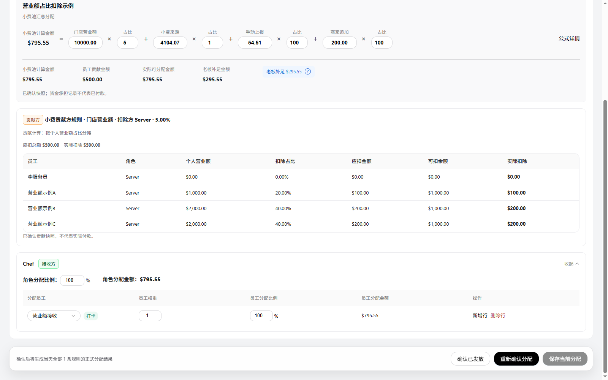

图：营业额项扣除与接收明细，实际页面采集于2026-11-04。

贡献区展示员工、角色、个人营业额、扣除占比（适用时）、应扣金额、可扣余额、实际扣除及少扣原因。确认前使用“预计”，确认后读取快照。只有汇总贡献流水时按员工展示实存字段，未存字段显示“—”；缺失贡献依据时提示“贡献明细暂不可用，请重新计算后查看”，不得补造零金额或按当前规则重算已保存扣除。商家承担方式明确显示“无员工贡献，由商家承担”。

先确定接收组预算，再筛选合格员工，最后计算员工金额。一行多个角色构成共同接收组，同组员工按ID去重；不是每个角色各分一遍预算。

- 组预算=可分配池金额×组占比。接收组占比合计100%。
- 员工有效基数=算法基础值×员工权重；不合格员工基数为0。
- 自动员工比例=有效基数÷组内有效基数总和。
- 员工金额由组预算和未舍入比例分币；组内基数全为0时保留余额，不改为均分。

| 分配方式 | 基础值 | 示例：组预算600，A/B/C权重1/2/1 |
| --- | --- | --- |
| 按员工数量平均分配 | 每位合格员工为1 | A/B/C为150/300/150。 |
| 按工作时长占比分配 | 该规则采用的分配工时 | 工时6/3/3小时，金额240/240/120。 |
| 按订单占比分配 | 有效归属订单笔数 | 订单4/2/2笔，金额240/240/120。 |

员工权重缺省1，0合法，最大1,000,000；不要求合计100%。权重1.1的换算百分比为110%，仅供解释，不是最终分配比例。

### 2.5 接收员工打卡要求与工时

图：当前应用实际页面，隔离演示数据；来源基线64ddec8f，2026-10-27。对应操作与状态见图像清单。

按整日是默认时间范围。默认“需有有效打卡”，另可选“不限打卡状态”。这两个条件只影响接收员工，不改变贡献员工范围。

| 条件 | 对三种算法的影响 |
| --- | --- |
| 需有有效打卡 | 按有效打卡或明确补录的参与依据建立名单；再按对应算法及权重分配。 |
| 不限打卡状态 | 平均方式仍需有效参与名单；工时方式需有效或明确录入的工时；订单方式可使用未打卡员工的有效归属订单。不自动纳入全部在职员工。 |

按工时分配时，可采用有效打卡工时，或按员工逐日应用0.1—24小时、最多一位小数的上限。明细中明确录入的工时优先于自动上限，不修改原打卡。平均和订单分配不使用该工时设置。

### 2.6 精度与一致性

金额按整数美分计算、两位小数展示。自动分摊先向下取整，再按小数余数从大到小补齐尾差，相同余数按稳定顺序处理。100美元三人等权为33.34/33.33/33.33。

普通按日工时明细允许明确修改最终员工比例；按该比例直接计算，不再乘一次权重或工时。合计低于100%留下余额，超过100%拒绝保存；改变工时或权重会重建自动比例。

每池核对：`C+E=D=ΣA+U`；整日核对：`ΣB+ΣE=ΣF+ΣU`。归集路径另校验其资金来源和贡献约束。

### 查询、导出与条件边界

- 员工每日页只允许在来源查询周期内调整日期；越界、空值或倒置时保留输入并标错，继续显示上次有效结果，不启动自动分配。
- 角色筛选约束员工列表；员工候选随角色更新并移除无效选择，全选或全部取消均表示全部员工。
- 分配工时明细由员工汇总行、员工每日页周期摘要及每日行打开；列为规则名称、规则类型、计算说明、分配计入工时、有记录／适用天数。
- CSV直接下载。日期／员工汇总PDF优先生成下载，失败转打印预览；员工每日页使用打印窗口，由用户保存PDF。弹窗拦截提示失败，不修改账本。
- 主动分配遇整个规则目录为空时提示“请先创建小费分配规则”并进入规则列表；看板无规则门店显示未关联规则，不入队、不计为执行失败。
- 来源条件的有效维度、必填与互斥见页面说明§7.15。销售额、小费、服务费至少一个有效条件，手动上报条件可为空；角色和员工互斥，Payment Method口径与菜单互斥。
- 当前贡献资金试算的演示事实支持Net Sales及cash、credit_card支付方式；缺少对应事实的口径或条件报错且不保存快照。手动上报在该资金分支按角色／员工过滤后累加reportedTips，不应用营业时间条件。配置可保存与运行可计算分别校验。

## 3. 状态与操作流程

### 3.1 三类状态

| 状态对象 | 状态 | 判定与效果 |
| --- | --- | --- |
| 营业 | 正常营业／未营业 | 有有效小费或打卡事实可营业；未营业日显示0、无需分配、无需发放。 |
| 分配 | 未分配／已分配／无需分配 | 未分配无有效确认；已分配已有有效日期快照；未营业无需分配。已确认接收为0也可属于已分配。 |
| 员工周期 | 已完成／部分待分配／待分配 | 按当前员工适用日的确认情况汇总，不用发放状态代替。 |
| 发放 | 待发放／已发放／无需发放 | 分配确认后可登记发放；已发放锁定整日快照；未营业无需发放。 |
| 编辑 | 未调整／有未保存调整／已保存 | 当日草稿未保存不进入正式统计；人工保存形成manual快照，系统计算形成system快照。 |

### 3.2 看板自动分配

小费管理→小费分配进入看板，默认本周周一至今天。按当前可访问门店及有效日期范围预检，每个“门店＋日期”为独立任务。

- 有适用规则、营业事实可分配、未确认且未发放的日期入队，同一门店日期只入队一次。规则引用或计算异常由执行阶段记录具体失败原因。
- 按门店列表顺序、门店内日期升序逐日执行；单日失败继续后续任务，成功结果不回滚。
- 已处理任务＝成功＋失败＋跳过；进度分母为本次实际入队任务数，不是日历天数。执行时发现已确认、已发放或无需分配则跳过。
- 检查及执行期间禁用看板全部操作，包括日期、搜索、规则入口、门店入口、任务明细和重试；进度持续更新。结束后恢复操作，结果保留在看板，没有关闭任务操作。
- 全部已分配或无需分配时不创建新队列、不改快照，展示无待处理任务或同范围已完成结果。无规则门店显示未关联规则，不生成任务。
- 全部任务结束且仍有失败时才显示“重新自动分配”，仅重试失败任务。失败事项列出门店、日期及原因，可进入对应日期处理。
- 点击门店进入独立全屏汇总。汇总内日期、视图、筛选、排序及通知重绘仅刷新查询，不启动自动任务；可主动使用行内分配或顶部批量分配。
- 离开看板停止后续任务，提交前及异步准备后检查页面和作用域；已保存快照保留，重新进入只补符合条件的未分配日期。

当日明细进入或切换门店日后，也会对符合条件、尚未确认的单日尝试系统自动确认；同一页面选择不重复尝试。失败后保留手动确认入口，不覆盖已有快照。

### 3.3 分配工时的展示

| 数据条件 | 展示 |
| --- | --- |
| 没有规则记录 | —。 |
| 存在规则但均不使用工时 | 不适用。 |
| 适用工时规则但均没有有效采用值 | 待补录。 |
| 各适用规则的采用值相同且记录完整 | 单一小时数＋说明入口；不跨规则累加。 |
| 采用值不同或存在部分缺失 | 按规则查看，打开规则明细。 |

周期只在同一规则内逐日累计。规则明细可显示“有记录／适用天数”，不足时不把缺失天数补成0；员工权重不改变展示的工时。

### 3.4 保存、系统重分配与发放

| 操作 | 前置条件 | 处理与结果 |
| --- | --- | --- |
| 行内分配 | 正常营业、未分配、未发放，事实和规则可计算 | 按系统规则保存整日快照；需手动工时则转到明细补全。 |
| 明细确认分配 | 当日尚未分配、未锁定，所有规则校验通过 | 保存整日结果；规则筛选不缩小保存范围。 |
| 保存当前分配 | 已有结果且存在人工调整、未发放 | 确认后保存人工调整快照，更新汇总；取消保留草稿。无调整时只提示原因。 |
| 重新确认分配 | 已分配、未发放 | 按系统规则重建当日结果。有人工数据时先说明覆盖；取消保留原结果。 |
| 批量／重新分配小费 | 当前门店与合法日期范围 | 先检查范围与人工结果，再校验、提交；包含人工快照需明确确认覆盖，已发放和未营业跳过。先准备全部日期，计算失败不写任何日期；实际提交失败后停止后续日，已完成日保留。此操作不同于自动队列的失败后继续。 |
| 确认已发放 | 整日快照有效、未发放、无未保存修改 | 保存发放登记，锁定对应快照；失败仍为待发放，不执行实际付款。 |
| 更新小费数据 | 未发放，确认更新上下文 | 重取来源数据、重建默认计算；已有结果进入更新待确认流程，手动调整会被覆盖。取消保留页面。 |

## 4. 页面与业务操作

### 4.1 日期分配汇总

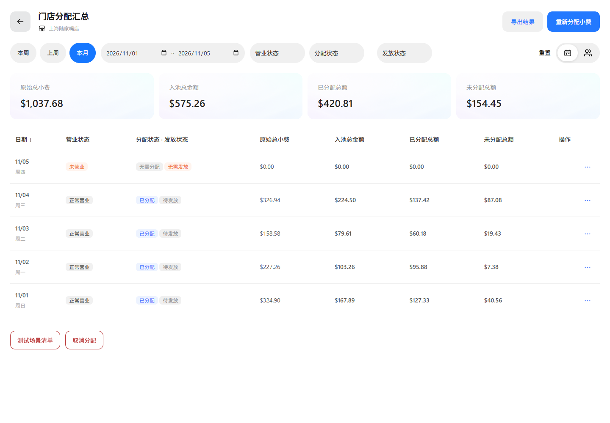

图：当前功能分支实际页面；d49705da＋TIPOUT-QUICK-DATE-BLUE-20261105-01，2026-11-05；快捷日期选中项为蓝底白字。

用途：小费分配看板→点击门店，独立全屏展示当前门店与日期。

| 字段／操作 | 说明 |
| --- | --- |
| 本周 | 浏览器本地日期的周一至今天，包含首尾；同步起止日期并刷新当前视图，仅查询、不启动分配。 |
| 上周 | 上周一至上周日，包含首尾；同步起止日期并刷新当前视图，仅查询、不启动分配。 |
| 本月 | 当月1日至今天，包含首尾；同步起止日期并刷新当前视图，仅查询、不启动分配。 |
| 分配状态 | 全部／已分配／未分配，筛选日期行及对应概览。 |
| 发放状态 | 全部／待发放／已发放／无需发放，不代替分配状态。 |
| 分配状态 | 已分配、未分配或无需分配。 |
| 发放状态 | 待发放、已发放或无需发放。 |
| 查看明细 | 携带门店、日期打开当日明细；返回保留查询上下文。未营业日点击提示原因并留在汇总。 |
| 确认已发放 | 符合发放条件时显示，打开整日登记确认。 |

### 4.2 员工分配汇总

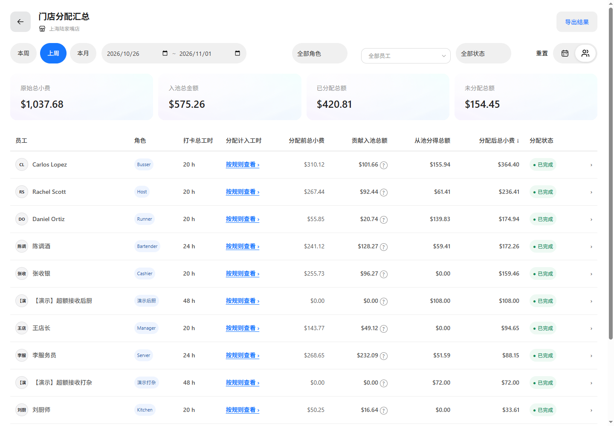

图：当前功能分支实际页面；d49705da＋TIPOUT-QUICK-DATE-BLUE-20261105-01，2026-11-05；快捷日期选中项为蓝底白字。

日期快捷项与日期视图共用；选取范围后刷新员工列表和统计，保留其他筛选及返回上下文。

用途：日期汇总→员工分配汇总。

| 字段／操作 | 说明 |
| --- | --- |
| 分配状态 | 已完成／部分待分配／待分配等周期条件，约束员工列表。 |
| 分配计入工时 | 按每条工时规则逐日累计，不跨不同规则相加；单一口径显示小时，不同口径显示可点击摘要。 |
| 贡献入池总额 | 已确认贡献＋未确认预计贡献；问号以“贡献金额明细”为标题，展示“已分配日期”“待分配日期（预计）”“合计”；提示“待分配金额为试算结果，以实际分配结果为准。” |
| 分配状态 | 按员工适用日的确认情况显示已完成／部分待分配／待分配。 |

### 4.3 员工每日考勤分配

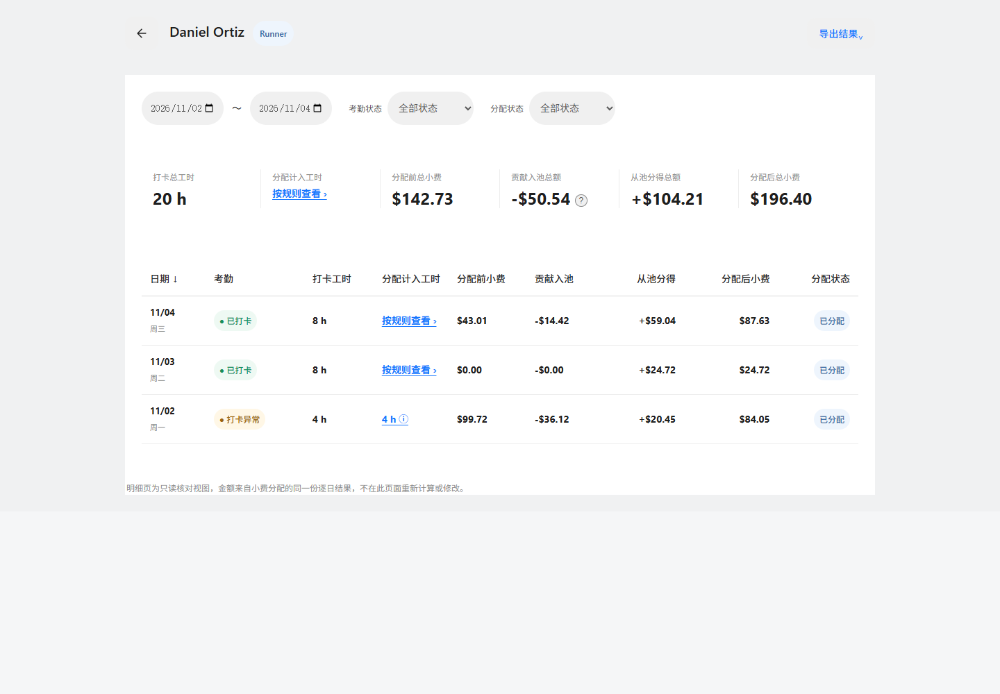

图：当前功能分支实际页面；79e13f27＋TIPOUT-FIGMA-UI-20261104-01，2026-11-04；完整视口，示例金额不作为默认参数。

用途：员工汇总→员工行；只查看该员工。

| 字段／操作 | 说明 |
| --- | --- |
| 分配状态 | 全部／已分配／待分配。 |
| 贡献入池总额 | 确认＋预计贡献，预计不是实扣。 |
| 分配状态 | 已分配／待分配，不由是否打卡决定。 |

### 4.4 当日小费分配明细

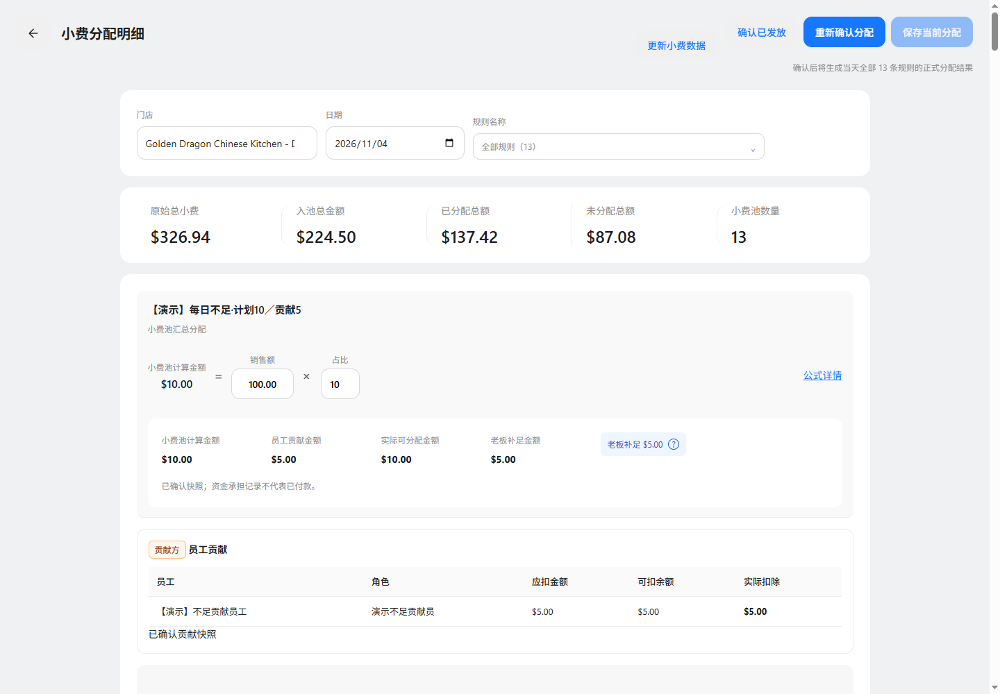

图：当前功能分支实际页面；79e13f27＋TIPOUT-FIGMA-UI-20261104-01，2026-11-04；完整视口，示例金额不作为默认参数。

用途：日期汇总→查看明细；处理门店的一个完整营业日。

| 字段／操作 | 说明 |
| --- | --- |
| 更新小费数据 | 确认后重新读取来源、重建默认计算；已发放不能更新。 |
| 保存当前分配 | 已有结果且发生手调时可用；无手调显示“当前系统分配数据未进行手动调整”，不写入。 |
| 确认已发放 | 整日有效快照、无未保存调整且未发放时可登记；发放后锁定编辑。 |

### 4.5 分配规则列表

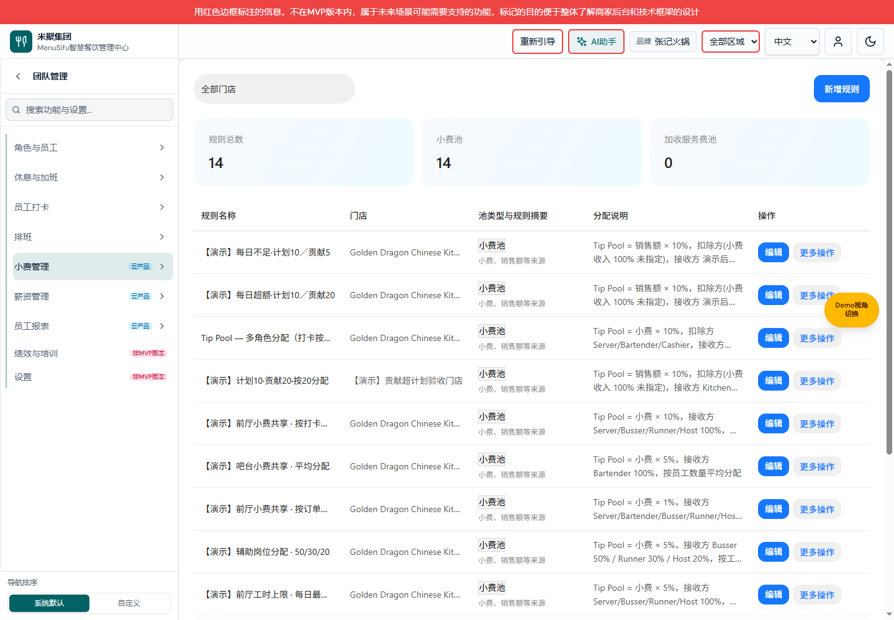

图：当前功能分支实际页面；79e13f27＋TIPOUT-FIGMA-UI-20261104-01，2026-11-04；完整视口，示例金额不作为默认参数。

用途：小费管理→分配规则。

| 字段／操作 | 说明 |
| --- | --- |
| 更多操作／复制 | 克隆配置并生成新规则ID和副本名称；不复制分配或发放结果。 |
| 更多操作／删除 | 打开确认框；确认删除规则配置，取消保留。不会清除已保存的日期快照。 |
| 新增规则 | 直接进入新增页面，在基础信息下方选择小费池类型。 |

### 4.6 新增／编辑分配规则

图：实际营业额项扣除方配置，2026-11-04。

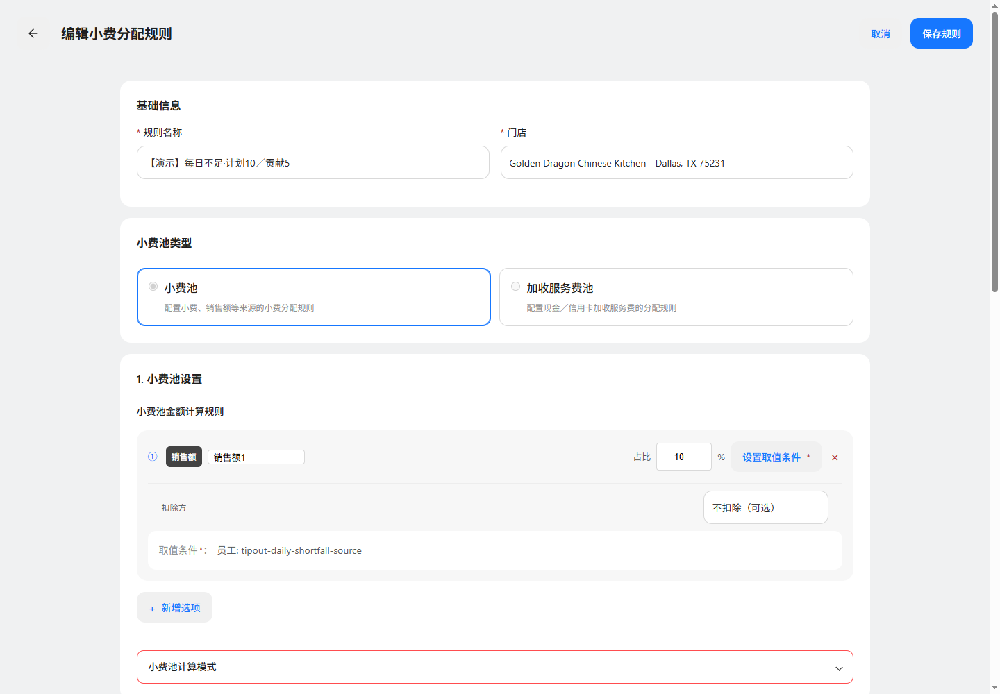

图：当前功能分支实际页面；79e13f27＋TIPOUT-FIGMA-UI-20261104-01，2026-11-04；完整视口，示例金额不作为默认参数。

入口：规则列表新增或编辑；配置规则模板，不直接修改已确认日期结果。

| 区域 | 产品规则 |
| --- | --- |
| 基础信息 | 规则名称、门店必填，顶部保存或取消。 |
| 1. 小费池设置 | 按销售额、小费、手动上报、自定义金额或对应池类型的服务费来源计算计划池金额；各项独立条件和比例，多项相加；营业额项可选扣除方。 |
| 2. 小费分配设置 | 选择人数、工时或订单算法；按整日处理，配置接收员工打卡要求。工时方式额外提供有效工时或每日上限。 |
| 3. 小费接收设置 | 配置共同接收角色组、组占比和员工权重。接收组占比合计100%，员工权重不要求合计100%。 |
| 保存规则 | 全部必填、金额、条件、份额及员工配置合法后保存；失败保留输入，取消不写配置。 |

逐字段、抽屉与弹框定义见[页面说明](小费管理需求文档（个人规范版）.md)第7—8节。

#### 营业额项扣除设置

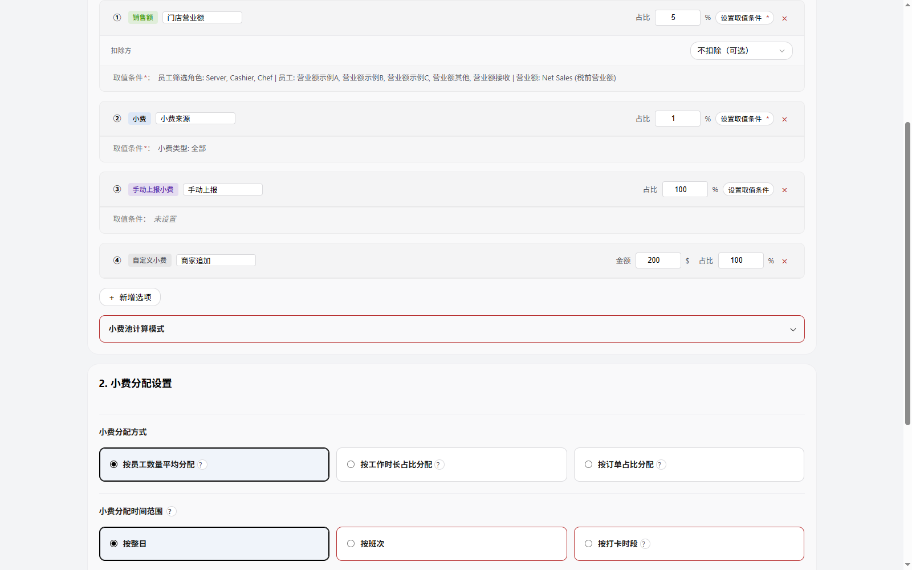

图：小费池设置中的营业额项，扣除方默认空；其他来源不提供扣除方，2026-11-04。

图：营业额项选择单角色，位置在取值条件行上方，2026-11-04。

| 字段 | 逻辑说明 |
| --- | --- |
| 扣除方 | 可选单角色，默认“不扣除”。只在营业额项展示；为空时本项不从员工扣款。 |
| 改选／清空扣除方 | 按新角色员工的个人营业额重新计算；清空时不再产生本项员工扣除。 |
| 删除营业额项 | 同时移除本项扣除方草稿，不影响其他项和已确认快照。 |
| 切换门店 | 扣除方需按新门店重选，不跨门店复用。 |

#### 独立贡献设置

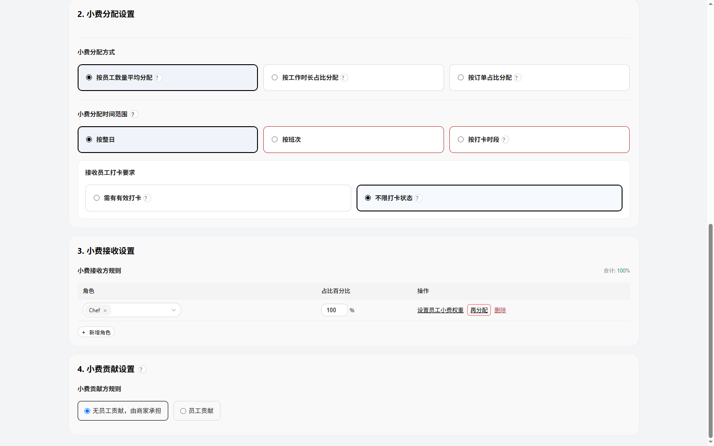

图：普通小费规则的独立贡献设置区块，完整页面背景；功能分支实际页面，2026-11-04。

用途：配置贡献方式及独立贡献规则；无需先添加营业额来源项。贡献员工不由接收员工打卡要求决定。

| 字段 | 逻辑说明 |
| --- | --- |
| 无员工贡献，由商家承担 | 默认选中。不写入独立贡献配置；切换时清空营业额项扣除角色，防止隐藏的扣款仍生效。 |
| 员工贡献 | 展示新增选项与独立贡献规则；保存至少有一条有效独立规则或已配置扣除方的营业额项。 |
| 新增选项 | 可添加按照销售额占比、按照小费收入占比规则。两项可独立配置，多条规则逐条保存。 |
| 贡献占比 | 必填，大于0且不超过100%，最多两位小数；持久化时除以100。 |
| 设置取值条件 | 打开对应来源的取值条件抽屉；角色或员工必须选择一个，二者互斥。条件按贡献项独立保存，不改小费池来源条件。 |
| 删除贡献项 | 删除当前项草稿；不改其他项，不修改已确认分配结果。 |
| 保存规则 | 校验比例、人员范围和规则完整性，保存贡献方式、独立规则与条件；重开回填。无效输入留在编辑页。 |
| 配置冲突 | 独立贡献规则与营业额项扣除方不能同时启用；提示先清空其中一类配置，不覆盖、不重复扣款。 |

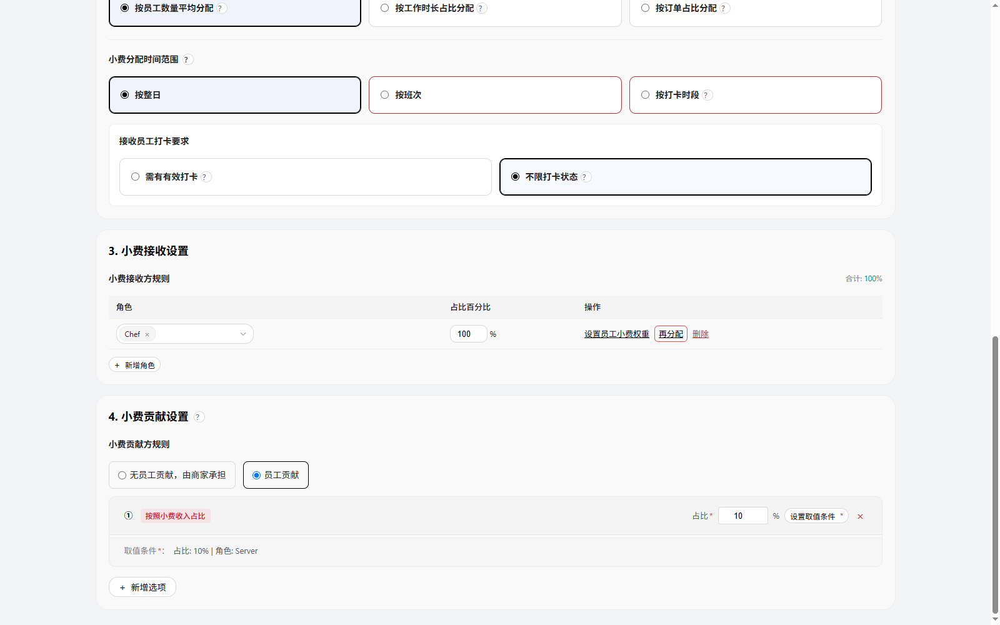

图：小费收入贡献规则，包含贡献比例与角色条件，不提供员工权重设置，2026-11-04。

#### 小费池类型

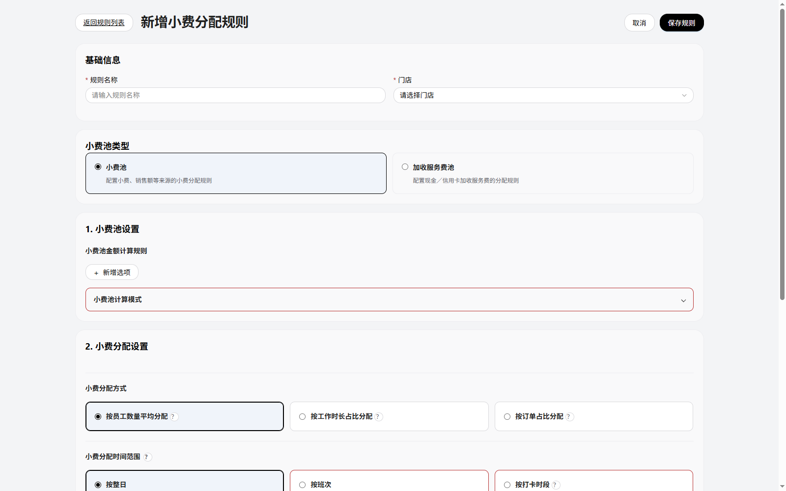

图：新增规则默认状态，基础信息下方独立展示小费池类型；完整页面，功能分支实际采集于2026-11-04。

入口：规则列表点击新增规则直接进入新增页面，不经过类型选择弹框。

| 字段 | 逻辑说明 |
| --- | --- |
| 小费池类型 | 单选，必有一个值；普通新增默认小费池。携带poolKind=surcharge的新增地址预选加收服务费池；其他值按小费池初始化。 |
| 小费池 | 提供销售额、小费、手动上报及自定义小费来源，展示小费贡献设置；保存poolKind=tip。 |
| 加收服务费池 | 提供加收服务费与自定义加收来源，隐藏小费贡献设置；保存poolKind=surcharge。 |
| 切换类型 | 没有类型专属配置时直接切换。已有金额来源、贡献项或专项草稿时先确认；取消保留全部草稿，确认清空来源及贡献配置。名称、门店、接收角色、占比和普通分配方式保留。 |
| 编辑规则的类型 | 按已保存poolKind回填，选项只读；编辑地址中的类型参数不能改变已保存类型。 |

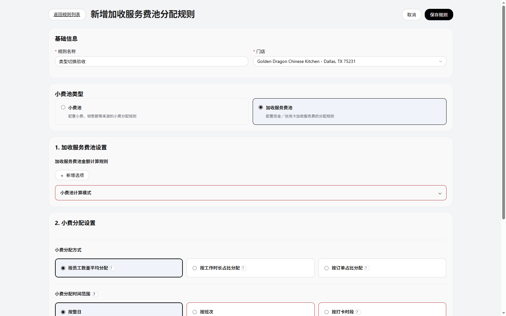

图：新增页选择加收服务费池，标题、金额来源及贡献区域同步，2026-11-04。

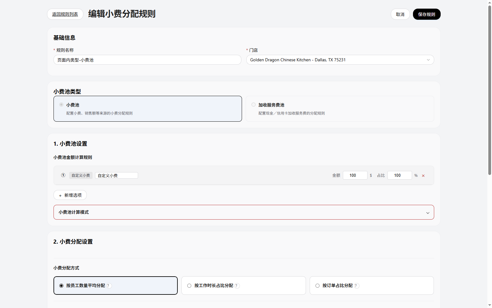

图：已保存规则的类型只读展示，2026-11-04。

### 4.7 小费分配看板与门店汇总

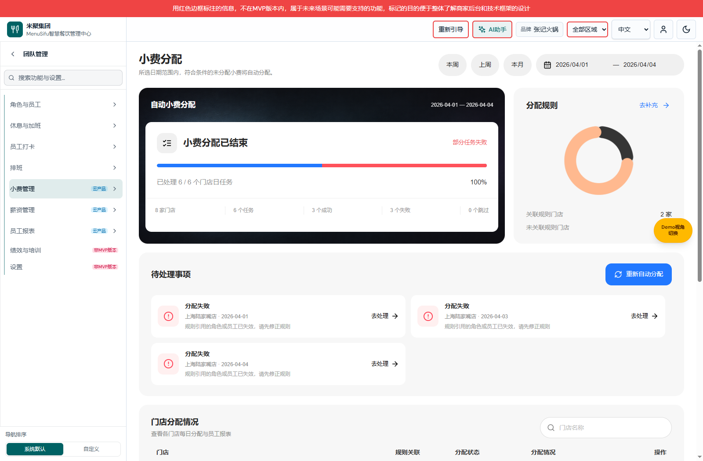

图：功能分支真实页面，2026-11-04，基线b5da1188；页面样例不作为默认业务参数。

看板运行期间全部操作禁用；完成后保留结果，失败事项支持重试失败日期或进入门店处理。

图：当前功能分支实际页面；d49705da＋TIPOUT-QUICK-DATE-BLUE-20261105-01，2026-11-05；快捷日期选中项为蓝底白字。

顶部左侧返回看板，右侧导出及主动分配。查询栏为日期、状态、重置和日期／员工视图；日期行操作通过更多菜单展开。逐字段说明见页面说明§1—§3。

## 5. 可复算与验收场景

| 场景 | 输入／操作 | 预期 |
| --- | --- | --- |
| 贡献不足 | P=100，A应扣40但只能扣20，B应扣60且可扣60 | C=80，E=20，D=100；不转嫁A的差额。 |
| 贡献超计划 | P=10，C=20；接收两组60%／40%且各有合格员工 | D=20、E=0；组预算12／8；显示贡献超计划对照。 |
| 无贡献 | P=100，C=0，独立贡献路径 | D=100、E=100，不阻止合法分配。 |
| 加权三算法 | 组预算600；权重1/2/1；工时6/3/3；订单4/2/2 | 平均150/300/150；工时与订单240/240/120。 |
| 多角色共同组 | Server A/B与Busser C同一组120，同权 | 各40；不是先按角色一半分。 |
| 零基数 | 本组无人合格、全零权重、全零工时或订单 | 本组预算保留未分配，不自动转组或回退平均。 |
| 上限与手动覆盖 | 有效8h、规则上限5h；当日明确改8h | 默认5h，手动后8h，打卡仍为原事实。 |
| 混合周期贡献 | 已确认贡献30，待分配预计12 | 贡献总额42，问号展示“已分配日期：30”“待分配日期（预计）：12”“合计：42”，并提示“待分配金额为试算结果，以实际分配结果为准。”；接收和最终金额仍只统计确认部分。 |
| 全部无需自动处理 | 选中10天，其中8已分配、2无需分配 | 看板展示无需自动分配，不写快照。 |
| 仅一天待分配 | 同范围只剩1天合格未分配 | 队列1项，处理1/1，其他日期不改。 |
| 执行失败与重试 | 2任务中1临时失败、1成功 | 全部结束显示重试；只重试失败日。成功后失败0、重试按钮隐藏。 |
| 已发放保护 | 分配已登记发放后尝试编辑／更新／重分配 | 拦截，保留快照与发放状态。 |
| 保存冲突 | 弹框打开后其他页面更新同日快照 | 原提交不覆盖新结果，提示重新读取。 |
| 失败后同步 | 快照提交成功，Payroll同步异常 | 分配仍成功；提示同步失败，不重复扣款。 |
| 错误日期 | 缺值、非法日历日或开始晚于结束 | 保留上次有效列表和错误输入，不保存错误查询、不启动分配。 |

## 6. 支持范围与异常处理

| 条件 | 当前处理 |
| --- | --- |
| 门店、规则、员工或角色引用无效 | 阻止相关保存／确认，保留输入并提示修正。 |
| 公式金额、比例、工时、权重非有限数或为负 | 拒绝提交；合法0与缺失值分开显示。 |
| 接收组份额不是100%／人工员工比例超过100% | 阻止确认，不自行缩放。 |
| 员工权重为负、非有限值或有效合计为0 | 禁止保存权重；至少一名当前范围员工的权重须大于0。 |
| 依赖订单类型、支付、区域或商品信息但事实缺失 | 不猜测归属，不伪造0，提示不能计算。 |
| 手动上报小费缺少所选筛选维度归属 | 不能按该条件计算贡献，需有效来源。 |
| 快照损坏或发放依据不一致 | 保护性失败／只读，不把损坏当未分配覆盖。 |
| Web Locks或安全哈希能力不可用 | 阻止需要安全提交的操作，不绕过并发保护。 |
| 存储失败 | 当前日期回滚；说明已经完成和未执行日期，不报全部成功。 |
| Payroll同步失败 | 分配保存状态与同步状态分别说明，通过员工数据更新流程补同步。 |
| 无可导出数据、邮箱为空或格式错误 | 不执行导出／发送反馈，提示原因。 |

## 7. 页面字段入口

| 字段／操作 | 说明 |
| --- | --- |
| 日期分配汇总 | 见[页面说明](小费管理需求文档（个人规范版）.md)第2节。 |
| 员工分配汇总 | 见[页面说明](小费管理需求文档（个人规范版）.md)第3节。 |
| 员工每日考勤分配 | 见[页面说明](小费管理需求文档（个人规范版）.md)第4节。 |
| 当日小费分配明细 | 见[页面说明](小费管理需求文档（个人规范版）.md)第5节。 |
| 分配规则列表 | 见[页面说明](小费管理需求文档（个人规范版）.md)第6节。 |
| 新增／编辑分配规则 | 见[页面说明](小费管理需求文档（个人规范版）.md)第7节。 |

截图与验证范围：[逐操作覆盖清单](小费管理逐操作覆盖清单.md)／[当前图像清单](assets/tips-current-scope-20261027/manifest.json)。正文不使用其他状态的图替代未重现结果。
