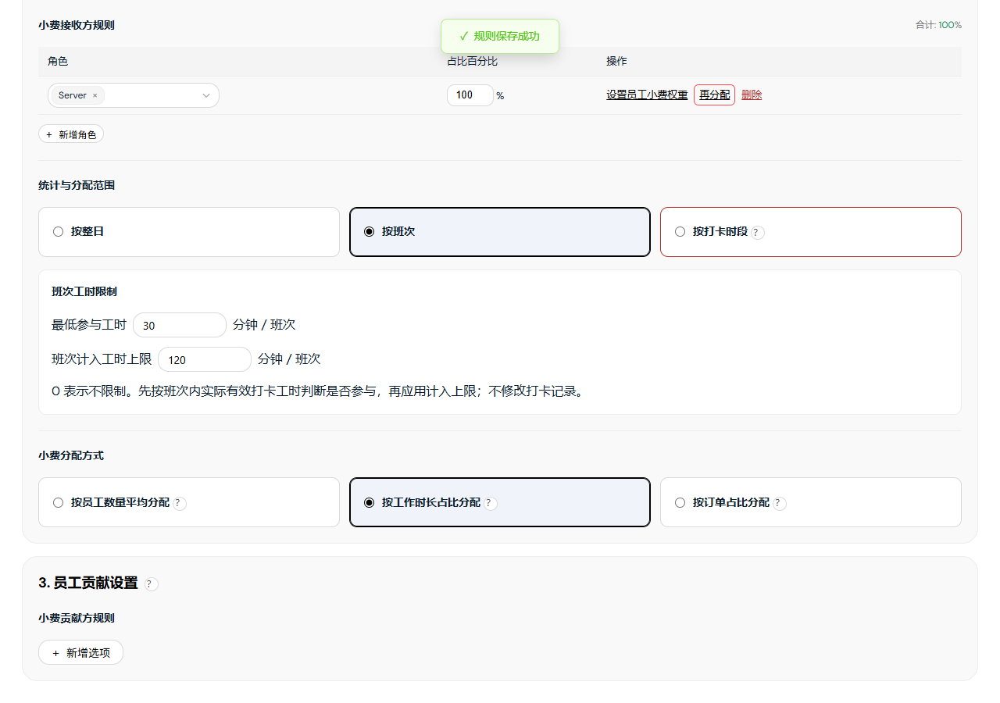
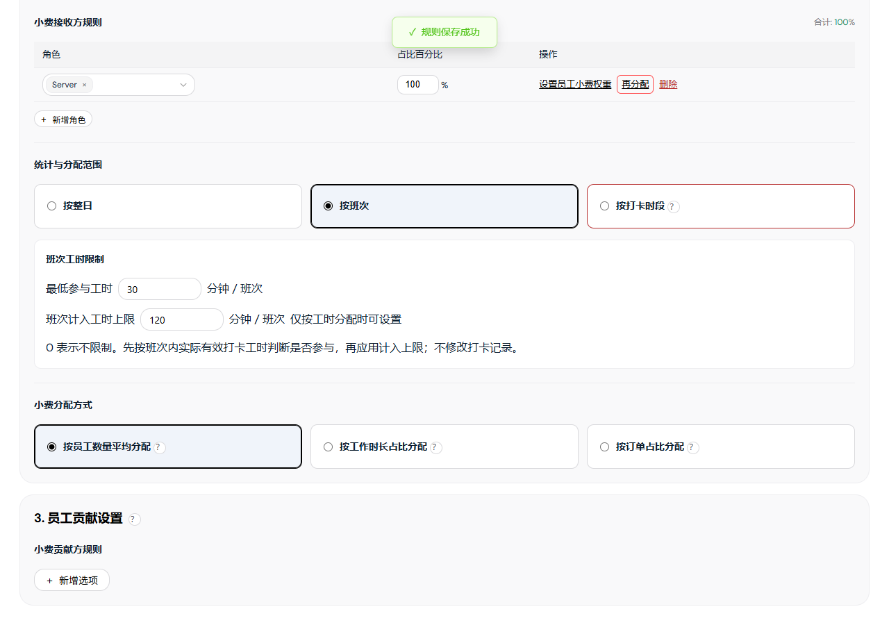

# 小费管理产品需求说明

版本：**V4.33**　日期：2026-10-26　文档编号：TIPOUT-SHIFT-HOURS-20261026-01

实现基线：`8cd69352`＋本次班次工时限制修改。本文说明项目可执行的现行功能。

配套文档：[研发规格 V3.33](小费分配业务规格说明书（研发交付版）.md)／[页面说明 V2.31](小费管理需求文档（个人规范版）.md)。

## 1. 范围与使用入口

小费管理包含小费分配、分配规则两个子菜单。分配页面提供日期汇总、员工汇总、员工每日明细和当日分配明细；规则页面提供列表、新增和编辑。

本项目使用前端演示事实和浏览器本地存储。确认分配保存计算快照；确认已发放登记状态，不执行转账。CSV、PDF可下载；邮箱入口提供模拟发送反馈，不实际投递。金额以美元展示，保留两位小数。

| 页面 | 路由／入口 | 作用 |
| --- | --- | --- |
| 日期分配汇总 | `/team/tips/distribution` | 按门店和日期管理分配任务、金额与发放状态。 |
| 员工分配汇总 | 上述页面的员工页签；`?view=employee` | 按角色、员工查看周期结果及预计贡献。 |
| 员工每日明细 | 员工汇总行 | 查看指定员工逐日考勤、工时和金额。 |
| 当日分配明细 | 日期行的查看明细 | 查看全部规则，调整草稿，保存或系统重分配。 |
| 分配规则列表 | `/team/tips/rules` | 查看、新增、编辑、复制、删除规则。 |
| 新增／编辑规则 | `/team/tips/rules/editor`及对应规则上下文 | 配置来源、接收、资格、工时和贡献。 |

## 2. 金额、人员与计算规则

### 2.1 金额口径

| 符号／名称 | 定义 |
| --- | --- |
| B：分配前小费 | 员工原始订单小费与手动上报小费之和；本轮接收不计入原始余额。 |
| P：计划池金额 | 各金额计算项按条件取值后，分别乘本项比例，再求和。 |
| C：实际贡献 | 贡献员工经过余额限制后的实扣总和；未确认时称预计贡献。 |
| E：老板补足 | 独立贡献资金路径中，`max(P−C,0)`；为资金解释项，不是员工扣款或付款凭证。 |
| D：可分配池金额 | 独立贡献资金路径中，`max(P,C)=C+E`。 |
| A：从池分得 | 员工本轮接收金额；汇总正式结果只统计已确认快照。 |
| U：池内未分配 | `D−ΣA`。接收人不合格、基数为0、人工比例未用满均可留下余额。 |
| F：分配后小费 | `B−员工贡献+A`。同一员工可以既贡献又接收。 |

独立贡献资金路径包括普通汇总池的个人销售额／小费收入贡献，以及明确配置员工承担比例的角色贡献。显式资金配置和未配置员工承担的销售额贡献按各自计算路径处理；不能直接套用独立贡献的补足公式。接收超过可用池、资金归集不满足校验时禁止确认。

### 2.2 贡献与池预算

| 条件 | 独立贡献资金路径的处理 | 示例 |
| --- | --- | --- |
| C=0 | 按P分配，E=P。 | P=100、C=0，D=100、E=100。 |
| 0<C
P | 按C分配；不把贡献截断到P。 | P=10、C=20，D=20、E=0。 |

每条规则独立比较P和C。明细在C>P或C<P时显示对应金额对照及说明；C=P不显示差额提示。

### 2.3 员工承担与余额

1. 先按贡献项的取值范围和比例计算应贡献金额。
2. 角色贡献可按当天有效员工人数平均分担，或按自定义员工比例分担。多角色的全部员工共同合计100%。
3. 员工实扣=`min(应扣,当前可扣余额)`；差额不转给其他员工。
4. 贡献项、规则依保存的规则数组顺序消耗余额；本轮接收不回流为后续贡献余额。

例：本项应贡献100，A承担40%、B承担60%。A只能扣20、B可扣60，则实扣20和60，C=80；A少扣20，不加扣B。若P=100，则D=100、E=20。

平均分担使用人数精确分币，不按页面近似百分比反算。自定义每人0—100%、最多两位小数，合计必须100%；名单或角色变化后需重新核对配置。

贡献基数按本项类型取值：销售额项使用选中范围的销售额；个人销售额项使用命中员工的个人销售额；小费收入项使用选中小费类型的可归属小费。配置员工承担后，先将本项基数汇总再乘比例，最后按员工比例分担；未配置承担的个人贡献按员工各自基数求应扣，不能混用两种计算顺序。

### 2.4 接收组、算法与权重

先确定接收组预算，再筛选合格员工，最后计算员工金额。一行多个角色构成共同接收组，同组员工按ID去重；不是每个角色各分一遍预算。

- 组预算=可分配池金额×组占比。同层接收组占比合计100%；子组占比相对父组预算。
- 员工有效基数=算法基础值×员工权重；不合格员工基数为0。
- 自动员工比例=有效基数÷组内有效基数总和。
- 员工金额由组预算和未舍入比例分币；组内基数全为0时保留余额，不改为均分。

| 分配方式 | 基础值 | 示例：组预算600，A/B/C权重1/2/1 |
| --- | --- | --- |
| 按员工数量平均分配 | 每位合格员工为1 | A/B/C为150/300/150。 |
| 按工作时长占比分配 | 该规则采用的分配工时 | 工时6/3/3小时，金额240/240/120。 |
| 按订单占比分配 | 有效归属订单笔数 | 订单4/2/2笔，金额240/240/120。 |

员工权重缺省1，0合法，最大1,000,000；不要求合计100%。权重1.1的换算百分比为110%，仅供解释，不是最终分配比例。

### 2.5 接收员工打卡要求与工时

两个选项复用统计与分配范围的卡片样式，选中、悬停、焦点效果一致。宽屏两列等宽等高，宽度不超过900px时纵向排列。点击卡片主体切换选值；各自问号只展开说明，不改变选值或自动保存。

图：规则编辑页，390px窄屏打卡要求；8cd69352基线功能分支，2026-10-26，实际模板与运行时的受控演示。

“接收员工打卡要求”仅按整日时展示，默认“需有有效打卡”，另可选“不限打卡状态”；按班次、按打卡时段由范围固定参与条件，不再单独设置。

| 资格 | 现行处理 |
| --- | --- |
| 需有有效打卡 | 默认选择。按有效打卡／明确补录参与依据判断名单，三种分配方式均可使用。 |
| 不限打卡状态 | 平均方式需要有效参与名单；工时方式需要有效或手动工时；订单方式可使用未打卡员工的有效归属订单。不是把全部在职员工自动加入。 |

工时方式显示分配工时设置。按有效打卡工时计算，或逐日应用0.1—24小时、最多一位小数的上限。普通按日规则的明确手动工时优先于自动上限；原打卡工时不改。平均和订单方式不使用工时设置；打卡时段模式采用实际在岗区间，不提供每日封顶，也不能用手输全天小时替代区间。

打卡时段模式仅允许普通小费池及支持的事件来源／条件。缺事件时间、在岗区间或不支持的贡献组合会阻止保存或确认，不回退到全天分配。来源筛选时段与接收在岗时段是两个独立条件。

### 2.6 精度与一致性

金额按整数美分计算、两位小数展示。自动分摊先向下取整，再按小数余数从大到小补齐尾差，相同余数按稳定顺序处理。100美元三人等权为33.34/33.33/33.33。

普通按日工时明细允许明确修改最终员工比例；按该比例直接计算，不再乘一次权重或工时。合计低于100%留下余额，超过100%拒绝保存；改变工时或权重会重建自动比例。

每池核对：`C+E=D=ΣA+U`；整日核对：`ΣB+ΣE=ΣF+ΣU`。归集路径另校验其资金来源和贡献约束。

## 3. 状态与操作流程

### 3.1 三类状态

| 状态对象 | 状态 | 判定与效果 |
| --- | --- | --- |
| 营业 | 正常营业／未营业 | 有有效小费或打卡事实可营业；未营业日显示0、无需分配、无需发放。演示数据按日期生成，周四设置为无营业事实。 |
| 分配 | 未分配／已分配／无需分配 | 未分配无有效确认；已分配已有有效日期快照；未营业无需分配。已确认接收为0也可属于已分配。 |
| 员工周期 | 已完成／部分待分配／待分配 | 按当前员工适用日的确认情况汇总，不用发放状态代替。 |
| 发放 | 待发放／已发放／无需发放 | 分配确认后可登记发放；已发放锁定整日快照；未营业无需发放。 |
| 编辑 | 未调整／有未保存调整／已保存 | 当日草稿未保存不进入正式统计；人工保存形成manual快照，系统计算形成system快照。 |

### 3.2 自动分配

进入分配页面默认本周周一至今天；从明细返回恢复合法查询上下文。切换有效日期后只读预检，手动起止日期在离开日期输入区后启动。

- 全部已分配、已发放或无需分配：不建任务、不弹结果框、不改快照。
- 只有合格未分配日期进入队列：营业事实可分配、有规则、无需先补录手动工时、未确认且未发放。
- 日期从旧到新逐日执行；单日失败继续下一日，成功日不回滚。
- 已处理天数=成功+失败+跳过，分母为本次入队日期数。跳过主要处理执行中出现的并发状态变化。
- 执行中冻结页面操作，关闭禁用；全部结束保留结果。重试按钮只在结束且仍有失败时显示，重试仅处理失败日期。
- 关闭结果层恢复列表，可通过行内分配或当日明细处理剩余日期。
- 离开页面停止后续任务；提交前及异步准备后检查页面存活，已提交结果保留。

切换页签、门店、角色、员工、状态、排序及后台通知重绘不单独启动自动分配；它们也不改变启动时捕获的任务范围。

当日明细进入或切换门店日后，也会对符合条件、尚未确认的单日尝试系统自动确认；同一页面选择不重复尝试。失败提示后保留手动确认入口，不覆盖已有快照。

### 3.3 分配工时的展示

| 数据条件 | 展示 |
| --- | --- |
| 没有规则记录 | —。 |
| 存在规则但均不使用工时 | 不适用。 |
| 适用工时规则但均没有有效采用值 | 待补录。 |
| 各适用规则的采用值相同且记录完整 | 单一小时数＋说明入口；不跨规则累加。 |
| 采用值不同或存在部分缺失 | 按规则查看，打开规则明细。 |

周期只在同一规则内逐日累计。规则明细可显示“有记录／适用天数”，不足时不把缺失天数补成0；员工权重不改变展示的工时。

### 3.4 保存、系统重分配与发放

| 操作 | 前置条件 | 处理与结果 |
| --- | --- | --- |
| 行内分配 | 正常营业、未分配、未发放，事实和规则可计算 | 按系统规则保存整日快照；需手动工时则转到明细补全。 |
| 明细确认分配 | 当日尚未分配、未锁定，所有规则校验通过 | 保存整日结果；规则筛选不缩小保存范围。 |
| 保存当前分配 | 已有结果且存在人工调整、未发放 | 确认后保存人工调整快照，更新汇总；取消保留草稿。无调整时只提示原因。 |
| 重新确认分配 | 已分配、未发放 | 按系统规则重建当日结果。有人工数据时先说明覆盖；取消保留原结果。 |
| 批量／重新分配小费 | 当前门店与合法日期范围 | 先检查范围与人工结果，再校验、提交；包含人工快照需明确确认覆盖，已发放和未营业跳过。先准备全部日期，计算失败不写任何日期；实际提交失败后停止后续日，已完成日保留。此操作不同于自动队列的失败后继续。 |
| 确认已发放 | 整日快照有效、未发放、无未保存修改 | 保存发放登记，锁定对应快照；失败仍为待发放，不执行实际付款。 |
| 更新小费数据 | 未发放，确认更新上下文 | 重取来源数据、重建默认计算；已有结果进入更新待确认流程，手动调整会被覆盖。取消保留页面。 |

## 4. 页面与业务操作

### 4.1 日期分配汇总

图：日期分配汇总。项目页面，演示数据；来源见[图像清单](assets/tips-current-spec-20261026/manifest.json)。

用途：小费管理→小费分配；作用于当前门店与日期范围。

| 字段／操作 | 说明 |
| --- | --- |
| 分配状态 | 全部／已分配／未分配，筛选日期行及对应概览。 |
| 发放状态 | 全部／待发放／已发放／无需发放，不代替分配状态。 |
| 分配状态 | 已分配、未分配或无需分配。 |
| 发放状态 | 待发放、已发放或无需发放。 |
| 查看明细 | 携带门店、日期打开当日明细；返回保留查询上下文。未营业日点击提示原因并留在汇总。 |
| 确认已发放 | 符合发放条件时显示，打开整日登记确认。 |

### 4.2 员工分配汇总

图：员工分配汇总。项目页面，演示数据；来源见[图像清单](assets/tips-current-spec-20261026/manifest.json)。

用途：日期汇总→员工分配汇总。

| 字段／操作 | 说明 |
| --- | --- |
| 分配状态 | 已完成／部分待分配／待分配等周期条件，约束列表和角色汇总。 |
| 分配计入工时 | 按每条工时规则逐日累计，不跨不同规则相加；单一口径显示小时，不同口径显示可点击摘要。 |
| 贡献入池总额 | 已确认贡献＋未确认预计贡献；问号以“贡献金额明细”为标题，展示“已分配日期”“待分配日期（预计）”“合计”；提示“待分配金额为试算结果，以实际分配结果为准。” |
| 分配状态 | 按员工适用日的确认情况显示已完成／部分待分配／待分配。 |

### 4.3 员工每日考勤分配

图：员工每日考勤分配。项目页面，演示数据；来源见[图像清单](assets/tips-current-spec-20261026/manifest.json)。

用途：员工汇总→员工行；只查看该员工。

| 字段／操作 | 说明 |
| --- | --- |
| 分配状态 | 全部／已分配／待分配。 |
| 贡献入池总额 | 确认＋预计贡献，预计不是实扣。 |
| 分配状态 | 已分配／待分配，不由是否打卡决定。 |

### 4.4 当日小费分配明细

图：当日小费分配明细。项目页面，演示数据；来源见[图像清单](assets/tips-current-spec-20261026/manifest.json)。

用途：日期汇总→查看明细；处理门店的一个完整营业日。

| 字段／操作 | 说明 |
| --- | --- |
| 更新小费数据 | 确认后重新读取来源、重建默认计算；已发放不能更新。 |
| 保存当前分配 | 已有结果且发生手调时可用；无手调显示“当前系统分配数据未进行手动调整”，不写入。 |
| 确认已发放 | 整日有效快照、无未保存调整且未发放时可登记；发放后锁定编辑。 |

### 4.5 分配规则列表

图：分配规则列表。项目页面，演示数据；来源见[图像清单](assets/tips-current-spec-20261026/manifest.json)。

用途：小费管理→分配规则。

| 字段／操作 | 说明 |
| --- | --- |
| 更多操作／复制 | 克隆配置并生成新规则ID和副本名称；不复制分配或发放结果。 |
| 更多操作／删除 | 打开确认框；确认删除规则配置，取消保留。不会清除已保存的日期快照。 |
| 新增规则 | 先选择小费池或加收服务费池，再进入编辑页。 |

### 4.6 新增／编辑分配规则

图：新增／编辑分配规则。916bcdcf基线功能分支，2026-10-26，受控演示；来源见[图像清单](assets/tips-current-spec-20261026/manifest.json)。

页面按三个独立分组配置：**小费池设置 → 接收与分配设置 → 员工贡献设置**。小费池设置包含金额计算及默认折叠的高级模式；接收与分配设置依次为接收角色、统计与分配范围及其打卡要求、分配方式及其工时设置；员工贡献设置独立配置贡献规则与员工承担比例。组内使用小标题和分隔线，不把每个条件拆成独立大卡片。

用途：规则列表→新增或编辑。分配规则与贡献规则分开配置。

| 字段／操作 | 说明 |
| --- | --- |
| 保存规则 | 校验所有必填、条件、接收份额、权重、员工承担及工时，成功持久化配置并返回列表；失败保留输入。 |
| 修改员工承担比例 | 只有本项已经应用角色才显示整行；无门店点击提示“请先选择门店”。 |

### 4.7 自动任务结果

图：自动任务有失败时显示重试。项目页面，演示数据；来源见[图像清单](assets/tips-current-spec-20261026/manifest.json)。

逐日展示日期、结果和原因；完成后允许关闭，有失败才显示重试。没有合格任务不打开该界面。

### 4.8 人工保存与系统覆盖

图：保存人工分配确认。项目页面，演示数据；来源见[图像清单](assets/tips-current-spec-20261026/manifest.json)。

保存当前分配采用人工草稿；重新确认分配采用系统规则。有人工数据时先确认覆盖，取消保留原结果与草稿。

### 4.9 发放登记

图：确认已发放。项目页面，演示数据；来源见[图像清单](assets/tips-current-spec-20261026/manifest.json)。

登记后锁定整日快照，不执行支付；已发放结果不允许编辑、更新来源或重新分配。

## 5. 可复算与验收场景

| 场景 | 输入／操作 | 预期 |
| --- | --- | --- |
| 贡献不足 | P=100，A应扣40但只能扣20，B应扣60且可扣60 | C=80，E=20，D=100；不转嫁A的差额。 |
| 贡献超计划 | P=10，C=20；接收两组60%／40%且各有合格员工 | D=20、E=0；组预算12／8；显示贡献超计划对照。 |
| 无贡献 | P=100，C=0，独立贡献路径 | D=100、E=100，不阻止合法分配。 |
| 加权三算法 | 组预算600；权重1/2/1；工时6/3/3；订单4/2/2 | 平均150/300/150；工时与订单240/240/120。 |
| 多角色共同组 | Server A/B与Busser C同一组120，同权 | 各40；不是先按角色一半分。 |
| 子组预算 | 池100，父组60%，子组70% | 子预算42。 |
| 零基数 | 本组无人合格、全零权重、全零工时或订单 | 本组预算保留未分配，不自动转组或回退平均。 |
| 上限与手动覆盖 | 有效8h、规则上限5h；当日明确改8h | 默认5h，手动后8h，打卡仍为原事实。 |
| 时点资格 | A在岗18—19，权重2；B在岗18—22，权重1；18:30小费90、19:30小费60，平均方式 | 第一笔60/30，第二笔0/60，合计A60、B90。 |
| 混合周期贡献 | 已确认贡献30，待分配预计12 | 贡献总额42，问号展示“已分配日期：30”“待分配日期（预计）：12”“合计：42”，并提示“待分配金额为试算结果，以实际分配结果为准。”；接收和最终金额仍只统计确认部分。 |
| 全部无需自动处理 | 选中10天，其中8已分配、2无需分配 | 无任务、无结果弹框、不写快照。 |
| 仅一天待分配 | 同范围只剩1天合格未分配 | 队列1项，处理1/1，其他日期不改。 |
| 执行失败与重试 | 2任务中1临时失败、1成功 | 全部结束显示重试；只重试失败日。成功后失败0、重试按钮隐藏。 |
| 已发放保护 | 分配已登记发放后尝试编辑／更新／重分配 | 拦截，保留快照与发放状态。 |
| 保存冲突 | 弹框打开后其他页面更新同日快照 | 原提交不覆盖新结果，提示重新读取。 |
| 失败后同步 | 快照提交成功，Payroll同步异常 | 分配仍成功；提示同步失败，不重复扣款。 |
| 错误日期 | 缺值、非法日历日或开始晚于结束 | 保留上次有效列表和错误输入，不保存错误查询、不启动分配。 |

## 6. 支持范围与异常处理

| 条件 | 当前处理 |
| --- | --- |
| 门店、规则、员工或角色引用无效 | 阻止相关保存／确认，保留输入并提示修正。 |
| 公式金额、比例、工时、权重非有限数或为负 | 拒绝提交；合法0与缺失值分开显示。 |
| 接收组份额不是100%／人工员工比例超过100% | 阻止确认，不自行缩放。 |
| 自定义员工承担名单变化／合计不是100% | 要求重新核对承担配置。 |
| 打卡时段模式与服务费池或不支持来源条件组合 | 阻止规则保存或计算，不回退按日。 |
| 员工承担配置与资金配置、时段组合 | 当前不支持，计算校验报错。 |
| 依赖订单类型、支付、区域或商品信息但事实缺失 | 不猜测归属，不伪造0，提示不能计算。 |
| 手动上报小费缺少所选筛选维度归属 | 不能按该条件计算贡献，需有效来源。 |
| 快照损坏或发放依据不一致 | 保护性失败／只读，不把损坏当未分配覆盖。 |
| Web Locks或安全哈希能力不可用 | 阻止需要安全提交的操作，不绕过并发保护。 |
| 存储失败 | 当前日期回滚；说明已经完成和未执行日期，不报全部成功。 |
| Payroll同步失败 | 分配保存状态与同步状态分别说明，通过员工数据更新流程补同步。 |
| 无可导出数据、邮箱为空或格式错误 | 不执行导出／发送反馈，提示原因。 |

## 7. 页面字段入口

| 字段／操作 | 说明 |
| --- | --- |
| 日期分配汇总 | 见[页面说明](小费管理需求文档（个人规范版）.md)第1节。 |
| 员工分配汇总 | 见[页面说明](小费管理需求文档（个人规范版）.md)第2节。 |
| 员工每日考勤分配 | 见[页面说明](小费管理需求文档（个人规范版）.md)第3节。 |
| 当日小费分配明细 | 见[页面说明](小费管理需求文档（个人规范版）.md)第4节。 |
| 分配规则列表 | 见[页面说明](小费管理需求文档（个人规范版）.md)第5节。 |
| 新增／编辑分配规则 | 见[页面说明](小费管理需求文档（个人规范版）.md)第6节。 |

### 统计与分配范围

范围选项与小费分配方式共用三列等宽卡片样式；选中时显示强调边框、浅色背景与内描边，文字为黑色。点击卡片空白区域、文字或单选框均可选择。按打卡时段保留红色边框标记；问号只展开说明，不改变选项。宽度不超过900px时卡片按原顺序纵向排列。

图：规则编辑页390px窄屏，范围卡片纵向排列；5501da2d基线功能分支，2026-10-26，实际模板与运行时受控演示。

范围提供按整日、按班次、按打卡时段三个互斥选项。

图：规则编辑页，按整日；本功能分支受控演示页面，2026-10-26。

图：规则编辑页，按打卡时段；同一来源版本。

| 字段／操作 | 说明 |
| --- | --- |
| 按整日 | 默认选中。按营业日汇总符合小费池条件的金额，显示接收员工打卡要求，可选需有有效打卡或不限打卡状态。 |
| 按打卡时段 | 按逐笔发生时间及实际打卡区间分配，隐藏接收员工打卡要求，固定使用当时在岗且符合接收方规则的员工。保留红色边框标记。 |
| 时段说明 | 点击按打卡时段旁问号，展示“各时段产生的小费，仅分配给该时段在岗的接收员工。”及打卡、接收角色限制；卡片底部不常驻展示。 |
| 模式切换 | 不自动保存；切回整日恢复本次编辑的接收员工打卡要求与工时上限草稿。保存以当前模式为准，取消不写入。 |
| 工时联动 | 按工时分配时：整日模式显示实际工时／每日上限，时段模式仅显示时段工时说明。 |
| 保存与校验 | 保留规则原有保存校验；时段模式仍只支持普通小费池与允许的来源／条件，不扩大支持范围。 |

#### 时段问号说明

图：点击按打卡时段旁问号，展示时段内在岗员工说明；关闭后不在卡片底部常驻展示。实际模板与运行时，受控演示，2026-10-26。

### 按排班表班次统计与分配

图：规则编辑页，按班次；bfbbd6aa基线功能分支，2026-10-26，真实模板与运行时的受控演示。

| 字段／操作 | 说明 |
| --- | --- |
| 按班次 | 与整日、打卡时段互斥。此区域不配置班次名称、时间或员工；选择按班次后展示班次工时限制。 |
| 班次来源 | 读取当前门店、营业日期的已保存排班表；使用排班班次模板及员工当日特殊开始／结束时间。未保存的排班页草稿不作为计算依据。 |
| 员工参与 | 员工须在对应班次已排班、符合接收方角色及员工范围，并在班次内有有效打卡重叠。仅打卡但未排班不参与。员工使用ID匹配，不以同名替代。 |
| 班次池 | 每个实际起止时间一致的排班班次独立统计和分配；班次开始计入、结束不计入。跨日归属排班开始日。 |
| 工时依据 | 取员工实际完整打卡区间与班次区间的交集，合并重叠记录后计时。先应用本规则的最低参与工时，按工时分配时再应用班次计入上限；班次时间与名单仍来自排班表。 |
| 模式切换 | 仅更新本次规则草稿；整日接收员工打卡要求与每日工时设置仅在适用范围显示；保存以当前选择为准，取消不写入。 |
| 保存规则 | 保存范围选择，不复制排班表进规则，不要求当前日期已排班；实际分配按所选日期读取排班。 |
| 无当日排班 | 阻止按班次计算并提示先设置排班表；不使用默认生成班次或其他日期数据补齐。 |
| 失效或跨店引用 | 排班引用班次缺失、班次所属门店不一致时明确报错，不自动改为其他班次。 |
| 重叠排班班次 | 无法唯一确定同一笔小费归属时阻止分配，提示修正排班表，避免重复入池。员工当日时间覆盖造成的重叠同样校验。 |
| 排班变化 | 重新试算读取最新已保存排班；保存分配前复核排班依据，变化则拒绝写入并要求重新计算。已有保存结果按其快照展示，不静默改写。 |

#### 班次工时限制

图：按班次＋平均分配，最低工时可设置、计入上限禁用；实际模板与运行时，受控演示，2026-10-26。

| 字段／操作 | 说明 |
| --- | --- |
| 班次工时限制 | 仅选择按班次时展示，位于范围区域内部；不设置班次名称、时间或员工。 |
| 最低参与工时 | 非负整数分钟，默认0，不限制。每个班次分别用实际有效打卡重叠时间判断，达到门槛且大于0才参与该班次；平均、按工时、按订单均应用。 |
| 班次计入工时上限 | 非负整数分钟，默认0，不限制。仅按工作时长占比分配时启用；其他方式禁用且不应用。正上限不得小于最低参与工时。 |
| 切换方式／范围 | 保留本次输入草稿；整日、打卡时段不展示或应用该限制。保存仅保留当前范围的有效配置。 |
| 保存 | 校验整数、非负及工时方式的上下限关系，成功保存本规则配置；失败保留输入且不覆盖已保存值。清空输入按0处理。 |

先判断实际工时是否达标，再取计入工时＝min(实际有效工时，上限)，0上限按实际计入。上限不会改变实际打卡，不会截断小费统计时段，也不会使超过上限的员工失去资格。限制逐班次独立应用，不跨班次累计后判断。

例：最低30分钟，上限120分钟，班次池120元，按工时分配。A实际60分钟、B实际240分钟，计入60与120分钟，分别获得40与80元；若A只有20分钟，A不参与，B仍以120分钟参与并获得120元。

图：输入负数后保存被拦截，原最低30分钟配置不变；实际模板与运行时，受控演示。

图：按工时分配，上限小于最低参与工时时保存被拦截，已保存的30／120分钟保持不变。

例：未设置工时限制时，排班表午班10:00—14:00，A、B均已排班，C未排班。A打卡10:00—12:00，B打卡12:00—14:00，C即使全天打卡也不参与。班次池120元，同组、权重1，平均分配A、B各60元；若按工时且A、B实际有效工时为1与3小时，分别获得30与90元。

班次内先按接收组占比分预算，再按平均／有效打卡工时／该班次有效归属订单笔数乘员工权重分配，分别执行分币。不跨班次共用分母。班次外小费不纳入本规则；班次池内无有效接收员工或基数为0的金额保留未分配。

图：受控排班记录与项目小费事实，员工已排班且有打卡，实际运行时计算产生结果，不代表生产记录。

| 明细字段 | 定义 |
| --- | --- |
| 班次时间 | 来自排班表，按门店时区展示完整起止日期时间。 |
| 来源 | 班次名称、“排班表”标识、符合条件的事件笔数。 |
| 接收员工 | 符合班次排班、接收条件及有效打卡的员工，展示分得金额和实际有效分钟；工时方式展示计入分钟。 |
| 未分配 | 班次池金额减接收金额。 |
| 工时汇总 | 同一规则内按各班次达到门槛后的计入工时累计；确认后读取保存快照，不以全天工时代替班次工时。 |

图：删除受控演示的当日排班记录后，真实明细页阻止计算并显示原因；不生成分配结果。

### 打卡时段参与示例

A 打卡10:00—14:00，B打卡12:00—16:00，同一接收角色、权重均为1，采用平均分配。11:00、13:00、15:00各产生60元小费，依次由A独得60元、A与B各得30元、B独得60元，最终各得90元。14:00产生的小费仅B参与。无符合条件在岗员工的金额保留为未分配，不转给非在岗员工。

问号说明：仅统计实际打卡起止时间内产生的小费，并按所选分配方式，分给该小费产生时在岗且符合接收方角色条件的员工。
