# KOI Palace 报税场景 — 报表功能设计

## V1.32 · 2026-10-15 移除设置页返回按钮

三份配对 V1.32：[产品](./payroll-需求分析.md)、[研发](./payroll-报表功能设计.md)、[个人规范版](./薪资管理需求文档（个人规范版）.md)。共同变更编号：PAYROLL-20261015-REMOVE-BACK。沿用 V1.31 业务基线，仅移除两个设置页中的“返回薪资管理”，使用既有侧栏切换页面；不变更保存、发布、权限及状态保留规则。下方 V1.31 返回按钮描述及旧截图中的该按钮仅为历史，不再生效。

### 员工声明设置／页头

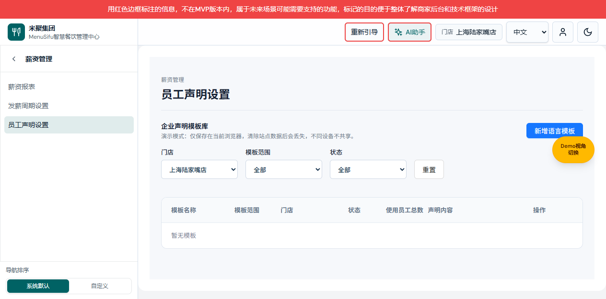

图注：V1.32 本地原生预览，2026-10-15，演示模板空列表；用于定位页头及侧栏，不代表真实 API 验收。

| 字段 | 逻辑说明 |
| --- | --- |
| 员工声明设置标题 | 保留标题与薪资管理归属信息。首次进入加载后焦点定位标题，不再尝试定位已移除的返回按钮。 |
| 返回薪资管理 | 从页面移除，不保留按钮空位或隐藏热区；返回报表使用侧栏薪资报表，不自动保存模板。 |
| 侧栏薪资报表 | 沿用 V1.31 路由和会话状态保留，不改变声明表单的成功、失败和取消规则。 |

### 发薪周期设置／页头

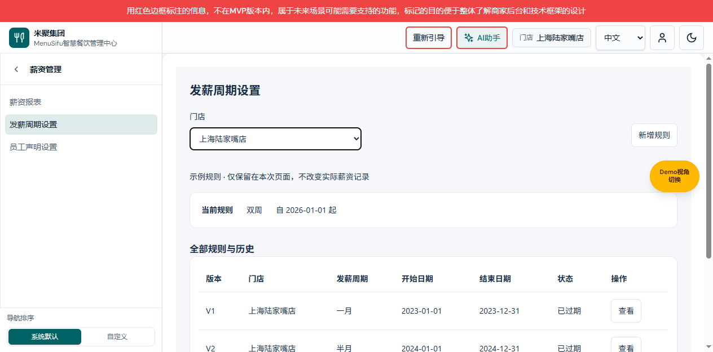

图注：V1.32 本地原生预览，2026-10-15，示例规则状态（仅当前页面，不改变真实薪资记录）；用于定位设置标题及侧栏。

| 字段 | 逻辑说明 |
| --- | --- |
| 发薪周期设置标题 | 保留标题，移除其左侧返回按钮，不移动门店筛选、不改变规则列表。 |
| 返回薪资管理 | 从页面移除，不留可点击热区；使用侧栏薪资报表切换，不能因导航而新增或发布规则。 |

验收：两个设置页均不存在“返回薪资管理”按钮；侧栏仍可进入三个薪资叶子；导航切换不触发保存。旧版编辑、确认弹框未调整，无新增业务字段。

## V1.31 · 2026-10-15 薪资子路由契约

三份配对 V1.31：[产品](./payroll-需求分析.md)、[研发](./payroll-报表功能设计.md)、[个人规范版](./薪资管理需求文档（个人规范版）.md)。共同变更编号：PAYROLL-20261015-SIDEBAR。

本文负责路由、状态与验证契约；本节替代旧版顶部常驻设置入口及全屏容器定义，未涉及业务仍沿用原定义。

| 字段／对象 | 定义与约束 |
| --- | --- |
| report | 路径 /team/payroll-report；旧地址兼容，不迁移薪资数据。 |
| schedule | 路径 /team/payroll-report/schedule-settings；复用原发薪周期控制器，非模态路由容器，内部编辑／确认弹框沿用原逻辑。 |
| declarations | 路径 /team/payroll-report/declaration-settings；复用声明管理、发布、分配及错误处理，非模态路由容器。首次加载前进入加载态；已打开编辑器再次进入不重置。 |
| 权限与过滤 | 薪资页原 page:/team/payroll-report 键保留；三个页面同属 navigation:team:team-tax-payroll。复用公共订阅、权限、预设过滤；本次不预置任何额外授权。 |
| storeId | string；优先匹配报表 employeeStoreFilter 的门店 ID／中英文标签，回退授权上下文 storeId；周期页无当前门店时沿用既有可访问默认门店，声明筛选为空表示授权范围内全部门店。 |
| 运行实例 | 薪资子路由之间重新挂接同一 Shadow DOM 与控制器；离开模块调用原 destroy。滚轮每次读取新的外层滚动容器，不能引用已被替换的旧容器。 |
| 数据写入 | 导航仅更新视图，不调用保存、发布、发放、下载接口；原报表输入和任务不因切换被清空。跨模块沿用原保护边界，不承诺刷新后恢复未保存数据。 |
| 异步加载 | 离开声明视图使当前加载代次失效；回来时非编辑状态重新加载，编辑状态保留重试输入，加载失败沿用现有消息。 |
| 路径匹配 | 标题及侧栏叶子使用最长前缀，防止报表基路径把两个设置页误判为报表；尾斜杠解析兼容。 |

### 验证用例

1. 三叶子路径、标题、共同权限父节点由 verify-payroll-secondary-navigation.ts 校验。
2. 浏览器点击两个设置叶子后，内容区单独显示对应设置，:modal 不包含路由设置容器，侧栏当前项仅一个。
3. 设置间切换时 Shadow DOM 宿主为同一对象；返回报表后不得自动保存或替换员工。
4. 正式周期数据仍只读；示例规则只在当前运行实例内，不通过导航发布真实规则。声明 API 失败与演示模式分别沿用已有定义。

## 2026-10-12 更多菜单被汇总层遮挡修复（V1.30）

变更编号 PAYROLL-20261012-MORE-STACKING；三份配对 V1.30：[产品](./payroll-需求分析.md)、[研发](./payroll-报表功能设计.md)、[个人规范版](./薪资管理需求文档（个人规范版）.md)。业务、菜单顺序及点击处理不变，本次修复 V1.29 仅扩大按钮仍未解决的文字区域遮挡。先前“内边距是主要根因”的解释不再作为当前结论。

### 薪资管理／更多菜单点击层级

待补页面图片：V1.30 文字区域实点及整行 hover 状态；既有图片不证明热区已修复。

| 字段｜操作 | 逻辑说明 |
|---|---|
| 更多菜单所在操作区 | hero-head 的层叠级别为 2，高于其后汇总层的 1；菜单的内部 z-index 100 不能单独逃出父级原有层叠，因此提升的是父级操作区。 |
| 薪资明细文字区域 | 不允许薪资合计／总工时／发薪日的透明区域覆盖菜单文字、截获 hover 或点击；文字和按钮上部、下部均属于同一个完整按钮。 |
| 汇总区 | 数值与展示不变；菜单打开时重叠范围优先由菜单接收鼠标，不禁用汇总区整体指针事件。 |
| ADP、编辑 | 继续共用按钮样式和原 data-action，不增加事件代理、不自动导出或保存。 |

定位证据：修复前 hero-head 与 metrics 均 z-index 1；明细按钮 y383.25–427.25，metrics y394.8125–443.078125，位于 DOM 后方的 metrics 遮住文字所在位置。保留 RED／GREEN 层叠回归测试。

## 2026-10-12 更多菜单整行热区（V1.29）

变更编号 PAYROLL-20261012-MORE-HIT-AREA；三份配对 V1.29：[产品](./payroll-需求分析.md)、[研发](./payroll-报表功能设计.md)、[个人规范版](./薪资管理需求文档（个人规范版）.md)。菜单顺序和原功能不变，仅消除可见行左右边缘的无效点击范围。

### 薪资管理／更多菜单

待补页面图片：V1.29 整行热区实际状态；V1.28 图只说明布局，不证明边缘点击有效。

| 字段｜操作 | 逻辑说明 |
|---|---|
| 薪资明细热区 | 按钮占满菜单内宽，取消菜单横向 6px 内边距；行内图标、名称和左右空白都属于同一个按钮，不把行边缘当成空白关闭。 |
| 行高与对齐 | 最小行高 44px，flex 垂直居中；按钮 border-box、margin 0，名称和图标间距 6px。 |
| 按钮热区一致性 | 薪资明细、导出 ADP、编辑共用 payroll-employee-more-item，点击事件定义在完整 button 上，不绑定名称文本；整块按钮宽度、高度、内边距和 hover 高亮一致，子元素及图标伪元素不单独截获指针。 |
| ADP、编辑热区 | 复用同一整行按钮样式，原 data-action 不变；子元素不另行截获指针事件。 |
| 外侧空白 | 只有菜单外的空白关闭菜单，不执行功能；按钮行之外的上下菜单留白仍不属于菜单项。 |

验收：名称、图标、行左侧与右侧空白点击均打开薪资明细，选择后关闭菜单；另两个菜单项顺序与功能不变。

## 2026-10-12 员工操作更多菜单（V1.28）

变更编号 PAYROLL-20261012-HERO-MORE；三份配对 V1.28：[产品](./payroll-需求分析.md)、[研发](./payroll-报表功能设计.md)、[个人规范版](./薪资管理需求文档（个人规范版）.md)。用户最新确认方案替代 V1.27 三行布局，不改功能处理、权限、薪资或导出任务规则。

### 薪资管理／员工操作区

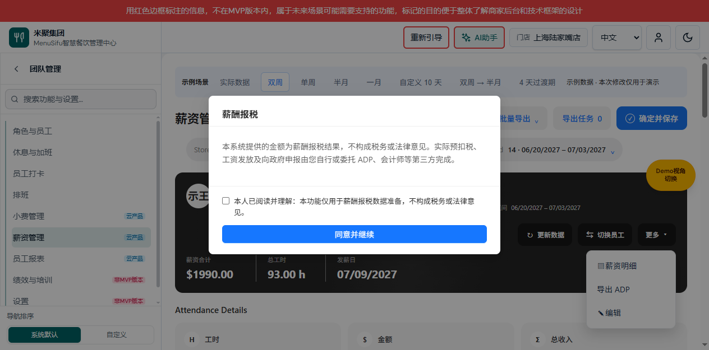

图注：65023 本地演示，V1.28，2026-10-12；右侧更多菜单完整展开，原薪酬报税提示遮挡主区域，无遮挡整页图待补。本次不修改或自动确认该声明。独立功能弹框继续沿用原说明与截图，本次不改变其字段或逻辑。

| 字段｜操作 | 逻辑说明 |
|---|---|
| 更新数据 | 单行最左侧，复用 refresh-employee-data，不增加自动刷新。 |
| 切换员工 | 位于更新数据右侧、更多左侧，原员工选择逻辑不变。 |
| 更多 | 最右侧，与原黑色操作按钮一致；默认关闭，点击展开右对齐下拉，再次点击关闭。aria-expanded 与实际开关同步。 |
| 薪资明细 | 第一个菜单项；复用 preview-employees-detail，先关闭菜单再打开当前员工明细。 |
| 导出 ADP | 第二个菜单项；复用 preview-adp-report，先关闭菜单，保留原确认和导出流程，不增加直接下载。 |
| 编辑 | 第三个菜单项；复用 open-employee-identity-edit，先关闭菜单再打开编辑弹框，取消／保存原行为不变。 |
| 空白点击 | 点击菜单之外的页面区域关闭；不取消已经打开的功能弹框或导出任务。 |
| Escape | 菜单展开时按 Esc 关闭并恢复更多按钮焦点；关闭时不拦截其他弹框原 Escape 行为。 |

验收：外侧仅显示“更新数据／切换员工／更多”，菜单顺序为“薪资明细／导出 ADP／编辑”；三个操作各一份，菜单开关与原入口功能均正常。小屏允许按钮组自然排列，不裁掉下拉菜单。

2026-10-12 验证补记（业务版本仍为 V1.28）：用户反馈三个入口点击无效果；本次直接绑定用户当前 65023 内置浏览器页面，通过真实菜单点击分别看见 Employees Payroll Detail、ADP Report 与编辑员工信息弹框，选择后菜单关闭，关闭编辑未保存数据。当前未复现反馈，根因未确认，不新增功能修复代码；未确认用户最初失败时的页面状态、资源版本及未保存确认分支。此前程序化 click 证据不能替代本次真实点击验证。

## 2026-10-10 更新数据按钮位置（V1.27）

变更编号 PAYROLL-20261010-UPDATE-BELOW-ADP；三份配对 V1.27：[产品](./payroll-需求分析.md)、[研发](./payroll-报表功能设计.md)、[个人规范版](./薪资管理需求文档（个人规范版）.md)。仅更改按钮位置，更新数据与导出 ADP 的行为不变。

### 薪资管理／员工操作区

待补页面图片：V1.27 三行操作区实际截图。

| 字段｜操作 | 逻辑说明 |
|---|---|
| 编辑、切换员工 | 保留第一行，顺序及行为不变。 |
| 薪资明细、导出 ADP | 第二行从左到右排列，保留原按钮风格和操作。 |
| 更新数据 | 从第二行移到第三行，右对齐位于导出 ADP 下方；仍使用原 refresh-employee-data 事件，不复制按钮、不增加自动刷新。 |

验收：三个操作行依次为“编辑／切换员工”“薪资明细／导出 ADP”“更新数据”，共五个按钮；更新数据只出现一次，原点击逻辑不变。

## 2026-10-10 导出成功提示延迟关闭（V1.26）

变更编号 PAYROLL-20261010-SUCCESS-TOAST；三份配对 V1.26：[产品](./payroll-需求分析.md)、[研发](./payroll-报表功能设计.md)、[个人规范版](./薪资管理需求文档（个人规范版）.md)。本条替代既有“所有任务结束立即隐藏”定义，其他导出规则不变。

### 薪资管理／导出状态提示

待补页面图片：导出成功提示保留与点击查看任务的实际页面状态。

| 字段｜操作 | 逻辑说明 |
|---|---|
| 导出成功 | 文件生成成功且自动下载已触发后展示“导出成功”，保留 5 秒再隐藏；不代表已经验证文件落盘。下载触发异常不展示成功提示。 |
| 查看任务 | 成功提示显示期间点击，立即隐藏提示、清除关闭定时器并打开任务记录；收起记录后不重新显示已关闭提示。焦点回到导出任务入口，而非已隐藏提示按钮。 |
| 并行提交 | 队列仍有任务时优先展示原运行提示；最近一次成功刷新成功提示计时，不允许旧计时器隐藏仍在运行的提示。新提交清除旧成功提示，失败不借用上次成功状态。 |
| 任务记录 | 状态记录继续保留，5 秒只影响浮动提示，不删除记录、不重复下载。 |
| 页面退出 | 销毁控制器时清除计时器，避免退出后修改已移除页面。 |

验收：成功后立即与第 4 秒仍能看到提示，满 5 秒隐藏；5 秒内点击查看任务立即隐藏并打开记录；记录保留成功结果。此规则同时适用单员工与批量导出。

## 2026-10-10 详细明细打印与 PDF 样式一致性（V1.25）

变更编号 PAYROLL-20261010-PRINT-PDF-PARITY；三份配对 V1.25：[产品](./payroll-需求分析.md)、[研发](./payroll-报表功能设计.md)、[个人规范版](./薪资管理需求文档（个人规范版）.md)。共同业务基线：详细明细、打印与单员工／批量 PDF 共用明细内容和视觉样式；仅适配 A4 纸张与分页，不改薪资计算、CSV、任务状态或自动下载规则。

### 薪资明细／详细明细打印内容

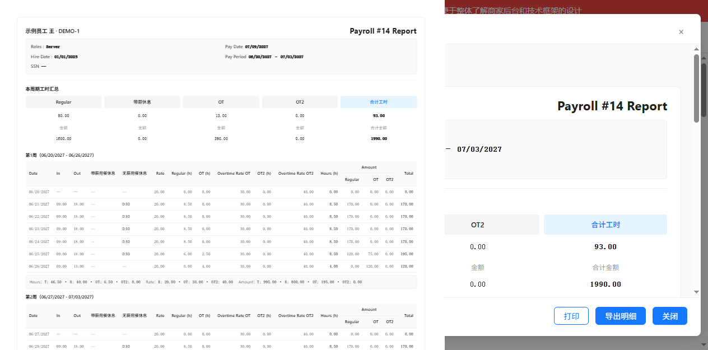

图注：65023 本地演示，V1.25，2026-10-10；测试中将真实打印 iframe 临时移到可视区域捕获，不是操作系统打印对话框截图，右侧为原明细弹框。批量多员工合并 PDF 的页面图片待补。

| 字段｜操作 | 逻辑说明 |
|---|---|
| 员工与报表标题 | 保留明细页左侧员工姓名／编号、右侧报表标题及字体层级，不变成纵向纯文本。 |
| 员工资料 | 保留双列资料网格、标签和值、背景及边框；来源与详细明细一致，不另算薪资。 |
| 工时及金额汇总 | 保留五列排列、数值、合计加粗与蓝色高亮；不能因样式作用域丢失变成逐行堆叠。 |
| 每周明细表 | 保留列顺序、表头层级、每行数据、周汇总和间距；按完整桌面明细宽度等比例适配 A4，不单独把表格字体缩到 7px。 |
| 声明 | 保留完整文字与变量的加粗下划线，不通过内容最大高度截断。 |
| 打印 | 复用真实明细 DOM 与样式，恢复 payroll-page 与 team-payroll-page 两个作用域；保留 A4 8mm 外边距，打印背景颜色。系统打印设置可能覆盖背景选项，需实际设备核对。 |
| 强制一页 | 完整内容按可用纸张高度整体缩放，先扣除上下边距再计算比例；不先裁掉内容再缩放。 |
| 按内容分页 | paginate 与批量 auto-pages 均映射为按内容分页，取消固定页高；长内容不得误走单页裁切。 |
| PDF 捕获 | 等待字体和两次布局帧后优先捕获 A4 页节点，不捕获含额外空白的外层 body；单员工与批量共用此生成器。 |

验收：同一员工／周期的详细明细、打印文档和 PDF 姓名、周期、14 天行数据、汇总与声明一致，双列资料和五列汇总均保持；多员工 PDF 每人另起页。精简明细仍使用原精简模板，CSV 不走此渲染。实际系统打印对话框及多员工跨页 PDF 逐页复核尚未覆盖，不能宣称全场景验证完成。

## 2026-10-10 薪资明细导出文案精简（V1.24）

变更编号 PAYROLL-20261010-DETAIL-EXPORT-COPY；三份配对 V1.24：[产品](./payroll-需求分析.md)、[研发](./payroll-报表功能设计.md)、[个人规范版](./薪资管理需求文档（个人规范版）.md)。共同基线：V1.23 导出任务机制不变，仅调整薪资明细弹框按钮及提交成功提示。

### 薪资明细弹框／导出明细

待补页面图片：V1.24 实际弹框；下方 V1.23 截图的按钮与成功提示为历史文案，不能作为最新验收依据。

| 字段｜操作 | 逻辑说明 |
|---|---|
| 导出明细 | 原“导出结果”按钮改名；中英文分别显示“导出明细”／“Export Details”。菜单 PDF、CSV、邮箱入口及行为不变，不改其他区域的“导出结果”。 |
| 提交成功提示 | 不展示“已提交导出任务，成功后自动下载”；成功入队后清空并隐藏弹框内状态文本。任务中心仍展示进度、记录和自动下载。 |
| 提交失败提示 | 保留错误说明；本次移除仅针对成功文案，不能隐藏员工未选择或提交异常。 |

验收：点击 PDF 或 CSV，成功提交后弹框不显示原成功文案，按钮显示导出明细，任务数量仍增加；提交异常仍显示原因。切换语言再切回中文不能恢复旧按钮文案。

## 2026-10-10 薪资明细单员工导出任务（V1.23）

变更编号 PAYROLL-20261010-SINGLE-DETAIL-TASK；三份配对 V1.23：[产品](./payroll-需求分析.md)、[研发](./payroll-报表功能设计.md)、[个人规范版](./薪资管理需求文档（个人规范版）.md)。共同基线：单员工 PDF／CSV 与批量导出共用任务队列；V1.22 外部点击关闭行为继续有效。下述单员工标题与格式字段补充 V1.21 卡片定义。

### 薪资明细弹框／导出明细

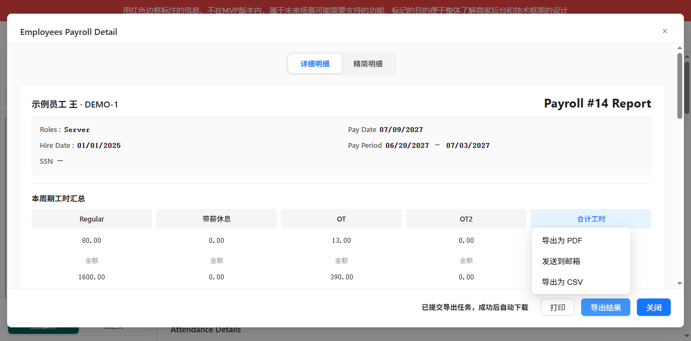

图注：65023 本地演示，V1.23，详细明细导出菜单及任务已提交提示，2026-10-10。入口为薪资明细，作用对象为当前员工及薪资周期，不修改或保存薪资数据。

| 字段｜操作 | 逻辑说明 |
|---|---|
| 导出为 PDF | 点击读取当前员工、周期、当前精简／详细页签和分页选择，冻结当前工作区数据与打印内容，提交单员工任务；不直接执行旧下载逻辑。提交成功收起菜单，不显示弹框内成功提示（V1.24）；没有员工或提交异常时就地提示，不触发下载。 |
| 导出为 CSV | 同样冻结当前工作区数据；格式为 CSV，使用对应精简／详细字段口径。CSV 不渲染 PDF 页面，不加载 PDF 库；生成文件后自动触发下载。 |
| 发送到邮箱 | 本次不变，不接入 PDF／CSV 下载队列。 |

### 任务记录／单员工与批量任务共用

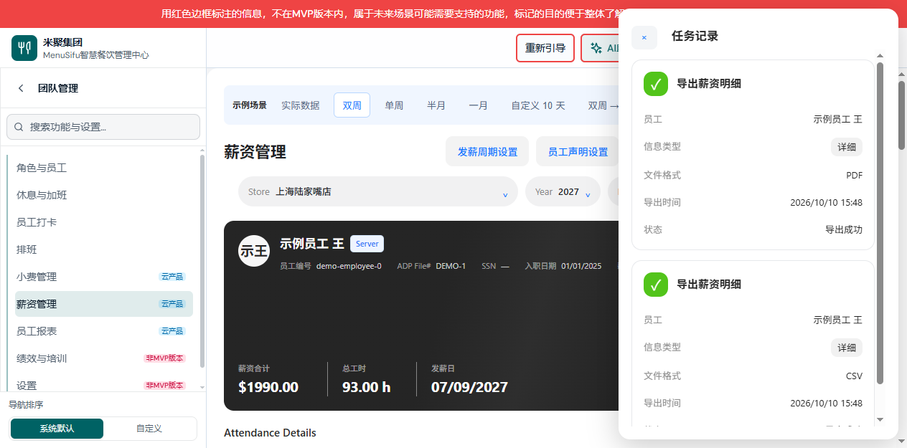

图注：65023 本地演示，V1.23，单员工详细 PDF／CSV 成功记录，2026-10-10；运行、失败及精简状态图片待补。

| 字段｜操作 | 逻辑说明 |
|---|---|
| 任务标题 | 单员工显示“导出薪资明细”，批量保持“批量导出薪资明细”；不能按人数判断来源，批量选择一人仍是批量任务。 |
| 员工 | 提交时员工姓名快照；后续切换员工、门店或周期不改变任务。 |
| 信息类型 | 提交时页签映射：精简为 summary，详细为 detailed；不可在记录中编辑。 |
| 文件格式 | 显示 PDF 或 CSV，与实际文件扩展名一致。 |
| 导出时间 | 提交时刻，显示至分钟。 |
| 状态 | 排队→准备数据→生成明细→合并 PDF／生成 CSV 文件→导出成功；失败显示原因且不下载。共用串行队列，避免同时占用 PDF 渲染资源。 |
| 自动下载 | 仅完整成功的任务触发一次浏览器下载；无手动下载按钮，终态仅展示结果。浏览器下载触发不等于已确认文件落盘；触发异常显示失败提示，不宣称下载成功。 |
| 重新导出 | 失败、部分失败或取消时使用原数据快照重试；不读取用户后来切换的数据。 |
| 查看任务提示 | 只要仍有运行或排队任务就显示；全部结束后隐藏。收起记录不取消任务。 |

验收：详细 PDF 与精简 CSV 连续提交，出现两个不同格式的单员工记录，依次执行，各自成功自动下载一次；期间切换员工不改变姓名或内容。PDF 失败不得下载，CSV 不请求打印 HTML。既有批量导出、邮箱与打印不受影响。

## 2026-10-10 任务记录外部点击关闭（V1.22）

变更编号 PAYROLL-20261010-TASK-DRAWER-DISMISS；配对 V1.22：[产品](./payroll-需求分析.md)、[研发](./payroll-报表功能设计.md)、[个人规范版](./薪资管理需求文档（个人规范版）.md)。任务记录打开时，点击抽屉之外的页面区域关闭抽屉，点击内部不关闭；点击导出任务或查看任务入口仍打开，不因同一次点击被关闭。使用 composedPath 判断 Shadow DOM 内外区域，关闭后恢复入口焦点；监听随页面控制器销毁释放。收起不取消导出、不删除记录、不改变自动下载。关闭／Escape 原行为保留；交互截图待补。

## 2026-10-10 任务卡片对齐展示（V1.21）

变更编号 PAYROLL-20261010-TASK-CARD-LAYOUT；配对 V1.21：[产品](./payroll-需求分析.md)、[研发](./payroll-报表功能设计.md)、[个人规范版](./薪资管理需求文档（个人规范版）.md)。按用户参考图调整任务卡片，保留 V1.20 自动下载与关闭提示规则。

### 任务记录／任务卡片

待补页面图片：用户参考图为设计依据，优化后的实际卡片截图待补。

| 字段｜操作 | 逻辑说明 |
|---|---|
| 图标与标题 | 顶部横排，标题批量导出薪资明细；运行蓝色加载图标，成功绿色勾，失败／部分失败／取消红色提示图标。文字状态同时展示，不能仅凭颜色识别。减少动态效果偏好下停止加载旋转。 |
| 员工 | 字段名左、姓名列表右；多个姓名右对齐自动换行，不覆盖标签或超出卡片。 |
| 信息类型 | 字段名左、精简／详细灰色圆角标签右。 |
| 导出时间 | 字段名左、时间右，显示提交时刻至分钟，不新增完成时间字段，不改变原时间来源。 |
| 状态 | 字段名左、实际阶段或导出结果右。运行保留进度，终态不展示进度条。 |
| 错误与重试 | 原错误说明、跳过人数和失败重试保留在字段区之后；不恢复手动下载。 |

仅布局及分钟时间展示调整，任务队列、导出范围与自动下载逻辑不变。校验以类型和队列测试为基线；卡片视觉与长姓名真实页面验收仍需补齐。

## 2026-10-10 导出完成与自动下载（V1.20）

变更编号 PAYROLL-20261010-AUTO-DOWNLOAD-ONLY；配对 V1.20：[产品](./payroll-需求分析.md)、[研发](./payroll-报表功能设计.md)、[个人规范版](./薪资管理需求文档（个人规范版）.md)。共同基线：用户要求成功自动下载、取消任务中手动下载、结束后关闭查看任务提示。

### 导出任务提示／任务记录

待补页面图片：移除手动下载后成功记录与提示关闭状态截图。V1.18 截图中下载按钮是历史界面，不代表现行行为。

| 字段｜操作 | 逻辑说明 |
|---|---|
| 自动下载 | PDF 成功合并后为每次成功任务触发一次浏览器下载；仅成功触发，失败和部分失败不触发。网页无法可靠获知磁盘保存完成，完成口径为文件生成成功并调用下载，不宣称已保存磁盘。浏览器可能拦截多文件自动下载，用户需允许浏览器下载权限。 |
| 手动下载 | 从任务记录 DOM 和事件处理删除，不提供下载入口；不支持再次下载已有结果。 |
| 导出结果 | 终态记录保留员工、类型、时间、结果／错误说明；隐藏终态进度条，成功显示导出成功。下载调用抛出异常时显示 PDF 已生成但触发失败，并指引重新提交，不声称下载成功。失败任务原重新导出行为保持。 |
| 查看任务提示条 | 仅有排队或运行任务时可见；全部任务结束自动隐藏，不出现结束后常驻提示。有其他任务尚未完成时保留提示。 |
| 导出任务按钮 | 顶部按钮保留，可查看当前会话历史结果；关闭抽屉不取消任务。 |

本节覆盖 V1.18 手动下载、结束提示及终态进度展示定义。无服务端文件下载回执或磁盘校验；自动下载限制需浏览器实际补测。

## 2026-10-10 导出任务入口位置（V1.19）

变更编号 PAYROLL-20261010-TASK-ENTRY-POSITION；配对 V1.19：[产品](./payroll-需求分析.md)、[研发](./payroll-报表功能设计.md)、[个人规范版](./薪资管理需求文档（个人规范版）.md)。工作台导出任务按钮位于确定并保存左侧；顶部操作顺序为发薪周期设置、员工声明设置、批量导出、导出任务、确定并保存。沿用原按钮样式、任务数及打开抽屉行为，不新增任务或改变下载逻辑。新位置图片待补；本节覆盖 V1.18 入口位置定义。

## 2026-10-10 导出任务中心（V1.18）

变更编号 PAYROLL-20261010-EXPORT-TASK-CENTER；共同基线：用户确认多任务排队、成功自动下载、当前页面会话保留记录。配对 V1.18：[产品权威](./payroll-需求分析.md)、[研发说明](./payroll-报表功能设计.md)、[个人规范版](./薪资管理需求文档（个人规范版）.md)。本节替代历史单任务阻塞和部分成功可下载定义；其他明细筛选及最多 10 人规则不变。

### 导出提交提示与任务入口

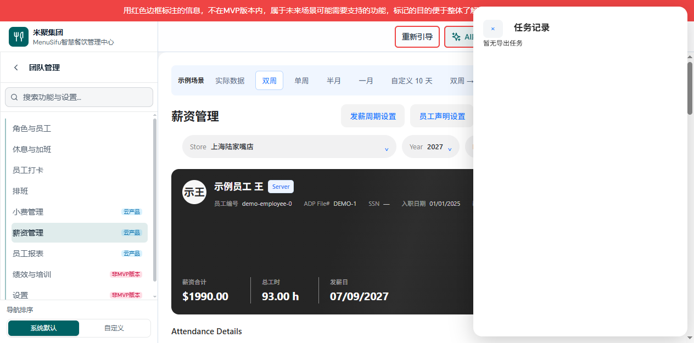

图注：65023 / V1.18 / 2026-10-10，真实空任务记录页面；进行中提示条截图待补。

用途／入口：确认导出通过原人数与薪资周期校验后入队，立即关闭选择弹框。排队前冻结员工数据、声明与打印 HTML；切换门店／员工／周期不会改变排队文件。

| 字段｜操作 | 逻辑说明 |
|---|---|
| 导出任务 | 顶部常驻入口，展示会话累计任务数；点击打开右侧任务记录。无任务显示暂无导出任务。 |
| 导出提示 | 有记录时显示。进行中提示正在导出并合并，成功后自动下载；全部结束提示可查看任务记录。查看任务打开抽屉。 |
| 确认导出 | 每次有效提交生成独立 job ID，串行排队，可继续提交下一任务；不并行渲染 PDF。提交前错误保留选择弹框及错误信息。 |

### 任务记录抽屉

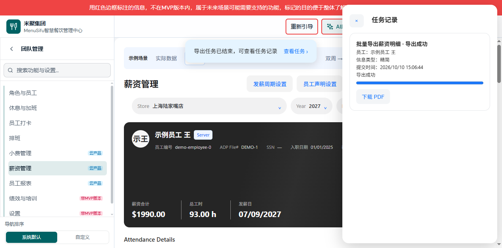

图注：65023 / V1.18 / 2026-10-10，实际单名员工精简 PDF 生成成功，进度 100%，下载按钮可用；生成、合并及失败瞬时状态截图待补。已核对成功流程，未验证浏览器下载文件落盘。

| 字段｜操作 | 逻辑说明 |
|---|---|
| 任务记录 | 当前页面会话内全部任务，新任务在前。刷新或离开薪资页面不持久化；未完成任务离开时触发浏览器离开确认。关闭抽屉不取消任务。 |
| 员工 | 固定提交时已选员工姓名列表；不随工作台切换改变。 |
| 信息类型 | 固定提交时精简或详细，与 PDF 模板一致。 |
| 提交时间 | 当前会话提交时间，本地时间格式。 |
| 状态 | 排队中 → 准备数据 → 生成明细 → 合并 PDF → 导出成功；异常进入失败或部分失败。部分失败不下载不完整文件。无数据员工沿用跳过规则，显示跳过人数。 |
| 进度 | 生成阶段实际已处理／可生成总人数；图形为阶段映射：生成 10–85%，合并 90%，成功 100%，不是虚构合并字节进度。 |
| 下载 PDF | 仅成功且结果存在可用；首次成功自动下载一次，后续点击可重新下载。浏览器阻止多文件自动下载时用户需点击下载；只触发浏览器下载，不宣称文件已保存到磁盘。 |
| 失败原因 | 显示任务或逐员工生成错误，失败不自动下载。 |
| 重新导出 | 失败／部分失败后将原完整输入重新排队，不仅导出失败员工，保证成功后为完整合并文件；保留原冻结数据，重试成功可自动下载。 |
| 关闭 | 收起抽屉返回原按钮焦点，不删除任务、不取消执行。 |

会话销毁时释放下载 URL、监听与任务资源。验收算例：任务 A 运行时提交 B，B 显示排队；A 完成后才开始 B，最大并发为 1；排队期间切换上下文，B 使用提交时 HTML；失败不提供下载，完整重试成功才可下载。串行、冻结上下文、失败与重试自动化验证通过；真实浏览器 PDF 下载尚需验证，截图交付缺口未闭合。不涉及服务端持久化或跨设备任务恢复。

## 2026-10-10 发薪周期设置入口迁移（V1.17）

变更编号 PAYROLL-20261010-SCHEDULE-ENTRY-MOVE；配对 V1.17：[产品](./payroll-需求分析.md)、[研发](./payroll-报表功能设计.md)、[个人规范版](./薪资管理需求文档（个人规范版）.md)。发薪周期设置从门店筛选行移至工作台顶部员工声明设置左侧，使用相同 btn payroll-workspace-action-btn no-print 样式。按钮顺序为发薪周期设置、员工声明设置、批量导出、确定并保存。不复制入口，保留原点击处理、门店上下文、规则校验及返回行为；不新增写入或变更周期算法。新位置截图待补。

## 2026-10-10 薪资明细导出入口名称（V1.16）

变更编号 PAYROLL-20261010-EXPORT-PAYROLL-DETAIL-LABEL；配对 V1.16：[产品](./payroll-需求分析.md)、[研发](./payroll-报表功能设计.md)、[个人规范版](./薪资管理需求文档（个人规范版）.md)。批量导出下拉第二项由导出明细改为导出薪资明细，第一项导出 ADP 不变。保留 open-batch-detail-export 动作与 unified 布局参数；点击仍打开原批量导出员工信息弹框，人数、角色筛选、明细类型及 PDF 规则不变。历史入口名称以本节覆盖；新名称页面图片待补。

## 2026-10-10 员工卡片操作文案简化（V1.15）

变更编号 PAYROLL-20261010-HERO-ACTION-LABELS；配对 V1.15：[产品](./payroll-需求分析.md)、[研发](./payroll-报表功能设计.md)、[个人规范版](./薪资管理需求文档（个人规范版）.md)。员工卡片第二行依次为更新数据、薪资明细、导出 ADP，替代更新员工数据、员工明细、导出当前员工 ADP。英文对应 Update data、Payroll Detail、Export ADP。保留原动作与国际化键，不改变刷新确认、当前员工明细与当前员工 ADP 上下文；卡片导出 ADP 仍仅对应当前员工，与顶部批量导出菜单的导出 ADP 范围不同。第一行编辑／切换员工保持不变。此处新文案覆盖历史按钮文案，更新图片待补。

## 2026-10-10 批量导出弹框滚动调整（V1.14）

变更编号 PAYROLL-20261010-INNER-SCROLL；配对 V1.14：[产品](./payroll-需求分析.md)、[研发](./payroll-报表功能设计.md)、[个人规范版](./薪资管理需求文档（个人规范版）.md)。批量导出员工信息弹框外层正文不出现滚动条；信息类型、筛选、已选人数与确认导出保持可见。员工列表与员工角色区在剩余高度内部滚动，角色筛选选项自身继续滚动。使用纵向 flex 布局与 min-height:0 约束，正文 overflow:hidden，内部列表 overflow-y:auto；不使用仅隐藏滚动条但仍截断列表的方式。选择、筛选和导出逻辑不变；更新页面图片待补，极小视口需补测。

## 2026-10-10 角色条件标题调整（V1.13）

变更编号 PAYROLL-20261010-ROLE-FILTER-LABEL；配对 V1.13：[产品](./payroll-需求分析.md)、[研发](./payroll-报表功能设计.md)、[个人规范版](./薪资管理需求文档（个人规范版）.md)。员工范围角色条件上方独立显示角色标题，与门店、员工标题对齐。框内移除角色筛选前缀，仅显示全部角色／已选 N 项／未选择。角色多选、全选、默认全选及外部点击收起规则不变。调整后页面图片待补；不新增数据字段或写入。

## 2026-10-10 角色筛选外部点击收起（V1.12）

变更编号 PAYROLL-20261010-ROLE-FILTER-DISMISS；配对 V1.12：[产品](./payroll-需求分析.md)、[研发](./payroll-报表功能设计.md)、[个人规范版](./薪资管理需求文档（个人规范版）.md)。角色筛选展开后，点击其外部空白、其他字段或遮罩收起下拉；内部勾选角色／全选保持展开，点击标题沿用切换展开状态。收起仅移除 details 的 open 属性，不清空筛选值、不改变已选导出员工、不关闭员工弹框。跨 Shadow DOM 外部点击通过 composedPath 判断，事件监听随控制器销毁释放。区域图片仍见 V1.10，外部收起交互图片待补。

## 2026-10-10 导出统计文案移除（V1.11）

变更编号 PAYROLL-20261010-REMOVE-EXPORT-SUMMARY；配对 V1.11：[产品权威](./payroll-需求分析.md)、[研发说明](./payroll-报表功能设计.md)、[个人规范版](./薪资管理需求文档（个人规范版）.md)。用户确认删除批量导出员工信息弹框底部将处理人数、可正常导出、Draft、无数据、预计文件数整段统计提示及其背景容器。正常状态不渲染该提示；原已选人数与 10 人上限保持。payrollBatchExportSummary 仅在启动失败时显示错误，成功／重新打开／重新选择时恢复隐藏。导出任务进度、结果、文件生成和校验规则不变。覆盖历史正常统计提示定义，不取消错误反馈。截图沿用 V1.10 作位置参考，本次统计区域删除后的页面图片待补；不宣称图片覆盖完整。

## 演示数据补测记录（2026-10-10）

共同变更编号 PAYROLL-20261010-DEMO-EMPLOYEES；沿用业务版本 V1.10，不改变产品规则。配对：[产品](./payroll-需求分析.md)、[研发](./payroll-报表功能设计.md)、[个人规范版](./薪资管理需求文档（个人规范版）.md)。所有薪资周期演示场景每门店补充 15 名员工，8 种主角色：Server、Busser、Runner、Host、Bartender、Chef、Cashier、Manager；示例员工吴同时为 Server／Host。第三名保留无考勤及 15 小费的原边界样例，其余新增员工提供演示考勤。仅由演示场景生成器创建，不新增实际员工、不持久化生产花名册；刷新后点击双周等示例场景重新加载。验收数据：ID 唯一、姓名非空、每周期 15 人、8 种主角色、多角色员工两项均可识别；7 种场景生成测试通过。用于测试 10 人限制和角色 OR 筛选，不代表已实测 PDF 下载。

## 2026-10-10 角色筛选与员工角色展示分离（V1.10）

变更编号 PAYROLL-20261010-ROLE-FILTER-SEPARATION。共同基线：用户确认顶部独立角色多选默认全选，右侧仅展示点选员工拥有的角色，不限定导出范围。三份配对 V1.10：[产品权威](./payroll-需求分析.md)、[研发说明](./payroll-报表功能设计.md)、[个人规范版](./薪资管理需求文档（个人规范版）.md)。V1.8 的右栏角色筛选及零勾选不限角色规则被本节替代，历史截图保留作历史参考。

### 批量导出员工信息／员工范围

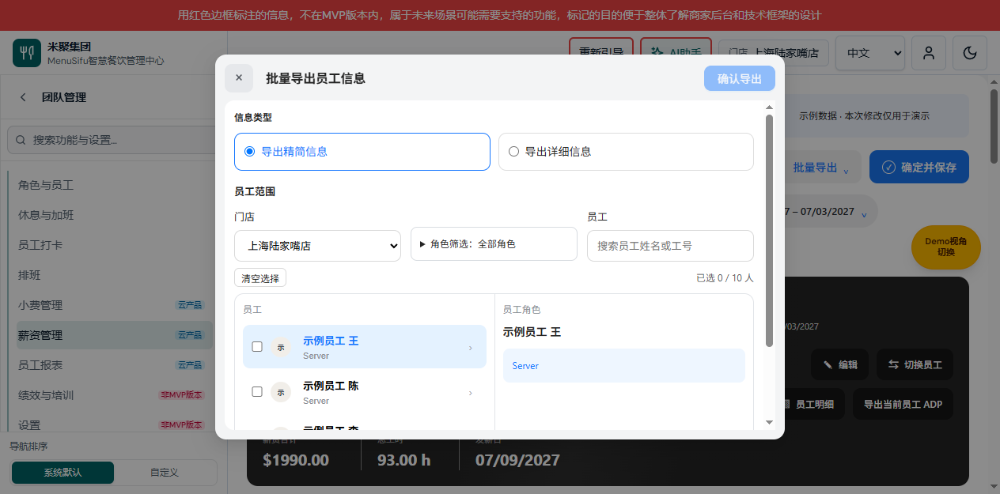

图注：65023 / 2026-10-10 / V1.10，真实双周示例，默认全部角色，点选王但未勾选导出。

入口：批量导出 → 导出明细。信息类型、PDF、最多 10 人和确认导出任务规则不变。

| 字段｜操作 | 逻辑说明 |
|---|---|
| 门店 | 第一项。更换后清空员工选择、搜索和点选员工；重新加载角色并默认全选。 |
| 角色筛选 | 位于门店之后、员工搜索之前。展开显示角色复选项与全选；默认勾选当前门店全部角色。角色来自员工 roleRecords.role、segments.role、role 和 department，去重；无角色员工归入未设置角色。匹配任一已选角色即保留员工，与姓名／工号搜索采用 AND。筛选不限制员工导出的角色记录。 |
| 全选角色 | 勾选选择全部；取消清空全部角色，员工结果为空，不视为不限角色。部分选中显示半选。筛选变化保留已勾选的导出员工，并在已选人数提示隐藏人数。 |
| 员工搜索 | 沿用姓名／工号过滤，保留员工选择。 |
| 员工姓名按钮 | 点击仅设置 focusedEmployeeId，右侧显示该员工姓名与拥有角色；不增加或删除 selectedIds。无点选提示点击左侧员工查看角色；点选员工不在新筛选结果时清空点选。 |
| 员工复选框 | 独立维护导出 selectedIds，最多 10 人；不与右侧展示联动。 |
| 员工角色 | 右侧只读，展示当前点选员工的去重角色列表；无角色显示未设置角色。不提供角色勾选，不改变导出范围。 |

验收：默认角色全选；取消全选显示空列表；恢复全选恢复候选；点击员工姓名后右侧更新且已选人数不变。数据类型校验、既有 UI 校验通过；真实预览确认点选不会勾选员工。当前示例仅 Server，多角色联合筛选仍需足量数据补测，未实际下载 PDF。未提交或自动合并。

## 2026-10-10 批量导出菜单收敛（V1.9）

变更编号 PAYROLL-20261010-EXPORT-MENU-SIMPLIFY；共同业务基线：用户明确将批量导出 ADP 改为导出 ADP，移除独立精简明细、详细明细入口。三份配对版本 V1.9：[产品权威](./payroll-需求分析.md)、[研发说明](./payroll-报表功能设计.md)、[个人规范版](./薪资管理需求文档（个人规范版）.md)。历史版本中的三项／四项菜单仅为历史记录，当前菜单以本节为准。

### 薪资工作台／批量导出菜单


图注：65023 / V1.9 / 2026-10-10，真实薪资工作台，双周示例数据，下拉已展开。

用途／入口：薪资工作台顶部批量导出按钮。菜单仅保留以下两项，不改变既有导出范围、校验和结果。

| 字段｜操作 | 逻辑说明 |
|---|---|
| 批量导出 | 入口名称及展开／收起行为不变。展开仅按顺序显示导出 ADP、导出明细。 |
| 导出 ADP | 中文显示导出 ADP，英文 Export ADP；沿用 export-batch-adp 动作和 export.batchAdp 国际化键，仅更名，不改为当前员工导出。范围、未保存校验、CSV 输出及取消／失败处理均不变，无新增数据字段或写入。 |
| 导出明细 | 打开 V1.8 定义的批量导出员工信息弹框，仍默认精简，可在弹框切换详细；保留员工多选、门店／角色／员工筛选、最多 10 人与 PDF 限制。 |

独立精简明细与详细明细菜单按钮从 DOM 移除，不只隐藏，不再提供固定类型的直接入口；弹框内 summary／detailed 单选和对应模板继续保留。员工卡片导出当前员工 ADP 不受影响。验收：菜单恰好两项且顺序正确；点击导出明细可见两个格式单选；静态菜单检查、类型校验及浏览器显示检查通过。本次未实际生成导出文件，历史跨角色与 10 人补测缺口仍保持原状态。

## 2026-10-10 统一导出明细员工选择（V1.8）

变更编号：PAYROLL-20261010-UNIFIED-DETAIL-PICKER。共同基线：用户确认新增导出明细入口，复用切换员工布局，支持员工多选、信息类型切换和角色筛选。配对版本 V1.8：[产品权威](./payroll-需求分析.md)、[研发说明](./payroll-报表功能设计.md)、[个人规范版](./薪资管理需求文档（个人规范版）.md)。本节为当前有效定义；下方 V1.7 及以前的三项菜单描述为历史状态，不再代表当前菜单。

### 批量导出员工信息弹框

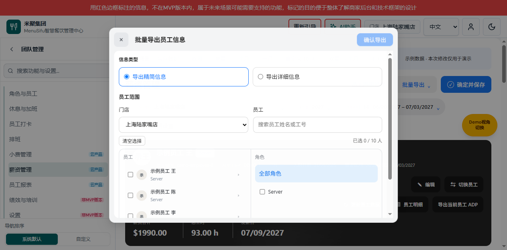

图注：65023 预览 / 2026-10-10 / V1.8，真实页面，双周示例数据，精简信息默认、未选择员工状态。沿用切换员工的头像、行选中与双栏布局，不改变原切换员工的单选行为。

用途／入口（V1.9 同步）：批量导出下拉依次显示导出 ADP、导出明细。点击导出明细打开本弹框，不切换工作台当前员工；精简／详细选择仅在弹框内提供。

| 字段｜操作 | 逻辑说明 |
|---|---|
| 导出明细 | 点击关闭下拉并打开统一弹框。每次打开默认精简信息、当前门店、无员工选择及无角色限制；年份与薪资周期承接工作台。 |
| 导出精简信息 | 单选，值 summary，打开默认选中；与详细互斥，使用既有精简 PDF 模板。切换不清空员工选择。 |
| 导出详细信息 | 单选，值 detailed，使用既有详细 PDF 模板。切换不清空员工选择，不变更薪资数据。 |
| 门店 | 沿用既有门店数据与筛选。变更门店重新加载当前年份／薪资周期员工，清空已选员工、角色及搜索条件，避免跨门店混合导出。 |
| 员工搜索 | 按姓名或工号过滤当前门店员工，与角色条件同时满足；搜索不清除已选员工。无匹配时显示空结果。 |
| 全部角色 | 默认不限角色。点击清空角色筛选，不清空员工选择。 |
| 角色复选项 | 来源为当前门店候选员工的非空 role，去重排序。多项采用 OR；未勾选任何角色视为全部。与门店和搜索采用 AND。改变角色不自动勾选员工，不清空筛选后隐藏的已选员工。 |
| 员工复选项 | 左栏显示头像、姓名和角色，通过 employee ID 唯一标识选择。允许多选、最多 10 人；达到 10 人禁用未选员工，已选仍可取消。原员工数据状态、无数据及任务校验规则不变。 |
| 已选人数 | 统计本次全部已选 ID，包括筛选后隐藏项，显示 N / 10，不是当前可见员工数。 |
| 清空选择 | 清空全部已选员工，不改变当前信息类型和筛选条件。 |
| 确认导出 | 0 人禁用；1–10 人可点击，执行原批量任务校验，参数固定 selected 范围、PDF 格式、merged 合并文件，detailType 使用当前单选值。启动成功关闭弹框并显示原任务进度，完成下载 PDF；启动失败保留弹框与输入并提示错误，不宣称导出成功。 |
| 关闭／Escape | 关闭弹框，不启动任务、不生成文件、不修改员工绑定或当前员工；焦点回到批量导出。 |

验收算例：选择王、陈两人，切换详细后两人仍选中，确认导出使用 detailed；勾选 Server 后只显示该角色，取消全部角色限制后恢复候选；无选择时不可确认，选 10 人后第 11 人不可选。原精简／详细独立入口仍锁定对应类型。当前预览示例仅有 Server，跨角色多项联合筛选和 10 人上限仍需使用足量真实数据补测；本次不宣称历史全文和图片覆盖缺口已闭合。

## 2026-10-10 批量导出入口文案更新（V1.7）

变更编号 PAYROLL-20261010-BATCH-EXPORT-LABEL；共同基线：用户确认顶部“导出 ADP 报表”改为“批量导出”。三份文档配对版本均为 V1.7：[产品说明](./payroll-需求分析.md)、[研发说明](./payroll-报表功能设计.md)、[个人规范版](./薪资管理需求文档（个人规范版）.md)。仅变更入口名称，菜单仍依次为批量导出 ADP、精简明细、详细明细；员工卡片“导出当前员工 ADP”不变。中文为“批量导出”，英文为 Batch Export，保持原展开、关闭和导出规则，无新增数据字段或写入。验收：顶部入口显示新名称，三个菜单操作仍可用。下面 V1.5、V1.6 截图中的旧入口文字仅作历史位置参考，V1.7 名称以本节为准。

## 2026-10-10 当前员工 ADP 入口迁移

范围版本 V1.6；变更编号 PAYROLL-20261010-CURRENT-ADP-HERO。配对：[产品说明 V1.6](./payroll-需求分析.md)、[个人规范版 V1.6](./薪资管理需求文档（个人规范版）.md)。共同基线：用户确认迁移当前员工 ADP 按钮。


图注：2026-10-10 / V1.6，65023 实际页面，双周示例数据，员工卡片第二行操作区。

原 preview-adp-report 从 payroll-adp-export-menu 移到 payroll-employee-action-row 第二行 preview-employees-detail 之后，使用同一 btn btn-sm payroll-hero-btn 类，移除菜单 role 属性。保留唯一 payroll-export-current-label 和 export.currentAdp 国际化映射；中英切换仍显示对应标签。原事件委托继续执行 runAfterUnsavedWorkspaceConfirm 并调用 showAdpReportModal，使用当前 employeeId/periodId，不增加数据字段、权限、计算或写入。

正常：点击新增位置打开 ADP Report；未保存：沿用原拦截确认分支，取消不打开；切换员工：下一次打开使用所切员工；报表关闭与 CSV 导出校验沿用原流程。顶部菜单现行三项为 export-batch-adp、summary 和 detailed；原批量人数、格式和筛选约束不变。

## 2026-10-10 导出入口合并

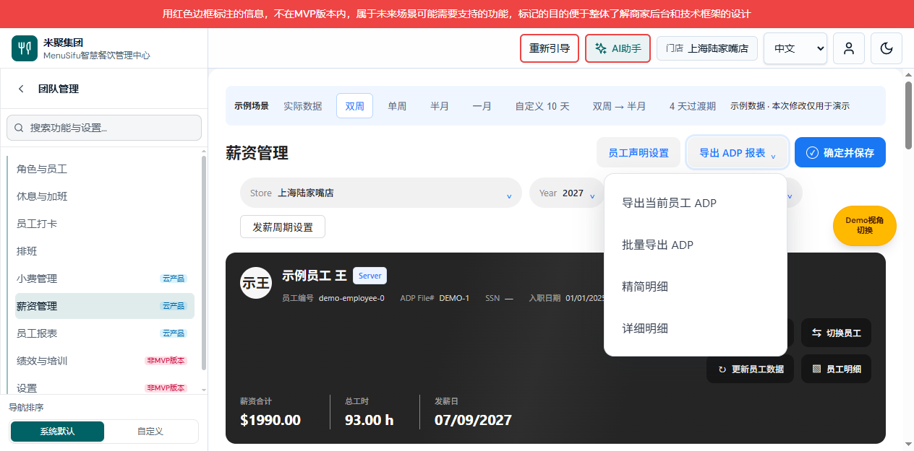

图注：65023 / V1.5 历史页面，当前员工菜单项已在 V1.6 移至员工卡片；最新按钮布局见上方 V1.6 图片。

范围版本 V1.5；变更编号 PAYROLL-20261010-EXPORT-MENU。配对：[产品说明 V1.5](./payroll-需求分析.md)、[个人规范版 V1.5](./薪资管理需求文档（个人规范版）.md)。共同基线：用户确认合并导出下拉。

原 btn-payroll-adp-menu-toggle 和 payroll-adp-export-menu 为唯一导出菜单；现保留 export-batch-adp 和 open-batch-detail-export 两项明细，data-detail-type 分别为 summary、detailed（V1.6 preview-adp-report 已迁至员工卡片）。删除独立批量按钮及菜单容器，批量控制器不再处理旧 toggle-batch-detail-export。菜单开关继续由原 ADP 逻辑负责；批量项打开弹框前关闭共用菜单、更新 aria-expanded，弹框取消、关闭或任务启动关闭后焦点回到原 ADP 按钮。Escape 与外部点击收起菜单，不修改薪资数据。

无新增持久化字段、类型、金额计算或权限。批量 scope=selected、format=pdf、organization=merged，人数 1–10；门店、角色、员工筛选与任务校验沿用 V1.3。算例：点击精简传入 summary 并显示“导出精简明细”；点击详细传入 detailed 并显示“导出详细明细”；取消弹框不启动任务，0 人导出禁用。历史 V1.3 的独立菜单入口已由本节替代，其他规则继续有效。

## 2026-10-10 员工声明功能定向整合记录

范围版本 V1.4；变更编号 PAYROLL-20261010-DECLARATION-INTEGRATION。承接已有员工声明实现，不新增业务决策；保留 V1.3 批量 PDF 和筛选口径。仅整合声明模板管理、员工绑定、声明展示及导出依赖，不合并来源分支的小费、菜单等其他变更。

配对：[产品说明 V1.4](./payroll-需求分析.md)、[个人规范版 V1.4](./薪资管理需求文档（个人规范版）.md)。入口 payroll-page.ts 挂载声明设置控制器，销毁时清理；使用现有薪资上下文提供组织、门店及员工范围。声明仓库按现有 HTTP／静态演示适配，新增模板不在打开或取消时写入。保留现有分配确认、权限、版本冲突和失败提示。批量导出经 getDetailPrintHtml 复用双语声明模板，不另建打印算法；无法生成的声明继续按既有阻断规则处理。

本次 RED：入口测试因 payroll-declaration-settings.ts 缺失失败。整合后声明套件、批量导出、TypeScript 与构建通过；静态薪资脚本同步测试统一 CRLF/LF 后通过。原验收脚本引用废弃的批量渲染位置，已改为验证当前桥接和双语渲染位置。浏览器验证不覆盖真实生产权限、签字或付款。
## 2026-10-08 研发变更：批量 PDF 选择交互

本次范围版本 V1.3；变更编号 PAYROLL-20261008-BATCH-COPY。配对 [产品说明 V1.3](./payroll-需求分析.md)，[个人规范版 V1.3](./薪资管理需求文档（个人规范版）.md)。历史全文并未升级为完整现行权威；本节是已确认变更及实现记录。

共用 ADP 菜单中的明细项 data-detail-type 为 summary/detailed；控制器固定 scope=selected、format=pdf、organization=merged，summaryPagination 仅沿用既有分页偏好。selectedIds 为会话 Set，每次打开清空；门店选项来源 PayrollPageContext.getScope().stores，默认从当前员工门店匹配其授权 ID。scopeBatchSnapshot 按门店 ID 或中英文精确别名过滤当前 period 员工（有 storeId 时优先），不做包含匹配；不在白名单时拒绝，专属其他门店的 period 返回空集合。角色为当前门店员工 role 去重，默认空字符串代表全部；搜索按 name/id/adpFile 包含匹配，三条件 AND，角色及搜索变化不清空集合。切店清空 selectedIds、role 和 search，重建角色列表，不写全局门店。0 人禁用按钮，10 人禁选未选行；输入构建及任务 run 均拒绝超过 10 人。示例：12 人列表选前 10 人后另外 2 人禁选，取消 1 人后可再选；筛选只显示 2 名已选员工时计数仍为 10。 V1.3 仅精简展示：移除弹框副标题、明细/PDF/合并格式说明行、员工人数和分页说明行；保留标题、筛选、已选人数、摘要及导出 PDF 按钮，业务规则不变。

打开记录门店与 period 信息，提交时比较，变化则要求重新选择；被移除的选中 ID 不得静默丢弃。构建克隆员工/周期快照，任务开始在异步 PDF 渲染前捕获对应明细 HTML，避免执行中切换页面污染产物。桥接在 finally 恢复当前员工及草稿。生成/合并沿用原任务管线，成功可下载；无数据与生成失败分开展示，空产物不得下载。取消选择弹框不写薪资数据；持久化偏好失败不阻断导出。无新增薪资计算、权限或后端字段。

变更历史（本节）：V1.3 / PAYROLL-20261008-BATCH-COPY 删除弹框副标题、明细/PDF/合并格式说明及人数分页说明三处文案，规则不变；V1.2 / PAYROLL-20261008-BATCH-FILTERS 增加权限门店与组合筛选；V1.1 / PAYROLL-20261008-BATCH-PDF 定义 10 人 PDF 流程。

验证入口：scripts/verify-payroll-batch-filters.ts（精确门店与角色/员工组合、权限及周期隔离）、scripts/verify-payroll-batch-export.ts（人数及失效 ID）、scripts/verify-payroll-batch-export-ui.mjs（菜单与固定格式）、TypeScript 无输出类型检查。真实 PDF 下载与浏览器交互验收单独记录，不以静态测试代替。

## 2026-10-08 研发变更记录：员工卡片操作区

变更编号 PAYROLL-20261008-01；本节 V1.0。对应 [需求分析](./payroll-需求分析.md) 同编号记录。仅补充本次布局，不将历史设计升级为完整研发权威规格。

两份模板均使用 payroll-employee-hero-actions--rows 列容器，内部两个 payroll-employee-action-row 横向容器靠右排列。第一行 data-action 为 open-employee-identity-edit、open-employee-picker；第二行为 refresh-employee-data、preview-employees-detail。四按钮保留 btn btn-sm payroll-hero-btn 类，复用既有事件委托与前置校验；无新增字段、持久化、权限或计算。移除顶部 workspace-action 的明细按钮，底部既有隐藏入口不变。中文 manage.employeesDetail 为员工明细，英文仍为 Employees Detail。静态校验 scripts/verify-payroll-hero-action-rows.mjs；浏览器需核对两行右边缘、窄屏分组和四个原有操作。

**版本**：1.0  
**日期**：2026-04-21  
**依据**：[KOI-palace-payroll-需求分析.md](./KOI-palace-payroll-需求分析.md)

本文描述「双周 ADP 报税 + 员工签字明细」相关报表的**功能范围、信息架构、数据流与实现路径选项**，供评审与排期；**不含具体代码与接口字段级定稿**（定稿需在确认 ADP 模板与法务文案后补充）。

---

## 1. 设计目标与边界

### 1.1 目标

| 目标 | 说明 |
|------|------|
| **按期管理** | 支持一年约 26 个 payroll 期，每期可打开、筛选、核对。 |
| **三层报表一致** | Manage Payroll（编辑源）→ EmployeesPayroll Detail（员工凭证）→ ADP PAYROLL REPORT（报税导出），字段可追溯、日期/批次一致。 |
| **可人工覆盖** | In/Out、工时分类、service charge、tips 及宽表约 13 类字段支持手工录入/修正，且能区分「系统算出的值」与「人工最终值」。 |
| **可审计** | 关键修改可记录操作者与时间（至少针对报税导出相关字段）。 |
| **导出** | ADP 侧：与客户模板一致的 **CSV**（或客户指定格式）；员工侧：**打印友好** 的明细 + 固定声明区块。 |

### 1.2 非目标（首期可明确排除或降级）

- 替代 ADP 完成全部税务计算或申报提交（本系统以 **数据准备与导出** 为主）。
- 完整 tipout 分配引擎（当前需求承认 **tipout 后数据可能无法自动接入**，见第 7 节）。
- 全自动加州加班合规引擎（若规则未就绪，允许 **OT/OT2 以人工填报或半自动** 为主）。

---

## 2. 角色与核心场景

| 角色 | 典型任务 |
|------|----------|
| **薪酬/报税专员** | 选期 → 选员工 → 改考勤/金额 → 确认本期 → 导出 ADP CSV；抽查员工签字页。 |
| **店长/排班**（可选） | 仅修正考勤 In/Out，不接触报税列（权限可配置）。 |
| **员工** | 不登录系统；领取纸质签字页（系统输出打印版）。 |

**权限原则**：能改「报税导出字段」的角色应最少化；「仅查看」与「可编辑」分离。

---

## 3. 功能模块总览

```
┌─────────────────────────────────────────────────────────────────┐
│  Payroll 期列表（26 期/年，双周）                                 │
│  · 状态：草稿 / 已确认（锁定下游依赖）                             │
└───────────────────────────┬─────────────────────────────────────┘
                            ▼
┌─────────────────────────────────────────────────────────────────┐
│  ① Manage Payroll（主编辑面）                                      │
│  · 按员工展示双周内多段考勤、Regular / OT / OT2                    │
│  · In/Out 可编辑；汇总工时、金额；宽表：Rate、SVCW、Tips、扣款等    │
└───────────────────────────┬─────────────────────────────────────┘
                            │ 同步（保存即写同一事实来源，或显式「生成下游」）
                            ▼
┌─────────────────────────────────────────────────────────────────┐
│  ② EmployeesPayroll Detail（员工明细 + 签字声明）                 │
│  · 单人打印；hours/amount 结构；底部固定法律声明模板                 │
└───────────────────────────┬─────────────────────────────────────┘
                            ▼
┌─────────────────────────────────────────────────────────────────┐
│  ③ ADP PAYROLL REPORT（报税格式导出）                             │
│  · CO CODE、BATCH ID（= paycheck date）、FILE#、各类 Code/Amount   │
└─────────────────────────────────────────────────────────────────┘
```

**产品顺序**：用户在 **①** 完成核对并 **确认本期**（或 per-employee 确认，见 5.2）后，**②③** 才允许生成「正式版」PDF/CSV；草稿状态可预览但带水印或标注「非最终」。

---

## 4. 信息架构与页面结构

### 4.1 导航

- **一级**：Payroll 中心 → **期列表**（按发薪日 / 区间排序）。
- **二级**：某期 → **员工列表**（筛选：部门、姓名、是否已确认）。
- **三级**：某员工 → **Manage Payroll** 标签页；同页或子路由进入 **Detail 预览**、**ADP 行预览**。

### 4.2 各屏关键元素

**期列表**

- 列：区间、paycheck date（batch）、状态（草稿/已确认）、操作（进入）。
- 操作：新建期（可选，或由管理员从日历生成 26 期模板）。

**Manage Payroll（核心）**

- **时间轴区**：双周内按周分段表格；列含 Date、多组 In/Out、Meal（可选）、Regular、OT、OT2；行内小计与周合计。
- **Pay Period 汇总**：总工时、分类工时；金额 = 工时 × 对应时薪（时薪可每期或每员工配置）。
- **宽表行**（与样例「13 列可编辑」对齐）：Exempt、Rate、Incentive、餐次、Sick、**SVCW**、**Tips**、扣款等；全部支持手工改，并显示「系统建议值」（若有）。

**EmployeesPayroll Detail**

- 只读预览（数据来自已保存的 Manage Payroll）；**打印**按钮；声明段落不可删改，仅允许法务配置版本号。

**ADP PAYROLL REPORT**

- 表格预览（列与客户 CSV 一致）；**导出 CSV**；可选 **单行校验**（必填、数值范围、FILE# 与员工主档一致）。

---

## 5. 数据与状态设计（逻辑层）

### 5.1 核心实体（概念模型）

| 实体 | 说明 |
|------|------|
| **PayrollPeriod** | `periodId`，区间起止，`paycheckDate`（对应 ADP batch / paycheck date），状态。 |
| **Employee** | 姓名、内部 ID；**ADP File#**（或备注字段存储，需唯一性校验）。 |
| **TimeSegment** | 归属某期、某员工；日期；In/Out 对；meal；regular/ot/ot2 工时（可为人工直接填）。 |
| **PayPeriodAdjustments** | 宽表字段：svc、tips、扣款等；区分 `systemComputed` / `userFinal`。 |
| **PayrollConfirmation** | 员工在某期是否已确认；确认时间、操作者（用于锁定 Detail/ADP 快照）。 |

### 5.2 状态机（建议）

- **draft**：可任意改 In/Out 与金额类字段。
- **ready_for_review**（可选）：提交复核。
- **confirmed**：该员工该期数据冻结为快照，**②③** 使用快照生成；再改需「解锁」并留痕（或新版本）。

若业务希望「整期一次性确认」，可将确认挂在 **PayrollPeriod**；若希望按员工分批，挂在 **Employee × Period**。**推荐按员工确认**，以便先完成大部分员工再处理争议项。

### 5.3 三报表数据关系

- **单一事实来源**：以 **Manage Payroll 保存库** 为准；Detail 与 ADP 为 **视图/投影**，由同一套字段映射生成，避免两套录入。
- **映射规则**（需在实现前写成配置表）：例如 ADP 列 `Earnings 3 Code = SVC` ← `serviceCharge`；`CCT` ← `ccTips`；`OHR` ← OT 工时等（与客户提供模板逐列对齐）。

---

## 6. 关键功能点细则

### 6.1 In/Out 编辑

- 支持直接改时间字符串（时:分），自动重算当日总工时（若启用计算）；**若未启用加班逻辑**，Regular/OT/OT2 可由用户直接填数覆盖。
- 变更时提示「将影响本期金额与 ADP 导出」。

### 6.2 Service charge / Tips

- 字段始终可手工输入；若未来接入 tipout，可增加「从 tipout 导入」按钮，导入后仍允许覆盖。
- Detail 页声明中动态填入：**最终采用值**（与需求文档「来源于 manage payroll」一致）。

### 6.3 ADP 导出

- **文件编码与分隔符**：与客户现有 CSV 一致（样例为英文逗号、UTF-8 或系统默认需在 Windows Excel 下验证）。
- **CO CODE 固定值**（如 X0L）可配置在「门店/公司设置」。
- **BATCH ID**：与 `paycheckDate` 格式一致（样例 `MM.DD.YY`）；导出前校验。

### 6.4 员工 ADP ID

- 在员工主档增加 **adpFileNumber** 字段（优于纯备注）；备注同步可作为迁移期的兼容方案。
- 导出时若缺失：该行标红并阻止导出或允许「仅导出完整行」策略（可配置）。

---

## 7. 已知缺口与产品策略

| 缺口 | 策略 |
|------|------|
| **Tipout 无自动数据** | 首期：**手工维护 SVC/Tips**；并行预留 **CSV 导入**（列映射 tipout 结果）。 |
| **无加班逻辑** | 方案 A：仅手工填 OT/OT2；方案 B：后续增加「每日超过 8 小时进 OT」等可配置规则（加州规则需法务/薪酬确认）。 |

---

## 8. 实现路径对比（供选型）

| 方案 | 做法 | 优点 | 缺点 |
|------|------|------|------|
| **A. 表单 + 快照导出** | Web 表单保存 JSON/关系表；确认后生成快照；ADP/打印读快照 | 逻辑清晰、易审计 | 需做快照与解锁流程 |
| **B. 电子表格内核** | 期×员工以「类 Excel」编辑，底层仍结构化存储 | 与现有 CSV 习惯接近 | 开发与交互复杂度高 |
| **C. 模板驱动** | ADP/Detail 用可配置列模板 + 占位符 | 换客户 ADP 模板成本低 | 模板编辑器与校验要做全 |

**推荐**：**A** 作为首期；ADP 列用 **配置映射表** 承接客户 CSV 变更，避免硬编码列名。

---

## 9. 非功能需求（摘要）

- **性能**：单期数百员工、每人多段考勤时，保存与预览 < 3s（量级目标）。
- **备份**：导出前可自动存档当期 CSV 到对象存储或下载历史列表。
- **无障碍与打印**：Detail 打印样式独立 CSS；声明区字体可读。

---

## 10. 验收标准（建议）

1. 任选一 payroll 期，完成至少 1 名员工从 **Manage Payroll 编辑 → 确认 → Detail 打印样张 → ADP CSV 导出**，**paycheck date 与 batch 一致**，FILE# 正确。
2. 修改 In/Out 与 SVC/Tips 后，三处展示一致。
3. 未填 ADP ID 时行为符合所选策略（拦截或部分导出）。
4. 确认后修改需解锁或版本留痕，符合审计要求。

---

## 11. 待客户确认项（落地前）

- ADP 官方模板最终列序、是否有多个 earnings 行、是否每人多行。
- EmployeesPayroll Detail 声明全文定稿（法务）。
- 「整期确认」还是「按员工确认」。
- tipout 是否计划 API 或固定 CSV 格式对接。

---

## 修订记录

| 日期 | 版本 | 说明 |
|------|------|------|
| 2026-04-21 | 1.0 | 初稿，基于需求分析 |
