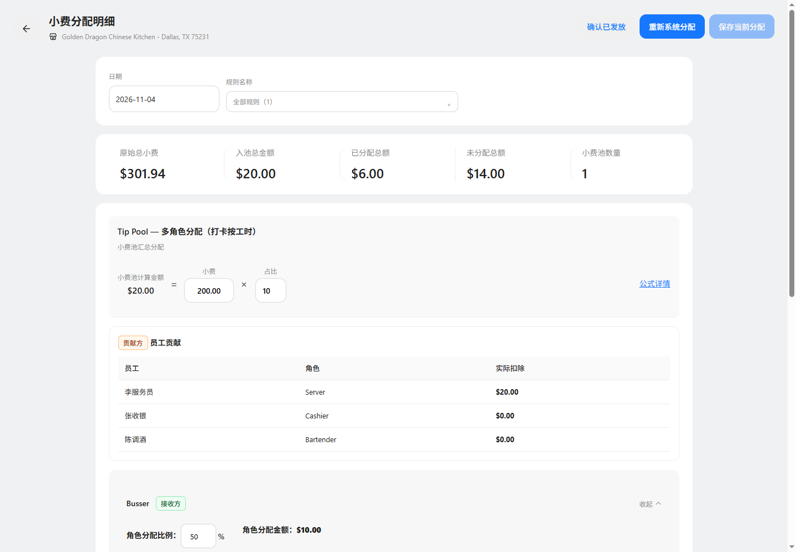

# 明细提示文案精简验证

基线 main@4c30d7a8；功能分支 codex/tips-detail-copy-cleanup-20261106；端口65254。

已确认状态的资金快照说明、贡献快照说明及页头默认全量确认说明不显示，空段落和占位同步收起。预计试算、余额不足及未保存修改提示保持原定义。未改变计算、保存和发放行为。

真实浏览器确认三类文案均不存在，默认页头提示隐藏，系统重新分配与保存按钮保留，未发生浏览器异常。三份文档引用的实际截图与实现证据检查通过。业务定义版本保持不变。

