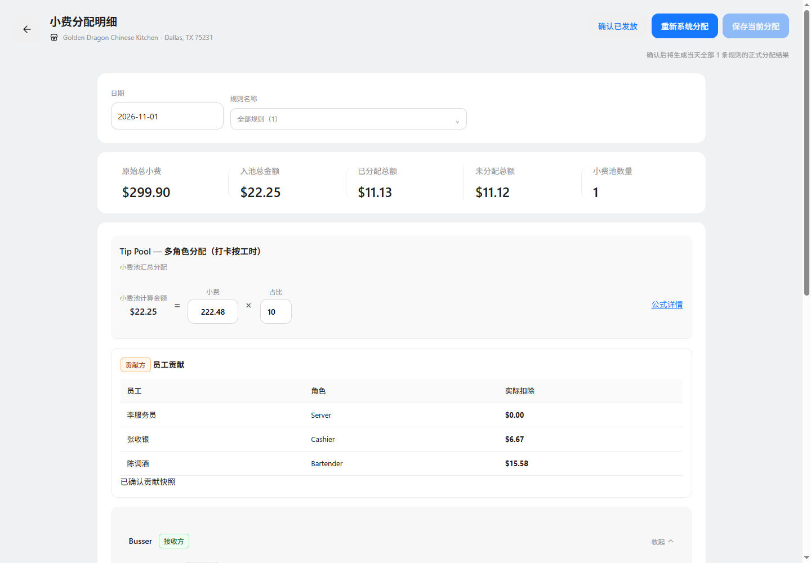

# 小费分配明细展示验证

基线 main@cb2549c4；功能分支 codex/tips-detail-fixed-store-20261106；端口65253。

门店图标和名称在标题下方只读展示。日期只读展示来源营业日，无日历或切换操作；规则筛选可用。页头无“更新小费数据”入口。

扣除方仅展示员工、角色与实际扣除；预计状态显示预计实际扣除。不展示贡献方权重、营业额、比例、应扣金额和可扣余额列。余额不足说明保留；底层计算、快照和接收方权重不变。

实际浏览器验证1440px及768px，来源日期2026-11-01正确显示；门店名称、图标、只读属性、按钮缺省与三列表格均通过，无浏览器异常。模型测试覆盖各类贡献快照的金额和列定义，三份文档与截图来源检查通过。

