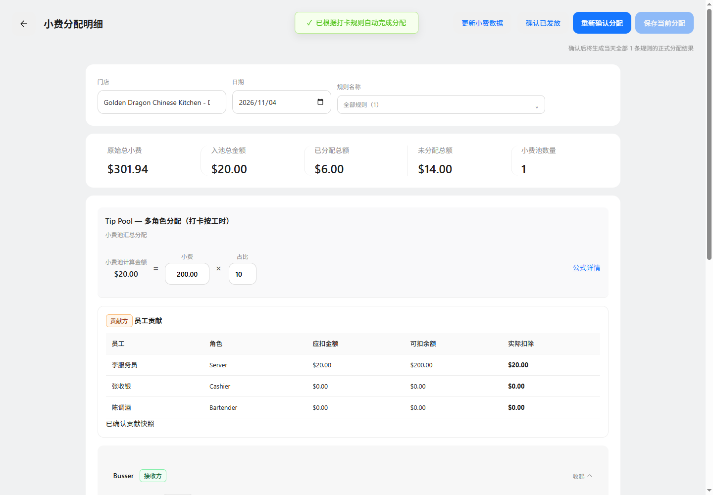

# 小费分配明细页头对齐验证

业务基线：main@a15332d2；功能分支：codex/tips-detail-update-align-20261105。

更新小费数据与其他页头操作按钮顶部对齐，范围说明保留在操作行下方。按钮事件、分配计算和状态逻辑保持现有定义。

实际浏览器验证：1440px、768px 视口下，更新、重新确认分配、保存按钮顶部均为 24px，高度均为 44px；无浏览器异常。三份业务文档的页头定义仍适用，版本不变；实现证据哈希已同步。

