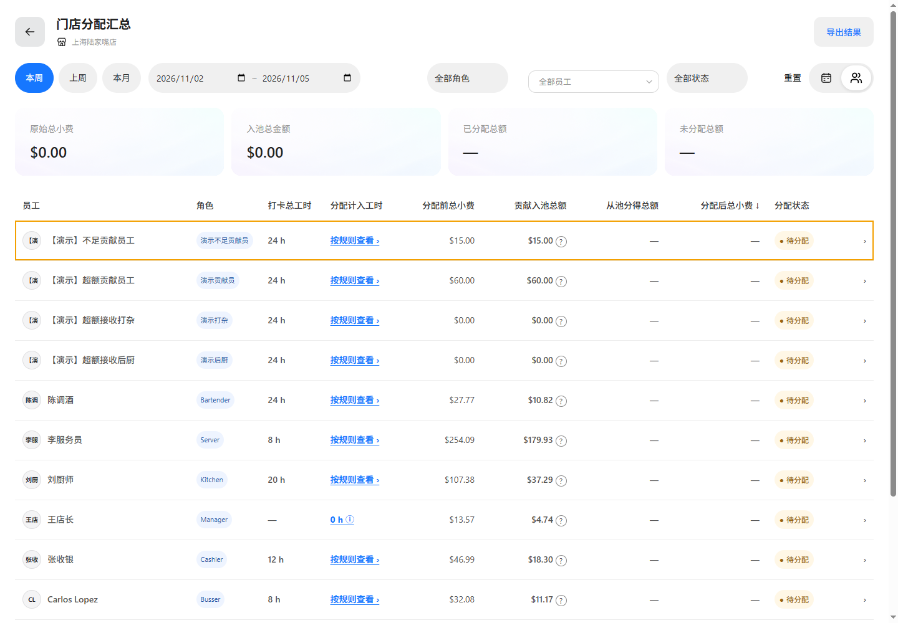

# 员工明细返回上下文验证

基线 main@0b8b7e4f，功能分支 codex/tips-employee-back-store-20261105，实际端口 65249。

返回使用来源门店的员工汇总查询。来源历史带有同一门店时保留其参数；缺少来源参数时，使用明细上下文中的门店及原日期范围构造员工汇总地址。金额、分配状态、员工快照保持不变。

实际浏览器验证：从非默认门店 Golden Dragon Chinese Kitchen - Dallas, TX 75231 的员工列表进入员工明细后点击返回，仍为同一门店员工视图，日期保持 2026-11-02 至 2026-11-05。既有三份文档的恢复来源查询定义适用；文档一致性及实现证据校验通过。

