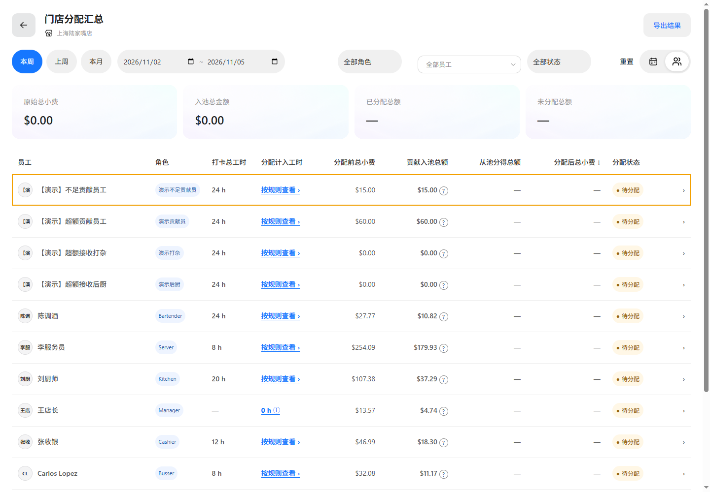

# 员工明细往返性能验证

业务基线：main@ff6cdf62；功能分支 codex/tips-employee-navigation-perf-20261105；端口 65250。

员工列表恢复查询后仅执行一次汇总；页面脚本工厂按视图复用，每次仍创建独立运行时、事件与数据作用域。已移除的角色汇总不再计算。无金额缓存，不改变分配计算及门店访问范围。

同一浏览器三轮往返，基线进入207/227/229毫秒，返回395/245/345毫秒；最终复测进入196/194/203毫秒，返回259/271/225毫秒。计时包含点击至目标内容绘制，受机器负载影响，不作为固定性能承诺。

浏览器连续往返后员工行文本、门店、日期保持一致，无浏览器异常。员工汇总、入口性能、视图切换回归、TypeScript检查和文档一致性校验通过。既有三份业务定义保持有效，源文件证据哈希同步。

