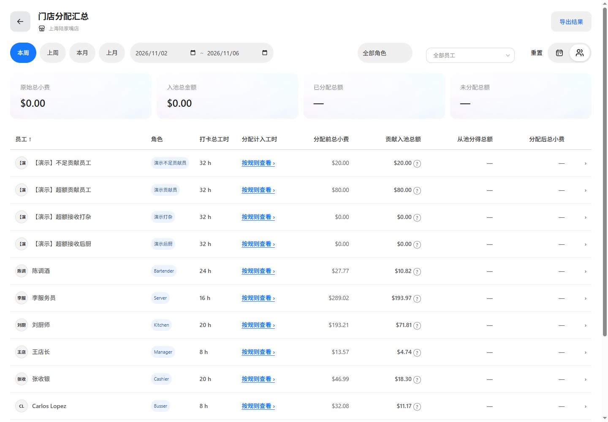

# 员工汇总状态展示验证

基线：main@a8ae0dd7。功能分支：codex/tips-employee-remove-status-20261106。

员工汇总不展示分配状态列和分配状态筛选，CSV/PDF不输出员工周期状态。历史状态筛选不约束员工列表。日期汇总及员工每日明细状态保持原有定义。

验证通过：专项表格/导出校验、employee-reconciliation、summary-switch-performance、current-spec-docs。外部浏览器验证实际员工列表、列对齐、排序及旧状态筛选刷新兼容；演示员工初始化完成后复核通过。

页面截图：

预览：127.0.0.1:65255。当前修改未提交、未合并。
