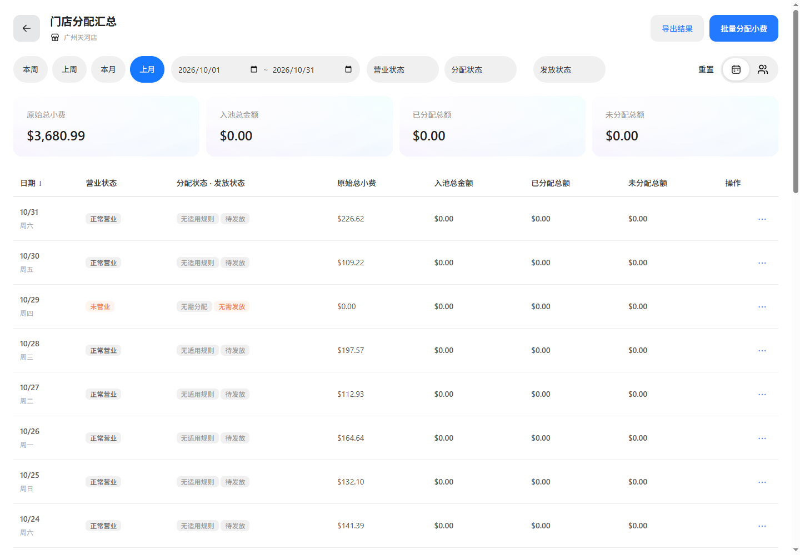

# 上月快捷日期验证

基线 main@aa3db7f7，功能分支 codex/tips-last-month-shortcut-20261105，端口 65252。

看板和门店日期／员工汇总均提供上月快捷项。浏览器本地日期计算上个自然月的首日至末日；选中项蓝底白字，datePreset=last-month 随日期传递。

实际浏览器点击上月，日期为2026-10-01至2026-10-31；看板沿用自动分配流程并完成，进入门店汇总后保留日期与蓝色选中态；门店切到本月再切回上月，范围正确。无浏览器异常。闰年二月、普通二月、跨年、显式标识与日期推断回归通过。三份文档一致性校验通过。

