# 小费分配业务规格说明书（研发交付版）

版本：**V3.76**　日期：2026-11-10　文档编号：TIPOUT-STORE-AUTO-PERIOD-20261110-01

实现基线：`851ade7d`；功能分支 `codex/tips-store-auto-period-20261110`。本文定义当前页面、字段、计算与异常规则。

配套文档：[产品说明 V4.76](PRD_产品需求文档.md)／[页面说明 V2.74](小费管理需求文档（个人规范版）.md)。

本文定义现行对象、字段、计算、状态、写入和异常；页面字段按第7节定位。浏览器本地存储不是后端API，发放登记不执行付款。

本文职责：字段、对象关系、状态流转、计算顺序、持久化和异常算例。三份文档使用同一业务基线；页面样例数据不作为默认业务参数。

截图形式：提示、确认弹框、取值条件与员工权重抽屉均保留完整界面、遮罩和入口页面背景；背景用于定位操作入口，不仅截取弹框或抽屉本体。

## 1. 范围与使用入口

小费管理包含小费分配、分配规则两个子菜单。分配页面提供看板、独立全屏门店汇总、员工每日明细和当日分配明细；规则页面提供列表、新增和编辑。

当前实现使用本地业务事实和浏览器存储。确认分配保存计算快照；确认已发放登记状态，不执行转账。CSV可下载。汇总页优先生成并下载PDF，生成失败时转打印预览；员工每日页通过打印窗口保存PDF，弹窗被拦截时提示。邮箱入口提供模拟发送反馈，不实际投递。金额以美元展示，保留两位小数。

| 页面 | 路由／入口 | 作用 |
| --- | --- | --- |
| 小费分配看板 | `/team/tips/distribution` | 自动分配、任务进度、规则配置状态、失败事项与门店列表。 |
| 日期分配汇总 | `/team/tips/distribution?screen=store&store=门店&startDate=开始日&endDate=结束日` | 独立全屏展示单店金额及发放状态，提供主动分配操作。 |
| 员工分配汇总 | 门店汇总员工视图；同一上下文追加`view=employee` | 按角色、员工查看周期结果及预计贡献。 |
| 员工每日明细 | 员工汇总行 | 查看指定员工逐日考勤、工时和金额。 |
| 当日分配明细 | 日期行的查看明细 | 查看全部规则，调整草稿，保存或系统重分配。 |
| 分配规则列表 | `/team/tips/rules` | 查看、新增、编辑、复制、删除规则。 |
| 新增／编辑规则 | `/team/tips/rules/editor`及对应规则上下文 | 配置来源、接收、资格、工时和贡献。 |

### 未分配日期明细提示

待补页面图片：未分配日期明细提示（完整页面背景与弹框）。

页面状态：未分配日期查看明细。共享依赖不可用，当前无可用功能预览截图。

入口：点击未分配日期行、键盘Enter／空格进入或更多菜单中的“查看明细”。

| 字段 | 逻辑说明 |
| --- | --- |
| 提示内容 | 该日期尚未分配小费，请先完成分配后查看明细。没有可识别的当日分配记录时同样拦截；不创建分配结果、不跳转。 |
| 知道了／关闭 | 关闭提示，保留当前门店、日期范围、筛选及列表位置。 |

日期明细入口以当日数据集的 allocated 布尔值判定：true允许跳转；false或日期记录不存在时拦截。先执行日期范围校验及未营业判断，再判断分配状态；不依赖显示金额是否为零。

算例：11月6日allocated=false时只展示提示；11月5日allocated=true时打开该门店11月5日明细，包含零分配金额的已确认记录。

## 2. 金额、人员与计算规则

### 2.1 金额口径

| 符号／名称 | 定义 |
| --- | --- |
| B：分配前小费 | 员工原始订单小费与手动上报小费之和；本轮接收不计入原始余额。 |
| P：计划池金额 | 各金额计算项按条件取值后，分别乘本项比例，再求和。 |
| C：实际贡献 | 贡献员工经过余额限制后的实扣总和；未确认时称预计贡献。 |
| E：老板补足 | 独立贡献资金路径中，`max(P−C,0)`；为资金解释项，不是员工扣款或付款凭证。 |
| D：可分配池金额 | 独立贡献资金路径中，`max(P,C)=C+E`。 |
| A：从池分得 | 员工本轮接收金额；汇总正式结果只统计已确认快照。 |
| U：池内未分配 | `D−ΣA`。接收人不合格、基数为0、人工比例未用满均可留下余额。 |
| F：分配后小费 | `B−员工贡献+A`。同一员工可以既贡献又接收。 |

当前编辑器的营业额扣除使用独立资金口径；仅选中扣除方的营业额项产生员工应扣。接收超过可用池或来源校验失败时禁止确认。

### 2.2 贡献与池预算

| 条件 | 独立贡献资金路径的处理 | 示例 |
| --- | --- | --- |
| C=0 | 按P分配，E=P。 | P=100、C=0，D=100、E=100。 |
| 0<C
P | 按C分配；不把贡献截断到P。 | P=10、C=20，D=20、E=0。 |

每条规则独立比较P和C。明细在C>P或C<P时显示对应金额对照及说明；C=P不显示差额提示。

### 2.3 营业额占比扣除

仅营业额（销售额来源）计算项支持扣除方。扣除方为可选单角色，默认空；不选择时，本项不从员工扣款，由商家承担。小费、手动上报小费和自定义金额不配置扣除方，金额仍计入小费池。

每个营业额项独立计算：

1. 本项应扣总额T＝该营业额项的来源营业额×计算比例。
2. 在扣除角色内，按该来源相同口径及取值条件取得员工个人营业额s。
3. 扣除占比＝员工个人营业额s÷当前扣除角色员工个人营业额合计。
4. 员工应扣＝T×扣除占比，精确分币；实扣＝min(应扣,当前可扣余额)。少扣不转给其他员工，不重新分摊。

显示比例保留两位小数；金额按未舍入的个人营业额占比精确分币，尾差按员工ID稳定分配。

例：门店营业额10000，营业额项设置5%，T=500；扣除方为服务生，A/B/C个人营业额1000/2000/2000，扣除占比20%/40%/40%，应扣100/200/200。

若A仅可扣20，则实扣20/200/200，C=420；仅此营业额项且P=500时，老板补足80，D=500。若另有不扣员工的来源200，P=700、C=420，老板补足280。贡献按规则、来源项保存顺序消耗余额，本轮接收不回流为后续可扣余额。

T>0而所选角色没有有效员工，或个人营业额合计为0时，明确报错，不自动平均扣除。T=0时不扣款。未确认日期按个人营业额占比计算；已确认日期快照不随模板编辑变化。

### 2.4 接收组、算法与权重

每条规则的明细分别展示贡献方和接收方。贡献方使用橙色文字、浅橙底标签，接收方使用绿色文字、浅绿底标签，同时保留身份文字。同一员工可以分别出现在两个区域；扣除与分得不以净额代替。

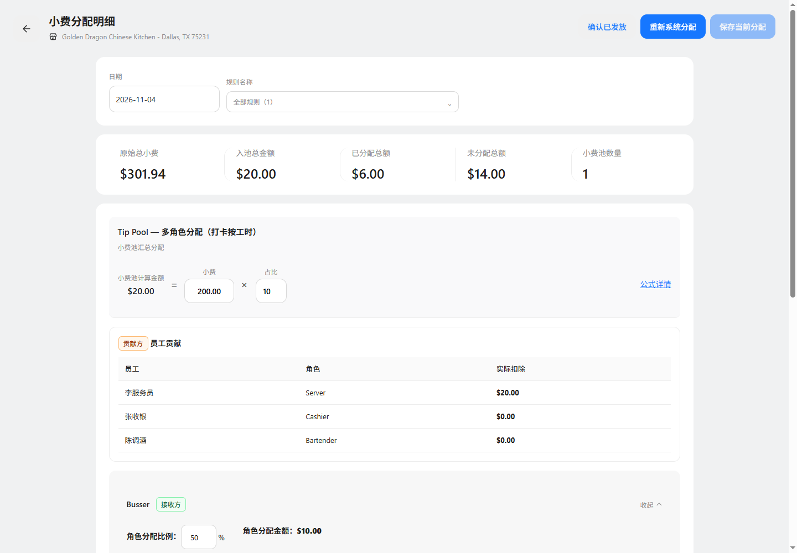

图：当前功能分支实际页面；4c30d7a8＋TIPOUT-DETAIL-COPY-CLEANUP-20261106-01，2026-11-06；门店与日期只读，已确认状态不展示快照及全量确认提示。

贡献区表格仅展示员工、角色和实际扣除，不展示贡献方权重、比例、应扣金额或可扣余额列。确认前使用“预计实际扣除”，确认后读取快照；余额不足的说明独立展示。只有汇总贡献流水时按员工展示实存的实际扣除；缺失贡献依据时提示“贡献明细暂不可用，请重新计算后查看”，不得补造零金额或按当前规则重算已保存扣除。商家承担方式明确显示“无员工贡献，由商家承担”。

先确定接收组预算，再筛选合格员工，最后计算员工金额。一行多个角色构成共同接收组，同组员工按ID去重；不是每个角色各分一遍预算。

- 组预算=可分配池金额×组占比。接收组占比合计100%。
- 员工有效基数=算法基础值×员工权重；不合格员工基数为0。
- 自动员工比例=有效基数÷组内有效基数总和。
- 员工金额由组预算和未舍入比例分币；组内基数全为0时保留余额，不改为均分。

| 分配方式 | 基础值 | 示例：组预算600，A/B/C权重1/2/1 |
| --- | --- | --- |
| 按员工数量平均分配 | 每位合格员工为1 | A/B/C为150/300/150。 |
| 按工作时长占比分配 | 该规则采用的分配工时 | 工时6/3/3小时，金额240/240/120。 |
| 按订单占比分配 | 有效归属订单笔数 | 订单4/2/2笔，金额240/240/120。 |

员工权重缺省1，0合法，最大1,000,000；不要求合计100%。权重1.1的换算百分比为110%，仅供解释，不是最终分配比例。

### 2.5 接收员工打卡要求与工时

图：当前应用实际页面，隔离演示数据；来源基线64ddec8f，2026-10-27。对应操作与状态见图像清单。

按整日是默认时间范围。默认“需有有效打卡”，另可选“不限打卡状态”。这两个条件只影响接收员工，不改变贡献员工范围。

| 条件 | 对三种算法的影响 |
| --- | --- |
| 需有有效打卡 | 按有效打卡或明确补录的参与依据建立名单；再按对应算法及权重分配。 |
| 不限打卡状态 | 平均方式仍需有效参与名单；工时方式需有效或明确录入的工时；订单方式可使用未打卡员工的有效归属订单。不自动纳入全部在职员工。 |

按工时分配时，可采用有效打卡工时，或按员工逐日应用0.1—24小时、最多一位小数的上限。明细中明确录入的工时优先于自动上限，不修改原打卡。平均和订单分配不使用该工时设置。

### 2.6 精度与一致性

金额按整数美分计算、两位小数展示。自动分摊先向下取整，再按小数余数从大到小补齐尾差，相同余数按稳定顺序处理。100美元三人等权为33.34/33.33/33.33。

普通按日工时明细允许明确修改最终员工比例；按该比例直接计算，不再乘一次权重或工时。合计低于100%留下余额，超过100%拒绝保存；改变工时或权重会重建自动比例。

每池核对：`C+E=D=ΣA+U`；整日核对：`ΣB+ΣE=ΣF+ΣU`。归集路径另校验其资金来源和贡献约束。

### 查询、导出与条件边界

- 员工每日页只允许在来源查询周期内调整日期；越界、空值或倒置时保留输入并标错，继续显示上次有效结果，不启动自动分配。
- 角色筛选约束员工列表；员工候选随角色更新并移除无效选择，全选或全部取消均表示全部员工。
- 分配工时明细由员工汇总行、员工每日页周期摘要及每日行打开；列为规则名称、规则类型、计算说明、分配计入工时、有记录／适用天数。
- CSV直接下载。日期／员工汇总PDF优先生成下载，失败转打印预览；员工每日页使用打印窗口，由用户保存PDF。弹窗拦截提示失败，不修改账本。
- 主动分配遇整个规则目录为空时提示“请先创建小费分配规则”并进入规则列表；看板无规则门店的分配状态显示未分配，规则配置状态显示未配置，不入队、不计为执行失败。
- 来源条件的有效维度、必填与互斥见页面说明§7.15。销售额、小费、服务费至少一个有效条件，手动上报条件可为空；角色和员工互斥，Payment Method口径与菜单互斥。
- 当前贡献资金试算的演示事实支持Net Sales及cash、credit_card支付方式；缺少对应事实的口径或条件报错且不保存快照。手动上报在该资金分支按角色／员工过滤后累加reportedTips，不应用营业时间条件。配置可保存与运行可计算分别校验。

## 3. 状态与操作流程

### 3.1 三类状态

| 状态对象 | 状态 | 判定与效果 |
| --- | --- | --- |
| 营业 | 正常营业／未营业 | 有有效小费或打卡事实可营业；未营业日显示0、无需分配、无需发放。 |
| 分配 | 未分配／已分配／无需分配 | 未分配无有效确认；已分配已有有效日期快照；未营业无需分配。已确认接收为0也可属于已分配。 |
| 发放 | 待发放／已发放／无需发放 | 分配确认后可登记发放；已发放锁定整日快照；未营业无需发放。 |
| 编辑 | 未调整／有未保存调整／已保存 | 当日草稿未保存不进入正式统计；人工保存形成manual快照，系统计算形成system快照。 |

### 3.2 看板自动分配

图：小费看板与订单中心导航，main@d31b1792 基线的功能分支实际页面，2026-11-07；隔离演示数据。导航展开不重新检查或启动分配任务。

原生宿主仅在同一路径、同一门店作用域且仍已挂载时复用运行时；重新挂接当前滚动容器。真实路由切换先销毁原宿主。自动任务复用同一存活断言，包含真实路由、宿主连接状态和运行时销毁状态；Web Lock 内及异步快照准备后的写入检查继续执行。

规则配置状态以带文字的标签展示：已配置为绿色浅底，未配置为橙色浅底；颜色仅帮助识别，规则适用和分配状态判断保持独立。

小费管理→小费分配进入看板，默认本周周一至今天。按当前可访问门店及有效日期范围预检，每个“门店＋日期”为独立任务。

- 有适用规则、营业事实可分配、未确认且未发放的日期入队，同一门店日期只入队一次。规则引用或计算异常由执行阶段记录具体失败原因。
- 按门店列表顺序、门店内日期升序逐日执行；单日失败继续后续任务，成功结果不回滚。
- 已处理任务＝成功＋失败＋跳过；进度分母为本次实际入队任务数，不是日历天数。执行时发现已确认、已发放或无需分配则跳过。
- 检查及执行期间禁用看板全部操作，包括日期、搜索、规则入口、门店入口、任务明细和重试；进度持续更新。结束后恢复操作，结果保留在看板，没有关闭任务操作。
- 全部已分配或无需分配时不创建新队列、不改快照，展示无待处理任务或同范围已完成结果。无规则门店的分配状态显示未分配，规则配置状态显示未配置，不生成任务。
- 全部任务结束且仍有失败时才显示“重新自动分配”，仅重试失败任务。失败事项列出门店、日期及原因，可进入对应日期处理。
- 点击门店进入独立全屏汇总。汇总进入及有效修改日期时检查当前门店的待分配日期，按下节执行；视图、状态筛选、排序及通知重绘不另起自动任务。原有主动分配入口保留。
- 仅展开、返回或搜索导航时保留当前看板、日期和任务进度，不重新预检或发起自动分配。
- 跳转其他页面时清理待启动任务并停止队列；调度、逐日执行、异步准备和保存边界均检查当前页面及作用域。离开后不再计算或保存后续日期，已保存快照保留。重新进入看板或门店汇总只补符合条件的未分配日期。

当日明细在标题下方展示门店图标和名称，筛选区不再展示门店字段，不支持切换门店；日期只读展示进入明细时选择的营业日，不提供日期切换。进入明细后，也会对符合条件、尚未确认的单日尝试系统自动确认；同一页面选择不重复尝试。失败后保留手动确认入口，不覆盖已有快照。

### 3.2.1 门店周期自动分配

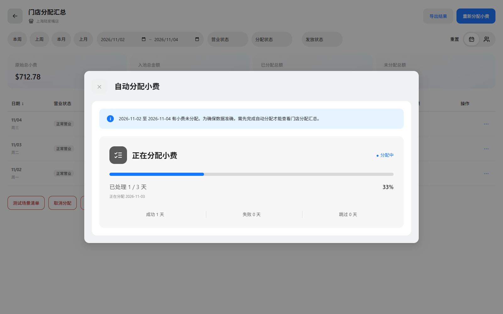

图：门店分配汇总中的自动分配流程；2026-11-10，main@851ade7d 基线的功能分支实际页面，隔离演示数据。

进入门店汇总（日期或员工视图）、有效修改起止日期、选择快捷周期或重置为本周时，检查当前门店及完整日期范围。列表的营业、分配、发放、角色和员工筛选不缩小任务范围。仅有适用规则、营业事实可分配、尚无确认快照且未发放的日期入队；已保存的系统或人工结果保留。全部已分配、无需分配、没有适用规则时，不打开自动分配界面。

| 字段／操作 | 逻辑说明 |
| --- | --- |
| 日期范围提示 | 展示本次选定的完整起止日期；任务只作用于当前门店。 |
| 分配状态 | 执行中为“分配中”；全部结束后为“分配完成”或“部分失败”。 |
| 当前日期 | 展示正在分配的日期；结束后显示“所有日期已处理”。 |
| 已处理天数 | 成功＋失败＋跳过；分母仅包含本次入队的可分配日期，不含已分配及无需分配日期。 |
| 进度百分比 | 已处理天数÷任务总数，四舍五入为整数百分比。 |
| 成功／失败／跳过 | 分别统计已保存、未能保存、执行时发现已有结果或无需分配的日期数。单日失败继续处理后续日期，成功结果不回滚。 |
| 关闭图标 | 运行中禁用；遮罩与 Esc 不能关闭。全部日期结束后可关闭，返回同一门店、日期及视图。 |
| 查看门店汇总 | 全部日期结束后显示；关闭进度界面，刷新汇总及金额，保留筛选和排序。失败日期仍为未分配。 |
| 重试失败日期 | 全部任务结束且仍有失败时显示。只重试失败日期，每次保存前再次检查已有快照及发放锁。 |
| 结果明细 | 存在失败时展示本次全部任务的日期、结果和原因，失败项排在前面；全部成功时隐藏。 |

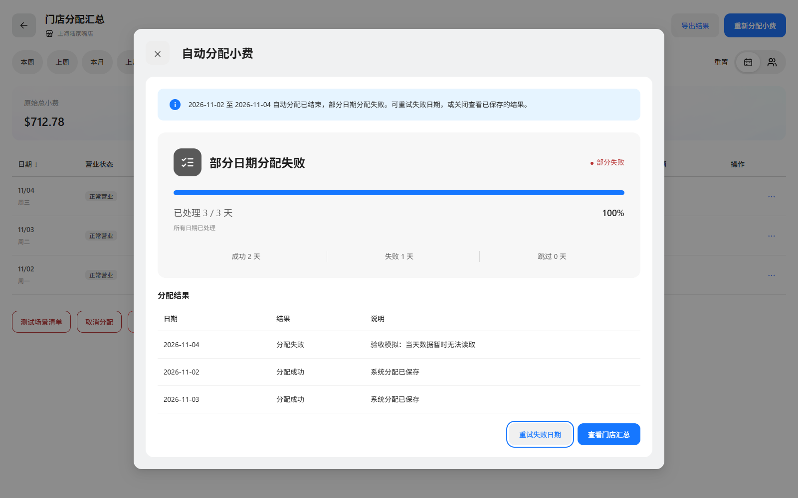

图：相同功能分支实际页面；一日数据读取故障为隔离验收注入，展示部分失败及失败日期重试入口。

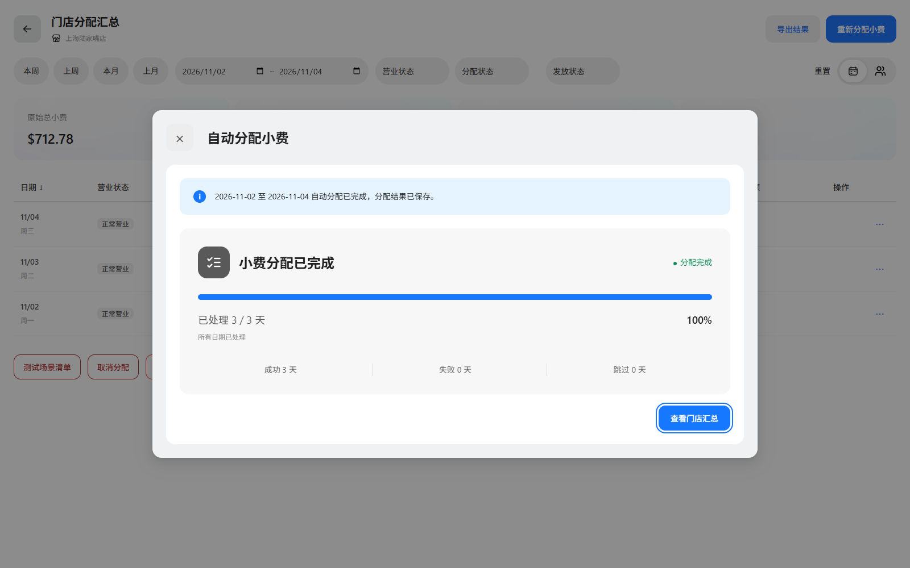

图：失败日期重试成功后的实际完成状态；关闭后展示当前门店汇总。

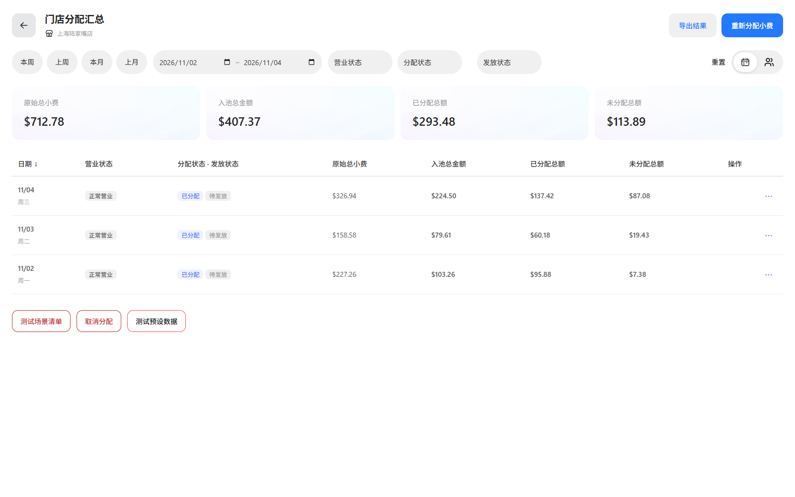

图：关闭后保留同一门店、日期和视图；所有日期已分配，再次检查不打开自动分配界面。

执行期间汇总页不可操作，任务逐日保存。快速连续选择周期，仅执行最后一次有效选择。退出实际小费页面后停止后续日期计算及写入；已成功日期保留，重新进入再检查未分配日期。关闭失败结果不会立即循环重试；可使用重试入口或原有单日分配操作。单纯切换日期／员工视图、调整状态筛选、排序或接收数据通知不另起自动任务。

例：选择10天，4天已有结果、2天无需分配、4天未分配。仅执行4个任务；若3天成功、1天失败，进度为4/4、100%，重试仅处理失败的1天。再次选择全部已分配的周期不打开进度界面。

任务标识为门店＋日期。预检通过 readAllocationScopeRows 读取整段日期，使用 TipOutDashboardModel.plan 去重与排除；storeSummaryAutoRevision 使已过期的预检不执行。storeSummaryAutoPlan 不读取列表状态或员工筛选值。

summaryAutoScope 同时记录 store、startDate、endDate 和可访问范围 key；调度及异步写入边界校验当前页面、门店和日期。TipOutAutoAllocation 顺序执行，成功日期经 onlyIfUnallocated 和 Web Locks 保护后保存。执行期间其他页面确认了同日结果时跳过，不覆盖。来源读取无法完成时提示错误，保留查询条件与已有结果，不伪造为0或成功。

运行态只保存进程内队列；关闭界面、路由退出不清除正式快照。任务结束刷新当前视图，失败日期没有正式写入；重试调用 run(true)，成功和跳过记录不重新执行。

### 3.3 分配工时的展示

| 数据条件 | 展示 |
| --- | --- |
| 没有规则记录 | —。 |
| 存在规则但均不使用工时 | 不适用。 |
| 适用工时规则但均没有有效采用值 | 待补录。 |
| 各适用规则的采用值相同且记录完整 | 单一小时数＋说明入口；不跨规则累加。 |
| 采用值不同或存在部分缺失 | 按规则查看，打开规则明细。 |

周期只在同一规则内逐日累计。规则明细可显示“有记录／适用天数”，不足时不把缺失天数补成0；员工权重不改变展示的工时。

### 3.4 保存、系统重分配与发放

| 操作 | 前置条件 | 处理与结果 |
| --- | --- | --- |
| 行内分配 | 正常营业、未分配、未发放，事实和规则可计算 | 按系统规则保存整日快照；需手动工时则转到明细补全。 |
| 明细确认分配 | 当日尚未分配、未锁定，所有规则校验通过 | 保存整日结果；规则筛选不缩小保存范围。 |
| 保存当前分配 | 已有结果且存在人工调整、未发放 | 确认后保存人工调整快照，更新汇总；取消保留草稿。无调整时只提示原因。 |
| 重新系统分配 | 已分配、未发放 | 按系统规则重建当日结果。有人工数据时先说明覆盖；取消保留原结果。 |
| 批量／重新分配小费 | 当前门店与合法日期范围 | 先检查范围与人工结果，再校验、提交；包含人工快照需明确确认覆盖，已发放和未营业跳过。先准备全部日期，计算失败不写任何日期；实际提交失败后停止后续日，已完成日保留。此操作不同于自动队列的失败后继续。 |
| 确认已发放 | 整日快照有效、未发放、无未保存修改 | 保存发放登记，锁定对应快照；失败仍为待发放，不执行实际付款。 |

## 4. 数据结构与计算入口

### 4.1 对象关系

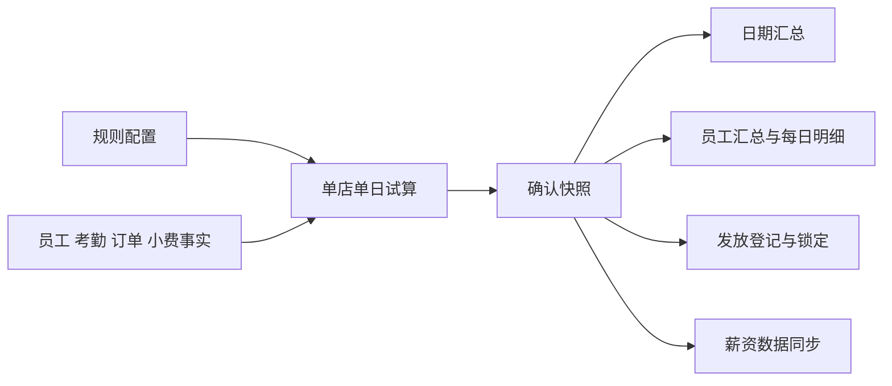

规则是模板；门店＋完整日期是一份整日快照的业务键；快照内按规则／池、接收组和员工分层。筛选只改变视图，不改变保存对象粒度。

### 4.2 规则字段

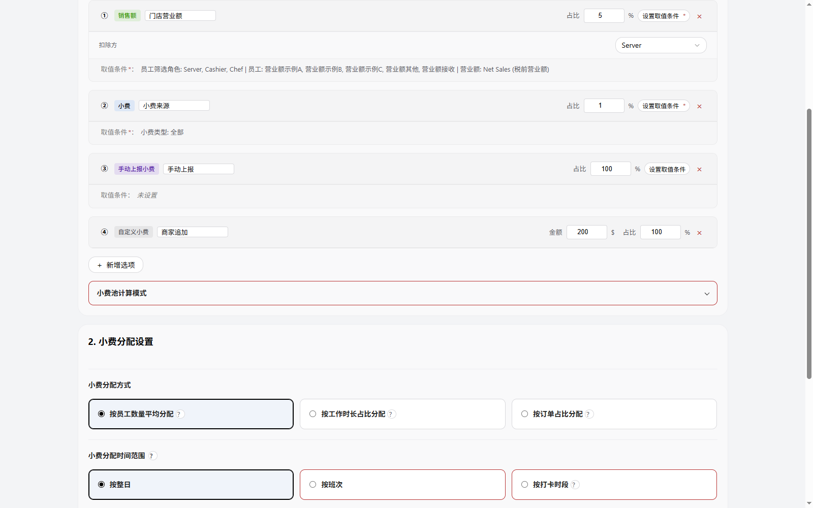

图：实际营业额项扣除方配置，2026-11-04。

扣除配置位于对应营业额项poolRules[].deduction内部，各来源项独立；非营业额项不接受deduction。规则配置与整日确认快照分别保存。

| 字段 | 类型／默认 | 现行含义与约束 |
| --- | --- | --- |
| id | integer | 规则目录生成的唯一标识；复制生成新ID，不复用结果快照。 |
| ruleName | string，必填 | 去除首尾空格；不能为空。 |
| store | string，必填 | 当前页面门店值；本地演示以门店名称字符串存储。 |
| poolKind | tip / surcharge，默认tip | 新增页独立类型模块的选中值；编辑按保存值回填且只读。 |
| allocationMode | string，legacy_pool | 当前普通汇总池的计算标识。 |
| poolRules[] | array | 来源计算项；汇总模式至少一项，每项包含type、name、pct和conditions，自定义项可有amount。 |
| poolRules[].pct | number，默认100 | 以百分数存储，计算除100；快照校验要求有限、非负、不超过100。 |
| poolRules[].deduction.version | 1 | 营业额扣除配置结构版本，仅type=sales使用。 |
| poolRules[].deduction.role | string，默认空 | 可选单角色；空表示该项不扣员工。数组及多角色非法。 |
| poolRules[].deduction.store | string | 该项门店，须与规则门店一致。 |
| deductConfig | object | 独立贡献规则配置；包含salesPct、personalSalesPct或tipIncome，单项对象或多项数组，独立保存人员与来源条件。无员工贡献时为空。 |
| deductRoles | string[] | 扣除角色去重集，用于范围引用；不是金额计算来源。 |
| deductEmployees | null | 独立贡献规则可按角色或员工取值，营业额项扣除方只支持单角色。 |
| contributionRules[].poolRuleId | string | 关联营业额来源项ID。 |
| contributionRules[].shareMode | sales_proportional | 按个人营业额计算扣除占比。 |
| contributionRules[].sourceAmount | number | 当日该营业额项入池金额，与本项plannedContribution一致。 |
| contributionRules[].employees[].salesAmount | number | 同口径、同条件的员工个人营业额。 |
| contributionRules[].employees[].pct | number | 个人营业额占比×100，金额不按显示舍入值计算。 |
| receivers[] | array | 接收组，包含roles、pct、employeeWeights；各接收组占比合计100%。 |
| receivers[].roles | string[]，非空 | 本组共同接收角色，保存核对当前门店有效角色及员工引用。 |
| receivers[].pct | number | 大于0且不超过100，各组合计100；新行0为待填写值，不能作为有效组保存。 |
| receivers[].employeeWeights | object | 当前实现按角色和员工显示键保存权重，即employeeWeights[role][employeeName]；读取缺省1。不是全局employeeId映射，员工身份及汇总去重仍使用名册ID。 |
| distribution | average / hours / orders | 算法枚举，默认average。 |
| allocationScope | string，day | 同一营业日内计算和分配。 |
| clockin | clock / unrestricted | 默认clock；按接收要求和算法所需名单、工时或订单依据计算。 |
| workHoursConfig.mode | actual / capped | 工时方式的默认采用模式，默认actual。 |
| workHoursConfig.maxHoursPerDay | number / null | capped时0.1—24，最多一位小数；其他模式不使用。 |
| contributionMode | merchant / employees | 贡献方式选择：merchant不扣员工；employees使用独立贡献规则或已选扣除方的营业额项；二类配置不能同时启用。 |
| employeeWeights | 映射 | 规则范围内的员工权重；缺省1，0合法，最大1,000,000，不等于百分比。 |

#### 营业额扣除数据关系

图：当前功能分支实际页面；4c30d7a8＋TIPOUT-DETAIL-COPY-CLEANUP-20261106-01，2026-11-06；门店与日期只读，已确认状态不展示快照及全量确认提示。

规则模板→poolRules营业额项→单个扣除角色→员工个人营业额→本项应扣／实扣→规则实际贡献C。多个营业额项分别计算，按保存顺序共用员工剩余余额；其他来源只增加计划池金额P。

日明细公式覆盖按来源项顺序传入sourceTargets；输入长度必须与来源项数一致，基数与比例均须有效。对应来源项金额同时用于试算和正式快照校验。模板保存不改已确认结果；读取快照保留实存规则字段（包括employeeShares），不以当前模板重算已确认扣除。

保存快照须核验sourceAmount＝plannedContribution、pct与个人营业额占比一致、应扣与未舍入的个人营业额占比分币一致、实扣与余额封顶一致。T>0且没有有效员工或个人营业额合计0时失败；T=0不扣，不阻断其他来源。

#### 独立贡献配置与保存

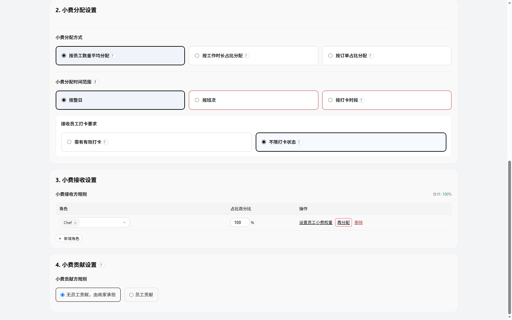

图：普通小费规则的独立贡献设置区块，完整页面背景；功能分支实际页面，2026-11-04。

用途：配置贡献方式及独立贡献规则；无需先添加营业额来源项。贡献员工不由接收员工打卡要求决定。

| 字段 | 逻辑说明 |
| --- | --- |
| 无员工贡献，由商家承担 | 默认选中。不写入独立贡献配置；切换时清空营业额项扣除角色，防止隐藏的扣款仍生效。 |
| 员工贡献 | 展示新增选项与独立贡献规则；保存至少有一条有效独立规则或已配置扣除方的营业额项。 |
| 新增选项 | 可添加按照销售额占比、按照小费收入占比规则。两项可独立配置，多条规则逐条保存。 |
| 贡献占比 | 必填，大于0且不超过100%，最多两位小数；持久化时除以100。 |
| 设置取值条件 | 打开对应来源的取值条件抽屉；角色或员工必须选择一个，二者互斥。条件按贡献项独立保存，不改小费池来源条件。 |
| 删除贡献项 | 删除当前项草稿；不改其他项，不修改已确认分配结果。 |
| 保存规则 | 校验比例、人员范围和规则完整性，保存贡献方式、独立规则与条件；重开回填。无效输入留在编辑页。 |
| 配置冲突 | 独立贡献规则与营业额项扣除方不能同时启用；提示先清空其中一类配置，不覆盖、不重复扣款。 |

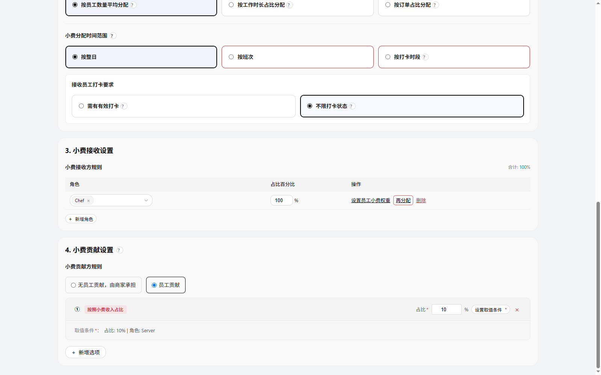

图：小费收入贡献规则，包含贡献比例与角色条件，不提供员工权重设置，2026-11-04。

独立配置载入时通过loadDeductRulesFromRule恢复贡献卡片与比例、角色／员工、来源条件；保存保留deductConfig。营业额项未选扣除方时，不得用空的deduction覆盖独立配置。员工权重不作为本编辑器可配置字段；已确认快照读取实存结果，不重算。

| 字段 | 逻辑说明 |
| --- | --- |
| deductConfig.tipIncome.rate | 小费收入贡献比例，百分数除100后保存。无来源细分条件时，以所选员工分配前小费为基数；有条件时读取匹配小费，缺少归属依据时报错。 |
| deductConfig.salesPct.rate | 销售额贡献组比例。同一规则多个贡献组按比例拆分池金额，组内按原始可扣小费余额占比分摊；有员工取值配置时沿用其逐员工贡献依据。 |
| deductConfig.*.scopeType | role或employee，二者互斥；人员至少选择一项。 |
| deductConfig.*.roles | 角色范围，多选取并集，员工身份去重。 |
| deductConfig.*.employee | 员工取值范围，保存名册引用并核对门店。 |
| deductConfig.*.conditions／salesConditions | 当前贡献项独立来源条件，不覆盖小费池来源条件。 |

#### 页内类型选择与状态

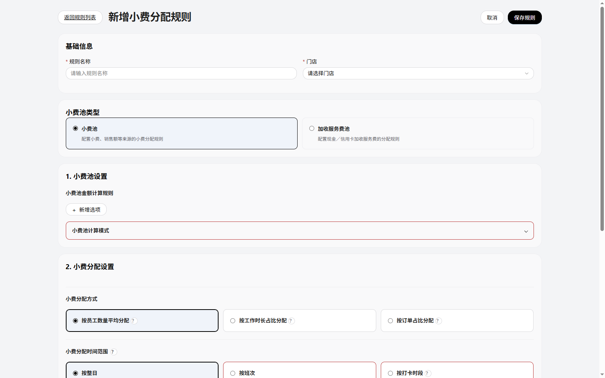

图：新增规则默认状态，基础信息下方独立展示小费池类型；完整页面，功能分支实际采集于2026-11-04。

入口：规则列表点击新增规则直接进入新增页面，不经过类型选择弹框。

| 字段 | 逻辑说明 |
| --- | --- |
| 小费池类型 | 单选，必有一个值；普通新增默认小费池。携带poolKind=surcharge的新增地址预选加收服务费池；其他值按小费池初始化。 |
| 小费池 | 提供销售额、小费、手动上报及自定义小费来源，展示小费贡献设置；保存poolKind=tip。 |
| 加收服务费池 | 提供加收服务费与自定义加收来源，隐藏小费贡献设置；保存poolKind=surcharge。 |
| 切换类型 | 没有类型专属配置时直接切换。已有金额来源、贡献项或专项草稿时先确认；取消保留全部草稿，确认清空来源及贡献配置。名称、门店、接收角色、占比和普通分配方式保留。 |
| 编辑规则的类型 | 按已保存poolKind回填，选项只读；编辑地址中的类型参数不能改变已保存类型。 |

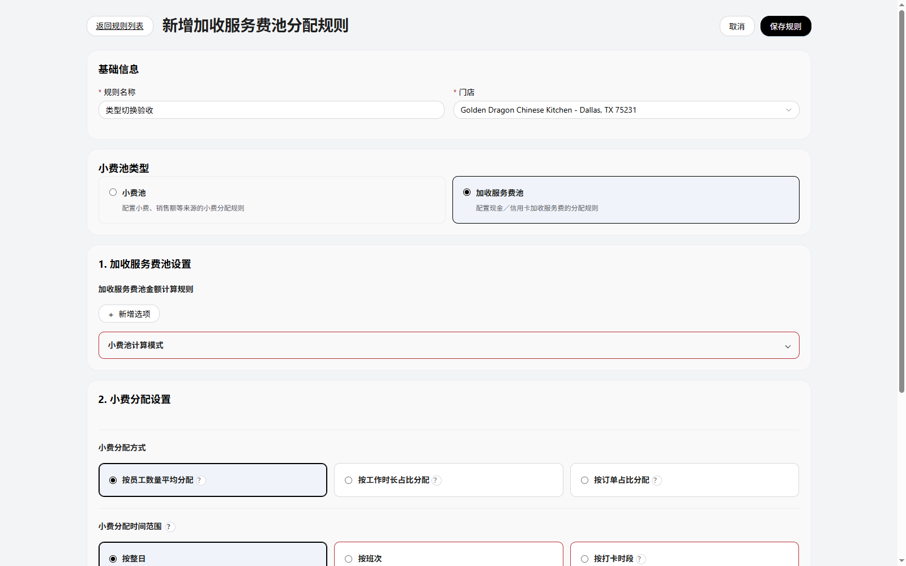

图：新增页选择加收服务费池，标题、金额来源及贡献区域同步，2026-11-04。

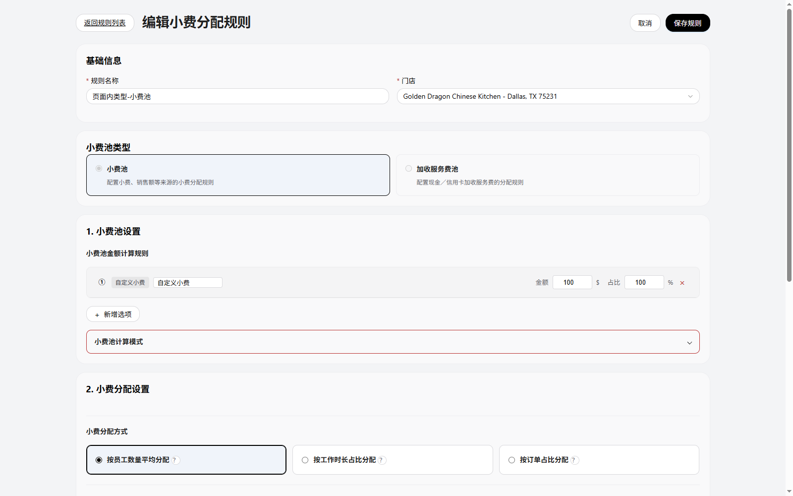

图：已保存规则的类型只读展示，2026-11-04。

新增入口不创建规则；只有保存成功时才持久化poolKind及当前类型允许的来源。切换类型不改已确认分配结果。临时目标pendingRulePoolKind只在确认前持有，取消后清空，不把目标类型提前保存。编辑态设置rulePoolKindReadOnly，UI和事件处理双重禁止改类型。

#### 金额来源与条件字段

| 字段 | 类型、默认和取值规则 |
| --- | --- |
| poolRules[].type | sales、tips、manual、custom、surcharge之一；受poolKind允许来源限制。 |
| poolRules[].name | string，默认来源名称；用于页面、公式和结果展示。 |
| poolRules[].amount | 非负有限金额，仅自定义来源使用，默认0；乘pct得到本项金额。 |
| poolRules[].conditions | object，各来源独立保存；不同维度取交集，同一维度的多选值取并集。缺少计算所需事实必须报错。 |
| conditions.role | string[]，来源角色过滤；仅过滤来源数据，不作为扣除角色配置。 |
| conditions.employee | array，员工过滤，候选受门店和角色引用约束；不通过姓名把跨门店人员合并。 |
| conditions.revenueType | string；UI候选Net Sales (税前营业额)、Gross Sales (总销售额)、Payment Method (支付方式)。资金试算分支只接受全部或Net Sales，其他口径报错，不写快照。 |
| conditions.orderType | string，订单类型单选过滤。 |
| conditions.paymentMethods | string[]；当前资金试算支持cash、credit_card，订单card可匹配credit_card；其他值报缺少实付明细。 |
| conditions.area | string，订单区域单选过滤。 |
| conditions.menu | object，产品线、分类、菜单组或商品条件，按商品销售额取值。 |
| conditions.containsProduct | object，订单需包含商品的条件；不能把整单金额当作该商品销售额。 |
| conditions.hours | {start,end}，HH:mm字符串；来源发生时间的起止条件必须完整。 |
| conditions.tipType / tipTypes | 来源所支持的小费类型；仅用于小费来源过滤，不配置扣除方。 |
| conditions.orderTipStatus | string，has_tip或no_tip，分别表示有小费或无小费。 |
| conditions.surchargeType | string或string[]，服务费类型；资金试算分支缺少对应明细时拒绝，不以0代替。 |

| 来源 | 可选条件 | 保存要求 |
| --- | --- | --- |
| 销售额 | 角色、员工、区域、订单类型、菜单、营业额类型、订单小费状态、支付方式、营业时间 | 至少一个有效条件。 |
| 小费 | 角色、员工、区域、订单类型、营业时间、小费类型、订单需包含商品 | 至少一个有效条件。 |
| 手动上报小费 | 角色、员工、营业时间 | 条件可为空。 |
| 加收服务费 | 角色、员工、区域、订单类型、营业时间、小费类型、加收类型 | 至少一个有效条件。 |
| 自定义小费 | 无必填来源条件 | 使用非负金额和计算比例。 |

角色与员工条件互斥。营业额候选为Net Sales（税前营业额）、Gross Sales（总销售额）、Payment Method（支付方式）；选择Payment Method会移除菜单条件并提示，不能再添加菜单条件。

当前贡献资金试算使用的演示事实仅支持Net Sales口径，支付方式支持cash、credit_card；缺少对应事实的销售口径、菜单或加收条件会返回明确错误，不保存分配快照。当前贡献资金试算对手动上报来源先按角色／员工过滤，再累计reportedTips；此分支不应用营业时间过滤。条件能保存不等于当前演示事实能完成试算；应区分配置校验与运行取值校验。

来源条件抽屉只应用草稿，整页保存后写入tipout_rules。删除、取消配置均不直接修改已确认快照。

### 4.3 来源事实

| 字段／对象 | 类型与来源 | 使用方式 |
| --- | --- | --- |
| employeeId / name / role | string | 本地名册／演示来源；按ID核对和去重，不以姓名跨人合并。 |
| dateKey | YYYY-MM-DD | 完整营业日，真实日历合法性由日期助手检查。 |
| originalTips | 非负金额 | 订单小费＋手动上报小费；不能与两来源重复累计。 |
| orderTips / reportedTips | 非负金额 | 可贡献来源的原始余额。 |
| orders[] | 订单事实数组 | 包含归属员工、订单金额／小费、类型、支付、区域、商品及时间。筛选所需字段缺失时不可猜测命中。 |
| completedPaymentAt | 完整时间 | 订单小费事件的支付完成时间。 |
| occurredAt | 完整时间 | 手动上报小费的实际发生时间，用于来源营业时间条件；不是上报操作时间。 |
| 考勤／在岗区间 | 区间及有效标记 | 原始打卡与分配采用工时分别保存，不相互覆盖。 |
| 分配手动工时 | 规则＋员工＋日期采用值 | 普通按日明确录入优先于自动上限，不写回考勤事实。 |

汇总日期助手按浏览器本地日历计算快捷范围；不把它描述为已接入生产门店营业日截点。营业判定助手支持销售额、小费或有效打卡任一为正；当前汇总和明细调用传入salesAmount=0，主要依据小费和有效打卡事实。

### 4.4 快照字段

| 字段 | 类型／默认 | 定义 |
| --- | --- | --- |
| version / schemaVersion | number | 本地快照格式标识；提交准备补齐schemaVersion=1。 |
| store / dateKey | string | 整日业务键，存储键为store＋空字符分隔符＋dateKey。 |
| snapshotId | string | 每次确认生成的快照ID。 |
| snapshotVersion | integer | 基于当前快照版本加1。 |
| snapshotHash | string | 排除自身字段后规范序列化计算SHA-256；发放依据、更新冲突检测使用。 |
| confirmedAt | ISO时间 | 本次确认时间。 |
| allocationSource | system / manual | 系统确认或明确保存人工调整的来源。 |
| scenarioFacts | array | 当次来源事实，用于确认结果追溯。 |
| pools[] | array | 整日全部采用规则／池。 |
| pools[].ruleId / ruleName | string | 本次采用规则身份与名称。 |
| pools[].poolAmount | 非负金额 | 当次实际可分配池金额。 |
| pools[].employees[] | array | employeeId、name、role、hours、percentage、amount及适用的employeeWeight等。 |
| employeeAmounts[] | array | 员工deducted、received；按员工合并同日多池的贡献和接收。 |
| employeeContributions[] | array | 员工ID及贡献amount，供汇总／薪资消费。 |
| editorState | object | 明细采用的输入状态；载入后可回显人工采用值。 |
| summary.originalTips | 金额 | 当日原始小费合计。 |
| summary.poolAmount | 金额 | 当日各池实际预算合计。 |
| summary.allocatedAmount | 金额 | 当日正式接收合计。 |
| summary.unallocatedAmount | 金额 | 各池未分配余额合计。 |
| summary.poolCount | integer | 快照内池数量。 |

独立贡献快照中的funding记录target=P、contributed=C、actual=D、ownerContribution=E、excess=max(C−P,0)。contributionRules记录每项plannedContribution、actualContribution、shortfall和员工的due、available、amount、shortfall；单位均为金额。

### 4.5 存储与并发

| 存储键 | 内容与边界 |
| --- | --- |
| tipout_rules | 规则配置；保存、复制、删除规则只更改规则目录。 |
| tipout_allocation_results_v1 | 门店日快照文档。 |
| tipout_allocated | 门店已确认日期集合，与有效快照共同核对。 |
| tipout-payout-records-v1 | 发放登记，绑定snapshotId、snapshotVersion、snapshotHash。 |
| tipout_unconfirmed_updates_v1 | 更新来源后需要重新确认的标记；有标记禁止直接发放。 |
| tipout-manual-hours-v1 | 规则、员工、日期维度的手动工时记录。 |
| tipout-payroll-state-v4 / tipout-payroll-bridge-meta-v1 | 薪资本地承接及同步标记。 |

同一门店日写入使用Web Locks独占锁。新自动分配提交onlyIfUnallocated；人工替换校验基准哈希或指纹。锁内检查发放状态，异步快照准备后再次核对页面存活。冲突、损坏或不支持安全锁时失败，不绕过锁覆盖。

分配保存按日原子回滚；不是跨日期事务。自动队列失败后继续，主动批量提交失败后停止，两者必须分别处理。快照写入后Payroll同步失败仍属于分配成功，显示同步警告，不把已确认日期再当未分配重扣。

### 4.6 现行计算顺序

1. 载入当前门店日事实和所有适用规则，校验人员引用及来源完整性。
2. 逐项取来源基数并乘比例得到P；不同公式独立求值，重叠不会增加员工可扣余额。
3. 按营业额项金额及个人营业额计算应扣，再按员工剩余余额封顶。
4. 独立贡献路径计算C、E、D；其他归集路径按其可用资金约束，缺口或接收超额拒绝确认。
5. 依据接收组份额、资格、基础值及权重分摊。
6. 应用明确人工工时／比例，保留人工来源；重新改权重或工时会重建相关自动结果。
7. 校验金额、身份、份额、资金守恒，提交整日快照，再更新汇总和薪资。

### 4.7 看板任务与返回上下文

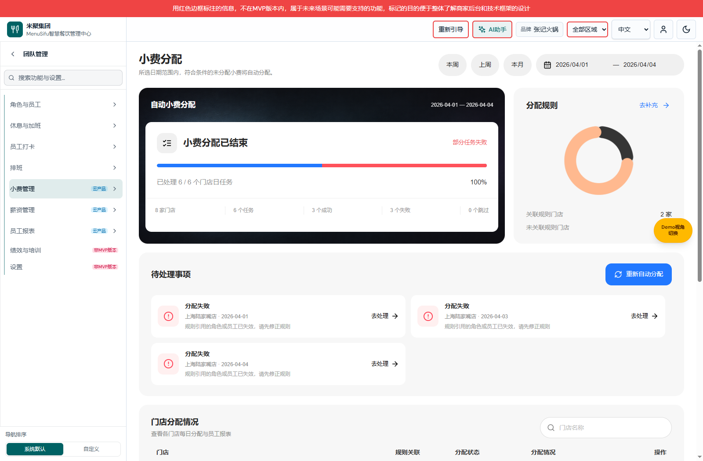

图：功能分支真实页面，2026-11-04，基线b5da1188；页面样例不作为默认业务参数。

| 字段／对象 | 定义 |
| --- | --- |
| screen | 缺省为看板，store为独立全屏门店汇总；view=employee兼容员工视图入口。 |
| store / startDate / endDate | 单店汇总的门店、起止日期；门店必须匹配可访问范围，无权限退回看板。 |
| summaryHref | 携带门店、日期及视图的完整汇总URL；日明细和员工每日页返回时恢复此上下文。 |
| task.store / storeLabel | store为快照业务主键；storeLabel为当前作用域展示名，别名不改变已存身份。 |
| task.date | YYYY-MM-DD，唯一键为JSON序列化的[store,date]。 |
| task.status | pending、running、success、failed、skipped。 |
| task.message | 保存说明或异常、跳过原因，不替代日期财务状态。 |
| dashboardBusy | 检查、执行期间为true；disabled、inert和捕获事件守卫共同阻止看板操作。 |
| scopeKey | 可访问门店与起止日期的序列化值；每次提交前校验范围及页面仍有效。 |
| task report | sessionStorage的tipout-dashboard-report-v1保存同范围结果和失败事项，仅供展示和重试；正式金额从日期快照读取，报告写入失败不撤销已提交结果。 |

pending→running→success/failed/skipped；重试只做failed→pending，计数按当前状态重算，不累加已解决失败。无任务不创建队列。按可访问门店顺序、门店内日期升序执行；重新读取日期及规则，调用现有快照准备和commit，携带onlyIfUnallocated、assertActive。单日失败继续，已成功结果不回滚；薪资同步异常作为成功附加警告。

同范围返回恢复报告，已有失败由用户显式重试，不自动循环。出现新的合格日期时重新预检。离开停止后续任务和晚到写入，已保存快照保留。报告不跨浏览器共享，也不代表后台任务持续执行。

门店分配情况分母为范围内可分配日期数，分子为已确认或已发放日期数；与本次任务分母独立。无规则不建立队列；读取失败单独展示，不伪造成功数量。

## 5. 可复算与验收场景

| 场景 | 输入／操作 | 预期 |
| --- | --- | --- |
| 贡献不足 | P=100，A应扣40但只能扣20，B应扣60且可扣60 | C=80，E=20，D=100；不转嫁A的差额。 |
| 贡献超计划 | P=10，C=20；接收两组60%／40%且各有合格员工 | D=20、E=0；组预算12／8；显示贡献超计划对照。 |
| 无贡献 | P=100，C=0，独立贡献路径 | D=100、E=100，不阻止合法分配。 |
| 加权三算法 | 组预算600；权重1/2/1；工时6/3/3；订单4/2/2 | 平均150/300/150；工时与订单240/240/120。 |
| 多角色共同组 | Server A/B与Busser C同一组120，同权 | 各40；不是先按角色一半分。 |
| 零基数 | 本组无人合格、全零权重、全零工时或订单 | 本组预算保留未分配，不自动转组或回退平均。 |
| 上限与手动覆盖 | 有效8h、规则上限5h；当日明确改8h | 默认5h，手动后8h，打卡仍为原事实。 |
| 混合周期贡献 | 已确认贡献30，待分配预计12 | 贡献总额42，问号展示“已分配日期：30”“待分配日期（预计）：12”“合计：42”，并提示“待分配金额为试算结果，以实际分配结果为准。”；接收和最终金额仍只统计确认部分。 |
| 全部无需自动处理 | 选中10天，其中8已分配、2无需分配 | 看板展示无需自动分配，不写快照。 |
| 仅一天待分配 | 同范围只剩1天合格未分配 | 队列1项，处理1/1，其他日期不改。 |
| 执行失败与重试 | 2任务中1临时失败、1成功 | 全部结束显示重试；只重试失败日。成功后失败0、重试按钮隐藏。 |
| 已发放保护 | 分配已登记发放后尝试编辑／更新／重分配 | 拦截，保留快照与发放状态。 |
| 保存冲突 | 弹框打开后其他页面更新同日快照 | 原提交不覆盖新结果，提示重新读取。 |
| 失败后同步 | 快照提交成功，Payroll同步异常 | 分配仍成功；提示同步失败，不重复扣款。 |
| 员工日期越界 | 来源10月1—25日，结束输入27日 | 标错并保留原有效结果；不查询越界日、不启动自动分配。 |
| 员工筛选清空 | 当前角色候选A/B，取消两人选中 | 规范化为全部员工，而非空结果。 |
| 来源口径失败与重试 | 普通销售来源选择Gross Sales，两天执行失败；改Net Sales后点击重试 | 首轮失败2；重试只处理这两天，完成成功2／失败0，隐藏重试按钮。 |
| 错误日期 | 缺值、非法日历日或开始晚于结束 | 保留上次有效列表和错误输入，不保存错误查询、不启动分配。 |

## 6. 支持范围与异常处理

| 条件 | 当前处理 |
| --- | --- |
| 门店、规则、员工或角色引用无效 | 阻止相关保存／确认，保留输入并提示修正。 |
| 公式金额、比例、工时、权重非有限数或为负 | 拒绝提交；合法0与缺失值分开显示。 |
| 接收组份额不是100%／人工员工比例超过100% | 阻止确认，不自行缩放。 |
| 员工权重为负、非有限值或有效合计为0 | 禁止保存权重；至少一名当前范围员工的权重须大于0。 |
| 依赖订单类型、支付、区域或商品信息但事实缺失 | 不猜测归属，不伪造0，提示不能计算。 |
| 手动上报小费缺少所选筛选维度归属 | 不能按该条件计算贡献，需有效来源。 |
| 快照损坏或发放依据不一致 | 保护性失败／只读，不把损坏当未分配覆盖。 |
| Web Locks或安全哈希能力不可用 | 阻止需要安全提交的操作，不绕过并发保护。 |
| 存储失败 | 当前日期回滚；说明已经完成和未执行日期，不报全部成功。 |
| Payroll同步失败 | 分配保存状态与同步状态分别说明，通过员工数据更新流程补同步。 |
| 无可导出数据、邮箱为空或格式错误 | 不执行导出／发送反馈，提示原因。 |

## 7. 页面字段与实现入口

### 7.1 日期分配汇总

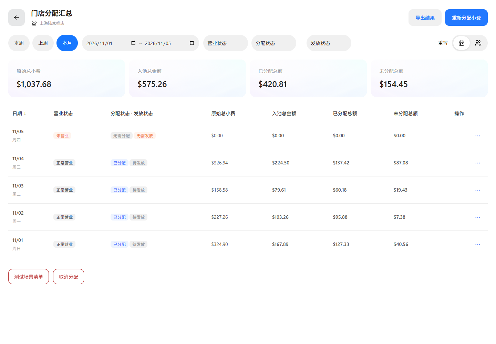

图：当前功能分支实际页面；d78a5de7＋TIPOUT-DATE-PRESET-CONTEXT-20261105-01，2026-11-05；看板选择本月后，门店日期与员工视图继承范围和蓝色选中态。

查询上下文`datePreset`为可选字符串：`this-week`／`last-week`／`this-month`／`last-month`表示选中项，`custom`表示手动范围、不选中。门店入口、返回看板和汇总URL同步该值；初始化按范围校验后恢复。缺省时按本周、上周、本月、上月顺序匹配；无匹配、未知标识或标识与范围不一致时不高亮。日期范围相同时优先显式标识。仅影响查询展示，不进入分配快照或金额计算。

快捷日期：`summaryDatePresets`提供本周、上周、本月、上月，调用`applySummaryDatePreset(key)`；范围由`TipOutSummaryDateSort.quickDateRange`按浏览器本地日期生成，周起点为周一。本周／本月至今天，上周取完整自然周，上月取上个自然月首日至末日。有效选择复用日期校验、查询刷新、URL与返回上下文同步；门店汇总检查当前门店的未分配日期，存在符合条件的日期时自动分配。选中项由`aria-pressed="true"`控制，背景#1677ff、文字#ffffff；看板与门店两个视图一致，仅改变样式。手动改日期清除快捷项选中态。角色、员工、分配和发放条件保持，切换员工视图共用日期。

页面字段：见[页面说明](小费管理需求文档（个人规范版）.md)第1节。实现：`src/team/tips/programs/distribution.js.txt`。

### 7.2 员工分配汇总

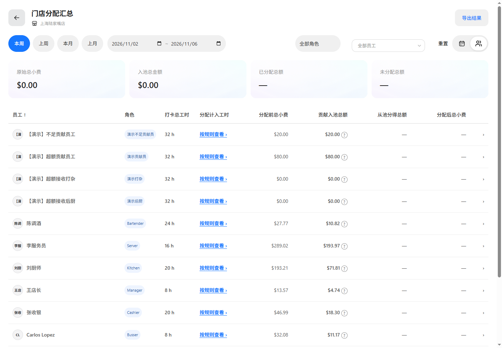

图：当前功能分支实际页面；a8ae0dd7＋TIPOUT-EMPLOYEE-REMOVE-STATUS-20261106-01，2026-11-06；员工汇总不展示分配状态列和状态筛选。

页面字段：见[页面说明](小费管理需求文档（个人规范版）.md)第2节。实现：`src/team/tips/programs/distribution.js.txt`。

### 7.3 员工每日考勤分配

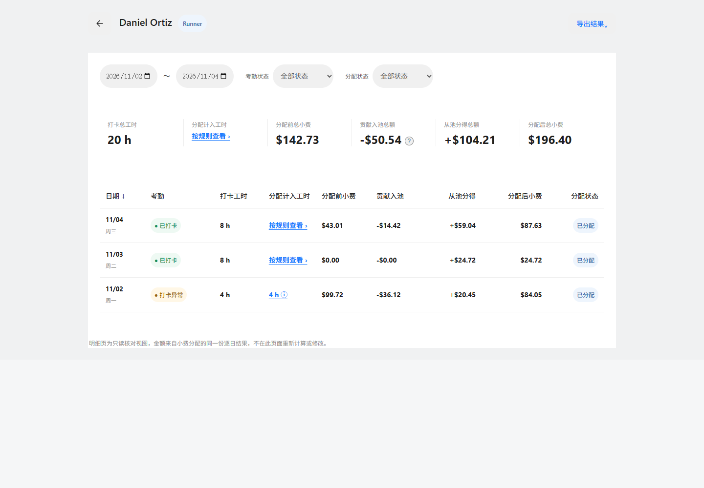

图：当前功能分支实际页面；79e13f27＋TIPOUT-FIGMA-UI-20261104-01，2026-11-04；完整视口，示例金额不作为默认参数。

页面字段：见[页面说明](小费管理需求文档（个人规范版）.md)第3节。实现：`src/team/tips/programs/employee-reconciliation.js.txt`。

### 7.4 当日小费分配明细

图：当前功能分支实际页面；4c30d7a8＋TIPOUT-DETAIL-COPY-CLEANUP-20261106-01，2026-11-06；门店与日期只读，已确认状态不展示快照及全量确认提示。

页面字段：见[页面说明](小费管理需求文档（个人规范版）.md)第4节。实现：`src/team/tips/programs/details.js.txt`。

### 7.5 分配规则列表

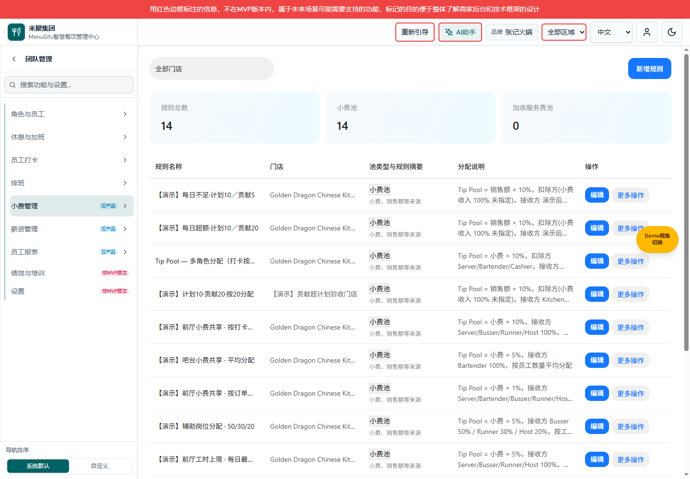

图：当前功能分支实际页面；79e13f27＋TIPOUT-FIGMA-UI-20261104-01，2026-11-04；完整视口，示例金额不作为默认参数。

页面字段：见[页面说明](小费管理需求文档（个人规范版）.md)第5节。实现：`src/team/tips/programs/rules.js.txt`。

### 7.6 新增／编辑分配规则

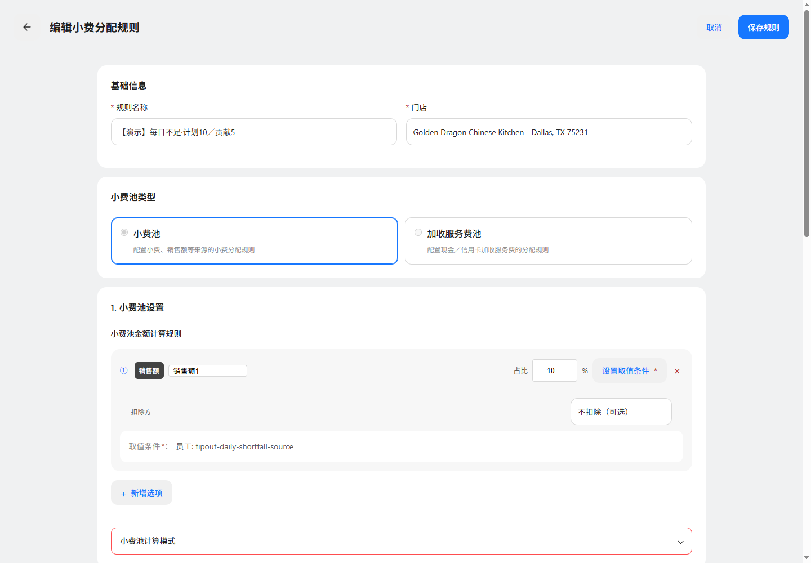

图：当前功能分支实际页面；79e13f27＋TIPOUT-FIGMA-UI-20261104-01，2026-11-04；完整视口，示例金额不作为默认参数。

四组分别为小费池设置、小费分配设置、小费接收设置、小费贡献设置。逐字段定义见[页面说明](小费管理需求文档（个人规范版）.md)第6节。实现：`src/team/tips/programs/rule-editor.js.txt`。

### 7.7 计算与写入模块

展示层：`tips-figma.css`限定小费页面样式；`tips-templates.ts`显式生成独立页头，保留操作元素ID和原事件处理。明细页`detailActionBar`作为整体保留状态隐藏边界；条件面板沿用原show状态与提交／取消回调。字段枚举、快照结构、计算顺序、存储键和路由不因展示层变化而改变。

| 字段／操作 | 说明 |
| --- | --- |
| tipout-funding.js.txt | 来源基数、贡献应扣／实扣、独立资金对照及快照对账。 |
| tipout-employee-weights.js.txt | 接收组、权重和美分分摊。 |
| tipout-summary-ui.js.txt | 周期金额、预计贡献、工时摘要及员工状态。 |
| tipout-allocation-results-store.js.txt | 快照校验、按日提交和失败回滚。 |
| tipout-date-state-store.js.txt | 门店日锁、版本哈希、发放登记及通知。 |
| summary-auto-allocation.js.txt／tipout-auto-allocation.js.txt | 范围预检、串行任务、结果与重试。 |
| contributor-shares-editor.js.txt | 营业额扣除角色校验与草稿应用。 |
| tipout-payroll-bridge.js.txt | 本地薪资数据承接。 |

截图与验证范围：[逐操作覆盖清单](小费管理逐操作覆盖清单.md)／[当前图像清单](assets/tips-current-scope-20261027/manifest.json)。正文不使用其他状态的图替代未重现结果。
