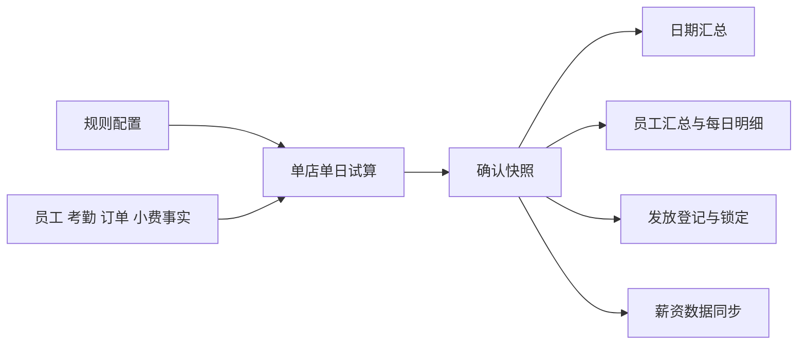
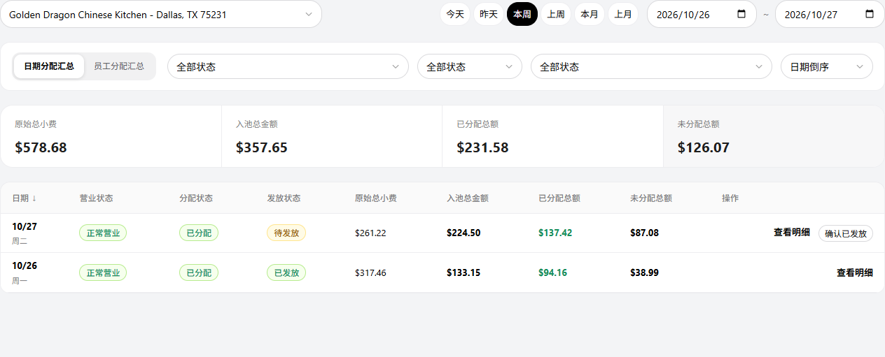
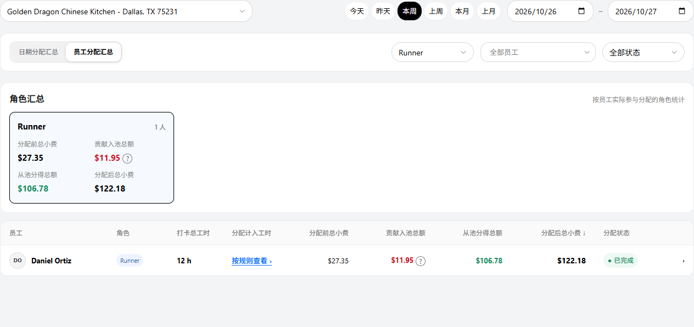
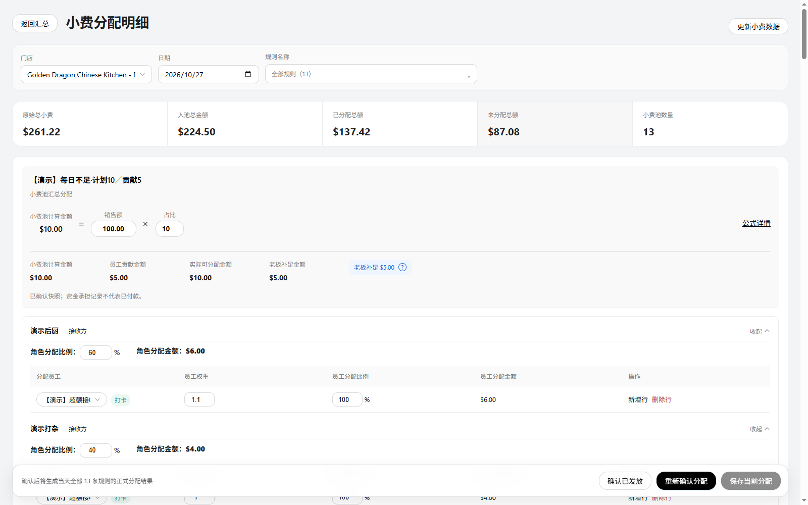

# 小费分配业务规格说明书（研发交付版）

版本：**V3.52**　日期：2026-10-27　文档编号：TIPOUT-DOC-COMPLETION-20261027-01

实现基线：`64ddec8f`。本文仅定义当前产品交付范围的页面、字段、计算、状态和异常规则。

配套文档：[产品说明 V4.52](PRD_产品需求文档.md)／[页面说明 V2.50](小费管理需求文档（个人规范版）.md)。

本文定义现行对象、字段、计算、状态、写入和异常；页面字段按第7节定位。浏览器本地存储不是后端API，发放登记不执行付款。

本文职责：字段、对象关系、状态流转、计算顺序、持久化和异常算例。三份文档使用同一业务基线；页面样例数据不作为默认业务参数。

截图形式：提示、确认弹框、取值条件与员工承担比例抽屉均保留完整界面、遮罩和入口页面背景；背景用于定位操作入口，不仅截取弹框或抽屉本体。

## 1. 范围与使用入口

小费管理包含小费分配、分配规则两个子菜单。分配页面提供日期汇总、员工汇总、员工每日明细和当日分配明细；规则页面提供列表、新增和编辑。

当前实现使用本地业务事实和浏览器存储。确认分配保存计算快照；确认已发放登记状态，不执行转账。CSV可下载。汇总页优先生成并下载PDF，生成失败时转打印预览；员工每日页通过打印窗口保存PDF，弹窗被拦截时提示。邮箱入口提供模拟发送反馈，不实际投递。金额以美元展示，保留两位小数。

| 页面 | 路由／入口 | 作用 |
| --- | --- | --- |
| 日期分配汇总 | `/team/tips/distribution` | 按门店和日期管理分配任务、金额与发放状态。 |
| 员工分配汇总 | 上述页面的员工页签；`?view=employee` | 按角色、员工查看周期结果及预计贡献。 |
| 员工每日明细 | 员工汇总行 | 查看指定员工逐日考勤、工时和金额。 |
| 当日分配明细 | 日期行的查看明细 | 查看全部规则，调整草稿，保存或系统重分配。 |
| 分配规则列表 | `/team/tips/rules` | 查看、新增、编辑、复制、删除规则。 |
| 新增／编辑规则 | `/team/tips/rules/editor`及对应规则上下文 | 配置来源、接收、资格、工时和贡献。 |

## 2. 金额、人员与计算规则

### 2.1 金额口径

| 符号／名称 | 定义 |
| --- | --- |
| B：分配前小费 | 员工原始订单小费与手动上报小费之和；本轮接收不计入原始余额。 |
| P：计划池金额 | 各金额计算项按条件取值后，分别乘本项比例，再求和。 |
| C：实际贡献 | 贡献员工经过余额限制后的实扣总和；未确认时称预计贡献。 |
| E：老板补足 | 独立贡献资金路径中，`max(P−C,0)`；为资金解释项，不是员工扣款或付款凭证。 |
| D：可分配池金额 | 独立贡献资金路径中，`max(P,C)=C+E`。 |
| A：从池分得 | 员工本轮接收金额；汇总正式结果只统计已确认快照。 |
| U：池内未分配 | `D−ΣA`。接收人不合格、基数为0、人工比例未用满均可留下余额。 |
| F：分配后小费 | `B−员工贡献+A`。同一员工可以既贡献又接收。 |

配置员工承担比例的角色贡献和小费收入贡献使用独立贡献资金口径。未配置员工承担比例的销售额贡献按其来源归集校验，不能直接套用补足公式。接收超过可用池或来源校验失败时禁止确认。

### 2.2 贡献与池预算

| 条件 | 独立贡献资金路径的处理 | 示例 |
| --- | --- | --- |
| C=0 | 按P分配，E=P。 | P=100、C=0，D=100、E=100。 |
| 0<C
P | 按C分配；不把贡献截断到P。 | P=10、C=20，D=20、E=0。 |

每条规则独立比较P和C。明细在C>P或C<P时显示对应金额对照及说明；C=P不显示差额提示。

### 2.3 员工承担与余额

1. 先按贡献项的取值范围和比例计算应贡献金额。
2. 角色贡献可按当天有效员工人数平均分担，或按自定义员工比例分担。多角色的全部员工共同合计100%。
3. 员工实扣=`min(应扣,当前可扣余额)`；差额不转给其他员工。
4. 贡献项、规则依保存的规则数组顺序消耗余额；本轮接收不回流为后续贡献余额。

例：本项应贡献100，A承担40%、B承担60%。A只能扣20、B可扣60，则实扣20和60，C=80；A少扣20，不加扣B。若P=100，则D=100、E=20。

平均分担使用人数精确分币，不按页面近似百分比反算。自定义每人0—100%、最多两位小数，合计必须100%；名单或角色变化后需重新核对配置。

贡献基数按本项类型取值：销售额项使用选中范围的销售额；小费收入项使用选中小费类型的可归属小费。配置员工承担后，先将本项基数汇总再乘比例，最后按员工比例分担；未配置承担的个人贡献按员工各自基数求应扣，不能混用两种计算顺序。

### 2.4 接收组、算法与权重

先确定接收组预算，再筛选合格员工，最后计算员工金额。一行多个角色构成共同接收组，同组员工按ID去重；不是每个角色各分一遍预算。

- 组预算=可分配池金额×组占比。接收组占比合计100%。
- 员工有效基数=算法基础值×员工权重；不合格员工基数为0。
- 自动员工比例=有效基数÷组内有效基数总和。
- 员工金额由组预算和未舍入比例分币；组内基数全为0时保留余额，不改为均分。

| 分配方式 | 基础值 | 示例：组预算600，A/B/C权重1/2/1 |
| --- | --- | --- |
| 按员工数量平均分配 | 每位合格员工为1 | A/B/C为150/300/150。 |
| 按工作时长占比分配 | 该规则采用的分配工时 | 工时6/3/3小时，金额240/240/120。 |
| 按订单占比分配 | 有效归属订单笔数 | 订单4/2/2笔，金额240/240/120。 |

员工权重缺省1，0合法，最大1,000,000；不要求合计100%。权重1.1的换算百分比为110%，仅供解释，不是最终分配比例。

### 2.5 接收员工打卡要求与工时

图：当前应用实际页面，隔离演示数据；来源基线64ddec8f，2026-10-27。对应操作与状态见图像清单。

按整日是默认时间范围。默认“需有有效打卡”，另可选“不限打卡状态”。这两个条件只影响接收员工，不改变贡献员工范围。

| 条件 | 对三种算法的影响 |
| --- | --- |
| 需有有效打卡 | 按有效打卡或明确补录的参与依据建立名单；再按对应算法及权重分配。 |
| 不限打卡状态 | 平均方式仍需有效参与名单；工时方式需有效或明确录入的工时；订单方式可使用未打卡员工的有效归属订单。不自动纳入全部在职员工。 |

按工时分配时，可采用有效打卡工时，或按员工逐日应用0.1—24小时、最多一位小数的上限。明细中明确录入的工时优先于自动上限，不修改原打卡。平均和订单分配不使用该工时设置。

### 2.6 精度与一致性

金额按整数美分计算、两位小数展示。自动分摊先向下取整，再按小数余数从大到小补齐尾差，相同余数按稳定顺序处理。100美元三人等权为33.34/33.33/33.33。

普通按日工时明细允许明确修改最终员工比例；按该比例直接计算，不再乘一次权重或工时。合计低于100%留下余额，超过100%拒绝保存；改变工时或权重会重建自动比例。

每池核对：`C+E=D=ΣA+U`；整日核对：`ΣB+ΣE=ΣF+ΣU`。归集路径另校验其资金来源和贡献约束。

### 查询、导出与条件边界

- 员工每日页只允许在来源查询周期内调整日期；越界、空值或倒置时保留输入并标错，继续显示上次有效结果，不启动自动分配。
- 角色卡点击选中，再次点击清除角色筛选。员工候选随角色更新并移除无效选择；全选或全部取消均表示全部员工。
- 分配工时明细由员工汇总行、员工每日页周期摘要及每日行打开；列为规则名称、规则类型、计算说明、分配计入工时、有记录／适用天数。角色卡无工时弹框入口。
- CSV直接下载。日期／员工汇总PDF优先生成下载，失败转打印预览；员工每日页使用打印窗口，由用户保存PDF。弹窗拦截提示失败，不修改账本。
- 主动分配遇整个规则目录为空时提示“请先创建小费分配规则”并进入规则列表；仅当前门店无规则属于自动预检阻断，不记为已执行失败。
- 来源条件的有效维度、必填与互斥见页面说明§7.16。销售额、小费、服务费至少一个有效条件，手动上报条件可为空；角色和员工互斥，Payment Method口径与菜单互斥。
- 当前贡献资金试算的演示事实支持Net Sales及cash、credit_card支付方式；缺少对应事实的口径或条件报错且不保存快照。手动上报在该资金分支按角色／员工过滤后累加reportedTips，不应用营业时间条件。配置可保存与运行可计算分别校验。

## 3. 状态与操作流程

### 3.1 三类状态

| 状态对象 | 状态 | 判定与效果 |
| --- | --- | --- |
| 营业 | 正常营业／未营业 | 有有效小费或打卡事实可营业；未营业日显示0、无需分配、无需发放。 |
| 分配 | 未分配／已分配／无需分配 | 未分配无有效确认；已分配已有有效日期快照；未营业无需分配。已确认接收为0也可属于已分配。 |
| 员工周期 | 已完成／部分待分配／待分配 | 按当前员工适用日的确认情况汇总，不用发放状态代替。 |
| 发放 | 待发放／已发放／无需发放 | 分配确认后可登记发放；已发放锁定整日快照；未营业无需发放。 |
| 编辑 | 未调整／有未保存调整／已保存 | 当日草稿未保存不进入正式统计；人工保存形成manual快照，系统计算形成system快照。 |

### 3.2 自动分配

进入分配页面默认本周周一至今天；从明细返回恢复合法查询上下文。切换有效日期后只读预检，手动起止日期在离开日期输入区后启动。

- 全部已分配、已发放或无需分配：不建任务、不弹结果框、不改快照。
- 只有合格未分配日期进入队列：营业事实可分配、有规则、无需先补录手动工时、未确认且未发放。
- 日期从旧到新逐日执行；单日失败继续下一日，成功日不回滚。
- 已处理天数=成功+失败+跳过，分母为本次入队日期数。跳过主要处理执行中出现的并发状态变化。
- 执行中冻结页面操作，底部按钮显示“正在分配”并禁用、降低透明度；全部日期处理结束后显示“关闭”并启用，保留结果。重试按钮只在结束且仍有失败时显示，重试仅处理失败日期。
- 关闭结果层恢复列表，可通过行内分配或当日明细处理剩余日期。
- 离开页面停止后续任务；提交前及异步准备后检查页面存活，已提交结果保留。

切换页签、门店、角色、员工、状态、排序及后台通知重绘不单独启动自动分配；它们也不改变启动时捕获的任务范围。

当日明细进入或切换门店日后，也会对符合条件、尚未确认的单日尝试系统自动确认；同一页面选择不重复尝试。失败提示后保留手动确认入口，不覆盖已有快照。

### 3.3 分配工时的展示

| 数据条件 | 展示 |
| --- | --- |
| 没有规则记录 | —。 |
| 存在规则但均不使用工时 | 不适用。 |
| 适用工时规则但均没有有效采用值 | 待补录。 |
| 各适用规则的采用值相同且记录完整 | 单一小时数＋说明入口；不跨规则累加。 |
| 采用值不同或存在部分缺失 | 按规则查看，打开规则明细。 |

周期只在同一规则内逐日累计。规则明细可显示“有记录／适用天数”，不足时不把缺失天数补成0；员工权重不改变展示的工时。

### 3.4 保存、系统重分配与发放

| 操作 | 前置条件 | 处理与结果 |
| --- | --- | --- |
| 行内分配 | 正常营业、未分配、未发放，事实和规则可计算 | 按系统规则保存整日快照；需手动工时则转到明细补全。 |
| 明细确认分配 | 当日尚未分配、未锁定，所有规则校验通过 | 保存整日结果；规则筛选不缩小保存范围。 |
| 保存当前分配 | 已有结果且存在人工调整、未发放 | 确认后保存人工调整快照，更新汇总；取消保留草稿。无调整时只提示原因。 |
| 重新确认分配 | 已分配、未发放 | 按系统规则重建当日结果。有人工数据时先说明覆盖；取消保留原结果。 |
| 批量／重新分配小费 | 当前门店与合法日期范围 | 先检查范围与人工结果，再校验、提交；包含人工快照需明确确认覆盖，已发放和未营业跳过。先准备全部日期，计算失败不写任何日期；实际提交失败后停止后续日，已完成日保留。此操作不同于自动队列的失败后继续。 |
| 确认已发放 | 整日快照有效、未发放、无未保存修改 | 保存发放登记，锁定对应快照；失败仍为待发放，不执行实际付款。 |
| 更新小费数据 | 未发放，确认更新上下文 | 重取来源数据、重建默认计算；已有结果进入更新待确认流程，手动调整会被覆盖。取消保留页面。 |

## 4. 数据结构与计算入口

### 4.1 对象关系

规则是模板；门店＋完整日期是一份整日快照的业务键；快照内按规则／池、接收组和员工分层。筛选只改变视图，不改变保存对象粒度。

### 4.2 规则字段

员工承担字段employeeShares位于每个贡献项deductConfig.*的配置内部，不是所有贡献项共用一份。规则配置与整日确认快照分别保存。

| 字段 | 类型／默认 | 现行含义与约束 |
| --- | --- | --- |
| id | integer | 规则目录生成的唯一标识；复制生成新ID，不复用结果快照。 |
| ruleName | string，必填 | 去除首尾空格；不能为空。 |
| store | string，必填 | 当前页面门店值；本地演示以门店名称字符串存储。 |
| poolKind | tip / surcharge | 来自新增池类型入口。 |
| allocationMode | string，legacy_pool | 当前普通汇总池的计算标识。 |
| poolRules[] | array | 来源计算项；汇总模式至少一项，每项包含type、name、pct和conditions，自定义项可有amount。 |
| poolRules[].pct | number，默认100 | 以百分数存储，计算除100；快照校验要求有限、非负、不超过100。 |
| receivers[] | array | 接收组，包含roles、pct、employeeWeights；各接收组占比合计100%。 |
| receivers[].roles | string[]，非空 | 本组共同接收角色，保存核对当前门店有效角色及员工引用。 |
| receivers[].pct | number | 大于0且不超过100，各组合计100；新行0为待填写值，不能作为有效组保存。 |
| receivers[].employeeWeights | object | 当前实现按角色和员工显示键保存权重，即employeeWeights[role][employeeName]；读取缺省1。不是全局employeeId映射，员工身份及汇总去重仍使用名册ID。 |
| distribution | average / hours / orders | 算法枚举，默认average。 |
| allocationScope | string，day | 同一营业日内计算和分配。 |
| clockin | clock / unrestricted | 默认clock；按接收要求和算法所需名单、工时或订单依据计算。 |
| workHoursConfig.mode | actual / capped | 工时方式的默认采用模式，默认actual。 |
| workHoursConfig.maxHoursPerDay | number / null | capped时0.1—24，最多一位小数；其他模式不使用。 |
| deductConfig.salesPct | object / array | 角色销售额贡献配置。 |
| deductConfig.tipIncome | object / array | 小费收入贡献配置。 |
| deductConfig.*.rate | number | 内部比率0—1，界面10%存0.1；保存要求大于0。 |
| deductConfig.*.roles | string[] | 取值角色；贡献项至少选择一个。 |
| deductConfig.*.conditions | object | 本贡献项来源过滤；小费收入项还需tipTypes。 |
| employeeShares.version | 1 | 员工承担配置结构标识。 |
| employeeShares.mode | average / custom | 默认平均；自定义按明细百分比。 |
| employeeShares.store / roles | string / string[] | 记录承担比例作用的门店和角色集合，变化后不得直接复用无效名单。 |
| employeeShares.employees[] | {employeeId,pct}[] | custom时每人必填、按ID匹配、不得重复、合计100%；平均模式按当天有效人数求值。 |
| employeeWeights | 映射 | 规则范围内的员工权重；缺省1，0合法，最大1,000,000，不等于百分比。 |

#### 金额来源与条件字段

| 字段 | 类型、默认和取值规则 |
| --- | --- |
| poolRules[].type | sales、tips、manual、custom、surcharge之一；受poolKind允许来源限制。 |
| poolRules[].name | string，默认来源名称；用于页面、公式和结果展示。 |
| poolRules[].amount | 非负有限金额，仅自定义来源使用，默认0；乘pct得到本项金额。 |
| poolRules[].conditions | object，各来源独立保存；不同维度取交集，同一维度的多选值取并集。缺少计算所需事实必须报错。 |
| conditions.role | string[]，来源角色过滤；贡献项要求有效角色，不能将接收组角色代入。 |
| conditions.employee | array，员工过滤，候选受门店和角色引用约束；不通过姓名把跨门店人员合并。 |
| conditions.revenueType | string；UI候选Net Sales (税前营业额)、Gross Sales (总销售额)、Payment Method (支付方式)。资金试算分支只接受全部或Net Sales，其他口径报错，不写快照。 |
| conditions.orderType | string，订单类型单选过滤。 |
| conditions.paymentMethods | string[]；当前资金试算支持cash、credit_card，订单card可匹配credit_card；其他值报缺少实付明细。 |
| conditions.area | string，订单区域单选过滤。 |
| conditions.menu | object，产品线、分类、菜单组或商品条件，按商品销售额取值。 |
| conditions.containsProduct | object，订单需包含商品的条件；不能把整单金额当作该商品销售额。 |
| conditions.hours | {start,end}，HH:mm字符串；来源发生时间的起止条件必须完整。 |
| conditions.tipType / tipTypes | 来源所支持的小费类型；贡献小费收入项必须选择允许类型。 |
| conditions.orderTipStatus | string，has_tip或no_tip，分别表示有小费或无小费。 |
| conditions.surchargeType | string或string[]，服务费类型；资金试算分支缺少对应明细时拒绝，不以0代替。 |

| 来源 | 可选条件 | 保存要求 |
| --- | --- | --- |
| 销售额 | 角色、员工、区域、订单类型、菜单、营业额类型、订单小费状态、支付方式、营业时间 | 至少一个有效条件。 |
| 小费 | 角色、员工、区域、订单类型、营业时间、小费类型、订单需包含商品 | 至少一个有效条件。 |
| 手动上报小费 | 角色、员工、营业时间 | 条件可为空。 |
| 加收服务费 | 角色、员工、区域、订单类型、营业时间、小费类型、加收类型 | 至少一个有效条件。 |
| 自定义小费 | 无必填来源条件 | 使用非负金额和计算比例。 |

角色与员工条件互斥。营业额候选为Net Sales（税前营业额）、Gross Sales（总销售额）、Payment Method（支付方式）；选择Payment Method会移除菜单条件并提示，不能再添加菜单条件。

当前贡献资金试算使用的演示事实仅支持Net Sales口径，支付方式支持cash、credit_card；缺少对应事实的销售口径、菜单或加收条件会返回明确错误，不保存分配快照。当前贡献资金试算对手动上报来源先按角色／员工过滤，再累计reportedTips；此分支不应用营业时间过滤。条件能保存不等于当前演示事实能完成试算；应区分配置校验与运行取值校验。

来源条件抽屉只应用草稿，整页保存后写入tipout_rules。删除、取消配置均不直接修改已确认快照。

### 4.3 来源事实

| 字段／对象 | 类型与来源 | 使用方式 |
| --- | --- | --- |
| employeeId / name / role | string | 本地名册／演示来源；按ID核对和去重，不以姓名跨人合并。 |
| dateKey | YYYY-MM-DD | 完整营业日，真实日历合法性由日期助手检查。 |
| originalTips | 非负金额 | 订单小费＋手动上报小费；不能与两来源重复累计。 |
| orderTips / reportedTips | 非负金额 | 可贡献来源的原始余额。 |
| orders[] | 订单事实数组 | 包含归属员工、订单金额／小费、类型、支付、区域、商品及时间。筛选所需字段缺失时不可猜测命中。 |
| completedPaymentAt | 完整时间 | 订单小费事件的支付完成时间。 |
| occurredAt | 完整时间 | 手动上报小费的实际发生时间，用于来源营业时间条件；不是上报操作时间。 |
| 考勤／在岗区间 | 区间及有效标记 | 原始打卡与分配采用工时分别保存，不相互覆盖。 |
| 分配手动工时 | 规则＋员工＋日期采用值 | 普通按日明确录入优先于自动上限，不写回考勤事实。 |

汇总日期助手按浏览器本地日历计算快捷范围；不把它描述为已接入生产门店营业日截点。营业判定助手支持销售额、小费或有效打卡任一为正；当前汇总和明细调用传入salesAmount=0，主要依据小费和有效打卡事实。

### 4.4 快照字段

| 字段 | 类型／默认 | 定义 |
| --- | --- | --- |
| version / schemaVersion | number | 本地快照格式标识；提交准备补齐schemaVersion=1。 |
| store / dateKey | string | 整日业务键，存储键为store＋空字符分隔符＋dateKey。 |
| snapshotId | string | 每次确认生成的快照ID。 |
| snapshotVersion | integer | 基于当前快照版本加1。 |
| snapshotHash | string | 排除自身字段后规范序列化计算SHA-256；发放依据、更新冲突检测使用。 |
| confirmedAt | ISO时间 | 本次确认时间。 |
| allocationSource | system / manual | 系统确认或明确保存人工调整的来源。 |
| scenarioFacts | array | 当次来源事实，用于确认结果追溯。 |
| pools[] | array | 整日全部采用规则／池。 |
| pools[].ruleId / ruleName | string | 本次采用规则身份与名称。 |
| pools[].poolAmount | 非负金额 | 当次实际可分配池金额。 |
| pools[].employees[] | array | employeeId、name、role、hours、percentage、amount及适用的employeeWeight等。 |
| employeeAmounts[] | array | 员工deducted、received；按员工合并同日多池的贡献和接收。 |
| employeeContributions[] | array | 员工ID及贡献amount，供汇总／薪资消费。 |
| editorState | object | 明细采用的输入状态；载入后可回显人工采用值。 |
| summary.originalTips | 金额 | 当日原始小费合计。 |
| summary.poolAmount | 金额 | 当日各池实际预算合计。 |
| summary.allocatedAmount | 金额 | 当日正式接收合计。 |
| summary.unallocatedAmount | 金额 | 各池未分配余额合计。 |
| summary.poolCount | integer | 快照内池数量。 |

独立贡献快照中的funding记录target=P、contributed=C、actual=D、ownerContribution=E、excess=max(C−P,0)。contributionRules记录每项plannedContribution、actualContribution、shortfall和员工的due、available、amount、shortfall；单位均为金额。

### 4.5 存储与并发

| 存储键 | 内容与边界 |
| --- | --- |
| tipout_rules | 规则配置；保存、复制、删除规则只更改规则目录。 |
| tipout_allocation_results_v1 | 门店日快照文档。 |
| tipout_allocated | 门店已确认日期集合，与有效快照共同核对。 |
| tipout-payout-records-v1 | 发放登记，绑定snapshotId、snapshotVersion、snapshotHash。 |
| tipout_unconfirmed_updates_v1 | 更新来源后需要重新确认的标记；有标记禁止直接发放。 |
| tipout-manual-hours-v1 | 规则、员工、日期维度的手动工时记录。 |
| tipout-payroll-state-v4 / tipout-payroll-bridge-meta-v1 | 薪资本地承接及同步标记。 |

同一门店日写入使用Web Locks独占锁。新自动分配提交onlyIfUnallocated；人工替换校验基准哈希或指纹。锁内检查发放状态，异步快照准备后再次核对页面存活。冲突、损坏或不支持安全锁时失败，不绕过锁覆盖。

分配保存按日原子回滚；不是跨日期事务。自动队列失败后继续，主动批量提交失败后停止，两者必须分别处理。快照写入后Payroll同步失败仍属于分配成功，显示同步警告，不把已确认日期再当未分配重扣。

### 4.6 现行计算顺序

1. 载入当前门店日事实和所有适用规则，校验人员引用及来源完整性。
2. 逐项取来源基数并乘比例得到P；不同公式独立求值，重叠不会增加员工可扣余额。
3. 按贡献规则与员工承担设置计算应扣，再按员工剩余余额封顶。
4. 独立贡献路径计算C、E、D；其他归集路径按其可用资金约束，缺口或接收超额拒绝确认。
5. 依据接收组份额、资格、基础值及权重分摊。
6. 应用明确人工工时／比例，保留人工来源；重新改权重或工时会重建相关自动结果。
7. 校验金额、身份、份额、资金守恒，提交整日快照，再更新汇总和薪资。

### 4.7 自动任务状态

Queue仅存在于当前页面内存，items元素为date、status、message；status= pending、running、success、failed、skipped。只有合格未分配日期进入初始队列；blocked前置问题只提示，不当作执行失败。

`pending→running→success/failed/skipped`；重试只做`failed→pending`。计数按当前结果重算，不累计已解决的失败。页面销毁停止后续日期，进度不持久化；已确认快照保留，重新进入只补剩余日期。

## 5. 可复算与验收场景

| 场景 | 输入／操作 | 预期 |
| --- | --- | --- |
| 贡献不足 | P=100，A应扣40但只能扣20，B应扣60且可扣60 | C=80，E=20，D=100；不转嫁A的差额。 |
| 贡献超计划 | P=10，C=20；接收两组60%／40%且各有合格员工 | D=20、E=0；组预算12／8；显示贡献超计划对照。 |
| 无贡献 | P=100，C=0，独立贡献路径 | D=100、E=100，不阻止合法分配。 |
| 加权三算法 | 组预算600；权重1/2/1；工时6/3/3；订单4/2/2 | 平均150/300/150；工时与订单240/240/120。 |
| 多角色共同组 | Server A/B与Busser C同一组120，同权 | 各40；不是先按角色一半分。 |
| 零基数 | 本组无人合格、全零权重、全零工时或订单 | 本组预算保留未分配，不自动转组或回退平均。 |
| 上限与手动覆盖 | 有效8h、规则上限5h；当日明确改8h | 默认5h，手动后8h，打卡仍为原事实。 |
| 混合周期贡献 | 已确认贡献30，待分配预计12 | 贡献总额42，问号展示“已分配日期：30”“待分配日期（预计）：12”“合计：42”，并提示“待分配金额为试算结果，以实际分配结果为准。”；接收和最终金额仍只统计确认部分。 |
| 全部无需自动处理 | 选中10天，其中8已分配、2无需分配 | 无任务、无结果弹框、不写快照。 |
| 仅一天待分配 | 同范围只剩1天合格未分配 | 队列1项，处理1/1，其他日期不改。 |
| 执行失败与重试 | 2任务中1临时失败、1成功 | 全部结束显示重试；只重试失败日。成功后失败0、重试按钮隐藏。 |
| 已发放保护 | 分配已登记发放后尝试编辑／更新／重分配 | 拦截，保留快照与发放状态。 |
| 保存冲突 | 弹框打开后其他页面更新同日快照 | 原提交不覆盖新结果，提示重新读取。 |
| 失败后同步 | 快照提交成功，Payroll同步异常 | 分配仍成功；提示同步失败，不重复扣款。 |
| 员工日期越界 | 来源10月1—25日，结束输入27日 | 标错并保留原有效结果；不查询越界日、不启动自动分配。 |
| 员工筛选清空 | 当前角色候选A/B，取消两人选中 | 规范化为全部员工，而非空结果。 |
| 来源口径失败与重试 | 普通销售来源选择Gross Sales，两天执行失败；改Net Sales后点击重试 | 首轮失败2；重试只处理这两天，完成成功2／失败0，隐藏重试按钮。 |
| 错误日期 | 缺值、非法日历日或开始晚于结束 | 保留上次有效列表和错误输入，不保存错误查询、不启动分配。 |

## 6. 支持范围与异常处理

| 条件 | 当前处理 |
| --- | --- |
| 门店、规则、员工或角色引用无效 | 阻止相关保存／确认，保留输入并提示修正。 |
| 公式金额、比例、工时、权重非有限数或为负 | 拒绝提交；合法0与缺失值分开显示。 |
| 接收组份额不是100%／人工员工比例超过100% | 阻止确认，不自行缩放。 |
| 自定义员工承担名单变化／合计不是100% | 要求重新核对承担配置。 |
| 依赖订单类型、支付、区域或商品信息但事实缺失 | 不猜测归属，不伪造0，提示不能计算。 |
| 手动上报小费缺少所选筛选维度归属 | 不能按该条件计算贡献，需有效来源。 |
| 快照损坏或发放依据不一致 | 保护性失败／只读，不把损坏当未分配覆盖。 |
| Web Locks或安全哈希能力不可用 | 阻止需要安全提交的操作，不绕过并发保护。 |
| 存储失败 | 当前日期回滚；说明已经完成和未执行日期，不报全部成功。 |
| Payroll同步失败 | 分配保存状态与同步状态分别说明，通过员工数据更新流程补同步。 |
| 无可导出数据、邮箱为空或格式错误 | 不执行导出／发送反馈，提示原因。 |

## 7. 页面字段与实现入口

### 7.1 日期分配汇总

图：当前应用实际页面，隔离演示数据；来源基线64ddec8f，2026-10-27。对应操作与状态见图像清单。

页面字段：见[页面说明](小费管理需求文档（个人规范版）.md)第1节。实现：`src/team/tips/programs/distribution.js.txt`。

### 7.2 员工分配汇总

图：当前应用实际页面，隔离演示数据；来源基线64ddec8f，2026-10-27。对应操作与状态见图像清单。

页面字段：见[页面说明](小费管理需求文档（个人规范版）.md)第2节。实现：`src/team/tips/programs/distribution.js.txt`。

### 7.3 员工每日考勤分配

图：当前应用实际页面，隔离演示数据；来源基线64ddec8f，2026-10-27。对应操作与状态见图像清单。

页面字段：见[页面说明](小费管理需求文档（个人规范版）.md)第3节。实现：`src/team/tips/programs/employee-reconciliation.js.txt`。

### 7.4 当日小费分配明细

图：当前应用实际页面，隔离演示数据；来源基线64ddec8f，2026-10-27。对应操作与状态见图像清单。

页面字段：见[页面说明](小费管理需求文档（个人规范版）.md)第4节。实现：`src/team/tips/programs/details.js.txt`。

### 7.5 分配规则列表

图：当前应用实际页面，隔离演示数据；来源基线64ddec8f，2026-10-27。对应操作与状态见图像清单。

页面字段：见[页面说明](小费管理需求文档（个人规范版）.md)第5节。实现：`src/team/tips/programs/rules.js.txt`。

### 7.6 新增／编辑分配规则

图：当前应用实际页面，隔离演示数据；来源基线64ddec8f，2026-10-27。对应操作与状态见图像清单。

四组分别为小费池设置、小费分配设置、小费接收设置、小费贡献设置。逐字段定义见[页面说明](小费管理需求文档（个人规范版）.md)第6节。实现：`src/team/tips/programs/rule-editor.js.txt`。

### 7.7 计算与写入模块

| 字段／操作 | 说明 |
| --- | --- |
| tipout-funding.js.txt | 来源基数、贡献应扣／实扣、独立资金对照及快照对账。 |
| tipout-employee-weights.js.txt | 接收组、权重和美分分摊。 |
| tipout-summary-ui.js.txt | 周期金额、预计贡献、工时摘要及员工状态。 |
| tipout-allocation-results-store.js.txt | 快照校验、按日提交和失败回滚。 |
| tipout-date-state-store.js.txt | 门店日锁、版本哈希、发放登记及通知。 |
| summary-auto-allocation.js.txt／tipout-auto-allocation.js.txt | 范围预检、串行任务、结果与重试。 |
| contributor-shares-editor.js.txt | 员工承担抽屉、范围校验与草稿应用。 |
| tipout-payroll-bridge.js.txt | 本地薪资数据承接。 |

截图与验证范围：[逐操作覆盖清单](小费管理逐操作覆盖清单.md)／[当前图像清单](assets/tips-current-scope-20261027/manifest.json)。正文不使用其他状态的图替代未重现结果。
