# 小费分配业务规格说明书（研发交付版）

## 当前研发基线（2026-10-23）

[产品V4.18](PRD_产品需求文档.md)／研发V3.18／[个人V2.16](小费管理需求文档（个人规范版）.md)，共同编号 **TIPOUT-DOC-CURRENT-20261023-01**。本次只更新文档，不新增算法、接口或状态。实现核对main@`e8d203b0`，独立65132真实预览；历史版本及测试记录保留。

| 对象／字段 | 当前契约与实现边界 |
| --- | --- |
| 编辑分组 | allocationRulesGroup包含金额、模式、接收方、分配方式、资格；contributorRulesGroup独立置底，仅普通小费池显示。不新增存储对象；字段ID与保存事件不变。 |
| 资金符号 | 业务讨论P=计划、C=实际贡献；研发正文T=计划、D=实际贡献、P=实际池。funding.target/contributed/actual/ownerContribution分别为T/D/max(T,D)/max(T−D,0)，金额单位不变。 |
| 支持路径 | previewIndependent／previewEmployeeShares及reconcileExisting已接入普通池独立贡献和员工承担；旧funding、旧salesPct无承担配置、计提及时段等保留原支持／拒绝边界，不自动升级历史。 |
| 员工承担 | employeeShares.mode=average/custom；average动态按当日有效员工整数分币，custom全角色合计100%。每人actual=min(due,available)，shortfall不转给他人。贡献项快照与资金元信息沿用原version，不因文档升级改数据版本。 |
| UI-01实现偏差 | 确认的目标名称为“系统重新分配／保存当前调整”，details模板、syncDetailAllocationAction和showDetailAllocationDialog仍为旧名称。本次保留当前截图及旧文字作为实现证据，不将其当目标文案。首次确认分配保持原名。 |
| UI-02实现偏差 | 测试场景清单／取消分配的黑字要求尚未全部落实；红框与禁用／报错不是同一语义。 |
| 验收边界 | 本地演示快照不等于真实资金支付；源码存在不等于生产事务／权限通过。Q01—Q14、Q16不关闭，Q15保持关闭。 |

本批截图与逐操作状态见[覆盖清单](小费管理逐操作覆盖清单.md)、[图片溯源](assets/tips-docs-current-20261023/capture-manifest.json)。后文旧批次验证只代表其原始基线；已确认目标与当前偏差须分别验收。

## 第二批页面缺口：明细上下文与员工每日日期（TIPOUT-DETAIL-GAPS-20261023-01）

图注：2026-10-23／main基线44ca8723＋未提交实现／65115独立演示；手工权重2，询问期间仍为原日期。完整切店、继续编辑及放弃结果见个人版T01／T02。

| 字段／操作 | 定义与结果 |
| --- | --- |
| 切门店／日期 | 仅真实未保存修改触发页面内确认。询问期间恢复原上下文；继续编辑保留输入，明确放弃才清除本页草稿并切目标。无草稿不提示；保存中不允许离开。 |
| 首次确认来源 | 首次无人工调整按system保存；首次人工调整按manual保存，以便后续系统重分配正确识别覆盖。既有结果重新确认仍按系统重建。函数专项测试通过，首次确认浏览器结果尚待补证，不能记为全链路完成。 |
| 草稿广播 | 本页编辑标记指纹相同、基础快照未变化且未锁定时，仅忽略自身通知，不关闭当前确认框；外部变化／锁定仍处理，不扩大忽略范围。 |
| 跨菜单离开 | 仍是验收缺口。当前浏览器分支未成功阻止跳转，不以切店／切日图代替。不得宣称已实现全路由保护。 |

图注：同一功能预览／员工每日页；开始晚于结束，保留上次有效查询范围，不静默将输入改成同日。清空、越界及恢复见个人版P01。

| 字段／操作 | 定义与结果 |
| --- | --- |
| 开始／结束日期 | 必填ISO日历日期字符串，单位日；默认继承员工汇总快照范围。两端均须在来源周期内，开始≤结束，同日合法且含当日。空值不代表全量。 |
| 无效输入 | 不改写输入；字段标记错误并显示可访问提示。停止读取新范围，保留旧行及六项统计，提示旧范围，不能显示为新范围计算成功。 |
| 有效恢复 | 校验通过后按当前员工及既有筛选重算展示，解除错误；只读查询，不生成确认快照。 |
| 导出入口 | 收集数据、打开菜单及邮件动作重复校验；无效返回空结果／中止，不携带错误周期。实际文件、投递未验收。 |
| 算例 | 来源9/23—10/23；10/22—10/20提示倒置，不改为10/22同日；9/22越界；10/20—10/20合法，更新为当天。 |

验证范围：切日取消／确认、切店确认、员工每日空值／倒置／越界／修复有实际截图；函数回归覆盖保存保护、日期导出守卫与首次人工来源。T08员工替换、T14首次确认、R22迁移、CSV／PDF及共用并发／权限等缺口不关闭。未提交、合并、推送或上线。

历史维护：TIPOUT-RULE-EDITOR-GROUPS-20261023-01。[产品V4.17](PRD_产品需求文档.md)／[研发V3.17](小费分配业务规格说明书（研发交付版）.md)／[个人V2.15](小费管理需求文档（个人规范版）.md)配对。规则编辑采用基础信息→分配规则→贡献规则，贡献独立后置；基线main@4edfd40e＋65129功能分支。仅组织结构变化，不改变P/C或员工分配算法。

## 规则编辑：基础信息、分配规则、贡献规则

### 工时标题问号对齐修复（TIPOUT-HOURS-HELP-ALIGN-20261023-01）

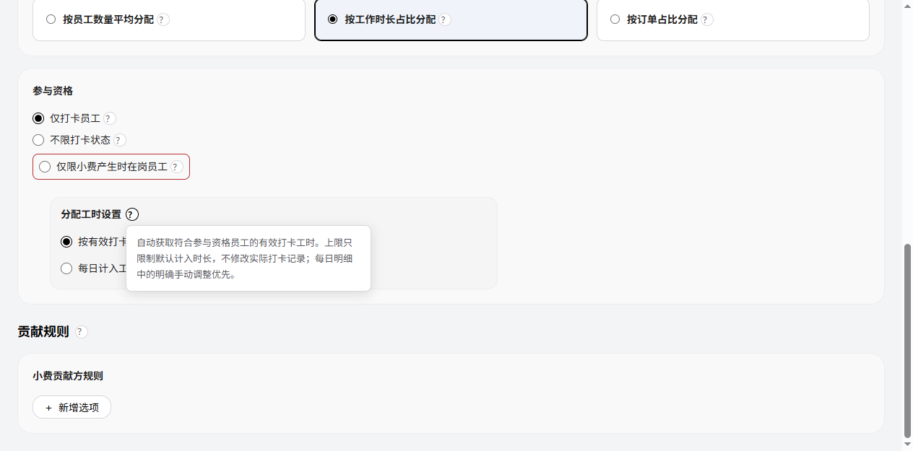

图注：工时分配＋仅打卡；标题问号展开。2026-10-23／main@e8d203b0／65132独立演示；实际页面采集，非生产交易。只证明所示状态，其他结果沿用逐操作缺口。

图注：工时分配＋不限打卡；原帮助内容保留。2026-10-23／main@e8d203b0／65132独立演示；实际页面采集，非生产交易。只证明所示状态，其他结果沿用逐操作缺口。

| 元素／状态 | 定义与结果 |
| --- | --- |
| 分配工时设置问号 | 原workHoursSourceHelp内容移至标题行内的details，紧随标题、间距6px、垂直居中；点击展开／收起内容不变，不写规则。 |
| 按时段参与 | 原通用说明随可编辑工时选项一起隐藏，仍显示时段专属问号，不将全天工时说明误用于时段规则。非按工时分配仍隐藏整个工时设置。 |
| 修复边界 | 仅布局修复，产品V4.17／研发V3.17／个人V2.15业务版本不变；工时来源、上限、校验、保存与参与资格不变。 |

验证：仅打卡／不限打卡的标题与问号中心差小于4px；问号可展开对应原文；时段通用问号隐藏及专属说明保留已做浏览器验证。时段与非工时状态的独立图片仍沿用既有覆盖缺口，不宣称全部截图完整。

图注：新增普通规则；基础与分配分组，模式默认折叠。2026-10-23／main@e8d203b0／65132独立演示；实际页面采集，非生产交易。只证明所示状态，其他结果沿用逐操作缺口。

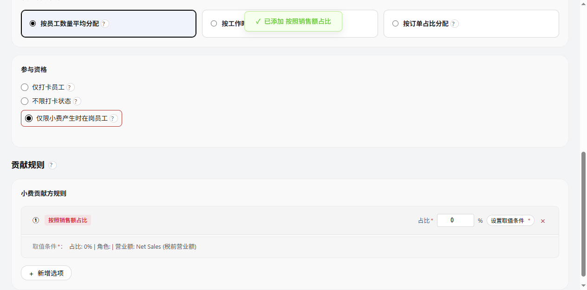

图注：规则页下部；参与资格后为独立贡献分组，无角色不展示员工承担行。2026-10-23／main@e8d203b0／65132独立演示；实际页面采集，非生产交易。只证明所示状态，其他结果沿用逐操作缺口。

| 区域／元素 | 逻辑说明 |
| --- | --- |
| 基础信息 | 规则名称和门店仍在原卡片，新增分组标题。必填、候选范围、上下文和保存行为不变。 |
| 分配规则 | 独立分组allocationRulesGroup，只组织现有配置，不是新增规则对象。顺序：小费池金额计算规则→小费池计算模式→接收方规则→小费分配方式→参与资格／分配工时设置。 |
| 金额计算与计算模式 | 回答计划分多少P；模式仍默认折叠，选项值及切换不变，保留既有红框。靠近金额与接收方，不插在贡献区中。 |
| 接收方 | 普通池显示原角色占比、员工权重和再分配；计提模式显示原计提接收方及剩余接收方。先定义分给谁，再选择员工之间如何分。 |
| 分配方式 | 保留平均／工时／订单三卡片、整卡点击和问号示例，移至接收方之后，参与资格之前；不初始化或重置已选值。 |
| 参与资格／工时 | 只约束接收员工。保留三项资格和按工时方式的联动字段；工时设置仍紧邻资格，模式切换不改变原校验、精度和计算。 |
| 贡献规则 | 单独一级分组contributorRulesGroup，在参与资格之后。内部保留小费贡献方规则卡片、已有入口及员工承担方式，不称为参与资格附加条件。 |
| 贡献标题问号 | 点击原生details问号显示“配置哪些员工贡献及扣除多少小费。贡献员工不受接收方参与资格限制。”；再次点击收起，不保存数据。 |
| 模式显隐 | 普通小费池显示贡献分组；计提模式或加收服务费池仍沿用既有兼容边界，贡献分组整体隐藏、不留空标题。不是解除这些模式的业务限制。 |
| 保存与取消 | 仍使用顶部统一保存／取消。分组不增加独立保存、步骤、权限或接口；使用原字段ID及事件。移动节点不删除值；切换模式保留原草稿，最终按原模式校验提交。 |
| P/C关系 | 分配规则计算P；贡献规则计算员工实际扣除C；实际可分配max(P,C)、老板补足max(P−C,0)，原已确认定义不变。 |

### 计提模式

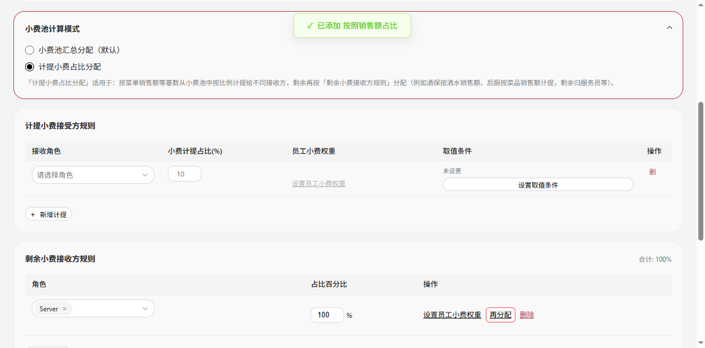

图注：计提模式；原贡献分组隐藏。2026-10-23／main@e8d203b0／65132独立演示；实际页面采集，非生产交易。只证明所示状态，其他结果沿用逐操作缺口。

验收：真实DOM位置及组归属、计算模式默认折叠、按工时联动、计提显隐、切回保留草稿通过浏览器测试。其他编辑回填、加收池、问号开关、保存成功／失败和键盘的独立结果截图未全覆盖；原文这些业务规则继续有效，旧页面图的排列仅为历史位置参考。

## 小费贡献方规则：个人销售额菜单标记

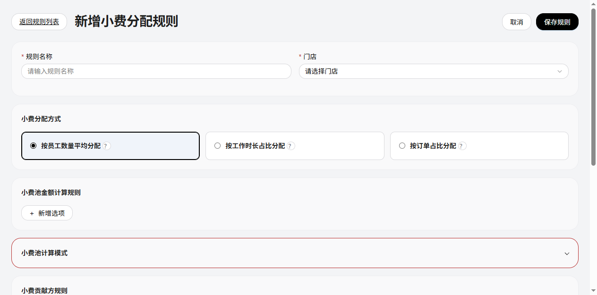

图注：规则编辑／贡献方新增选项展开；65128隔离浏览器，main@89d002f2＋本次样式修改。仅第二项红框，不是真实分配记录。

| 字段／操作 | 逻辑说明 |
| --- | --- |
| 按照个人销售额占比 | 贡献方新增菜单内data-basis=personal_sales_pct选项，1px实线红框#ff4d4f、圆角6px；文字沿用原颜色，不变红。不是报错，不增加校验、权限或禁用规则。 |
| 点击／选择 | 沿用addDeductRule('personal_sales_pct')，互斥、条件及计算不变；不标记小费池金额计算选项或已添加卡片。其余两个贡献菜单项不加框。 |

验证：浏览器计算样式确认目标红框1px、文字未变红、销售额项仍无边框；仅本次菜单展开图，不关闭其他历史操作截图缺口。

### 小费接收方规则：再分配红框

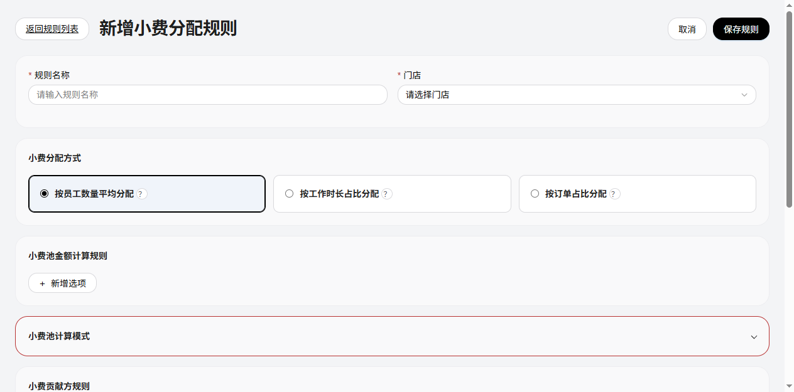

图注：同一65128隔离预览，新增接收方行，未保存配置。红框标记“再分配”，不是错误或禁止操作。

| 字段／操作 | 逻辑说明 |
| --- | --- |
| 再分配 | 接收方一级行中的文字链接，新增和编辑回填两处渲染均为1px实线红框#ff4d4f、圆角6px，内边距2px 6px；文字沿用原颜色。 |
| 点击及计算 | 沿用toggleReceiverRedistribute(this)及原二级展开／收起逻辑，不改变角色校验、占比、权重、计算或保存。删除和员工权重入口不加框。 |

验证：浏览器新增接收方行计算样式红框1px且文字未变红；不以本次截图关闭原再分配全部结果状态图片缺口。

## 贡献项员工承担行：按角色条件展示

图注：新增贡献项未配置角色，摘要及修改入口不展示、不占位。65127隔离验收，main@3f4e330b＋本次修改，未保存规则或分配记录。

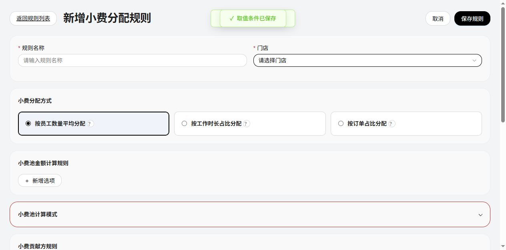

图注：同一贡献项在取值条件选择Bartender并提交，显示员工承担摘要和按钮；未选择门店，点击仍按既有规则提示“请先选择门店”。

| 字段／操作 | 逻辑说明 |
| --- | --- |
| 角色条件 | 每张贡献卡片已应用到页面草稿的取值条件role字符串数组；至少一个角色时显示。只在条件抽屉内临时勾选、尚未提交时不提前显示；取消不改卡片状态。 |
| 员工承担整行 | 摘要＋设置／修改按钮共同显示／隐藏，不只隐藏按钮。初始标记hidden，样式display:none避免flex覆盖；更新取值条件、加载编辑、切换门店摘要刷新时重判。 |
| 清空角色 | 条件成功应用为空时隐藏整行；若原条件必填校验拒绝清空，则保持原有效条件及显示。隐藏本身不删除已有份额、不触发保存／重算，旧自定义范围失效仍按既有规则阻止保存。 |
| 未选门店 | 角色为空时整行隐藏，无法点击；已有角色但无门店时整行显示且按钮可点，提示“请先选择门店”，抽屉不打开。 |

验证：真实新建项无角色隐藏／选择角色提交后显示两态已截图；函数覆盖角色清空后隐藏，算法回归不变。取消、角色清空结果与编辑回填等独立操作图仍待补，原其他缺口不关闭。

## 员工承担比例入口：未选门店提示

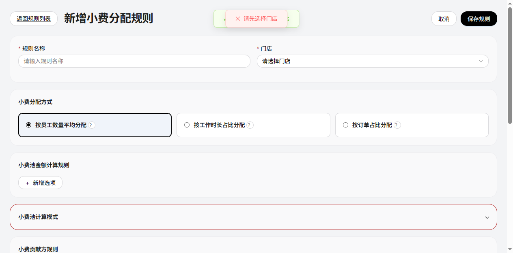

图注：新增规则／未选择门店／点击“修改员工承担比例”后，页面提示“请先选择门店”，抽屉保持关闭；65125隔离演示，main@726c463b＋本次修改，无规则或分配数据写入。

| 字段／操作 | 逻辑说明 |
| --- | --- |
| 门店 | 来源为规则编辑页storeSelect，空字符串代表未选择；不是全门店。 |
| 设置／修改员工承担比例 | 已选角色使入口行显示后，未选择门店时仍可点击。点击优先校验门店，显示页面提示“请先选择门店”，不展开抽屉、不重置输入、不写规则、不生成分配快照；待选择门店后可重试。 |
| 无贡献角色 | 按当前角色展示规则隐藏整行，不再以禁用按钮展示。历史未选角色截图只作历史记录，不作为当前入口显示依据。 |
| 有效门店及角色 | 保留既有模式、有效员工及范围校验；通过后打开平均／自定义抽屉。失败保留草稿。门店错误优先于模式／角色／名单错误。 |

验证：自动测试确认未选门店按钮可点击、通知文案精确匹配、抽屉未打开。角色禁用及既有份额逻辑回归通过；选择门店后重试的独立结果图沿用原缺口登记，不宣称全操作截图完整。

## 角色贡献规则：员工承担比例（TIPOUT-CONTRIBUTOR-SHARES-20261023-01）

实现修复记录（TIPOUT-SHARES-DRAWER-FIX-20261023-01）：修复680px员工比例抽屉沿用公共400px关闭偏移而残露的问题。关闭状态完全隐藏且不可操作；仅点击有效入口后显示并解除inert，确定／取消后恢复隐藏。未配置比例仍沿用旧扣除方式，不自动展开、不自动启用配置。该批入口禁用已被后续规则替代：无角色隐藏，有角色无门店点击提示；不改变既有业务、字段、版本及计算口径。基线main@05775454，独立功能预览65123已验证默认隐藏、点击打开、两员工40/60确定后关闭及摘要更新；不代表规则持久化或全部场景重新验收。

图注：编辑规则／取消员工比例输入后，仍为沿用原方式；main@03afacb8＋未提交功能分支，65122隔离浏览器。专用验收人员A销售200、小费20，B销售800、小费1000；不是真实员工或付款记录。固定身份仅由验收脚本显式创建，不向普通名单自动加人。

用途：先按取值条件算本条贡献项应承担的总额，再配置由哪些员工按什么比例承担。它与小费池预算P、接收组占比、员工接收权重和参与资格是不同层级；一条贡献项可以选多个角色，所有命中员工共同合计100%，不是每个角色各100%。

| 元素／操作 | 定义及联动 |
| --- | --- |
| 原贡献比例 | 例如10%，计算本条取值总基数的10%。启用自定义承担时须大于0、不超过100%，最多两位百分数小数。不是员工承担比例，也不是角色固定分得小费池P的10%。 |
| 设置员工承担比例 | 位于贡献卡片取值条件下方；已应用角色为空时整行隐藏，选中至少一个角色后才显示。显示后未选门店可点击并提示“请先选择门店”；有效门店／角色通过原校验后打开抽屉，仅作用于本卡片。 |
| 默认摘要 | 新添加贡献项默认平均分担；历史无配置显示“员工承担：未设置”，不改变旧算法或快照。打开默认平均，只有确定才应用转换；取消不迁移。 |
| 已配置摘要 | 平均显示“按员工人数平均分担（按当天有效员工人数计算）”；自定义显示“A 40%、B 60%”，超过3人显示人数。点击修改可查看完整名单。 |
| 范围变化 | 自定义：门店、角色或有效员工名单改变须重设，不静默归一化。平均：明确修改门店／角色后更新范围，按计算当天有效贡献员工动态均分；抽屉打开期间名单变化仍须取消重开。 |

### 员工承担比例抽屉

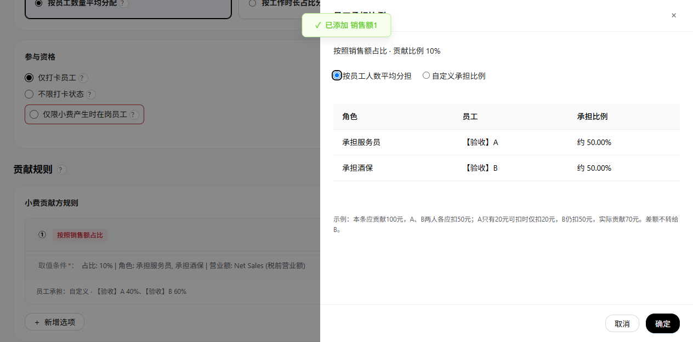

图注：员工承担比例；平均模式只读比例，无长说明。2026-10-23／main@e8d203b0／65132独立演示；实际页面采集，非生产交易。只证明所示状态，其他结果沿用逐操作缺口。

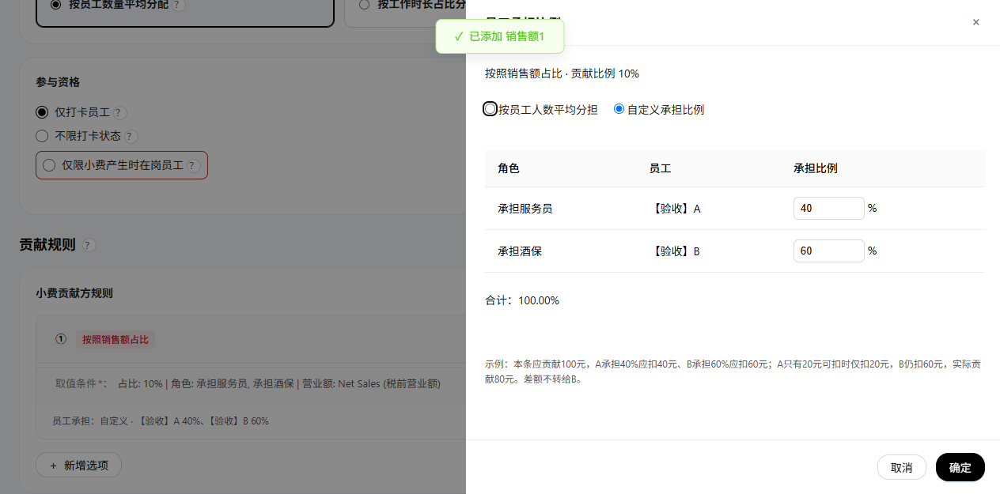

图注：员工承担比例；自定义40/60，合计100%。2026-10-23／main@e8d203b0／65132独立演示；实际页面采集，非生产交易。只证明所示状态，其他结果沿用逐操作缺口。

| 字段／操作 | 定义、默认及约束 |
| --- | --- |
| 上下文 | 只读当前贡献依据及贡献比例，明确是在分摊本条应贡献额；不显示虚构当天试算金额。 |
| 员工承担方式 | 必选单选：按员工人数平均分担／自定义承担比例，无沿用旧方式选项。新建默认平均；已配置按保存方式回填，旧自定义缺mode按custom回填。确定仅更新草稿，页面保存才落盘；取消／关闭不应用切换或输入。 |
| 角色 | 当前门店有效员工目录中的角色，只读；按所选角色顺序分组展示。不是另一个百分比分母。 |
| 员工 | 按稳定employeeId引用和去重，不用姓名作主键。命中多个角色只配置一次，不受接收方打卡资格限制，零小费余额员工仍可以出现在名单。 |
| 承担比例 | 平均只读“约100/N%”，两位小数仅供预览，不固化员工百分比、不用近似值反算金额。自定义每行必填0—100、最多两位小数，初次空值不自动填均分；切换保留本次自定义输入，取消丢弃。 |
| 合计 | 自定义全角色员工共同100%，不足／超过均拦截，保留实时合计和错误。平均不显示合计或人数说明行，不累加近似百分比；仍按人数精确分币。 |
| 确定 | 再核对打开时门店、角色及名单未变化；校验通过才更新本页规则草稿和摘要，不直接写规则或分配记录。 |
| 取消／关闭／遮罩／Esc | 丢弃本次抽屉输入，不改此前草稿或有效规则；重开按已应用草稿回填。标题关闭／取消／Esc返回入口焦点；Tab循环在抽屉控件中。 |
| 页面保存规则 | 按既有必填、引用和状态校验，并重验自定义份额及范围。成功写deductConfig对应卡片，失败保留草稿。仅查看抽屉不改变业务。 |

### 比例错误、取消与草稿应用

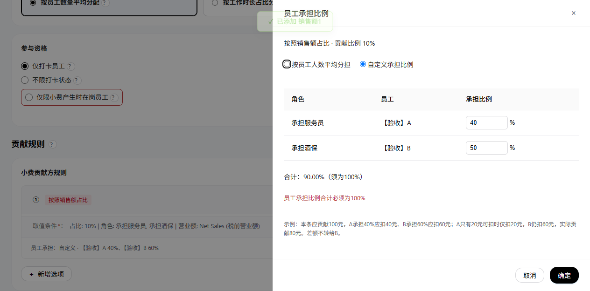

图注：自定义40＋50=90%；点击确定被拦截，草稿保留。2026-10-23／main@e8d203b0／65132独立演示；实际页面采集，非生产交易。只证明所示状态，其他结果沿用逐操作缺口。

图注：确定40%／60%后，卡片摘要已变，但存储尚无员工比例；不等于规则已保存。

### 保存后编辑回填

图注：实际点击页面保存规则，随后重新编辑并打开抽屉；输入为40／60，合计100%。接收方使用验收Chef人员，本贡献名单与其独立。未改历史分配结果。

### 计算定义与字段

| 字段／对象 | 研发定义及例子 |
| --- | --- |
| deductConfig条目 | 保留salesPct／personalSalesPct／tipIncome原结构；每张卡片可选追加employeeShares，无该字段的旧规则走原计算路径。 |
| employeeShares.version／mode | version整数1；mode为average／custom，新建默认average。历史mode缺省兼容custom，非法值拒绝；没有employeeShares仍保留旧算法，不视为默认平均。 |
| employeeShares.store | 设置时门店字符串，编辑器保存时校验与当前门店一致；员工ID还须属于当前角色名单。 |
| employeeShares.roles | 角色字符串数组，去重集合须等于贡献项角色；custom变化须重设。average在用户明确修改取值角色时同步范围，之后计算按该范围动态取当天员工。 |
| employeeShares.employees | custom必填数组：employeeId和pct，覆盖角色全部有效员工且无重复／失效。average不保存该数组；计算当天按角色取facts、employeeId去重排序；无有效员工报错，不除以0或静默返回零。 |
| 应贡献额D | 汇总所选员工符合取值条件的基数B，计算D＝B×原贡献比例。销售额／个人销售额／小费收入保留各自基数与筛选约束，不借承担比例扩大来源范围。 |
| 员工应扣dᵢ | average：D转整数美分，N人等权split，每人floor(D分/N)，余分按稳定员工ID补1分。custom：D×pctᵢ÷100，最大余数分币。先分应扣再各自余额封顶，所有应扣之和等于D。 |
| 可扣余额aᵢ | 当天原始可扣小费减此前贡献项／池已实际扣除金额，不含接收分得金额；不因本次应扣不足变成负数。 |
| 实际扣除cᵢ／少扣sᵢ | cᵢ＝min(dᵢ,aᵢ)，sᵢ＝dᵢ−cᵢ。只封顶本人，不转给其他员工或重新归一化承担比例。 |
| 同日顺序 | 沿用规则池计算顺序；同池按既有口径顺序salesPct、personalSalesPct、tipIncome，同口径按数组顺序消耗余额。新增配置不授权重排其他规则。 |
| C与实际可分配 | C为所有贡献项实际扣除之和，不是应扣之和；实际可分配max(P,C)，老板补足max(P−C,0)。 |
| contributionRules | 逐项快照增加shareMode=average/custom；custom历史布尔字段表示显式员工承担路径。average的pct为100/N展示依据，应扣按等权分币校验；保存当时人员与金额，不用现在人员重写历史。旧快照缺shareMode保留原custom校验。 |
| 贡献员工快照 | employeeId／name／role／pct／due／available／amount／shortfall；pct在沿用项为null，其他金额为应扣／扣前余额／实扣／少扣，保留确认时值，不用现行角色或名字重写历史。 |
| 守恒检查 | 贡献项员工应扣、实扣、少扣分别汇总；项实扣合计等于C，员工实扣合计与贡献流水及员工统计相等。无效或不守恒拒绝生成新确认结果。 |

算例：角色范围销售基数1,000元×10%＝应贡献100元；A承担40%应扣40、余额20实际扣20；B承担60%应扣60、余额1,000实际扣60。C＝80，少扣20。P＝100时实际分100、老板补20；P＝50时实际分80、老板补0，仍少扣20，不能把少扣直接等同于补足。

### 分配明细：贡献方及少扣提示

平均算例（本次新增）：D＝100元，A/B/C三人应扣33.34／33.33／33.33元（相同尾差按稳定ID）；A仅20元可扣，实际20／33.33／33.33，C＝86.66，P＝100时老板补13.34。新增有效贡献员工D且基数仍1000元时四人各应扣25元。所有选中角色共同分担，与接收方打卡资格无关；已发放快照不重算。

当前验证：两项单选、平均只读、保存规则后重开回填average、自定义40/60合计100、取消保留已存average已做浏览器验证；三人尾差、人数变化、少扣与快照守恒为自动测试。新建默认平均／历史无配置打开取消及范围变化的完整操作截图尚待补，不据此宣称逐操作全覆盖。其余原兼容限制不扩展。

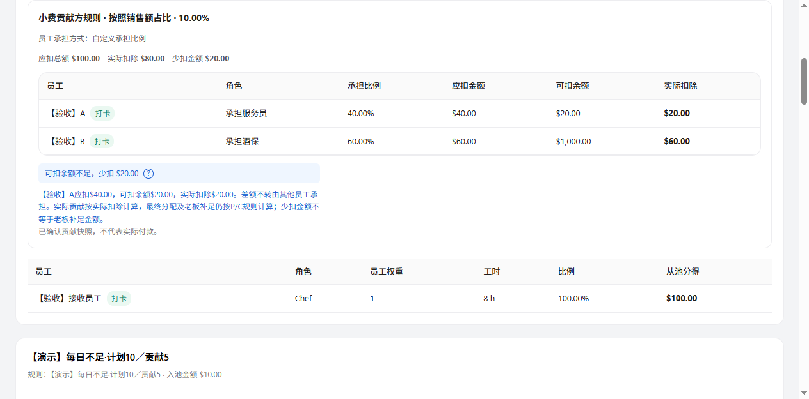

图注：已发放快照；本条A应扣40、余额20、实扣20，少扣提示展开。2026-10-23／main@e8d203b0／65132独立演示；实际页面采集，非生产交易。只证明所示状态，其他结果沿用逐操作缺口。

| 字段／操作 | 定义及可见条件 |
| --- | --- |
| 贡献方规则区 | 在对应小费池／规则金额区下方、接收方表前显示本规则的各贡献项；新自定义路径保留员工承担、应扣、余额、实扣。旧快照无逐项元数据时不猜测补算。 |
| 试算／确认 | 未确认使用“预计”标签；确认后读取保存的contributionRules，不用当前规则重算。人工保存沿用既有有效快照替换流程，已发放仍只读。 |
| 应扣总额 | 当前贡献项按条件及比例算出的D，不是整个小费池P。 |
| 实际扣除 | 当前项员工实际扣除之和，是该项对C的贡献；不是最终接收金额。 |
| 少扣金额 | 当前项应扣−实扣，只有大于0才额外强调，不等于老板补足。 |
| 蓝色提示 | 有员工余额不足才显示“可扣余额不足，少扣 $金额”，不阻止正常分配；不同贡献项分别判断，无少扣不显示此提示。 |
| 问号 | 点击展开逐位不足员工的应扣、余额和实扣，说明不转嫁、C按实扣、补足仍按P/C；收起仅隐藏说明，不写数据。原C＞P／C＜P提示独立保留。 |

图注：同日同规则／点击蓝色问号后，A应扣40、余额20、实扣20；单人不足仅列该人，多人不足逐人列出，B不会被追加扣20。

### 已发放快照

图注：隔离演示登记已发放后，贡献表及少扣提示仍按原确认快照显示，不修改旧发放或执行实际转账。原演示取消例外不因本次改变。

### 支持与交付边界

- 本期实现普通、非时段角色贡献配置及上述三种取值依据；旧funding、计提、逐笔时段路径遇自定义承担明确拦截，不默默忽略或退回全天。此为实现兼容边界，不替用户重新定义这些模式的业务。
- 同池启用自定义后，如包含旧salesPct项，必须为这些销售额贡献项均明确配置承担比例；否则保存与计算拦截，避免把旧按预算归集算法静默转换。未配置任何员工承担的旧规则不迁移。
- 仅在规则草稿保存后影响后续计算；已有确认／已发放快照不自动改写。旧无metadata快照继续原样展示，不补造历史比例。
- 本次不新增导出列、权限或支付接口。现有统计仍用实际扣除；新增字段的导出格式不在本次范围。
- 已验：90%拦截、取消不应用、确定仅草稿、保存后回填40/60、确认与已发放明细、少扣展开；函数覆盖多项／跨池余额、尾差、失效／重复ID、0比例及P/C。新建未选角色禁用、门店／角色／名单变化、恢复原方式、多人不足、键盘和故障等全部分支的页面图尚未齐全，其他历史缺口不关闭。

## 小费池计算模式默认折叠（TIPOUT-MODE-COLLAPSE-20261023-01）

图注：新增规则／默认收起，main@440289d5＋未提交分支，65121隔离演示；原默认模式legacy_pool保留，非已保存记录。

| 元素／字段 | 定义与行为 |
| --- | --- |
| 标题与箭头 | 红框内显示“小费池计算模式”和展开箭头；整条标题点击可切换，聚焦后Enter／Space使用原生summary交互。 |
| 默认展开状态 | 新建、编辑首次进入均为收起（details无open）；仅当前页临时布尔状态，不入库、不跨页面记忆，不新增配置字段。不是默认修改计算模式。 |
| 隐藏范围 | 收起时隐藏下方两个模式单选项及说明，其他卡片不随之折叠；保留红框。展开后原选项、说明、联动和校验恢复可操作。 |
| 计算模式取值 | 新建仍默认legacy_pool；编辑按已有allocationMode回填，包括order_tip_then_residual。收起不清空／禁用单选项、不重置为默认，保存继续读取当前选值。 |
| 保存及失败 | 仅展开／收起无业务写入、不构成人工业务调整；修改选项才走既有规则草稿。保存校验、成功／失败／取消和金额计算均沿用原定义。 |

图注：同页同版本，展开后两个选项可见；Enter再次收起，选值仍legacy_pool。默认、展开与键盘关闭有真实浏览器验证；既有计提模式编辑回填、离开重新进入的独立截图待补，不能据此宣称全链路验收。前批“计算模式区块红框”图展示的是展开态，不再代表首次默认状态。

## 规则编辑页红框视觉补充（TIPOUT-RULE-OUTLINE-20261023-01）

图注：新增规则／默认计算模式，main@07f8dd36＋未提交独立分支，65120隔离演示；不作为真实规则保存记录。仅样式补充，三文档保持产品V4.9／研发V3.9／个人V2.7，无业务版本变更。

| 元素 | 视觉定义与边界 |
| --- | --- |
| 小费池计算模式区块 | 红框沿用。默认仅显示可操作标题与箭头；展开后两个单选项和说明位于框内；重新点击标题收起。红框不是校验失败或选中状态。 |
| 在岗员工选项 | “仅限小费产生时在岗员工”单选项、文字及问号整体使用1px红框、8px圆角；框宽随内容，不框住整个参与资格区。默认未选与已选都显示红框，文字、打卡条件与选中逻辑不变。 |

图注：同页同版本／选中在岗资格并点击问号，说明浮层可正常展开；边框不裁切说明，原工时联动沿用。框不是整行点击的新入口，不改禁用、保存及算法。本轮未保存规则；其他历史截图及验收缺口保持原状态。

## 取消已发放分配（演示重置，TIPOUT-CANCEL-PAID-20261023-01）

图注：日期汇总10/21—10/23，23日已发放、21日待发放、22日未营业；origin/main@649225c3＋未提交功能分支，65118隔离演示，非真实交易。当前原生页面生效；旧dist/TipOut/index.html静态原型未升级该业务，不作为本次入口。

| 字段／操作 | 定义及结果 |
| --- | --- |
| 测试场景清单 | 复用btn-danger红色边框，位置、点击行为不变。 |
| 取消分配 | 同样红框；范围为当前门店、起止日期（含两端）的正常营业日，不按状态筛选缩小范围。已发放也可取消；未营业、范围外、其他门店、原始订单／考勤不改。门店必选，日期必须有效。 |
| 无记录／异常 | 无有效记录不写入或重复归档；损坏或发放依据异常拦截，不强行解锁。 |
| 锁定例外 | 仅本演示取消可重置已发放；普通编辑、更新、分配、底层cancel仍遵守锁定，不新增支付撤回接口。 |

### 页面内取消确认

图注：同版本／点击红框取消入口；页面对话框，不调用浏览器confirm。

| 字段／操作 | 定义及结果 |
| --- | --- |
| 标题／范围 | “取消分配？”；只读门店及日期。打开时冻结范围及各日快照／发放／更新指纹，外部变化不静默改变目标。 |
| 警示 | “取消后将恢复为待分配，已发放标记也将撤销。此操作不会撤回实际付款。” |
| 保留分配／关闭／Esc／遮罩 | 不写入，关闭返回焦点；提交期间阻止关闭及重复提交。框外主内容inert，Tab在框内循环。 |
| 确认取消分配 | 先检查整个范围及指纹一致，再逐日Web Lock内复核；confirmed=true和expectedFingerprint必填。过期确认失败，需关闭后重新检查。 |
| 成功 | 归档旧数据后清有效快照、已分配索引、发放标记及未确认更新。正常日回未分配／待发放；已分配金额归零，未分配金额按现行试算展示；刷新汇总及冻结周期Payroll。 |
| 失败 | 每日五项写失败恢复原值；回滚也失败明确提示停止操作。范围逐日执行，非全范围原子；中断报已完成天数，剩余不动。薪资失败明确取消已写入、同步失败，可经原员工数据更新流程重试同步，不假报全成功。 |

### 保留分配

图注：同范围点击保留，23日仍已发放、21日已分配待发放、22日仍未营业。

### 确认后结果及历史

图注：同范围确认后，23／21日恢复未分配、待发放，22日仍无需分配／无需发放。实际归档2条，23日含原发放记录，21日payout为空。

| 字段／对象 | 定义、来源、默认与约束 |
| --- | --- |
| cancelFingerprint | 已分配索引、快照、发放、未确认更新的JSON字符串，用于锁内并发比较；非金额，不展示。 |
| 历史存储 | tipout-allocation-cancel-history-v1，JSON数组，默认空；实际取消才追加，不参与有效汇总。损坏拦截。 |
| recordId／canceledAt | 系统唯一ID字符串／ISO当前时间字符串，必填不可编辑。 |
| storeId／businessDate／source | 必填字符串：冻结门店、ISO营业日、固定summary-demo-reset。 |
| snapshot／payout／unconfirmedUpdate | 完整撤销前对象或null；保留快照ID、版本、hash、金额及原发放时间、确认人、请求ID。不删除订单／人员／规则。暂不新增历史查看页。 |
| 写入 | 锁内归档→快照→索引→发放→未确认更新；保留五项原始值并逐项回滚，只成功后通知其他视角。历史不是退款流水。 |
| 发放确认警示 | 本操作仅记录发放状态，不执行转账。确认后分配结果锁定；仅可通过汇总页“取消分配”演示重置，撤销标记不会撤回实际付款。 |

验收：23日已发放、21日未发放、22日闭店；保留不写，确认归档2条、清有效状态，范围外不动。重复取消幂等，过期指纹拦截，五项故障回滚、普通cancel仍锁定有函数测试；默认、确认、保留和成功有截图。并发、故障、薪资失败、焦点循环的页面截图仍待补，原历史缺口不关闭。旧“已发放取消跳过”图片仅为历史，不代表当前规则。

上批维护（历史）：TIPOUT-FUNDING-EXCESS-20261023-01（2026-10-23）。[产品V4.6](PRD_产品需求文档.md)／[研发V3.6](小费分配业务规格说明书（研发交付版）.md)／[个人规范V2.4](小费管理需求文档（个人规范版）.md)配对。明细金额对照、蓝色贡献超计划标识及展开说明，新增隔离演示门店“计划10·贡献20·按20分配”。普通池明确个人小费／个人销售额贡献配置已接入试算与确认；角色无独立公式、salesPct、旧funding、计提及时段资金的兼容边界仍保留，非全部资金契约完成。代码及文档未提交。

上批维护（历史）：TIPOUT-FUNDING-DEFINITION-20261023-01（2026-10-23）。[产品V4.5](PRD_产品需求文档.md)／[研发V3.5](小费分配业务规格说明书（研发交付版）.md)／[个人规范V2.3](小费管理需求文档（个人规范版）.md)配对。明确贡献≤计划金额按计划分配、贡献>计划按实际贡献分配；补符号映射、等于／零值及20对10算例。只更新资金业务定义，不改代码、页面或历史快照；实现状态与原待确认项保留。基线为本地main@fb78f5e7（含尚未推送提交）。

上批维护（历史）：TIPOUT-DETAIL-GAPS-20261023-01（2026-10-23）。[产品V4.4](PRD_产品需求文档.md)／[研发V3.4](小费分配业务规格说明书（研发交付版）.md)／[个人规范V2.2](小费管理需求文档（个人规范版）.md)配对。第二批补明细切店／切日的页面内草稿确认、首次人工结果来源标记及员工每日日期校验。功能基线44ca8723＋65115未提交实现；跨菜单离开、首次确认和员工替换仍有浏览器验收缺口，不声称全部完成。

上批维护（保留）：TIPOUT-DATE-VALIDATION-20261023-01（2026-10-23）。[产品V4.3](PRD_产品需求文档.md)／[研发V3.3](小费分配业务规格说明书（研发交付版）.md)／[个人规范V2.1](小费管理需求文档（个人规范版）.md)配对。第一批实现汇总日期空值／倒置反馈、结果保留、操作拦截与修复恢复，补10张真实截图；资金、算法、资格和历史快照不变。其余缺口继续分批，不代表全部实现。

上轮文档维护：TIPOUT-DOC-HISTORY-20261023-01（2026-10-23）。[产品V4.2](PRD_产品需求文档.md)／本文V3.2／[个人规范V2.0](小费管理需求文档（个人规范版）.md)同步配对。个人版承接本文§3.1—3.7、§6.1的已有规则与页面字段，保留此前人工保存／系统重算专项，不新增接口、计算或状态；操作与图片覆盖见[逐操作清单](小费管理逐操作覆盖清单.md)。文字承接阶段仅核对文字与本地链接；后续本轮截图补充见下方记录，不执行生产发放或资金新契约开发。

上轮2026-10-23截图补充（当时业务版本不变）：新增125张真实界面图，来自main基线44ca8723的65114独立演示；已在个人规范版按页面／操作就近内嵌。99项清单操作已关联所示状态，仍有7项操作及部分异常分支缺图。仅本地演示生成快照／登记发放锁，无转账；不改用户原会话或业务代码。CSV／PDF未取得文件、邮件未发送；历史兼容与待实现界面仍保留缺口。见[逐操作覆盖清单](小费管理逐操作覆盖清单.md)及[图片溯源清单](assets/tips-operations-20261023/capture-manifest.json)。本轮截图说明当前实现，不覆盖已确认待实现的产品定义。

维护范围：个人版新增日期／员工汇总、员工每日、工时弹框、明细编辑、更新／发放、规则与来源抽屉、权重及导出说明；旧歧义按§6.1对照而非重新批准。Q01—Q14／Q16仍待明确，Q15保持关闭；班次兼容入口、截图及历史导出差异保留缺口。本文既有公式与字段编号不变。

## 日期分配汇总：人工结果覆盖确认（TIPOUT-BATCH-COPY-20261022-01）

图注：2026-10-23／44ca8723基线／65114隔离演示，仅1个人工日；下方2026-10-22图片保留为历史专项证据。

图注：2026-10-22，功能分支codex/tips-overwrite-copy-20261022，基线为已合并但未推送的本地main e52b31a8，端口65113；演示数据仅用于验证提示，不是生产数据。

用途／入口：日期分配汇总底部“重新分配小费／批量分配小费”→选择门店和起止日期→“分配小费”。起止同日即单日，范围含首尾日期；不按汇总表当前营业／分配／发放筛选缩小选择范围。

| 字段／操作 | 逻辑说明 |
| --- | --- |
| 人工结果识别 | 读取所选门店每个可分配日的有效快照，allocationSource===manual表示人工保存；system及历史缺字段不据此推断人工。未营业、已发放或锁定日不实际覆盖，不列入人工提示清单。 |
| 首次分配按钮 | 校验门店和日期后读取范围；不存在可覆盖人工日则按既有覆盖说明进入系统分配。有至少一天人工日时不写入，原选择弹框进入二次确认阶段。 |
| 页面内二次确认 | 标题“重新分配小费？”。第一段“所选日期中有 N 天已手动调整：YYYY/MM/DD、YYYY/MM/DD。”，天数加粗；第二段“重新分配将按系统规则计算，覆盖手动调整结果。”，覆盖后果加粗。去掉重复的门店和起止日期范围；底部按钮“取消／重新分配”。人工天数、日期集合及重算范围不变。 |
| 范围冻结 | 二次确认阶段隐藏并禁用原门店及日期选择字段，不再重复显示范围摘要；保留内部不可变范围和快照指纹。确认时范围、资格或已保存结果变化则恢复选择并要求重新检查；不因省略摘要而改变实际操作范围。 |
| 重新分配（覆盖确认主按钮） | 明确点击后先预生成并校验全部可执行日期的系统快照；复用明细系统重建，不加载旧人工公式、人员调整、权重或手工工时为新系统结果。提交后来源为system，统计读取新快照。不能只写已分配日期标记。 |
| 取消／关闭／Esc／遮罩 | 均取消该次覆盖，不写分配结果，不清除人工快照；下一次操作重新识别人工日期。关闭后焦点返回汇总分配入口。 |
| 执行及失败 | 执行期间按钮禁用，阻止重复提交。全部日期先校验，计算失败不写任何日期；实际存储沿用按日原子提交及乐观冲突检查，后续日提交失败则停止，已成功日保留并报告已保存天数，不谎报全部成功。此为本次本地实现边界，不自动关闭原Q11跨日生产事务决策。 |
| 薪资与统计 | 全部日期成功后刷新范围与汇总并调用既有薪资桥接；薪资失败明确已保存但同步失败。已发放锁定仍受日期写锁保护，不被重新分配。 |

### 单日覆盖确认

同一确认页面按实际数据展示1天和日期，不使用另一套规则。本次文案精简的专项断言覆盖两个人工日期的YYYY/MM/DD格式、标题、主按钮及加粗节点；实际浏览器核对单日与范围含一个人工日时的两段正文和取消，截图为本次精简后的真实页面。重新分配范围、指纹和写入实现未变。

### 可验收算例

范围10/19—10/21中，10/19人工比例60/40已保存，10/20系统50/50，10/21人工70/30已保存：提示2天（10/19、10/21）；取消后三天快照均不变。确认后所有可执行日按系统规则重算，不保留60/40和70/30。如果10/21已发放，则跳过、提示清单仅含10/19，并反馈跳过数量。

验证状态：专项覆盖单日、范围、多人工日、混合系统日、未营业、已锁定及指纹变化；范围预计算、真实快照提交与并发参数检查。实际浏览器：10/19与10/21人工v2，取消后均不变；10/19—10/21确认后两日均为system v3，10/20为system v1，10/19公式由人工100恢复系统200。单日二次确认显示1天及10/19。类型检查、既有保存／页面弹框／存储专项通过。不表示生产上线、Q11闭合或全套历史脚本通过。

## 小费分配明细：保存与系统重分配（TIPOUT-DIALOG-20261022-01）

图注：基础明细截图来自2026-10-22、基线f5940cbd的功能预览65110，仅用于定位保存按钮。下方弹框截图来自本次基线ae7443e9、codex/tips-page-dialogs-20261022、端口65111；计算与保存定义未变。

用途／入口：当前门店、营业日明细底部。“保存当前分配”位于“重新确认分配”右侧；规则筛选只控制可见区块，两操作均处理当天全部规则。已发放仍锁定，不改变资金、人员及金额校验。

| 字段／操作 | 逻辑说明 |
| --- | --- |
| 共用页面内对话框 | 使用项目modal-overlay/modal样式，不调用浏览器alert/confirm；notice/save/reallocate三个类型。打开默认聚焦主按钮，Tab／Shift+Tab循环限定在弹框按钮内；关闭回到触发按钮。确认前不提交，重复打开不重复执行。取消、右上角关闭、遮罩或Esc均返回取消；弹框期间门店、日期或基准快照变化时不执行原确认。同日外部状态变化自动取消弹框，再按既有状态处理。 |
| 手动调整标记 | 员工、权重、工时、比例、角色占比、公式等既有可编辑项发生手动输入或增删即标记；改回原值仍视为已操作。筛选、查看不标记；更新小费数据的系统草稿不单独算人工调整。首次手工录入无快照仍沿用“确认分配”。 |
| 保存当前分配 | 已有系统分配且有未保存人工调整时启用；无人工调整时置灰、aria-disabled=true但可点击原因提示，不写入。保存成功清除未保存人工标记并置灰。执行中、无已分配结果、不可分配日或锁定时真正禁用。 |
| 保存确认 | 提示“已手动调整过小费分配数据，将按照手动调整后的分配数据进行统计”；确认后校验并保存页面当前全部规则结果，不重建系统默认值。取消不写入并保留草稿。 |
| 重新确认分配 | 已分配未锁定日期可主动重算。有未保存人工调整或上次快照为人工来源时提示“已手动调整过小费分配数据，将按照系统小费规则进行重新分配，分配后会覆盖手动调整的数据”；无人工调整保留原覆盖提示。 |
| 系统重算 | 确认后使用当前门店全部有效规则、系统事实及默认工时，忽略当天人工调整、手工工时；新快照校验与提交成功后才替换页面。取消不变；失败保留原草稿与旧有效快照。 |
| 提交保护 | 沿用日期锁、快照哈希冲突、金额与人员校验。执行中阻止重复操作、编辑及离开；失败不清草稿。统计只读取最新成功保存快照，不使用草稿；薪资同步失败明确提示已保存但同步失败，不回滚快照。 |
| allocationSource | 快照可选字符串 manual/system，人工保存写 manual，系统自动或重分配写 system，随完整快照及哈希保存。重开人工快照仍提示覆盖人工数据；旧快照缺省值为未知，不推断来源、不自动迁移重算。 |
| detailManualDirty | 页面运行态 boolean，默认false；用户编辑置true，成功保存、放弃、锁定或系统更新替换草稿后置false。与系统更新草稿标记detailDirty分开；不直接参与金额计算或持久化。 |

### 未调整提示框

图注：2026-10-23／44ca8723基线／65114隔离演示，本轮实际页面弹框；下方旧图保留原来源。

点击灰色保存，仅提示“当前系统分配数据未进行手动调整”；关闭不改变统计或快照版本。 页面内标题“提示”，按钮“知道了”，右上角可关闭；不调用浏览器alert。

### 人工保存确认框

图注：2026-10-23／44ca8723基线／65114隔离演示，本轮实际页面弹框；下方旧图保留原来源。

提示采用上表原文。页面内标题“保存当前分配？”，底部“取消／保存当前分配”；确认才保存，取消、关闭、遮罩或Esc保留草稿和旧统计。

### 覆盖人工数据确认框

图注：2026-10-23／44ca8723基线／65114隔离演示，本轮实际页面弹框；下方旧图保留原来源。

提示采用上表原文。页面内标题“重新确认分配？”，底部“取消／重新确认分配”；确认才重算，取消、关闭、遮罩或Esc不覆盖。无人工调整时的原覆盖提示同样使用此页面内弹框。

### 验收算例

预算 $100，A/B 权重均为1、工时均4h，系统各分 $50。人工比例改为60%/40%，保存确认后统计为 $60/$40；取消保存仍统计 $50/$50并保留草稿。重新确认分配并确认覆盖后按4h:4h恢复 $50/$50。未调整点灰色保存只提示；失败和并发冲突不覆盖草稿；已发放不能保存或重分配。

验证状态：保存/重算专项、页面弹框专项、确认/自动分配回归及类型检查通过。隔离浏览器验证三种页面弹框、Esc保留草稿、Tab循环及焦点返回、取消不写入；确认人工保存生成manual快照v2（公式100），页面确认系统重算生成system快照v3（公式200）。三个弹框实截图已就近嵌入。不宣称生产发布或全套历史回归通过；既有payout-ui和detail-rounding旧测试缺口保留。

## 版本记录

| 版本 | 日期 | 修改内容 | 对应版本 |
| --- | --- | --- | --- |
| V3.18 | 2026-10-23 | TIPOUT-DOC-CURRENT-20261023-01：核对主线实现，修正规则排列、资金路径状态及旧配对信息，更新真实截图，登记UI-01／02偏差；无新增业务 | 产品V4.18／研发V3.18／个人V2.16 |
| V3.17 | 2026-10-23 | TIPOUT-RULE-EDITOR-GROUPS-20261023-01：基础／分配／贡献分组，金额→接收方→方式→资格，贡献后置，保留模式显隐与算法 | 产品V4.17／研发V3.17／个人V2.15 |
| V3.16 | 2026-10-23 | TIPOUT-PERSONAL-SALES-BORDER-20261023-01：个人销售额贡献新增选项红框，文字和点击不变 | 产品V4.16／研发V3.16／个人V2.14 |
| V3.15 | 2026-10-23 | TIPOUT-SHARE-ROLE-VISIBILITY-20261023-01：角色条件非空才展示员工承担摘要与入口整行，清空隐藏 | 产品V4.15／研发V3.15／个人V2.13 |
| V3.14 | 2026-10-23 | TIPOUT-SHARE-COPY-TRIM-20261023-01：删除抽屉四处说明，保留示例主体与自定义合计，不改计算或保存流程 | 产品V4.14／研发V3.14／个人V2.12 |
| V3.13 | 2026-10-23 | TIPOUT-SHARE-STORE-NOTICE-20261023-01：未选门店员工承担入口可点击，提示“请先选择门店”，不打开或写入 | 产品V4.13／研发V3.13／个人V2.11 |
| V3.12 | 2026-10-23 | TIPOUT-CONTRIBUTOR-SHARE-MODES-20261023-01：仅平均／自定义，新建默认平均，动态人数精确分币，历史无配置不迁移 | 产品V4.12／研发V3.12／个人V2.10 |
| V3.11 | 2026-10-23 | TIPOUT-CONTRIBUTOR-SHARES-20261023-01：跨角色员工承担100%、余额封顶不转嫁、逐项快照与少扣提示、抽屉及实证 | 产品V4.11／研发V3.11／个人V2.9 |
| V3.10 | 2026-10-23 | TIPOUT-MODE-COLLAPSE-20261023-01：计算模式默认折叠、原生键盘展开、保留选值及截图 | 产品V4.10／研发V3.10／个人V2.8 |
| V3.9 | 2026-10-23 | TIPOUT-CANCEL-PAID-20261023-01：演示取消归档并重置已发放／已分配，页面确认、红框及截图 | 产品V4.9／研发V3.9／个人V2.7 |
| V3.8 | 2026-10-23 | TIPOUT-DAILY-SHORTFALL-20261023-01：不足对照与老板补足问号说明；每日10/5数据及截图 | 产品V4.8／研发V3.8／个人V2.6 |
| V3.7 | 2026-10-23 | TIPOUT-DAILY-EXCESS-20261023-01：仅超额规则显示资金对照；当前默认门店每日演示；半美分口径对齐与截图 | 产品V4.7／研发V3.7／个人V2.5 |
| V3.6 | 2026-10-23 | TIPOUT-FUNDING-EXCESS-20261023-01：贡献超计划金额对照与展开说明；独立个人贡献资金联动及10/20演示；历史和未支持路径不自动迁移 | 产品V4.6／研发V3.6／个人V2.4 |
| V3.5 | 2026-10-23 | TIPOUT-FUNDING-DEFINITION-20261023-01：贡献与预算取较大值为分配基数；明确符号映射、等于与零值、20/10算例；仅文档 | 产品V4.5／研发V3.5／个人V2.3 |
| V3.4 | 2026-10-23 | TIPOUT-DETAIL-GAPS-20261023-01：明细草稿页面内确认、人工来源及员工每日日期错误反馈；产品V4.4／研发V3.4／个人V2.2；保留未验收分支 | — |
| V3.3 | 2026-10-23 | TIPOUT-DATE-VALIDATION-20261023-01：共用汇总日期错误、结果保留、操作拦截及恢复；产品V4.3／研发V3.3／个人V2.1；第一批日期校验，其他缺口继续分批 | — |
| V3.2 | 2026-10-23 | TIPOUT-DOC-HISTORY-20261023-01：同步个人规范V2.0历史字段与操作承接、CF对照及截图缺口；配对产品V4.2；不改业务计算和待确认状态 | — |
| V3.1 | 2026-10-22 | TIPOUT-BATCH-COPY-20261022-01：覆盖提示精简为两段，去掉门店与范围重复信息，突出天数和覆盖后果；配对产品V4.1、研发V3.1、个人V1.5，计算不变 | — |
| V3.0 | 2026-10-22 | TIPOUT-BATCH-20261022-01：日期汇总单日／范围重分配增加人工快照覆盖确认，真正重建系统结果；配对产品V4.0、研发V3.0、个人V1.4 | — |
| V2.9 | 2026-10-22 | TIPOUT-DIALOG-20261022-01：保存提示及系统重分配确认改用页面内对话框，补充取消、Esc、焦点及截图；配对产品V3.9、研发V2.9、个人V1.3 | — |
| V2.8 | 2026-10-22 | TIPOUT-SAVE-20261022-01：人工保存与系统重分配分离，三提示、来源及草稿保护；配对产品 V3.8、研发 V2.8、个人规范 V1.2 | — |
| V2.7 | 2026-10-15 | TIPOUT-NAV-20261015-02：原生及静态模板删除两个跨页入口、清理闲置处理函数；配对产品 V3.7、个人规范 V1.1 | — |
| V2.6 | 2026-10-15 | TIPOUT-NAV-20261015-01：公共滑层派生两入口并保留原路由权限目录；规则快捷入口固定列表、列表退出全屏；配对产品 V3.6、个人规范 V1.0 | — |
| V2.5 | 2026-10-14 | TIPOUT-PERF-20261014-01：首次汇总去除重复渲染；门店日事实按同步读取作用域缓存，finally 清理；补充性能、刷新和视图一致性测试，配对产品 PRD V3.5 | — |
| V2.4 | 2026-10-10 | TIPOUT-COPY-20261010-01：底部首次分配按钮更名“批量分配小费”，事件及计算不变；配对产品 PRD V3.4 | — |
| V2.3 | 2026-09-30 | TIPOUT-PAYOUT-COPY-20260930-02：移除线下核对说明节点并更新回归断言；配对产品 PRD V3.3；状态和计算不变 | — |
| V2.2 | 2026-09-30 | TIPOUT-PAYOUT-COPY-20260930-01：两入口标题及提示展示同步；补充静态文案契约与回归口径，配对产品 PRD V3.2；不修改计算、发放写入与锁定状态 | — |
| V2.1 | 2026-09-30 | TIPOUT-FUNDING-20260930-02：贡献超预算按实际贡献全额分配；统一预计／确认池金额与老板补足，关闭 Q15 并补充超额算例；配对产品 PRD V3.1，待开发 | — |
| V2.0 | 2026-09-30 | TIPOUT-FUNDING-20260930-01：员工贡献独立于池预算；新增老板出资字段、确认记账与对账口径；更新不足额算例和历史保护，配对产品 PRD V3.0；待开发 | — |
| V1.1 | 2026-09-30 | DOC-GOV-20260930-01：确立研发交付版权威职责，与产品 PRD V2.16 配对；加入双文档同步维护与冲突处理约定；原待确认项及业务计算保持不变 | — |
| V1.0 | 2026-09-30 | 首次创建；以权威 PRD V2.15 为基线展开字段、状态、计算与贯穿算例；区分会话已确认变更、实现证据和发布前待确认边界 | — |

## 0. 文档信息与阅读约定

| 项目 | 内容 |
| --- | --- |
| 模块 | 团队管理／小费管理（TipOut） |
| 读者 | 产品、前端、后端、测试、实施 |
| 文档状态 | V3.18文档对齐稿，尚未提交；main@e8d203b0已包含普通池独立贡献及员工承担。实现与已确认目标仍有UI-01／02偏差；旧资金、兼容及生产结算缺口保留，Q15关闭，其他待确认状态不变。 |
| 主要依据 | [产品权威V4.18](PRD_产品需求文档.md)及用户已确认决策；当前源码核对main@e8d203b0。历史代码与原验收基线保留，不表示全部路径统一。 |
| 补充依据 | 本会话已经明确确认、但原文尚未同步的页面与统计要求；当前 `src/team/tips` 源码只作为实现佐证 |
| 权威关系 | 本文是小费模块研发交付权威文档，负责字段、对象关系、状态、计算、异常及算例；产品 PRD 负责产品需求与业务决策。两份文档共同维护同一业务定义，不以研发细节新增或覆盖产品决策；本文评审状态及待确认项不会因权威定位而自动转为已确认 |
| 配对与变更 | 产品PRD V4.18 ↔ 本文V3.18；[个人规范V2.16](小费管理需求文档（个人规范版）.md)；共同变更编号TIPOUT-DOC-CURRENT-20261023-01。 |
| 同步维护规则 | 遵循[项目规则](../../../AGENTS.md)及个人三文档规范；功能变更同次更新产品、研发、个人规范三份受影响正文、版本与共同编号，冲突关联同一待确认项。 |
| 本次交付性质 | 文案、字段、排列、实现状态和截图对齐；不修改业务代码、不提交快照或发放、不新增接口、不代表上线或合规认证。旧截图及测试记录保留溯源。 |
| 覆盖范围 | 六个现有业务页面、普通池完整计算、时段资格、确认与发放、统计与导出；兼容模式明确记录未统一处 |

**先读第 2 章理解对象，再读第 3 章对应模块；计算联调使用第 5 章同一组输入。** 表中字段编号是本文的业务索引，不是承诺已经存在的接口名或数据库列。

## 本次导航实现契约（TIPOUT-NAV-20261015-02）

图注：2026-10-15，原生预览 65024，示例列表状态；图片定位，不作为金额定义。

| 字段／操作 | 逻辑说明 |
|---|---|
| 小费管理子项 | `navModuleChildrenAsSheetSubnav` 从既有 `TIPS_MANAGEMENT_SUBNAV` 派生两个可见叶子，排除 `tips-details`。目录仍保留三个业务页面，用于路由标题、权限和明细访问；不向 NAV_MODULES 重复添加新权限层。 |
| 小费分配 | 既有 ID `tips-distribution`、路径 `/team/tips/distribution`；日期／员工视角继续用业务页签及既有 query，不生成两个侧栏权限资源。 |
| 分配规则 | 既有 ID `tips-rules`、路径 `/team/tips/rules`；不带日期上下文也能访问列表。普通列表不再匹配 `isTipsFullscreenRoute`；编辑、日期和员工明细继续匹配原全屏路径。 |
| 页面内跨页按钮 | 删除分配页 `summaryRuleEntryBtn` 与闲置 `openSummaryRuleEntry`；删除规则列表“返回小费分配”链接及其返回布局修饰类。原生模板与静态页面同步；不新增写入，左侧导航返回及编辑器取消／返回规则列表不受影响。 |
| 权限及过滤 | `navigation:team:team-tips`、原有分配／规则／明细 `page:` 键及其父级保持不变；公共权限、订阅、预设和草稿保护继续生效，不迁移或补授任何权限。 |
| 新增规则 | 原 `openAddRuleModal`、池类型确认及编辑流程继续使用；仅入口和空状态文案统一为“新增规则”。关闭池类型弹框不创建记录，取消编辑沿用离开确认，保存仍按既有校验和写入。 |
| 公共滑层返回 | 仅弹出一层内存导航栈，不调用业务路由返回；叶子点击保持子层并按路径高亮；无可访问子项时遵循公共过滤，不打开空层。 |

验证入口：`verify-tipout-rule-navigation.ts` 校验可见子项、两页面重复按钮及闲置处理函数均不存在和现有三个页面权限父级；既有路由、全屏、权限导航及 TypeScript 检查。隔离浏览器实测父行下钻、叶子高亮、列表保留侧栏、池类型弹框、编辑取消确认后回列表及导航返回不改变 URL。宽泛历史脚本仍存在非本次变更的旧断言：native-views 对未分配贡献缺失数据期望“—”，interaction-refresh 对已移除 pendingDateCount 仍作存在性检查；不以此声明全套历史测试通过。

本次无金额、精度、状态流转、数据库字段及持久化新增；原 Q 类待确认项和资金新方案的待开发状态保持不变。

TIPOUT-PERF-20261014-01 实现记录：initializeSummaryPage 调用 updateEmployeeFilter(true) 更新筛选项后只渲染一次。renderSummaryViews 用 TipOutScenarioSource.withReadCache 包裹同步渲染；缓存 roster 的键为规范门店 ID，day 的键为 [规范门店 ID, dateKey]，空数组也是有效缓存值；嵌套读取沿用当前作用域，成功和异常均 finally 清理。仅为一次读取的内存复用，不持久化、不复用到下一次渲染，也不覆盖已确认快照。其他未调用此包装的页面继续原读取方式。金额、权重、资格、状态及精度不变。

验证：scripts/verify-tipout-summary-entry-performance.mjs 使用 60 员工×30 天、每员工两次事实读取，生成次数由 3600 降为 30；名单变更、门店隔离及异常清理通过。此 Node 合成负载测得约 66.65 秒→0.63 秒，不是用户页面端到端指标。scripts/verify-tipout-summary-entry-browser.cjs 在隔离 Chrome 中挂载真实页面：60 员工、31 日期行初始化约 0.68 秒、名单读取 4 次；日期→员工→日期切换结果一致、无页面异常。耗时为本机单次测量，不作跨设备 SLA。既有待分配贡献、汇总切换及 TypeScript 回归另行验证；资金新方案实施状态不因性能修复改变。

证据标记：

- **[D] 已确认定义**：权威 PRD 最新有效条款明确规定；即使尚未实现，也不能用旧代码覆盖。
- **[U] 已确认补充**：本会话用户已明确确认的后续要求，原 PRD 存在未同步旧句；具体对照见第 6.1 节。
- **[I] 实现事实**：当前源码的静态核对结果，不等于业务定案、全部路径一致或测试通过。
- **[Q] 待确认**：来源缺失或相互冲突且不能确定，不擅自采用“行业通常如此”补齐。
- **[建议]**：供研发评审的实现承接建议，不是已批准数据库、接口或新增页面要求。

字段表遵守统一约定：未注明允许编辑的计算字段均只读；未配置与合法 0 不相同；所有字段的单位、空值、版本、统计和失效处理还受第 4 章约束。普通池为本文完整计算主线，计提／剩余、服务费及历史模式不可直接套用。

## 1. 背景与目标

**背景**：现有权威文档按版本追加，字段、状态与计算依据分散，部分历史描述仍与最新定义并存。研发需要从同一个业务问题查到输入、计算、结果、异常和例子，而不是自行推断章节优先级。

**本期只解决**：把已确认的小费业务展开为可理解、可核对、可测试的研发交接规格，保留原文及业务含义。

成功标准：

- 每个业务字段能定位所属对象、来源、单位、空值、可编辑范围、状态口径和示例。
- 每个关键动作能明确前置条件、成功写入、失败保留、后续状态和跨页影响。
- 同一组数据在贡献、接收、员工结果、日期汇总和发放参考值之间可对账。
- 缺失的业务决策有编号、影响范围和确认责任，不隐藏在公式或代码建议中。

不做：重新设计页面、增加分配算法、迁移旧快照、执行真实支付、确定州法／税务政策、把演示接口视为生产连接。本轮没有新定义的页面视觉变化，故不新建 HTML 原型；现有页面只作为字段和动作的承载范围。核心业务流程图用于解释资金与确认关系，不是页面原型。

## 2. 业务全景与对象关系

### 2.1 先理解三个独立问题

| 业务问题 | 所属规则 | 输入 | 输出 | 不能误解为 |
| --- | --- | --- | --- | --- |
| 今天需要拿出多少钱分配？ | 小费池金额计算规则 | 当天数据、筛选条件、计算比例 | 动态池预算 T | 必须全从员工贡献或固定日额度 |
| 哪些员工需要贡献多少？ | 小费贡献方规则 | 员工已有小费、独立贡献公式、可扣余额 | 员工贡献 D；不足 T 的部分由老板补足 E | 为凑池预算而自动扩大员工扣款 |
| 实际资金分给谁、怎么分？ | 小费接收方规则 | 实际入池、接收组、参与资格、方式、权重 | 每人从池分得、池内未分配余额 | 贡献员工自动获得接收资格 |

[D：PRD V3.1 §22、§24.2] 同一人可以同时贡献和接收，两笔分别记账。池预算与员工贡献独立：T=$1,000、D=$500 时老板补 E=$500，接收方仍分 $1,000。老板承担额须独立记录，不是员工原始小费，也不表示已经实际转账。

### 2.2 业务对象及关联粒度

| 编号／对象 | 定义与标识范围 | 关系与例子 |
| --- | --- | --- |
| O01 门店 | 统一门店标识，不用显示名称关联 | 一门店有多员工、多规则、多营业日结果；同名店不能串账 |
| O02 营业日 | 门店日归档键，完整日期 | 同店 09/29 和 09/30 是独立确认范围；跨午夜时间事实不截成纯时分 |
| O03 员工 | 稳定员工 ID，姓名仅展示 | 员工可命中多个角色或规则；同名员工仍是不同人 |
| O04 角色 | 统一目录的岗位／角色引用 | 一接收行可选择 Server＋Busser；不自动形成两个预算 |
| O05 规则 | 配置模板及本次采用版本 | 一条规则跨日重复执行，每日结果可以不同 |
| O06 金额计算项 | 规则下的一项取值与比例公式 | 酒水销售额 5% 与其他来源 2% 是两项计算，不是两份新增资金 |
| O07 小费池日执行结果 | 某门店日、某规则／池的本次资金结果 | 包含需求、贡献、接收、余额；不能仅凭池名称合并 |
| O08 贡献组／贡献明细 | 承担资金的人员集合及每人金额 | 组比例 60% 表示承担目标的 60%，不是接收该池 60% |
| O09 接收组 | 一个接收配置行，含角色集合和份额，可有子组 | 同行 Server＋Busser 100% 与两行各 50% 的结果不同 |
| O10 来源事实／事件 | 可追溯订单、支付、小费上报或考勤记录 | 同一来源被引用多次不代表发生了多笔收入 |
| O11 当日草稿／人工调整 | 对当前计算的未确认修改 | A 工时由 5 改 8，仅影响当次指定规则，未保存不替换正式金额 |
| O12 确认快照 | 门店日完整规则集合的一次有效结果 | 保存采用规则、事实及贡献接收结果；重新确认形成替代结果 |
| O13 发放记录 | 对有效整日快照的线下结清登记 | 关联已确认结果；确认后锁定，不是转账指令 |
| O14 员工周期汇总 | 员工在筛选范围内的投影，不是另一套账 | 由日事实、预计贡献和有效确认结果按不同字段范围组成 |

关系约束：

1. 门店日确认覆盖完整适用规则集合，页面只显示其中一条不代表只提交这一条。
2. 各池共用员工剩余可贡献余额；各接收组各自使用预算，不能互相挤占。
3. 组内人员按稳定 ID 去重；跨接收组重复人员的允许范围、权重优先级见 Q04，不自行推断为禁止或重复全额分配。
4. 员工周期工时按规则累计，不把同一天用于多个池的工时相加成“实际工作更久”。
5. 配置、原始事实、草稿、确认、发放是不同层；修改配置不会自动改已确认或已发放结果。

### 2.3 核心流程

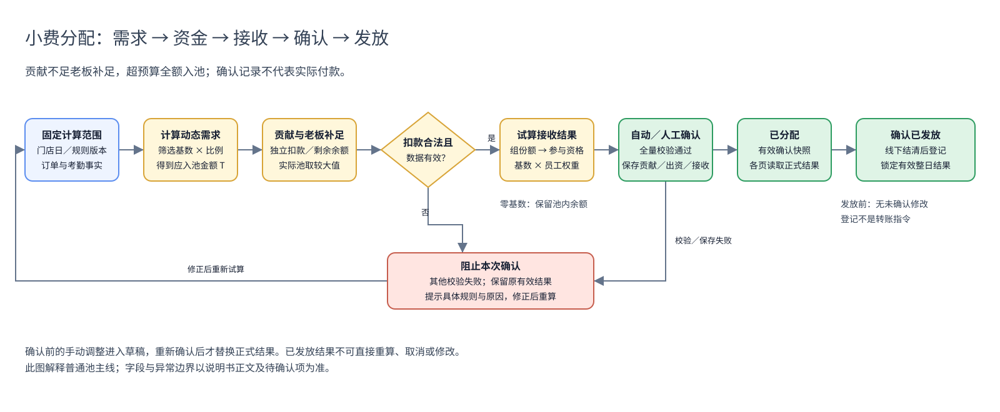

图中金额校验不再要求贡献不超过预算：低于预算老板补足，高于预算全部贡献入池；P=max(T,D)。确认时员工贡献、老板出资、接收和余额同时保存。非法数据、超出个人可扣余额、接收超过实际池 P 等错误仍须校验；不以 D>T 本身拦截。

图的可编辑源文件：[核心流程 Draw.io](小费分配研发交付_核心流程.drawio)。

## 3. 功能模块

### 3.1 规则配置与生效

图注：当前新增普通规则：基础信息及分配区域，不是编辑回填。2026-10-23／main@e8d203b0／65132独立演示；实际页面采集，非生产交易。只证明所示状态，其他结果沿用逐操作缺口。

**目的**：配置计算模板，而不是在规则编辑器直接完成某天扣款或发放。

#### 3.1.1 基础字段

[D：PRD §9、§21、§24；U：标题及按钮文案、布局确认]

| 编号／字段 | 类型、必填与默认 | 定义、来源和约束 | 编辑及示例 |
| --- | --- | --- | --- |
| R01 规则标识 | 稳定标识；保存后必有 | 区分规则身份，不能用名称替代；复制应形成独立身份 | 系统管理；改名仍保留原规则身份 |
| R02 规则名称 | 文本；必填；新建待输入 | 筛选、列表、明细和快照解释名称；空白不可保存；长度及重名策略 Q01 | 规则编辑可改；例“前厅工时共享” |
| R03 适用门店 | 门店引用；必填 | 关联可用门店目录，约束角色、员工及事实 | 未选择不可保存；换门店后需校验旧人员引用 |
| R04 池类型 | 枚举；必填；按新建入口选择 | 小费／加收服务费，来源边界不同 | 服务费不是普通自愿小费；支持范围见 3.1.6 |
| R05 小费分配方式 | 单选；必填；新建当前默认平均 [I] | 平均、工时、订单笔数；决定接收组内基数 | 选择卡片；切换后工时设置与帮助示例联动 |
| R06 小费池计算模式 | 单选；必填；默认小费池汇总分配 | 普通汇总池／计提小费占比分配，决定金额形成流程 | 与 R05 独立，不能把“计提”当第四种算法 |
| R07 参与资格 | 单选；必填；默认仅打卡员工 | clock／unrestricted／time_window，限制接收集合或事件时点 | 具体 3×3 矩阵见 3.3.3；旧 noclock 不作为新选项 |
| R08 规则／事实采用版本 | 业务版本依据；确认时必有可追溯信息 | 决定本次结果用哪版配置和事实 | 非人工金额输入；具体版本字段／接口由研发确认 |
| R09 规则引用有效性 | 校验结果；只读 | 门店、角色、员工有效且可关联 | 失效时保留引用定位，不自动删行或换同名人 |

当前布局：标题及右侧取消／保存规则→基础信息（名称和门店）→分配规则（金额计算→计算模式→接收方→分配方式→参与资格及适用工时）→独立贡献规则。计算模式默认折叠；标题后的旧信息图标不恢复，算法及资格选项的“？”保留。仅分组／排列变化，不重置既有字段或更改计算。

#### 3.1.2 金额计算项与筛选字段

图注：2026-10-23／44ca8723基线／65114隔离演示；小费来源条件抽屉。仅说明当前实现画面；逐操作结果与剩余缺口见个人规范版及覆盖清单。

[D：PRD §9、§22.3；未定义上限不自行发明]

| 编号／字段 | 类型、默认或必填条件 | 含义、输入及校验 | 例子 |
| --- | --- | --- | --- |
| S01 计算项来源 | 来源枚举；每项必选 | 销售额、个人销售额、小费、手动上报；服务费、自定义存在兼容边界 | “销售额 5%”只算需求 |
| S02 取值基数 | 金额；计算只读 | S01 经本项全部有效条件过滤后的金额 | 筛选酒水后 $20,000，不是全店销售额 |
| S03 计算比例 | 百分比；配置项必填 | 本项需求＝S02×比例÷100；通用精度／上限 Q02；独立资金 v1 接口当前限制大于 0 且不超过 100% [I] | 5 输入为 5%，不是 0.05% |
| S04 营业额口径 | 来源适用时选择 | 税前净销售等基数口径；生产定义需与 POS 对齐 | 折扣、退款、税、服务费是否包含见 Q03 |
| S05 角色条件 | 角色引用集合；未选为不追加该过滤 | 过滤计算依据的归属角色，不自动设置贡献或接收人 | Server 销售额可计算池需求 |
| S06 员工条件 | 员工引用集合；受门店与角色联动 | 过滤计算依据所属员工；互斥组合需校验 | 选 A、B，不等于只扣 A、B 小费 |
| S07 订单区域 | 有效区域引用；来源支持时可选 | 仅纳入匹配区域订单 | Patio；缺少区域事实不能猜测匹配 |
| S08 订单类型 | 枚举集合；来源支持时可选 | 只纳入选定用餐／订单类型 | 堂食；生产枚举映射 Q03 |
| S09 商品范围 | 产品线、分类、菜单组、商品引用 | 仅使用匹配商品的来源金额；不支持的层级拒绝求值 | 酒水分类不包含菜品销售 |
| S10 支付方式 | 枚举集合；可选 | 筛选或分摊口径必须与来源支持能力一致 | 混合支付如何分摊销售额见 Q03，不默认整单都计入 |
| S11 星期条件 | 星期集合；可选 | 按适用营业日判定；内部枚举需规范化 | 周五；不能把界面“周日”直接当未约定的 0／7 |
| S12 时间范围 | 开始／结束成对；来源支持时可选 | 过滤来源发生时间；与接收在岗资格不同 | 18:00–22:00；跨午夜与边界精确定义 Q05 |
| S13 班次条件 | 班次引用；来源支持时可选 | 来源班次筛选，不等于按工时算法 | 演示无班次明细时不得伪造 |
| S14 订单小费状态 | 有小费／无小费／不限，若当前来源支持 | 过滤订单，不是员工资格；现金、卡、服务费分类需明确 | 旧辅助说明存在定义，生产适配 Q03 |
| S15 加收类型 | 服务费来源适用时的类型引用 | 区分加收服务费项目 | 不用它把服务费归类为普通小费 |
| S16 公式结果 | 非负金额；计算只读 | 每项独立计算结果，再形成当日需求 | $20,000×5%＝$1,000 |
| S17 来源明细及重叠 | 来源标识与计算解释；只读 | 追溯命中的数据；重叠提示不生成第二份真实余额 | 两公式都命中同一订单，应说明叠加需求 |

条件组合：不同维度按交集理解，多选值按该维度的合法匹配集合处理；具体复杂组合、支付方式金额分摊及商品重叠按 Q03 明确后实现。空条件表示未追加该筛选，不等于所有缺字段记录都合法。角色与员工等互斥条件不得静默同时使用；切换来源使条件失效时须清理不兼容项并告知用户。

**支持边界**：字段出现在编辑器，不代表当前演示或生产事实已经能求值。无法验证的条件要说明原因并阻止确认；完整的来源明细／重叠可视化是已确认目标，不宣称当前 UI 已全部交付。

#### 3.1.3 贡献配置字段

图注：2026-10-23／44ca8723基线／65114隔离演示；销售额贡献方取值条件抽屉。仅说明当前实现画面；逐操作结果与剩余缺口见个人规范版及覆盖清单。

[D：PRD §22.4–22.6；旧界面解释单列]

| 编号／字段 | 类型／默认 | 业务定义与校验 | 例子与影响 |
| --- | --- | --- | --- |
| C01 贡献范围类型 | 角色／指定员工；必填 | 定义谁承担资金；与 S05/S06、接收资格各自独立 | 计算用全店销售，贡献范围仅 Server |
| C02 贡献角色／员工 | 有效引用集合；至少一个有效范围 | 同组命中同人去重，不按姓名串人 | A 同时命中两个角色仍不能重复扣 |
| C03 可贡献小费来源 | 来源集合；必填 | 哪些员工既有小费可投入本池，不能含本轮新接收款 | 订单小费＋上报小费；不直接含营收 |
| C04 独立贡献公式 | 配置的来源基数及比例 | 按贡献方规则计算计划扣款，不按 T 自动反推；缺少明确规则不得默认全额扣取 | 原始小费 $2,000×25%=$500，不因 T=$1,000 加扣 |
| C05 组内贡献分摊 | 使用组分摊时明确独立贡献基数与比例 | 不把 T 默认作为该基数；同人不重复扣，缺额不自动转嫁其他组 | 旧配置映射及组基数定义见 Q06 |
| C06 归集顺序 | 同店规则的稳定执行次序 | 前池先消耗可用余额；排序筛选不改变次序 | P1 先归集 $60，P2 只能用剩余 $40 |
| C07 旧贡献依据及比例 | 兼容配置 | 现有“销售额占比／个人销售额占比／小费收入占比”不是 C05 的同义字段 | 原 3% 可能是销售额计算率，不能迁移成承担池的 3% |

C04 独立计算是本次已确认变更；C05 的旧按池需求分摊不再是默认贡献逻辑。现有销售额／个人销售额／小费收入配置的实际公式及组基数须明确映射（Q06），不得将相同数字在迁移后解释成不同扣款含义。C06 仍保证跨池不超扣。

#### 3.1.4 接收配置及员工权重字段

图注：2026-10-23／44ca8723基线／65114隔离演示；接收组员工权重弹框。仅说明当前实现画面；逐操作结果与剩余缺口见个人规范版及覆盖清单。

| 编号／字段 | 类型、默认及校验 | 业务定义 | 编辑范围／例子 |
| --- | --- | --- | --- |
| G01 接收组标识 | 稳定组引用 | 一个接收配置行；不能用行索引当跨版本永久身份 | 新增行产生新的组 |
| G02 接收角色范围 | 一个或多个有效角色 | 组成共同候选员工集合，不先按角色数拆钱 | 一行 Server＋Busser 100% |
| G03 指定接收员工 | 有效员工集合，适用能力需核对 | 限定候选集合；不能超出门店和适用角色范围 | 仅 A/B；无该 UI 入口不宣称已交付 |
| G04 接收组占比 | 百分比；必填；各层合计 100% | 分得上级预算的份额；新保存／确认拒绝无效行 | 60% 组从 $1,000 得 $600 |
| G05 子接收组 | 可选组集合 | 有子组时父组为预算容器，不再重复给父组员工分钱 | 父 60%、子 70%，最终 42% |
| G06 默认员工权重 | 数值；未配置按 1；范围 0–1,000,000 | 相对倍数，不是最终比例；负值、空输入、NaN、无穷值非法 | 2 表示同基础值下分两份 |
| G07 权重换算百分比 | 只读派生，不独立存储 | G06×100%，最多两位小数、去末尾零 | 1.1→110%；不要求全组合计 100% |
| G08 当日采用权重 | 数值；默认读规则，允许当次调整 | 覆盖当天本规则本组员工采用值 | 改为 2 后重算同组；不回写默认规则 |
| G09 自动员工比例 | 只读计算比例 | 有效基数÷同组有效基数和 | 基数 6/15→40%；不要用显示舍入值算钱 |
| G10 人工最终比例 | 百分比；明确调整时采用 | 普通工时规则的最终分配例外；合计≤100% | 90% 留余额；>100% 拦截，不自动缩小 |

缺省权重 1 与用户把输入清空不同：前者为兼容默认，后者为无效输入。规则保存只保存原始权重；G07 不参与计算或形成独立事实字段。[D：PRD §9.1、§24.3–24.8]

#### 3.1.5 工时设置字段

图注：2026-10-23／44ca8723基线／65114隔离演示；工时分配与仅打卡资格联动。仅说明当前实现画面；逐操作结果与剩余缺口见个人规范版及覆盖清单。

| 编号／字段 | 类型、默认与校验 | 定义与联动 | 示例 |
| --- | --- | --- | --- |
| H01 工时模式 | 有效工时／每日上限；当前默认有效工时 | 仅 R05＝工时显示并适用 | 平均和订单不依赖此设置 |
| H02 每日计入工时上限 | 小时；上限模式必填 | 默认自动采用值逐日封顶；UI 当前范围 0.1–24 [I]，服务端精度边界 Q02 | 每日有效 8、上限 5，默认采用 5 |
| H03 原始打卡工时 | 小时；来源记录；只读 | 原始考勤展示值，不随小费人工修改变化 | 原始 8、POS 修正 10，原始仍 8 |
| H04 当前有效考勤工时 | 小时；有效考勤事实；只读 | 默认计算依据，可能经考勤修正 | 有效 10、上限 5，自动采用 5 |
| H05 当日手动分配工时 | 非负有限小时；明确录入才存在 | 普通按日工时规则的当次调整，优先于默认上限 | 明确填 8，采用 8，不再封顶 5 |
| H06 分配计入工时 | 小时；计算采用值，含来源解释 | 某员工、某规则、某日的实际依据；不含权重倍数 | 工时 8×权重 2 的基数 16，展示工时仍 8 h |
| H07 有效在岗区间 | 完整日期时间区间集合 | 时段资格必需，排除休息／无效区间，左闭右开 | [18:00,19:00)，19:00 已不在该区间 |
| H08 工时来源／有效性 | 来源和有效性标记 | 区分原始、修正、上限、人工、时段、缺失 | 来源未知不伪装有效 0 |
| H09 旧时段上限确认 | 兼容确认；仅旧 time_window＋上限出现 | 明确取消旧每日上限后再保存新时段规则 | 历史结果不重算 |
| H10 有记录／适用天数 | 两个计数，按规则和筛选周期 | 说明累计工时是否完整；非工时不应伪计为缺失 | 2/3 天有记录，不把第三天默认补 0 |

H07 不由全天总小时数推断；时段模式不提供每日封顶，不可用 H05 直接绕过时间资格。工时／比例输入最多两位小数依据 PRD §21.4；原始事实精度到计算的策略仍见 Q02。

#### 3.1.6 计提、剩余和服务费模式边界

图注：2026-10-23／44ca8723基线／65114隔离演示；计提及剩余接收方区域。仅说明当前实现画面；逐操作结果与剩余缺口见个人规范版及覆盖清单。

| 字段／对象 | 可确定含义 | 不能直接承诺的内容 |
| --- | --- | --- |
| 计提接收角色 | 获得某项计提结果的角色范围 | 不自动等同普通池 G02 的全部分组语义 |
| 小费计提占比 | 对该计提项取值基数应用的比例 | 不是普通池占比，也不是员工最终比例 |
| 计提取值条件 | 决定该项销售额等基数范围 | 混合支付、商品重叠、超出可用池金额策略需明确 |
| 计提员工权重 | 在对应计提结果内解释员工相对权重 | 旧兼容路径是否全程使用统一权重需补验 |
| 剩余接收组与占比 | 对计提后剩余预算分配 | 多角色、嵌套、零基数及尾差不可凭普通池公式假定已统一 |
| 加收服务费池 | 独立来源类别，仍需明确金额归属 | 不可自动当作普通小费；生产及政策分类另行确认 |
| 自定义小费来源 | 旧来源类型 | 不自动转换为新方案固定日目标，不跳过真实资金归属 |

示例仅解释计提顺序：若已明确有效池资金 $100、某项计提计算为 $30，则可供剩余分配的预算为 $70；若两项计算为 $80＋$40，不能确认发出 $120。如何处理计提竞争、限额和差额须按 Q07 定案，不在本文擅自规定先到先得或比例缩减。

[D：PRD §22.9、§24.1；I：现有编辑器模式字段] 研发不得为了“统一”直接删除旧模式，也不能将以下普通池完整算法无条件覆盖所有旧结果。

#### 3.1.7 配置动作

| 条件／状态 | 用户操作 | 系统行为 | UI 反馈与可验证结果 |
| --- | --- | --- | --- |
| 新建／编辑 | 选分配方式或资格 | 联动说明、适用工时配置，不执行当日确认 | 整卡可选；“？”显示对应示例 |
| 配置未完整或比例非法 | 保存规则 | 校验名称、门店、来源、人员、组份额、权重、资格 | 留在编辑页，说明错误；不静默丢掉无效行 |
| 历史 noclock | 编辑后保存 | 要求明确选择受支持的新资格 | 不静默把历史模式改为 unrestricted |
| 规则保存成功 | 返回列表／用于新计算 | 保存配置；不回写已确认／已发放快照 | 历史结果不变，新计算使用有效配置 |
| 引用失效 | 执行分配 | 阻止对应规则参与确认 | 指明规则及失效引用 |
| 复制／删除 | 管理规则 | 配置操作不改历史结果 | 重名、复制身份及删除引用细节见 Q01；不得删除历史流水 |

### 3.2 动态入池与贡献归集

**目的**：独立计算动态预算与员工实扣，以实际池金额 max(T,D) 分配；贡献不足老板补足，贡献超预算全额入池。

#### 3.2.1 金额字段字典

以下均是非负金额，展示两位小数，正式金额按最小货币单位保存／核对；预计与正式为不同状态，不可用同一无状态数值混称。

| 编号／字段 | 粒度及来源 | 定义／公式 | 状态、空值及示例 |
| --- | --- | --- | --- |
| M01 员工分配前小费 B | 门店日员工；原始事实或采用快照 | 本次贡献接收前已有的小费，跨规则引用不重复累计 | A $1,200；缺失原始事实不按 0 继续扣款 |
| M02 原始总小费 | 门店日；员工／来源归属去重 | 未参与池也不应因此丢失其原始小费 | A $1,200＋B $800＝$2,000 |
| M03 动态预算 T | 规则日／事件；公式求和 | Σ本项基数×本项比例；不是实际池上限 | T=$1,000、员工贡献=$1,500，则实际池=$1,500 |
| M04 员工可贡献余额 L | 本轮执行位置＋员工＋允许来源 | 允许来源余额减前序池已占用金额，不加本轮接收 | 初始 $100，前池使用 $60，后池可用 $40 |
| M05 员工计划贡献 | 规则日员工；独立贡献公式 | 按配置计算的计划扣款，不等于已扣，不根据 T 自动提高 | 员工小费 $2,000×25%=$500 |
| M06 预计员工贡献 Ĉ | 规则日试算 | 在贡献公式与余额限制下的预计员工实扣合计 | T=$1,000、Ĉ=$500，员工仅预计扣 $500 |
| M07 预计老板补足 Ê | 规则日试算 | max(T−Ĉ,0)；不产生负出资 | T=$1,000、Ĉ=$1,500，则 Ê=0 |
| M08 员工实际贡献 D | 有效确认结果中的规则日员工 | 成功确认时正式承担的金额 | 校验失败无本次正式扣款；界面负号只表达方向 |
| M09 确认池金额 P | 规则日有效确认结果 | Σ员工实际贡献＋M18，即 max(T,ΣD) | 贡献 $1,500 超预算 $1,000，P=$1,500；非到账证明 |
| M10 接收组预算 G | 池／父组＋组 | P×组份额，子组相对父预算 | P $1,000，60% 组 G $600 |
| M11 员工从池分得 A | 规则日／事件员工结果 | 该组预算按基数或明确最终比例计算 | 同人多个规则分别计算后加总 |
| M12 池内已分配 | 有效池结果 | Σ 本池员工从池分得 | 不等于员工分配后小费总和 |
| M13 池内未分配余额 U | 有效池结果 | P−ΣA，确认预算中尚未分给员工的部分 | P=$1,000，分 $900，余 $100；与老板补足不同 |
| M14 员工分配后小费 F | 门店日员工有效结果 | B−ΣD＋ΣA | 原有 $200−贡献 $50＋接收 $30＝$180 |
| M15 预计贡献 | 未确认日员工试算 | 当前可计算贡献计划，不写入正式流水 | 显示“预计”；无法试算不是 $0 |
| M16 贡献入池总额 | 周期员工 | 已确认 D 合计＋未确认预计贡献合计 | 已确认 $18＋预计 $12，显示 $30，问号拆分 |
| M17 入池总金额（页面） | 日期行／筛选范围 | 未确认用预计池 max(T,Ĉ)；确认用 P | 不将超预算贡献截断；预计与确认区分 |
| M18 已确认老板出资 E | 规则日有效快照 | max(T−ΣD,0)；独立于员工贡献 | 员工贡献达到或超过 T 时 E=0 |
| M19 老板出资依据 | 规则日／版本 | 保存出资主体引用、金额及计算来源；主体与权限细节 Q16 | 不创建虚构员工，不把出资记录当到账凭证 |

员工贡献少于 T 时老板补足；超过 T 时按全部实际贡献形成池金额，不截断或截留。确认前不正式扣款；个人扣款不超过可扣余额。T=0、贡献>0 时 P=贡献合计；T=贡献=0 的操作条件仍见 Q08。

#### 3.2.2 计算规则

### 贡献超计划：明细金额对照与提示（TIPOUT-FUNDING-EXCESS-20261023-01）

#### 当前显示条件与每日演示（TIPOUT-DAILY-SHORTFALL-20261023-01）

本次产品V4.8／研发V3.8／个人V2.6同一业务基线，取代前次“C≤P隐藏”的显示约定；历史版本记录保留。

图注：明细10/25确认后，main@aff91c4c＋未提交功能分支，65117隔离演示，非真实资金记录。

| 字段／操作 | 定义及示例 |
| --- | --- |
| 不足标识 | C＜P显示蓝色“老板补足 $差额”，不是异常拦截。差额＝P−C，单位元，展示两位小数。 |
| 实际可分配 | max(P,C)；老板补足max(P−C,0)。P来自规则公式，C来自实际贡献，仅有有效资金元数据才展示，不猜测旧快照。 |
| 问号 | 点击展开页面内说明，再点收起；不修改数据或触发付款。说明员工仅扣C，差额由老板承担，补足记录不代表已付款。 |
| 不足算例 | P10、C5：实际分10，员工扣5，老板补5，后厨60%得6、打杂40%得4。C0、P10则老板补10；C=P含0/0隐藏。 |
| 每日测试规则 | Golden默认门店新增“【演示】每日不足·计划10／贡献5”；独立不足贡献员工销售100、小费5、8h，销售10%算P10，个人小费100%贡献5。接收沿用演示后厨／打杂；原每日超额10/20规则不变。 |
| 历史及闭店 | marker防重复；新增事实影响未筛员工的演示汇总。正常营业日固定可复算，闭店全零不强造营业。历史结果不自动改写；未发放按原显式更新／重分配，已发放锁定。 |

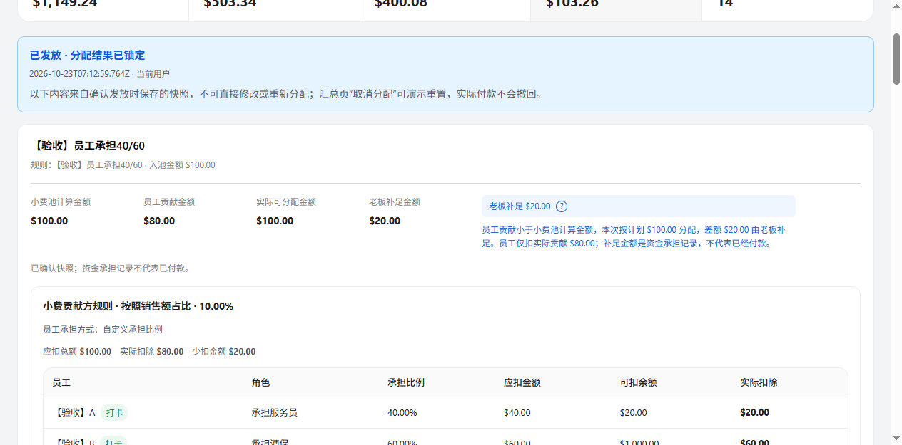

图注：C<P规则：实际贡献不足，按计划分配，老板补足提示展开。2026-10-23／main@e8d203b0／65132独立演示；实际页面采集，非生产交易。只证明所示状态，其他结果沿用逐操作缺口。

图注：2026-10-23／codex/tips-daily-excess-20261023／main基线aff91c4c＋未提交实现／65117隔离演示。Golden默认门店10/23的新确认结果，演示池计划10、贡献20、实际20、老板0、后厨12／打杂8；非生产扣款。

图注：同门店切到另一个正常营业日10/24，仍按当日数据生成10/20；不携带前一天金额或修改前一天结果。

图注：同一版本，前图为10/23的非超额规则，不展示额外资金对照；后图10/22未营业、原始与入池均0，无超额提示。仅证明所示状态。

| 字段／操作 | 最新定义 |
| --- | --- |
| 额外金额对照区 | 按整数美分比较，C≠计划P时显示计划、员工贡献、实际可分配、老板补足四项。C＞P展示超额；C＜P展示老板补足；C＝P（含0＝0）整体隐藏。原公式和接收表不变，各规则独立判断。 |
| 比较与符号 | 讨论C对应资金contributed／文档D，计划P对应target／文档T；比较整数美分，不用已格式化文本或浮点小数差直接判断。正式actual／文档P仍=max(T,D)，本批不改资金公式。 |
| 蓝色标识及问号 | 只在超额对照内显示，差额D−T。点击展开／收起原已确认说明，只改变阅读状态，不重新计算或写入。 |
| 预计／确认／发放 | 使用各自当前草稿或保存快照的资金元信息，执行相同显示判断；旧快照缺字段不反算或伪造。已发放继续只读，不因本批提示而解除锁定。 |
| 每日演示规则 | 默认Golden／上海陆家嘴别名门店新增一条“【演示】每日超额·计划10／贡献20”，标记daily-excess-golden-v1，明确演示身份与独立角色。每日事实：销售100×10%=计划10；员工原始小费20×100%=贡献20；接收60%／40%=12／8。 |
| 数据范围及隔离 | 本次只为默认门店追加3个演示身份及规则，原人员逐笔事实不变；演示原始小费增加20，未筛人员的公式可能同时引用新增演示事实，属于演示口径变化，不是生产归集。规则置于演示归集首位，避免贡献先被其他池占用。旧funding模式门店不自动植入。 |
| 重复进入／自定义 | 标记防重复植入；不覆盖已存在人员ID、用户编辑过的规则或分配结果；已删演示规则不自动恢复。身份冲突提示并停止，不替换原人员。 |
| 未营业日 | 仍由原营业状态和来源适配统一清零，P=C=0，不展示超额、不制造交易／考勤来变为营业。故“每日”指每天有可用演示规则，超额事实适用于正常营业日。 |
| 既有结果 | 新规则不会补进已确认／已发放的历史快照。未发放且需重算时，沿用“更新小费数据”和系统重新确认及覆盖确认；已发放不可重算。不静默清空记录。 |
| 金额精度 | 页面池公式沿用资金校验的整数美分四舍五入，例460.50×3%=13.815→13.82，不再用二进制浮点toFixed产生13.81而阻止确认；不更改已保存金额。 |

验证：31天覆盖26营业日与5闭店；不足计划10、贡献5、老板5、接收6/4，超额10/20、接收12/8。同日两规则守恒、重复种子、历史保留、相等隐藏专项通过；其他历史缺口不关闭。

图注：2026-10-23，codex/tips-funding-definition-20261023，main基线fb78f5e7＋未提交实现，65116隔离浏览器；演示门店10/20场景，非生产扣款或转账。

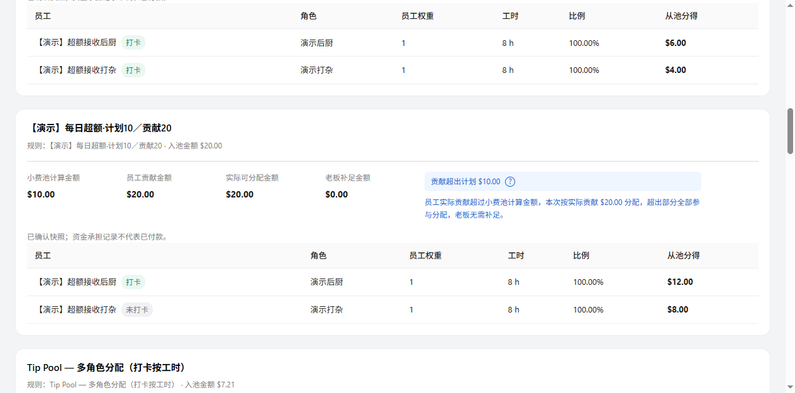

图注：C>P规则：按实际贡献分配，超出部分全部参与分配。2026-10-23／main@e8d203b0／65132独立演示；实际页面采集，非生产交易。只证明所示状态，其他结果沿用逐操作缺口。

图注：同会话将计算基数100改为50，计划从10变5，贡献仍20；预计实际池仍20、超计划15。仅草稿，原确认快照计划仍10，不因查看或展开写入。

| 字段／操作 | 逻辑说明 |
| --- | --- |
| 小费池计算金额 | 原公式区域保留基数×比例及可编辑输入，结果表示计划T，不再把实际池金额放入公式等号左侧；对照区重复显示计划用于比较，不可单独编辑。 |
| 员工贡献金额 | 当前规则员工实扣D之和。未确认／编辑草稿前缀“预计”；确认后取对应版本快照。不能用员工原始小费合计冒充贡献。 |
| 实际可分配金额 | max(T,D)，接收组预算和员工分得以此为基数；预计与确认分别标记。10/20得到20，不截断为10。 |
| 老板补足金额 | max(T−D,0)，独立于员工贡献。10/20为0；10/5为5。金额承担不代表完成支付。 |
| 贡献超出计划标识 | D>T时显示蓝色“贡献超出计划 $差额”，差额D−T；相等或不足不显示。正常业务标识，不用红色错误样式，不阻止确认。 |
| 问号／展开说明 | 点击标识或问号展开“员工实际贡献超过小费池计算金额，本次按实际贡献 $金额 分配，超出部分全部参与分配，老板无需补足。”；取当前展示版本金额。展开／收起只影响阅读。 |
| 接收金额 | 沿用组占比、资格、方式、工时／订单及权重。实际池20，后厨60%得12、打杂40%得8；调整资金基数不自动放宽资格，不将余额强制分完。 |
| 顶部概览 | 入池以实际池计；已分配按实际接收合计，未分配=实际池−接收合计。超计划10本身不是未分配余额。 |
| 保存与重新进入 | 已确认按快照回显，公式结果取快照target、接收池取actual。人工保存不重算／缩放人工接收比例；系统重确认重建当前规则资金。已发放只读也展示已记录的资金对照。 |
| 缺失历史字段 | 没有version2资金元信息的历史快照不反算贡献、补足、超额，不补造标识或改写历史。旧模式继续原有展示／校验。 |

演示入口：小费分配／分配规则选择“【演示】贡献超计划验收门店”，规则“【演示】计划10·贡献20·按20分配”。专属确定性事实：贡献服务员销售100、小费20，池公式销售10%，个人小费贡献100%；后厨及打杂打卡8小时、权重1、接收60%／40%。其他预置人员在该专属门店生成零事实，不影响10/20。普通门店数据不改写；已保存快照不自动替换。

**实施边界**：本批实现普通池中明确个人小费收入tipIncome及个人销售额personalSalesPct的独立贡献；按剩余可扣余额封顶，同一员工本轮接收不回流。未配置employeeShares的旧salesPct／角色归集、旧funding及计提／时段兼容未自动迁移；显式员工承担路径按前文已确认定义计算，相关Q06／Q07等待确认项不关闭。过滤依据缺失须报错，不能按0或忽略条件。新资金元信息version2；外层fundingVersion仍1，沿用员工身份账本及薪资接口。单元覆盖不足／相等／超额／0及守恒；本批浏览器已验证10/20确认、展开及草稿，不宣称所有兼容模式完成。

**CAL-01 需求计算**：每个营业日代入实际数据，逐项算出 M03。例：日 1 酒水销售 $20,000、比例 5%，T=$1,000；日 2 $12,000，T=$600。比例配置相同不代表目标固定。

**CAL-02 独立员工贡献**：先由贡献方公式计算计划 Qᵢ，再在同一原始可贡献余额账内得到实际可扣计划 D̂ᵢ（不得超过 Lᵢ）；不足不自动转嫁或产生负小费。Ĉ=ΣD̂ᵢ。缺失来源不按 0 兜底；组内分摊基数及旧配置迁移见 Q06。

**CAL-03 组承担**：使用指定贡献组时，贡献需求来自其明确的独立规则，不再默认 T×组比例。组内分摊只用于其贡献计划；某组扣不足不得自动向其他员工加扣。

**CAL-04 实际池与老板补足**：Ĉ=Σ预计员工实扣，Ê=max(T−Ĉ,0)，预计池 P̂=max(T,Ĉ)；确认时D=ΣDᵢ，E=max(T−D,0)，P=D+E=max(T,D)。接收组份额、员工分配及未分配余额以P／P̂为基数，不以T截断。个人实扣Dᵢ不因预算被放大或缩放；确认原子性、余额限制和付款边界不变。

**统一口径（TIPOUT-FUNDING-DEFINITION-20261023-01）**：讨论中的“P＝小费池计划金额、C＝员工贡献金额”，对应本文“动态预算T、员工实际贡献合计D”；本文原字段P仍表示确认实际池金额，不更名、不混用。

- C≤计划P：以计划P作为分配基数，老板补足计划P−C；员工只扣C。
- C＞计划P：以C作为分配基数，员工扣C，老板补足为0；超出部分全额入池，不截断、不截留。
- 对应正式公式：实际池P=max(T,D)，老板补足E=max(T−D,0)，员工实际扣款合计=D。预计阶段使用Ĉ，不能把预计显示成已扣款。
- “按该金额分配”是确定接收计算基数，不保证全部分完；无人符合资格或有效基数为0时，按接收规则保留未分配余额。
- 真实贡献0可参与上述计算；数据缺失、读取失败或计算异常不等于0，仍阻止错误确认。规则保存不因当天贡献与预算不相等而被拒绝，其他合法性校验保留。

| 场景 | 预算T（讨论中的计划P） | 贡献D（讨论中的C） | 实际池P／分配基数 | 老板补足E | 员工合计扣款 |
| --- | --- | --- | --- | --- | --- |
| 贡献少于预算 | 10 | 5 | 10 | 5 | 5 |
| 贡献等于预算 | 10 | 10 | 10 | 0 | 10 |
| 贡献超过预算 | 10 | 20 | 20 | 0 | 20 |
| 贡献为0 | 10 | 0 | 10 | 10 | 0 |
| 预算为0但有贡献 | 0 | 20 | 20 | 0 | 20 |
| 二者均为0 | 0 | 0 | 0 | 0 | 0 |

示例单位均为同一币种，正式金额按既有货币精度处理；二者均0只确认金额结果，不新增“必须生成0元分配记录”的要求，具体操作条件仍见Q08。老板出资独立记账，不伪造员工贡献，不代表已付款；资金渠道、凭证及实际结算仍见Q16。本轮仅明确资金定义，未修改程序或补造历史快照。

计算顺序：取得同规则、同门店、同营业日的合法动态预算T → 按贡献公式与剩余可扣余额求各人Dᵢ（试算为D̂ᵢ） → 求和D／Ĉ → 计算E及P／Ê及P̂ → 按既有接收组占比、资格、基础值与权重计算接收 → 核对D+E=P=接收合计+未分配余额。不得把本轮接收额循环加入贡献余额；未确认不写正式扣款，异常保留原有效快照。

**CAL-05 跨池余额**：固定顺序逐池占用同一余额账。本轮从池分得不回流后续池。若后池失败，整日新确认不落部分结果，旧有效结果不变。

**CAL-06 来源重叠**：公式可形成叠加需求，但事实中的一笔小费余额只能消耗一次；原始总小费按来源去重。跨公式来源提示是解释需求，不是增加供给。

[D：PRD §22.3–22.8]

| 条件／状态 | 用户操作 | 系统行为 | UI 反馈与可验证结果 |
| --- | --- | --- | --- |
| 数据完整且员工扣款合法 | 试算／自动计算 | 独立计算 T、Ĉ、Ê、P̂，按 P̂ 分配；不写正式流水 | 贡献大于 T 也正常计算，不报超预算错误 |
| 员工贡献少于池预算 | 确认分配 | 老板补足差额，其他校验通过后整日保存 | 不报缺口禁止分配；分别回显员工贡献和老板出资 |
| 员工贡献超过池预算 | 确认分配 | 全额贡献入池，以实际池金额分配；按人保存实扣 | 不压缩贡献、不退差额、不增加老板出资 |
| 来源缺字段／不支持条件 | 计算 | 不静默改来源、不用 0 掩盖读取失败 | 提示缺失条件或来源 |
| 多池顺序未变化 | 切换页面排序／规则可见筛选 | 只改变展示，不改变归集顺序 | 金额不因排序而改变 |
| 重新确认 | 提交新结果 | 基于原始来源和替代版本计算，不在已扣余额上再扣 | 对账仍满足第 4.3 节 |

### 3.3 接收组、三种算法及人工调整

**目的**：只在合格集合内分配组预算，解释“占比”“权重”“最终比例”三个不同量。

#### 3.3.1 接收组预算

**CAL-07**：普通池同层有效组份额合计 100%。组预算 G=P×p，p 使用小数比例；界面 60 先除以 100。配置份额大于 0 且不超过 100%，无效行不能静默丢弃 [D/I：PRD §24.3、§24.10]。

- 同行多角色：合并候选员工，按稳定 ID 去重后共同分这组钱。
- 多行不同份额：分别形成独立组预算，各组内计算，不跨组重新归一化。
- 子组：父组只是容器；父 60%、子 70%，最终占池 42%，不是 130% 或另扣 70% 的整池。
- 某组没人或有效基数为 0，该组预算留余额；不把它按其他组人数再次分完。
- 同一员工多角色权重冲突与跨组重叠见 Q04，不静默用“第一个角色”决定权重。

**比较例**：池 $120，Server 有 A/B，Busser 有 C，均合格等权。同行两角色 100% 时三人各 $40；两行 Server 50%、Busser 50% 时 A/B 各 $30，C $60。

#### 3.3.2 统一公式及字段

| 编号／字段 | 类型、来源 | 定义与校验 | 示例 |
| --- | --- | --- | --- |
| A01 候选员工集合 | 去重身份集合；接收配置＋目录 | 先限制门店和组的接收范围 | A/B/C，不包含未被选择的其他岗位 |
| A02 本次合格集合 E | 身份集合；资格及证据 | 普通日按当日资格；时段按每笔发生时间 | A 下班后不在该笔 E |
| A03 有效订单笔数 N | 非负整数；订单事实 | 有效且归属员工、属于对应范围的订单数，不是销售额 | 4 单销售 $100 的基数仍为 4 |
| A04 算法基础值 x | 数值；所选方式 | 平均＝1；工时＝H06；订单＝A03 | H06 6 h→x=6 |
| A05 有效分配基数 b | 非负计算值 | 合格时 x×采用权重，不合格时 0 | 3 h×权重 2＝6 |
| A06 参与／未参与原因 | 计算解释；只读 | 区分不在候选范围、无打卡、未手动加入、时段外、零基数、未知依据 | 零权重不等于没有打卡 |
| A07 明确手动参与 | 当日规则员工调整标记；未操作不推断为真 | 普通资格补录依据；保存并回显，不修改考勤事实 | 只改权重不能当作手动加入 |
| A08 比例来源 | 自动／明确人工；跟随结果保存 | 决定金额读基础值还是最终人工比例 | 改工时后重算自动比例，旧人工比例失效 |
| A09 自动比例与展示值 | 计算值＋格式化展示 | 精确基数计算金额，展示比例仅用于阅读 | 显示 33.33% 不等于必须分 $33.33 |

**CAL-08 自动分配**：合格员工 bᵢ=xᵢ×wᵢ，自动比例 rᵢ=bᵢ/Σb，自动金额 aᵢ=G×rᵢ。Σb=0 时不除零，预算留未分配。非合格员工仅本次 b=0，其规则配置权重不被修改。

| 方式 | x | 分母范围 | 无依据时 |
| --- | --- | --- | --- |
| 平均 | 合格人员每人 1 | 本接收组全部合格员工的权重和 | 未明确参与者不进入分母 |
| 工时 | 有效分配工时 | 同组全部合格员工工时×权重之和 | 合法 0 不获自动分配；缺失不能伪造工时 |
| 订单 | 有效归属订单笔数 | 同组全部合格员工订单数×权重之和 | 合法 0 单不获自动分配；未知订单数据不是 0 单 |

权重均相同时，平均才是金额均分；权重不同则按人数份额加权。订单算法与“每笔订单发生时分钱”不是同义词：前者是计算依据，后者属于时间资格。

[D：PRD §24.2–24.6] 全组零基数允许保留预算，不回退平均；不要沿用旧历史建议“工时全零一律禁止确认”。

#### 3.3.3 三种资格 × 三种算法

| 参与资格 | 平均 | 工时 | 订单 |
| --- | --- | --- | --- |
| 仅打卡员工 clock | 有效打卡员工自动参与；漏卡须明确手动补录 | 默认有效考勤，可明确补录／调整 | 默认已打卡且有有效订单；漏卡须明确补录参与 |
| 不限打卡 unrestricted | 打卡者自动参与；未打卡者须手动加入当日名单 | 已有考勤自动取值；未打卡者须补录有效工时 | 有有效归属订单即可，不以打卡为门槛；0 单分 0 |
| 仅限小费产生时在岗 time_window | 每笔发生时在岗的合格者按权重分 | 所属时段内有效在岗时长×权重 | 所属时段内、归属合格员工的有效订单数×权重 |

**CAL-09**：资格独立于算法，也独立于贡献范围。不限打卡不是所有在职员工每天自动分钱；能贡献不等于能接收。手动参加与权重调整是两件事。

例：组预算 $100，A 打卡且 3 单，B 未打卡且 2 单，等权。订单＋clock 且未补录：A=$100、B=$0；订单＋unrestricted：A=$60、B=$40。若改平均＋unrestricted，未明确加入的 B 仍不参与。

考勤读取失败必须显示未知，不冒充未打卡。clock 新确认拒绝未知考勤；unrestricted 仍须具备对应基础值；time_window 缺必要区间不能回退按日。

#### 3.3.4 工时、权重与人工比例的优先级

**CAL-10 普通日工时**：

1. 原始打卡用于展示；有效考勤用于默认计算。
2. 自动上限按日应用：默认 H06=min(有效考勤, 每日上限)。
3. 明确手动 H05 存在时，本次采用手动值，允许覆盖上限；不反写原考勤。
4. H06×权重得到计算基数，不改变 H06 展示值。

例：原始 8 h、修正有效 10 h、上限 5 h，默认采用 5 h；当天明确改为 8 h，采用 8 h。两天有效各 8 h，上限 5 h，周期默认计入 10 h，不是整月只计 5 h。

**CAL-11 调整联动**：

- 改工时或权重，重算同接收组所有人的自动比例和金额，替换旧手动比例。
- 普通工时规则随后可改最终比例；采用最终比例后，不再乘一次工时或权重。
- 最终比例合计低于 100% 留余额，超过 100% 拦截，不自动归一化。
- 0 工时的自动金额是 0；明确人工比例例外须记录人工来源，不称作正工时自动计算。
- time_window 不能用全天手动小时或参与勾选绕过在岗事实。
- 平均／订单的额外人工最终比例入口不在本次统一工时例外授权内；如现有兼容 UI 允许，需按 Q07 确认，不扩大业务范围。

| 条件／状态 | 用户操作 | 系统行为 | UI 反馈与可验证结果 |
| --- | --- | --- | --- |
| 普通未锁定工时规则 | 工时 5 改 8 | 采用 8，重算同组自动结果 | 本人及同组比例改变；原始打卡不变 |
| 有旧人工比例 | 修改员工权重 | 用新权重重算自动比例 | 旧人工比例不继续控制金额 |
| 自动结果已算好 | 手动设最终比例 90% | 只分 90%，留 10% | 不强制补到 100% |
| 最终比例 >100% | 确认 | 拦截完整结果保存 | 提示具体组，原确认结果不变 |
| 已发放 | 修改任意接收数据 | 拒绝 | 锁定结果只读 |

### 3.4 按小费发生时段确定在岗资格

图注：2026-10-23／44ca8723基线／65114隔离演示；发生时在岗资格工时提示。仅说明当前实现画面；逐操作结果与剩余缺口见个人规范版及覆盖清单。

**目的**：员工只能参与实际在岗期间发生的小费，不因当天其他时段打过卡而参与全天金额。

#### 3.4.1 事件与时间字段

| 编号／字段 | 类型与来源 | 定义及校验 | 示例／缺失处理 |
| --- | --- | --- | --- |
| T01 来源事件标识 | 稳定 ID；来源系统 | 标识订单小费、上报等事实，支持去重和追溯 | 重复拉取 E1 不是新增第二笔 |
| T02 来源员工身份 | 员工引用 | 小费／订单归属人，未必是接收人 | 服务员的订单小费可分给当时在岗 Busser |
| T03 小费发生时间 | 带日期和时区的时点 | 订单取完成支付时间；上报取实际发生时间 | 不能用开单时间、当前时间、营业日零点代替 |
| T04 归档营业日 | 门店日键 | 用于确认归档，不替代发生时点 | 00:30 是否属前一营业日由门店规则决定，见 Q05 |
| T05 有效上下班时点 | 完整时点区间集合 | 已确认考勤修正可改变新计算依据，保留原事实 | 缺下班卡无法确定区间时阻止确认 |
| T06 时段边界 | 计算派生 | 相邻有效上下班边界划分最小时段，不强制整点 | 18:15、19:10、22:00 |
| T07 本笔应入池／实际资金 | 事件金额 | 先来源公式，再贡献资金校验；不能均摊整日池猜每笔 | 非小费销售公式也需订单级时间 |
| T08 本笔参与与基数明细 | 事件＋员工结果 | 保存当时名单、有效区间、权重、基础值、金额 | 用于解释“为什么 A 本笔得 0” |
| T09 时间证据／异常原因 | 记录及解释 | 区分有完整事实但无人合格，与无法确定谁在岗 | 前者留余额，后者阻止确认 |

**CAL-12**：

- 以 [上班, 下班) 判断；恰在下班时不属于旧区间，恰在上班时属于新区间。
- 每笔先通过资金约束，再在该笔所属时段集合内计算，结果逐笔求和。
- 休息及无效区间不算在岗；跨午夜使用完整时间而不是“时分大小”判断。
- 只在所属时段统计工时或订单，不能再乘全天工时占比。
- 所有合格者均覆盖同一最小时段且等权时，时段工时法在该时段等同均分。
- 时段订单范围内是否允许事件之后、但仍在同一计算时段的订单进入最终分母，生产实时／整日结算边界见 Q05，不能各入口自定。
- 无发生时间或必要区间时，整日新确认失败；源数据补齐后重算，不把处理当天的在岗名单用于迟到事件。

[D：PRD §23、§24.6–24.7]

| 条件／状态 | 用户操作 | 系统行为 | UI 反馈与可验证结果 |
| --- | --- | --- | --- |
| 时间事实完整 | 计算时段规则 | 逐笔匹配在岗，按选定算法计算 | 可追溯事件、名单及金额 |
| A 已下班 | 计算下班后的事件 | A 本笔基数为 0，不改其配置权重 | 下班前已分金额保留 |
| 事实完整但无人在岗 | 确认 | 该预算留池内未分配 | 不转给其他时段员工 |
| 缺发生时间或必要区间 | 自动／手动确认 | 拦截，不降级整日分配 | 指明事件／人员缺什么 |
| 旧规则带每日封顶 | 编辑保存 | 要求明确取消旧上限 | 新计算按真实时段，历史结果不变 |

### 3.5 分配、草稿、确认与发放状态

**目的**：明确哪个动作只是计算、哪个动作正式记账、哪个动作锁定本期结果（汇总演示取消是显式例外）。

#### 3.5.1 状态字段与主体

| 编号／状态字段 | 主体、取值 | 判定时点和来源 | 业务影响 |
| --- | --- | --- | --- |
| ST01 营业状态 | 门店日：正常营业／未营业 | 当前演示销售、小费或有效考勤有任一事实即营业 | 未营业不分配；生产数据完整性不等于营业状态 |
| ST02 日期分配状态 | 门店日：未分配／已分配／无需分配 | 完整有效快照保存成功才已分配；未营业无需分配 | 未分配可以有试算，不代表已有结果 |
| ST03 员工周期分配状态 | 员工＋筛选周期：待分配／部分待分配／已完成 | 参与记录的确认覆盖情况 | 不以金额大于 0 判断完成 |
| ST04 角色周期状态 | 角色＋筛选周期：待分配／部分／已完成 | 角色内有效参与记录覆盖 | 不是一条额外支付状态 |
| ST05 发放状态 | 门店日有效结果：待发放／已发放／无需发放 | 登记发放保存成功后为已发放 | 未分配也可显示待发放，但不可发放 |
| ST06 未确认修改 | 当日编辑上下文：有／无 | 修改人员、工时、权重、比例后置有 | 不把 ST02 已分配改回未分配；阻止发放 |
| ST07 未确认更新 | 门店日：有／无 | 更新小费数据成功后仍未重新确认 | 刷新、跨页仍需阻止旧结果发放 |
| ST08 考勤标签 | 门店日员工：打卡／未打卡／未知，另有异常说明 | 来自真实考勤证据，不从分配金额反推 | 同人跨池一致；补录不篡改标签 |
| ST09 执行中／失败 | 当前操作反馈，不是新业务枚举 | 确认／更新／发放请求过程 | 控制重复提交、错误反馈，不持久伪造已分配 |

ST03 的“参与日期”如何处理只有原始小费却没有接收资格、仅贡献、零结果、无适用规则等边界见 Q09；不能简单按自然日数判定员工未完成。ST01 生产未知／同步失败不得被演示“全零＝未营业”覆盖。

#### 3.5.2 计算版本与状态的读取关系

| 情况 | 明细计算 | 正式金额／汇总 | 发放依据 |
| --- | --- | --- | --- |
| 没有确认结果 | 当前事实＋规则＋允许的手工输入 | 只展示明确标识的预测；日期已分配为 0 | 不允许 |
| 已确认，无修改 | 回显有效快照，不自动重算 | 有效确认结果 | 该结果 |
| 已确认，有未确认修改／更新 | 预览草稿 | 正式金额仍为原有效结果；预计字段按定义独立读 | 拦截；人工修改先保存当前分配或系统重算，单纯系统更新先重新确认 |
| 重新确认成功 | 新结果 | 原有效结果被新版本替代 | 新结果 |
| 已发放 | 锁定快照 | 锁定结果 | 已登记，不重复写 |
| 历史信息不完整 | 只显示历史已有依据 | 不用实时数据补造旧金额／工时 | 缺有效依据时保护性拦截 |

历史文档允许部分场景显示草稿工时而金额仍为确认值，这是已有差异，不在本文宣称已经做到“正式／草稿双栏”；见 Q10。读取字段必须知道自己属于哪一版本。

#### 3.5.3 操作转换表

| 当前条件／用户操作 | 系统行为：成功后的状态与写入 | 失败／取消必须保持 | UI 反馈与范围 |
| --- | --- | --- | --- |
| 首次进入，符合自动条件 | 完整确认结果一次保存，ST02→已分配，发放仍待发放 | 失败仍未分配，不留部分扣款 | 自动完成提示，员工／日期读取同一结果 |
| 首次进入，含旧 noclock | 只准备人工计算 | 不自动确认 | 补录后提供确认分配 |
| 日期行点击分配 | 只计算当前门店该行日期；自动路径原地完成 | 不影响其他日期及筛选；失败恢复按钮 | 处理中禁用，成功刷新该行 |
| 进入已有确认结果 | 无写入，回显快照 | 原结果不变 | 可重新确认分配；无人工草稿时保存当前分配置灰可提示 |
| 修改员工／工时／权重／比例 | ST06→有，仅改草稿 | 不自动替换正式结果 | 启用保存当前分配；重新确认分配会按系统规则覆盖人工调整 |
| 保存当前分配 | 校验当前全部明细后原子提交人工快照，清除修改标记 | 失败保留原快照和草稿 | 同步统计；不按系统默认值覆盖人工结果 |
| 已有结果重新确认 | 确认后重建当前规则系统结果，校验后原子替换 | 失败／取消保留原快照和草稿 | 同步各汇总；不可重复扣款 |
| 有修改时离开 | 明确选择放弃才离开，或继续编辑 | 不静默保存／确认 | 离开提示；放弃的持久标记边界见 Q10 |
| 点击更新小费数据 | 先打开覆盖确认，未确认前无数据读取／替换 | 取消不读取、不清除、不重算 | 说明将覆盖手工调整 |
| 确认更新 | 最新规则／来源完整重算成功后替换草稿；已有结果则 ST07→有 | 失败恢复更新前完整数据 | 提示重新核对并补录；更新不等于确认 |
| 批量分配 | 底部无已分配日期显示“批量分配小费”，否则“重新分配小费”；选择范围后按本次人工覆盖确认流程，复用明细系统计算与有效快照提交 | 跳过未营业／已锁定，按日提交并明确失败与跳过数量；生产跨日事务Q11保留待确认 | 不得只写日期标记，不得将人工快照当系统重算结果 |
| 取消分配（演示重置） | 归档原快照及发放记录后清有效状态，恢复待分配 | 包含已发放，未营业不改 | 不执行退款或撤回付款 |
| 打开发放确认框 | 无业务写入 | 取消无状态变化 | 展示门店、日期、参考金额、人数和结清提醒 |
| 确认整日已发放 | 保存记录并锁定有效快照，ST05→已发放 | 写入失败仍待发放，原分配不变 | 明确仅登记，不执行转账 |
| 重复提交／其他页已完成发放 | 不重复记账，加载已发放状态 | 不覆盖已有发放记录 | 返回锁定结果 |
| 已发放尝试更新／编辑／重分配／取消 | 禁止 | 原快照和审计不变 | 只读锁定提示 |

自动条件共同包括：有效门店日、正常营业、有适用有效规则、事实及人员可校验、无确认结果、未发放、资金与计算通过。新 unrestricted 不因“不限打卡”而被视作旧手动规则；可先确认当前自动可计算结果，再补录重新确认。time_window 还必须满足事件和区间要求；不可仅凭选项名称决定自动通过。

#### 3.5.4 快照、发放与操作字段

| 编号／字段 | 类型、来源及必填时点 | 定义／例子 |
| --- | --- | --- |
| V01 快照／结果标识 | 稳定结果引用，正式保存时必有 | 关联本次门店日有效结果；不是只写“已分配”日期列表 |
| V02 完整规则集合与版本 | 确认时的采用配置 | 页面只筛选显示 1 条也须确认全部有效规则 |
| V03 来源事实与计算依据 | 确认采用的数据、事件、考勤及版本 | 重看旧结果不用今天生成的新演示事实 |
| V04 贡献明细 | 员工＋规则＋金额＋来源 | 可追溯谁的哪部分小费入哪一池 |
| V05 接收明细 | 员工＋组＋规则＋基数／人工比例＋金额 | 能解释 $400 来自 6/15，而非仅存总数 |
| V06 池余额与来源 | 池＋金额＋贡献来源关联 | 无人合格的余额仍须可追溯，不消失 |
| V07 调整来源 | 自动／手工及采用值 | 保存工时、权重、人工比例的本次依据；旧快照不补写 |
| V08 确认人／确认时间 | 操作者及系统时点 | 审计“谁确认哪版结果”；生产权限 Q12 |
| V09 发放记录编号 | 稳定记录引用，发放登记成功后 | 关联 V01，重复提交不新增第二条有效登记 |
| V10 发放确认人／时间 | 登记操作者及系统时间 | 不是资金渠道到账时间 |
| V11 发放参考金额 | 确认结果的池内已分配合计 | 不是员工分配后总小费，也不是剩余应发 |
| V12 发放涉及人数 | 确认结果中的员工身份去重数 | 跨池同人计一次；是否计零金额员工见 Q09 |
| V13 并发依据 | 当前结果／规则／事实版本标识 | 提交前再次比对，拒绝用旧页覆盖新页 |
| V14 外部同步结果 | 独立操作结果 | 分配保存成功、Payroll 同步失败应分别反馈 |
| V15 老板出资记录 | 池／规则日／结果版本，确认成功保存 | 金额 M18、来源依据 M19；重确认替换、不累加；与员工实扣独立，历史旧快照缺失不补造 |

一致性要求：[D：PRD §8.1–8.2、§17–18、§22.8] 保存前再次核对门店、日期、引用、完整规则、来源版本、快照版本和发放锁；员工贡献、老板出资、接收、余额、结果与正式状态同一次成功生效。技术事务及幂等键方案由研发设计，不因前端按钮禁用而省略服务端校验。

**已发放锁定范围**：规则默认值可另行修改用于未来计算，但不能借改规则、更换门店／日期、其他入口或重试接口改写已经发放的结果。真实支付、部分发放、现金抵扣、解锁及补发调整均不是本文已交付能力。

### 3.6 日期汇总、员工汇总及明细读取

**目的**：不同页面展示同一业务事实；同名金额必须能解释统计范围，不能把预测和确认结果混作同一账本。

本节页面口径包含 [U] 用户已确认的后续修改，原 PRD §3、§5–7 有旧句。具体对照见 6.1；本文不会恢复已经去掉的列、按钮或旧文案。

#### 3.6.1 上下文与筛选字段

图注：2026-10-23，codex/tips-summary-date-validation-20261023，起始main@44ca8723＋本次未提交实现，65115隔离演示；开始晚于结束，字段报错，原金额保留，非生产数据。

图注：2026-10-23，codex/tips-summary-date-validation-20261023，起始main@44ca8723＋本次未提交实现，65115隔离演示；清空开始日期，保留上次结果，非生产数据。

图注：2026-10-23，codex/tips-summary-date-validation-20261023，起始main@44ca8723＋本次未提交实现，65115隔离演示；清空结束日期，保留上次结果，非生产数据。

图注：2026-10-23，codex/tips-summary-date-validation-20261023，起始main@44ca8723＋本次未提交实现，65115隔离演示；修正为10/19—10/23，错误清除并更新，非生产数据。

| 字段／操作 | 逻辑说明 |
| --- | --- |
| 开始日期 | 日期，必填；默认最近一个月起点。为空提示“请选择开始日期”；非法日历日提示“请输入有效的开始日期”。保留输入、标红字段，不保存错误查询历史。 |
| 结束日期 | 日期，必填；默认当天。为空提示“请选择结束日期”；非法日历日提示“请输入有效的结束日期”。同日范围合法，含首尾。 |
| 日期先后 | 开始晚于结束提示“开始日期不能晚于结束日期”，定位开始字段；不交换日期、不静默查询为空。 |
| 页面提示 | 日期区下方显示错误，追加“当前仍显示上次有效查询结果（YYYY/MM/DD—YYYY/MM/DD），修正日期后更新。”；无有效结果时追加“修正日期后查询。”。不用系统对话框。 |
| 原查询结果 | 无效范围不读事实、不重绘为零或空列表；保留原日期／员工列表、角色卡与金额。筛选、排序和后台刷新不能绕过校验。提示所示为上次有效查询，不是错误范围统计。 |
| 操作保护 | 错误时拦截日期／员工页签、日期／员工明细、行内分配、发放入口、批量入口、取消分配、导出菜单、CSV／PDF和邮箱入口／发送；定位字段，不写账，不打开目标界面。已打开弹框的独立范围和冻结规则不变。 |
| 修正与恢复 | 保留错误输入供修改；合法后清除红框和提示，失效缓存、刷新当前视角一次，保留其他筛选／排序，记录合法查询历史。离开不保存错误日期；重新进入沿用既有合法历史或默认范围。 |
| 真实空态 | 合法查询无匹配结果仍按既有空态；本批仅补日期输入校验，不声明其他读取失败、并发等异常已全部实现。 |

实现契约：`validateSummaryDateRange(focusError): boolean`只校验与反馈；`handleSummaryDateRangeChange(): boolean`仅合法时失效缓存、渲染和保存历史。`lastValidSummaryDateRange`是当前页面内存中的有效结果日期，不写账本、不替换确认快照。错误输入保留在控件，不保存为查询历史。

校验优先顺序：开始为空→结束为空→开始日历合法→结束日历合法→先后顺序；同日合法。错误字段`aria-invalid=true`，提示`role=alert`，输入通过`aria-describedby`关联；修复移除错误属性。原生date控件将非法日历日清空时按空值反馈，底层日历校验也拒绝2月30日。

| 场景 | 可验收结果 |
| --- | --- |
| 10/19—10/23 | 5行；本地演示原始773.97、入池430.16、已分配0、未分配430.16。数值只是测试事实。 |
| 开始改10/24 | 倒置报错，仍保留原5行及金额；历史开始仍10/19；分配／取消／导出／明细／页签均拦截；账本未变。 |
| 清空起止 | 分别提示开始／结束必填并定位，不将旧结果清零。 |
| 修复／同日 | 改回10/19清除提示；10/20—10/20合法，只显示一天。 |
| 员工视角 | 有效10/20切员工汇总；开始改10/21报错，角色卡与员工列表保留；改回10/20恢复。 |
本批验证（2026-10-23）：日期专项、页签切换性能、入口性能、批量人工覆盖及TypeScript无输出检查通过；65115实际浏览器验证上述正常／错误／恢复，分配账本不变。日期排序专项因旧CSS选择器断言失败，在未改实现的44ca8723基线上同样失败，未将其报为通过。未执行生产发放、发布或CI部署。

| 编号／字段 | 类型／默认 | 数据范围及联动 | 示例／校验 |
| --- | --- | --- | --- |
| F01 当前门店 | 统一门店引用 | 日期／员工汇总共用；明细继承 | 不以显示名称拼接账本身份 |
| F02 开始／结束日期 | 日期对，必填；默认往前一个月含今天，同日合法 | 合法才查询；错误保留结果，不保存错误历史 | 空值／非法／倒置按上方顺序定位提示，拦截范围依赖动作；月份截断细节Q05不变 |
| F03 汇总视图 | 日期／员工 | 切换视图不触发确认，不重置共享门店日期 | 日期筛选与员工筛选保留各自状态 |
| F04 营业状态筛选 | 全部／正常营业／未营业；默认全部 | 日期汇总适用 | 筛选后顶部与行合计口径对应 |
| F05 日期分配筛选 | 全部／已分配／未分配；默认全部 | 不新增其他未批准状态 | 未营业是否被该筛选包含须按既有行为核对 |
| F06 发放筛选 | 全部／待发放／已发放／无需发放 | 日期汇总适用 | 待发放不等于可点击发放 |
| F07 日期顺序 | 倒序／顺序；默认倒序 | 表头与筛选联动；员工明细重新进入重置倒序 | 不改变池归集执行顺序 |
| F08 角色筛选 | 单选；未限定时全部 | 约束员工候选及角色卡 | 换角色清理已选不适用员工 |
| F09 员工筛选 | 多选、全选 | 约束员工表和角色卡；按 ID | 选择 A/B 后不包含同名 C |
| F10 员工分配状态筛选 | 待分配／部分待分配／已完成及全部 | 按员工周期状态 | 不是取某一天最后状态 |
| F11 员工明细考勤筛选 | 全部、已打卡、未打卡、打卡异常、手动工时、混合工时 | 原始考勤及相关采用记录的展示分类 | 手动工时不把真实未打卡改为已打卡 |
| F12 员工明细分配筛选 | 全部／已分配／待分配 | 逐日记录范围 | 顶部合计跟随筛选 |
| F13 分配明细规则名称筛选 | 多选；默认全选，支持取消全选 | 只影响可见规则，不改变确认集合 | 看 1 条仍须校验当天全部适用规则 |
| F14 员工表排序 | 默认分配后总小费倒序；支持既有员工／工时／金额排序 | 缺失值排末尾，稳定顺序 | 不将未知金额当 0 排名 |
| F15 导出格式／邮箱 | PDF、CSV、邮箱入口 | 当前展示范围，不重新定义计算 | 当前邮件为模拟，不宣称已送达 |

#### 3.6.2 日期汇总字段与状态口径

图注：2026-10-23／44ca8723基线／65114隔离演示；默认最近一个月与有效门店。仅说明当前实现画面；逐操作结果与剩余缺口见个人规范版及覆盖清单。

| 展示字段 | 对应业务字段／粒度 | 未确认分配 | 有效已确认 | 未营业 |
| --- | --- | --- | --- | --- |
| 日期／星期 | O02；门店日 | MM/DD＋星期，保留内部完整日期 | 同左 | 同左 |
| 营业状态 | ST01 | 当前判定 | 当前有效上下文 | 未营业 |
| 分配状态 | ST02 | 未分配 | 已分配 | 无需分配 |
| 发放状态 | ST05 | 待发放，不可发放 | 待发放／已发放 | 无需发放 |
| 原始总小费 | M02 | 当日有效原始事实 | 有效快照事实 | $0.00 |
| 入池总金额 | M17 | 当前预计池金额，不宣称正式入池 | ΣM09 | $0.00 |
| 已分配总额 | ΣM12 | $0.00，不读试算接收冒充确认 | 已确认接收总和 | $0.00 |
| 未分配总额 | 日期展示余额 | 等于该行入池总金额 | ΣM13 | $0.00 |
| 操作 | 当前日动作 | 查看明细、符合条件的分配 | 查看明细、符合条件的发放 | 查看时拦截说明未营业 |

顶部四项按当前筛选的日期行累加，表格不显示“小费池”列。年份由日期范围、内部日期和导出上下文保留，不能因为 MM/DD 相同跨年合并。

**关键语义**：未确认日已分配为 0，未分配总额＝预计实际池 max(T,Ĉ)，并非恒等于 T；确认后未分配=P−ΣA。贡献超预算时，概览、日期行、明细、导出须使用扩大后的实际池，不能一处按 T、一处按 D。老板出资不计入员工贡献。

#### 3.6.3 员工周期、角色卡与逐日字段

图注：2026-10-23／44ca8723基线／65114隔离演示；员工汇总及角色卡默认待分配。仅说明当前实现画面；逐操作结果与剩余缺口见个人规范版及覆盖清单。

| 展示字段 | 统计范围／来源 | 空值、状态及说明 |
| --- | --- | --- |
| 员工姓名 | O03 显示名 | 内部按 ID；重名不合并 |
| 角色 | 有效参与角色集合 | 可多角色；角色汇总多角色归属的去重口径见 Q04 |
| 角色员工人数 | 当前过滤范围稳定员工去重 | 不把跨池记录数当人数 |
| 打卡总工时 | 原始有效记录逐日累计 | 全部无有效记录显示 —；不受分配调整影响 |
| 分配计入工时 | H06 按规则日累计 | 不能跨规则相加；显示规则见 3.6.4 |
| 分配前总小费 | 选定范围全部有效日的 M01 | 含待分配日，不因尚未确认整体隐藏 |
| 贡献入池总额 | M16：已确认贡献＋待分配预计 | “？”拆分两部分；无法试算不得部分值冒充总额 |
| 从池分得总额 | 已确认有效日期的 M11 汇总 | 无有效确认结果显示 —；合法确认零值显示 $0.00 |
| 老板出资（资金来源解释） | M07 预计／M18 已确认，按规则日独立汇总 | 不计入员工贡献、原始小费；汇总／明细／导出需可追溯，具体展示位置未在本轮设计 |
| 分配后总小费 | 已确认日期的 M14 汇总 | 部分确认提示已确认部分；无有效结果显示 — |
| 分配状态 | ST03／角色卡 ST04 | 不按金额是否为零判断 |
| 员工逐日考勤 | ST08 与考勤解释 | 不显示班次、上下班时间列；追溯事实不因此删除 |
| 逐日分配前小费 | M01，当天 | 待分配可展示 |
| 逐日贡献入池 | 确认读 M08；未确认读 M15 | 待分配标预计；失败说明无法试算；负号只是方向 |
| 逐日从池分得 | 当天确认 M11 | 待分配仍 — |
| 逐日分配后小费 | 当天确认 M14 | 待分配仍 — |

员工明细顶部六项为：打卡总工时、分配计入工时、分配前总小费、贡献入池总额、从池分得总额、分配后总小费。不恢复“手动工时记录”顶部指标。角色卡沿用相应金额口径，不另起计算公式。

**VIEW-01 不同范围禁止相减**：周期分配前包含未确认日，而分配后只包含确认日。因此“页面分配前总额−页面贡献总额＋页面接收总额”不一定等于页面分配后总额；正式对账必须限定同一有效确认集合。完整例见 E12。

**VIEW-02 预计失败**：当某待分配日贡献试算失败，不能把该天按 0 合计，或只展示其他日的数却不说明不完整；金额主值／详情应表达无法试算及原因。已确认事实可以独立查看，不因预计失败被改写。

#### 3.6.4 工时展示及展开字段

图注：2026-10-23／44ca8723基线／65114隔离演示；周期工时明细弹框。仅说明当前实现画面；逐操作结果与剩余缺口见个人规范版及覆盖清单。

[U；I：当前 summary-ui 与两个实际模板] 原“多口径（N）”不再作为推荐展示。

| 条件 | 主单元格 | 点击后说明 |
| --- | --- | --- |
| 适用工时规则记录完整，采用值相同 | 单一 N h＋明细入口 | 展示各规则采用依据 |
| 值不同或记录不完整需核对 | 按规则查看 | 不把不同口径合成单一小时数 |
| 存在适用工时规则但无有效记录 | 待补录 | 区分合法 0 与缺记录 |
| 只有非工时规则 | 不适用 | 不伪造工时用于平均／订单 |
| 没有适用记录 | — | 不凭空补规则 |

展开字段：规则名称 R02、规则类型 R04、计算说明 H08、分配计入工时 H06、有记录／适用天数 H10；不展示小费池名称列。同一规则跨日累计；每日入口只看当天；不同规则并行列出。

例：同一员工两天各 8 h，同时参与 R1 实际工时、R2 每日封顶 5 h，则打卡总工时 16 h，R1 计入 16 h、R2 计入 10 h；不得显示合计 26 h 作为实际工时。

#### 3.6.5 当日分配明细、确认框和默认场景

图注：2026-10-23／44ca8723基线／65114隔离演示；当天已分配系统结果。仅说明当前实现画面；逐操作结果与剩余缺口见个人规范版及覆盖清单。

- 当日明细顶部保留原始总小费、入池总金额、已分配总额、未分配总额、小费池数量；日期列表去列不等于删除这里的池数量。
- 小费池数量为当日适用执行池个数，不是员工人数；筛选后的概览范围与提交完整集合须明确，现有实现差异见 Q13。
- 规则区包含计算来源、贡献范围、接收组、员工、工时或订单依据、权重、比例和金额；本稿不强制新增尚未实现的贡献独立表或试算布局。
- 发放确认框展示门店、日期、V11 参考金额、V12 去重人数及锁定警示。汇总／明细入口标题统一为“确认小费已发放？”。移除金额下方“以上为整日分配结果参考金额，不是剩余应发金额。”展示行，不删除 V11 字段或修改金额口径。已发放不恢复“查看发放记录”按钮，但发放审计数据须保留。
- TIPOUT-PAYOUT-COPY-20260930-02 静态展示契约：标题与锁定警示为不可编辑的必显字符串，无单位、空值或业务默认值；来源为两个页面模板，不入库。移除“请在线下核对现金及其他已支付金额，确认当天员工小费均已结清。”段落节点，不保留占位空行。警示独立使用 `.tipout-payout-warning > strong`，内容为“本操作仅记录发放状态，不执行转账。确认后分配结果锁定；仅可通过汇总页“取消分配”演示重置，撤销标记不会撤回实际付款。”沿用背景与边框，并整段加粗。
- 本次不新增字段、对象关系、权限、公式、精度、支付调用或状态转换；打开发放框无写入，取消无写入，确认仍遵循既有整日快照、幂等与失败保护。测试：正常两入口文本完全一致；长门店名／窄屏警示允许换行且不截断；关闭或取消不改变发放状态；旧金额说明不在有效模板中。仅验证展示，不通过真实确认发放来验收。既有资金规则待开发及 Q 类历史差异不因本次关闭。
- 默认测试场景应覆盖有／无打卡×有／无订单×有／无小费；无订单有小费来源可为上报，不伪造订单。
- 场景清单字段：日期、员工、角色、场景编号、考勤、有效订单数、分配前小费、原始工时、有效工时、预期说明；只读及 CSV 导出，不清空业务数据。
- 已有快照以历史事实为准；新演示场景不能解释成历史快照来源。

| 条件／状态 | 用户操作 | 系统行为 | UI 反馈与可验证结果 |
| --- | --- | --- | --- |
| 切日期／员工视图 | 切换 Tab | 复用上下文，读对应范围 | 不自动重置门店、日期、排序或确认结果 |
| 周期存在待分配日 | 查看贡献总额的“？” | 拆分确认与预计 | 合计能追溯，不称预计已经扣款 |
| 两规则工时不同 | 点击按规则查看 | 展示各规则累计和来源 | 不相加成总分配工时 |
| 查看员工后返回 | 返回汇总 | 恢复原筛选及位置 | 不跳到其他员工或门店 |
| 筛选无结果 | 查看页面 | 保留条件并显示空态 | 不是数据读取失败伪装空列表 |
| 查看测试清单 | 打开／导出 | 只读事实 | 不写入分配、员工或发放状态 |

### 3.7 导出、异常与历史兼容

**目的**：导出可解释、错误可恢复、历史不会因新规则而被重算。

#### 3.7.1 导出业务字段

图注：2026-10-23／44ca8723基线／65114隔离演示；导出格式菜单。仅说明当前实现画面；逐操作结果与剩余缺口见个人规范版及覆盖清单。

日期导出对应 3.6.2 的金额、状态和日期范围；员工导出对应 3.6.3；工时按规则解释。金额显示格式不得改变计算精度。

| 项目 | 规则 | 示例／待明确项 |
| --- | --- | --- |
| 查询范围 | 当前门店、周期、筛选和排序 | 不导出全部门店代替当前门店 |
| 日期标识 | 必须可区分完整营业日 | UI MM/DD 不能使跨年记录同名；导出格式 Q14 |
| 员工及角色 | 可追溯稳定身份和实际角色 | 同名员工仍独立 |
| 打卡／计入工时 | 两种业务概念分开；按规则解释 | R1 16 h、R2 10 h，不导出 26 h 总工时 |
| 预计贡献 | 必须保留预计属性 | $30＝确认 $18＋预计 $12，不能导出成已扣 $30 |
| 正式金额 | 同一有效结果范围 | 不在同一行混入新草稿接收与旧确认贡献 |
| 旧快照缺字段 | 保留不可用说明 | 不用实时工时填补缺失旧工时 |
| PDF／CSV／邮箱 | 相同业务数据映射 | 当前邮箱为模拟提交，不作为真实送达证据 |

旧导出仍有“实际获得”等名称及小费池名称组合，是否完整统一到当前页面列定义须按 Q14 确认。仅删页面列不代表同时删除内部池标识或所有审计导出字段。

#### 3.7.2 异常处理矩阵

| 条件／状态 | 用户操作 | 系统行为 | UI 反馈与恢复 |
| --- | --- | --- | --- |
| 无适用规则 | 分配 | 不生成结果 | 引导配置规则 |
| 引用失效／身份歧义 | 分配 | 不猜同名员工、不静默删引用 | 指明规则和人员，修正后重试 |
| 金额／工时／权重／比例非法 | 编辑或确认 | 不保存非法计算 | 保留输入位置，提示约束 |
| 员工贡献不足 | 确认 | 差额由老板承担，其他校验通过可确认 | 展示老板补足，不报员工贡献不足错误 |
| 时间证据缺失 | 时段确认 | 不回退整日 | 指明事件／考勤，补齐后试算 |
| 资金足够但零接收基数 | 确认 | 保留池余额，不替换算法 | 展示零基数原因 |
| 结果版本冲突 | 重新确认 | 拒绝覆盖较新有效结果 | 提示重新加载核对 |
| 写入失败 | 确认／更新／发放 | 原有效数据和状态不变 | 说明失败，可重试，不报成功 |
| 结果保存但 Payroll 同步失败 | 等待反馈 | 保留确认结果，单独记录同步失败 | 不诱导用户再次扣款／分配 |
| 已发放／发放记录异常 | 尝试编辑或读取 | 保护性只读，不伪造有效记录 | 显示锁定或异常原因 |
| 员工上下文不匹配 | 打开员工明细 | 不显示他人数据 | 回汇总重新进入 |
| 预计贡献失败 | 看周期合计 | 不用 0 或部分数冒充完整值 | 说明无法试算，已确认部分仍可追溯 |

#### 3.7.3 兼容和迁移

[D：PRD §18.3、§19–24]

- 旧 `noclock` 是历史手动模式，不自动等于 unrestricted；编辑须明确选择，禁止批量静默迁移。
- 旧 time_window＋每日上限须明确确认取消上限；新时段不能继承旧封顶使晚班凭空失去资格。
- 历史快照若缺考勤、来源或权重，不用当前数据补写；保留已存结果和缺失说明。
- 已发放结果不能直接编辑或覆盖；汇总演示取消允许归档后重置有效状态，不撤回实际付款，生产纠错及退款需独立设计。
- 历史“必须从员工全额归集、不足即失败”的规则已由 V2.0 替代；旧快照不重算、不补造老板出资，旧公式如何转为独立贡献按 Q06 处理。
- 保留计提／剩余及服务费类别的兼容读取，未完成映射不得声称所有模式统一验收。
- 演示数据、本地存储、模拟外部同步不是生产权限、审计、事务及服务承诺。

## 4. 跨模块计算与数据约束

### 4.1 字段通用语义

| 数据类别 | 默认、空值、单位与范围 | 全局约束 |
| --- | --- | --- |
| 身份引用 | 使用稳定 ID；无默认替代身份 | 名称用于显示，禁止同名兜底串账 |
| 金额 | 同币种；计算以最小货币单位；展示两位小数 | 普通例子用 USD；不隐含货币转换，币种扩展 Q02 |
| 百分比 | 配置显示 60%，计算使用 0.6 | 接收组份额、贡献组比例、公式比例、员工比例是不同字段 |
| 员工权重 | 缺省 1，允许 0；有限非负，最大 1,000,000 | 清空输入无效；不得先转展示百分比再计算 |
| 工时 | h；非负有限；人工输入精度见 3.1.5 | 未知不是 0；权重不改变展示小时数 |
| 订单数 | 非负整数 | 必须有有效归属；拆单、合单、退款、重复订单 Q03 |
| 日期与时间 | 营业日键与完整事件时点分开 | 门店时区、夏令时及营业日截点 Q05 |
| 列表／集合 | 空集合与“未限制”需有明确语义 | 不因空接收组而自动选全店员工 |
| 0 | 已知且合法的零结果 | 与无确认结果、缺事实不同 |
| —／不适用／待补录 | 缺适用结果／非该算法／缺必要记录等展示 | 不存为可参与金额计算的数值 0 |
| 预计 | 尚未生效的计算解释 | 不写正式贡献和发放账 |
| 已确认／已发放 | 结果及锁定版本 | 不读实时新事实改变旧结果 |

对表内未给默认值的必填输入，含义是“需要明确配置”，不是允许研发自行默认为 0、100% 或全员。每个字段的状态／编辑规则由第 3 章对应模块指定，通用约束不替代个别例外。

### 4.2 美分、尾差及人工比例

**CAL-13 自动分摊**：[D：PRD §24.8]

1. 将确定的预算转换为整数美分。
2. 用精确有效基数计算每人理论分数。
3. 各人先向下取整到美分。
4. 预算减取整合计的剩余分，按小数余数从大到小补；相同余数使用固定顺序。
5. 每层组预算及每笔事件独立守恒；固定顺序的身份键需要明确并保存，见 Q02。

例：$100＝10,000 分，等权三人理论各 3,333.333…分，取整合计 9,999，余 1 分给固定顺序第一人，结果 $33.34／$33.33／$33.33。

不能只按显示的 33.33% 反算金额，也不能把真正未分配预算都给最后一人。人工比例合计 90% 时，只处理这 90% 所属金额的取整问题，不能把另 10% 当尾差补发。人工比例精度、按项舍入与合计美分的统一规则见 Q02；生产合同未定前不以不同实现自行选取。

自动分摊算法适用于明确的接收预算；贡献端同样必须守恒，现有独立资金分摊也采用稳定最小单位分配 [I]。贡献公式求值、指定组预算到分钱之间的舍入时点需跨入口统一，不能仅凭一处函数推断全系统已一致。

### 4.3 三层对账

**CAL-14**：以下公式只对同一有效确认版本、同一币种和匹配统计范围成立。

1. 每池：Σ员工实际贡献＋老板出资＝确认池金额＝Σ员工从池分得＋池内未分配余额。
2. 每员工日：分配后＝分配前−贡献合计＋从池分得合计。
3. 门店日：员工分配前合计＋老板出资合计＝员工分配后合计＋本次新增池内未分配余额。

贡献按非负金额代入；显示负号不能再次反向相减。老板出资独立计入池资金，不计入员工分配前或贡献合计；其支付执行状态不由确认分配推断。

分配后不是剩余应发，发放参考金额也不是分配后总和。渠道现金、历史实际支付、工资税等不在本期公式中；不得从本公式推导实际转账额。

### 4.4 数据版本、幂等与权限

- 同一确认操作使用同一门店日、同一规则集合与来源版本，禁止半程换事实。
- 重新确认替换有效结果，不从已扣减的展示余额再扣一次。
- 刷新、重复点击、请求重试、多个页面同时提交不能新增重复贡献或发放。
- 锁定与校验须在实际写入边界执行，不只在 UI 隐藏按钮。
- 更新配置、数据读取、金额试算、正式保存、发放登记和外部同步是不同动作。
- [建议] 生产用事务、版本条件更新、幂等请求与审计实现以上行为；字段名和接口形状由研发评审，不把现有 localStorage 视为服务端保证。
- 角色操作权限、门店授权、人工调整理由是否必填及审批未完整定义，见 Q12，不声称当前所有入口已有生产权限控制。

## 5. 贯穿算例与业务测试输入

本章是可复算的业务期望，不是本轮执行过的应用测试报告。各例的门店、日期、币种、人员、资格和版本须固定；除特意改变的条件外，不能用随机演示数据替换输入。

### E01 完整链路：动态需求、贡献、工时接收与整日结果

条件：2026-09-29、门店 S1、USD、普通小费池 P1；销售额 $20,000、计算率 5%。A/B 原始小费 $1,200/$800，C 为 0；贡献范围 A/B，独立贡献规则为各自原始小费的 50%；接收同一行选择 A/B/C 所属角色，占比 100%，三人均符合资格，工时 6/3/3，权重 1/2/1。

1. 需求 T＝20,000×5%＝$1,000，销售额本身不提供资金。
2. 独立贡献公式得到 A=$600、B=$400，合计 $1,000，老板出资 $0。
3. 组预算 G＝$1,000；加权基数 A/B/C＝6/6/3，合计 15。
4. 接收 $400/$400/$200。
5. 确认成功时贡献、接收、余额和结果同时生效。

| 员工 | 原始小费 | 实际贡献 | 工时 h | 权重 | 基数 | 从池分得 | 分配后 |
| --- | ---: | ---: | ---: | ---: | ---: | ---: | ---: |
| A | $1,200 | $600 | 6 | 1 | 6 | $400 | $1,000 |
| B | $800 | $400 | 3 | 2 | 6 | $400 | $800 |
| C | $0 | $0 | 3 | 1 | 3 | $200 | $200 |
| 合计 | $2,000 | $1,000 | 不跨规则累计 | — | 15 | $1,000 | $2,000 |

日期确认后：原始总小费 $2,000、入池 $1,000、已分配 $1,000、未分配 $0，状态已分配／待发放。员工汇总读取上表，不再自行重算。

发放确认框参考金额 $1,000，而不是分配后合计 $2,000；线下仍需核对员工各自的小费是否已经结清。点击发放确认只登记锁定，不转账。

### E02 同一组预算下比较三种算法

固定组预算 $600，A/B/C 全部合格，无人工最终比例；工时 6/3/3，订单 4/2/2，权重 1/2/1。

| 算法 | 基数 A/B/C | 分得 A/B/C | 合计 |
| --- | --- | --- | ---: |
| 平均 | 1/2/1 | $150/$300/$150 | $600 |
| 工时 | 6/6/3 | $240/$240/$120 | $600 |
| 订单 | 4/4/2 | $240/$240/$120 | $600 |

如果全部权重改为 1：平均各 $200；工时和订单均为 $300/$150/$150。不要从这个特定输入推断工时与订单算法始终相同。

### E03 同行多角色、不同组、嵌套

- $120、Server A/B、Busser C、等权平均：同行 100%→各 $40；两行各 50%→A/B 各 $30，C $60。
- $1,000、组一 60%、组二 40%：组预算 $600/$400。组一员工权重增加，只能改变组内 $600 的分法。
- 父组 60%，两个子组 70%/30%：得到 $420/$180；另一个顶层 40% 组 $400，合计 $1,000。
- 子组已有分配时，父组不能再额外发 $600。

### E04 同一规则跨日需求变化

同一规则始终 5%。日 1 来源 $20,000→需求 $1,000；日 2 来源 $12,000→需求 $600。两天分别做贡献校验和确认；日 1 已确认结果不会因日 2 数据变化改成 $600。

### E05 员工贡献不足由老板补足

**规则贡献少于池预算**：T=$1,000，服务员 A 原始小费 $2,000，贡献规则 25%，扣 $500；老板补 $500。后厨 B、打杂 C 同组等权平均，各接收 $500。A 最终 $1,500，B/C 各 $500，总计 $2,500＝原始 $2,000＋老板 $500；允许确认，不能因 A 仍有余额而提高扣款。

**余额不足**：独立规则原计划扣 $1,000，但有效可扣仅 $800；员工扣 $800、老板 $200，池仍 $1,000。指定组原计划各 $500，组一可扣 $300、组二可扣 $900 时，仅扣 $300/$500，老板补 $200，不自动转为员工 $300/$700。

**员工贡献为零**：T=$1,000、员工贡献=0，老板承担 $1,000；接收资格独立。T=0、员工贡献=$500 时老板=0，实际池=$500。

**员工贡献超过预算**：T=$1,000；A/B 原始小费 $2,000/$1,000，贡献规则各 50%，实扣 A=$1,000、B=$500，D=$1,500。老板出资=0，实际池 P=$1,500；C/D 同组等权平均各接收 $750。贡献者余额 A=$1,000、B=$500，四人结果合计 $3,000＝原始合计，不将贡献等比缩成 $666.67/$333.33。若接收比例只用 90%，则分出 $1,350、池余 $150；超预算贡献全部纳入分配基数，并不绕过既有资格和留余额规则。

### E06 同一余额被两个池使用

A 原始可贡献 $100，P1 池预算及独立计划贡献各 $60，P2 池预算及计划贡献各 $50，顺序 P1→P2。员工分别扣 $60/$40，P2 老板补 $10，两池分别按 $60/$50 计算接收；其他校验通过可整日确认。A 从 P1 收回的钱不能用于本轮 P2 再扣，重复确认不重复登记员工扣款或老板出资。

### E07 工时上限及明确手动覆盖

A/B 有效工时 8/4，等权，组 $90，上限 5 h：默认基数 5:4，A=$50、B=$40。明确手动 A=8 h 后基数 8:4，A=$60、B=$30；A 原始打卡仍 8 h。若 POS 有效值由 8 修正到 10 而原始仍 8，需区分三者，不改原始显示。

### E08 人工比例与重新计算

组预算 $600，普通工时规则自动计算完成后，人工最终比例 A/B/C＝40%/30%/20%，得到 $240/$180/$120，合计 $540，余额 $60。设 50%/40%/20% 合计 110%，确认失败；不能自动缩为 100%。之后修改任一人的工时或权重，会重算同组自动比例，原人工 40/30/20 不再继续生效。

### E09 参与资格并不等于算法

组 $100，A 打卡 3 单、B 未打卡 2 单，等权：

- 订单＋clock，B 无人工补录：$100/$0。
- 订单＋unrestricted：$60/$40。
- 平均＋unrestricted，B 未明确加入：$100/$0；明确加入后 $50/$50。
- 工时＋unrestricted，B 没有有效工时：默认 0；提高权重不会补出工时。

### E10 时段资格与交接边界

例一：6–7 点 A/B/C 在岗产生可分预算 $30；7–9 点 B/C 在岗产生 $40；9–10 点 C 在岗产生 $20。均同组等权平均。分得 A=$10、B=$30、C=$50，合计 $90。

例二：A 在岗 [18:00,19:00)、权重 2；B 在岗 [18:00,22:00)、权重 1。18:30 组预算 $90→A=$60/B=$30；19:30 预算 $60→B=$60；合计 A=$60/B=$90。

边界：事件恰在 19:00 时，A 不参与；不能因 A 当天打过卡或权重大而纳入。跨午夜例：完整区间 [09/29 22:00,09/30 02:00)，09/30 00:30 在区间内；营业日归档规则另由 Q05 确定。

### E11 零值、无人合格和美分

- 确认池预算 $100（员工贡献＋老板出资），但全组有效工时为 0：接收 $0、池余额 $100，不退回平均；合法确认零接收是否允许发放见 Q08。
- 无人在事件时点合格但时间事实完整：该笔预算留池余额。
- 缺少事件时间：不是“无人合格”，而是无法判断，必须拦截确认。
- $100 等权三人，固定 A/B/C 顺序：$33.34/$33.33/$33.33。
- $0.01 等权三人，固定 A/B/C 顺序：$0.01/$0/$0；下次重算相同输入结果相同。
- 所有权重为 0：基数和为 0，整组留余额，不恢复默认权重 1。

### E12 周期混合状态和预计贡献

同一员工仅两天：

| 日期 | 状态 | 分配前 | 贡献 | 接收 | 分配后 |
| --- | --- | ---: | ---: | ---: | ---: |
| 09/28 | 已确认 | $100 | 已确认 $20 | $10 | $90 |
| 09/29 | 待分配 | $80 | 预计 $15 | — | — |

周期显示：分配前总小费 $180；贡献入池总额 $35（问号：已确认 $20、预计 $15）；从池分得总额 $10；分配后总小费 $90，并说明已确认部分。

不能使用 $180−$35＋$10＝$155 覆盖 $90，因为它包含尚未确认的日期。若 09/29 预计失败，贡献总额不显示完整 $20；应提示无法试算并允许追溯已确认部分。

### E13 草稿、失败、重新确认和发放

已确认组 $100，A/B 各 $50。用户把 A 权重从 1 改为 2，草稿预览 $66.67/$33.33；原正式结果仍 $50/$50。

- 重新确认写入失败：原正式金额不变，当前编辑保留。
- 重新确认成功：新结果替代旧结果，不新增第二次 $100 贡献。
- 有未确认修改时发放：拦截。
- 已确认发放后再尝试改权重：拦截，快照不变。
- 分配保存成功但 Payroll 同步失败：不能再次执行分配来“修复同步”。

### E14 多规则工时及来源

两天原始工时各 8 h，R1 按有效工时，R2 每日上限 5 h：原始总工时 16 h；R1 计入 16 h，R2 计入 10 h，主值“按规则查看”，不能显示 26 h。

只有平均规则→不适用；存在工时规则但缺记录→待补录；合法采用 0 h→0 h，不混作缺失。规则有 3 天适用、仅 2 天有记录→2/3，不用缺日 0 拼成完整累计。

### E15 身份、重复来源与公式重叠

两名同名员工 ID A001/A002：必须分别计算和展示，不按姓名合并。源订单 O1 小费 $10 被重复拉取两次：原始小费仍 $10。若两个合法公式都引用 O1，需展示叠加需求，但员工供给余额不能凭空变成 $20。

如果权重按角色＋姓名的旧存储无法确定同名身份，应报歧义并要求明确映射，不使用第一条匹配记录。

### E16 动作失败、筛选及历史保护

- 分配明细只看 1 条，另外规则员工贡献不足：仍须计算全部规则及老板补足；若其他规则存在非法比例或来源缺失，整日确认失败，不只保存可见规则。
- 用户在更新确认框点取消：不读取最新规则、不清空人工输入、不重算。
- 发放按钮连点或两个标签页同时确认：只有一次有效登记，结果锁定。
- 历史快照缺订单时间：查看只显示已有结果／缺失说明，不能用当前订单时间补写。
- 零事实演示未营业与生产数据读取失败：后者不得直接标未营业并跳过应处理业务。

### 5.1 例子如何用于研发与测试

每个用例至少断言：输入事实未被篡改、参与集合正确、金额精确、池与员工守恒、状态正确、失败无部分写入、历史未被修改。普通明细、日期快捷分配、资金核对、时段计算、汇总、导出都应使用相同输入对比，不能仅证明某个纯函数算对。

本轮只验证文档算例的算术与结构，未重跑全部应用路径；权威 PRD §24.10 的历史测试结果继续按其原覆盖范围理解。

## 6. 待确认事项

### 6.1 原文冲突与已确认补充对照

该表解释为什么本文某些展示与原 PRD 早期章节不同。它不是把旧段落删除，也不是授权一次新的业务改版。

| 编号 | 原文／历史描述 | 本交付稿采用口径及依据 | 是否仍需业务决策 |
| --- | --- | --- | --- |
| CF01 | §3.3 同角色均分、最后一项承接尾差 | §24 已明确共同接收组、权重及最大余数；采用最新产品契约 [D] | 无需重新决策，须查兼容实现 |
| CF02 | §23 “不在岗权重为 0” | §24 明确只把本笔有效基数置 0，配置权重不变 [D] | 已明确 |
| CF03 | §21 两种资格；旧“不打卡规则” | §24 三种资格；noclock 与 unrestricted 不同 [D] | 历史迁移不擅自执行 |
| CF04 | §3/§5 未分配金额为 —，日期保留池列 | 用户已确认未分配已分配=0、未分配=预计实际池金额，去池列、日期仅 MM/DD＋星期；实际池主值按 max(T,Ĉ)，不因员工贡献不足缩小，也不截断超额贡献 | 明细筛选范围仍见 Q13 |
| CF05 | §3/§6 员工金额仅确认部分 | 用户已确认分配前包含待分配、贡献确认＋预计，问号拆分；当前汇总程序一致 [U/I] | 多角色统计 Q04/Q09 |
| CF06 | §7 待分配贡献 —、七项顶部 | 用户已确认逐日预计贡献；当前六项顶部与模板一致 [U/I] | 导出同步 Q14 |
| CF07 | §3/§6–7 多口径、工时弹框池列 | 用户确认工时优化及移除池字段；当前“按规则查看”、五列说明 [U/I] | 草稿工时混合版本 Q10 |
| CF08 | §16 两个查看发放记录入口 | 用户要求去掉按钮，当前页面不再提供；审计数据保留 [U/I] | 不恢复旧入口 |
| CF09 | §22 历史建议分区、独立试算 | 当前采用基础→分配→独立贡献；历史试算分区不作为现有入口，顶部保存及问号仍有效 [D/U/I] | 仅同步已确认分组，不新增试算页 |
| CF10 | §22/23 章标题待开发、§24.3 嵌套未支持 | §22.9、§23 章首与 §24.10 记录部分已接入 | 区分路径，不宣称全量生产支持 |
| CF11 | 旧 §22 全额员工归集、不足阻止确认 | 独立贡献＋老板补足，实际池max(T,D)；普通池明确个人贡献及显式员工承担已接入 | 旧配置Q06及兼容Q07保留；Q15关闭；实际结算Q16 |

### 6.2 发布前问题清单

“待确认”不是允许研发随意选择。表中给出影响与建议确认人；没有足够依据的细节不得默认写成正式接口契约。

| 编号／优先级 | 未闭合问题 | 影响及需要的答案 | 建议确认方 |
| --- | --- | --- | --- |
| Q01 配置前 | 规则名长度、重名、复制、删除及生效时间 | 名称校验；复制是否禁用／重命名；已被待分配引用时删除如何处理；规则何时用于新计算 | 产品＋研发 |
| Q02 金额上线前 | 金额／比例／工时精度、舍入阶段、平余数固定键、币种及上限 | 每项公式先舍入还是合计后舍入；人工比例美分策略；贡献尾差；数值溢出限制；不可各入口不同 | 产品＋后端＋测试 |
| Q03 来源接入前 | POS 销售与有效订单定义、归属、混合支付和商品条件 | 退款／作废／拆合单／多人归属／重复事件；净额与税折扣服务费；支付分摊及缺事实策略 | 产品＋POS 集成＋后端 |
| Q04 接收／汇总相关实现前 | 同人多角色权重冲突、跨组重叠、角色卡重复归属 | 选择哪个权重、是否允许跨组获分、如何避免角色卡合计重复；同组 ID 去重已明确不能改变 | 产品＋后端＋测试 |
| Q05 生产时间接入前 | 门店时区、夏令时、营业日截点、默认月范围及实时结算 | 重叠考勤区间如何合并；时段订单分母是否包含后续订单；过滤时间边界与在岗边界独立明确 | 产品＋考勤／POS 集成 |
| Q06 贡献配置实施前 | 旧贡献公式与独立贡献规则的映射 | 销售额、个人销售额、小费比例保持各自含义；组内分摊基数明确，不再默认按 T 全额扣取 | 产品＋研发 |
| Q07 兼容模式统一前 | 计提竞争、剩余组、多角色、人工比例及服务费 | 明确资金不足、超额计提、权重／尾差、资格支持；不照搬普通池契约 | 产品＋后端＋测试 |
| Q08 零金额操作前 | 目标 0／接收 0／池全留余额时的确认与发放 | 零基数留余额已明确；是否允许整日发放登记及参考提示仍需定案 | 产品 |
| Q09 状态及人数验收前 | 员工“参与日期”、仅贡献员工、无规则及零金额人数 | 员工周期完成状态、角色卡人数、发放涉及人数的边界 | 产品＋测试 |
| Q10 版本一致性处理前 | 草稿工时与正式金额、放弃修改后持久标记的行为 | 不误显示同版结果；放弃草稿是否解除未确认更新拦截要区分更新类型 | 产品＋前后端 |
| Q11 批量执行前 | 单日失败后其他日继续还是终止、跨日事务范围 | 单日原子已明确；整批成功／部分失败的恢复和反馈需约定 | 产品＋后端 |
| Q12 生产上线前 | 门店权限、确认与发放授权、审计理由和生产纠错 | 谁可改权重、代补参与、确认、登记发放；理由是否必填；已发放不得直接覆盖 | 产品＋安全／后端 |
| Q13 金额概览验收前 | 明细筛选后概览范围 | 主值按预计／确认实际池已明确，不按 T 截断；筛选后卡片按可见还是整日完整规则仍待确认 | 产品＋前端＋测试 |
| Q15 已关闭 V2.1 | 员工贡献 D>T，包括 T=0、D>0 | 用户已确认按 D 全额入池分配，各人实扣各自 Dᵢ；E=0，不截留、不截断；代码待实现 | 用户确认，研发／测试承接 |
| Q16 老板出资承接前 | 出资主体、权限、凭证、线下结算及余额归属 | 分配确认记录承担额，不是付款；确认／取消／重算的金额版本须幂等，实际结算及来源余额处理需明确 | 产品＋财务业务＋研发 |
| Q14 导出发布前 | 新页面命名、预计拆分、池名称、完整日期如何输出 | 各格式统一字段含义；是否删池名称不能由页面删列自动推断 | 产品＋测试 |

上述问题不阻止理解已明确普通池公式，但影响相应实现范围及生产交付。本文不自我批准“所有分支可直接上线”；正式交付前应由产品与研发逐项确认，必要时增补权威 PRD。

## 7. 研发交接附录

### 7.1 来源与实现落点

| 业务模块 | 权威依据 | 当前实现核对入口（相对项目根） |
| --- | --- | --- |
| 对象、上下文、引用 | PRD §2、§10、§20 | `src/team/tips/tips-context.ts`、`legacy/tipout-roster-directory.js.txt` |
| 配置与资格 | PRD §9、§21、§24 | `src/team/tips/templates/rule-editor.html`、`programs/rule-editor.js.txt` |
| 普通池资金 | PRD §22 | `src/team/tips/legacy/tipout-funding.js.txt` |
| 接收组、权重、精度 | PRD §24 | `src/team/tips/legacy/tipout-employee-weights.js.txt` |
| 时段资格 | PRD §23、§24.6–24.7 | `src/team/tips/legacy/tipout-time-window.js.txt` |
| 草稿、快照、确认 | PRD §8.2、§17–18、§22.8 | `src/team/tips/programs/details.js.txt`、`legacy/tipout-detail-snapshot.js.txt` |
| 发放与锁定 | PRD §8.1、§16、§18 | `src/team/tips/legacy/tipout-date-state-store.js.txt`、`tipout-allocation-results-store.js.txt` |
| 汇总与员工逐日 | PRD §3、§5–7＋CF04–CF07 | `src/team/tips/programs/distribution.js.txt`、`employee-reconciliation.js.txt`、`legacy/tipout-summary-ui.js.txt` |
| 兼容计提／剩余 | PRD §22.9、§24.1 | `src/team/tips/legacy/tipAllocation.js.txt`，需独立核对旧分支 |
| 历史专项验证 | PRD §24.10 | `docs/superpowers/plans/2026-09-29-tipout-receiver-contract-validation.md` |

表内省略公共目录前缀的并列文件仍位于对应 `src/team/tips` 子目录。此处用于定位，不代表本文已审计每一行代码；本轮重点核对字段、聚合、配置和支持边界。

实现边界必须保留：

- 本次独立贡献／老板补足尚未实施：需调整旧缺口拦截、资金与快照结构及各入口，不能仅关闭报错。此前普通明细、时段分配器和普通资金路径已接入共同接收组；不能推断旧计提／剩余路径全量一致。
- 时段使用 `TipOutTimeWindow.allocateRule`；不能用独立 `TipOutFunding.calculate` 的按日实现证明时段语义。
- 服务费、固定自定义金额、缺商品／班次事实等来源不可因编辑器有选项就宣称可确认。
- 部分旧导出命名未统一；生产 POS、Payroll、邮件、支付及完整 3×3 组合未全量验收。
- 原文历史“测试通过”只对应当时范围；旧综合浏览器脚本及类型／构建限制按 §24.10 理解，本轮未重新运行应用测试。

### 7.2 字段分组索引

| 字段组 | 所属对象／范围 | 定义位置 |
| --- | --- | --- |
| R01–R09 | 规则身份、配置与版本 | 3.1.1 |
| S01–S17 | 金额来源、过滤、公式与解释 | 3.1.2 |
| C01–C07 | 贡献范围、承担及顺序 | 3.1.3 |
| G01–G10 | 接收组、权重、比例 | 3.1.4 |
| H01–H10 | 工时依据、采用值及完整性 | 3.1.5 |
| 计提／剩余／服务费字段 | 兼容模式 | 3.1.6、Q07 |
| M01–M19 | 需求、员工贡献、老板出资、接收与员工金额 | 3.2.1 |
| A01–A09 | 接收名单、基础值与调整来源 | 3.3.2 |
| T01–T09 | 事件、时间及在岗证据 | 3.4.1 |
| ST01–ST09 | 营业、分配、发放、编辑和考勤状态 | 3.5.1 |
| V01–V15 | 结果版本、流水、老板出资、审计与发放 | 3.5.4 |
| F01–F15 | 页面上下文、筛选、排序及导出 | 3.6.1 |
| 页面派生显示字段 | 日期／角色／员工／工时／概览 | 3.6.2–3.6.5 |
| 通用单位与空值 | 所有字段 | 4.1 |

这是业务字段字典，不要求后端为每个只读展示字段新增数据库列。派生量应由可追溯原始值计算；哪些字段为响应投影、快照冗余或独立账项，由研发在满足业务语义的前提下设计。

### 7.3 接口／存储承接建议（非现有 API 声明）

建议按业务操作区分契约，不在本文发明具体 URL 或数据库表：

| 操作 | 至少需要的业务输入 | 至少需要的业务输出／保护 |
| --- | --- | --- |
| 规则保存 | 门店、规则身份／版本、来源、贡献、接收、资格 | 完整校验、规则版本；无当天资金写入 |
| 试算 | 门店日、采用规则集合、事实版本、明确人工调整 | 来源解释、员工贡献计划、老板补足、接收计划、余额、错误；不改变正式状态 |
| 确认／重新确认 | 上述采用依据＋当前结果版本＋请求身份 | 整日原子结果、守恒校验、重复请求幂等、并发拒绝 |
| 读取结果 | 门店日或员工周期＋筛选 | 每个字段的预测／确认来源、异常与统计范围 |
| 登记发放 | 门店日、确认快照身份、操作者／请求身份 | 检查未确认修改、幂等记录、整日锁定 |
| 外部同步 | 已保存结果版本及外部目标 | 独立同步状态，失败不触发重新分配 |
| 导出 | 查询上下文、结果范围和格式 | 使用同一字段投影，预计属性不丢失 |

生产“试算无写入”指不写正式贡献／接收／分配／发放结果，不排除经确认设计的技术日志；日志和审批保留期限需另定。浏览器已有临时草稿不是服务端事务的替代品。

### 7.4 交接评审清单

- 产品：确认 CF 对照，关闭本期涉及的 Q 项，不把历史建议当新需求。
- 前后端：对齐身份、来源版本、金额精度、事务边界、错误结构和锁定守卫。
- 测试：用 E01–E16 建立固定输入，覆盖正常、零值、缺失、冲突、重复、保存失败及历史保护。
- 集成：明确 POS／考勤事实、时间和订单归属；无事实时不能以演示默认值兜底。
- 上线：另行核对政策资格、真实支付与外部连接；本文不提供法律结论，不将旧法规研究作为本轮已核验依据。

交付判据：针对任一字段能回答“是什么、从哪里来、怎么计算、何时生效、谁能改、影响谁、失败怎样保持、用哪个例子验证”。确认后的变更必须在同一次任务交付中同步更新产品 PRD 与本文对应条款、各自版本和共同变更编号；可以先明确产品口径再展开研发定义，但不得仅交付一份或继续追加相互覆盖的说明。两份文档存在无明确依据的冲突时，关联同一待确认项并说明影响，不擅自定案。
