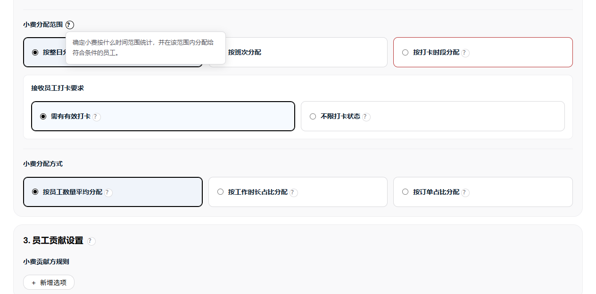
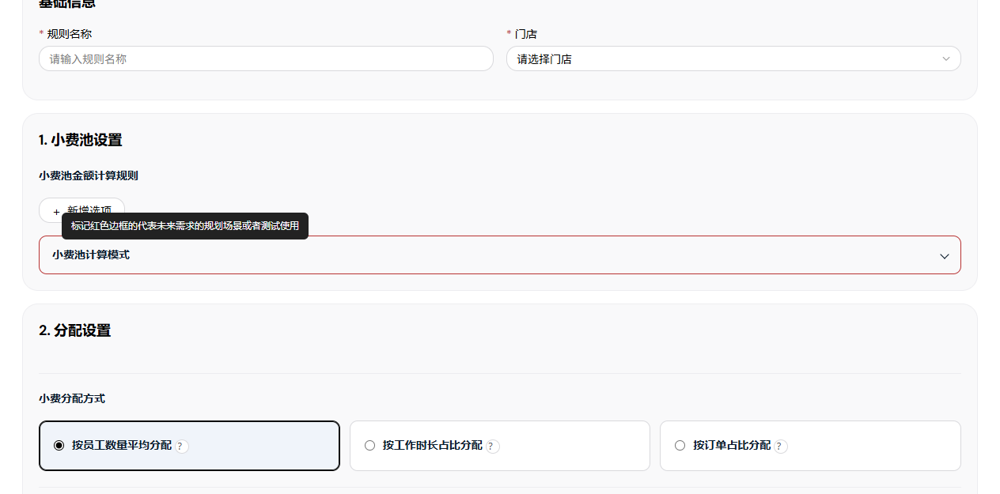
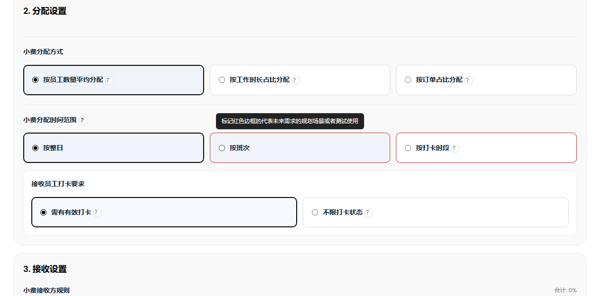
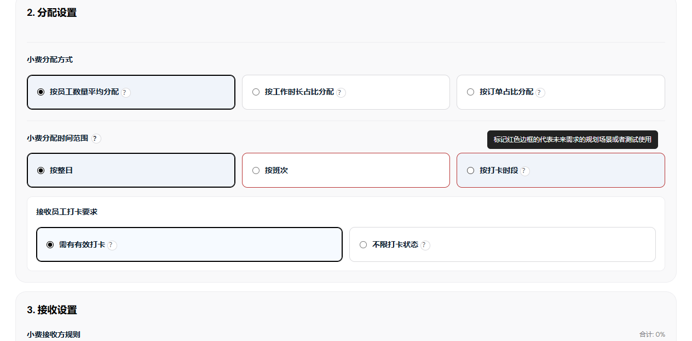
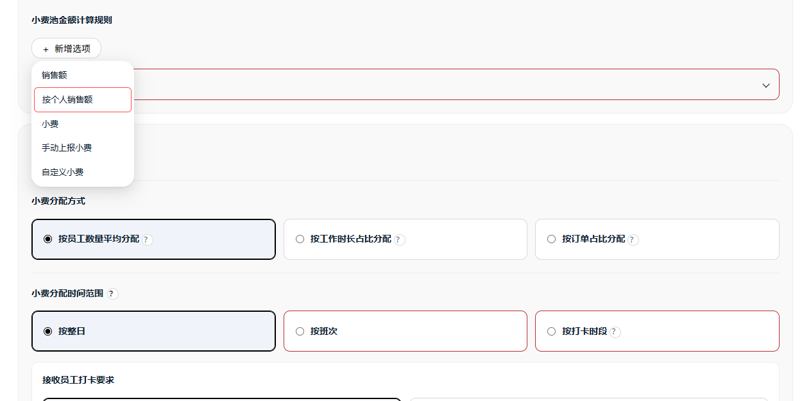
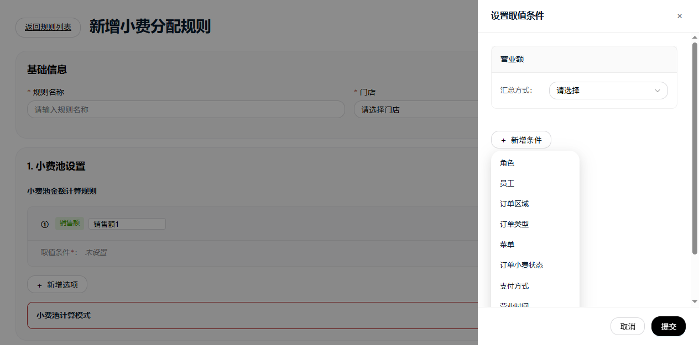

# 小费管理页面与操作覆盖清单

文档编号：TIPOUT-PLANNING-COPY-20261026-01；基线：a016be92＋本次分配范围文案修改。字段定义在三份正文，本表只核对页面和操作定位。

| 页面／操作 | 入口及结果 | 页面说明位置 | 图像状态 |
| --- | --- | --- | --- |
| 日期分配汇总／日期排序 | 日期倒序或顺序；不改变执行规则和金额。 | 第1节／查询条件 | 页面图已嵌入；独立状态按下表核对 |
| 日期分配汇总／查看明细 | 携带门店、日期打开当日明细；返回保留查询上下文。未营业日点击提示原因并留在汇总。 | 第1节／日期行 | 页面图已嵌入；独立状态按下表核对 |
| 日期分配汇总／确认已发放 | 符合发放条件时显示，打开整日登记确认。 | 第1节／日期行 | 页面图已嵌入；独立状态按下表核对 |
| 日期分配汇总／导出结果 | 选择CSV、PDF或邮箱；使用当前视角和有效筛选。 | 第1节／底部操作 | 页面图已嵌入；独立状态按下表核对 |
| 员工分配汇总／员工明细入口 | 携带员工ID、门店、周期和返回上下文，打开每日明细。 | 第2节／员工列表 | 页面图已嵌入；独立状态按下表核对 |
| 员工每日考勤分配／返回员工分配汇总 | 恢复来源查询、排序及位置。 | 第3节／上下文与统计 | 页面图已嵌入；独立状态按下表核对 |
| 员工每日考勤分配／导出结果 | 按当前员工和过滤周期导出。 | 第3节／上下文与统计 | 页面图已嵌入；独立状态按下表核对 |
| 当日小费分配明细／规则名称筛选 | 多选、全选；只改变可见规则，不缩小保存或发放的整日范围。 | 第4节／上下文与概览 | 页面图已嵌入；独立状态按下表核对 |
| 当日小费分配明细／新增行 | 加入本次分配草稿，不创建员工目录；参与及依据必须有效。 | 第4节／接收组与员工行 | 页面图已嵌入；独立状态按下表核对 |
| 当日小费分配明细／删除行 | 移除本次草稿行，重算相关分配，不删除员工。 | 第4节／接收组与员工行 | 页面图已嵌入；独立状态按下表核对 |
| 当日小费分配明细／返回汇总 | 恢复来源视角、筛选和位置；有未保存调整先保护草稿。 | 第4节／页面操作 | 页面图已嵌入；独立状态按下表核对 |
| 当日小费分配明细／确认分配 | 首次保存整日所有规则；校验失败留在页面并保留草稿。 | 第4节／页面操作 | 页面图已嵌入；独立状态按下表核对 |
| 当日小费分配明细／重新确认分配 | 已有分配时按系统规则重新生成；人工结果须确认覆盖。 | 第4节／页面操作 | 页面图已嵌入；独立状态按下表核对 |
| 当日小费分配明细／保存当前分配 | 已有结果且发生手调时可用；无手调显示“当前系统分配数据未进行手动调整”，不写入。 | 第4节／页面操作 | 页面图已嵌入；独立状态按下表核对 |
| 当日小费分配明细／确认已发放 | 整日有效快照、无未保存调整且未发放时可登记；发放后锁定编辑。 | 第4节／页面操作 | 页面图已嵌入；独立状态按下表核对 |
| 分配规则列表／门店筛选 | 全部门店或指定门店，限制列表及统计。 | 第5节／筛选与统计 | 页面图已嵌入；独立状态按下表核对 |
| 分配规则列表／更多操作／复制 | 克隆配置并生成新规则ID和副本名称；不复制分配或发放结果。 | 第5节／列表与操作 | 页面图已嵌入；独立状态按下表核对 |
| 分配规则列表／更多操作／删除 | 打开确认框；确认删除规则配置，取消保留。不会清除已保存的日期快照。 | 第5节／列表与操作 | 页面图已嵌入；独立状态按下表核对 |
| 分配规则列表／新增规则 | 先选择小费池或加收服务费池，再进入编辑页。 | 第5节／列表与操作 | 页面图已嵌入；独立状态按下表核对 |
| 新增／编辑分配规则／保存规则 | 校验所有必填、条件、接收份额、权重、员工承担及工时，成功持久化配置并返回列表；失败保留输入。 | 第6节／基础信息与顶部操作 | 页面图已嵌入；独立状态按下表核对 |
| 新增／编辑分配规则／取消／返回规则列表 | 离开本页，不把当前未保存配置写入正式规则。 | 第6节／基础信息与顶部操作 | 页面图已嵌入；独立状态按下表核对 |
| 新增／编辑分配规则／新增选项 | 可选销售额、个人销售额、小费、手动上报、加收服务费、自定义等当前来源。 | 第6节／分配规则／小费池金额计算规则 | 页面图已嵌入；独立状态按下表核对 |
| 新增／编辑分配规则／删除计算项 | 只删除当前规则草稿项；汇总模式至少保留一项有效来源。 | 第6节／分配规则／小费池金额计算规则 | 页面图已嵌入；独立状态按下表核对 |
| 新增／编辑分配规则／再分配 | 配置该父组内的子接收组；子比例相对父预算。 | 第6节／分配规则／计算模式与接收组 | 页面图已嵌入；独立状态按下表核对 |
| 新增／编辑分配规则／新增角色／删除 | 添加或删除预算组，保存重新校验份额；不创建或删除角色目录。 | 第6节／分配规则／计算模式与接收组 | 页面图已嵌入；独立状态按下表核对 |
| 新增／编辑分配规则／分配方式问号 | 点击显示对应说明及示例，不改变选值。 | 第6节／分配规则／分配方式、接收员工打卡要求与工时 | 页面图已嵌入；独立状态按下表核对 |
| 新增／编辑分配规则／资格问号 | 说明随当前分配方式联动，帮助阅读不保存规则。 | 第6节／分配规则／分配方式、接收员工打卡要求与工时 | 页面图已嵌入；独立状态按下表核对 |
| 新增／编辑分配规则／新增选项 | 按照销售额占比、按照个人销售额占比、按照小费收入占比；销售额与个人销售额条件按界面互斥。 | 第6节／贡献规则／小费贡献方规则 | 页面图已嵌入；独立状态按下表核对 |
| 新增／编辑分配规则／删除贡献项 | 仅删除规则草稿项，后续保存才生效。 | 第6节／贡献规则／小费贡献方规则 | 页面图已嵌入；独立状态按下表核对 |

| 独立界面／操作 | 图像 | 页面说明位置 | 覆盖范围 |
| --- | --- | --- | --- |
| 自动分配状态与结果 | assets/tips-retry-visibility-20261026/running.png | 7.1 | 已嵌入所示界面；其他确认／取消／异常状态按实际图像清单，不视为全部结果已覆盖 |
| 主动批量分配范围 | assets/tips-operations-20261023/batch-selection.png | 7.2 | 已嵌入所示界面；其他确认／取消／异常状态按实际图像清单，不视为全部结果已覆盖 |
| 覆盖人工结果确认 | assets/tips-operations-20261023/batch-manual-warning.png | 7.3 | 已嵌入所示界面；其他确认／取消／异常状态按实际图像清单，不视为全部结果已覆盖 |
| 确认已发放 | assets/tips-operations-20261023/payout-summary-dialog.png | 7.4 | 已嵌入所示界面；其他确认／取消／异常状态按实际图像清单，不视为全部结果已覆盖 |
| 分配计入工时明细 | assets/tips-operations-20261023/hours-period.png | 7.5 | 已嵌入所示界面；其他确认／取消／异常状态按实际图像清单，不视为全部结果已覆盖 |
| 贡献金额拆分 | assets/tips-operations-20261023/employee-contribution-breakdown.png | 7.6 | 已嵌入所示界面；其他确认／取消／异常状态按实际图像清单，不视为全部结果已覆盖 |
| 公式详情 | assets/tips-operations-20261023/detail-formula.png | 7.7 | 已嵌入所示界面；其他确认／取消／异常状态按实际图像清单，不视为全部结果已覆盖 |
| 保存当前分配确认 | assets/tips-operations-20261023/detail-save-confirm.png | 7.8 | 已嵌入所示界面；其他确认／取消／异常状态按实际图像清单，不视为全部结果已覆盖 |
| 重新确认分配提示 | assets/tips-operations-20261023/detail-reallocate-confirm.png | 7.9 | 已嵌入所示界面；其他确认／取消／异常状态按实际图像清单，不视为全部结果已覆盖 |
| 无手动调整提示 | assets/tips-docs-current-20261023/detail-no-change.png | 7.10 | 已嵌入所示界面；其他确认／取消／异常状态按实际图像清单，不视为全部结果已覆盖 |
| 更新小费数据 | assets/tips-operations-20261023/detail-update-dialog.png | 7.11 | 已嵌入所示界面；其他确认／取消／异常状态按实际图像清单，不视为全部结果已覆盖 |
| 未保存调整保护 | assets/tips-detail-gaps-20261023/detail-date-leave.png | 7.12 | 已嵌入所示界面；其他确认／取消／异常状态按实际图像清单，不视为全部结果已覆盖 |
| 选择池类型 | assets/tips-docs-current-20261023/pool-type.png | 7.13 | 已嵌入所示界面；其他确认／取消／异常状态按实际图像清单，不视为全部结果已覆盖 |
| 员工权重 | assets/tips-operations-20261023/rule-weight-dialog.png | 7.14 | 已嵌入所示界面；其他确认／取消／异常状态按实际图像清单，不视为全部结果已覆盖 |
| 员工承担比例 | assets/tips-docs-current-20261023/share-custom.png | 7.15 | 已嵌入所示界面；其他确认／取消／异常状态按实际图像清单，不视为全部结果已覆盖 |
| 来源／贡献取值条件 | assets/tips-operations-20261023/rule-source-drawer.png | 7.16 | 已嵌入所示界面；其他确认／取消／异常状态按实际图像清单，不视为全部结果已覆盖 |
| 班次设置 | 待补页面图片 | 7.17 | 尚缺独立界面图，字段已按实现说明 |
| 导出与邮件 | assets/tips-operations-20261023/export-email.png | 7.18 | 已嵌入所示界面；其他确认／取消／异常状态按实际图像清单，不视为全部结果已覆盖 |
| 删除规则确认 | 待补页面图片 | 7.19 | 尚缺独立界面图，字段已按实现说明 |

## 未覆盖的图像

- 班次设置和规则删除确认的独立截图。
- 重试后再次失败、并发冲突、写入回滚失败及无安全锁环境的结果截图。
- 自定义员工承担与已发放保护等未在图片中展示的组合状态。

现有图像只证明所示状态；未采到的结果不使用其他界面替代。

打卡时段选项位于小费分配时间范围，当前模式截图见 assets/tips-shift-scope-20261026/。

统计范围：整日／时段选择、接收员工打卡要求隐藏与恢复、工时上限草稿恢复、已有时段规则回显已验证；对应图片见 assets/tips-shift-scope-20261026/day.png 与 time-window.png。受控演示使用实际模板与运行时。

排班来源：规则页按班次无设置行、编辑保存不携带班次配置、读取实际排班、已有排班的分配结果及无排班拦截均已验证并配图。跨店、日期覆盖、失效引用、未排班员工排除及提交前排班变化拦截通过专项测试；独立排班变化提示截图待补。

规则布局：分配方式、范围、金额、高级模式、接收方、接收员工打卡要求／工时、贡献规则的实际页面顺序已验证；整日、时段、班次模式截图位于 assets/tips-rule-order-20261026/，切换草稿保留已验证。

范围卡片：三列等宽等高、卡片空白区域切换、问号不改变选项、红框保留及390px窄屏纵向排列已浏览器验证并配图，见 assets/tips-scope-cards-20261026/。

接收员工打卡要求：整日显示新标题与需有有效打卡／不限打卡状态两个选项；班次和时段隐藏，切回整日恢复原选值，浏览器验证通过。

三组布局：金额与高级模式归属小费池设置；分配方式及其工时设置、范围及参与条件、接收方依次归属分配设置与接收设置；贡献方独立归属员工贡献设置。DOM归属、联动、草稿恢复、窄屏及整页截图已核对。

打卡要求卡片：两个等宽等高选项、整卡选择、问号不改选值、390px窄屏纵向排列，均已浏览器验证并配图，见 assets/tips-clock-cards-20261026/。

时段说明：已移入按打卡时段问号，卡片底部不常驻；问号展开及选值不变已验证，配图 time-window.png／time-help.png 位于 assets/tips-clock-cards-20261026/。

班次工时限制：按班次显示、其他范围隐藏、平均／订单禁用上限、工时方式启用、草稿恢复、编辑保存回显及非法输入不写入已验证。配图 assets/tips-shift-hours-20261026/；班次与员工仍取排班表。

| 规则编辑 | 小费分配时间范围问号 | 点击标题旁问号显示统计与分配范围说明，不改变当前选值 |  | 已验证，受控演示 |

### 规划标记悬停提示

图：悬停小费池计算模式，a016be92基线功能分支真实模板与运行时，受控演示。

图：悬停按班次，a016be92基线功能分支真实模板与运行时，受控演示。

图：悬停按打卡时段，a016be92基线功能分支真实模板与运行时，受控演示。

| 操作 | 说明 |
| --- | --- |
| 悬停提示 | 鼠标悬停小费池计算模式标题、按班次卡片、按打卡时段卡片，均显示“标记红色边框的代表未来需求的规划场景或者测试使用”；移开隐藏。不改变选择、折叠状态或保存数据，原问号说明保留。 |

### 小费池来源菜单标记

图：新增小费池金额计算规则菜单，a016be92基线功能分支真实模板与运行时，受控演示。

“按个人销售额”菜单项显示红色边框，文字保持原色；点击、取值条件、保存和金额计算不变。

### 取值条件菜单标记

图：设置取值条件的新增条件菜单，a016be92基线功能分支真实模板与运行时，受控演示。

取值条件新增菜单中的“班次”“周期（星期）”使用红色边框，文字保持原色；各取值抽屉一致，原选取、提交、取消和计算逻辑不变。
