# 小费管理需求文档（个人规范版）

最新维护：TIPOUT-CONTRIBUTOR-SHARES-20261023-01。[产品V4.11](PRD_产品需求文档.md)／[研发V3.11](小费分配业务规格说明书（研发交付版）.md)／[个人V2.9](小费管理需求文档（个人规范版）.md)配对。角色贡献项支持员工承担比例，跨角色全条100%；余额不足不转嫁，明细保留逐条应扣／实扣／少扣及问号说明。基线main@03afacb8＋65122独立未提交分支，旧规则不自动迁移。

## 角色贡献规则：员工承担比例（TIPOUT-CONTRIBUTOR-SHARES-20261023-01）

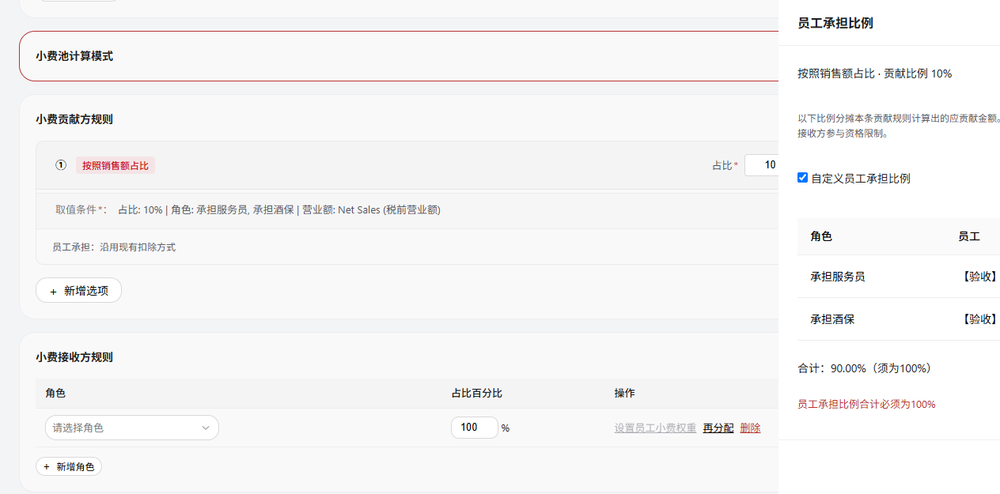

图注：编辑规则／取消员工比例输入后，仍为沿用原方式；main@03afacb8＋未提交功能分支，65122隔离浏览器。专用验收人员A销售200、小费20，B销售800、小费1000；不是真实员工或付款记录。固定身份仅由验收脚本显式创建，不向普通名单自动加人。

用途：先按取值条件算本条贡献项应承担的总额，再配置由哪些员工按什么比例承担。它与小费池预算P、接收组占比、员工接收权重和参与资格是不同层级；一条贡献项可以选多个角色，所有命中员工共同合计100%，不是每个角色各100%。

| 元素／操作 | 定义及联动 |
| --- | --- |
| 原贡献比例 | 例如10%，计算本条取值总基数的10%。启用自定义承担时须大于0、不超过100%，最多两位百分数小数。不是员工承担比例，也不是角色固定分得小费池P的10%。 |
| 设置员工承担比例 | 位于每条贡献卡片的取值条件下方；未选门店或角色时禁用，提示先设置范围。点击打开右侧抽屉，仅作用于本卡片。 |
| 默认摘要 | 未配置为“员工承担：沿用现有扣除方式”，旧规则不自动迁移、不改变既有快照。 |
| 已配置摘要 | “员工承担：自定义 · A 40%、B 60%”；超过3人显示已配置人数。点击修改可查看全部，不把完整名单挤在卡片上。 |
| 范围变化 | 角色、门店或有效员工名单改变，提示重新设置，不清空已存比例或静默归一化；保存也必须重验，失效／新增员工不能悄悄参与。 |

### 员工承担比例抽屉

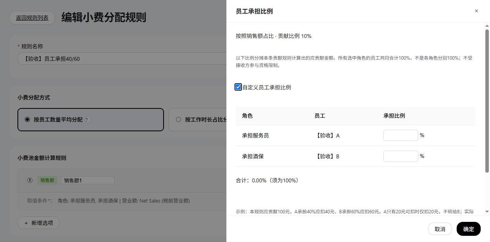

图注：同页／首次打开，两个不同角色的员工各一行，比例尚未填写；当前规则上下文和贡献比例10%保留。

| 字段／操作 | 定义、默认及约束 |
| --- | --- |
| 上下文 | 只读当前贡献依据及贡献比例，明确是在分摊本条应贡献额；不显示虚构当天试算金额。 |
| 自定义员工承担比例 | 打开设置时勾选，不代表已应用。取消不生效；取消勾选后点确定，移除本条自定义配置并恢复原扣除方式，最终仍需保存规则。 |
| 角色 | 当前门店有效员工目录中的角色，只读；按所选角色顺序分组展示。不是另一个百分比分母。 |
| 员工 | 按稳定employeeId引用和去重，不用姓名作主键。命中多个角色只配置一次，不受接收方打卡资格限制，零小费余额员工仍可以出现在名单。 |
| 承担比例 | 百分数，启用自定义后每行必填；0—100，最多两位小数，0合法。初次空值不自动均分；编辑回填上次配置。 |
| 合计 | 所有角色员工合计100%，实时显示，不按角色各自100%。不足／超过100均阻止确定，不自动补到100或按比例压缩。 |
| 确定 | 再核对打开时门店、角色及名单未变化；校验通过才更新本页规则草稿和摘要，不直接写规则或分配记录。 |
| 取消／关闭／遮罩／Esc | 丢弃本次抽屉输入，不改此前草稿或有效规则；重开按已应用草稿回填。标题关闭／取消／Esc返回入口焦点；Tab循环在抽屉控件中。 |
| 页面保存规则 | 按既有必填、引用和状态校验，并重验自定义份额及范围。成功写deductConfig对应卡片，失败保留草稿。仅查看抽屉不改变业务。 |

### 比例错误、取消与草稿应用

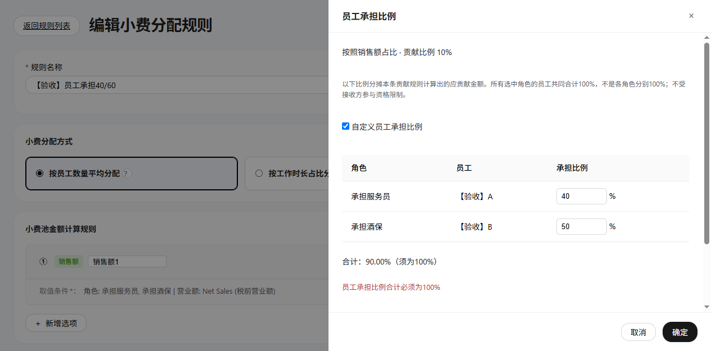

图注：40%＋50%，点击确定仍留在抽屉，提示必须100%；有效规则尚无employeeShares。取消后的无写入结果见入口图。

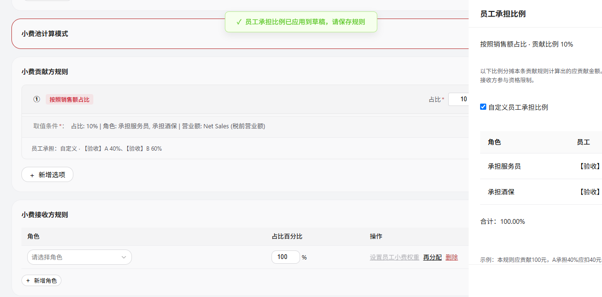

图注：确定40%／60%后，卡片摘要已变，但存储尚无员工比例；不等于规则已保存。

### 保存后编辑回填

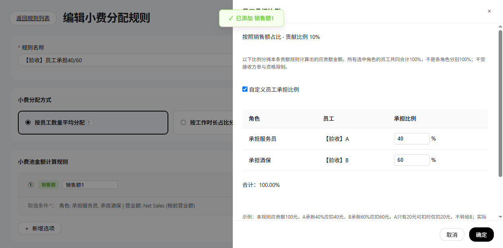

图注：实际点击页面保存规则，随后重新编辑并打开抽屉；输入为40／60，合计100%。接收方使用验收Chef人员，本贡献名单与其独立。未改历史分配结果。

### 计算定义与字段

| 字段／对象 | 研发定义及例子 |
| --- | --- |
| deductConfig条目 | 保留salesPct／personalSalesPct／tipIncome原结构；每张卡片可选追加employeeShares，无该字段的旧规则走原计算路径。 |
| employeeShares.version | 整数1，标记自定义配置结构；启用时必须有合法对象，空对象不视为未配置。 |
| employeeShares.store | 设置时门店字符串，编辑器保存时校验与当前门店一致；员工ID还须属于当前角色名单。 |
| employeeShares.roles | 角色字符串数组，保存范围快照；去重后集合须等于该贡献项选中的角色，变化需重设。 |
| employeeShares.employees | 员工对象数组，必须覆盖所选角色全部有效员工且无重复／失效ID；每行employeeId字符串、pct百分数。 |
| 应贡献额D | 汇总所选员工符合取值条件的基数B，计算D＝B×原贡献比例。销售额／个人销售额／小费收入保留各自基数与筛选约束，不借承担比例扩大来源范围。 |
| 员工应扣dᵢ | D×pctᵢ÷100；先转换整数美分，最大余数法补足分位尾差，稳定员工ID顺序处理相同尾差；所有应扣之和等于D。 |
| 可扣余额aᵢ | 当天原始可扣小费减此前贡献项／池已实际扣除金额，不含接收分得金额；不因本次应扣不足变成负数。 |
| 实际扣除cᵢ／少扣sᵢ | cᵢ＝min(dᵢ,aᵢ)，sᵢ＝dᵢ−cᵢ。只封顶本人，不转给其他员工或重新归一化承担比例。 |
| 同日顺序 | 沿用规则池计算顺序；同池按既有口径顺序salesPct、personalSalesPct、tipIncome，同口径按数组顺序消耗余额。新增配置不授权重排其他规则。 |
| C与实际可分配 | C为所有贡献项实际扣除之和，不是应扣之和；实际可分配max(P,C)，老板补足max(P−C,0)。 |
| contributionRules | 新计算快照中的逐贡献项数组：entryId、basis、label、rate、roles、custom、plannedContribution、actualContribution、shortfall和employees。金额单位元、两位小数，非配置输入。 |
| 贡献员工快照 | employeeId／name／role／pct／due／available／amount／shortfall；pct在沿用项为null，其他金额为应扣／扣前余额／实扣／少扣，保留确认时值，不用现行角色或名字重写历史。 |
| 守恒检查 | 贡献项员工应扣、实扣、少扣分别汇总；项实扣合计等于C，员工实扣合计与贡献流水及员工统计相等。无效或不守恒拒绝生成新确认结果。 |

算例：角色范围销售基数1,000元×10%＝应贡献100元；A承担40%应扣40、余额20实际扣20；B承担60%应扣60、余额1,000实际扣60。C＝80，少扣20。P＝100时实际分100、老板补20；P＝50时实际分80、老板补0，仍少扣20，不能把少扣直接等同于补足。

### 分配明细：贡献方及少扣提示

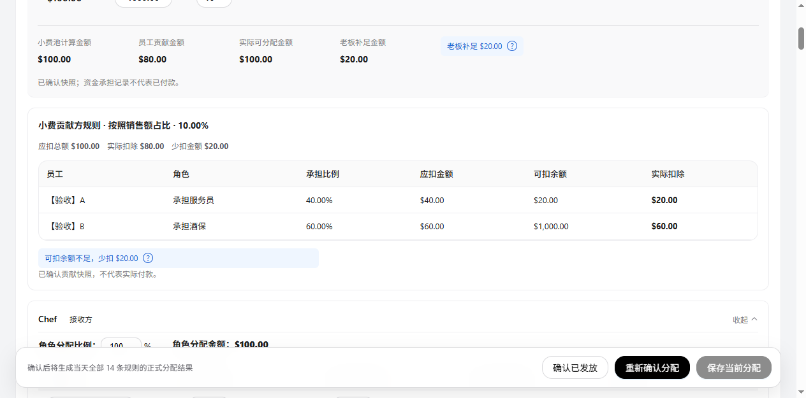

图注：10/23确认快照／本条贡献应扣100、实扣80；A40→20、B60→60。仅本条是上述数字，同一天其他旧规则的扣款仍可能计入员工当天合计，不能把本条60当作全天唯一扣款。

| 字段／操作 | 定义及可见条件 |
| --- | --- |
| 贡献方规则区 | 在对应小费池／规则金额区下方、接收方表前显示本规则的各贡献项；新自定义路径保留员工承担、应扣、余额、实扣。旧快照无逐项元数据时不猜测补算。 |
| 试算／确认 | 未确认使用“预计”标签；确认后读取保存的contributionRules，不用当前规则重算。人工保存沿用既有有效快照替换流程，已发放仍只读。 |
| 应扣总额 | 当前贡献项按条件及比例算出的D，不是整个小费池P。 |
| 实际扣除 | 当前项员工实际扣除之和，是该项对C的贡献；不是最终接收金额。 |
| 少扣金额 | 当前项应扣−实扣，只有大于0才额外强调，不等于老板补足。 |
| 蓝色提示 | 有员工余额不足才显示“可扣余额不足，少扣 $金额”，不阻止正常分配；不同贡献项分别判断，无少扣不显示此提示。 |
| 问号 | 点击展开逐位不足员工的应扣、余额和实扣，说明不转嫁、C按实扣、补足仍按P/C；收起仅隐藏说明，不写数据。原C＞P／C＜P提示独立保留。 |

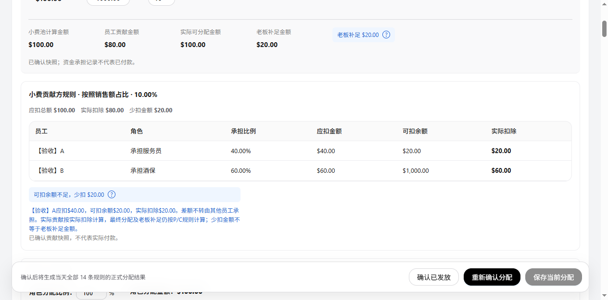

图注：同日同规则／点击蓝色问号后，A应扣40、余额20、实扣20；单人不足仅列该人，多人不足逐人列出，B不会被追加扣20。

### 已发放快照

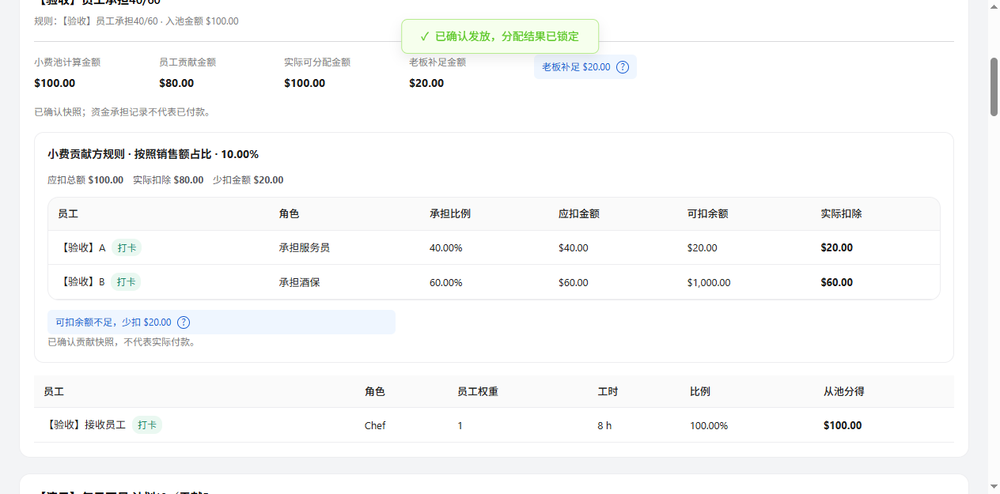

图注：隔离演示登记已发放后，贡献表及少扣提示仍按原确认快照显示，不修改旧发放或执行实际转账。原演示取消例外不因本次改变。

### 支持与交付边界

- 本期实现普通、非时段角色贡献配置及上述三种取值依据；旧funding、计提、逐笔时段路径遇自定义承担明确拦截，不默默忽略或退回全天。此为实现兼容边界，不替用户重新定义这些模式的业务。
- 同池启用自定义后，如包含旧salesPct项，必须为这些销售额贡献项均明确配置承担比例；否则保存与计算拦截，避免把旧按预算归集算法静默转换。未配置任何员工承担的旧规则不迁移。
- 仅在规则草稿保存后影响后续计算；已有确认／已发放快照不自动改写。旧无metadata快照继续原样展示，不补造历史比例。
- 本次不新增导出列、权限或支付接口。现有统计仍用实际扣除；新增字段的导出格式不在本次范围。
- 已验：90%拦截、取消不应用、确定仅草稿、保存后回填40/60、确认与已发放明细、少扣展开；函数覆盖多项／跨池余额、尾差、失效／重复ID、0比例及P/C。新建未选角色禁用、门店／角色／名单变化、恢复原方式、多人不足、键盘和故障等全部分支的页面图尚未齐全，其他历史缺口不关闭。

## 小费池计算模式默认折叠（TIPOUT-MODE-COLLAPSE-20261023-01）

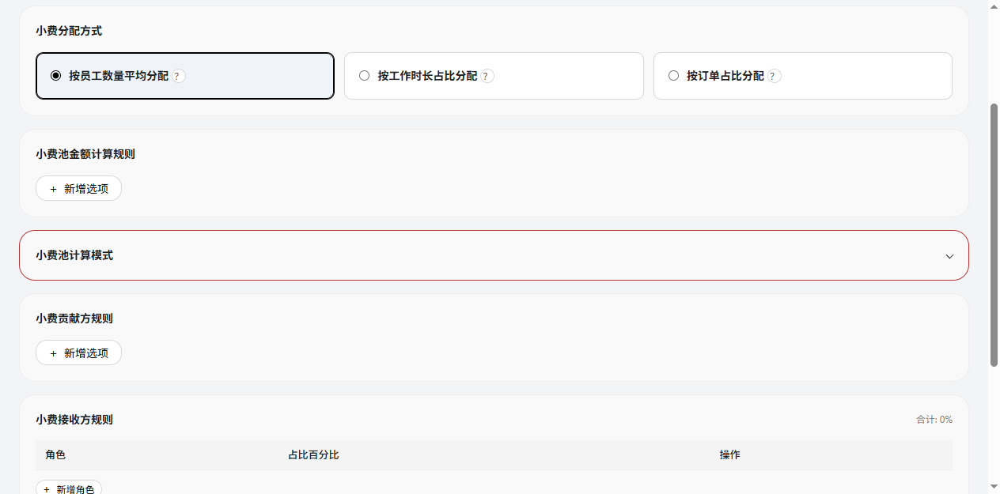

图注：新增规则／默认收起，main@440289d5＋未提交分支，65121隔离演示；原默认模式legacy_pool保留，非已保存记录。

| 元素／字段 | 定义与行为 |
| --- | --- |
| 标题与箭头 | 红框内显示“小费池计算模式”和展开箭头；整条标题点击可切换，聚焦后Enter／Space使用原生summary交互。 |
| 默认展开状态 | 新建、编辑首次进入均为收起（details无open）；仅当前页临时布尔状态，不入库、不跨页面记忆，不新增配置字段。不是默认修改计算模式。 |
| 隐藏范围 | 收起时隐藏下方两个模式单选项及说明，其他卡片不随之折叠；保留红框。展开后原选项、说明、联动和校验恢复可操作。 |
| 计算模式取值 | 新建仍默认legacy_pool；编辑按已有allocationMode回填，包括order_tip_then_residual。收起不清空／禁用单选项、不重置为默认，保存继续读取当前选值。 |
| 保存及失败 | 仅展开／收起无业务写入、不构成人工业务调整；修改选项才走既有规则草稿。保存校验、成功／失败／取消和金额计算均沿用原定义。 |

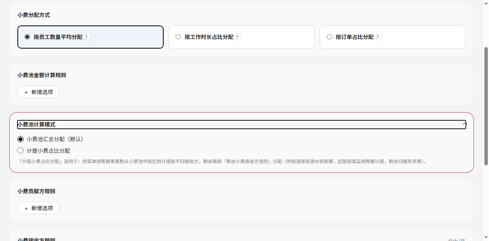

图注：同页同版本，展开后两个选项可见；Enter再次收起，选值仍legacy_pool。默认、展开与键盘关闭有真实浏览器验证；既有计提模式编辑回填、离开重新进入的独立截图待补，不能据此宣称全链路验收。前批“计算模式区块红框”图展示的是展开态，不再代表首次默认状态。

## 规则编辑页红框视觉补充（TIPOUT-RULE-OUTLINE-20261023-01）

图注：新增规则／默认计算模式，main@07f8dd36＋未提交独立分支，65120隔离演示；不作为真实规则保存记录。仅样式补充，三文档保持产品V4.9／研发V3.9／个人V2.7，无业务版本变更。

| 元素 | 视觉定义与边界 |
| --- | --- |
| 小费池计算模式区块 | 红框沿用。默认仅显示可操作标题与箭头；展开后两个单选项和说明位于框内；重新点击标题收起。红框不是校验失败或选中状态。 |
| 在岗员工选项 | “仅限小费产生时在岗员工”单选项、文字及问号整体使用1px红框、8px圆角；框宽随内容，不框住整个参与资格区。默认未选与已选都显示红框，文字、打卡条件与选中逻辑不变。 |

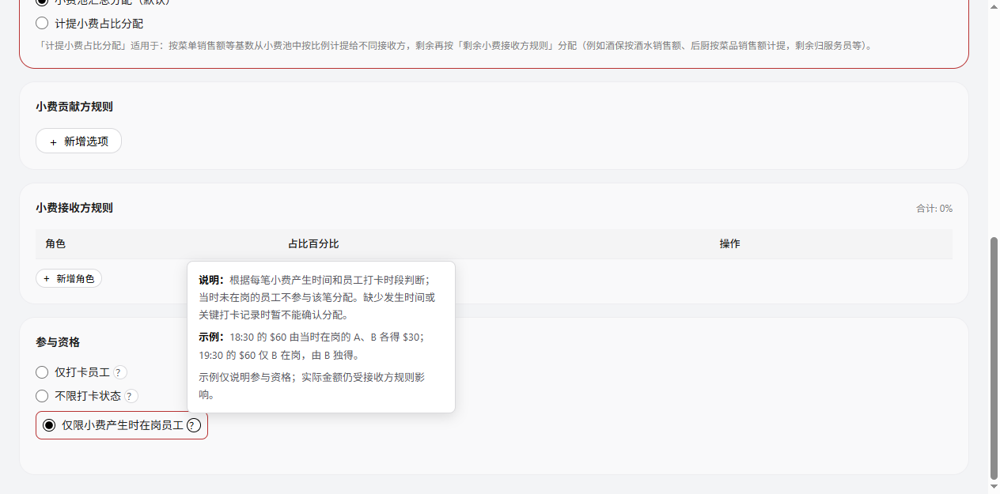

图注：同页同版本／选中在岗资格并点击问号，说明浮层可正常展开；边框不裁切说明，原工时联动沿用。框不是整行点击的新入口，不改禁用、保存及算法。本轮未保存规则；其他历史截图及验收缺口保持原状态。

## 取消已发放分配（演示重置，TIPOUT-CANCEL-PAID-20261023-01）

图注：日期汇总10/21—10/23，23日已发放、21日待发放、22日未营业；origin/main@649225c3＋未提交功能分支，65118隔离演示，非真实交易。当前原生页面生效；旧dist/TipOut/index.html静态原型未升级该业务，不作为本次入口。

| 字段／操作 | 定义及结果 |
| --- | --- |
| 测试场景清单 | 复用btn-danger红色边框，位置、点击行为不变。 |
| 取消分配 | 同样红框；范围为当前门店、起止日期（含两端）的正常营业日，不按状态筛选缩小范围。已发放也可取消；未营业、范围外、其他门店、原始订单／考勤不改。门店必选，日期必须有效。 |
| 无记录／异常 | 无有效记录不写入或重复归档；损坏或发放依据异常拦截，不强行解锁。 |
| 锁定例外 | 仅本演示取消可重置已发放；普通编辑、更新、分配、底层cancel仍遵守锁定，不新增支付撤回接口。 |

### 页面内取消确认

图注：同版本／点击红框取消入口；页面对话框，不调用浏览器confirm。

| 字段／操作 | 定义及结果 |
| --- | --- |
| 标题／范围 | “取消分配？”；只读门店及日期。打开时冻结范围及各日快照／发放／更新指纹，外部变化不静默改变目标。 |
| 警示 | “取消后将恢复为待分配，已发放标记也将撤销。此操作不会撤回实际付款。” |
| 保留分配／关闭／Esc／遮罩 | 不写入，关闭返回焦点；提交期间阻止关闭及重复提交。框外主内容inert，Tab在框内循环。 |
| 确认取消分配 | 先检查整个范围及指纹一致，再逐日Web Lock内复核；confirmed=true和expectedFingerprint必填。过期确认失败，需关闭后重新检查。 |
| 成功 | 归档旧数据后清有效快照、已分配索引、发放标记及未确认更新。正常日回未分配／待发放；已分配金额归零，未分配金额按现行试算展示；刷新汇总及冻结周期Payroll。 |
| 失败 | 每日五项写失败恢复原值；回滚也失败明确提示停止操作。范围逐日执行，非全范围原子；中断报已完成天数，剩余不动。薪资失败明确取消已写入、同步失败，可经原员工数据更新流程重试同步，不假报全成功。 |

### 保留分配

图注：同范围点击保留，23日仍已发放、21日已分配待发放、22日仍未营业。

### 确认后结果及历史

图注：同范围确认后，23／21日恢复未分配、待发放，22日仍无需分配／无需发放。实际归档2条，23日含原发放记录，21日payout为空。

| 字段／对象 | 定义、来源、默认与约束 |
| --- | --- |
| cancelFingerprint | 已分配索引、快照、发放、未确认更新的JSON字符串，用于锁内并发比较；非金额，不展示。 |
| 历史存储 | tipout-allocation-cancel-history-v1，JSON数组，默认空；实际取消才追加，不参与有效汇总。损坏拦截。 |
| recordId／canceledAt | 系统唯一ID字符串／ISO当前时间字符串，必填不可编辑。 |
| storeId／businessDate／source | 必填字符串：冻结门店、ISO营业日、固定summary-demo-reset。 |
| snapshot／payout／unconfirmedUpdate | 完整撤销前对象或null；保留快照ID、版本、hash、金额及原发放时间、确认人、请求ID。不删除订单／人员／规则。暂不新增历史查看页。 |
| 写入 | 锁内归档→快照→索引→发放→未确认更新；保留五项原始值并逐项回滚，只成功后通知其他视角。历史不是退款流水。 |
| 发放确认警示 | 本操作仅记录发放状态，不执行转账。确认后分配结果锁定；仅可通过汇总页“取消分配”演示重置，撤销标记不会撤回实际付款。 |

验收：23日已发放、21日未发放、22日闭店；保留不写，确认归档2条、清有效状态，范围外不动。重复取消幂等，过期指纹拦截，五项故障回滚、普通cancel仍锁定有函数测试；默认、确认、保留和成功有截图。并发、故障、薪资失败、焦点循环的页面截图仍待补，原历史缺口不关闭。旧“已发放取消跳过”图片仅为历史，不代表当前规则。

上批维护（历史）：TIPOUT-FUNDING-EXCESS-20261023-01（2026-10-23）。[产品V4.6](PRD_产品需求文档.md)／[研发V3.6](小费分配业务规格说明书（研发交付版）.md)／[个人规范V2.4](小费管理需求文档（个人规范版）.md)配对。明细金额对照、蓝色贡献超计划标识及展开说明，新增隔离演示门店“计划10·贡献20·按20分配”。普通池明确个人小费／个人销售额贡献配置已接入试算与确认；角色无独立公式、salesPct、旧funding、计提及时段资金的兼容边界仍保留，非全部资金契约完成。代码及文档未提交。

上批维护（历史）：TIPOUT-FUNDING-DEFINITION-20261023-01（2026-10-23）。[产品V4.5](PRD_产品需求文档.md)／[研发V3.5](小费分配业务规格说明书（研发交付版）.md)／[个人规范V2.3](小费管理需求文档（个人规范版）.md)配对。明确贡献≤计划金额按计划分配、贡献>计划按实际贡献分配；补符号映射、等于／零值及20对10算例。只更新资金业务定义，不改代码、页面或历史快照；实现状态与原待确认项保留。基线为本地main@fb78f5e7（含尚未推送提交）。

上批维护（历史）：TIPOUT-DETAIL-GAPS-20261023-01（2026-10-23）。[产品V4.4](PRD_产品需求文档.md)／[研发V3.4](小费分配业务规格说明书（研发交付版）.md)／[个人规范V2.2](小费管理需求文档（个人规范版）.md)配对。第二批补明细切店／切日的页面内草稿确认、首次人工结果来源标记及员工每日日期校验。功能基线44ca8723＋65115未提交实现；跨菜单离开、首次确认和员工替换仍有浏览器验收缺口，不声称全部完成。

上批维护（保留）：TIPOUT-DATE-VALIDATION-20261023-01（2026-10-23）。[产品V4.3](PRD_产品需求文档.md)／[研发V3.3](小费分配业务规格说明书（研发交付版）.md)／[个人规范V2.1](小费管理需求文档（个人规范版）.md)配对。第一批实现汇总日期空值／倒置反馈、结果保留、操作拦截与修复恢复，补10张真实截图；资金、算法、资格和历史快照不变。其余缺口继续分批，不代表全部实现。

## 版本记录

| 版本 | 日期 | 修改内容 | 对应版本 |
| --- | --- | --- | --- |
| V2.9 | 2026-10-23 | TIPOUT-CONTRIBUTOR-SHARES-20261023-01：跨角色员工承担100%、余额封顶不转嫁、逐项快照与少扣提示、抽屉及实证 | 产品V4.11／研发V3.11／个人V2.9 |
| V2.8 | 2026-10-23 | TIPOUT-MODE-COLLAPSE-20261023-01：计算模式默认折叠、原生键盘展开、保留选值及截图 | 产品V4.10／研发V3.10／个人V2.8 |
| V2.7 | 2026-10-23 | TIPOUT-CANCEL-PAID-20261023-01：演示取消归档并重置已发放／已分配，页面确认、红框及截图 | 产品V4.9／研发V3.9／个人V2.7 |
| V2.6 | 2026-10-23 | TIPOUT-DAILY-SHORTFALL-20261023-01：不足对照与老板补足问号说明；每日10/5数据及截图 | 产品V4.8／研发V3.8／个人V2.6 |
| V2.5 | 2026-10-23 | TIPOUT-DAILY-EXCESS-20261023-01：仅超额规则显示资金对照；当前默认门店每日演示；半美分口径对齐与截图 | 产品V4.7／研发V3.7／个人V2.5 |
| V2.4 | 2026-10-23 | TIPOUT-FUNDING-EXCESS-20261023-01：贡献超计划金额对照与展开说明；独立个人贡献资金联动及10/20演示；历史和未支持路径不自动迁移 | 产品V4.6／研发V3.6／个人V2.4 |
| V2.3 | 2026-10-23 | TIPOUT-FUNDING-DEFINITION-20261023-01：贡献与预算取较大值为分配基数；明确符号映射、等于与零值、20/10算例；仅文档 | 产品V4.5／研发V3.5／个人V2.3 |
| V2.2 | 2026-10-23 | TIPOUT-DETAIL-GAPS-20261023-01：明细草稿页面内确认、人工来源及员工每日日期错误反馈；产品V4.4／研发V3.4／个人V2.2；保留未验收分支 |
| V2.1 | 2026-10-23 | TIPOUT-DATE-VALIDATION-20261023-01：共用汇总日期错误反馈、结果保留与操作拦截，补10张实际截图；其余缺口分批 | 产品V4.3／研发V3.3 |
| V2.0 | 2026-10-23 | TIPOUT-DOC-HISTORY-20261023-01：承接历史页面字段、计算及操作说明；保留V1.5近期功能，建立逐操作覆盖与缺图清单；不新增业务决策 | 产品V4.2／研发V3.2 |
| V1.5 | 2026-10-22 | TIPOUT-BATCH-COPY-20261022-01：精简覆盖确认文案与格式 | 产品V4.1／研发V3.1 |
| V1.4 | 2026-10-22 | TIPOUT-BATCH-20261022-01：单日／范围人工覆盖确认与真实系统重算 | 产品V4.0／研发V3.0 |
| V1.3 | 2026-10-22 | TIPOUT-DIALOG-20261022-01：改用页面内对话框 | 产品V3.9／研发V2.9 |
| V1.2 | 2026-10-22 | TIPOUT-SAVE-20261022-01：保存当前人工分配与系统重算分离 | 产品V3.8／研发V2.8 |
| V1.1 | 2026-10-15 | TIPOUT-NAV-20261015-02：移除两个重复跨页入口 | 产品V3.7／研发V2.7 |
| V1.0 | 2026-10-15 | 首次创建；双子导航、列表及返回关系，未完整承接历史页面 | 产品V3.6／研发V2.6 |

## 文档信息与阅读导航

| 项目 | 说明 |
| --- | --- |
| 当前版本 | 个人规范V2.9；[产品权威V4.11](PRD_产品需求文档.md)／[研发权威V3.11](小费分配业务规格说明书（研发交付版）.md)。 |
| 文档状态 | 已补真实页面与逐操作截图；仍有未采集分支，**不代表全量截图验收或上线验收。** |
| 业务基线 | TIPOUT-DAILY-EXCESS-20261023-01；本地main@aff91c4c＋本次文档修订。资金规则按产品§22.6，实施偏差和既有待确认项仍保留。 |
| 本次补图 | 上轮125图与日期校验10图保留；本批另补10张有效图。65115未提交功能预览；跨菜单失败图不作为成功证据。 |
| 本次排版 | 2026-10-23：短句、条件表、分支表及维护记录分层；不改业务定义，不新增业务版本。 |
| 范围与限制 | 不改UI、业务代码或用户原浏览器数据；仅在独立浏览器操作本地演示快照，含发放登记标记，无实际转账。 |
| 图片及操作 | 缺图就近标记，详细状态见[逐操作覆盖清单](小费管理逐操作覆盖清单.md)。旧图只说明注明版本，不作为本轮验收。 |
| 维护说明 | 原承接背景与基线说明保留在附录B；历史验证在附录A，不混入页面规则。 |

阅读顺序：**页面截图 → 区域字段 → 操作及分支 → 示例／待确认项**。简单字段用短句，复杂字段按含义、来源、默认、限制、联动等适用标签换行。

| 阅读主题 | 内容 |
| --- | --- |
| 共用定义 | 资金、接收公式、状态及版本。 |
| 日期／员工汇总 | 筛选、统计、列表及分配入口。 |
| 员工每日／工时弹框 | 逐日核对及各规则工时依据。 |
| 当日分配明细 | 调整、保存、更新、重算和发放。 |
| 规则列表／编辑 | 金额来源、贡献、接收、资格及权重。 |
| 导出／追溯 | 导出、场景清单、异常及历史承接索引。 |

## 本轮截图来源与未完成项

本轮为文档补图，不新增产品决策。全部新增图片来自同一worktree的真实运行界面：`codex/tips-personal-doc-history-20261023`，main基线`44ca87232e5d60479f1e58001d396c227199a776`，预览`http://127.0.0.1:65114/`，1500×1050浅色窗口（员工汇总含整页图）。独立演示会话与原浏览器隔离；页面金额、姓名与发放登记均为演示，不是生产交易。

图片内显示的是当前实现，不反向修改本文已确认待实现的业务规则。后文历史截图保留原图注；本轮图统一注明2026-10-23。每项操作的已补状态及剩余缺口见[逐操作覆盖清单](小费管理逐操作覆盖清单.md)，原始捕获清单及SHA256见[图片溯源清单](assets/tips-operations-20261023/capture-manifest.json)。

尚未完整覆盖：历史兼容／迁移入口、全部算法帮助组合、个人销售额与计提条件、首次人工确认、脏数据切店切日保护、存储失败／并发／权限受限等异常，以及CSV／PDF真实下载文件。测试清单CSV下载被浏览器取消，未取得文件；邮件未执行实际发送。资金新契约未实现的界面不伪造配图。

## 共用定义：先理解钱、人员和版本

本节无独立界面，无须页面截图。下文金额字段引用本节公式，但分别说明其页面范围。

### 基础对象

| 字段 | 逻辑说明 |
| --- | --- |
| 门店＋营业日 | 一次正式分配和锁定的主体； 内部保留完整日期和稳定门店标识，不以MM/DD或门店显示名作为唯一键。 门店时区、夏令时、跨日截点按Q05明确后接入生产。 |
| 规则／小费池 | 规则是计算模板，不是已完成扣款；实际执行结果按门店日、池／规则保存。规则改名、调权重不自动改历史确认快照。 |

### 资金与对账

| 字段 | 逻辑说明 |
| --- | --- |
| 动态预算T | **公式：**Σ（各项筛选后基数×比例）。 **含义：**随当天事实变化，不是固定日目标，也不是分配上限。 **示例：**销售20,000×5%=1,000；次日12,000×5%=600。 |
| 员工实际贡献D | 贡献方独立公式经可用余额约束后的员工实扣合计；确认前只能称预计贡献Ĉ。不能为了达到T而多扣员工，不能直接从销售额虚构员工小费。 |
| 老板补足E | max(T−D,0)，预计时用Ĉ；与员工贡献独立记录，不伪造一个老板员工，不表示已经转账。主体、凭证及实际结算见Q16。 |
| 实际池金额P | **公式：**D＋E=max(T,D)。 **状态：**已确认待实现；本次文档修订不代表代码完成。 **分支与示例：**见下方“池金额条件表”。 |
| 贡献可用余额 | 员工已有、可归属、规则允许的原始小费余额，减去前序池已占用额； 本轮新接收款不再贡献给后续池。 跨池按稳定顺序，页面排序不能改变归集顺序。 |
| 池内未分配U | P−接收合计；确认后表示未分给员工的池余额，不是老板补足。无人合格、零基数、人工比例未用满都可形成余额。 |
| 员工分配后F | 同一确认集合内：分配前B−贡献D＋接收A。同一人可同时贡献和接收，分别留痕；例200−50＋30=180。 |
| 对账 | 每池D＋E=P=ΣA＋U；整日ΣB＋ΣE=ΣF＋ΣU。贡献不得超过员工可扣余额；重复提交／重确认替换版本，不重复扣款或补足。 |

### 接收组与员工份额

| 字段 | 逻辑说明 |
| --- | --- |
| 接收组 | 一行接收配置是一个共同预算组； 一行多个角色合并候选员工并按ID去重，不先按角色数分钱。 接收组份额决定组预算，参与资格决定名单，算法与权重决定组内分法。 |
| 组预算G | P×接收组占比； UI 60表示60%，计算先除100。 同层完整配置合计100%； 子组按父预算计算，父组只是容器不重复分。 例父60%、子70%→整池42%。 兼容路径和嵌套支持见研发§3.1.6及产品§24.10。 |
| 自动员工金额 | **有效基数：**合格者b=x×w；不合格者本次b=0。 **自动比例：**r=b/Σb。 **金额：**G×r。 **零基数：**Σb=0时保留余额，不回退平均。 |
| 员工权重w | **含义：**相对分配倍数，不要求合计100%。 **默认：**缺省1；0合法，可修改。缺字段默认1不代表手工清空合法。 **限制：**有限非负数，当前支持0—1,000,000。 **生效：**当日调整不修改规则默认权重。 |
| 权重换算百分比 | **公式：**w×100%，仅解释性展示。 **格式：**最多两位小数，去无效零。 **示例：**1→100%；1.1→110%。 **边界：**不是最终员工比例，不参与计算、不独立持久化。 |
| 人工最终比例 | 普通按日工时规则可明确调整； 金额按最终比例，不再次乘工时／权重； 合计低于100%保留余额，超过100%拒绝确认、不缩放。 改工时／权重会重新生成同组比例，替代旧人工比例。 不能擅自扩展到全部兼容模式。 |

### 精度与数据版本

| 字段 | 逻辑说明 |
| --- | --- |
| 精度与尾差 | 正式金额按整数美分核对、两位小数展示； 自动金额直接用未舍入基数分摊，向下取整后按最大余数补分，平余数固定顺序。 例100元三人等权为33.34／33.33／33.33； 不能把未分配预算作为尾差强发最后一人。 人工及贡献细节精度仍见Q02。 |
| 零／缺失／错误 | 合法0展示0；没有确认接收／最终金额展示—；缺工时不能伪造0；读取或试算失败必须说明原因，不能伪装空列表或零金额。 |
| 快照与草稿 | 草稿可预览但不改正式金额。 保存当前分配提交人工快照； 重新确认按系统规则重建； 已发放只读锁定快照。 筛选只改可见集合，不缩小整日确认范围。 |
| 首次自动分配 | **前提与分支：**见下方“首次自动分配条件”。 |

### 首次自动分配条件

| 条件 | 处理 |
| --- | --- |
| 共同门槛 | 有效门店日、正常营业、有效规则及人员、完整事实及计算校验、无确认快照且未发放。 |
| 旧noclock | 需手工确认。 |
| 新unrestricted | 不因“不限打卡”字样阻止自动确认；先保存自动可算部分，不假称包含尚未录入的手动参与人员。 |
| time_window | 另需完整事件和区间，不凭选项直接放行。 |

### 池金额条件表

### 贡献超计划：明细金额对照与提示（TIPOUT-FUNDING-EXCESS-20261023-01）

#### 当前显示条件与每日演示（TIPOUT-DAILY-SHORTFALL-20261023-01）

本次产品V4.8／研发V3.8／个人V2.6同一业务基线，取代前次“C≤P隐藏”的显示约定；历史版本记录保留。

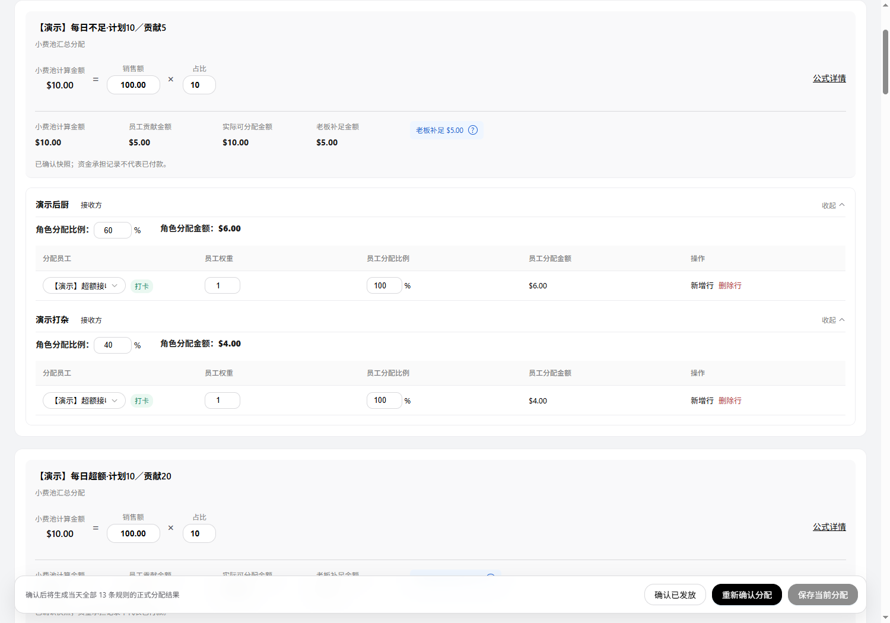

图注：明细10/25确认后，main@aff91c4c＋未提交功能分支，65117隔离演示，非真实资金记录。

| 字段／操作 | 定义及示例 |
| --- | --- |
| 不足标识 | C＜P显示蓝色“老板补足 $差额”，不是异常拦截。差额＝P−C，单位元，展示两位小数。 |
| 实际可分配 | max(P,C)；老板补足max(P−C,0)。P来自规则公式，C来自实际贡献，仅有有效资金元数据才展示，不猜测旧快照。 |
| 问号 | 点击展开页面内说明，再点收起；不修改数据或触发付款。说明员工仅扣C，差额由老板承担，补足记录不代表已付款。 |
| 不足算例 | P10、C5：实际分10，员工扣5，老板补5，后厨60%得6、打杂40%得4。C0、P10则老板补10；C=P含0/0隐藏。 |
| 每日测试规则 | Golden默认门店新增“【演示】每日不足·计划10／贡献5”；独立不足贡献员工销售100、小费5、8h，销售10%算P10，个人小费100%贡献5。接收沿用演示后厨／打杂；原每日超额10/20规则不变。 |
| 历史及闭店 | marker防重复；新增事实影响未筛员工的演示汇总。正常营业日固定可复算，闭店全零不强造营业。历史结果不自动改写；未发放按原显式更新／重分配，已发放锁定。 |

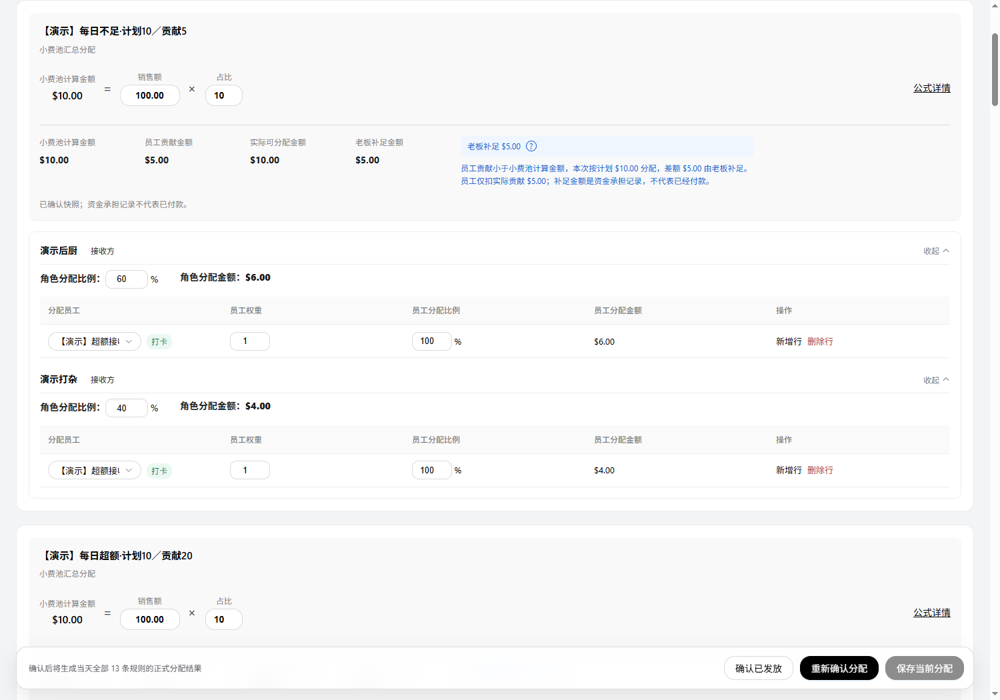

图注：同页同版本，点击问号后；收起仅隐藏说明，无业务写入。旧funding、计提、时段兼容边界保留。

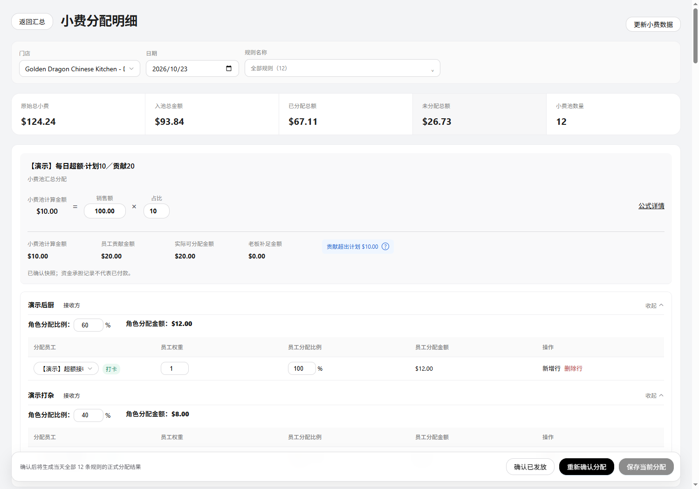

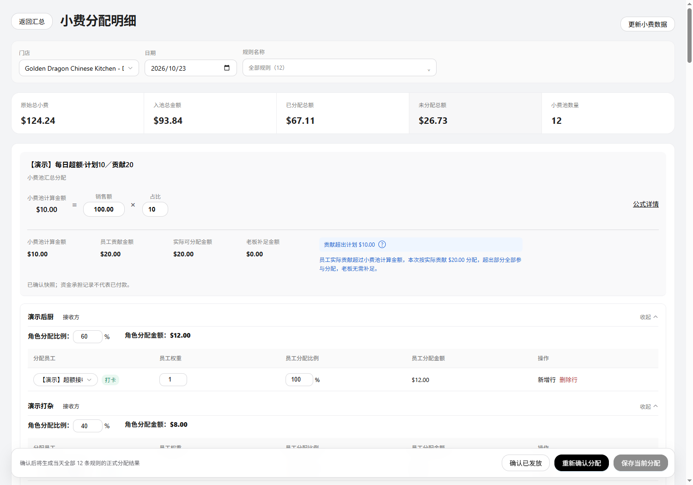

图注：2026-10-23／codex/tips-daily-excess-20261023／main基线aff91c4c＋未提交实现／65117隔离演示。Golden默认门店10/23的新确认结果，演示池计划10、贡献20、实际20、老板0、后厨12／打杂8；非生产扣款。

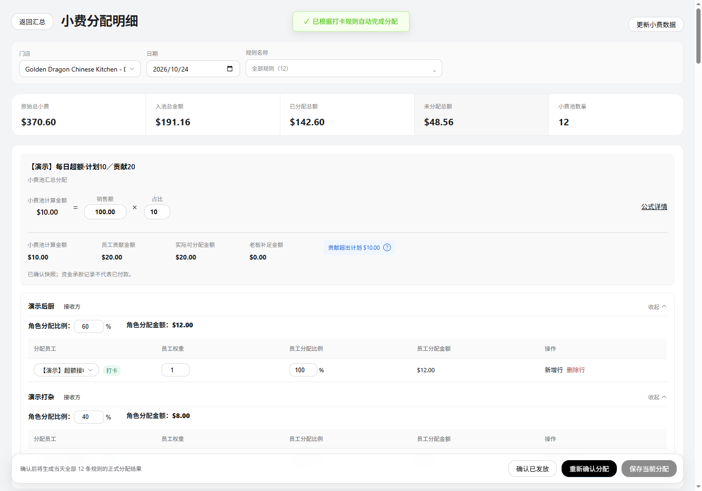

图注：同门店切到另一个正常营业日10/24，仍按当日数据生成10/20；不携带前一天金额或修改前一天结果。

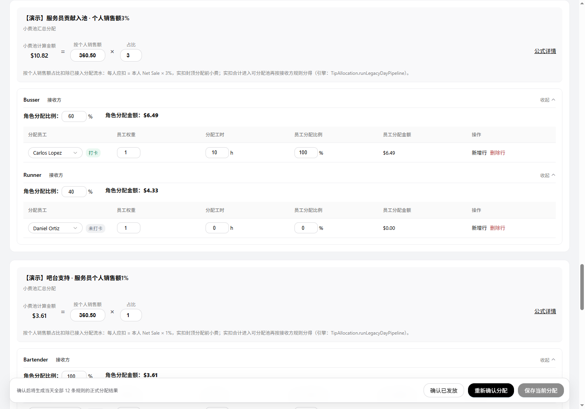

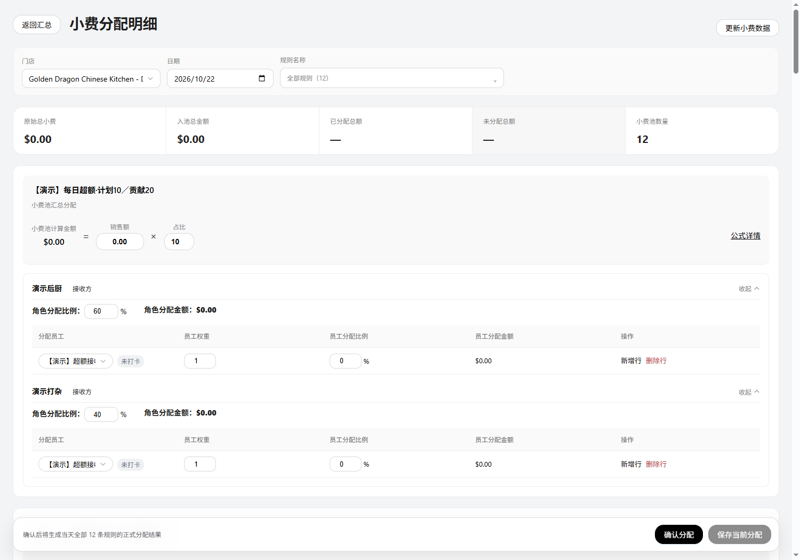

图注：同一版本，前图为10/23的非超额规则，不展示额外资金对照；后图10/22未营业、原始与入池均0，无超额提示。仅证明所示状态。

| 字段／操作 | 最新定义 |
| --- | --- |
| 额外金额对照区 | 按整数美分比较，C≠计划P时显示计划、员工贡献、实际可分配、老板补足四项。C＞P展示超额；C＜P展示老板补足；C＝P（含0＝0）整体隐藏。原公式和接收表不变，各规则独立判断。 |
| 比较与符号 | 讨论C对应资金contributed／文档D，计划P对应target／文档T；比较整数美分，不用已格式化文本或浮点小数差直接判断。正式actual／文档P仍=max(T,D)，本批不改资金公式。 |
| 蓝色标识及问号 | 只在超额对照内显示，差额D−T。点击展开／收起原已确认说明，只改变阅读状态，不重新计算或写入。 |
| 预计／确认／发放 | 使用各自当前草稿或保存快照的资金元信息，执行相同显示判断；旧快照缺字段不反算或伪造。已发放继续只读，不因本批提示而解除锁定。 |
| 每日演示规则 | 默认Golden／上海陆家嘴别名门店新增一条“【演示】每日超额·计划10／贡献20”，标记daily-excess-golden-v1，明确演示身份与独立角色。每日事实：销售100×10%=计划10；员工原始小费20×100%=贡献20；接收60%／40%=12／8。 |
| 数据范围及隔离 | 本次只为默认门店追加3个演示身份及规则，原人员逐笔事实不变；演示原始小费增加20，未筛人员的公式可能同时引用新增演示事实，属于演示口径变化，不是生产归集。规则置于演示归集首位，避免贡献先被其他池占用。旧funding模式门店不自动植入。 |
| 重复进入／自定义 | 标记防重复植入；不覆盖已存在人员ID、用户编辑过的规则或分配结果；已删演示规则不自动恢复。身份冲突提示并停止，不替换原人员。 |
| 未营业日 | 仍由原营业状态和来源适配统一清零，P=C=0，不展示超额、不制造交易／考勤来变为营业。故“每日”指每天有可用演示规则，超额事实适用于正常营业日。 |
| 既有结果 | 新规则不会补进已确认／已发放的历史快照。未发放且需重算时，沿用“更新小费数据”和系统重新确认及覆盖确认；已发放不可重算。不静默清空记录。 |
| 金额精度 | 页面池公式沿用资金校验的整数美分四舍五入，例460.50×3%=13.815→13.82，不再用二进制浮点toFixed产生13.81而阻止确认；不更改已保存金额。 |

验证：31天覆盖26营业日与5闭店；不足计划10、贡献5、老板5、接收6/4，超额10/20、接收12/8。同日两规则守恒、重复种子、历史保留、相等隐藏专项通过；其他历史缺口不关闭。

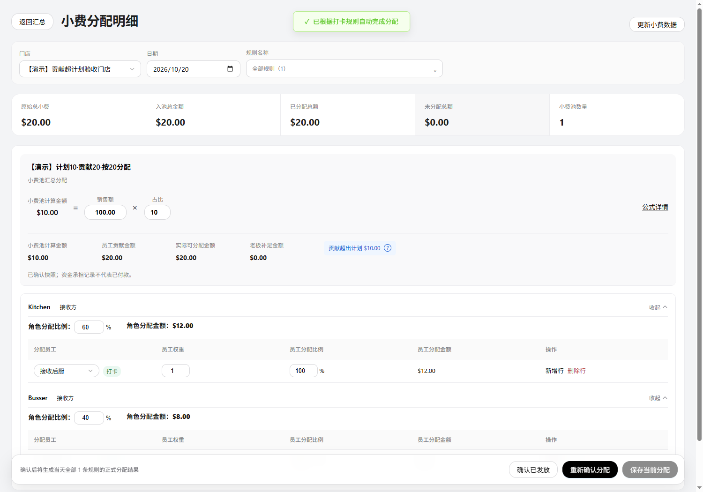

图注：2026-10-23，codex/tips-funding-definition-20261023，main基线fb78f5e7＋未提交实现，65116隔离浏览器；演示门店10/20场景，非生产扣款或转账。

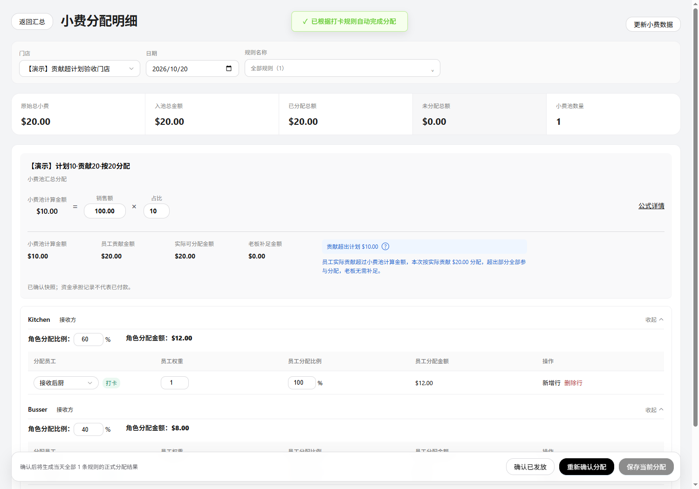

图注：同一已确认快照，点击蓝色超计划标识／问号展开；再次点击收起，键盘Enter／空格可操作，不保存或重算分配。

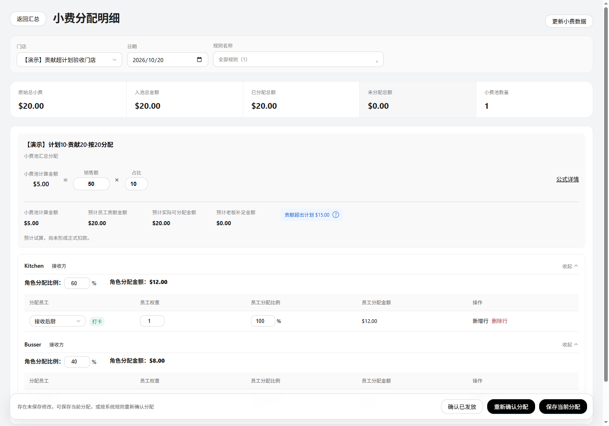

图注：同会话将计算基数100改为50，计划从10变5，贡献仍20；预计实际池仍20、超计划15。仅草稿，原确认快照计划仍10，不因查看或展开写入。

| 字段／操作 | 逻辑说明 |
| --- | --- |
| 小费池计算金额 | 原公式区域保留基数×比例及可编辑输入，结果表示计划T，不再把实际池金额放入公式等号左侧；对照区重复显示计划用于比较，不可单独编辑。 |
| 员工贡献金额 | 当前规则员工实扣D之和。未确认／编辑草稿前缀“预计”；确认后取对应版本快照。不能用员工原始小费合计冒充贡献。 |
| 实际可分配金额 | max(T,D)，接收组预算和员工分得以此为基数；预计与确认分别标记。10/20得到20，不截断为10。 |
| 老板补足金额 | max(T−D,0)，独立于员工贡献。10/20为0；10/5为5。金额承担不代表完成支付。 |
| 贡献超出计划标识 | D>T时显示蓝色“贡献超出计划 $差额”，差额D−T；相等或不足不显示。正常业务标识，不用红色错误样式，不阻止确认。 |
| 问号／展开说明 | 点击标识或问号展开“员工实际贡献超过小费池计算金额，本次按实际贡献 $金额 分配，超出部分全部参与分配，老板无需补足。”；取当前展示版本金额。展开／收起只影响阅读。 |
| 接收金额 | 沿用组占比、资格、方式、工时／订单及权重。实际池20，后厨60%得12、打杂40%得8；调整资金基数不自动放宽资格，不将余额强制分完。 |
| 顶部概览 | 入池以实际池计；已分配按实际接收合计，未分配=实际池−接收合计。超计划10本身不是未分配余额。 |
| 保存与重新进入 | 已确认按快照回显，公式结果取快照target、接收池取actual。人工保存不重算／缩放人工接收比例；系统重确认重建当前规则资金。已发放只读也展示已记录的资金对照。 |
| 缺失历史字段 | 没有version2资金元信息的历史快照不反算贡献、补足、超额，不补造标识或改写历史。旧模式继续原有展示／校验。 |

演示入口：小费分配／分配规则选择“【演示】贡献超计划验收门店”，规则“【演示】计划10·贡献20·按20分配”。专属确定性事实：贡献服务员销售100、小费20，池公式销售10%，个人小费贡献100%；后厨及打杂打卡8小时、权重1、接收60%／40%。其他预置人员在该专属门店生成零事实，不影响10/20。普通门店数据不改写；已保存快照不自动替换。

**实施边界**：本批实现普通池中明确个人小费收入tipIncome及个人销售额personalSalesPct的独立贡献；按剩余可扣余额封顶，同一员工本轮接收不回流。旧角色无独立公式、salesPct组承担、旧funding配置及计提／时段兼容未自动迁移，相关Q06／Q07等待确认项不关闭。过滤依据缺失须报错，不能按0或忽略条件。新资金元信息version2；外层fundingVersion仍1，沿用员工身份账本及薪资接口。单元覆盖不足／相等／超额／0及守恒；本批浏览器已验证10/20确认、展开及草稿，不宣称所有兼容模式完成。

**统一口径（TIPOUT-FUNDING-DEFINITION-20261023-01）**：讨论中的“P＝小费池计划金额、C＝员工贡献金额”，对应本文“动态预算T、员工实际贡献合计D”；本文原字段P仍表示确认实际池金额，不更名、不混用。

- C≤计划P：以计划P作为分配基数，老板补足计划P−C；员工只扣C。
- C＞计划P：以C作为分配基数，员工扣C，老板补足为0；超出部分全额入池，不截断、不截留。
- 对应正式公式：实际池P=max(T,D)，老板补足E=max(T−D,0)，员工实际扣款合计=D。预计阶段使用Ĉ，不能把预计显示成已扣款。
- “按该金额分配”是确定接收计算基数，不保证全部分完；无人符合资格或有效基数为0时，按接收规则保留未分配余额。
- 真实贡献0可参与上述计算；数据缺失、读取失败或计算异常不等于0，仍阻止错误确认。规则保存不因当天贡献与预算不相等而被拒绝，其他合法性校验保留。

| 场景 | 预算T（讨论中的计划P） | 贡献D（讨论中的C） | 实际池P／分配基数 | 老板补足E | 员工合计扣款 |
| --- | --- | --- | --- | --- | --- |
| 贡献少于预算 | 10 | 5 | 10 | 5 | 5 |
| 贡献等于预算 | 10 | 10 | 10 | 0 | 10 |
| 贡献超过预算 | 10 | 20 | 20 | 0 | 20 |
| 贡献为0 | 10 | 0 | 10 | 10 | 0 |
| 预算为0但有贡献 | 0 | 20 | 20 | 0 | 20 |
| 二者均为0 | 0 | 0 | 0 | 0 | 0 |

示例单位均为同一币种，正式金额按既有货币精度处理；二者均0只确认金额结果，不新增“必须生成0元分配记录”的要求，具体操作条件仍见Q08。老板出资独立记账，不伪造员工贡献，不代表已付款；资金渠道、凭证及实际结算仍见Q16。本轮仅明确资金定义，未修改程序或补造历史快照。

### 三种方式的基础值

| 分配方式 | 基础值x |
| --- | --- |
| 按员工数量平均分配 | 1 |
| 按工作时长占比分配 | 有效分配工时 |
| 按订单占比分配 | 有效归属订单笔数 |

### 状态定义及操作关系

| 字段 | 逻辑说明 |
| --- | --- |
| 营业状态 | 门店日：演示销售、小费或有效考勤任一有效事实即正常营业，否则未营业； 生产未知／同步失败不直接当未营业。 未营业金额为0、无需分配／无需发放，不能分配； 查看明细提示“当天未营业，无法查看分配明细”。 |
| 日期分配状态 | 无有效确认结果为未分配； 完整有效结果保存成功才已分配； 未营业为无需分配。 零接收金额不自动等于未分配； 修改草稿不将已有已分配状态回退。 |
| 员工周期状态 | 参与记录全确认为已完成，确认与待分配并存为部分待分配，全待分配为待分配； 角色卡对应已完成／部分／待分配。 仅贡献、零结果、无规则等参与边界见Q09，不自行按自然日数判断。 |
| 发放状态 | 正常日未登记为待发放，包括尚未分配但此时不可发放； 整日登记成功为已发放； 未营业无需发放。 登记不执行转账。 已发放禁止直接更新、编辑和重分配；汇总演示取消可归档重置。 |
| 未保存人工修改 | 员工／工时／权重／比例／公式等实际编辑产生； 仅查看、初始化、筛选不算。 保留旧有效快照并禁止按旧结果发放。 保存人工或系统重算成功才清除相应修改。 |
| 未确认系统更新 | 更新小费数据成功替换草稿但未重新确认； 刷新／跨页仍须拦截按旧结果发放。 与人工修改区分，不因关闭提示自行解除保护，持久标记边界Q10。 |
| 考勤标签 | 按真实门店日员工考勤：打卡、未打卡、考勤未知，异常另说明。改分配工时不改变标签；跨池同人一致；读取失败不能冒充未打卡。 |

## 日期分配汇总：完整字段与操作

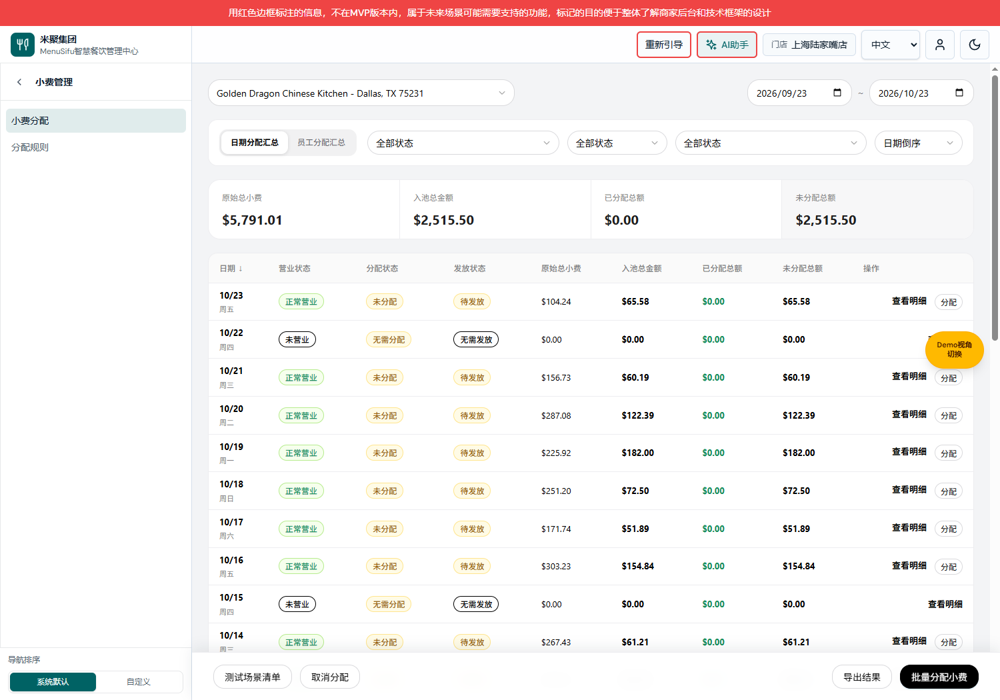

图注：2026-10-23，main基线44ca8723／65114隔离演示，默认最近一个月与有效门店；仅证明所示界面和状态。

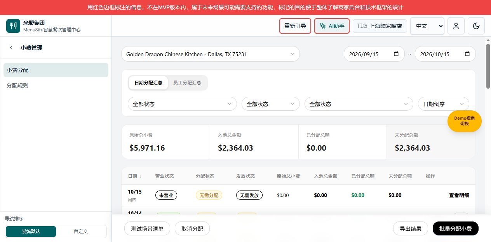

图注：2026-10-15旧图仅保留历史位置参考；本轮当前默认、过滤及结果见上方和对应操作图片。加载失败等未示出状态仍待补，资金未实现处以文字状态为准。

用途／入口：小费管理→小费分配，默认日期视角；作用于当前门店与所选营业日。路由 `/team/tips/distribution`，员工视角为原有query，不新增权限资源。

### 共用上下文与筛选区

| 字段 | 逻辑说明 |
| --- | --- |
| 门店 | 统一可用门店目录，单选，限制事实、规则和人员； 两个汇总视角共用。 未能读取时显示错误不归零； 不能跨店按同名员工串账。 候选受既有权限限制，不新增授权。 |
| 开始日期 | 与结束日期成对；默认往前一个月含今天，月底截断细节Q05。范围含首尾，内部保留完整年月日；倒置或缺值不能批量写入。 |
| 结束日期 | 同上；切换后读取对应范围，列表与顶部指标同范围。进入明细返回保留原周期，不让明细单日替换汇总周期。 |
| 日期分配汇总页签 | 默认选中；切换只改变视角，不确认分配，不清共用门店日期。日期与员工筛选各自保留。 |
| 员工分配汇总页签 | 显示员工与角色聚合，定义见下文；切换不写分配、发放或规则。 |
| 营业状态筛选 | 单选，默认全部状态；全部／正常营业／未营业；与其他日期筛选取交集。 |
| 分配状态筛选 | 单选，默认全部状态；全部／已分配／未分配。无需分配日是否纳入特定过滤须按既有行为核对，不新增未批准枚举。 |
| 发放状态筛选 | 单选，默认全部状态；全部／待发放／已发放／无需发放。待发放不代表可登记发放。 |
| 展示顺序 | 默认日期倒序，可切日期顺序，与日期表头双向联动；缺失或同日稳定排序，不改变池计算顺序。 |

### 金额概览

| 字段 | 逻辑说明 |
| --- | --- |
| 原始总小费 | 当前筛选日期行原始小费合计；未确认取原始事实，确认取有效快照；同来源跨规则去重。不是预算公式重复引用值之和。 |
| 入池总金额 | 当前筛选日期行预计池max(T,Ĉ)或确认P合计；含预计日不称已扣款。老板补足不计入员工贡献；超预算贡献不截断。 |
| 已分配总额 | 当前筛选行已确认接收合计；未分配日按0，不将草稿接收记作确认。 |
| 未分配总额 | 当前行余额之和；未分配日等于该日预计入池金额，已确认日为P−接收合计。例预计100、未确认→已分配0、未分配100。 |

### 日期列表

| 字段 | 逻辑说明 |
| --- | --- |
| 日期 | 主行MM/DD，次行星期几，不重复展示YYYY-MM-DD；内部和导出仍能区分完整营业日。点击日期进入该日明细，未营业拦截。 |
| 营业状态 | 共用状态定义；未营业不因零小费但有有效销售或考勤就误判。 |
| 分配状态 | 当前门店日有效快照状态；不能仅靠一个日期标记宣称已分配。 |
| 发放状态 | 整日登记状态，已发放锁定；异常发放依据保护性只读，不暴露额外未批准筛选。 |
| 原始总小费 | 当日来源去重金额；未营业0。 |
| 入池总金额 | 当日预计池或确认P；不是仅员工贡献D，也不是恒等预算T。 |
| 已分配总额 | 当日确认接收额；未确认0，合法确认0仍显示0。 |
| 未分配总额 | 未确认=该行入池；确认=池余额；不是员工未领取现金。 |
| 操作 | 查看明细； 符合条件时行内分配／确认已发放。 列不再包含“小费池”数量； 数量仍可在当天明细存在。 已移除“查看发放记录”按钮，不恢复历史入口。 |

### 日期汇总逐操作

各操作下的“待补”分别涵盖入口、操作后界面与结果，不以本页总览替代；本轮仅补文字，没有新截图。

#### D01 门店筛选

图注：2026-10-23，main基线44ca8723／65114隔离演示，默认最近一个月与有效门店；仅证明所示界面和状态。

> 图片覆盖：切店后的其他门店数据及读取失败图仍待补；当前只有一个演示门店。

- 选择可用门店后重新读取其日期范围事实与规则，列表、概览和人员上下文同步；

- 不生成确认结果。

- 失败显示原因，可重试，不保留旧店金额冒充新店。

#### D02 日期范围

图注：2026-10-23，main基线44ca8723／65114隔离演示，默认最近一个月与有效门店；仅证明所示界面和状态。

图注：2026-10-23，main基线44ca8723／65114隔离演示，改为10/19—10/23；仅证明所示界面和状态。

图注：2026-10-23，codex/tips-summary-date-validation-20261023，起始main@44ca8723＋本次未提交实现，65115隔离演示；有效范围10/19—10/23，非生产数据。

图注：2026-10-23，codex/tips-summary-date-validation-20261023，起始main@44ca8723＋本次未提交实现，65115隔离演示；清空开始日期，保留上次结果，非生产数据。

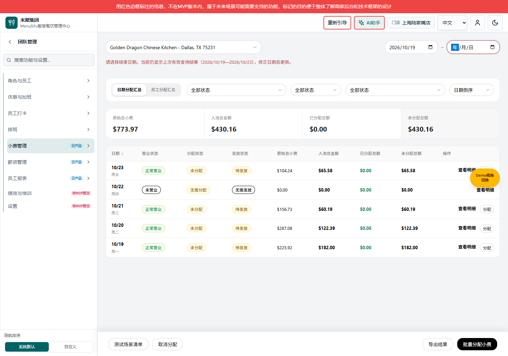

图注：2026-10-23，codex/tips-summary-date-validation-20261023，起始main@44ca8723＋本次未提交实现，65115隔离演示；清空结束日期，保留上次结果，非生产数据。

图注：2026-10-23，codex/tips-summary-date-validation-20261023，起始main@44ca8723＋本次未提交实现，65115隔离演示；开始晚于结束，字段报错，原金额保留，非生产数据。

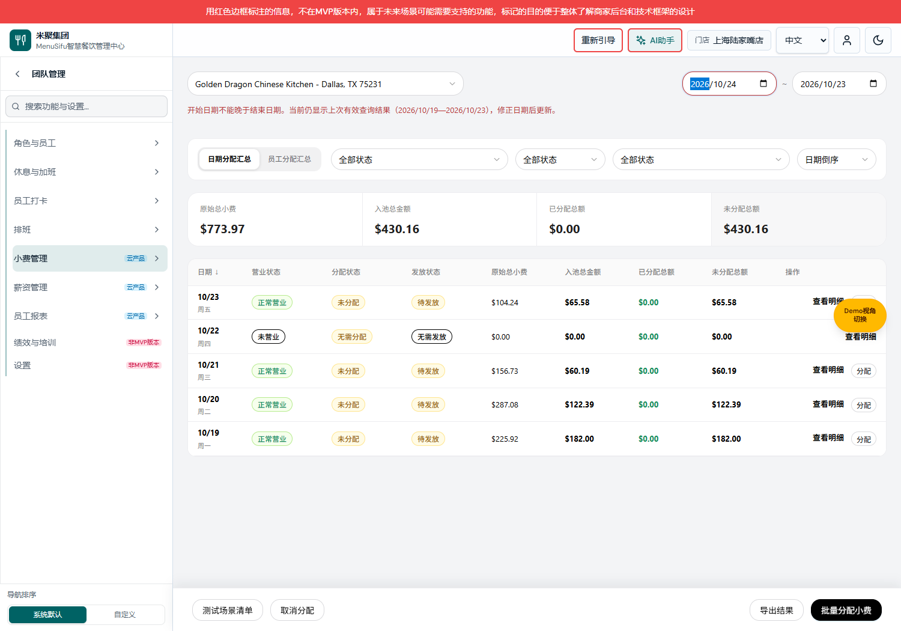

图注：2026-10-23，codex/tips-summary-date-validation-20261023，起始main@44ca8723＋本次未提交实现，65115隔离演示；日期错误期间阻止批量、取消、导出、视角及明细入口；金额与有效历史保留，非生产数据。

图注：2026-10-23，codex/tips-summary-date-validation-20261023，起始main@44ca8723＋本次未提交实现，65115隔离演示；修正为10/19—10/23，错误清除并更新，非生产数据。

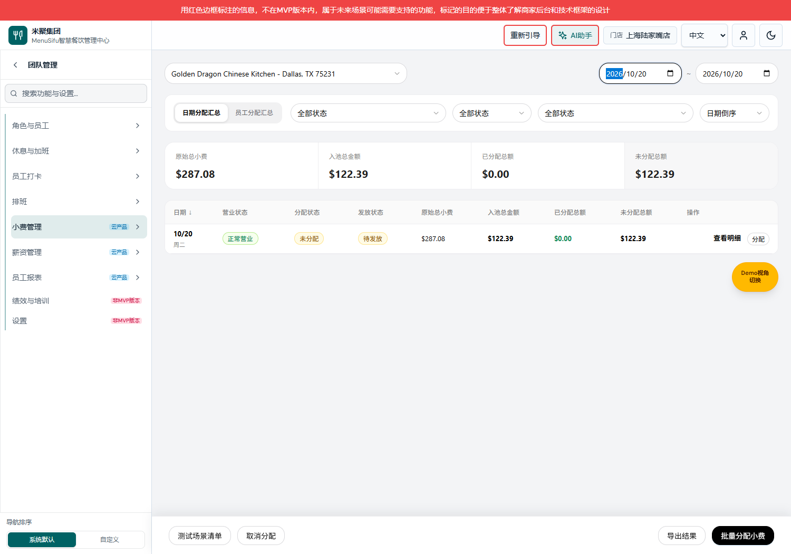

图注：2026-10-23，codex/tips-summary-date-validation-20261023，起始main@44ca8723＋本次未提交实现，65115隔离演示；同日10/20—10/20合法，展示一天，非生产数据。

图注：2026-10-23，codex/tips-summary-date-validation-20261023，起始main@44ca8723＋本次未提交实现，65115隔离演示；员工视角有效周期，非生产数据。

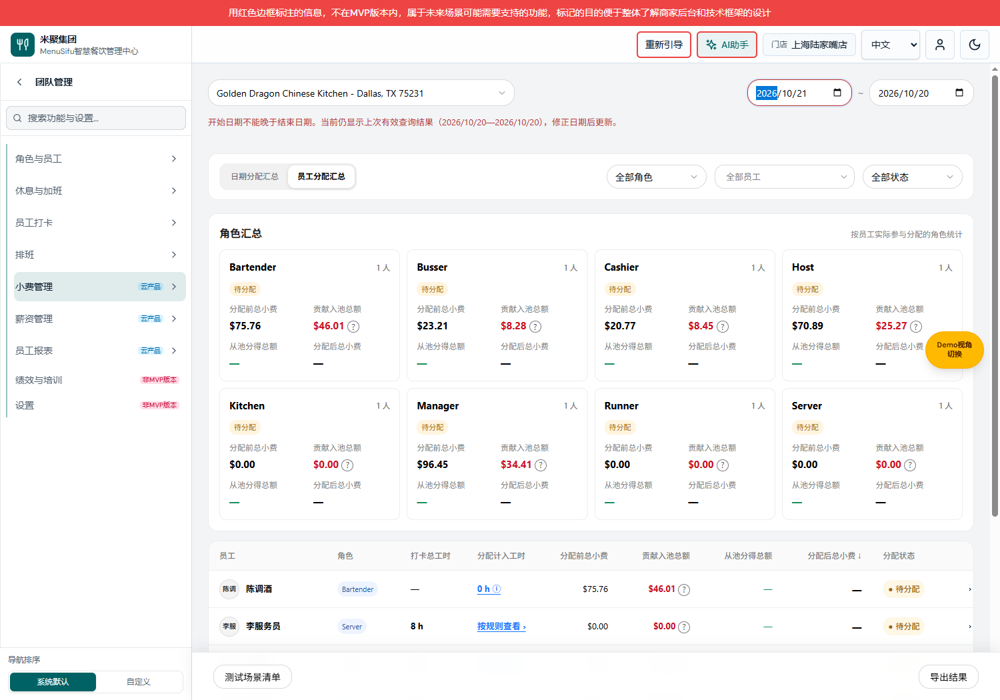

图注：2026-10-23，codex/tips-summary-date-validation-20261023，起始main@44ca8723＋本次未提交实现，65115隔离演示；员工视角倒置日期提示，原角色卡和列表保留，非生产数据。

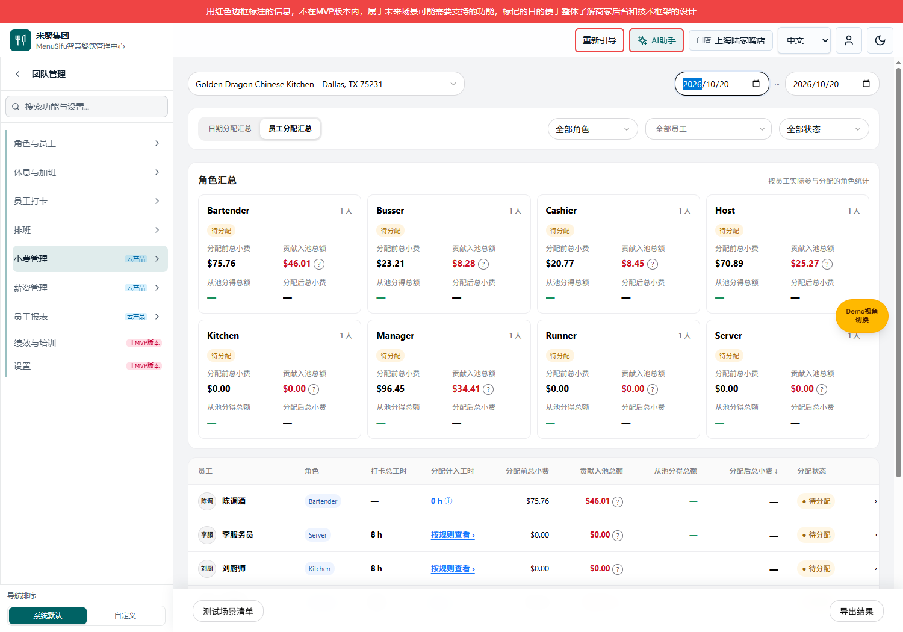

图注：2026-10-23，codex/tips-summary-date-validation-20261023，起始main@44ca8723＋本次未提交实现，65115隔离演示；员工视角修正后错误清除，非生产数据。

本次实现替换“日期错误反馈待补”的旧缺口，不以D12批量错误图代替查询校验。

| 字段／操作 | 逻辑说明 |
| --- | --- |
| 开始日期 | 日期，必填；默认最近一个月起点。为空提示“请选择开始日期”；非法日历日提示“请输入有效的开始日期”。保留输入、标红字段，不保存错误查询历史。 |
| 结束日期 | 日期，必填；默认当天。为空提示“请选择结束日期”；非法日历日提示“请输入有效的结束日期”。同日范围合法，含首尾。 |
| 日期先后 | 开始晚于结束提示“开始日期不能晚于结束日期”，定位开始字段；不交换日期、不静默查询为空。 |
| 页面提示 | 日期区下方显示错误，追加“当前仍显示上次有效查询结果（YYYY/MM/DD—YYYY/MM/DD），修正日期后更新。”；无有效结果时追加“修正日期后查询。”。不用系统对话框。 |
| 原查询结果 | 无效范围不读事实、不重绘为零或空列表；保留原日期／员工列表、角色卡与金额。筛选、排序和后台刷新不能绕过校验。提示所示为上次有效查询，不是错误范围统计。 |
| 操作保护 | 错误时拦截日期／员工页签、日期／员工明细、行内分配、发放入口、批量入口、取消分配、导出菜单、CSV／PDF和邮箱入口／发送；定位字段，不写账，不打开目标界面。已打开弹框的独立范围和冻结规则不变。 |
| 修正与恢复 | 保留错误输入供修改；合法后清除红框和提示，失效缓存、刷新当前视角一次，保留其他筛选／排序，记录合法查询历史。离开不保存错误日期；重新进入沿用既有合法历史或默认范围。 |
| 真实空态 | 合法查询无匹配结果仍按既有空态；本批仅补日期输入校验，不声明其他读取失败、并发等异常已全部实现。 |

| 场景 | 可验收结果 |
| --- | --- |
| 10/19—10/23 | 5行；本地演示原始773.97、入池430.16、已分配0、未分配430.16。数值只是测试事实。 |
| 开始改10/24 | 倒置报错，仍保留原5行及金额；历史开始仍10/19；分配／取消／导出／明细／页签均拦截；账本未变。 |
| 清空起止 | 分别提示开始／结束必填并定位，不将旧结果清零。 |
| 修复／同日 | 改回10/19清除提示；10/20—10/20合法，只显示一天。 |
| 员工视角 | 有效10/20切员工汇总；开始改10/21报错，角色卡与员工列表保留；改回10/20恢复。 |

> 图片覆盖：D02正常、起止空值、倒置、操作拦截、修复、同日及员工视角已实测。非法日历日由专项测试覆盖；原生date控件会将非法日清空，沿用空值提示。其他页面不在本批验收中。

- 起止含首尾；

- 合法值更新范围，保留视角及其他适用筛选；

- 缺值或倒置按上方定义反馈，保留结果并拦截范围依赖动作；合法才刷新。

- 只改查询不写业务账。

#### D03 营业状态筛选

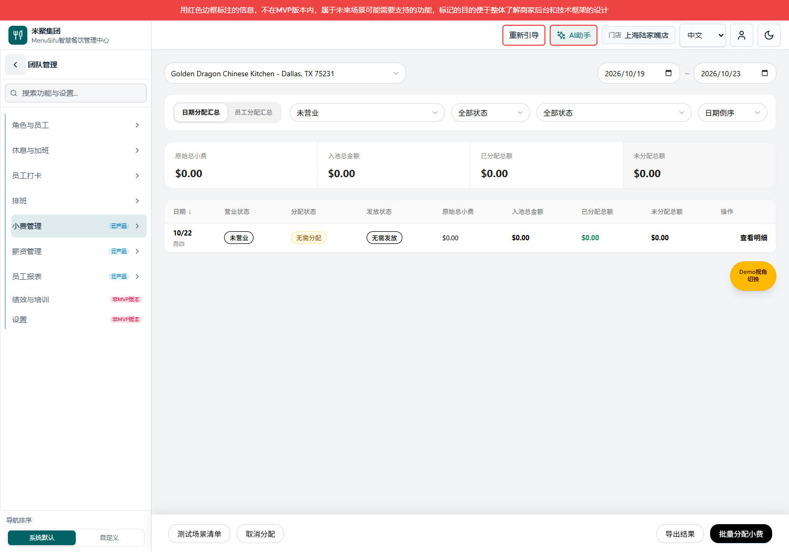

图注：2026-10-23，main基线44ca8723／65114隔离演示，未营业过滤；仅证明所示界面和状态。

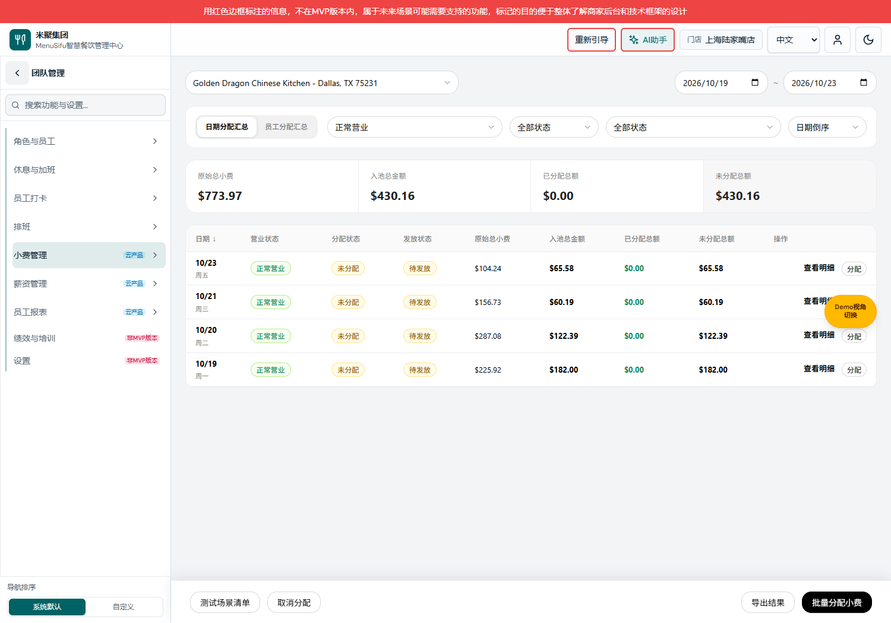

图注：2026-10-23，main基线44ca8723／65114隔离演示，正常营业过滤；仅证明所示界面和状态。

> 图片覆盖：已补所示状态；未示出的其他分支仍待核验，见逐操作清单。

- 与门店、日期、分配／发放条件取交集；

- 无结果显示空态保留条件，不当作数据失败或自动重置。

#### D04 分配状态筛选

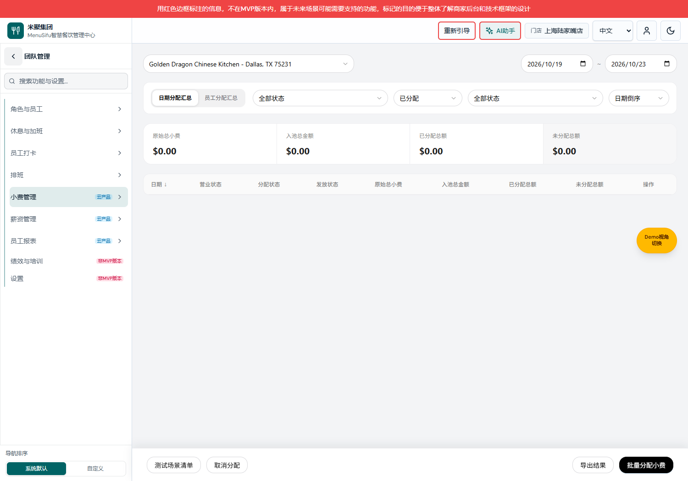

图注：2026-10-23，main基线44ca8723／65114隔离演示，已分配过滤空态；仅证明所示界面和状态。

图注：2026-10-23，main基线44ca8723／65114隔离演示，未分配过滤；仅证明所示界面和状态。

> 图片覆盖：已补所示状态；未示出的其他分支仍待核验，见逐操作清单。

- 过滤对应门店日状态，顶部按可见日期累加；

- 不因选“已分配”而确认其他天。

#### D05 发放状态筛选

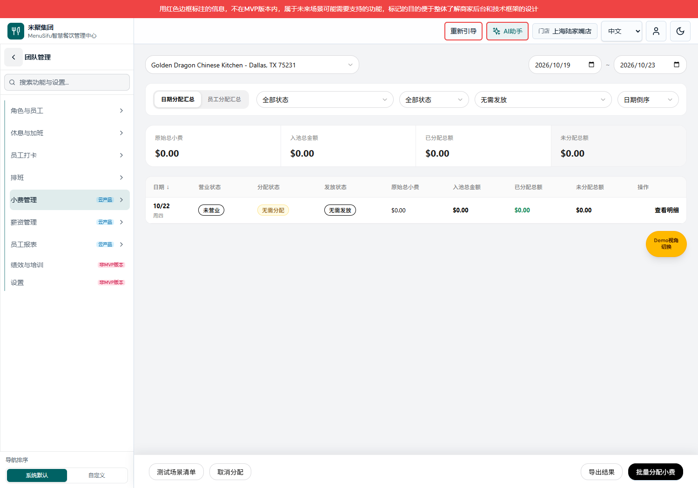

图注：2026-10-23，main基线44ca8723／65114隔离演示，无需发放过滤；仅证明所示界面和状态。

> 图片覆盖：已补无需发放；待发放与已发放可见结果另见F02／F03，尚未穷举各过滤组合。

- 只读过滤，不能把待发放自动视为可以点击发放；

- 未分配仍需先有效确认。

#### D06 顺序下拉

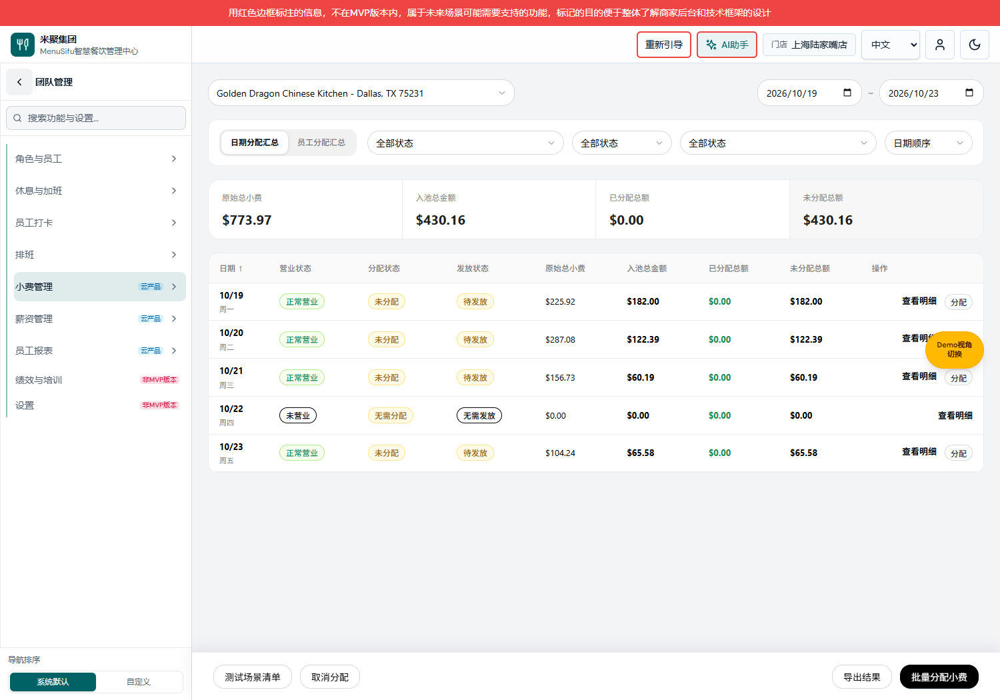

图注：2026-10-23，main基线44ca8723／65114隔离演示，顺序下拉；仅证明所示界面和状态。

> 图片覆盖：已补所示状态；未示出的其他分支仍待核验，见逐操作清单。

- 切换更新行顺序及表头箭头；

- 金额、确认状态及归集执行顺序不变。

#### D07 日期表头排序

图注：2026-10-23，main基线44ca8723／65114隔离演示，表头切倒序；仅证明所示界面和状态。

> 图片覆盖：已补所示状态；未示出的其他分支仍待核验，见逐操作清单。

- 点击切升降序并更新排序控件；

- 不得因排序重算其他日或产生写入。

#### D08 员工分配汇总页签

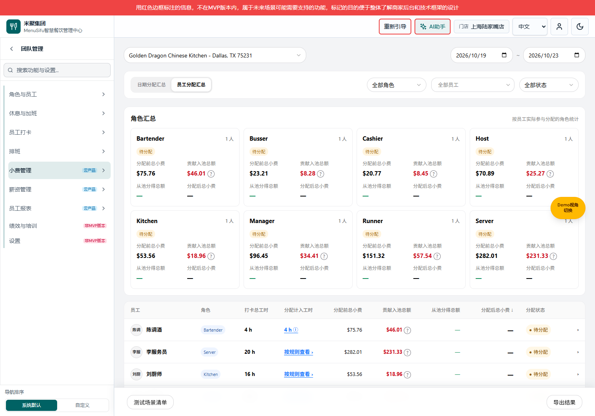

图注：2026-10-23，main基线44ca8723／65114隔离演示，员工汇总及角色卡默认待分配；仅证明所示界面和状态。

> 图片覆盖：已补所示状态；未示出的其他分支仍待核验，见逐操作清单。

- 保持门店和周期，恢复员工视角条件；

- 不用日期状态条件偷偷过滤员工集合；

- 无确认接收显示—，贡献预计按员工规则展示。

#### D09 查看明细／日期链接

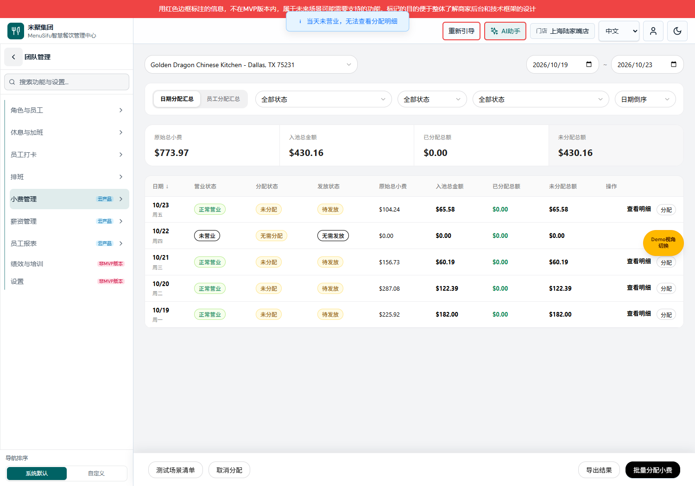

图注：2026-10-23，main基线44ca8723／65114隔离演示，未营业拦截；仅证明所示界面和状态。

图注：2026-10-23，main基线44ca8723／65114隔离演示，当天已分配系统结果；仅证明所示界面和状态。

> 图片覆盖：已补所示状态；未示出的其他分支仍待核验，见逐操作清单。

- 正常日携带门店、日期及返回上下文进入明细；

- 未营业停留并提示“当天未营业，无法查看分配明细”。

- 返回恢复原筛选、排序及行定位。

#### D10 行内分配

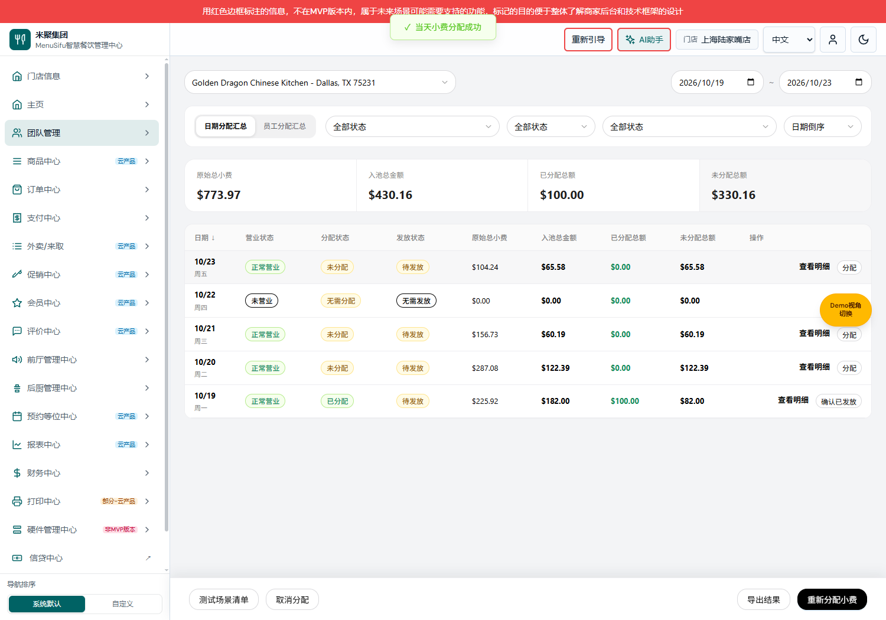

图注：2026-10-23，main基线44ca8723／65114隔离演示，单日快捷分配成功；仅证明所示界面和状态。

> 图片覆盖：已补系统分配成功；手工规则跳转、处理中及提交失败仍待补。

| 项目 | 说明 |
| --- | --- |
| 作用范围 | 当前门店、当前行日期；不处理其他日期。 |
| 显示条件 | 正常营业＋未分配＋未发放；点击时重新校验。 |
| 处理中 | 按钮禁用，避免重复操作。 |

| 条件 | 处理与结果 |
| --- | --- |
| 可自动计算 | 原地保存当天完整快照，不只写日期标记；提示“当天小费分配成功”，刷新该日及员工聚合，其他日期不变。 |
| 含旧手工模式 | 进入当天明细补录，不自动确认。 |
| 引用、金额或存储失败 | 说明原因，不留半成品。 |
| 分配已保存，薪资同步失败 | 分别反馈两个结果，不能诱导重复分配。 |

#### D11 批量分配小费／重新分配小费入口

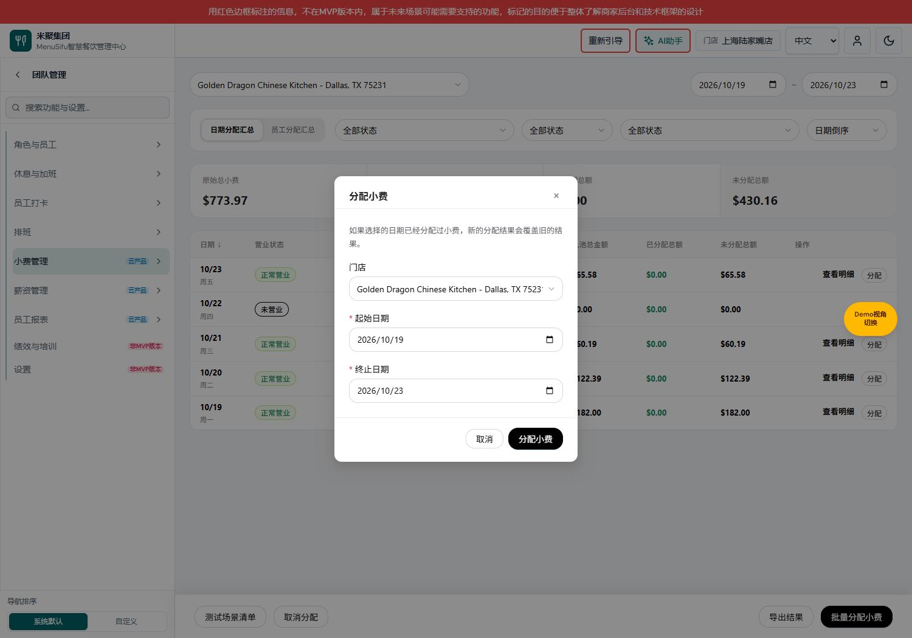

图注：2026-10-23，main基线44ca8723／65114隔离演示，批量门店日期选择；仅证明所示界面和状态。

> 图片覆盖：已补所示状态；未示出的其他分支仍待核验，见逐操作清单。

- 无已分配日期时底部为“批量分配小费”，否则“重新分配小费”；

- 点击先打开门店、开始和结束日期选择，不立即写入。

- 批量范围由弹框明确选择，不由列表当前营业／分配／发放筛选暗中缩小。

#### D12 范围选择框的分配小费

图注：2026-10-23，main基线44ca8723／65114隔离演示，批量门店日期选择；仅证明所示界面和状态。

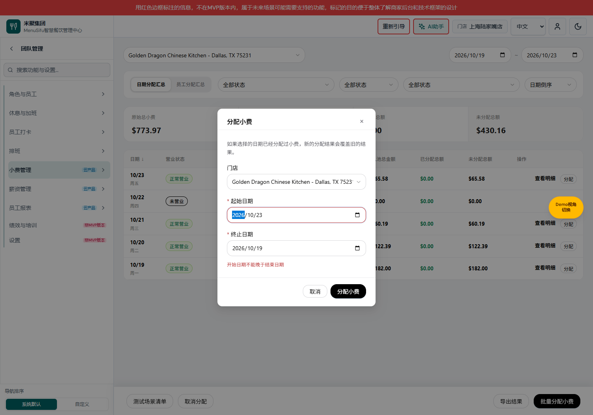

图注：2026-10-23，main基线44ca8723／65114隔离演示，开始晚于结束字段校验；仅证明所示界面和状态。

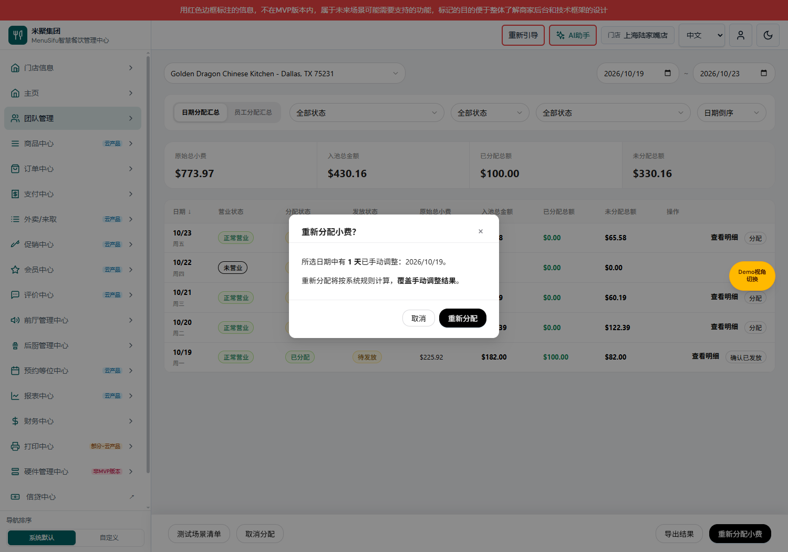

图注：2026-10-23，main基线44ca8723／65114隔离演示，范围含人工日覆盖确认；仅证明所示界面和状态。

> 图片覆盖：已补所示状态；未示出的其他分支仍待核验，见逐操作清单。

| 步骤 | 处理 |
| --- | --- |
| 1. 校验 | 门店、起止日期、有效规则及引用。 |
| 2. 检查人工日 | 无人工可覆盖日则进入系统重算；存在人工保存日则进入二次确认，确认前不覆盖。 |
| 3. 检查可执行日 | 跳过未营业／锁定日，分别反馈数量。 |
| 4. 预计算 | 全范围先生成并校验结果。 |
| 5. 写入 | 实际逐日原子提交；后续日写入失败则停止，报告已成功天数。 |

**待确认Q11：**生产跨日事务策略仍未闭合，不能将上述本地逐日提交称为跨日全量原子。

#### D13 范围选择框取消

图注：2026-10-23，main基线44ca8723／65114隔离演示，改为10/19—10/23；仅证明所示界面和状态。

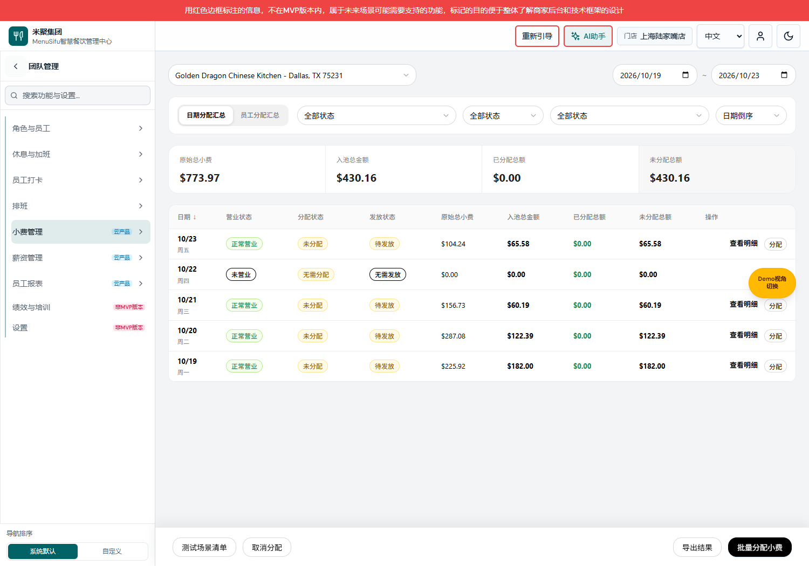

图注：2026-10-23，main基线44ca8723／65114隔离演示，取消范围弹框返回汇总；仅证明所示界面和状态。

> 图片覆盖：已补所示状态；未示出的其他分支仍待核验，见逐操作清单。

- 取消不重算、不写快照，不清人工结果；

- 再次打开重新识别范围和状态。

- 二次覆盖的确认／取消分别为D14／D15，见原专项章节。

#### D16 取消分配

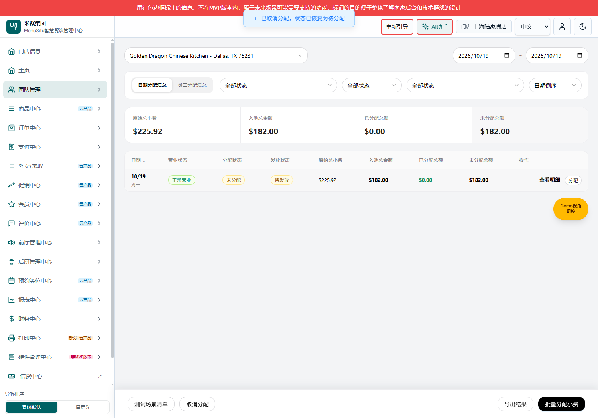

图注：2026-10-23，main基线44ca8723／65114隔离演示，历史截图：取消分配曾跳过已发放（本次已变更）；仅证明所示界面和状态。

> 此为旧跳过行为的历史证据，不代表当前规则；本次默认、确认、保留及成功截图见“取消已发放分配”章节，故障及并发页面图仍待补。

- 仅演示重置能力；确认后归档并清除有效分配／发放状态，包含已发放，刷新员工汇总与薪资统计。

- 已发放正常营业日允许归档重置，未营业日仍跳过，异常发放依据仍拦截。

- 只解除系统记录的有效锁定，不撤回实际付款或退款。

- 本次演示门店／日期范围、确认UI及保留历史已明确，详见本次章节；Q11／Q12的生产支付撤销部分不在本次范围。

## 员工分配汇总：角色卡与员工列表

图注：2026-10-23，main基线44ca8723／65114隔离演示，员工汇总及角色卡默认待分配；仅证明所示界面和状态。

> 页面配图：本轮已补当前画面；各操作的已补状态及未采集分支见下文和逐操作覆盖清单，不代表所有结果已齐。

用途／入口：汇总“员工分配汇总”页签，沿用当前门店和周期；以稳定员工ID合并，姓名只展示，跨角色列出实际参与角色，不显示班次。

### 筛选与角色卡

| 字段 | 逻辑说明 |
| --- | --- |
| 角色筛选 | 单选，未限定为全部角色；限制员工候选、角色卡及员工表。更换时清除已选但不属于新角色的员工。 |
| 员工筛选 | 多选，支持全选；候选来自当前门店及角色有效目录，按ID筛选，不按姓名。 |
| 分配状态筛选 | 全部／已完成／部分待分配／待分配；按周期参与记录判定，不取最后一天状态。 |
| 角色名称 | 当前范围实际参与角色；角色卡不按所有目录角色机械生成确认金额。多角色归属重叠仍Q04。 |
| 员工人数 | 卡片范围稳定ID去重，不把跨池行数当人数；零金额及仅贡献边界Q09。 |
| 分配前总小费 | 卡片范围全部有效日的员工原始小费，含待分配，不再只限确认日；同人来源去重。 |
| 贡献入池总额 | 卡片范围已确认贡献＋待分配预计；不含老板出资。问号分拆，预计失败须说明不完整。 |
| 从池分得总额 | 仅有效确认日期接收合计；全无确认显示—，确认合法零显示0。 |
| 分配后总小费 | 仅有效确认日期最终小费；混合周期标“已确认部分”，不能用含预计的页面合计直接相减推导。 |
| 角色分配状态 | 已完成／部分／待分配，按参与记录确认覆盖；不是付款状态。 |

### 员工表

| 字段 | 逻辑说明 |
| --- | --- |
| 员工 | 姓名及身份展示；同名不同ID不合并；支持既有员工排序，明细按同一ID打开。 |
| 角色 | 本周期实际参与角色集合，可多值；角色与贡献／接收范围分别追溯，不靠姓名推断。 |
| 打卡总工时 | 周期原始有效打卡工时累计；不随分配人工调整变化；全部无有效记录—。不显示X/Y天文案；可排序，缺失始终排末尾。 |
| 分配计入工时 | **口径：**每条工时规则逐日累计，不跨规则求和。 **展示：**按下方“工时展示条件表”判断。 **操作：**点击查看各规则采用值与来源。 |
| 分配前总小费 | 所选范围全部有效日原始小费合计，含待分配。未确认不再整项隐藏。 |
| 贡献入池总额 | 已确认＋预计总和；旁边“？”解释，未能完整预计不能用部分数冒充完整值。贡献是扣除方向，页面负号或颜色不改变公式中D为非负扣款值。 |
| 从池分得总额 | 已确认接收合计，不能把待分配试算接收纳入正式数。 |
| 分配后总小费 | 已确认F合计，默认按该值倒序；无有效确认—。部分确认要说明只统计已确认部分。 |
| 分配状态 | 采用员工周期三态，零金额不等于未完成。 |
| 明细入口 | 打开该员工每日明细，携带门店、员工ID、周期、返回筛选和定位。 |

### 工时展示条件表

| 条件 | 页面展示 |
| --- | --- |
| 各工时规则采用值相同，记录完整 | N h |
| 采用值不同或记录需核对 | 按规则查看 |
| 存在工时规则，无有效记录 | 待补录 |
| 仅非工时规则 | 不适用 |
| 无适用记录 | — |

### 混合周期金额示例

| 日期 | 状态 | 分配前B | 贡献D／预计 | 接收A | 分配后F |
| --- | --- | --- | --- | --- | --- |
| 第一天 | 已确认 | 100 | 20（确认） | 30 | 110 |
| 第二天 | 待分配 | 80 | 10（预计） | — | — |
| 周期展示 | 部分确认 | 180 | 30（确认20＋预计10） | 30 | 110（已确认部分） |

不能用180−30＋30=180作为已确认最终金额：分配前和贡献包含待分配日，分配后仅含确认日。

### 员工汇总逐操作

#### E01 角色筛选

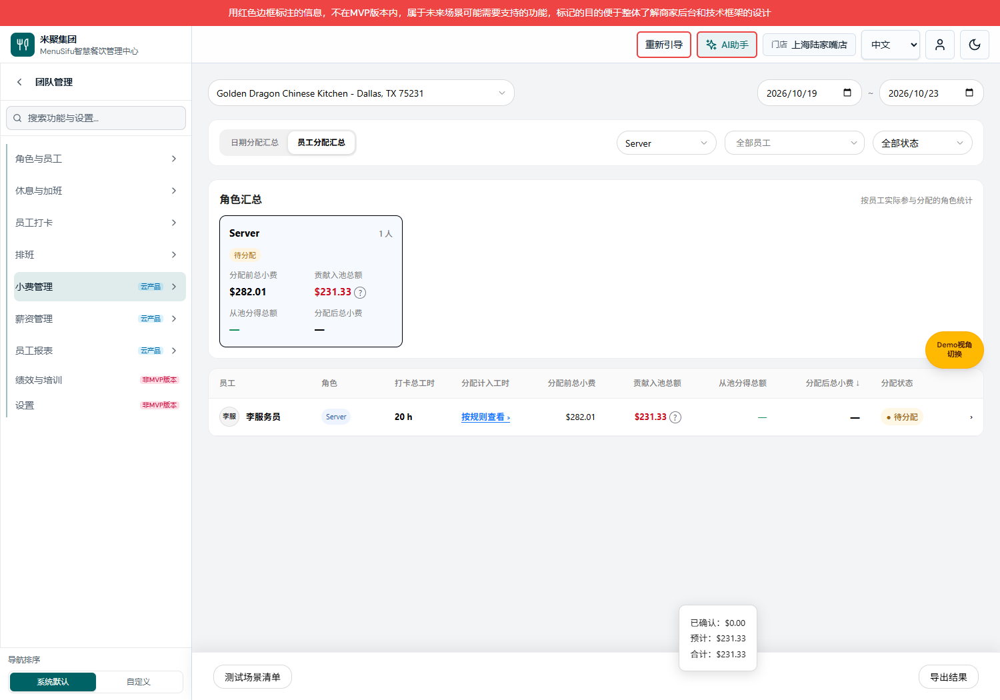

图注：2026-10-23，main基线44ca8723／65114隔离演示，角色过滤Server；仅证明所示界面和状态。

> 图片覆盖：已补所示状态；未示出的其他分支仍待核验，见逐操作清单。

- 改角色联动候选和已选员工，列表与卡片使用同一交集；

- 没有匹配保留条件显示空态，不改规则。

#### E02 员工多选

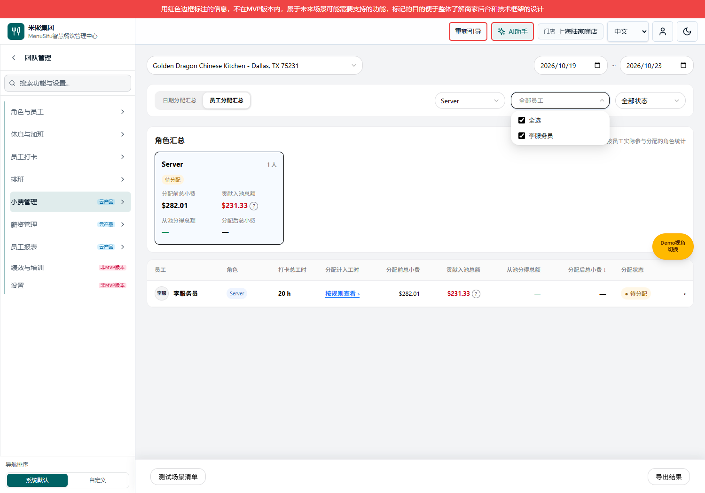

图注：2026-10-23，main基线44ca8723／65114隔离演示，员工多选下拉；仅证明所示界面和状态。

图注：2026-10-23，main基线44ca8723／65114隔离演示，取消员工选择后空态；仅证明所示界面和状态。

> 图片覆盖：已补所示状态；未示出的其他分支仍待核验，见逐操作清单。

- 按ID选择有效候选，角色卡和员工表同时过滤；

- 全选仅该候选集合，不扩大到其他门店。

#### E03 分配状态筛选

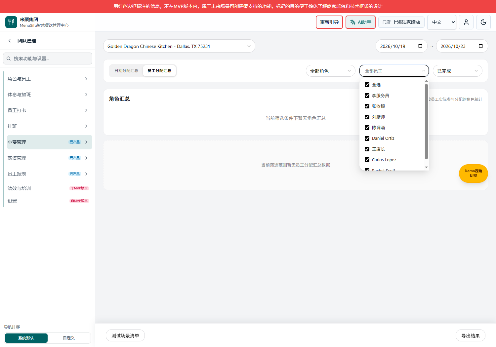

图注：2026-10-23，main基线44ca8723／65114隔离演示，已完成状态筛选空态；仅证明所示界面和状态。

> 图片覆盖：已补所示状态；未示出的其他分支仍待核验，见逐操作清单。

- 按周期参与覆盖判断，保留门店／周期及角色员工选择；

- 不触发确认。

#### E04 员工排序

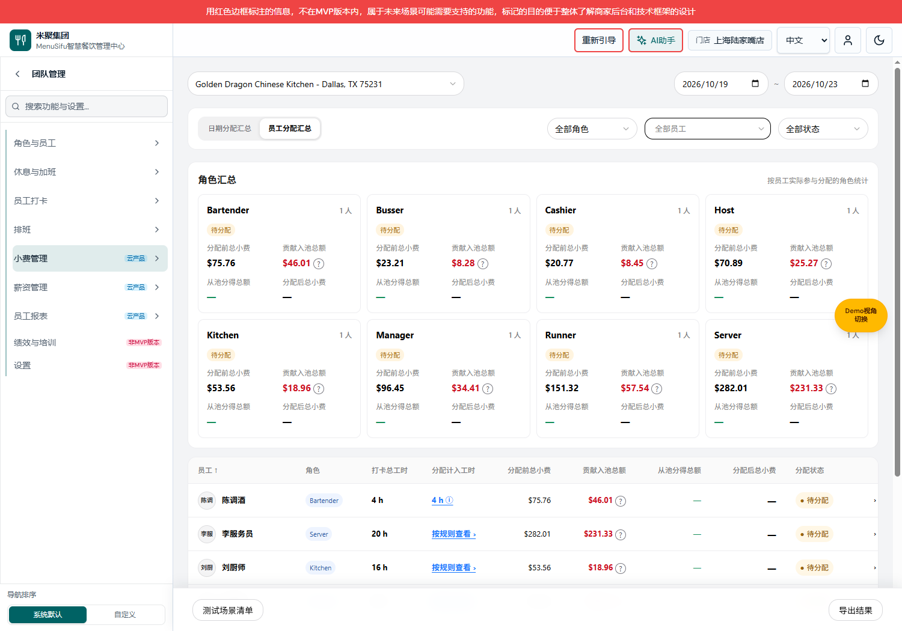

图注：2026-10-23，main基线44ca8723／65114隔离演示，按员工排序；仅证明所示界面和状态。

> 图片覆盖：已补所示状态；未示出的其他分支仍待核验，见逐操作清单。

- 按既有员工排序切换，身份仍按ID；

- 稳定顺序，不合并同名记录。

#### E05 打卡工时排序

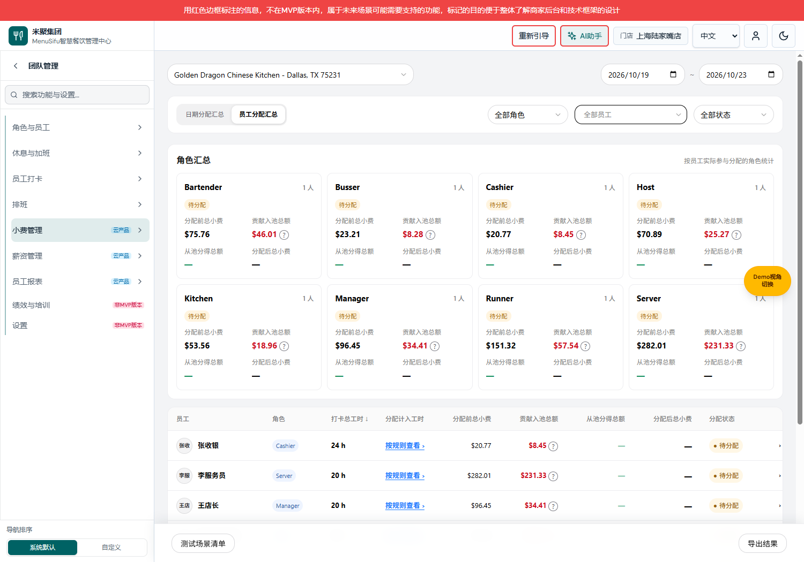

图注：2026-10-23，main基线44ca8723／65114隔离演示，按打卡工时排序；仅证明所示界面和状态。

> 图片覆盖：已补所示状态；未示出的其他分支仍待核验，见逐操作清单。

- 以原始累计工时排序，缺失始终末尾；

- 不能以分配规则的累计小时代替。

#### E06 分配后金额排序

图注：2026-10-23，main基线44ca8723／65114隔离演示，分配后金额排序；仅证明所示界面和状态。

> 图片覆盖：已补所示状态；未示出的其他分支仍待核验，见逐操作清单。

- 按确认F排序，—不冒充0；

- 不按预计接收或草稿金额重排正式数。

#### E07 贡献入池问号说明

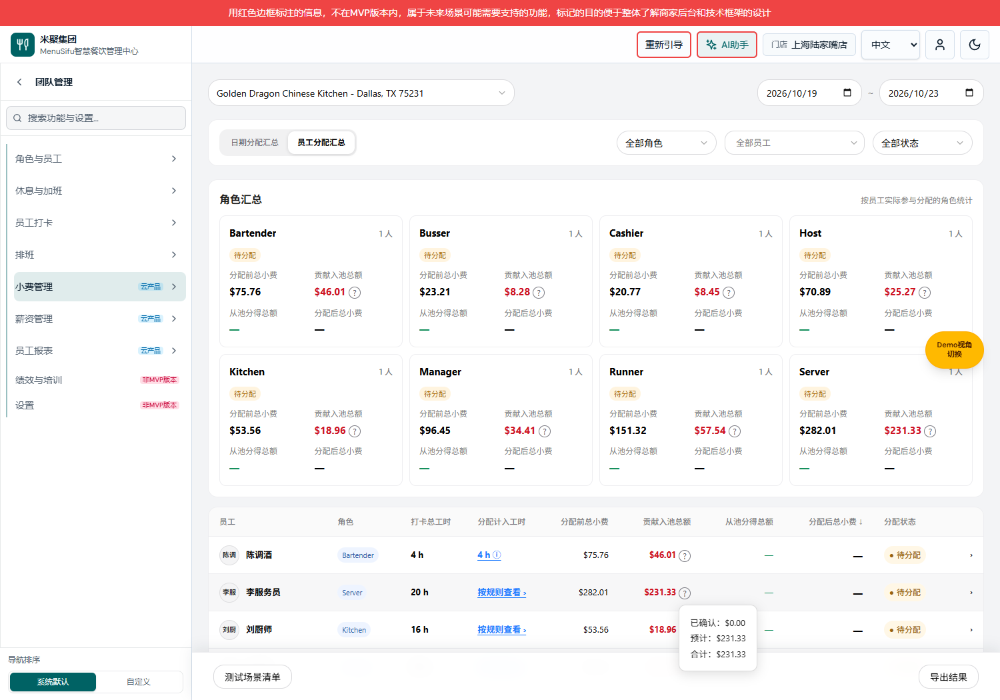

图注：2026-10-23，main基线44ca8723／65114隔离演示，确认与预计贡献说明；仅证明所示界面和状态。

> 图片覆盖：已补所示状态；未示出的其他分支仍待核验，见逐操作清单。

- 入口紧邻贡献总额，点击查看已确认、预计及合计；

- 例30=20＋10，说明预计非正式扣款。

- 若任一日无法试算，说明原因／范围，不假装总额完整。

- 只读，关闭不写入；

- 具体展示容器以当前项目实现核验，不自行设计新弹框。

#### E09 员工明细入口

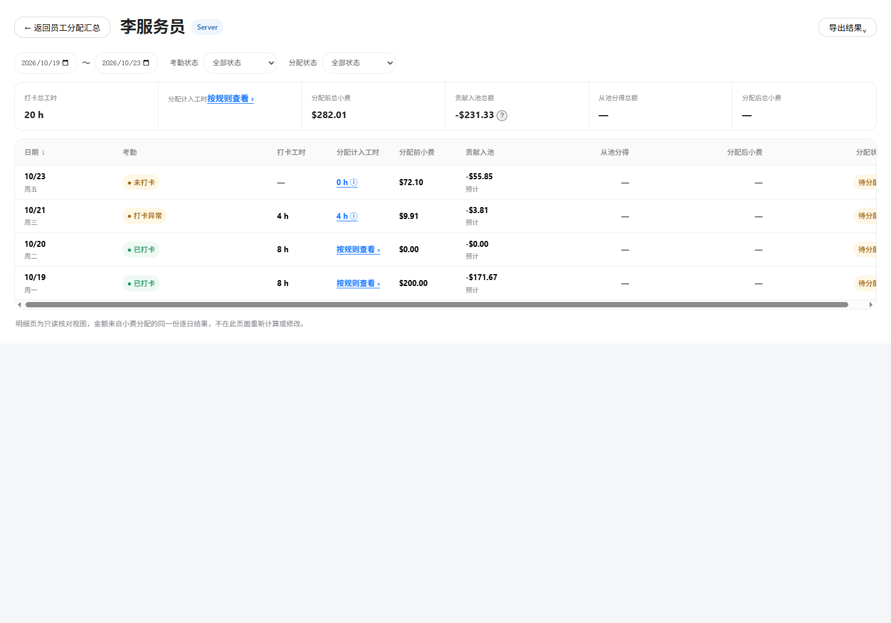

图注：2026-10-23，main基线44ca8723／65114隔离演示，员工每日考勤及预计贡献；仅证明所示界面和状态。

> 图片覆盖：已补所示状态；未示出的其他分支仍待核验，见逐操作清单。

- 带稳定身份及周期；

- 员工不存在或上下文不匹配拒绝显示他人数据，引导返回重新进入；

- 不得按姓名找另一位员工。

#### E10 日期分配汇总页签

图注：2026-10-23，main基线44ca8723／65114隔离演示，员工页签切回日期；仅证明所示界面和状态。

> 图片覆盖：已补所示状态；未示出的其他分支仍待核验，见逐操作清单。

恢复日期视角自己的筛选／排序，共用门店周期不变，不改变任何分配快照。

## 员工每日考勤分配／员工分配明细

图注：2026-10-23，main基线44ca8723／65114隔离演示，员工每日考勤及预计贡献；仅证明所示界面和状态。

> 页面配图：本轮已补当前画面；各操作的已补状态及未采集分支见下文和逐操作覆盖清单，不代表所有结果已齐。

用途／入口：员工汇总明细，追溯一个员工各营业日。顶部姓名及实际角色来自所选身份；上下文失配返回汇总，不显示别人的金额。每次进入日期默认倒序。

### 筛选、统计与逐日行

| 字段 | 逻辑说明 |
| --- | --- |
| 开始日期 | 继承原周期，可调整；不得晚于结束日；当前员工不变。 |
| 结束日期 | 同上；顶部与行均跟随有效筛选范围。 |
| 考勤状态筛选 | 全部／已打卡／未打卡／打卡异常／手动工时／混合工时；描述事实及采用来源，不把手动分配工时变成真实打卡。 |
| 分配状态筛选 | 全部／已分配／待分配；约束行和顶部汇总。 |
| 打卡总工时（顶部） | 当前过滤日原始工时累计，无有效记录—，分配调整不反写。 |
| 分配计入工时（顶部） | 按规则逐日累计，不跨规则求和；展开看周期规则明细。 |
| 分配前总小费（顶部） | 全部有效过滤日B，含待分配日。 |
| 贡献入池总额（顶部） | 确认D＋未确认预计贡献，预计属性必须可解释；失败不能默认为0。 |
| 从池分得总额（顶部） | 仅确认A合计，未确认不计；全无确认—。 |
| 分配后总小费（顶部） | 仅确认F合计，混合范围说明已确认部分；顶部只保留这六项，不恢复“手动工时记录”指标。 |
| 日期 | MM/DD及星期、内部完整日期；可切排序，重新进入倒序。 |
| 考勤 | 当天真实标签及异常说明；未知不冒充未打卡。 |
| 打卡工时 | 当天原始有效工时，合法0与无记录—区分。 |
| 分配计入工时 | 当天各规则采用工时的摘要；点击只看当天，不以全天打卡替代所有规则值。 |
| 分配前小费 | 当天B，未分配仍可展示。 |
| 贡献入池 | 已确认读快照D；待分配读预计并明确预计。试算失败说明无法计算，不显示正式扣款。 |
| 从池分得 | 当天确认A；待分配—，不展示试算接收冒充结果。 |
| 分配后小费 | 当天确认F；待分配—。例B=42.13、预计贡献5，仍不能展示37.13为已确认最终数。 |
| 分配状态 | 该日已分配／待分配；不以是否有打卡决定分配状态。不显示班次／上下班时间列，但计算追溯仍保存区间。 |

### 员工每日逐操作

#### P01 日期范围调整

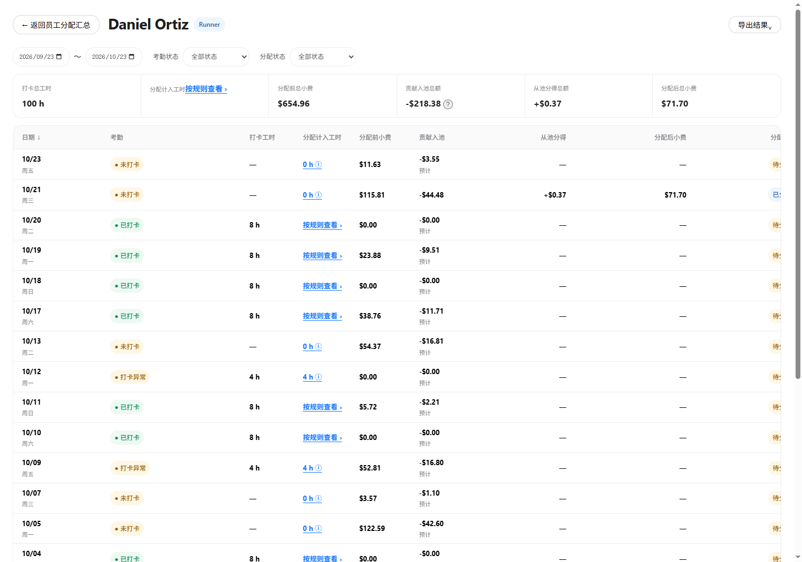

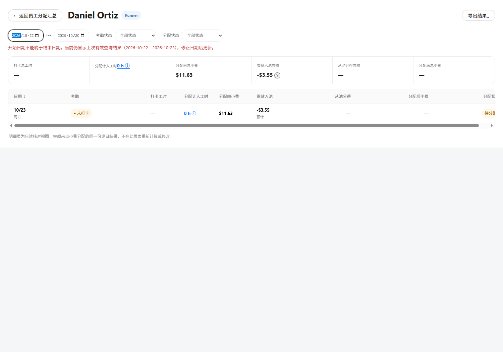

图注：2026-10-23，功能分支codex/tips-summary-date-validation-20261023，main基线44ca8723＋未提交实现，65115隔离演示；依次为有效周期、倒置、清空开始、超出来源周期及修复为同日。

| 字段／操作 | 逻辑说明 |
| --- | --- |
| 开始日期 | 必填、有效日历日期；不得晚于结束日，不得早于来源汇总快照周期。错误保留原输入并标记字段，不自动交换或改为同日。 |
| 结束日期 | 必填、有效日历日期；不得早于开始日，不得晚于来源汇总快照周期。同日合法，包含当天。 |
| 错误结果 | 保留上次有效查询的行及统计，明确提示实际显示的旧周期；不得把旧金额当作错误输入周期的新结果。清空开始日期已实测行内容不变。 |
| 导出 | 日期未修复时不能收集导出数据、打开导出菜单或发起邮件；读取范围校验测试已通过，实际文件和投递仍待验收。 |
| 修复 | 两端合法后重新筛选当前员工数据，清除错误；仅查询，不写分配账本。 |

图注：2026-10-23，main基线44ca8723／65114隔离演示，员工每日调整周期；仅证明所示界面和状态。

> 图片覆盖：已补所示状态；未示出的其他分支仍待核验，见逐操作清单。

- 仅当前员工重查，起止合法才用于统计和导出；

- 读取失败保留错误提示，不显示他人缓存。

#### P02 考勤状态筛选

图注：2026-10-23，main基线44ca8723／65114隔离演示，员工每日未打卡过滤；仅证明所示界面和状态。

> 图片覆盖：已补所示状态；未示出的其他分支仍待核验，见逐操作清单。

- 过滤逐日记录并同步顶部范围；

- 选手动工时不修改考勤标签，不写考勤记录。

#### P03 分配状态筛选

图注：2026-10-23，main基线44ca8723／65114隔离演示，员工每日已分配过滤空态；仅证明所示界面和状态。

> 图片覆盖：已补所示状态；未示出的其他分支仍待核验，见逐操作清单。

只读过滤，待分配贡献可预计，接收／最终仍—，不能点击筛选就确认。

#### P04 日期表头排序

图注：2026-10-23，main基线44ca8723／65114隔离演示，员工每日顺序列表；仅证明所示界面和状态。

> 图片覆盖：已补所示状态；未示出的其他分支仍待核验，见逐操作清单。

- 同页切顺倒序；

- 离开重进默认倒序，不继承上次每日排序；

- 不影响汇总保留的排序。

#### P06 返回员工分配汇总

图注：2026-10-23，main基线44ca8723／65114隔离演示，员工每日返回汇总并恢复原周期；仅证明所示界面和状态。

> 图片覆盖：已补所示状态；未示出的其他分支仍待核验，见逐操作清单。

- 恢复来源员工汇总上下文及定位，不把每日修改后的周期无依据覆盖来源筛选；

- 无有效上下文按既有入口恢复，异常提示重新选择员工。

## 分配计入工时明细弹框

图注：2026-10-23，main基线44ca8723／65114隔离演示，周期工时明细弹框；仅证明所示界面和状态。

> 页面配图：本轮已补当前画面；各操作的已补状态及未采集分支见下文和逐操作覆盖清单，不代表所有结果已齐。

用途：解释不同规则采用工时，不相加成一个虚假的总工时。入口E08／P05／员工每日顶部；只读，修改须回当天分配明细。具体模板当前五列如下。

| 字段 | 逻辑说明 |
| --- | --- |
| 规则名称 | 已采用规则或对应草稿名称；按稳定poolId＋ruleId区分，不按名称合并。 |
| 规则类型 | 小费／加收服务费等已记录类型；来源缺失注明不可用，不猜历史类型。 |
| 计算说明 | 原始／有效考勤、上限、手动、时段或混合来源，解释为何不同。 |
| 分配计入工时 | 周期入口对同规则逐日累加，逐日入口只看当天；权重不改变此小时数。只有非工时规则不伪造值。 |
| 有记录／适用天数 | 说明记录完整性；2/3不把第三天补0，不把不适用日当缺失。 |

例同人两天各8h，R1实际累计16h，R2每日最多5h累计10h；打卡16h，主单元格“按规则查看”，不显示26h。0h是合法记录；缺失为待补录；新鲜草稿工时与正式金额可能不同版，按Q10说明，不假称同版对账。

#### H01 周期分配工时入口（E08）

图注：2026-10-23，main基线44ca8723／65114隔离演示，周期工时明细弹框；仅证明所示界面和状态。

> 图片覆盖：已补所示状态；未示出的其他分支仍待核验，见逐操作清单。

- 有可解释规则数据时打开对应员工周期明细，显示同规则累计；

- 无适用—不凭空补记录；

- 不写工时或确认状态。

#### H02 逐日分配工时入口（P05）

图注：2026-10-23，main基线44ca8723／65114隔离演示，单日工时弹框；仅证明所示界面和状态。

> 图片覆盖：已补所示状态；未示出的其他分支仍待核验，见逐操作清单。

- 只展示所选日的各规则与来源，不误用整个周期累计；

- 已发放取锁定快照，旧快照缺工时不得拿当前考勤补历史。

#### H03 关闭按钮

图注：2026-10-23，main基线44ca8723／65114隔离演示，关闭工时弹框回汇总；仅证明所示界面和状态。

> 图片覆盖：已补所示状态；未示出的其他分支仍待核验，见逐操作清单。

关闭并返回触发按钮，列表筛选、顺序和数据不变。

#### H04 遮罩关闭

图注：2026-10-23，main基线44ca8723／65114隔离演示，遮罩关闭工时说明；仅证明所示界面和状态。

> 图片覆盖：已补所示状态；未示出的其他分支仍待核验，见逐操作清单。

- 只关闭工时说明，不提交、不更改任何工时；

- 不能把弹框内点击当遮罩点击。

#### H05 Esc关闭

图注：2026-10-23，main基线44ca8723／65114隔离演示，Esc关闭工时说明；仅证明所示界面和状态。

> 图片覆盖：已补所示状态；未示出的其他分支仍待核验，见逐操作清单。

按Esc关闭当前说明并回触发点，不退出业务页面或确认数据。

## 当日小费分配明细：字段、编辑与确认

图注：2026-10-23，main基线44ca8723／65114隔离演示，当天已分配系统结果；仅证明所示界面和状态。

图注：2026-10-22功能预览65110的系统结果，只定位页面和底部保存入口；未补本轮默认、失败、锁定及每项编辑前后图。人工保存／重算弹框沿用后面的原专项实截图，不以本图代替。

用途／入口：日期行查看明细、行内分配的手工路径；当前门店＋单日，按当天完整有效规则集合计算。规则筛选只控制可见，不缩小提交集合。已经确认时回显快照，不因重新进入自动覆盖；未分配且具备自动条件才首次计算并完整保存。

### 上下文、概览与规则计算区

| 字段 | 逻辑说明 |
| --- | --- |
| 门店 | 单日上下文，员工与规则均受此门店限制；切换有未保存编辑时先保护，不能沿用旧店人员账。 |
| 日期 | 完整营业日；首次从汇总继承，切日重新校验营业及发放状态。 |
| 规则名称筛选 | 多选，默认全选，可部分选择或取消全选；只控制规则可见，不只提交可见1条。概览随可见还是整日的口径仍Q13，不能擅自定案。 |
| 原始总小费 | 当日去重原始来源，读取当前事实或有效快照，别把公式重复引用累计成两份小费。 |
| 入池总金额 | 当日预计实际池或确认P；新资金语义待实现，不与旧页面仅T混称一致。 |
| 已分配总额 | 当前有效确认接收合计；草稿变化不直接成为正式统计。 |
| 未分配总额 | 未确认等于预计池，确认为P−正式接收；草稿内预览若显示试算必须明确属性。 |
| 小费池数量 | 当天适用执行池数，不是员工数；日期汇总删列不等于本页删指标。 |
| 规则名称／计算模式 | 当前规则区所属规则和普通汇总／计提模式；已保存结果按采用快照解释，不取当前改名代替审计依据。 |
| 小费池总金额 | 本规则草稿或快照采用金额；来源基数和比例用于解释预算T，不自动等于贡献D。P与T区别见共用资金定义；未实现时须明确偏差。 |
| 公式基数 | 当前规则来源筛选后的取值；可编辑兼容控件仅生成当次草稿，不改POS原事实。负数、NaN、无穷不允许提交。 |
| 公式占比 | 百分数输入，10表示10%；修改重算草稿，不直接产生贡献或接收流水。通用上限及舍入Q02，不能用代码默认值替未定业务。 |
| 公式详情 | 解释各来源、范围、基数、比例及结果；历史缺公式依据要说明不可用，不用当前数据伪造历史。来源重叠不表示余额重复增加。 |

### 贡献与接收字段

| 字段 | 逻辑说明 |
| --- | --- |
| 贡献员工／角色 | 贡献规则命中的稳定身份范围，与预算公式角色及接收资格独立；同范围去重，未打卡但有可归属小费可按规则贡献。 |
| 分配前小费 | 员工真实归属B，用于核验贡献余额；不是该员工已经从本轮池接收的金额。 |
| 可贡献余额 | 原始允许来源减去前序池占用，本轮接收不回流；不能超扣。 |
| 应贡献 | 独立贡献公式计算的计划扣款；不默认T×承担比例，旧公式映射Q06。 |
| 实际／预计贡献 | 确认后为D，确认前为预计；应体现在该员工汇总及逐日结果，不因其不是接收人丢失。独立贡献表为已确认目标，未宣称当前UI已完整实现。 |
| 老板补足 | E=max(T−D,0)，非员工扣款，非未分配余额，非真实付款凭证；展示位置与承接Q16。 |
| 接收角色／组 | 同一配置行共同候选集合；角色标题不代表必须按单角色独立分钱。一个组下多角色员工共同计算分母。 |
| 角色分配比例／组占比 | 该组占P份额，不是员工最终比例；组内权重修改不能扩大预算。同层配置应100%，子组相对父。 |
| 角色分配金额／组预算 | P×组份额；组无人或基数为0则保留余额，不转给别组或时段外员工。 |
| 分配员工 | 当前门店、配置接收范围内有效身份；姓名旁考勤标签来自实际考勤，补录不改成打卡。 |
| 员工权重 | 默认规则值1，未锁定时可调当次采用值；合法0不自动还原1，非法输入拒绝保存。改权重重算同组自动结果，不回写规则。 |
| 分配工时 | 只在工时方式适用； 普通按日可明确修改或补录，无论是否打卡。 手动8h可覆盖规则5h上限； 原打卡不变。 时段方式不可用全天小时绕过在岗证据。 |
| 有效订单笔数 | 订单方式依据，非销售额、非小费金额；零订单自动分0，未知不能默认为0。只读事实，不新增未经确认的手输订单入口。 |
| 员工分配比例 | 自动为基数／组总基数；普通工时允许最终人工比例例外。比例展示舍入不作为自动金额计算依据。 |
| 员工分配金额 | 按未舍入加权基数或明确人工比例计算，保留精度来源；不是员工分配后F，F还包含原有B和贡献D。 |
| 操作 | 新增行、删除行及折叠只改当前分配草稿，不创建／删除员工目录；实际参与必须有明确依据，不能修改权重就视作手动加入。 |

### 明细逐操作

#### T01 切换门店

图注：2026-10-23／44ca8723＋本批未提交实现／65115隔离演示。目标“文档验收门店B”是浏览器受控夹具，非生产门店；仅用于证明切换范围和不携带旧权重，不批准新规则。

| 元素 | 逻辑说明 |
| --- | --- |
| 草稿确认 | 真实修改后切店，先恢复原门店并显示页面内“放弃未保存修改？”；没有修改直接切换，保存中禁止。 |
| 继续编辑／关闭 | 留在原门店，保留手工值，不保存也不丢弃；继续编辑实测，Esc／遮罩分支保留待核验。 |
| 放弃修改 | 丢弃本页未保存输入后读取目标店；不把原店手工权重2带到目标店，目标权重按自身数据读取。 |

- 存在编辑先提示离开，选择继续保留原草稿和上下文；

- 明确放弃才切换，不自动保存。

- 目标店重新读取并验证目录、规则和锁定状态，失败不把旧店金额显示为新店。

#### T02 切换日期

图注：2026-10-23／44ca8723＋本批未提交实现／65115隔离演示；权重2时请求从10/20切10/21，询问期间仍显示10/20，继续编辑保留2；明确放弃后切到10/21。已发放目标日只读分支仍待补图。

本页自身草稿广播且快照未变时不得关闭刚打开的确认框；外部快照变化或发放锁定不忽略。跨菜单路由离开的浏览器测试未通过，本批不得声称所有离开入口均已保护。

- 同样先保护未保存输入；

- 确认放弃后切日，不改来源汇总周期。

- 已发放日加载只读快照，不进入可编辑重算。

#### T03 规则筛选

图注：2026-10-23，main基线44ca8723／65114隔离演示，规则多选下拉；仅证明所示界面和状态。

图注：2026-10-23，main基线44ca8723／65114隔离演示，仅显示一条规则；仅证明所示界面和状态。

> 图片覆盖：已补所示状态；未示出的其他分支仍待核验，见逐操作清单。

- 只隐藏／显示规则区；

- 不丢隐藏区草稿。

- 确认提交仍校验当天全部有效规则，不能绕过隐藏区错误。

#### T04 公式详情

图注：2026-10-23，main基线44ca8723／65114隔离演示，实际公式详情弹框；仅证明所示界面和状态。

> 图片覆盖：已补公式详情；缺历史依据分支仍待补。

- 打开只读解释，不确认或更新数据。

- 旧快照缺公式则提示不可用，需更新时走独立覆盖确认，不从当前事实补造历史公式。

#### T05 收起／展开角色区

图注：2026-10-23，main基线44ca8723／65114隔离演示，折叠角色员工表；仅证明所示界面和状态。

> 图片覆盖：已补所示状态；未示出的其他分支仍待核验，见逐操作清单。

- 仅控制可见，保留员工草稿、比例和权重；

- 不因折叠排除提交或重算金额。

#### T06 修改公式基数／比例

图注：2026-10-23，main基线44ca8723／65114隔离演示，手动修改公式基数210；仅证明所示界面和状态。

> 图片覆盖：已补所示状态；未示出的其他分支仍待核验，见逐操作清单。

- 未锁定时录入合法数，当前草稿联动；

- 标记人工调整、启用保存；

- 正式统计仍旧快照。

- 不能以此修改真实订单或销售记录。

#### T07 修改角色／组占比

图注：2026-10-23，main基线44ca8723／65114隔离演示，组占比超100后的保存确认；仅证明所示界面和状态。

图注：2026-10-23，main基线44ca8723／65114隔离演示，完整组占比校验失败；仅证明所示界面和状态。

> 图片覆盖：已补所示状态；未示出的其他分支仍待核验，见逐操作清单。

- 重算对应组预算并重验完整份额，不能静默丢无效行或缩放比例。

- 若兼容模式不支持统一组语义按Q07拦截／说明，不擅自扩大支持。

#### T08 选择员工

> 待补页面图片：候选联动、替换后考勤与金额。

- 只选择目录中当前店及接收范围有效身份，去重并重算本组；

- 同名不能代替ID。

- 替换后读取该员工真实标签，不继承前一人手动工时、历史身份或贡献账。

#### T09 新增行

图注：2026-10-23，main基线44ca8723／65114隔离演示，新增员工分配行；仅证明所示界面和状态。

> 图片覆盖：已补所示状态；未示出的其他分支仍待核验，见逐操作清单。

- 为本次规则组补录参与人员，不创建在职员工；

- 普通资格漏卡参与要明确标记，工时方式补有效工时；

- 时段仍需完整在岗区间。

- 不能添加行后默认把所有未打卡人员计入分母。

#### T10 删除行

图注：2026-10-23，main基线44ca8723／65114隔离演示，删除新增行恢复；仅证明所示界面和状态。

> 图片覆盖：已补所示状态；未示出的其他分支仍待核验，见逐操作清单。

- 只删本次草稿参与行，重算本组自动结果；

- 不删除员工目录、旧有效快照或其他规则。

- 正式结果待成功保存才替换。

#### T11 修改员工权重

图注：2026-10-23，main基线44ca8723／65114隔离演示，员工权重手动2；仅证明所示界面和状态。

> 图片覆盖：已补所示状态；未示出的其他分支仍待核验，见逐操作清单。

- 有限非负、当前范围0—1,000,000；

- 重算同组自动基数、比例、金额，替换之前人工比例。

- 权重提高不能弥补0工时、0订单或不在岗资格。

#### T12 修改分配工时

图注：2026-10-23，main基线44ca8723／65114隔离演示，未打卡员工补分配工时4；仅证明所示界面和状态。

> 图片覆盖：已补未打卡员工补录4小时；手动超过默认上限场景仍待补。

| 项目 | 说明 |
| --- | --- |
| 适用范围 | 普通按日工时方式；打卡、未打卡员工均可明确调整或补录。 |
| 输入限制 | 非负，最多两位小数。 |
| 优先级 | 明确手动值优先于默认上限。例如自动8h封顶5h，手动改8h后采用8h。 |
| 联动 | 重算同组比例和金额，替代旧人工比例。 |
| 不改变 | 原始考勤及“未打卡”标签。 |
| 时段方式 | 不能用全天手输小时作为在岗证明。 |

#### T13 修改员工最终比例

图注：2026-10-23，main基线44ca8723／65114隔离演示，手动最终比例80留余额；仅证明所示界面和状态。

> 图片覆盖：已补所示状态；未示出的其他分支仍待核验，见逐操作清单。

- 普通按日工时规则在自动计算后可明确输入最终比例，最多两位小数、非负；

- 金额不再乘工时／权重。

- 组内90%保留10%余额，>100%阻止确认；

- 再改工时／权重时旧人工比例失效。

- 平均／订单等兼容路径的额外例外未自动授权，见Q07。

#### T14 首次确认分配

> 待补页面图片：首次手工确认、保存成功及失败。

- 尚无有效确认快照且不能自动确认时，补全所需数据再提交；

- 校验完整门店日规则、事实、人员、金额、比例、权重及锁定。

- 成功一次保存整日正式结果，状态已分配、待发放；

- 失败维持未分配，保留输入，不留只扣不发的中间状态。

- 符合自动条件则首次进入即按同一校验完整保存，不要求额外点此按钮。

#### T20 返回汇总／离开页面

图注：2026-10-23，main基线44ca8723／65114隔离演示，明细返回日期汇总；仅证明所示界面和状态。

> 图片覆盖：已补正常返回；有未保存修改的继续编辑／放弃及浏览器刷新原生提示仍待补。

- 有真实未保存编辑先提示，不因初始化、查看或筛选触发。

- 继续编辑不离开；

- 明确放弃后回原汇总上下文；

- 不静默提交。

- 刷新／关页可能使用浏览器原生未保存提示，不将其与保存／重分配页面弹框混同；

- 原生层采集限制如有需登记。

## 更新小费数据确认

图注：2026-10-23，main基线44ca8723／65114隔离演示，更新小费覆盖确认；仅证明所示界面和状态。

> 页面配图：本轮已补当前画面；各操作的已补状态及未采集分支见下文和逐操作覆盖清单，不代表所有结果已齐。

用途／入口T18：当日可编辑明细右上“更新小费数据”；获取最新规则和原始事实，重建草稿，不等于保存或发放。

| 字段 | 逻辑说明 |
| --- | --- |
| 标题 | “确认更新小费数据？”；打开前不得直接清除或拉取替换数据。 |
| 覆盖说明 | 说明重新获取当前有效规则与原始小费，清除手工员工、工时、比例及调整结果；仍需手动调整须更新后重录。 |
| 取消 | 不读、不清、不重算，保留当前完整草稿与正式快照。 |
| 确认更新 | 临时完整计算成功并再次校验上下文／指纹／版本／发放锁后，原子替换草稿；不是确认正式金额。 |

#### U01 打开更新确认（T18）

图注：2026-10-23，main基线44ca8723／65114隔离演示，更新小费覆盖确认；仅证明所示界面和状态。

> 图片覆盖：已补所示状态；未示出的其他分支仍待核验，见逐操作清单。

- 只展示影响说明，不先读取／替换。

- 已发放或保护性锁定不允许更新。

#### U02 确认更新

图注：2026-10-23，main基线44ca8723／65114隔离演示，更新成功但未重新确认，发放禁用；仅证明所示界面和状态。

> 图片覆盖：已补所示状态；未示出的其他分支仍待核验，见逐操作清单。

- 成功提示“小费数据已更新，请重新检查并补充需要的手工调整。

- ”；

- 已有正式结果保留但新草稿标未确认更新，发放禁用并提示先重新确认。

- 完整重算或并发校验失败不替换任何部分。

- 刷新／跨标签页仍拦截旧快照发放。

#### U03 取消更新

图注：2026-10-23，main基线44ca8723／65114隔离演示，取消更新保留手工数据；仅证明所示界面和状态。

> 图片覆盖：已补所示状态；未示出的其他分支仍待核验，见逐操作清单。

- 取消／关闭不读取新数据、不清手工值、不写正式结果；

- 继续留原页核对。

## 确认小费已发放：两入口共用

图注：2026-10-23，main基线44ca8723／65114隔离演示，日期行整日发放确认弹框；仅证明所示界面和状态。

> 页面配图：本轮已补当前画面；各操作的已补状态及未采集分支见下文和逐操作覆盖清单，不代表所有结果已齐。

用途／入口D17、T19：正常营业＋存在有效确认快照＋待发放＋无未保存修改／未确认更新才可确认；明细按钮位于重新确认分配左侧。整日登记，不是部分员工支付。

| 字段 | 逻辑说明 |
| --- | --- |
| 标题 | 两入口均“确认小费已发放？”。 |
| 门店 | 当前有效结果的门店，不从最后一次全局切店猜测。 |
| 日期 | 待登记的完整营业日，仅该日，不是整个查询周期。 |
| 已分配金额（参考） | 快照allocatedAmount／池内接收合计，不是员工分配后总小费，不是剩余应付或转账金额。不恢复已删除的金额解释行。 |
| 涉及人数 | 同一确认快照员工ID跨池去重；零结果等人数边界Q09。 |
| 警示 | 保留背景和边框并整段加粗：“本操作仅记录发放状态，不执行转账。 确认后分配结果锁定；仅可通过汇总页“取消分配”演示重置，撤销标记不会撤回实际付款。” 不恢复旧线下结清普通说明。 |
| 确认 | 再验快照及版本、未确认更新、日期锁和幂等；成功记录确认人／时间／记录与快照关联，整日永久只读。 |
| 取消 | 不写发放记录、不改待发放、不影响分配结果。 |

#### F01 打开发放确认框

图注：2026-10-23，main基线44ca8723／65114隔离演示，日期行整日发放确认弹框；仅证明所示界面和状态。

图注：2026-10-23，main基线44ca8723／65114隔离演示，明细整日发放确认；仅证明所示界面和状态。

> 图片覆盖：已补所示状态；未示出的其他分支仍待核验，见逐操作清单。

- 只展示快照参考信息；

- 快照无效／失配阻止并要求先确认分配，不用实时数据伪造可发放金额。

#### F02 确认整日已发放

图注：2026-10-23，main基线44ca8723／65114隔离演示，隔离演示发放登记成功，仅本地标记锁定；仅证明所示界面和状态。

图注：2026-10-23，main基线44ca8723／65114隔离演示，已发放锁定明细只读；仅证明所示界面和状态。

> 图片覆盖：仅隔离浏览器演示数据登记为已发放并锁定，无转账；并发锁冲突和写入失败仍待补。

- 成功提示“已确认发放”，所有汇总与明细读锁定结果，禁编辑／更新／重分配／取消；

- 记录确认人、时间、编号，不执行转账。

- 别页已发放不重复登记，加载已有锁定状态。

- 写入失败原分配和待发放不变，提示失败可重试。

- 不新增现金抵扣、部分发放、解锁、补发能力。

#### F03 取消发放确认

图注：2026-10-23，main基线44ca8723／65114隔离演示，取消发放确认，状态仍待发放；仅证明所示界面和状态。

图注：2026-10-23，main基线44ca8723／65114隔离演示，取消明细发放确认；仅证明所示界面和状态。

> 图片覆盖：已补所示状态；未示出的其他分支仍待核验，见逐操作清单。

- 取消不登记，原数据不变；

- 关闭方式沿用公共页面弹框约束，焦点返回来源入口。

- 当前已移除查看发放记录按钮，但审计记录仍保存，不据此删除历史数据。

## 规则列表：完整字段与管理操作

图注：2026-10-23，main基线44ca8723／65114隔离演示，分配规则列表；仅证明所示界面和状态。

图注：2026-10-15原生预览65024，列表及新增入口位置参考。待补当前筛选、编辑回填、更多菜单、复制／删除结果图。

用途／入口：小费管理→分配规则，路由 `/team/tips/rules`；保留侧栏，页面不恢复“返回小费分配”按钮，分配页不恢复“规则管理”按钮。

| 字段 | 逻辑说明 |
| --- | --- |
| 门店筛选 | 统一可用门店，支持全部门店；筛选对应规则和统计数量，不扩大用户门店权限。 |
| 规则总数 | 当前列表范围规则记录数，不是执行池数或某天可分配数；过滤联动。 |
| 小费池数量 | 列表中小费类规则数量；与当天明细执行池数量不同。 |
| 加收服务费池数量 | 列表中服务费类规则数量，不能归类为普通自愿小费。 |
| 规则名称 | 规则展示名，用稳定规则ID打开；名称长度、重名策略Q01。 |
| 门店 | 规则适用范围，不把显示名当主键。 |
| 池类型与规则摘要 | 展示来源和类型，摘要不替代完整公式、资格及权重。 |
| 分配说明 | 用于快速阅读预算、贡献、接收、算法等配置；历史旧名只作兼容，不凭摘要重算历史。 |
| 操作 | 编辑、更多操作中的复制／删除；引用失效保留定位并阻止分配，不自动删员工或规则。 |
| 空列表 | 提示“暂无规则，请点击「新增规则」创建”；不自动跳编辑或创建默认记录。 |

#### L01 门店筛选

图注：2026-10-23，main基线44ca8723／65114隔离演示，单店规则筛选；仅证明所示界面和状态。

> 图片覆盖：已补所示状态；未示出的其他分支仍待核验，见逐操作清单。

- 读取该范围规则，数量和列表同步；

- 失败区别空列表，不按同名门店串规则。

#### L03 编辑规则

图注：2026-10-23，main基线44ca8723／65114隔离演示，既有规则编辑回填；仅证明所示界面和状态。

图注：2026-10-23，main基线44ca8723／65114隔离演示，既有规则编辑默认；仅证明所示界面和状态。

> 图片覆盖：已补所示状态；未示出的其他分支仍待核验，见逐操作清单。

- 进入现有全屏编辑，回填本规则配置，不生成新身份；

- 历史noclock、旧时段上限及失效引用须明确处理，不静默迁移。

#### L04 更多操作

图注：2026-10-23，main基线44ca8723／65114隔离演示，规则更多操作菜单；仅证明所示界面和状态。

> 图片覆盖：已补所示状态；未示出的其他分支仍待核验，见逐操作清单。

- 仅打开当前行管理菜单，不写配置、不进入分配；

- 菜单项不新增独立侧栏入口。

#### L05 复制规则

图注：2026-10-23，main基线44ca8723／65114隔离演示，隔离演示复制生成副本；仅证明所示界面和状态。

> 图片覆盖：已补所示状态；未示出的其他分支仍待核验，见逐操作清单。

- 目标为独立规则，不改原规则或历史分配。

- 新身份、名称和默认启用策略未完整定案，见Q01；

- 不按示例推断立即生效，不宣称已完备验收。

#### L06 删除规则

图注：2026-10-23，main基线44ca8723／65114隔离演示，仅删除隔离演示副本的确认框；仅证明所示界面和状态。

图注：2026-10-23，main基线44ca8723／65114隔离演示，隔离演示副本删除成功，原11条规则保留；仅证明所示界面和状态。

> 图片覆盖：已补所示状态；未示出的其他分支仍待核验，见逐操作清单。

- 只针对配置，不删除已确认／发放历史流水。

- 被待分配引用、生效时间及删除确认文案／引用策略见Q01；

- 待确认前不新增“自动删历史”或“静默停用”的业务规则。

- 失败保留配置，取消不删除。

## 新增规则：选择池类型弹框

图注：2026-10-23，main基线44ca8723／65114隔离演示，新增规则选择池类型；仅证明所示界面和状态。

图注：2026-10-15隔离原生演示，默认小费池；待补当前切换、下一步及取消结果图。入口L02为规则列表“新增规则”。

| 字段 | 逻辑说明 |
| --- | --- |
| 小费池 | 默认单选，进入小费来源配置；不在选择时保存规则。 |
| 加收服务费池 | 与小费互斥，独立来源类别；服务费不能因池名直接按普通小费政策处理，兼容边界Q07。 |
| 下一步 | 携带poolKind进入新增编辑，尚无正式规则。 |
| 取消／关闭 | 回列表，不创建记录，列表筛选不变。 |

#### L07 选择池类型

图注：2026-10-23，main基线44ca8723／65114隔离演示，新增规则选择池类型；仅证明所示界面和状态。

图注：2026-10-23，main基线44ca8723／65114隔离演示，选择加收服务费池；仅证明所示界面和状态。

> 图片覆盖：已补所示状态；未示出的其他分支仍待核验，见逐操作清单。

单选切换仅决定下一步类型，未进入编辑前不写规则，不混用小费与服务费来源。

#### L08 下一步

图注：2026-10-23，main基线44ca8723／65114隔离演示，新增小费规则默认页面；仅证明所示界面和状态。

> 图片覆盖：已补所示状态；未示出的其他分支仍待核验，见逐操作清单。

打开所选类型编辑页，规则名称等待输入，门店按有效上下文填写／选择，不因进入页面自动保存。

#### L09 取消类型选择

图注：2026-10-23，main基线44ca8723／65114隔离演示，取消池类型选择返回列表；仅证明所示界面和状态。

> 图片覆盖：已补所示状态；未示出的其他分支仍待核验，见逐操作清单。

取消或关闭丢弃本次未提交类型选择，不创建记录、不清列表条件。

## 新增／编辑规则：逐区域字段

图注：2026-10-23，main基线44ca8723／65114隔离演示，既有规则编辑默认；仅证明所示界面和状态。

图注：2026-10-15新增未保存页面；只定位既有单页结构，不能证明当前资格／工时联动及全部字段。待补当前三算法、三资格、来源条件及错误态。沿用真实交互，不另建试算页或新布局。

用途／入口：类型选择下一步或列表编辑；规则是以后代入营业日事实的计算模板，不是今天直接扣款。页面顺序保持：标题与右侧取消／保存→名称门店→小费分配方式→金额计算→计算模式→贡献方→接收方→资格及工时。

### 标题与基础信息

| 字段 | 逻辑说明 |
| --- | --- |
| 页面标题 | 新增／编辑小费分配规则，依上下文显示；与右侧取消／保存规则同一区域。 |
| 规则名称 | 必填文本，空白不能保存；用于列表、规则筛选和快照解释，长度／重名Q01。不恢复标题后的旧信息图标。 |
| 门店 | 必填有效门店引用，影响候选角色员工和事实；换店必须重验原引用，不静默替换同名员工。名称、门店后的旧信息图标不恢复。 |
| 取消 | 顶部右侧，真实编辑未保存先离开保护，不自动保存；默认加载不算编辑。 |
| 保存规则 | 顶部右侧主按钮，不叫“提交”；保存配置，不立即生成任何日分配或改历史快照。 |

### 小费分配方式：三种单选

| 字段 | 逻辑说明 |
| --- | --- |
| 按员工数量平均分配 | 默认选项，合格员工基础值各1，再乘权重。 同行多个接收角色员工共同分； 同权才金额均分。 例Server A/B＋Busser C同组100%、池120，三人同权各40； 拆成两行各50%则30／30／60。 |
| 按工作时长占比分配 | 基础值为对应有效分配工时，再乘权重；零工时不获自动金额；显示工时设置，普通日可手动覆盖。 |
| 按订单占比分配 | 基础值为有效归属订单笔数，再乘权重；不是销售额／订单小费；零单不获自动金额，不显示工时设置。 |
| 各卡片问号 | 位于各标题后，点击显示对应说明与可复算示例，默认不铺开长说明；帮助不触发保存。卡片整块可选，不只点标题。 |

**三算法统一示例：**组预算600，改变算法不改变组份额或贡献规则。

| 员工 | 权重 | 工时 | 订单笔数 | 平均分得 | 工时分得 | 订单分得 |
| --- | --- | --- | --- | --- | --- | --- |
| A | 1 | 6h | 4 | 150 | 240 | 240 |
| B | 2 | 3h | 2 | 300 | 240 | 240 |
| C | 1 | 3h | 2 | 150 | 120 | 120 |

### 小费池金额计算规则

| 字段 | 逻辑说明 |
| --- | --- |
| 新增选项 | 添加来源计算项，不执行扣款；来源只展示当前类型与事实可支持的能力。 |
| 来源类型 | 现有销售额、个人销售额、小费、手动上报、加收服务费、自定义等； 新资金契约的服务费／自定义兼容未完全统一，Q07，不将旧自定义自动变固定目标。 |
| 取值基数 | 本来源经有效条件过滤后的金额，只读计算依据；不是全部店营收或员工可扣余额。 |
| 计算比例 | 数值百分比，5→5%，结果=基数×5/100；精度／上限Q02，不能把当前接口0—100范围伪称全部业务已定。 |
| 本项金额 | 只读计算结果；多项加总T，不代表直接从老板营收扣款。 |
| 来源条件 | 各项独立，不同维度交集，同维多选为合法匹配集合；不支持组合需说明并阻止求值，不能静默忽略。 |
| 删除选项 | 删除草稿计算项，最终保存须至少一个有效计算来源；不删历史结果引用。 |

### 小费池计算模式

| 字段 | 逻辑说明 |
| --- | --- |
| 小费池汇总分配（默认） | 普通池：按P形成组预算再分给员工，使用共用完整公式。 |
| 计提小费占比分配 | 先按计提项取值及比例分配，再按剩余接收规则处理余额；不是第四种员工算法。贡献／老板资金兼容Q07，不无条件套普通池。 |
| 计提接收角色 | 该计提结果的候选角色；与普通接收组不是未经说明的同义对象。 |
| 小费计提占比 | 计提基数对应比例，不是整池接收组份额，也不是员工最终比例。 |
| 计提员工权重 | 对相应计提结果的相对权重，兼容全路径待验，不宣称已全部统一。 |
| 计提取值条件 | 来源范围，支付／菜单／重叠仍受Q03；独立条件草稿提交不等于保存规则。 |
| 剩余接收角色 | 对计提后剩余金额参与； 子组、权重、零基数兼容见Q07。 例池100、合法计提30→剩70； 计提80＋40不能确认发120，如何竞争须定案。 |
| 剩余组占比 | 相对剩余预算，不是再分一次原池；不能把未决竞争处理自定为先到先得或比例压缩。 |

### 小费贡献方规则

| 字段 | 逻辑说明 |
| --- | --- |
| 贡献范围类型 | 角色／指定员工，用于明确谁被扣款；不继承接收方打卡要求，不等于金额计算来源中的角色过滤。 |
| 贡献角色 | 当前门店有效目录集合，命中同人去重；有真实小费的未打卡员工可贡献。 |
| 贡献员工 | 当前有效员工引用，按ID；与角色冲突的条件必须校验，不能猜同名员工。 |
| 贡献依据 | 旧销售额占比／个人销售额占比／小费收入占比等保留各自实际含义；销售额与个人销售额互斥，不一律解释为承担预算比例。 |
| 贡献比例 | 未配置员工承担比例的旧规则沿用各自原口径；新自定义承担先汇总本条取值基数×贡献比例，再按全条员工比例分摊，不能套“每人各乘贡献比例”。应扣与实扣分开，余额封顶不转嫁；详见员工承担比例章节。旧兼容映射Q06／Q07未整体关闭。 |
| 可贡献小费范围 | 明确小费类型和营业日，不能含本轮新接收。员工余额不足不加扣别人。 |
| 新增／删除范围 | 只改规则草稿；同一贡献集合去重，不产生正式扣款。 |

### 小费接收方规则

| 字段 | 逻辑说明 |
| --- | --- |
| 角色 | 一行可多个角色，组成共同接收组；同组员工按ID去重。不能按角色数先均分预算。 |
| 占比百分比 | 行预算占池比例，完整同层合计100%，不与权重混淆；父60%、子70%=池42%。 |
| 新增角色／接收组 | 新增一行独立预算组，不创建角色目录；已有某组零基数不将其预算自动转给新组。 |
| 删除接收组 | 只改编辑草稿，保存重验完整份额；不删历史接收流水。 |
| 设置员工小费权重 | 打开对应角色／组员工权重弹框，定义见下一节。同行多角色权重冲突Q04，不按第一个角色静默决定。 |

### 参与资格：三种单选与动态帮助

| 字段 | 逻辑说明 |
| --- | --- |
| 仅打卡员工（默认） | 自动纳入范围内合格打卡者；漏卡须当日明确补录参与／依据，标签仍未打卡。不是“工时法才可用”，三算法均可配。 |
| 不限打卡状态 | 不用打卡作硬门槛，但仍限定接收范围和分配依据。 平均：未打卡须明确加入名单； 工时：未打卡补有效工时； 订单：有有效归属订单可参与。 不是所有在职人员自动分钱。 |
| 仅限小费产生时在岗员工 | 每笔按发生时点匹配实际在岗，不是第四种算法； 用[上班,下班)，排除休息／无效区间。 订单用支付完成时间、上报用实际发生时间； 缺必要时间拒绝确认，不退回全天。 |
| 资格问号 | 各选项标题后点击显示描述与随算法变化的例子；不选择时不展开冗长说明，不恢复已移除的标题信息图标。 |
| 旧noclock | 历史手工模式，不等于unrestricted；不作为新选项，编辑保存需明确选择新资格，不批量改写旧快照。 |

**动态帮助示例：**按当前算法生成，不混用基础值；展示帮助不代表已自动保存。

| 当前组合 | 输入条件 | 结果 |
| --- | --- | --- |
| 平均＋不限打卡 | A/B已打卡；C未打卡未加入；池120，等权 | A/B/C为60／60／0；明确加入C后各40 |
| 工时＋不限打卡 | A4h；B补录2h；池120，等权 | A/B为80／40 |
| 订单＋不限打卡 | A3单；B未打卡2单；池100，等权 | A/B为60／40 |
| 上例切为仅打卡 | B未补录参与 | A/B为100／0 |

**时段资格示例：**A在岗18—19点、权重2；B在岗18—22点、权重1；同组平均分配。

| 小费发生时间 | 该笔金额 | A分得 | B分得 |
| --- | --- | --- | --- |
| 18:30 | 90 | 60 | 30 |
| 19:30 | 60 | 0（已下班） | 60 |
| 全天合计 | 150 | 60 | 90 |

- **工时方式：**用所属最小时段有效时长，不再乘全天工时。

- **订单方式：**用所属时段有效归属笔数。

- **无人合格：**时间证据完整则保留余额；缺证据则拦截。

- **时间边界：**不固定整点，不用手输全天8h证明在岗。

### 分配工时设置

| 字段 | 逻辑说明 |
| --- | --- |
| 显示条件 | 仅选工时算法时显示；平均／订单不使用，不能因隐藏仍套旧上限。 |
| 按有效打卡工时 | clock默认口径；取POS当前有效考勤，不是用于核对的原始首次工时。 |
| 按有效分配工时 | unrestricted说明；有打卡取有效考勤，未打卡依当日补录；0不获自动分配。 |
| 每日计入工时上限 | 普通日工时可选，上限模式必填，当前UI0.1—24h为实现范围，服务端边界Q02；逐日min后累计，手动明确调整优先。 |
| 时段工时说明 | time_window只读“按小费产生时段内的有效在岗工时”，不提供每日封顶，不用全天总小时替代区间。 |
| 旧上限取消确认 | 旧time_window＋capped编辑时必须明确确认取消旧上限才能保存； 切换可暂保留未提交草稿，新保存按实际在岗且无有效上限； 历史结果不重算。 |

### 规则编辑逐操作

#### R01 点击分配方式卡片

图注：2026-10-23，main基线44ca8723／65114隔离演示，工时分配与仅打卡资格联动；仅证明所示界面和状态。

图注：2026-10-23，main基线44ca8723／65114隔离演示，订单占比分配选中；仅证明所示界面和状态。

> 图片覆盖：已补所示状态；未示出的其他分支仍待核验，见逐操作清单。

- 整卡均可选，不限标题；

- 三者单选，更新工时设置与资格帮助，不确认当天金额，也不修改历史结果。

#### R02 点击算法问号

图注：2026-10-23，main基线44ca8723／65114隔离演示，平均分配说明示例展开；仅证明所示界面和状态。

> 图片覆盖：仅补平均分配示例展开；工时与订单算法问号展开仍待补。

- 只展示当前算法含义与上述可复算算例；

- 不能点击问号意外保存或改变已选方式。

- 关闭不写配置。

#### R03 新增金额计算项

图注：2026-10-23，main基线44ca8723／65114隔离演示，金额计算项新增菜单；仅证明所示界面和状态。

> 图片覆盖：已补所示状态；未示出的其他分支仍待核验，见逐操作清单。

- 选来源后生成本规则草稿项，仅支持的数据条件可用；

- 销售来源只算T，不凭新增项生成营收或扣款。

#### R04 删除金额计算项

图注：2026-10-23，main基线44ca8723／65114隔离演示，金额计算项删除确认框（未确认删除）；仅证明所示界面和状态。

> 图片覆盖：仅证明所示确认框或返回结果；确认／取消、失败及未保存保护仍未完成全分支截图验收。

- 移除该草稿项，其他项不变；

- 正式保存重新校验至少一个有效来源，不删历史快照。

#### R10 切换小费池计算模式

图注：2026-10-23，main基线44ca8723／65114隔离演示，计提及剩余接收方区域；仅证明所示界面和状态。

> 图片覆盖：已补所示状态；未示出的其他分支仍待核验，见逐操作清单。

- 显示对应配置，不把计提当算法；

- 不静默转换旧贡献比例，兼容未决Q07保留。

- 最终保存校验当前模式，不使用隐藏旧字段冒充已定义。

#### R11 新增贡献范围

图注：2026-10-23，main基线44ca8723／65114隔离演示，销售额贡献方取值条件抽屉；仅证明所示界面和状态。

> 图片覆盖：仅补既有销售额贡献条件入口；新增／删除贡献范围、指定员工范围仍待补。

- 选择有效目录引用，重复身份去重；

- 贡献公式与预算分别配置，接收资格不限制可贡献人。

#### R12 删除贡献范围

图注：2026-10-23，main基线44ca8723／65114隔离演示，贡献方删除确认框（未确认删除）；仅证明所示界面和状态。

> 图片覆盖：仅证明所示确认框或返回结果；确认／取消、失败及未保存保护仍未完成全分支截图验收。

- 只改本规则草稿；

- 重验模式所需贡献条件，不撤销历史实扣或自动退钱。

#### R13 新增接收组

图注：2026-10-23，main基线44ca8723／65114隔离演示，新增接收组；仅证明所示界面和状态。

> 图片覆盖：已补所示状态；未示出的其他分支仍待核验，见逐操作清单。

- 新行独立预算份额；

- 同行多角色共同分，不能将每个角色各复制一份100%。

- 保存检查组份额和身份有效性。

#### R14 删除接收组

图注：2026-10-23，main基线44ca8723／65114隔离演示，删除新建接收组后的配置；仅证明所示界面和状态。

> 图片覆盖：已补所示状态；未示出的其他分支仍待核验，见逐操作清单。

- 保留其他组配置，完整份额不足／超额明确报错，不自动平均余下行；

- 不改历史已分配结果。

#### R19 选择参与资格

图注：2026-10-23，main基线44ca8723／65114隔离演示，工时分配与仅打卡资格联动；仅证明所示界面和状态。

图注：2026-10-23，main基线44ca8723／65114隔离演示，不限打卡资格工时设置；仅证明所示界面和状态。

图注：2026-10-23，main基线44ca8723／65114隔离演示，发生时在岗资格工时提示；仅证明所示界面和状态。

> 图片覆盖：已补所示状态；未示出的其他分支仍待核验，见逐操作清单。

- 单选改变参与过滤及帮助示例，工时设置按上述矩阵；

- 不将不限理解成旧noclock或全体员工每日自动参与，不静默迁移历史。

#### R20 点击资格问号

图注：2026-10-23，main基线44ca8723／65114隔离演示，工时算法仅打卡资格动态示例；仅证明所示界面和状态。

图注：2026-10-23，main基线44ca8723／65114隔离演示，工时算法不限打卡资格动态示例；仅证明所示界面和状态。

图注：2026-10-23，main基线44ca8723／65114隔离演示，工时算法发生时在岗动态示例；仅证明所示界面和状态。

> 图片覆盖：已补工时算法下三种资格示例；平均／订单算法的动态示例组合仍待补。

- 显示当前组合的基础值、合格名单及结果；

- 切算法后说明同步改变，不用工时例子解释订单。

- 只读帮助，关闭不写规则。

#### R21 选择分配工时设置

图注：2026-10-23，main基线44ca8723／65114隔离演示，工时分配与仅打卡资格联动；仅证明所示界面和状态。

图注：2026-10-23，main基线44ca8723／65114隔离演示，不限打卡资格工时设置；仅证明所示界面和状态。

图注：2026-10-23，main基线44ca8723／65114隔离演示，发生时在岗资格工时提示；仅证明所示界面和状态。

图注：2026-10-23，main基线44ca8723／65114隔离演示，每日计入工时上限5小时；仅证明所示界面和状态。

> 图片覆盖：已补实际工时、5小时上限、时段只读提示；历史时段上限迁移确认见R22，仍待补。

- 仅工时方式生效；

- 上限逐日限制自动采用值，明确手动值可覆盖；

- time_window不允许保留可执行的每日封顶。

#### R22 确认取消旧时段上限

> 待补页面图片：历史兼容提示、未勾阻止保存、确认后状态。

- 必须明确确认，不能代码升级自动改写。

- 保存新配置只影响未来重算，已确认／发放历史不变。

#### R23 保存规则

图注：2026-10-23，main基线44ca8723／65114隔离演示，新增规则缺名称校验；仅证明所示界面和状态。

> 图片覆盖：仅补缺规则名称校验；合法保存、其他字段错误和写入失败仍待补。

| 阶段 | 处理与结果 |
| --- | --- |
| 入口 | 顶部右侧“保存规则”，不叫“提交”。 |
| 保存校验 | 名称、门店、来源及兼容条件、有效角色员工、组份额、权重、资格和适用工时。 |
| 历史规则 | 旧noclock必须明确选择受支持资格，不静默迁移。 |
| 成功 | 保存配置并回列表；编辑保持规则身份，新建生成独立身份。 |
| 失败 | 保留输入，定位错误，不报成功。 |
| 生效边界 | 不同时修改当天确认或已发放快照。生效时点、命名边界仍见Q01，不自行补API。 |

#### R24 顶部取消

图注：2026-10-23，main基线44ca8723／65114隔离演示，离开有修改规则的提示；仅证明所示界面和状态。

> 图片覆盖：已补所示状态；未示出的其他分支仍待核验，见逐操作清单。

- 真实未保存编辑才提示；

- 继续编辑保留草稿，明确放弃后回规则列表，不自动保存；

- 仅查看／初始化不误拦截。

#### R25 返回规则列表

图注：2026-10-23，main基线44ca8723／65114隔离演示，返回规则列表结果（不证明未保存保护已生效）；仅证明所示界面和状态。

> 图片覆盖：仅证明所示确认框或返回结果；确认／取消、失败及未保存保护仍未完成全分支截图验收。

与取消一致使用既有离开保护，回保留侧栏的列表，不因导航自动保存或清他人草稿。

## 来源与贡献条件抽屉

图注：2026-10-23，main基线44ca8723／65114隔离演示，小费来源条件抽屉；仅证明所示界面和状态。

> 页面配图：本轮已补当前画面；各操作的已补状态及未采集分支见下文和逐操作覆盖清单，不代表所有结果已齐。

用途／入口R05：计算项或贡献项的条件入口；抽屉内提交只应用到当前规则草稿，整页保存后才持久化。以下是字段语义全集，不表示每个来源同时支持所有条件。

| 字段 | 逻辑说明 |
| --- | --- |
| 角色 | 过滤本项事实归属范围，不自动设置贡献人或接收组；当前门店有效目录，多值同维合法集合。 |
| 员工 | 按稳定ID限定归属，受门店和角色联动；互斥组合添加时阻止，不静默同时使用。 |
| 订单区域 | 匹配事实有效区域；缺区域证据不能猜命中。 |
| 订单类型 | 匹配堂食等选定类型，生产枚举与POS映射Q03。 |
| 菜单／商品范围 | 产品线、分类、菜单组、商品等支持层级；只纳匹配金额，重叠归属Q03，不能将“含商品订单”直接等同商品销售金额。 |
| 订单需包含商品 | 订单命中条件，不等于只对该商品金额计算；计价范围需来源明确，未确定Q03。 |
| 营业额类型 | 定义税折扣、退款、服务费是否计入，具体POS口径Q03；不支持支付方式营业额＋菜单的组合需移除并提示。 |
| 支付方式 | 合法支付集合，混合支付如何分摊Q03；不能将任一命中当整单全部金额。 |
| 营业时间／订单时间段 | 过滤来源发生时间，开始结束成对；与接收时段资格不同，跨午夜及精确边界Q05，不凭时分字符串猜测。 |
| 班次 | 已有班次引用过滤，不是新增第四种算法；演示无班次证据不能伪造。班次管理附属入口的编辑／保存边界未完整定案，见下方缺口。 |
| 周期（星期） | 选择适用营业日星期集合；内部0／7等枚举需规范化，不凭显示名猜编码。 |
| 小费类型／订单小费状态 | 来源支持时选有／无／不限或相应类型，过滤来源，不决定员工资格；现金、卡、服务费分类Q03。 |
| 加收类型 | 服务费来源下有效类型，不将加收自动归类自愿小费。 |
| 新增条件 | 仅显示当前来源支持且不冲突的维度；换来源不兼容条件需清理并告知，不静默忽略。 |
| 条件删除 | 只解除本项筛选，不清其他计算项或贡献项。 |
| 提交 | 校验引用、范围及组合后应用到父编辑草稿；非法留在抽屉说明，不持久化正式规则。 |
| 取消／关闭 | 不提交本次抽屉改动；各历史兼容抽屉是否已实现一致回滚须补验，不把直接绑定行为当产品授权。 |

#### C01 打开对应条件抽屉（R05）

图注：2026-10-23，main基线44ca8723／65114隔离演示，小费来源条件抽屉；仅证明所示界面和状态。

图注：2026-10-23，main基线44ca8723／65114隔离演示，销售额贡献方取值条件抽屉；仅证明所示界面和状态。

图注：2026-10-23，main基线44ca8723／65114隔离演示，销售额来源条件抽屉；仅证明所示界面和状态。

图注：2026-10-23，main基线44ca8723／65114隔离演示，手动上报来源条件抽屉；仅证明所示界面和状态。

图注：2026-10-23，main基线44ca8723／65114隔离演示，加收服务费来源条件抽屉；仅证明所示界面和状态。

> 图片覆盖：已补小费、销售额、上报小费、服务费及销售额贡献抽屉；个人销售额、计提取值及其他贡献范围仍待补。

- 携带当前规则项及其原条件，不能打开另一项后覆盖前项；

- 关闭不保存规则。

#### C02 新增条件（R06）

图注：2026-10-23，main基线44ca8723／65114隔离演示，小费来源新增条件菜单；仅证明所示界面和状态。

图注：2026-10-23，main基线44ca8723／65114隔离演示，新增订单时间段条件；仅证明所示界面和状态。

> 图片覆盖：已补所示状态；未示出的其他分支仍待核验，见逐操作清单。

- 按支持能力添加，校验角色／员工、来源／菜单等冲突；

- 无事实求值能力说明原因，不宣称“UI有即支持”。

#### C03 删除条件（R07）

图注：2026-10-23，main基线44ca8723／65114隔离演示，删除抽屉中的角色条件；仅证明所示界面和状态。

> 图片覆盖：已补所示状态；未示出的其他分支仍待核验，见逐操作清单。

- 解除该维度过滤并保留其他条件；

- 不产生实际贡献或改历史结果。

#### C04 抽屉提交（R08）

图注：2026-10-23，main基线44ca8723／65114隔离演示，条件提交成功回父配置（截图为实际成功，不作为非法条件拦截证据）；仅证明所示界面和状态。

> 图片覆盖：已补实际提交成功回父页；未取得非法输入停留图，不把成功画面作为校验拦截证据。

- 校验通过应用本项草稿并更新摘要；

- 不等于整页保存，不写分配；

- 失败保留抽屉输入。

#### C05 抽屉取消（R09）

图注：2026-10-23，main基线44ca8723／65114隔离演示，取消抽屉回父配置，未保存整条规则；仅证明所示界面和状态。

> 图片覆盖：已补所示状态；未示出的其他分支仍待核验，见逐操作清单。

- 取消不应用本次条件修改，原配置保留；

- 关闭／遮罩／Esc的具体回滚一致性须逐抽屉核验，不将缺验标为通过。

班次管理兼容缺口：模板仍有班次名称、时间段、最低／最高参与分钟等附属字段；其是否可达、与现行三资格的关系及保存后果缺乏已确认完整定义，归Q05／Q07。这里登记未定义点，不把模板里的最低分钟值新增为全模块资格要求；需补独立操作清单与真实截图后才能称该兼容入口完整交付。

## 设置员工小费权重弹框

图注：2026-10-23，main基线44ca8723／65114隔离演示，接收组员工权重弹框；仅证明所示界面和状态。

> 页面配图：本轮已补当前画面；各操作的已补状态及未采集分支见下文和逐操作覆盖清单，不代表所有结果已齐。

用途／入口R15：为接收角色／组配置默认员工权重；不是当天手动分配，也不是角色组占比编辑。

| 字段 | 逻辑说明 |
| --- | --- |
| 角色 | 当前接收配置范围，来源统一目录；同组多角色冲突Q04。 |
| 员工姓名 | 当前门店角色员工，内部按ID，重名不合并。 |
| 员工权重 | 缺省1，有限非负，0合法；高精度历史有效权重不能只因控件步长被拒绝。空输入／非法值不默认补1。 |
| 权重换算百分比 | 当前行权重×100%，只读、不独立存储、不要求合计100%；0.3333→33.33%，0.125→12.5%，非法→—。 |
| 确认 | 校验后只把原始employeeWeights应用到规则草稿，整页保存才持久； 不得存weightPercentage或用换算值覆盖权重。 |
| 取消 | 不应用本次弹框改动，不写当天结果。 |

#### W01 打开权重弹框（R15）

图注：2026-10-23，main基线44ca8723／65114隔离演示，接收组员工权重弹框；仅证明所示界面和状态。

> 图片覆盖：已补所示状态；未示出的其他分支仍待核验，见逐操作清单。

- 新增／编辑／复制再打开均以原始employeeWeights为事实源；

- 缺省1显示100%，不根据最终分配比例反推。

#### W02 修改员工权重（R16）

图注：2026-10-23，main基线44ca8723／65114隔离演示，权重修改后的换算比例；仅证明所示界面和状态。

> 图片覆盖：已补权重2→200%；非法输入反馈仍待补。

- 只联动当前员工的换算展示；

- 1.1→110%，其他行不改，未确认不持久。

- 不因110%而认为组份额超100%。

#### W03 确认权重（R17）

图注：2026-10-23，main基线44ca8723／65114隔离演示，确认权重回编辑页，尚未保存整条规则；仅证明所示界面和状态。

> 图片覆盖：已补确认后父页权重摘要；这是规则草稿变更，不代表整条规则已保存。

- 合法原始值应用到编辑草稿；

- 非法留框提示，保持此前有效配置。

- 后续保存规则才形成可用于新计算的配置，不改旧快照。

#### W04 取消权重（R18）

图注：2026-10-23，main基线44ca8723／65114隔离演示，取消临时权重3，父配置保留旧权重；仅证明所示界面和状态。

> 图片覆盖：已补所示状态；未示出的其他分支仍待核验，见逐操作清单。

放弃本次框内修改，回编辑，不保存派生百分比或改变历史员工结果。

## 导出、测试清单与异常恢复

图注：2026-10-23，main基线44ca8723／65114隔离演示，导出格式菜单；仅证明所示界面和状态。

> 页面配图：本轮已补当前画面；各操作的已补状态及未采集分支见下文和逐操作覆盖清单，不代表所有结果已齐。

用途：把当前视角与筛选的同一业务事实交付核对；不因导出执行分配、发放或清空演示数据。

| 字段 | 逻辑说明 |
| --- | --- |
| 导出范围 | 当前门店、日期、视角、过滤及排序；员工每日另包含当前员工和考勤条件，不导出其他门店代替。 |
| 日期 | 能区分完整营业日，UI的MM/DD不意味着跨年合并；最终各格式命名／列顺序Q14。 |
| 打卡工时 | 原始工时单列，无X/Y覆盖文案，不与分配工时合并为旧“工时”。 |
| 分配计入工时 | 按规则逐项解释来源与采用值，不跨规则求总数；页面五列与旧导出池名组合差异Q14，不因页面删池列就删内部审计ID。 |
| 员工金额 | 同一有效确认版本；预计贡献明确“预计”并能拆确认／预计，不把当前草稿接收混入旧正式金额。 |
| PDF | 相同数据口径的排版结果，需实际检查图片、换行、表头及完整金额，不以生成成功代替验证。 |
| CSV | 当前结果字段数据；多规则工时同单元格可分行；去掉班次／上下班时间旧列，最终一致性仍Q14。 |
| 邮箱地址 | 邮件导出输入，按现有格式校验，多邮箱逗号分隔为当前模板能力；真实发送API、大小上限无权威依据不承诺。 |
| 发送结果 | 当前为模拟提交，不宣称已送达；失败保留可恢复输入，不改变分配结果。 |
| 测试清单日期 | 当前门店在用员工最近一个月含今天，不受角色／员工筛选缩小；清单不是正式账。 |
| 测试清单员工 | 稳定ID关联姓名，不凭空创建员工。 |
| 测试清单角色 | 统一目录及事实中的角色。 |
| 场景编号 | 有／无打卡×有／无订单×有／无小费八种基础组合，未营业全零另注明。 |
| 考勤 | 原始事实标签及异常，不由小费金额推断。 |
| 有效订单数 | 来源可归属笔数，无订单有小费可以是直接上报，不伪造订单。 |
| 分配前小费 | 同日统一原始事实，可与订单／上报来源核验。 |
| 原始工时 | 原始打卡依据，不等于修正后工时。 |
| 有效工时 | 当前有效考勤，可能修正，不在初始化时改规则上限。 |
| 预期说明 | 有快照标“已有快照，以历史结果为准”，不适用标“未参与规则”；新生成清单不冒充旧快照原始依据。 |

#### X01 打开导出菜单（D18及员工页面）

图注：2026-10-23，main基线44ca8723／65114隔离演示，导出格式菜单；仅证明所示界面和状态。

> 图片覆盖：已补所示状态；未示出的其他分支仍待核验，见逐操作清单。

- 只打开格式选择，冻结／核对实际导出上下文，不执行分配；

- 无数据、超限和格式异常明确反馈，生产上限未定义不编造数值。

#### X02 导出CSV

> 待补页面图片：导出前范围、下载成功／失败；另需核验实际文件。

- 按当前过滤排序生成，完整日期、预计属性和双工时不丢失；

- 空结果按既有能力提示，不伪造零金额。

- 失败不改账，允许重试。

#### X03 导出PDF

> 待补页面图片：预览、文件及失败反馈。

- 与CSV同业务映射，渲染检查截断、中文和多规则工时；

- 不把成功下载当内容完整，不把界面预览当真实支付凭证。

#### X04 邮箱发送

图注：2026-10-23，main基线44ca8723／65114隔离演示，发送邮箱输入框；仅证明所示界面和状态。

图注：2026-10-23，main基线44ca8723／65114隔离演示，无效邮箱提示；仅证明所示界面和状态。

图注：2026-10-23，main基线44ca8723／65114隔离演示，取消邮箱弹框；仅证明所示界面和状态。

> 图片覆盖：已补输入、格式错误和取消；发送成功、发送失败及实际投递均未验证。

- 校验地址后提交当前导出，重复提交防护；

- 取消关闭不发送。

- 当前成功只表示模拟提交，不能表示真实收件；

- 失败可修正重试，不改分配状态。

#### X05 打开测试场景清单（D19）

图注：2026-10-23，main基线44ca8723／65114隔离演示，真实只读测试场景清单；仅证明所示界面和状态。

> 图片覆盖：已补所示状态；未示出的其他分支仍待核验，见逐操作清单。

- 展示当前店全体在用员工近月事实，不受员工过滤限制；

- 只访问不写员工、分配、发放存储，不生成伪员工。

#### X06 测试清单CSV

图注：2026-10-23，main基线44ca8723／65114隔离演示，尝试清单CSV下载被浏览器取消，未取得文件；仅证明所示界面和状态。

> 图片覆盖：浏览器取消了CSV下载，未取得文件；该图只记录尝试后的页面，不作为下载成功证据。

- 导出清单事实与说明，保留历史快照优先标识；

- 不是正式分配结果导出，不能清空或重置账。

#### X07 关闭测试清单

图注：2026-10-23，main基线44ca8723／65114隔离演示，关闭清单回原汇总；仅证明所示界面和状态。

> 图片覆盖：已补所示状态；未示出的其他分支仍待核验，见逐操作清单。

关闭只读层并恢复原页面，原门店、范围、筛选及已确认金额不变。

### 各页面共用异常结果

| 字段／条件 | 逻辑说明 |
| --- | --- |
| 无适用规则 | 不写已分配，说明先到分配规则配置；不在空列表自动创建规则。 |
| 引用失效／身份歧义 | 指明规则与角色员工，保留定位，修正后重试，不改成同名其他人。 |
| 时间依据缺失 | 时段规则阻止确认，补事件／区间；完整依据无人合格才留余额，两者不能混淆。 |
| 非法金额／权重／比例／工时 | 保留输入位置和旧有效结果，明确约束；不能通过静默归零完成确认。 |
| 快照／规则／事实版本冲突 | 不覆盖较新结果，提示重新核对；不只靠前端禁用按钮防并发。 |
| 保存失败 | 单日无部分正式结果，保留原快照与草稿；批量按本地逐日提交边界反馈成功数量，Q11生产策略仍待确认。 |
| 已保存但薪资同步失败 | 分别反馈，保留已保存结果，不回滚成未分配或诱导重复扣款。 |
| 已发放／发放依据异常 | 保护性只读，禁止直接更新／重分配，合法已发放可演示取消，异常仍拦截；不伪造记录、不解锁历史。 |
| 预计贡献失败 | 说明无法试算及影响日期，不以0或部分和冒充总和，确认事实仍可单独追溯。 |

## 历史需求承接索引与未闭合项

本节是追溯索引，不替代上述逐字段说明；本次不删除任何旧版本记录。原有近期专项章节继续保留在下方。

| 历史需求主题 | 本文有效承接位置 | 权威依据及边界 |
| --- | --- | --- |
| 资金预算、贡献扣款与老板补足 | 共用定义、当日明细贡献字段、规则贡献区 | 产品§22／研发§3.2；已确认待实现，Q06／Q16保留 |
| 三种方式、同行多角色、组占比与权重 | 共用公式、规则三卡、接收组、权重弹框 | 产品§24／研发§3.3；不恢复同角色先均分旧语义 |
| 参与资格与分配工时联动 | 规则资格及工时区、R19—R22 | 产品§24.6—24.7／研发§3.1.5；旧noclock不自动迁移 |
| 按小费发生时在岗 | 资格时段说明与事件示例 | 产品§23及§24.6／研发§3.4；缺时间不降级按日 |
| 日期状态、金额、快捷与批量分配 | 日期完整字段、D01—D17及原覆盖专项 | 产品§4、§17—18／研发§3.5—3.6；单日原子与跨日Q11分开 |
| 员工汇总、确认＋预计贡献 | 员工卡／表、E01—E10及混合周期算例 | 研发§3.6.3、CF05；不能用不同集合合计对账 |
| 员工每日待分配预计贡献 | 员工每日字段、P01—P06 | 研发§3.6.3、CF06；接收／最终仍仅确认 |
| 工时按规则查看 | 工时弹框H01—H05 | 研发§3.6.4、CF07；不跨规则求和，保留缺失来源 |
| 人工保存、系统重算、原生改页面框 | 原专项章节与T15—T17索引 | 产品／研发顶部2026-10-22专项，保留最新复制文案及结果来源 |
| 更新、草稿保护、发放锁定 | T20、U01—U03、F01—F03 | 产品§8／§18、研发§3.5；发放不执行转账 |
| 导出、演示数据、生产边界 | X01—X07及异常矩阵 | 产品§12／§20、研发§3.7；模拟邮件及本地账不称生产接通 |
| 双子导航及删除重复入口 | 原导航章节及N01—N04清单 | 2026-10-15已确认；不恢复已删除按钮 |

### 待确认事项

沿用[研发§6.2](小费分配业务规格说明书（研发交付版）.md)原编号，不因本次排版关闭。

| 编号 | 仍需明确的内容 |
| --- | --- |
| Q01 | 名称、复制／删除、生效。 |
| Q02 | 精度、上限、平余数固定键。 |
| Q03 | POS有效事实与复杂来源。 |
| Q04 | 跨角色权重冲突与跨组重叠。 |
| Q05 | 时间、营业日、班次兼容。 |
| Q06 | 旧贡献公式映射。 |
| Q07 | 计提、剩余、服务费。 |
| Q08 | 全零确认及发放。 |
| Q09 | 参与日期与人数。 |
| Q10 | 草稿／正式混版及持久标记。 |
| Q11 | 生产跨日事务。 |
| Q12 | 权限、审计、纠错。 |
| Q13 | 明细筛选后的概览范围。 |
| Q14 | 各格式导出一致性。 |
| Q16 | 老板出资实际结算。 |

**Q15保持关闭：**超预算贡献已确认全额入池。

### 不恢复的历史口径

- 员工贡献必须填满预算才可分、超预算截断。

- 同角色先拆钱、全部未打卡一律不得接收、不限打卡等于所有员工自动参与。

- 显示比例先舍入再算钱、多规则工时相加、待分配贡献一律—。

- 两个已移除的“查看发放记录”按钮，以及第15章未采纳的部分发放／支付工作台建议。

历史已发放快照仍按当时结果保留，不用新规则补写。

文档核验边界：本轮补文字、交叉引用和本地图片路径；未运行业务分配／发放验收，未重拍历史操作截图，未修复代码中的已知实现差异。清单内已定义操作可定位，截图未完成项仍保持待补；兼容班次管理等可达性及未决分支不算已完整覆盖。

## 日期分配汇总：人工结果覆盖确认（TIPOUT-BATCH-COPY-20261022-01）

图注：2026-10-22，功能分支codex/tips-overwrite-copy-20261022，基线为已合并但未推送的本地main e52b31a8，端口65113；演示数据仅用于验证提示，不是生产数据。

用途／入口：日期分配汇总底部“重新分配小费／批量分配小费”→选择门店和起止日期→“分配小费”。起止同日即单日，范围含首尾日期；不按汇总表当前营业／分配／发放筛选缩小选择范围。

| 字段／操作 | 逻辑说明 |
| --- | --- |
| 人工结果识别 | 读取所选门店每个可分配日的有效快照，allocationSource===manual表示人工保存； system及历史缺字段不据此推断人工。 未营业、已发放或锁定日不实际覆盖，不列入人工提示清单。 |
| 首次分配按钮 | 校验门店和日期后读取范围；不存在可覆盖人工日则按既有覆盖说明进入系统分配。有至少一天人工日时不写入，原选择弹框进入二次确认阶段。 |
| 页面内二次确认 | 标题“重新分配小费？”。 第一段“所选日期中有 N 天已手动调整：YYYY/MM/DD、YYYY/MM/DD。” ，天数加粗； 第二段“重新分配将按系统规则计算，覆盖手动调整结果。” ，覆盖后果加粗。 去掉重复的门店和起止日期范围； 底部按钮“取消／重新分配”。 人工天数、日期集合及重算范围不变。 |
| 范围冻结 | 二次确认阶段隐藏并禁用原门店及日期选择字段，不再重复显示范围摘要； 保留内部不可变范围和快照指纹。 确认时范围、资格或已保存结果变化则恢复选择并要求重新检查； 不因省略摘要而改变实际操作范围。 |
| 重新分配（覆盖确认主按钮） | 明确点击后先预生成并校验全部可执行日期的系统快照； 复用明细系统重建，不加载旧人工公式、人员调整、权重或手工工时为新系统结果。 提交后来源为system，统计读取新快照。 不能只写已分配日期标记。 |
| 取消／关闭／Esc／遮罩 | 均取消该次覆盖，不写分配结果，不清除人工快照；下一次操作重新识别人工日期。关闭后焦点返回汇总分配入口。 |
| 执行及失败 | 执行期间按钮禁用，阻止重复提交。 全部日期先校验，计算失败不写任何日期； 实际存储沿用按日原子提交及乐观冲突检查，后续日提交失败则停止，已成功日保留并报告已保存天数，不谎报全部成功。 此为本次本地实现边界，不自动关闭原Q11跨日生产事务决策。 |
| 薪资与统计 | 全部日期成功后刷新范围与汇总并调用既有薪资桥接；薪资失败明确已保存但同步失败。已发放锁定仍受日期写锁保护，不被重新分配。 |

### D14 重新分配（单日或范围覆盖确认）

图注：2026-10-23，main基线44ca8723／65114隔离演示，范围含人工日覆盖确认；仅证明所示界面和状态。

图注：2026-10-23，main基线44ca8723／65114隔离演示，单日含人工保存确认；仅证明所示界面和状态。

图注：2026-10-23，main基线44ca8723／65114隔离演示，确认系统覆盖人工完成；仅证明所示界面和状态。

> 图片覆盖：已补单日／范围提示与成功；本轮范围仅含1个人工日，并发冲突、跨日部分失败仍待补。

同一确认页面按实际数据展示1天和日期，不使用另一套规则。本次文案精简的专项断言覆盖两个人工日期的YYYY/MM/DD格式、标题、主按钮及加粗节点；实际浏览器核对单日与范围含一个人工日时的两段正文和取消，截图为本次精简后的真实页面。重新分配范围、指纹和写入实现未变。

### D15 取消覆盖人工结果

图注：2026-10-23，main基线44ca8723／65114隔离演示，取消覆盖后人工结果保留；仅证明所示界面和状态。

> 图片覆盖：已补所示状态；未示出的其他分支仍待核验，见逐操作清单。

在覆盖确认阶段点取消、右上关闭、遮罩或Esc，均不写系统结果、不清人工快照。原范围与草稿保留规则见专项字段表；下次操作重新识别人工日。取消不能被当作默认确认，焦点回汇总触发处。

### 可验收算例

| 范围内日期 | 已保存结果 |
| --- | --- |
| 10/19 | 人工比例60%／40% |
| 10/20 | 系统比例50%／50% |
| 10/21 | 人工比例70%／30% |

| 操作／条件 | 可验收结果 |
| --- | --- |
| 选择10/19—10/21 | 提示2天手动调整：10/19、10/21。 |
| 取消 | 三天快照均不变。 |
| 确认重新分配 | 所有可执行日按系统规则重算，不保留人工60%／40%及70%／30%。 |
| 10/21已发放 | 跳过该日；人工提示仅列10/19，并反馈跳过数量。 |

历史验证记录见文末附录A；不作为本轮重新验收结论。

## 小费分配明细：保存与系统重分配（TIPOUT-DIALOG-20261022-01）

图注：基础明细截图来自2026-10-22、基线f5940cbd的功能预览65110，仅用于定位保存按钮。下方弹框截图来自本次基线ae7443e9、codex/tips-page-dialogs-20261022、端口65111；计算与保存定义未变。

用途／入口：当前门店、营业日明细底部。“保存当前分配”位于“重新确认分配”右侧；规则筛选只控制可见区块，两操作均处理当天全部规则。已发放仍锁定，不改变资金、人员及金额校验。

| 字段／操作 | 逻辑说明 |
| --- | --- |
| 共用页面内对话框 | 使用页面内对话框，不调用浏览器alert／confirm；交互保护见下方共用规则。 |
| 手动调整标记 | 员工、权重、工时、比例、角色占比、公式等既有可编辑项发生手动输入或增删即标记； 改回原值仍视为已操作。 筛选、查看不标记； 更新小费数据的系统草稿不单独算人工调整。 首次手工录入无快照仍沿用“确认分配”。 |
| 保存当前分配 | 已有系统分配且有未保存人工调整时启用； 无人工调整时置灰、aria-disabled=true但可点击原因提示，不写入。 保存成功清除未保存人工标记并置灰。 执行中、无已分配结果、不可分配日或锁定时真正禁用。 |
| 保存确认 | 提示“已手动调整过小费分配数据，将按照手动调整后的分配数据进行统计”； 确认后校验并保存页面当前全部规则结果，不重建系统默认值。 取消不写入并保留草稿。 |
| 重新确认分配 | 已分配未锁定日期可主动重算。 有未保存人工调整或上次快照为人工来源时提示“已手动调整过小费分配数据，将按照系统小费规则进行重新分配，分配后会覆盖手动调整的数据”； 无人工调整保留原覆盖提示。 |
| 系统重算 | 确认后使用当前门店全部有效规则、系统事实及默认工时，忽略当天人工调整、手工工时； 新快照校验与提交成功后才替换页面。 取消不变； 失败保留原草稿与旧有效快照。 |
| 提交保护 | 沿用日期锁、快照哈希冲突、金额与人员校验。 执行中阻止重复操作、编辑及离开； 失败不清草稿。 统计只读取最新成功保存快照，不使用草稿； 薪资同步失败明确提示已保存但同步失败，不回滚快照。 |
| allocationSource | 快照可选字符串 manual/system，人工保存写 manual，系统自动或重分配写 system，随完整快照保存。 重开人工快照仍提示覆盖人工数据； 旧快照无此字段不推断来源、不自动迁移重算。 |

### 页面弹框共用规则

| 项目 | 说明 |
| --- | --- |
| 实现样式 | 项目modal-overlay／modal；notice、save、reallocate三个类型。 |
| 初始焦点 | 打开后默认聚焦主按钮。 |
| 键盘 | Tab／Shift+Tab在弹框按钮内循环。 |
| 关闭结果 | 焦点返回触发按钮；取消、右上关闭、遮罩或Esc均视为取消。 |
| 提交保护 | 确认前不提交；重复打开不重复执行。 |
| 上下文变化 | 门店、日期或基准快照变化，不执行原确认；同日外部状态变化时自动取消弹框，再按既有状态处理。 |

### T16 未调整提示框

图注：2026-10-23，main基线44ca8723／65114隔离演示，当天已分配系统结果；仅证明所示界面和状态。

图注：2026-10-23，main基线44ca8723／65114隔离演示，未调整保存原因提示；仅证明所示界面和状态。

> 图片覆盖：已补所示状态；未示出的其他分支仍待核验，见逐操作清单。

点击灰色保存，仅提示“当前系统分配数据未进行手动调整”；关闭不改变统计或快照版本。 页面内标题“提示”，按钮“知道了”，右上角可关闭；不调用浏览器alert。

### T15 人工保存确认框

图注：2026-10-23，main基线44ca8723／65114隔离演示，保存人工分配确认；仅证明所示界面和状态。

图注：2026-10-23，main基线44ca8723／65114隔离演示，人工分配保存成功；仅证明所示界面和状态。

> 图片覆盖：已补所示状态；未示出的其他分支仍待核验，见逐操作清单。

提示采用上表原文。页面内标题“保存当前分配？”，底部“取消／保存当前分配”；确认才保存，取消、关闭、遮罩或Esc保留草稿和旧统计。

### T17 覆盖人工数据确认框

图注：2026-10-23，main基线44ca8723／65114隔离演示，系统重新分配覆盖人工确认；仅证明所示界面和状态。

图注：2026-10-23，main基线44ca8723／65114隔离演示，取消重分配保留人工结果；仅证明所示界面和状态。

图注：2026-10-23，main基线44ca8723／65114隔离演示，系统重分配成功恢复默认；仅证明所示界面和状态。

> 图片覆盖：已补所示状态；未示出的其他分支仍待核验，见逐操作清单。

提示采用上表原文。页面内标题“重新确认分配？”，底部“取消／重新确认分配”；确认才重算，取消、关闭、遮罩或Esc不覆盖。无人工调整时的原覆盖提示同样使用此页面内弹框。

### 验收算例

预算 $100，A/B 权重均为1、工时均4h，系统各分 $50。人工比例改为60%/40%，保存确认后统计为 $60/$40；取消保存仍统计 $50/$50并保留草稿。重新确认分配并确认覆盖后按4h:4h恢复 $50/$50。未调整点灰色保存只提示；失败和并发冲突不覆盖草稿；已发放不能保存或重分配。

历史验证记录见文末附录A；不作为本轮重新验收结论。

## 小费管理子导航与小费分配页面

图注：2026-10-23，main基线44ca8723／65114隔离演示，进入小费管理前；仅证明所示界面和状态。

图注：2026-10-23，main基线44ca8723／65114隔离演示，小费子导航与日期汇总；仅证明所示界面和状态。

图注：2026-10-23，main基线44ca8723／65114隔离演示，返回团队导航，业务页不变；仅证明所示界面和状态。

图注：子导航展开、日期分配汇总状态，TIPOUT-DIALOG-20261022-01。

用途／入口：团队管理中整行点击“小费管理”进入同位置覆盖滑层；仅切换导航层，不自动切换右侧业务页面。分配页面与原路由相同。

| 字段｜操作 | 逻辑说明 |
|---|---|
| N01 小费管理父菜单 | 存在可访问子项才显示可进入的父项；整行含空白可点击，采用公共覆盖滑层，沿用权限和预设范围。 |
| 当前层标题 | 显示“小费管理”，与父层顶部、宽度对齐，覆盖父层搜索与列表。 |
| N02 返回上一级菜单 | 只返回团队管理导航，业务页面及其筛选不变，不执行保存。 |
| N03 小费分配 | 进入既有 `/team/tips/distribution`；子层保持显示，当前项高亮。没有查询参数时按原默认视角进入。 |
| N04 分配规则 | 进入既有 `/team/tips/rules` 规则列表；不是新增或编辑入口。 |
| 日期分配汇总 | 保留原页面内页签，切换规则与统计口径不变，不作为侧栏菜单。 |
| 员工分配汇总 | 保留原页面内页签，沿用原 query 和视角恢复，不新增独立权限。 |
| 页面内规则管理按钮 | 已移除；用户通过左侧“分配规则”进入列表，不触发分配或创建规则。 |
## 既有导航专项验证记录

2026-10-15导航专项的历史验证见附录A。

V1.0的列表、类型框和编辑导航简表已展开到上方对应完整页面，原截图仍保留，移除重复简表不删除业务要求。两个页面重复跨页按钮继续移除，编辑页继续全屏。当前缺图及兼容入口缺口见逐操作清单；历史测试旧断言不因本次文档修订宣称通过。

## 附录A：历史验证记录

本附录只保留原有验证记录，不新增本轮业务验收结论。

### 2026-10-22 批量覆盖确认

专项覆盖单日、范围、多人工日、混合系统日、未营业、已锁定及指纹变化；范围预计算、真实快照提交与并发参数检查。实际浏览器：10/19与10/21人工v2，取消后均不变；10/19—10/21确认后两日均为system v3，10/20为system v1，10/19公式由人工100恢复系统200。单日二次确认显示1天及10/19。类型检查、既有保存／页面弹框／存储专项通过。不表示生产上线、Q11闭合或全套历史脚本通过。

### 2026-10-22 明细保存与页面弹框

保存/重算专项、页面弹框专项、确认/自动分配回归及类型检查通过。隔离浏览器验证三种页面弹框、Esc保留草稿、Tab循环及焦点返回、取消不写入；确认人工保存生成manual快照v2（公式100），页面确认系统重算生成system快照v3（公式200）。三个弹框实截图已就近嵌入。不宣称生产发布或全套历史回归通过；既有payout-ui和detail-rounding旧测试缺口保留。

### 2026-10-15 导航专项

2026-10-15曾实测子导航下钻、同层两叶子、叶子高亮、规则列表保留侧栏、池类型弹框、编辑取消确认后回列表及返回上级不改业务URL；这些是历史验证，不代表本轮重验。

## 附录B：原文档承接说明

以下保留V2.0文字补齐及排版阶段的原记录；其中“未采集”“待补”是当时状态，本轮后续补图以文档顶部、就近图注及逐操作清单为准，不新增业务规则。

### V2.0承接背景与基线

对应[产品权威 V4.2](PRD_产品需求文档.md)、[研发权威 V3.2](小费分配业务规格说明书（研发交付版）.md)。共同变更编号 TIPOUT-DOC-HISTORY-20261023-01；基线 origin/main@44ca8723。三份独立维护同一业务定义：产品版解释决策，研发版解释对象和计算，本文按页面逐字段与逐操作承接。

背景：V1.0仅整理导航，后续仅补近期改动，导致历史页面说明不完整。本次补入日期／员工汇总、员工每日、规则编辑、计算与资格、更新／发放、导出及异常说明，不回退文件，不恢复已废弃规则，不改程序或历史数据。

状态：**历史需求文字承接稿，操作图片待补，不是完整截图交付或上线验收。** 已确认待实现、实现差异、待确认分别注明。既有图片保留原版本属性，不将登录页、旧截图或代码当作新验收。逐项缺口见[逐操作覆盖清单](小费管理逐操作覆盖清单.md)，正文操作编号与清单对应。

共同业务基线：普通池资金以产品§22为准；接收组、算法和资格以产品§24为准；页面后续已确认修改以研发§6.1 CF01—CF11为对照；近期保存／系统重算及覆盖弹框沿用本文原有专项章节。历史建议、停用方案不并列生效。来源不充分处引用研发Q项，不能由示例替研发决定。

本次是文档补齐，不改变UI：不新建原型、不调整页面，也不执行真实发放采集结果。图片缺失就近标记；所有缺图操作仍未通过DOC-OP截图完整性验收。旧导航／编辑截图来自2026-10-15，保存和弹框来自2026-10-22。没有新增2026-10-23业务验收截图。

阅读顺序：共用资金／状态→日期汇总→员工汇总→员工每日→工时弹框→当天明细→更新与发放→规则列表／编辑／条件／权重→导出→历史承接索引→保留的近期保存与覆盖确认专项。操作编号与独立覆盖清单一一核对；同一操作的按钮入口与弹框不是两套计算。
