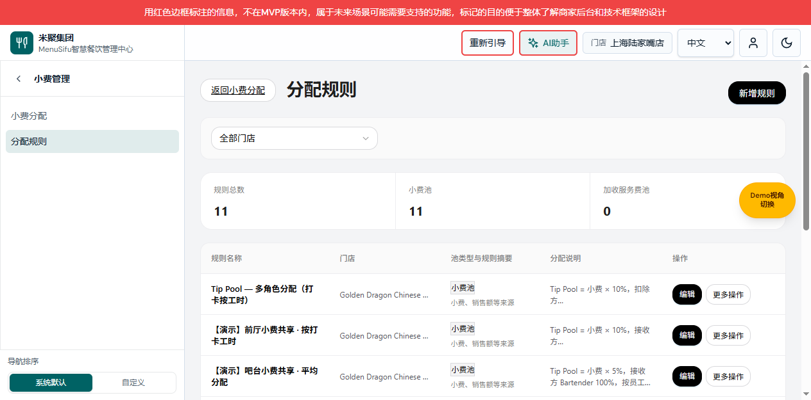

# 小费管理需求文档（个人规范版）

版本 V1.0；2026-10-15；变更编号 TIPOUT-NAV-20261015-01。

对应[产品权威 V3.6](PRD_产品需求文档.md)、[研发权威 V2.6](小费分配业务规格说明书（研发交付版）.md)。本文独立说明本次导航、列表入口及关联返回；历史规则配置和计算页面未批量迁移，不宣称覆盖小费模块全部功能。

共同业务基线：用户确认“小费管理下设置小费分配／分配规则，分配页保留规则管理快捷入口”，公共交互沿用 NAV-20261014-01。图片均为 2026-10-15 原生预览 65024 的隔离演示状态；示例门店、规则和金额不构成新业务定义。

## 小费管理子导航与小费分配页面

图注：子导航展开、日期分配汇总状态，TIPOUT-NAV-20261015-01。

用途／入口：团队管理中整行点击“小费管理”进入同位置覆盖滑层；仅切换导航层，不自动切换右侧业务页面。分配页面与原路由相同。

| 字段｜操作 | 逻辑说明 |
|---|---|
| 小费管理父菜单 | 存在可访问子项才显示可进入的父项；整行含空白可点击，采用公共覆盖滑层，沿用权限和预设范围。 |
| 当前层标题 | 显示“小费管理”，与父层顶部、宽度对齐，覆盖父层搜索与列表。 |
| 返回上一级菜单 | 只返回团队管理导航，业务页面及其筛选不变，不执行保存。 |
| 小费分配 | 进入既有 `/team/tips/distribution`；子层保持显示，当前项高亮。没有查询参数时按原默认视角进入。 |
| 分配规则 | 进入既有 `/team/tips/rules` 规则列表；不是新增或编辑入口。 |
| 日期分配汇总 | 保留原页面内页签，切换规则与统计口径不变，不作为侧栏菜单。 |
| 员工分配汇总 | 保留原页面内页签，沿用原 query 和视角恢复，不新增独立权限。 |
| 规则管理 | 分配页右上角快捷按钮；先保存现有汇总返回状态，再打开规则列表。有规则、无规则都到同一列表，取消空列表自动跳新增的旧分支。不会创建规则或执行分配。 |

## 分配规则列表

图注：规则列表有数据，左侧“分配规则”高亮；同一原生预览版本。

用途／入口：小费管理子导航“分配规则”及分配页“规则管理”进入同一页面，保留主导航与账号栏。

| 字段｜操作 | 逻辑说明 |
|---|---|
| 分配规则标题 | 当前列表标题，两个入口一致。 |
| 返回小费分配 | 保留原返回链接；沿用已保存的汇总状态，直接进入列表且没有返回状态时按分配页原默认行为处理。 |
| 新增规则 | 点击打开既有“选择小费池类型”弹框，不直接创建记录。 |
| 门店筛选 | 保留既有全部门店及可用门店选项、数据来源和筛选逻辑；本次不修改默认筛选或扩展权限范围。 |
| 空列表提示 | 说明“暂无规则，请点击「新增规则」创建”；入口名称与按钮一致。 |
| 编辑／复制／删除 | 沿用原规则操作及其权限、校验、确认和失败处理；不新增侧栏菜单。 |
| 日期／员工分配明细 | 继续由业务列表进入，保留路由和权限，不直接显示为子导航第三项。 |

## 选择小费池类型弹框

图注：从“新增规则”打开，默认小费池选中，2026-10-15 本地原生演示。

用途／入口：规则列表的“新增规则”，复用既有类型选择流程。

| 字段｜操作 | 逻辑说明 |
|---|---|
| 小费池类型 | 沿用原“小费池／加收服务费池”单选及默认值，不新增类型。 |
| 下一步 | 携带所选 poolKind 进入既有新增编辑地址，尚未保存规则。 |
| 取消／关闭 | 关闭弹框并停留列表，不创建规则，不改变列表筛选。 |

## 新增／编辑规则页面的导航关系

图注：新增小费池规则、未保存状态；2026-10-15 本地原生演示。

用途／入口：类型选择下一步或列表“编辑”。本节仅定义本次导航关联，不重述历史全部配置字段。

| 字段｜操作 | 逻辑说明 |
|---|---|
| 规则编辑页面 | 保留既有全屏布局、字段、校验、数据来源和保存规则，不加入侧栏。 |
| 返回规则列表／取消 | 沿用现有取消编辑确认及草稿保护；确认离开后回列表，列表恢复保留主导航的布局。不因导航调整新增自动保存。 |
| 保存规则 | 沿用既有必填校验、成功／失败及返回逻辑；本次无金额、参与资格或写入规则改变。 |

验证及缺口：已实测子导航下钻、同层两叶子、叶子高亮、规则列表正常布局、新增类型弹框、编辑取消确认回列表、子层返回不改业务 URL；原权限父级及空／非空规则快捷入口检查通过。历史宽泛脚本存在与本次无关的旧断言，见研发版说明。本文未覆盖原模块全部历史页面，不作为完整旧 PRD 迁移。
