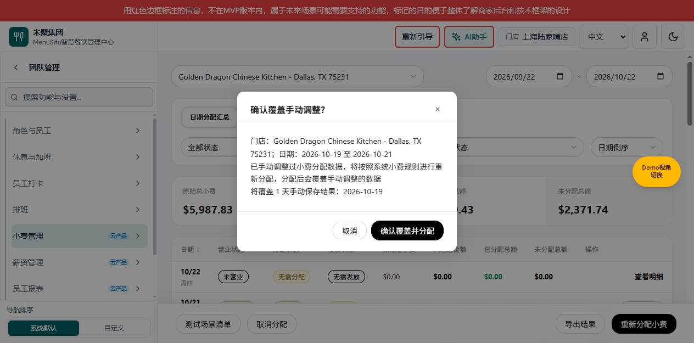
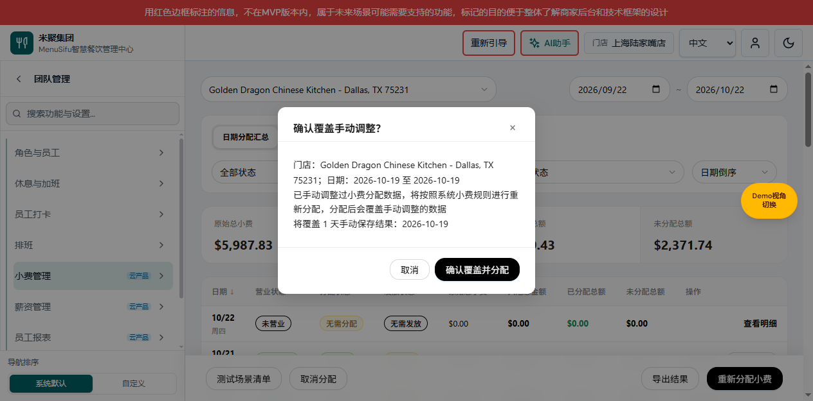

# 小费管理需求文档（个人规范版）

版本 V1.4；2026-10-22；变更编号 TIPOUT-BATCH-20261022-01。

对应[产品权威 V4.0](PRD_产品需求文档.md)、[研发权威 V3.0](小费分配业务规格说明书（研发交付版）.md)。本文独立说明导航、列表入口、明细人工保存／系统重分配和日期汇总覆盖确认；其他历史页面未批量迁移，不宣称覆盖小费模块全部功能。

共同业务基线：导航沿用已确认的双子导航与 NAV-20261014-01；本次按用户确认分离人工保存与系统重新分配。导航截图来源2026-10-15端口65024，新明细截图来源2026-10-22功能预览65110；示例数据不构成新业务定义。

变更记录：V1.4 增加日期汇总单日／范围人工覆盖确认与真实系统重算；V1.3 将保存／重新分配提示改为页面内弹框，补充键盘与关闭定义及实际截图；V1.2 新增保存当前分配、覆盖确认及失败保护；V1.1 删除两个页面内跨页按钮；V1.0 建立双子导航及保留快捷入口，快捷入口定义已由V1.1替代。

## 日期分配汇总：人工结果覆盖确认（TIPOUT-BATCH-20261022-01）

图注：2026-10-22，功能分支codex/tips-batch-manual-warning-20261022，基线da6a8020，端口65112；演示人工保存结果用于验证，并非生产数据。

用途／入口：日期分配汇总底部“重新分配小费／批量分配小费”→选择门店和起止日期→“分配小费”。起止同日即单日，范围含首尾日期；不按汇总表当前营业／分配／发放筛选缩小选择范围。

| 字段／操作 | 逻辑说明 |
| --- | --- |
| 人工结果识别 | 读取所选门店每个可分配日的有效快照，allocationSource===manual表示人工保存；system及历史缺字段不据此推断人工。未营业、已发放或锁定日不实际覆盖，不列入人工提示清单。 |
| 首次分配按钮 | 校验门店和日期后读取范围；不存在可覆盖人工日则按既有覆盖说明进入系统分配。有至少一天人工日时不写入，原选择弹框进入二次确认阶段。 |
| 页面内二次确认 | 标题“确认覆盖手动调整？”，提示“已手动调整过小费分配数据，将按照系统小费规则进行重新分配，分配后会覆盖手动调整的数据”；显示将覆盖的人工天数及完整日期。范围内系统结果日仍参与此次范围重算，不仅重算清单上的人工日。 |
| 范围冻结 | 二次确认阶段用只读摘要展示门店和起止日期，隐藏并禁用原选择字段，完整显示覆盖日期清单；指纹包含范围、每个日期的营业／锁定资格和已保存快照。确认时数据变化则取消授权，恢复范围选择并提示重新检查，不使用旧确认覆盖新数据。 |
| 确认覆盖并分配 | 明确点击后先预生成并校验全部可执行日期的系统快照；复用明细系统重建，不加载旧人工公式、人员调整、权重或手工工时为新系统结果。提交后来源为system，统计读取新快照。不能只写已分配日期标记。 |
| 取消／关闭／Esc／遮罩 | 均取消该次覆盖，不写分配结果，不清除人工快照；下一次操作重新识别人工日期。关闭后焦点返回汇总分配入口。 |
| 执行及失败 | 执行期间按钮禁用，阻止重复提交。全部日期先校验，计算失败不写任何日期；实际存储沿用按日原子提交及乐观冲突检查，后续日提交失败则停止，已成功日保留并报告已保存天数，不谎报全部成功。此为本次本地实现边界，不自动关闭原Q11跨日生产事务决策。 |
| 薪资与统计 | 全部日期成功后刷新范围与汇总并调用既有薪资桥接；薪资失败明确已保存但同步失败。已发放锁定仍受日期写锁保护，不被重新分配。 |

### 单日覆盖确认

同一确认页面按实际数据展示1天和日期，不使用另一套规则。

### 可验收算例

范围10/19—10/21中，10/19人工比例60/40已保存，10/20系统50/50，10/21人工70/30已保存：提示2天（10/19、10/21）；取消后三天快照均不变。确认后所有可执行日按系统规则重算，不保留60/40和70/30。如果10/21已发放，则跳过、提示清单仅含10/19，并反馈跳过数量。

验证状态：专项覆盖单日、范围、多人工日、混合系统日、未营业、已锁定及指纹变化；范围预计算、真实快照提交与并发参数检查。实际浏览器：10/19与10/21人工v2，取消后均不变；10/19—10/21确认后两日均为system v3，10/20为system v1，10/19公式由人工100恢复系统200。单日二次确认显示1天及10/19。类型检查、既有保存／页面弹框／存储专项通过。不表示生产上线、Q11闭合或全套历史脚本通过。

## 小费分配明细：保存与系统重分配（TIPOUT-DIALOG-20261022-01）

图注：基础明细截图来自2026-10-22、基线f5940cbd的功能预览65110，仅用于定位保存按钮。下方弹框截图来自本次基线ae7443e9、codex/tips-page-dialogs-20261022、端口65111；计算与保存定义未变。

用途／入口：当前门店、营业日明细底部。“保存当前分配”位于“重新确认分配”右侧；规则筛选只控制可见区块，两操作均处理当天全部规则。已发放仍锁定，不改变资金、人员及金额校验。

| 字段／操作 | 逻辑说明 |
| --- | --- |
| 共用页面内对话框 | 使用项目modal-overlay/modal样式，不调用浏览器alert/confirm；notice/save/reallocate三个类型。打开默认聚焦主按钮，Tab／Shift+Tab循环限定在弹框按钮内；关闭回到触发按钮。确认前不提交，重复打开不重复执行。取消、右上角关闭、遮罩或Esc均返回取消；弹框期间门店、日期或基准快照变化时不执行原确认。同日外部状态变化自动取消弹框，再按既有状态处理。 |
| 手动调整标记 | 员工、权重、工时、比例、角色占比、公式等既有可编辑项发生手动输入或增删即标记；改回原值仍视为已操作。筛选、查看不标记；更新小费数据的系统草稿不单独算人工调整。首次手工录入无快照仍沿用“确认分配”。 |
| 保存当前分配 | 已有系统分配且有未保存人工调整时启用；无人工调整时置灰、aria-disabled=true但可点击原因提示，不写入。保存成功清除未保存人工标记并置灰。执行中、无已分配结果、不可分配日或锁定时真正禁用。 |
| 保存确认 | 提示“已手动调整过小费分配数据，将按照手动调整后的分配数据进行统计”；确认后校验并保存页面当前全部规则结果，不重建系统默认值。取消不写入并保留草稿。 |
| 重新确认分配 | 已分配未锁定日期可主动重算。有未保存人工调整或上次快照为人工来源时提示“已手动调整过小费分配数据，将按照系统小费规则进行重新分配，分配后会覆盖手动调整的数据”；无人工调整保留原覆盖提示。 |
| 系统重算 | 确认后使用当前门店全部有效规则、系统事实及默认工时，忽略当天人工调整、手工工时；新快照校验与提交成功后才替换页面。取消不变；失败保留原草稿与旧有效快照。 |
| 提交保护 | 沿用日期锁、快照哈希冲突、金额与人员校验。执行中阻止重复操作、编辑及离开；失败不清草稿。统计只读取最新成功保存快照，不使用草稿；薪资同步失败明确提示已保存但同步失败，不回滚快照。 |
| allocationSource | 快照可选字符串 manual/system，人工保存写 manual，系统自动或重分配写 system，随完整快照保存。重开人工快照仍提示覆盖人工数据；旧快照无此字段不推断来源、不自动迁移重算。 |

### 未调整提示框

点击灰色保存，仅提示“当前系统分配数据未进行手动调整”；关闭不改变统计或快照版本。 页面内标题“提示”，按钮“知道了”，右上角可关闭；不调用浏览器alert。

### 人工保存确认框

提示采用上表原文。页面内标题“保存当前分配？”，底部“取消／保存当前分配”；确认才保存，取消、关闭、遮罩或Esc保留草稿和旧统计。

### 覆盖人工数据确认框

提示采用上表原文。页面内标题“重新确认分配？”，底部“取消／重新确认分配”；确认才重算，取消、关闭、遮罩或Esc不覆盖。无人工调整时的原覆盖提示同样使用此页面内弹框。

### 验收算例

预算 $100，A/B 权重均为1、工时均4h，系统各分 $50。人工比例改为60%/40%，保存确认后统计为 $60/$40；取消保存仍统计 $50/$50并保留草稿。重新确认分配并确认覆盖后按4h:4h恢复 $50/$50。未调整点灰色保存只提示；失败和并发冲突不覆盖草稿；已发放不能保存或重分配。

验证状态：保存/重算专项、页面弹框专项、确认/自动分配回归及类型检查通过。隔离浏览器验证三种页面弹框、Esc保留草稿、Tab循环及焦点返回、取消不写入；确认人工保存生成manual快照v2（公式100），页面确认系统重算生成system快照v3（公式200）。三个弹框实截图已就近嵌入。不宣称生产发布或全套历史回归通过；既有payout-ui和detail-rounding旧测试缺口保留。

## 小费管理子导航与小费分配页面

图注：子导航展开、日期分配汇总状态，TIPOUT-DIALOG-20261022-01。

用途／入口：团队管理中整行点击“小费管理”进入同位置覆盖滑层；仅切换导航层，不自动切换右侧业务页面。分配页面与原路由相同。

| 字段｜操作 | 逻辑说明 |
|---|---|
| 小费管理父菜单 | 存在可访问子项才显示可进入的父项；整行含空白可点击，采用公共覆盖滑层，沿用权限和预设范围。 |
| 当前层标题 | 显示“小费管理”，与父层顶部、宽度对齐，覆盖父层搜索与列表。 |
| 返回上一级菜单 | 只返回团队管理导航，业务页面及其筛选不变，不执行保存。 |
| 小费分配 | 进入既有 `/team/tips/distribution`；子层保持显示，当前项高亮。没有查询参数时按原默认视角进入。 |
| 分配规则 | 进入既有 `/team/tips/rules` 规则列表；不是新增或编辑入口。 |
| 日期分配汇总 | 保留原页面内页签，切换规则与统计口径不变，不作为侧栏菜单。 |
| 员工分配汇总 | 保留原页面内页签，沿用原 query 和视角恢复，不新增独立权限。 |
| 页面内规则管理按钮 | 已移除；用户通过左侧“分配规则”进入列表，不触发分配或创建规则。 |

## 分配规则列表

图注：规则列表有数据，左侧“分配规则”高亮；同一原生预览版本。

用途／入口：小费管理子导航“分配规则”进入列表，保留主导航与账号栏。

| 字段｜操作 | 逻辑说明 |
|---|---|
| 分配规则标题 | 当前列表标题，两个入口一致。 |
| 页面内返回小费分配按钮 | 已移除；通过左侧“小费分配”切换，既有导航与视角恢复规则不变。 |
| 新增规则 | 点击打开既有“选择小费池类型”弹框，不直接创建记录。 |
| 门店筛选 | 保留既有全部门店及可用门店选项、数据来源和筛选逻辑；本次不修改默认筛选或扩展权限范围。 |
| 空列表提示 | 说明“暂无规则，请点击「新增规则」创建”；入口名称与按钮一致。 |
| 编辑／复制／删除 | 沿用原规则操作及其权限、校验、确认和失败处理；不新增侧栏菜单。 |
| 日期／员工分配明细 | 继续由业务列表进入，保留路由和权限，不直接显示为子导航第三项。 |

## 选择小费池类型弹框

图注：从“新增规则”打开，默认小费池选中，2026-10-15 本地原生演示。

用途／入口：规则列表的“新增规则”，复用既有类型选择流程。

| 字段｜操作 | 逻辑说明 |
|---|---|
| 小费池类型 | 沿用原“小费池／加收服务费池”单选及默认值，不新增类型。 |
| 下一步 | 携带所选 poolKind 进入既有新增编辑地址，尚未保存规则。 |
| 取消／关闭 | 关闭弹框并停留列表，不创建规则，不改变列表筛选。 |

## 新增／编辑规则页面的导航关系

图注：新增小费池规则、未保存状态；2026-10-15 本地原生演示。

用途／入口：类型选择下一步或列表“编辑”。本节仅定义本次导航关联，不重述历史全部配置字段。

| 字段｜操作 | 逻辑说明 |
|---|---|
| 规则编辑页面 | 保留既有全屏布局、字段、校验、数据来源和保存规则，不加入侧栏。 |
| 返回规则列表／取消 | 沿用现有取消编辑确认及草稿保护；确认离开后回列表，列表恢复保留主导航的布局。不因导航调整新增自动保存。 |
| 保存规则 | 沿用既有必填校验、成功／失败及返回逻辑；本次无金额、参与资格或写入规则改变。 |

验证及缺口：已实测子导航下钻、同层两叶子、叶子高亮、规则列表正常布局、新增类型弹框、编辑取消确认回列表、子层返回不改业务 URL；原权限父级检查保留，删除入口另行验证。历史宽泛脚本存在与本次无关的旧断言，见研发版说明。本文未覆盖原模块全部历史页面，不作为完整旧 PRD 迁移。
