# 小费管理页面说明（个人规范版）

版本：**V2.35**　日期：2026-10-26　文档编号：TIPOUT-RANGE-CONDITIONS-20261026-01

实现基线：`edd906b6`＋本次分配范围文案修改。本文说明项目可执行的现行功能。

配套文档：[产品说明 V4.37](PRD_产品需求文档.md)／[研发规格 V3.37](小费分配业务规格说明书（研发交付版）.md)。

本文按页面定义字段与操作。计算和状态术语采用产品说明§2—§3；数据结构见研发规格。

## 1. 日期分配汇总

图：日期分配汇总。项目页面，演示数据；来源见[图像清单](assets/tips-current-spec-20261026/manifest.json)。

入口与范围：小费管理→小费分配；作用于当前门店与日期范围。

### 查询条件

| 字段／操作 | 说明 |
| --- | --- |
| 门店 | 单选；限定规则、员工和来源数据。与员工汇总共用，切换后更新查询，不跨门店合并同名员工。 |
| 今天 | 开始=结束=浏览器本地今天。 |
| 昨天 | 开始=结束=今天前一日，跨月／跨年按日历处理。 |
| 本周 | 默认；周一至今天，包含首尾。 |
| 上周 | 上周一至上周日。 |
| 本月 | 当月1日至今天，不包含未来日。 |
| 上月 | 上月1日至最后一天，闰年按实际月历。 |
| 开始日期 | 必填完整日期；不得晚于结束日。无效、空值或倒置时标错，保留上次有效结果，不启动分配。 |
| 结束日期 | 必填，默认今天。手动改日期清除快捷项高亮；合法确认后刷新并预检自动任务。 |
| 日期分配汇总页签 | 切换日期任务视角，保留共用门店日期，不重分配。 |
| 员工分配汇总页签 | 切换角色和员工视角，保留共用门店日期，不重分配。 |
| 营业状态 | 全部／正常营业／未营业，与其他条件取交集。 |
| 分配状态 | 全部／已分配／未分配，筛选日期行及对应概览。 |
| 发放状态 | 全部／待发放／已发放／无需发放，不代替分配状态。 |
| 日期排序 | 日期倒序或顺序；不改变执行规则和金额。 |

### 金额概览

| 字段／操作 | 说明 |
| --- | --- |
| 原始总小费 | 当前可见日期原始小费合计。 |
| 入池总金额 | 未确认日期采用预计可分配池；已确认日期采用快照池金额。 |
| 已分配总额 | 当前可见日期的正式接收金额合计，未确认日计0。 |
| 未分配总额 | 未确认日等于预计入池；确认日等于池余额，按可见日期求和。 |

### 日期行

| 字段／操作 | 说明 |
| --- | --- |
| 日期 | MM/DD＋星期几；内部保留完整年月日。 |
| 营业状态 | 正常营业或未营业。 |
| 分配状态 | 已分配、未分配或无需分配。 |
| 发放状态 | 待发放、已发放或无需发放。 |
| 原始总小费 | 当日原始金额；未营业为0。 |
| 入池总金额 | 当日预计或快照可分配池金额。 |
| 已分配总额 | 当日确认接收额；确认前为0。 |
| 未分配总额 | 当日尚未分给员工的池金额。 |
| 查看明细 | 携带门店、日期打开当日明细；返回保留查询上下文。未营业日点击提示原因并留在汇总。 |
| 分配 | 符合行内条件时显示，执行整日系统分配。 |
| 确认已发放 | 符合发放条件时显示，打开整日登记确认。 |

### 底部操作

| 字段／操作 | 说明 |
| --- | --- |
| 导出结果 | 选择CSV、PDF或邮箱；使用当前视角和有效筛选。 |
| 批量分配小费／重新分配小费 | 打开主动分配日期范围，不等同无覆盖的自动补分配。 |

## 2. 员工分配汇总

图：员工分配汇总。项目页面，演示数据；来源见[图像清单](assets/tips-current-spec-20261026/manifest.json)。

入口与范围：日期汇总→员工分配汇总。

### 筛选与角色汇总

| 字段／操作 | 说明 |
| --- | --- |
| 角色 | 默认全部，限定当前门店的角色集合；与日期、员工和状态取交集。 |
| 员工 | 当前有效员工多选；使用稳定ID，支持全部。 |
| 分配状态 | 已完成／部分待分配／待分配等周期条件，约束列表和角色汇总。 |
| 角色卡 | 按角色归集当前查询员工的分配前、贡献、接收、分配后金额；贡献包含预计，正式接收和分配后只统计确认部分。 |
| 贡献金额旁“？” | 以“贡献金额明细”为标题，展示“已分配日期”“待分配日期（预计）”和“合计”；预计失败说明无法试算，不把部分数显示成完整总数。 |

### 员工列表

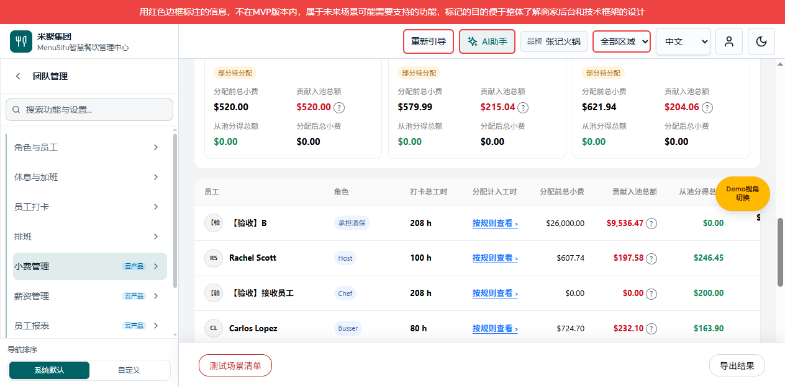

图：员工列表。项目页面，演示数据；来源见[图像清单](assets/tips-current-spec-20261026/manifest.json)。

| 字段／操作 | 说明 |
| --- | --- |
| 员工 | 姓名、身份信息；可按姓名排序，同名不同ID不合并。 |
| 角色 | 当前参与的角色展示，不作为唯一身份键。 |
| 打卡总工时 | 周期原始打卡工时累计，不受小费人工工时调整影响；无有效记录显示—。可排序，缺失排末。 |
| 分配计入工时 | 按每条工时规则逐日累计，不跨不同规则相加；单一口径显示小时，不同口径显示可点击摘要。 |
| 分配前总小费 | 周期全部有效日原始小费，包含未分配日。 |
| 贡献入池总额 | 已确认贡献＋未确认预计贡献；问号以“贡献金额明细”为标题，展示“已分配日期”“待分配日期（预计）”“合计”；提示“待分配金额为试算结果，以实际分配结果为准。” |
| 从池分得总额 | 仅累计已确认接收。 |
| 分配后总小费 | 仅累计已确认结果，默认按此倒序；无有效确认显示—。 |
| 分配状态 | 按员工适用日的确认情况显示已完成／部分待分配／待分配。 |
| 员工明细入口 | 携带员工ID、门店、周期和返回上下文，打开每日明细。 |

## 3. 员工每日考勤分配

图：员工每日考勤分配。项目页面，演示数据；来源见[图像清单](assets/tips-current-spec-20261026/manifest.json)。

入口与范围：员工汇总→员工行；只查看该员工。

### 上下文与统计

| 字段／操作 | 说明 |
| --- | --- |
| 员工 | 当前选择员工的身份及姓名。 |
| 角色 | 该员工的适用角色，不作为唯一身份键。 |
| 开始日期 | 继承查询周期，可调整；必填且起止合法。该页改日期只查询，不触发自动分配。 |
| 结束日期 | 继承查询周期，可调整；必填且起止合法。该页改日期只查询，不触发自动分配。 |
| 考勤状态 | 全部、已打卡、未打卡、打卡异常、手动工时、混合工时，按记录来源过滤。 |
| 分配状态 | 全部／已分配／待分配。 |
| 打卡总工时 | 当前过滤日原始打卡工时合计。 |
| 分配工时 | 按规则累计及来源摘要，点击查看规则明细。 |
| 分配前总小费 | 过滤日原始小费合计，包含未分配。 |
| 贡献入池总额 | 确认＋预计贡献，预计不是实扣。 |
| 从池分得总额 | 过滤日已确认接收合计；无确认显示—。 |
| 分配后总小费 | 过滤日已确认结果合计；无确认显示—。 |
| 返回员工分配汇总 | 恢复来源查询、排序及位置。 |
| 导出结果 | 按当前员工和过滤周期导出。 |

### 每日行

| 字段／操作 | 说明 |
| --- | --- |
| 日期 | MM/DD＋星期；支持日期排序，进入默认倒序。 |
| 考勤 | 真实打卡及异常标签，手动分配不改打卡事实。 |
| 打卡工时 | 当日原始值；0与没有记录—区分。 |
| 分配工时 | 当天各工时规则采用值及来源，点击只看该日。 |
| 分配前小费 | 当天原始小费，未分配也展示。 |
| 贡献入池 | 确认日读快照；未分配日显示预计值或试算错误。 |
| 从池分得 | 确认日接收额，待分配显示—。 |
| 分配后小费 | 确认日最终金额，待分配显示—。 |
| 分配状态 | 已分配／待分配，不由是否打卡决定。 |

## 4. 当日小费分配明细

图：当日小费分配明细。项目页面，演示数据；来源见[图像清单](assets/tips-current-spec-20261026/manifest.json)。

入口与范围：日期汇总→查看明细；处理门店的一个完整营业日。

### 上下文与概览

| 字段／操作 | 说明 |
| --- | --- |
| 门店 | 限定当日规则与人员；切换时有未保存调整先确认是否放弃。 |
| 日期 | 完整营业日，切换后重新检查营业和发放状态。 |
| 规则名称筛选 | 多选、全选；只改变可见规则，不缩小保存或发放的整日范围。 |
| 原始总小费 | 当日来源总额，保持与员工原始事实一致。 |
| 入池总金额 | 当日可分配池金额；草稿变化尚未成为正式确认结果。 |
| 已分配总额 | 有效确认接收金额，不把未保存调整直接计入。 |
| 未分配总额 | 未确认采用预计池金额，确认后采用池余额。 |
| 小费池数量 | 当日适用规则／池数量。 |

### 规则金额与贡献

图：规则金额与贡献。项目页面，演示数据；来源见[图像清单](assets/tips-current-spec-20261026/manifest.json)。

| 字段／操作 | 说明 |
| --- | --- |
| 规则名称 | 当前规则块的保存名称。 |
| 计算模式 | 小费池汇总分配；金额计算后按接收组与员工分配。 |
| 公式基数 | 来源条件过滤后的金额；可编辑值只影响当次分配草稿，不改来源订单。 |
| 公式占比 | 百分数输入，10表示10%；修改重算本次草稿。 |
| 公式详情 | 展开来源基数、比例和结果，关闭不写账。 |
| 小费池计算金额 | 规则的金额计算目标P。 |
| 员工贡献金额 | 已确认取快照C；未确认是按当前事实试算。 |
| 实际可分配金额 | 独立贡献路径D=max(P,C)，作为接收预算。 |
| 老板补足金额 | 独立贡献路径E=max(P−C,0)；草稿前缀预计，仅C与P不同的对照区显示，不代表已付款。 |
| 贡献超计划提示 | 只在C>P的规则显示差额和对照，点击说明展开／收起。 |
| 贡献不足提示 | 只在C<P的规则显示差额、老板补足及采用金额。 |
| 贡献员工 | 显示命中贡献角色的员工、承担比例及对应金额，不受接收资格限制。 |
| 应扣金额 | 按本贡献项应贡献额及员工承担比例得到；草稿前缀预计。 |
| 可扣余额 | 扣除本项前，员工当前还可用于贡献的原始小费。 |
| 实际扣除 | min(应扣金额,可扣余额)；确认前为预计，不转嫁差额。 |
| 少扣金额 | 应扣与实际扣除的差额，存在少扣时展示原因。 |
| 承担比例 | 平均或自定义承担比例，只作用于本贡献项的应贡献金额。 |

### 接收组与员工行

| 字段／操作 | 说明 |
| --- | --- |
| 接收角色／组 | 同一配置行的共同预算组，可折叠查看。 |
| 角色分配比例 | 组占比；同层合计须符合100%约束。 |
| 角色分配金额 | 由该池实际可分配金额和组占比得到。 |
| 分配员工 | 选择当前门店及接收范围员工；真实考勤标签保持。 |
| 员工权重 | 规则默认值，可调整当日采用值；0合法，不修改规则默认。 |
| 分配工时 | 工时方式适用，普通按日可明确修改或补录；不反写考勤。 |
| 有效订单笔数 | 订单方式的事实依据；只读，不用销售额代替。 |
| 员工分配比例 | 自动来自加权基数；普通工时方式可明确改为人工最终比例。 |
| 员工分配金额 | 从池分得金额A，不等同分配后F。 |
| 新增行 | 加入本次分配草稿，不创建员工目录；参与及依据必须有效。 |
| 删除行 | 移除本次草稿行，重算相关分配，不删除员工。 |

### 页面操作

| 字段／操作 | 说明 |
| --- | --- |
| 返回汇总 | 恢复来源视角、筛选和位置；有未保存调整先保护草稿。 |
| 更新小费数据 | 确认后重新读取来源、重建默认计算；已发放不能更新。 |
| 确认分配 | 首次保存整日所有规则；校验失败留在页面并保留草稿。 |
| 重新确认分配 | 已有分配时按系统规则重新生成；人工结果须确认覆盖。 |
| 保存当前分配 | 已有结果且发生手调时可用；无手调显示“当前系统分配数据未进行手动调整”，不写入。 |
| 确认已发放 | 整日有效快照、无未保存调整且未发放时可登记；发放后锁定编辑。 |

## 5. 分配规则列表

图：分配规则列表。项目页面，演示数据；来源见[图像清单](assets/tips-current-spec-20261026/manifest.json)。

入口与范围：小费管理→分配规则。

### 筛选与统计

| 字段／操作 | 说明 |
| --- | --- |
| 门店筛选 | 默认全部门店，可选择指定门店，限制列表及统计。 |
| 规则总数 | 当前筛选规则数量。 |
| 小费池 | 当前筛选中小费池规则数量。 |
| 加收服务费池 | 当前筛选中服务费池规则数量。 |

### 列表与操作

| 字段／操作 | 说明 |
| --- | --- |
| 规则名称 | 规则保存名称，不是某天的确认结果。 |
| 门店 | 该规则适用的门店。 |
| 池类型与规则摘要 | 显示来源类别及来源摘要。 |
| 分配说明 | 概述金额计算、贡献、接收组、算法及工时配置。 |
| 编辑 | 打开该规则当前配置。 |
| 更多操作／复制 | 克隆配置并生成新规则ID和副本名称；不复制分配或发放结果。 |
| 更多操作／删除 | 打开确认框；确认删除规则配置，取消保留。不会清除已保存的日期快照。 |
| 新增规则 | 先选择小费池或加收服务费池，再进入编辑页。 |

## 6. 新增／编辑分配规则

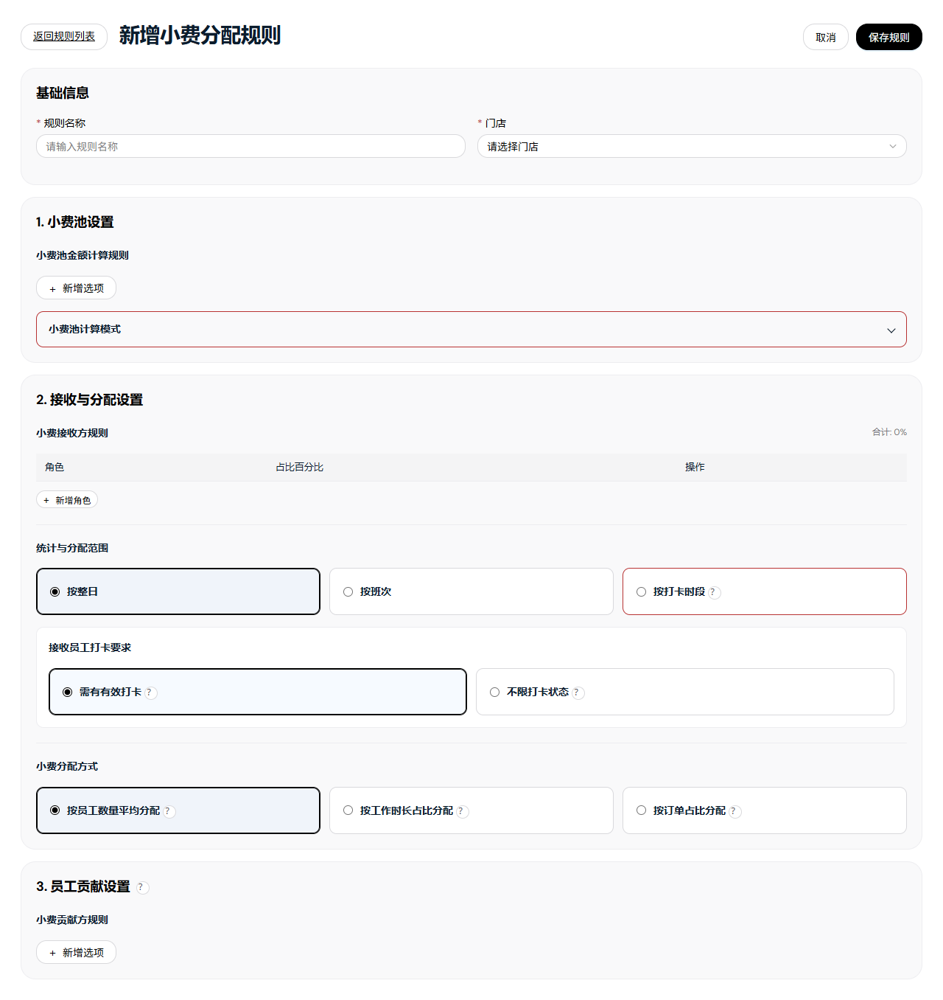

图：新增／编辑分配规则。916bcdcf基线功能分支，2026-10-26，受控演示；来源见[图像清单](assets/tips-current-spec-20261026/manifest.json)。

入口与范围：规则列表→新增或编辑。分配规则与贡献规则分开配置。

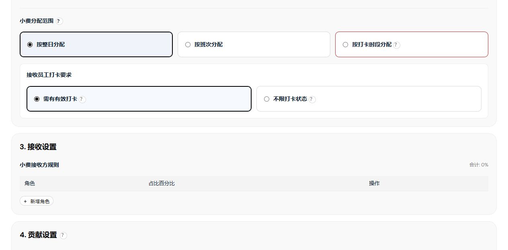

图：规则编辑，分配设置（方式、工时、范围及联动条件）→ 接收设置（角色、占比、权重）；edd906b6基线功能分支真实模板与运行时，受控演示，2026-10-26。

页面按四个独立分组配置：**小费池设置 → 分配设置 → 接收设置 → 贡献设置**。小费池设置包含金额计算及默认折叠的高级模式；分配设置包含分配方式、分配工时、范围及范围联动条件；接收设置包含接收方规则与员工权重；贡献设置独立配置贡献规则与员工承担比例。组内使用小标题和分隔线，不把每个条件拆成独立大卡片。

### 基础信息与顶部操作

| 字段／操作 | 说明 |
| --- | --- |
| 规则名称 | 必填，去除首尾空格；为空阻止保存。 |
| 门店 | 必选，决定角色、员工、来源条件候选；为空阻止保存。 |
| 池类型 | 由新增入口选择：小费池或加收服务费池；影响相关字段文案及可选条件。 |
| 保存规则 | 校验所有必填、条件、接收份额、权重、员工承担及工时，成功持久化配置并返回列表；失败保留输入。 |
| 取消／返回规则列表 | 离开本页，不把当前未保存配置写入正式规则。 |

### 小费池设置

#### 小费池金额计算规则

| 字段／操作 | 说明 |
| --- | --- |
| 新增选项 | 可选销售额、个人销售额、小费、手动上报、加收服务费、自定义等当前来源。 |
| 计算项名称 | 为本来源项命名，默认使用来源名称；只标识计算项。 |
| 来源类型 | 决定可添加的条件及基数来源；不同类型不共享不适用条件。 |
| 计算比例 | 来源项默认100%；百分数输入，结果=基数×比例/100。确认分配仍校验金额及来源约束。 |
| 自定义金额 | 自定义来源显示金额与占比输入，初始金额0、占比100%；不等同固定员工贡献。 |
| 设置取值条件 | 来源项独立条件；有必填条件的来源未设置时阻止保存。 |
| 删除计算项 | 只删除当前规则草稿项；汇总模式至少保留一项有效来源。 |

#### 高级计算模式

| 字段／操作 | 说明 |
| --- | --- |
| 小费池计算模式 | 默认折叠，点击标题展开／收起；折叠不改已选模式。 |
| 小费池汇总分配 | 默认模式，先形成可分配池，再按接收组与员工分配。 |

### 分配设置与接收设置

#### 小费接收方规则

| 字段／操作 | 说明 |
| --- | --- |
| 接收角色 | 一行可选多个角色，共同形成一个接收组。 |
| 占比百分比 | 普通接收组同层合计100%；新行默认0，角色和有效占比须填写。 |
| 设置员工小费权重 | 先有角色才能设置；打开员工权重弹框。 |
| 再分配 | 配置该父组内的子接收组；子比例相对父预算。 |
| 新增角色／删除 | 添加或删除预算组，保存重新校验份额；不创建或删除角色目录。 |

#### 小费分配范围

图：小费分配范围，说明展开；edd906b6基线功能分支真实模板与运行时，受控演示，2026-10-26。

标题旁问号说明：确定小费按什么时间范围统计，并在该范围内分配给符合条件的员工。三个选项显示为“按整日分配”“按班次分配”“按打卡时段分配”；选项值与计算规则不变。

范围采用与分配方式一致的卡片样式。点击整张卡片选择，问号不改变选值；窄屏按顺序纵向排列，打卡时段保留红框。

| 字段／操作 | 说明 |
| --- | --- |
| 按整日分配 | 默认，使用整日金额与适用接收员工打卡要求。 |
| 按班次分配 | 读取已保存排班表，不展示班次设置。 |
| 按打卡时段分配 | 按逐笔时间与实际打卡区间匹配接收员工。 |

##### 接收员工打卡要求

两个选项复用小费分配范围的卡片样式，选中、悬停、焦点效果一致。宽屏两列等宽等高，宽度不超过900px时纵向排列。点击卡片主体切换选值；各自问号只展开说明，不改变选值或自动保存。

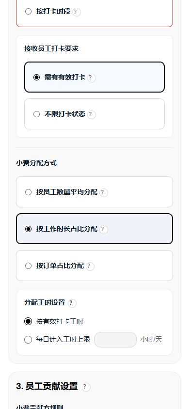

图：规则编辑页，390px窄屏打卡要求；edd906b6基线功能分支，2026-10-26，实际模板与运行时的受控演示。

位于小费分配范围下方，仅按整日展示。

| 字段／操作 | 说明 |
| --- | --- |
| 需有有效打卡 | 整日模式默认接收员工打卡要求；与算法分别配置，时段模式不显示。 |
| 不限打卡状态 | 按名单和有效依据参与，不自动纳入所有员工。 |
| 资格问号 | 说明随当前分配方式联动，帮助阅读不保存规则。 |

#### 小费分配方式

| 字段／操作 | 说明 |
| --- | --- |
| 按员工数量平均分配 | 默认，按合格员工的权重占比分配。 |
| 按工作时长占比分配 | 以有效分配工时×权重计算，显示工时设置。 |
| 按订单占比分配 | 以有效订单笔数×权重计算，不使用工时设置。 |
| 分配方式问号 | 点击显示对应说明及示例，不改变选值。 |

##### 分配工时设置

位于分配方式下方，仅使用工时时展示；班次模式的限制在范围区域内设置，班次时间与名单依排班表。

| 字段／操作 | 说明 |
| --- | --- |
| 按有效打卡工时 | 工时方式默认采用有效考勤工时。 |
| 每日计入工时上限 | 选择上限模式时必填0.1—24、最多一位小数，按员工逐日限制。 |
| 时段工时说明 | 打卡时段模式按有效在岗区间计算，无每日上限输入。 |

### 员工贡献设置

#### 小费贡献方规则

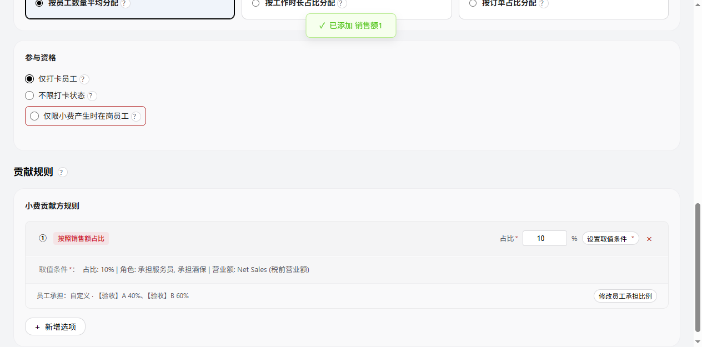

图：贡献规则／小费贡献方规则。项目页面，演示数据；来源见[图像清单](assets/tips-current-spec-20261026/manifest.json)。

| 字段／操作 | 说明 |
| --- | --- |
| 新增选项 | 按照销售额占比、按照个人销售额占比、按照小费收入占比；销售额与个人销售额条件按界面互斥。 |
| 贡献比例 | 初始0，保存时必填且大于0；按百分数输入，员工承担配置路径最多两位百分比小数、不能超过100%。 |
| 设置取值条件 | 至少选择一个角色；小费收入贡献还需要小费类型。 |
| 角色条件 | 决定被扣款员工范围，与接收方角色及资格独立。 |
| 修改员工承担比例 | 只有本项已经应用角色才显示整行；无门店点击提示“请先选择门店”。 |
| 员工承担摘要 | 显示平均分担或已配置的自定义比例；不直接执行扣款。 |
| 删除贡献项 | 仅删除规则草稿项，后续保存才生效。 |

## 7. 弹框、抽屉及操作结果

### 7.1 自动分配状态与结果

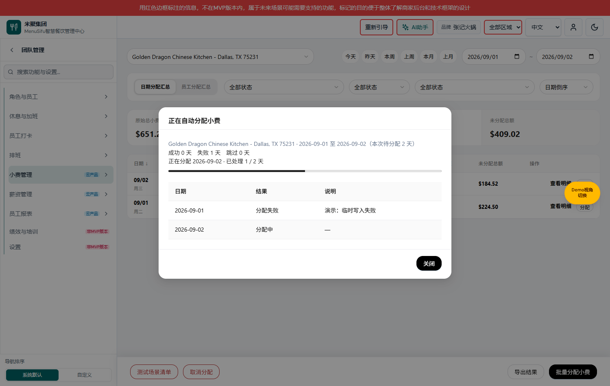

图：自动分配状态与结果。项目页面，演示数据；来源见[图像清单](assets/tips-current-spec-20261026/manifest.json)。

入口与范围：进入汇总或确认有效日期后，有合格未分配日期才打开。

| 字段／操作 | 说明 |
| --- | --- |
| 门店／日期范围 | 任务开始时固定的查询范围；列明本次待分配天数。 |
| 成功天数 | 已保存系统快照的任务数。 |
| 失败天数 | 执行失败的任务数；失败原因逐日列出。 |
| 跳过天数 | 执行时发现已被其他页面处理或状态变化的任务数。 |
| 已处理／进度条 | 成功＋失败＋跳过，相对本次任务总数；非选中日期总数。 |
| 日期／结果／说明 | 等待、分配中、分配成功、分配失败、已跳过及原因。 |
| 重试失败日期 | 全部任务结束且仍有失败时才显示并启用；运行中或失败为0隐藏、不占位、不进入Tab。 |
| 关闭 | 运行中禁用，完成后关闭结果但不撤销保存；完成有失败聚焦重试，否则聚焦关闭。 |

#### 执行结束，有失败才显示重试

图：执行结束，有失败才显示重试。项目页面，演示数据；来源见[图像清单](assets/tips-current-spec-20261026/manifest.json)。

#### 全部成功，仅保留关闭

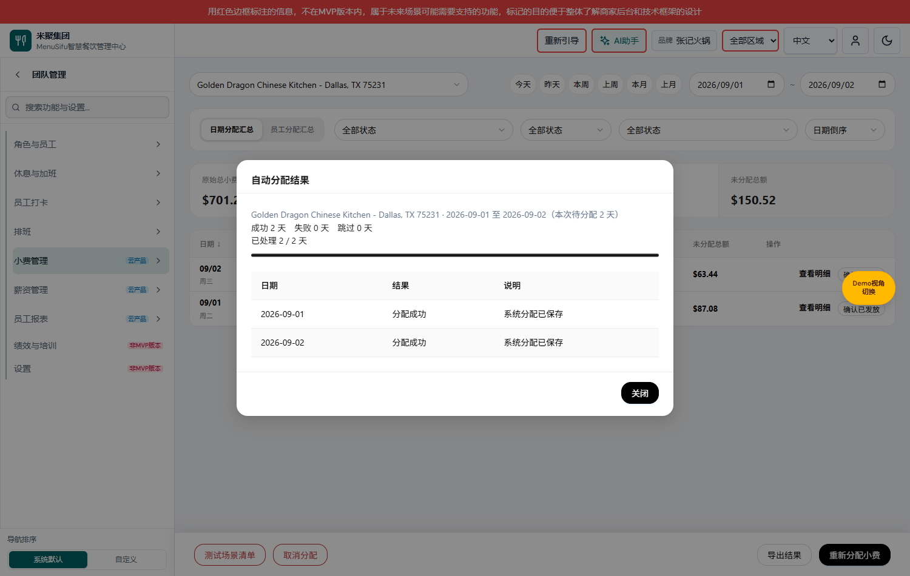

图：全部成功，仅保留关闭。项目页面，演示数据；来源见[图像清单](assets/tips-current-spec-20261026/manifest.json)。

### 7.2 主动批量分配范围

图：主动批量分配范围。项目页面，演示数据；来源见[图像清单](assets/tips-current-spec-20261026/manifest.json)。

入口与范围：日期汇总底部批量分配／重新分配小费。

| 字段／操作 | 说明 |
| --- | --- |
| 门店 | 当前操作门店，不能把多店混入一个范围。 |
| 开始日期／结束日期 | 包含首尾；空值、非法或倒置阻止提交并提示。 |
| 确认分配 | 预检范围、跳过未营业／已发放；有人工结果先二次确认。 |
| 取消／关闭 | 不写入，恢复来源查询。 |

### 7.3 覆盖人工结果确认

图：覆盖人工结果确认。项目页面，演示数据；来源见[图像清单](assets/tips-current-spec-20261026/manifest.json)。

入口与范围：主动重分配范围包含已保存人工调整时出现。

| 字段／操作 | 说明 |
| --- | --- |
| 提示正文 | 按系统小费规则重新分配，并覆盖手动调整结果；列出受影响天数和日期。 |
| 确认覆盖并分配 | 再次核对范围与快照未被其他页面更改后执行。 |
| 取消／关闭 | 保留人工快照，不执行本轮重分配。 |

### 7.4 确认已发放

图：确认已发放。项目页面，演示数据；来源见[图像清单](assets/tips-current-spec-20261026/manifest.json)。

入口与范围：日期汇总行或当日明细；作用于整日全部已确认规则。

| 字段／操作 | 说明 |
| --- | --- |
| 门店／日期 | 待登记的单店单日。 |
| 已分配金额／人数 | 当前确认快照的接收额和接收人数，仅供核对。 |
| 确认已发放 | 保存对应快照ID、版本和哈希的登记，锁定编辑；重复操作不重复生成有效记录。 |
| 取消／关闭 | 不登记，保留待发放；运行中防止重复提交。 |

#### 当日明细发放确认

图：当日明细发放确认。项目页面，演示数据；来源见[图像清单](assets/tips-current-spec-20261026/manifest.json)。

#### 发放后只读结果

图：发放后只读结果。项目页面，演示数据；来源见[图像清单](assets/tips-current-spec-20261026/manifest.json)。

### 7.5 分配计入工时明细

图：分配计入工时明细。项目页面，演示数据；来源见[图像清单](assets/tips-current-spec-20261026/manifest.json)。

入口与范围：员工汇总、角色汇总或员工每日行的分配工时摘要。

| 字段／操作 | 说明 |
| --- | --- |
| 规则／采用模式 | 逐条工时规则展示，不将多规则小时相加。 |
| 打卡／有效／分配采用工时 | 说明原始、修正、上限、手动、时段等来源。 |
| 日期范围／适用天数 | 周期入口只汇总所选周期；逐日入口只显示当天。 |
| 关闭／遮罩／Esc | 关闭只读说明，不改筛选、工时或分配结果，并返回触发位置。 |

#### 单日工时明细

图：单日工时明细。项目页面，演示数据；来源见[图像清单](assets/tips-current-spec-20261026/manifest.json)。

### 7.6 贡献金额拆分

图：贡献金额拆分。截图文案待更新，当前字段文案以本节定义为准。项目页面，演示数据；来源见[图像清单](assets/tips-current-spec-20261026/manifest.json)。

入口与范围：员工／角色汇总贡献金额旁问号。

| 字段／操作 | 说明 |
| --- | --- |
| 已分配日期 | 有效分配快照累计的贡献金额。 |
| 待分配日期（预计） | 待分配日期按当前规则试算的贡献，尚未正式扣除。 |
| 合计 | 已分配日期贡献与待分配日期预计贡献之和。 |
| 提示说明 | 待分配金额为试算结果，以实际分配结果为准。 |
| 试算失败 | 显示无法试算及原因，不把部分金额当完整贡献总额。 |
| 关闭说明 | 仅改变展开状态，不执行保存或扣款。 |

### 7.7 公式详情

图：公式详情。项目页面，演示数据；来源见[图像清单](assets/tips-current-spec-20261026/manifest.json)。

入口与范围：当日明细→公式详情。

| 字段／操作 | 说明 |
| --- | --- |
| 来源与条件 | 本规则计算项的取值范围。 |
| 基数／比例／金额 | 列出每项计算及总和；不把计划金额解释成实际贡献。 |
| 关闭 | 退出只读详情，不修改草稿。 |

### 7.8 保存当前分配确认

图：保存当前分配确认。项目页面，演示数据；来源见[图像清单](assets/tips-current-spec-20261026/manifest.json)。

入口与范围：当日明细已有结果，并且发生人工调整后点击保存当前分配。

| 字段／操作 | 说明 |
| --- | --- |
| 提示 | 已手动调整过小费分配数据，将按照手动调整后的分配数据进行统计。 |
| 确认 | 保存整日人工快照，更新正式汇总；校验失败保留草稿。 |
| 取消／关闭 | 返回编辑，人工草稿保留。 |

### 7.9 重新确认分配提示

图：重新确认分配提示。项目页面，演示数据；来源见[图像清单](assets/tips-current-spec-20261026/manifest.json)。

入口与范围：当日明细已有手调数据时点击重新确认分配。

| 字段／操作 | 说明 |
| --- | --- |
| 提示 | 已手动调整过小费分配数据，将按照系统小费规则进行重新分配，分配后会覆盖手动调整的数据。 |
| 确认 | 重建系统快照，替换手调结果；不重复叠加扣款。 |
| 取消／关闭 | 保留已有正式结果及页面草稿。 |

### 7.10 无手动调整提示

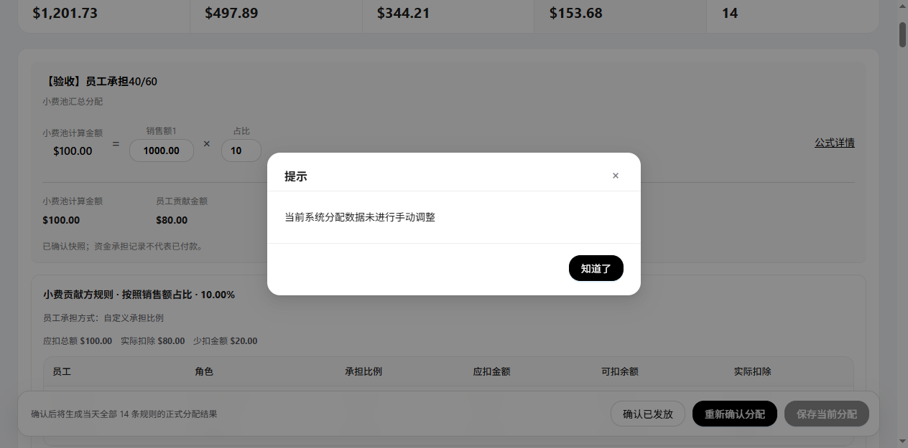

图：无手动调整提示。项目页面，演示数据；来源见[图像清单](assets/tips-current-spec-20261026/manifest.json)。

入口与范围：无人工调整时点击灰显的保存当前分配。

| 字段／操作 | 说明 |
| --- | --- |
| 提示 | 当前系统分配数据未进行手动调整。 |
| 关闭／确认 | 仅关闭说明，不写快照。 |

### 7.11 更新小费数据

图：更新小费数据。项目页面，演示数据；来源见[图像清单](assets/tips-current-spec-20261026/manifest.json)。

入口与范围：当日明细→更新小费数据。

| 字段／操作 | 说明 |
| --- | --- |
| 提示与范围 | 确认门店、日期、基准快照及覆盖手调影响。 |
| 确认更新 | 重新读取当日来源并重建默认计算；需要确认的结果不伪称已完成确认。 |
| 取消／关闭 | 不更新，保留当前内容。 |

#### 更新后需要确认的计算

图：更新后需要确认的计算。项目页面，演示数据；来源见[图像清单](assets/tips-current-spec-20261026/manifest.json)。

### 7.12 未保存调整保护

图：未保存调整保护。项目页面，演示数据；来源见[图像清单](assets/tips-current-spec-20261026/manifest.json)。

入口与范围：当日明细切店、切日、返回或离开时存在未保存调整。

| 字段／操作 | 说明 |
| --- | --- |
| 继续编辑 | 取消跳转，保留日期、筛选和草稿。 |
| 放弃调整 | 不保存该草稿，继续目标跳转；正式快照不受影响。 |

### 7.13 选择池类型

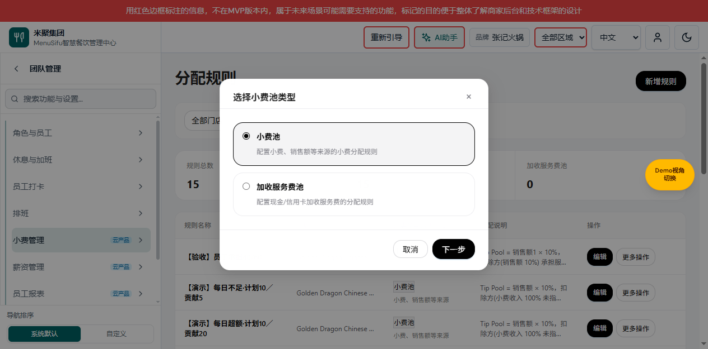

图：选择池类型。项目页面，演示数据；来源见[图像清单](assets/tips-current-spec-20261026/manifest.json)。

入口与范围：规则列表→新增规则。

| 字段／操作 | 说明 |
| --- | --- |
| 小费池 | 创建普通小费来源规则。 |
| 加收服务费池 | 创建加收服务费来源规则，相关标题和条件采用该类别。 |
| 确认 | 携带选中池类型进入新增页。 |
| 取消／关闭 | 退出，不创建规则。 |

### 7.14 员工权重

图：员工权重。项目页面，演示数据；来源见[图像清单](assets/tips-current-spec-20261026/manifest.json)。

入口与范围：接收组→设置员工小费权重。

| 字段／操作 | 说明 |
| --- | --- |
| 角色／员工姓名 | 当前门店所选角色的员工。 |
| 员工权重 | 缺省1、0合法，输入须为有限非负数，最大1,000,000。 |
| 权重换算百分比 | 权重×100%，最多两位小数，1.1显示110%；仅供说明。 |
| 确定 | 应用到当前规则草稿；整页保存后持久化。 |
| 取消／关闭 | 丢弃本次弹框输入。 |

### 7.15 员工承担比例

图：员工承担比例。项目页面，演示数据；来源见[图像清单](assets/tips-current-spec-20261026/manifest.json)。

入口与范围：贡献项已选角色→修改员工承担比例。

| 字段／操作 | 说明 |
| --- | --- |
| 角色／员工 | 当前门店选中角色的有效员工，按ID识别；名单只预览当前范围。 |
| 按员工人数平均分担 | 默认；按当天有效员工人数等分应贡献，比例为近似显示，金额按人数分币。 |
| 自定义承担比例 | 每人必填0—100%，最多两位小数；全部选中角色的员工共同合计100%。 |
| 合计 | 自定义模式显示合计和未达100%提示。 |
| 示例 | 说明应扣、余额封顶和差额不转嫁，不是当天实际金额。 |
| 确定 | 校验门店、角色、员工未变化，应用当前规则草稿；失败留框并说明。 |
| 取消／关闭 | 丢弃本次输入，回到贡献项，不自动保存规则。 |

#### 平均分担只读比例

图：平均分担只读比例。项目页面，演示数据；来源见[图像清单](assets/tips-current-spec-20261026/manifest.json)。

#### 自定义合计错误

图：自定义合计错误。项目页面，演示数据；来源见[图像清单](assets/tips-current-spec-20261026/manifest.json)。

### 7.16 来源／贡献取值条件

图：来源／贡献取值条件。项目页面，演示数据；来源见[图像清单](assets/tips-current-spec-20261026/manifest.json)。

入口与范围：金额计算项或贡献项→设置取值条件。每项独立，菜单只提供该来源可用的维度。

| 字段／操作 | 说明 |
| --- | --- |
| 角色 | 按归属角色过滤；贡献项至少一个角色。多值为同维并集，不决定接收组。 |
| 员工 | 按员工引用过滤，候选受门店与角色限制；与角色维度按界面互斥，不能靠同名串账。 |
| 营业额类型 | 选择该来源的营业额口径，例如Net Sales（税前营业额）。 |
| 订单类型 | 限定堂食、外带等当前候选类型。 |
| 支付方式 | 限定来源支付类型；不支持的营业额＋菜单组合不能提交为有效条件。 |
| 区域 | 限定订单发生区域。 |
| 菜单／商品范围 | 按当前来源支持的产品线、分类、菜单组或商品过滤；商品销售额与包含商品订单不是同一口径。 |
| 订单需包含商品 | 限定订单命中条件，不自动把整单金额变成某商品金额。 |
| 营业时间／订单时间 | 起止成对；对来源事件过滤，不代替接收在岗资格。 |
| 班次 | 从班次目录选择；管理入口打开班次设置。 |
| 周期／星期 | 限定适用星期集合。 |
| 小费类型／订单小费状态 | 按来源选择允许类型或有／无等状态；小费收入贡献需要小费类型。 |
| 加收类型 | 服务费来源的允许类型。 |
| 新增条件／删除 | 添加当前可用维度或解除本项条件，不更改其他来源项。 |
| 提交 | 校验必填、范围、组合，应用到父规则草稿；整页保存后持久化。 |
| 取消／关闭 | 退出抽屉，不保存正式规则。 |

#### 销售额来源条件

图：销售额来源条件。项目页面，演示数据；来源见[图像清单](assets/tips-current-spec-20261026/manifest.json)。

#### 手动上报来源条件

图：手动上报来源条件。项目页面，演示数据；来源见[图像清单](assets/tips-current-spec-20261026/manifest.json)。

#### 服务费来源条件

图：服务费来源条件。项目页面，演示数据；来源见[图像清单](assets/tips-current-spec-20261026/manifest.json)。

### 7.17 班次设置

待补页面图片：班次设置。

入口与范围：来源条件的班次管理入口。

| 字段／操作 | 说明 |
| --- | --- |
| 班次名称 | 必填；同名目录不能重复创建，编辑保留原条目引用。 |
| 时间段 | 开始与结束时间都必填。 |
| 最低打卡分钟 | 非负整数，空值按0处理。 |
| 最多计入分钟 | 非负整数，空值为0；大于0时不能小于最低分钟。 |
| 保存 | 校验后保存本地班次目录；不是提交小费分配。 |
| 清空表单 | 重置编辑输入，切换到新增状态。 |
| 编辑／删除 | 对选中班次目录条目操作，不直接重算确认快照。 |
| 完成 | 关闭班次设置。 |

### 7.18 导出与邮件

图：导出与邮件。项目页面，演示数据；来源见[图像清单](assets/tips-current-spec-20261026/manifest.json)。

入口与范围：日期、员工或员工每日页面→导出结果。

| 字段／操作 | 说明 |
| --- | --- |
| CSV | 下载当前视角、门店、合法日期和有效筛选下的数据，日期保留完整信息。 |
| PDF | 生成当前视角报表；没有数据或所需能力不可用时提示，不修改账本。 |
| 邮箱地址 | 必填，多个地址用英文逗号分隔，逐个校验格式。 |
| 导出格式 | PDF或CSV单选，默认PDF。 |
| 发送 | 有可导出数据后关闭弹框并显示模拟发送反馈；没有实际邮件服务调用。 |
| 取消／关闭 | 不发送，不修改查询或分配。 |

#### 邮箱格式错误

图：邮箱格式错误。项目页面，演示数据；来源见[图像清单](assets/tips-current-spec-20261026/manifest.json)。

### 7.19 删除规则确认

待补页面图片：删除规则确认。

入口与范围：规则列表→更多操作→删除。

| 字段／操作 | 说明 |
| --- | --- |
| 提示 | 确定要删除该规则吗？此操作不可恢复。 |
| 删除 | 删除当前规则配置，不删除已确认的日期快照。 |
| 取消／关闭 | 保留规则，返回列表。 |

## 8. 通用显示与交互

| 字段／操作 | 说明 |
| --- | --- |
| 金额0／无结果— | 真实0显示0.00；尚未确认接收或最终金额显示—；计算异常显示原因，不用0掩盖。 |
| 负号与颜色 | 贡献为扣除方向，但计算对象中贡献金额仍为非负数；接收方向为加项。 |
| 空结果 | 筛选无匹配时显示空态，不清空来源、规则或确认快照。 |
| 日期上下文 | 日期行展示MM/DD与星期，内部查询、快照和导出保留完整日期。 |
| 页面内确认 | 保存、覆盖、取消、发放等弹框显示具体范围；确认前不写数据，运行中防重复。 |
| 焦点与关闭 | 可关闭的说明／确认框支持返回触发位置；自动分配运行中不能关闭，有失败才显示重试。 |
| 整日操作范围 | 规则筛选、角色收起只影响显示，保存与发放仍为当前门店日全部规则。 |
| 红色边框 | 页面对演示／扩展操作的标识，不是输入校验错误。 |
| 图像缺口 | 班次设置、删除规则及部分重复异常结果未补对应截图；逐项见操作清单，不以其他弹框图片替代。 |

### 小费分配范围

标题旁问号说明：确定小费按什么时间范围统计，并在该范围内分配给符合条件的员工。三个选项显示为“按整日分配”“按班次分配”“按打卡时段分配”；选项值与计算规则不变。

范围选项与小费分配方式共用三列等宽卡片样式；选中时显示强调边框、浅色背景与内描边，文字为黑色。点击卡片空白区域、文字或单选框均可选择。按打卡时段保留红色边框标记；问号只展开说明，不改变选项。宽度不超过900px时卡片按原顺序纵向排列。

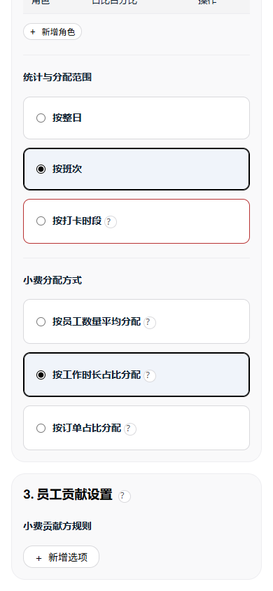

图：规则编辑页390px窄屏，范围卡片纵向排列；5501da2d基线功能分支，2026-10-26，实际模板与运行时受控演示。

范围提供按整日、按班次、按打卡时段三个互斥选项。

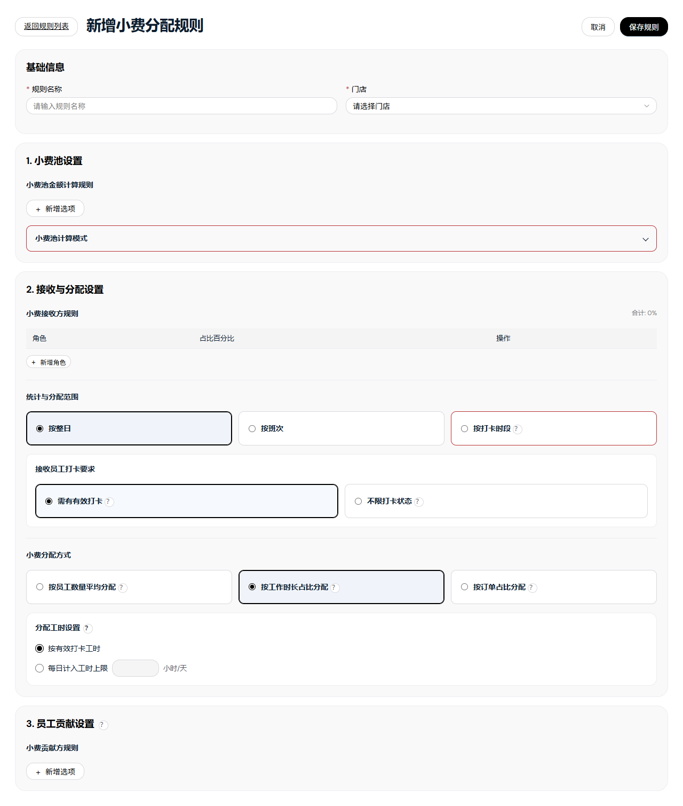

图：规则编辑页，按整日；本功能分支受控演示页面，2026-10-26。

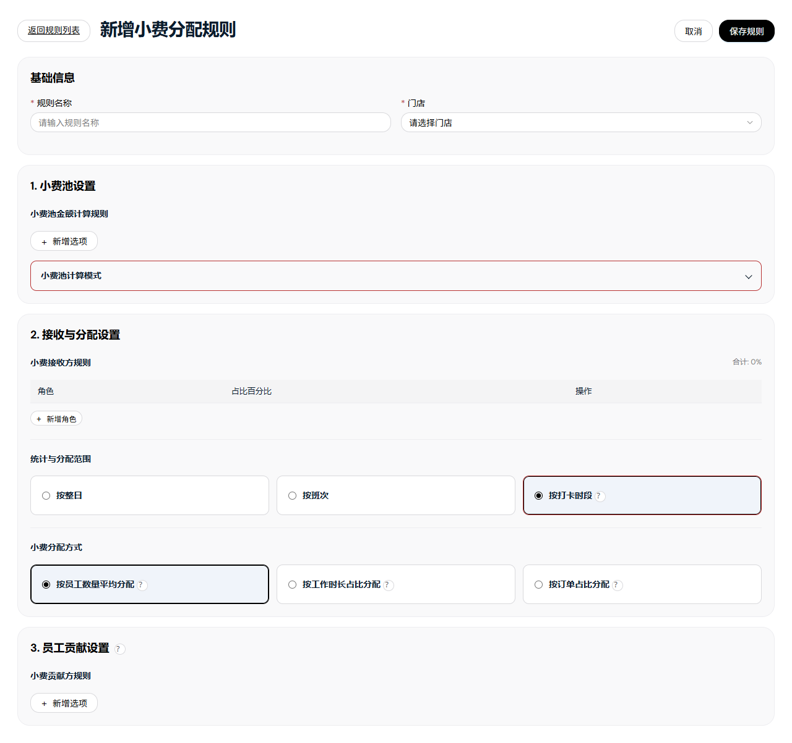

图：规则编辑页，按打卡时段；同一来源版本。

| 字段／操作 | 说明 |
| --- | --- |
| 按整日分配 | 默认选中。按营业日汇总符合小费池条件的金额，显示接收员工打卡要求，可选需有有效打卡或不限打卡状态。 |
| 按打卡时段分配 | 按逐笔发生时间及实际打卡区间分配，隐藏接收员工打卡要求，固定使用当时在岗且符合接收方规则的员工。保留红色边框标记。 |
| 时段说明 | 点击按打卡时段旁问号，展示“各时段产生的小费，仅分配给该时段在岗的接收员工。”及打卡、接收角色限制；卡片底部不常驻展示。 |
| 模式切换 | 不自动保存；切回整日恢复本次编辑的接收员工打卡要求与工时上限草稿。保存以当前模式为准，取消不写入。 |
| 工时联动 | 按工时分配时：整日模式显示实际工时／每日上限，时段模式仅显示时段工时说明。 |
| 保存与校验 | 保留规则原有保存校验；时段模式仍只支持普通小费池与允许的来源／条件，不扩大支持范围。 |

#### 时段问号说明

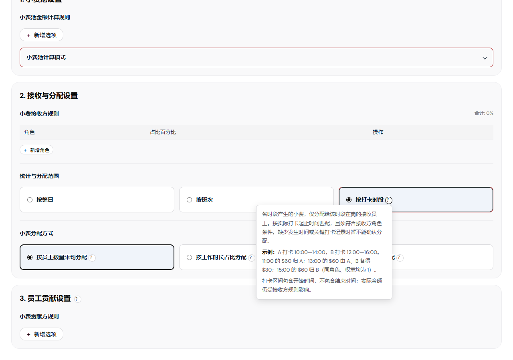

图：点击按打卡时段旁问号，展示时段内在岗员工说明；关闭后不在卡片底部常驻展示。实际模板与运行时，受控演示，2026-10-26。

### 按排班表班次统计与分配

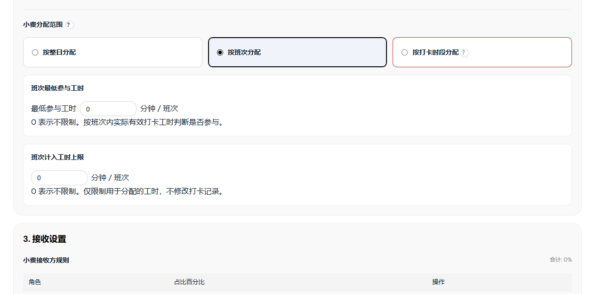

图：规则编辑页，按班次；bfbbd6aa基线功能分支，2026-10-26，真实模板与运行时的受控演示。

| 字段／操作 | 说明 |
| --- | --- |
| 按班次分配 | 与整日、打卡时段互斥。此区域不配置班次名称、时间或员工；选择按班次后展示班次工时限制。 |
| 班次来源 | 读取当前门店、营业日期的已保存排班表；使用排班班次模板及员工当日特殊开始／结束时间。未保存的排班页草稿不作为计算依据。 |
| 员工参与 | 员工须在对应班次已排班、符合接收方角色及员工范围，并在班次内有有效打卡重叠。仅打卡但未排班不参与。员工使用ID匹配，不以同名替代。 |
| 班次池 | 每个实际起止时间一致的排班班次独立统计和分配；班次开始计入、结束不计入。跨日归属排班开始日。 |
| 工时依据 | 取员工实际完整打卡区间与班次区间的交集，合并重叠记录后计时。先应用本规则的最低参与工时，按工时分配时再应用班次计入上限；班次时间与名单仍来自排班表。 |
| 模式切换 | 仅更新本次规则草稿；整日接收员工打卡要求与每日工时设置仅在适用范围显示；保存以当前选择为准，取消不写入。 |
| 保存规则 | 保存范围选择，不复制排班表进规则，不要求当前日期已排班；实际分配按所选日期读取排班。 |
| 无当日排班 | 阻止按班次计算并提示先设置排班表；不使用默认生成班次或其他日期数据补齐。 |
| 失效或跨店引用 | 排班引用班次缺失、班次所属门店不一致时明确报错，不自动改为其他班次。 |
| 重叠排班班次 | 无法唯一确定同一笔小费归属时阻止分配，提示修正排班表，避免重复入池。员工当日时间覆盖造成的重叠同样校验。 |
| 排班变化 | 重新试算读取最新已保存排班；保存分配前复核排班依据，变化则拒绝写入并要求重新计算。已有保存结果按其快照展示，不静默改写。 |

#### 班次工时限制

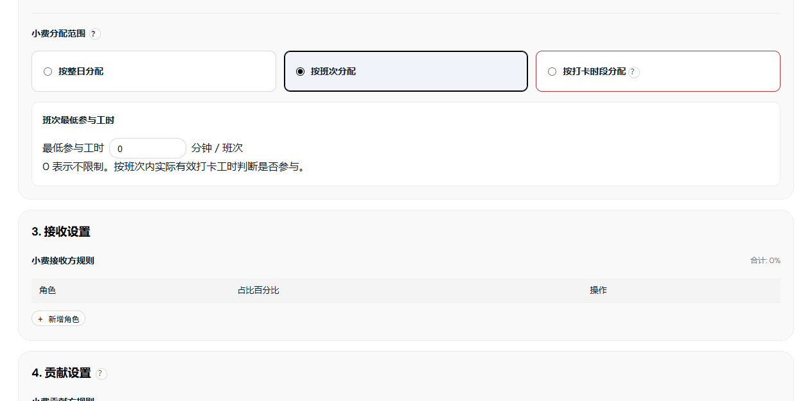

图：按班次＋平均分配，最低工时可设置、计入上限隐藏；实际模板与运行时，受控演示，2026-10-26。

| 字段／操作 | 说明 |
| --- | --- |
| 班次工时限制 | 按班次时，最低参与工时与班次计入工时上限紧邻放在小费分配范围下；上限仅按工时分配时展示。不设置班次名称、时间或员工。 |
| 最低参与工时 | 非负整数分钟，默认0，不限制。每个班次分别用实际有效打卡重叠时间判断，达到门槛且大于0才参与该班次；平均、按工时、按订单均应用。 |
| 班次计入工时上限 | 非负整数分钟，默认0，不限制。仅按工作时长占比分配时启用；其他方式隐藏且不应用。正上限不得小于最低参与工时。 |
| 切换方式／范围 | 保留本次输入草稿；整日、打卡时段不展示或应用该限制。保存仅保留当前范围的有效配置。 |
| 保存 | 校验整数、非负及工时方式的上下限关系，成功保存本规则配置；失败保留输入且不覆盖已保存值。清空输入按0处理。 |

先判断实际工时是否达标，再取计入工时＝min(实际有效工时，上限)，0上限按实际计入。上限不会改变实际打卡，不会截断小费统计时段，也不会使超过上限的员工失去资格。限制逐班次独立应用，不跨班次累计后判断。

例：最低30分钟，上限120分钟，班次池120元，按工时分配。A实际60分钟、B实际240分钟，计入60与120分钟，分别获得40与80元；若A只有20分钟，A不参与，B仍以120分钟参与并获得120元。

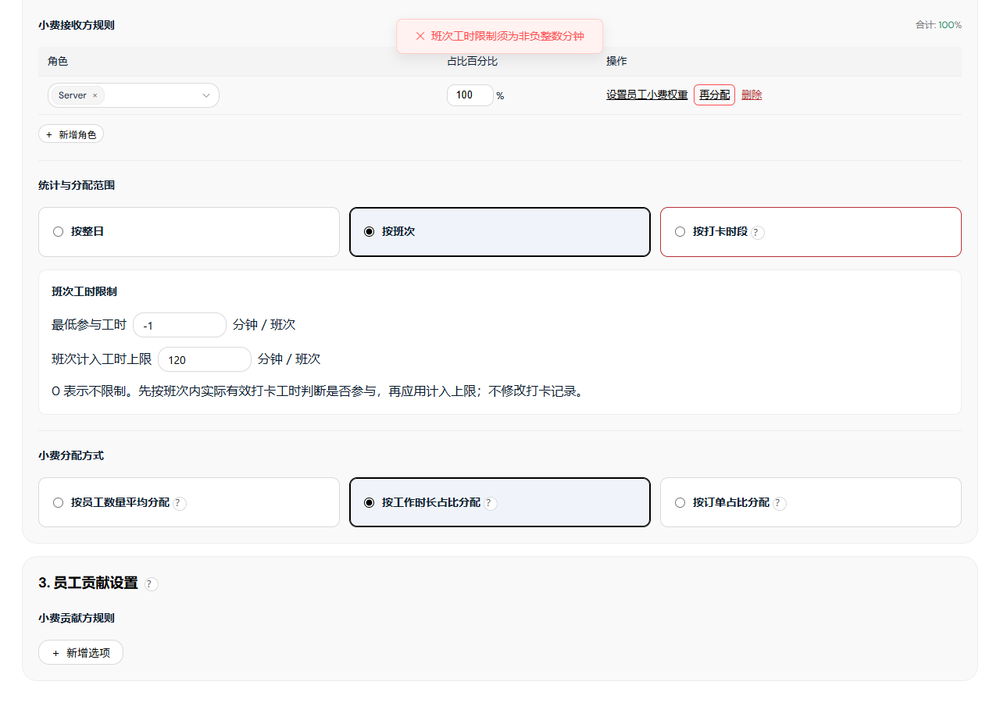

图：输入负数后保存被拦截，原最低30分钟配置不变；实际模板与运行时，受控演示。

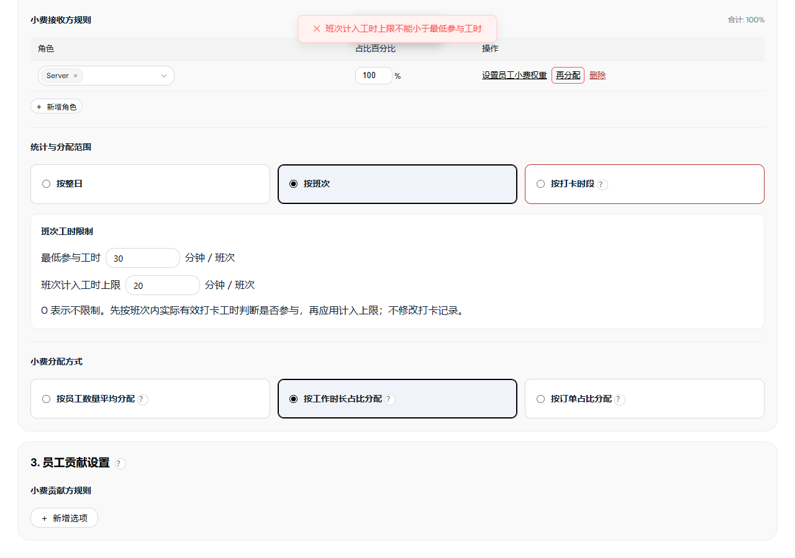

图：按工时分配，上限小于最低参与工时时保存被拦截，已保存的30／120分钟保持不变。

例：未设置工时限制时，排班表午班10:00—14:00，A、B均已排班，C未排班。A打卡10:00—12:00，B打卡12:00—14:00，C即使全天打卡也不参与。班次池120元，同组、权重1，平均分配A、B各60元；若按工时且A、B实际有效工时为1与3小时，分别获得30与90元。

班次内先按接收组占比分预算，再按平均／有效打卡工时／该班次有效归属订单笔数乘员工权重分配，分别执行分币。不跨班次共用分母。班次外小费不纳入本规则；班次池内无有效接收员工或基数为0的金额保留未分配。

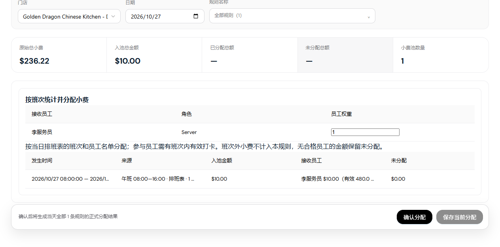

图：受控排班记录与项目小费事实，员工已排班且有打卡，实际运行时计算产生结果，不代表生产记录。

| 明细字段 | 定义 |
| --- | --- |
| 班次时间 | 来自排班表，按门店时区展示完整起止日期时间。 |
| 来源 | 班次名称、“排班表”标识、符合条件的事件笔数。 |
| 接收员工 | 符合班次排班、接收条件及有效打卡的员工，展示分得金额和实际有效分钟；工时方式展示计入分钟。 |
| 未分配 | 班次池金额减接收金额。 |
| 工时汇总 | 同一规则内按各班次达到门槛后的计入工时累计；确认后读取保存快照，不以全天工时代替班次工时。 |

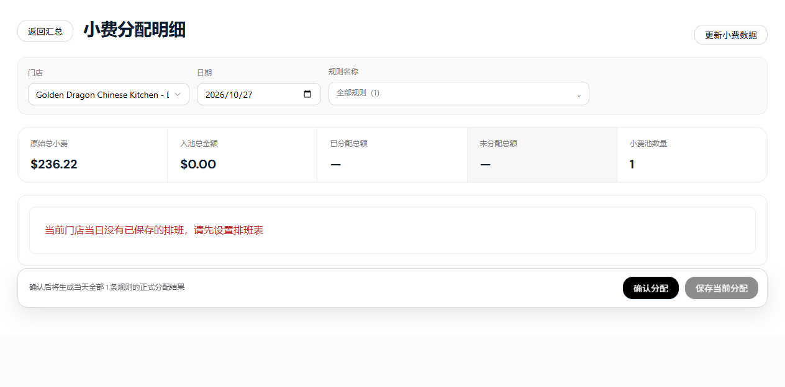

图：删除受控演示的当日排班记录后，真实明细页阻止计算并显示原因；不生成分配结果。

### 打卡时段参与示例

A 打卡10:00—14:00，B打卡12:00—16:00，同一接收角色、权重均为1，采用平均分配。11:00、13:00、15:00各产生60元小费，依次由A独得60元、A与B各得30元、B独得60元，最终各得90元。14:00产生的小费仅B参与。无符合条件在岗员工的金额保留为未分配，不转给非在岗员工。

问号说明：仅统计实际打卡起止时间内产生的小费，并按所选分配方式，分给该小费产生时在岗且符合接收方角色条件的员工。

### 接收条件联动

小费分配范围下方集中展示联动条件：按整日显示打卡要求；按班次显示最低参与工时，并在按工时分配时显示计入上限；按打卡时段不额外展示配置或常驻说明，在问号中解释在岗要求。切换保留草稿，保存字段与计算顺序不变。
