# 小费管理页面说明（个人规范版）

版本：**V2.65**　日期：2026-11-05　文档编号：TIPOUT-DATE-PRESET-CONTEXT-20261105-01

实现基线：`d78a5de7`＋快捷日期上下文及规则配置文案；功能分支 `codex/tips-date-preset-context-20261105`。本文定义当前页面、字段、计算与异常规则。

配套文档：[产品说明 V4.67](PRD_产品需求文档.md)／[研发规格 V3.67](小费分配业务规格说明书（研发交付版）.md)。

本文按页面定义字段与操作。计算和状态术语采用产品说明§2—§3；数据结构见研发规格。

本文职责：按页面、区域逐项说明字段、操作及其结果。三份文档使用同一业务基线；页面样例数据不作为默认业务参数。

截图形式：提示、确认弹框、取值条件与员工权重抽屉均保留完整界面、遮罩和入口页面背景；背景用于定位操作入口，不仅截取弹框或抽屉本体。

## 1. 小费分配看板

图：规则配置文案分支实际看板，d78a5de7＋TIPOUT-RULE-CONFIG-LABELS-20261105-01；日期状态继承另见门店截图。

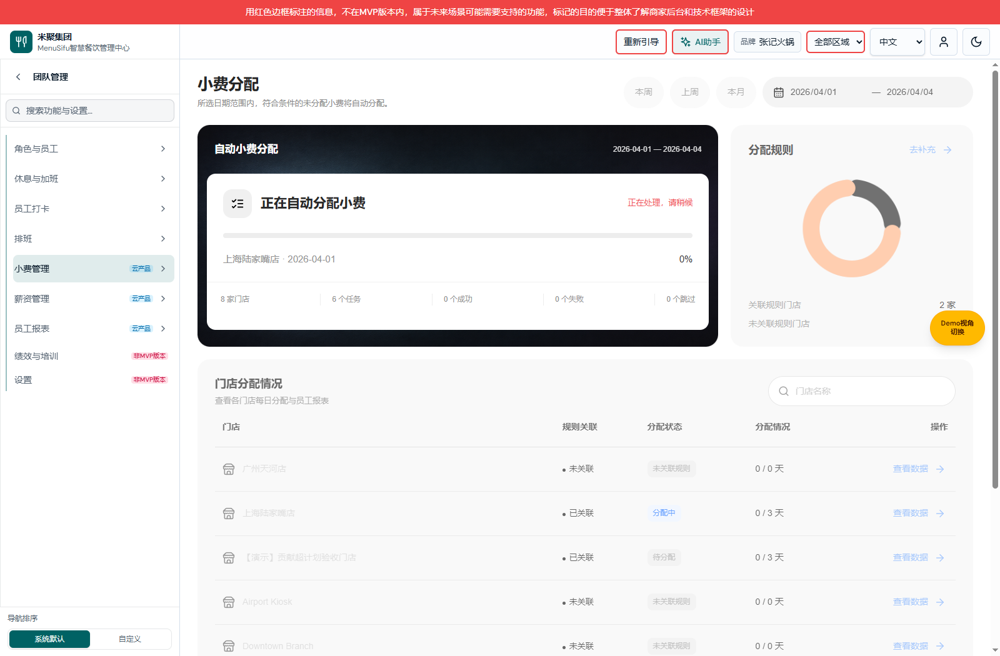

图：功能分支真实页面，2026-11-04，基线b5da1188；页面样例不作为默认业务参数。

入口：小费管理→小费分配；`/team/tips/distribution`。作用于当前权限允许访问的门店，不扩大权限或自动关联规则。

### 日期与任务进程

| 字段 | 逻辑说明 |
| --- | --- |
| 本周 | 默认；浏览器本地周一至今天，包含首尾；切换后预检自动任务。 |
| 上周 | 上周一至上周日，切换后预检。 |
| 本月 | 当月1日至今天，切换后预检。 |
| 开始日期 | 完整日期，必填且不得晚于结束日；有效修改后按所选范围预检。 |
| 结束日期 | 必填，默认今天；无效、空值或倒置时标错，不启动任务，保留已有结果。 |
| 自动小费分配 | 检查可访问门店及规则，逐个处理合格未分配门店日；已分配、已发放结果不覆盖。 |
| 分配状态进程 | 正在检查／正在分配／已完成／部分失败；运行时显示当前门店及日期。 |
| 门店数量 | 本次可访问门店总数，含未配置规则门店。 |
| 任务总数 | 实际入队的门店日数量；同一天在两家门店分别计任务。 |
| 成功任务数 | 已保存分配快照的任务数。 |
| 失败任务数 | 执行失败数，不含无规则门店。 |
| 跳过任务数 | 执行时已被其他页面分配、已发放或变为无需分配的任务数。 |
| 已处理任务数 | 成功＋失败＋跳过，不含等待和正在处理。 |
| 进度条 | 已处理÷任务总数，展示整数百分比；失败部分红色，检查阶段0%。 |
| 查看分配任务明细 | 结束后展开门店、日期、结果与说明；运行期间不可操作。 |
| 日期 | 每个入队门店日的YYYY-MM-DD日期。 |
| 分配结果 | 等待分配／正在分配／分配成功／分配失败／已跳过。 |
| 说明 | 保存结果、失败或跳过原因；没有说明显示—。 |

检查和执行期间，日期、搜索、规则、门店、任务明细及重试全部禁用。

### 分配任务明细

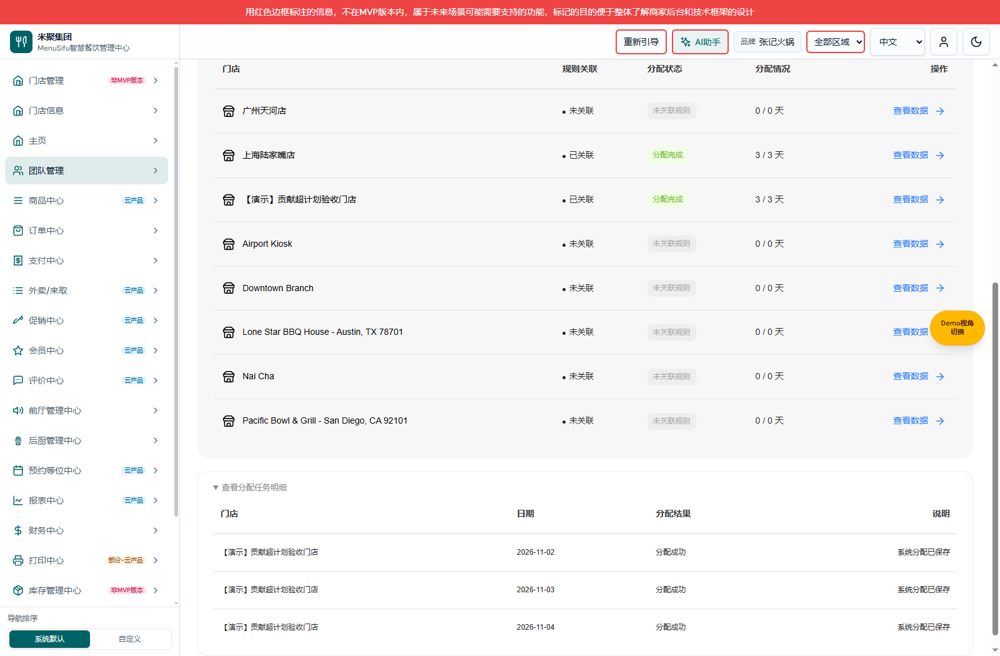

图：任务结束后展开的门店、日期、结果及原因，2026-11-04，基线b5da1188。字段定义见“日期与任务进程”。

### 分配规则

| 字段 | 逻辑说明 |
| --- | --- |
| 已配置规则门店 | 可访问门店中有适用规则的门店数，一家多条规则只计一家。 |
| 未配置规则门店 | 可访问门店总数减已配置规则门店；不进入自动队列。 |
| 规则配置状态图 | 以上两个门店数量的占比，不代表规则条数或金额。 |
| 去补充 | 无任务运行时进入分配规则列表，不自动创建或关联规则。 |

### 待处理事项

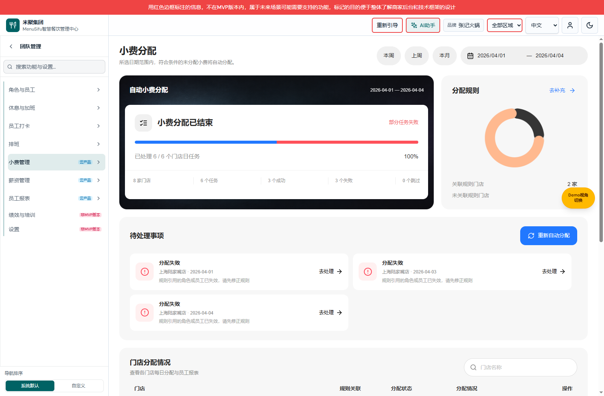

图：功能分支真实页面，2026-11-04，基线b5da1188；页面样例不作为默认业务参数。

| 字段 | 逻辑说明 |
| --- | --- |
| 分配失败 | 每个失败任务单独显示门店、日期、原因；读取范围失败显示读取原因。全部成功时隐藏区域。 |
| 去处理 | 结束后进入对应门店全屏汇总，日期限定为失败当天；不直接覆盖快照。 |
| 重新自动分配 | 全部任务结束且仍有失败时才显示并启用；仅重试失败任务，成功与跳过不变。运行中隐藏；成功后失败0、重试按钮隐藏。 |

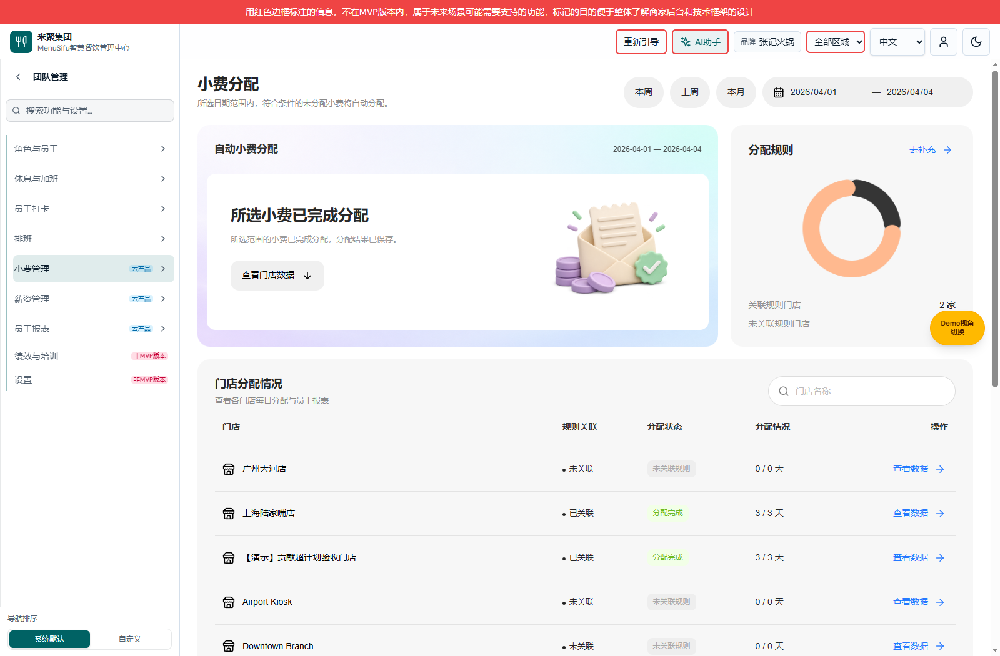

图：功能分支真实页面，2026-11-04，基线b5da1188；页面样例不作为默认业务参数。

### 完成状态与门店列表

图：功能分支真实页面，2026-11-04，基线b5da1188；页面样例不作为默认业务参数。

图：功能分支真实页面，2026-11-04，基线b5da1188；页面样例不作为默认业务参数。

| 字段 | 逻辑说明 |
| --- | --- |
| 查看门店数据 | 无任务运行时滚动至门店列表。 |
| 门店名称搜索 | 按展示名或业务名包含匹配，仅筛选列表，不重启任务，不改变规则数量和进度。 |
| 门店 | 当前可访问门店，点击名称进入该门店全屏汇总，保留所选日期。 |
| 规则配置状态 | 已配置／未配置，由门店适用规则数量判定。 |
| 分配状态 | 无规则为未关联规则；读取异常为读取失败；执行中为分配中；有失败为部分失败；全部可分配日期已确认则分配完成；没有可分配日期为无需分配；其余待分配。 |
| 分配情况 | 已确认或已发放的可分配日期数／范围内可分配日期总数；未营业不计分母，与本次任务数分别统计。 |
| 查看数据 | 结束后进入独立全屏门店汇总；无规则门店仍可查看，不自动创建规则。 |

例：A门店选3天，2天未分配、1天已确认；B门店1天未分配、2天未营业。入队3个任务，全部成功后进度3/3，A分配情况3/3天，B为1/1天。

## 2. 日期分配汇总

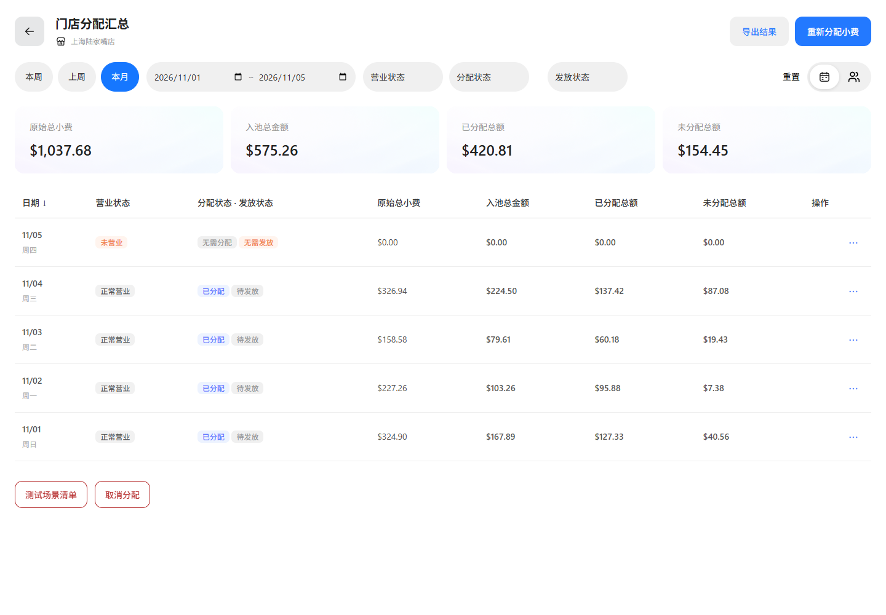

图：当前功能分支实际页面；d78a5de7＋TIPOUT-DATE-PRESET-CONTEXT-20261105-01，2026-11-05；看板选择本月后，门店日期与员工视图继承范围和蓝色选中态。

入口与范围：看板→点击门店；独立全屏，作用于所选门店与日期。门店固定，不在汇总内切换。

### 查询条件

| 字段 | 逻辑说明 |
| --- | --- |
| 门店 | 标题下展示进入时所选门店，限定规则、员工和来源，不跨门店合并同名员工。 |
| 返回看板 | 标题左侧返回并保留当前日期范围，不撤销已保存结果。 |
| 重置 | 清空状态与员工筛选，将日期恢复本周，仅刷新查询。 |
| 本周 | 浏览器本地日期的周一至今天，包含首尾；同步起止日期并刷新当前视图，仅查询、不启动分配。 |
| 上周 | 上周一至上周日，包含首尾；同步起止日期并刷新当前视图，仅查询、不启动分配。 |
| 本月 | 当月1日至今天，包含首尾；同步起止日期并刷新当前视图，仅查询、不启动分配。 |
| 快捷项选中态 | 点击的快捷项采用蓝底白字（背景#1677ff、文字#ffffff），未选中项为灰底；手动修改日期清除高亮。角色、员工与状态条件保留，切换视图保留日期与快捷项。 |
| 看板日期继承 | 从看板进入门店时带入起止日期及实际选中的快捷项；对应项保持蓝底白字。自定义日期不选中快捷项。 |
| 刷新与返回 | 刷新、切换日期／员工视图或返回看板保留有效的日期范围和快捷项。标识与日期不一致时不高亮。 |
| 开始日期 | 必填完整日期；不得晚于结束日。无效、空值或倒置时标错，保留上次有效结果，不启动分配。 |
| 结束日期 | 必填，默认今天。合法修改后只刷新查询，不启动自动任务。 |
| 日期分配汇总页签 | 切换日期任务视角，保留共用门店日期，不重分配。 |
| 员工分配汇总页签 | 切换角色和员工视角，保留共用门店日期，不重分配。 |
| 营业状态 | 全部／正常营业／未营业，与其他条件取交集。 |
| 分配状态 | 全部／已分配／未分配，筛选日期行及对应概览。 |
| 发放状态 | 全部／待发放／已发放／无需发放，不代替分配状态。 |
| 日期排序 | 点击日期表头切换倒序与顺序，不改变执行规则和金额。 |
| 更多操作 | 日期行展开查看明细、符合条件的分配及确认已发放；后果分别见各操作定义。 |

### 金额概览

| 字段 | 逻辑说明 |
| --- | --- |
| 原始总小费 | 当前可见日期原始小费合计。 |
| 入池总金额 | 未确认日期采用预计可分配池；已确认日期采用快照池金额。 |
| 已分配总额 | 当前可见日期的正式接收金额合计，未确认日计0。 |
| 未分配总额 | 未确认日等于预计入池；确认日等于池余额，按可见日期求和。 |

### 日期行

| 字段 | 逻辑说明 |
| --- | --- |
| 日期 | MM/DD＋星期几；内部保留完整年月日。 |
| 营业状态 | 正常营业或未营业。 |
| 分配状态 | 已分配、未分配或无需分配。 |
| 发放状态 | 待发放、已发放或无需发放。 |
| 原始总小费 | 当日原始金额；未营业为0。 |
| 入池总金额 | 当日预计或快照可分配池金额。 |
| 已分配总额 | 当日确认接收额；确认前为0。 |
| 未分配总额 | 当日尚未分给员工的池金额。 |
| 查看明细 | 携带门店、日期打开当日明细；返回保留查询上下文。未营业日点击提示原因并留在汇总。 |
| 分配 | 符合行内条件时显示，执行整日系统分配。 |
| 确认已发放 | 符合发放条件时显示，打开整日登记确认。 |

### 顶部操作

| 字段 | 逻辑说明 |
| --- | --- |
| 导出结果 | 选择CSV、PDF或邮箱；使用当前视角和有效筛选。 |
| 批量分配小费／重新分配小费 | 打开主动分配日期范围，不等同无覆盖的自动补分配。 |

## 3. 员工分配汇总

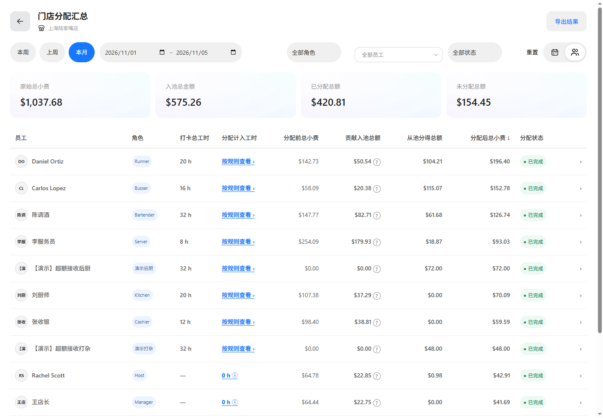

图：当前功能分支实际页面；d78a5de7＋TIPOUT-DATE-PRESET-CONTEXT-20261105-01，2026-11-05；看板选择本月后，门店日期与员工视图继承范围和蓝色选中态。

入口与范围：全屏门店汇总→员工视图，保留门店与日期。

### 员工筛选

| 字段 | 逻辑说明 |
| --- | --- |
| 本周 | 共用第2节的本周定义与查询行为，刷新员工结果与统计。 |
| 上周 | 共用第2节的上周定义与查询行为，刷新员工结果与统计。 |
| 本月 | 共用第2节的本月定义与查询行为，刷新员工结果与统计。 |
| 角色 | 默认全部，限定当前门店的角色集合；与日期、员工和状态取交集。 |
| 员工 | 当前角色下的有效员工多选，按稳定ID匹配；全选或全部取消均表示全部员工。切换角色后剔除不在候选集中的选择；有效选择为空时恢复全部。 |
| 分配状态 | 已完成／部分待分配／待分配等周期条件，约束员工列表。 |
| 贡献金额旁“？” | 以“贡献金额明细”为标题，展示“已分配日期”“待分配日期（预计）”和“合计”；预计失败说明无法试算，不把部分数显示成完整总数。 |

### 员工列表

图：当前功能分支实际页面；d78a5de7＋TIPOUT-DATE-PRESET-CONTEXT-20261105-01，2026-11-05；看板选择本月后，门店日期与员工视图继承范围和蓝色选中态。

| 字段 | 逻辑说明 |
| --- | --- |
| 员工 | 姓名、身份信息；可按姓名排序，同名不同ID不合并。 |
| 角色 | 当前参与的角色展示，不作为唯一身份键。 |
| 打卡总工时 | 周期原始打卡工时累计，不受小费人工工时调整影响；无有效记录显示—。可排序，缺失排末。 |
| 分配计入工时 | 按每条工时规则逐日累计，不跨不同规则相加；单一口径显示小时，不同口径显示可点击摘要。 |
| 分配前总小费 | 周期全部有效日原始小费，包含未分配日。 |
| 贡献入池总额 | 已确认贡献＋未确认预计贡献；问号以“贡献金额明细”为标题，展示“已分配日期”“待分配日期（预计）”“合计”；提示“待分配金额为试算结果，以实际分配结果为准。” |
| 从池分得总额 | 仅累计已确认接收。 |
| 分配后总小费 | 仅累计已确认结果，默认按此倒序；无有效确认显示—。 |
| 分配状态 | 按员工适用日的确认情况显示已完成／部分待分配／待分配。 |
| 员工明细入口 | 携带员工ID、门店、周期和返回上下文，打开每日明细。 |

## 4. 员工每日考勤分配

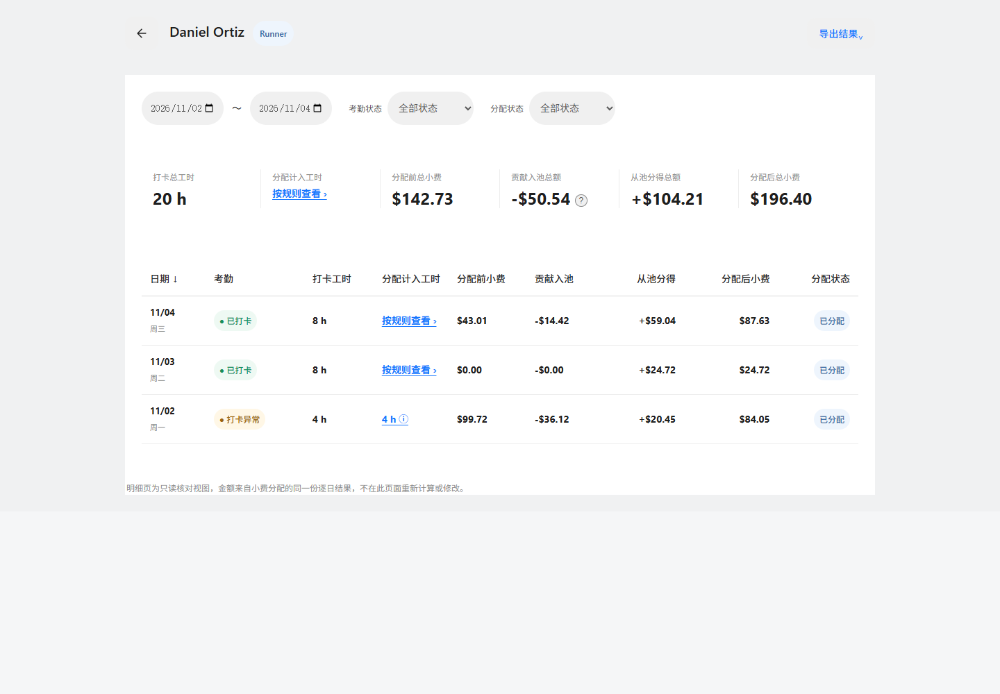

图：当前功能分支实际页面；79e13f27＋TIPOUT-FIGMA-UI-20261104-01，2026-11-04；完整视口，示例金额不作为默认参数。

入口与范围：员工汇总→员工行；只查看该员工。

### 上下文与统计

| 字段 | 逻辑说明 |
| --- | --- |
| 员工 | 当前选择员工的身份及姓名。 |
| 角色 | 该员工的适用角色，不作为唯一身份键。 |
| 开始日期 | 继承来源查询周期，可在该周期内调整，包含首尾；不得超出来源开始、结束日期。必填且开始不晚于结束；无效时保留输入并标错，继续显示上次有效结果。只查询，不触发自动分配。 |
| 结束日期 | 继承来源查询周期，可在该周期内调整，包含首尾；不得超出来源开始、结束日期。必填且开始不晚于结束；无效时保留输入并标错，继续显示上次有效结果。只查询，不触发自动分配。 |
| 考勤状态 | 全部、已打卡、未打卡、打卡异常、手动工时、混合工时，按记录来源过滤。 |
| 分配状态 | 全部／已分配／待分配。 |
| 打卡总工时 | 当前过滤日原始打卡工时合计。 |
| 分配工时 | 按规则累计及来源摘要，点击查看规则明细。 |
| 分配前总小费 | 过滤日原始小费合计，包含未分配。 |
| 贡献入池总额 | 确认＋预计贡献，预计不是实扣。 |
| 从池分得总额 | 过滤日已确认接收合计；无确认显示—。 |
| 分配后总小费 | 过滤日已确认结果合计；无确认显示—。 |
| 返回员工分配汇总 | 恢复来源查询、排序及位置。 |
| 导出结果 | 按当前员工和过滤周期导出。 |

### 每日行

| 字段 | 逻辑说明 |
| --- | --- |
| 日期 | MM/DD＋星期；支持日期排序，进入默认倒序。 |
| 考勤 | 真实打卡及异常标签，手动分配不改打卡事实。 |
| 打卡工时 | 当日原始值；0与没有记录—区分。 |
| 分配工时 | 当天各工时规则采用值及来源，点击只看该日。 |
| 分配前小费 | 当天原始小费，未分配也展示。 |
| 贡献入池 | 确认日读快照；未分配日显示预计值或试算错误。 |
| 从池分得 | 确认日接收额，待分配显示—。 |
| 分配后小费 | 确认日最终金额，待分配显示—。 |
| 分配状态 | 已分配／待分配，不由是否打卡决定。 |

## 5. 当日小费分配明细

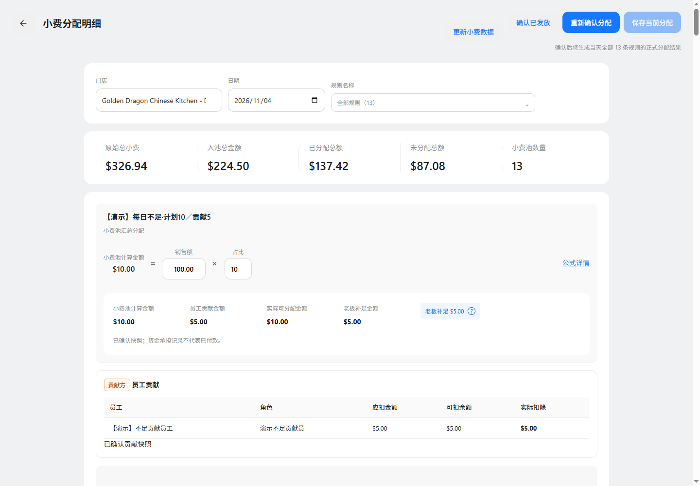

图：当前功能分支实际页面；79e13f27＋TIPOUT-FIGMA-UI-20261104-01，2026-11-04；完整视口，示例金额不作为默认参数。

入口与范围：日期汇总→查看明细；处理门店的一个完整营业日。

### 上下文与概览

| 字段 | 逻辑说明 |
| --- | --- |
| 门店 | 限定当日规则与人员；切换时有未保存调整先确认是否放弃。 |
| 日期 | 完整营业日，切换后重新检查营业和发放状态。 |
| 规则名称筛选 | 多选、全选；只改变可见规则，不缩小保存或发放的整日范围。 |
| 原始总小费 | 当日来源总额，保持与员工原始事实一致。 |
| 入池总金额 | 当日可分配池金额；草稿变化尚未成为正式确认结果。 |
| 已分配总额 | 有效确认接收金额，不把未保存调整直接计入。 |
| 未分配总额 | 未确认采用预计池金额，确认后采用池余额。 |
| 小费池数量 | 当日适用规则／池数量。 |

### 规则金额与贡献

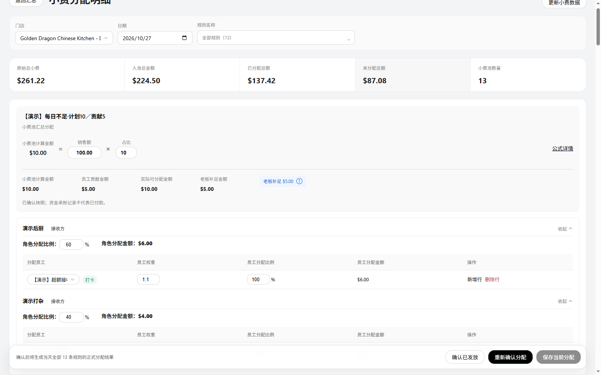

图：C＜P时的资金说明，当前完整应用实际操作；隔离演示数据，64ddec8f，2026-10-27。

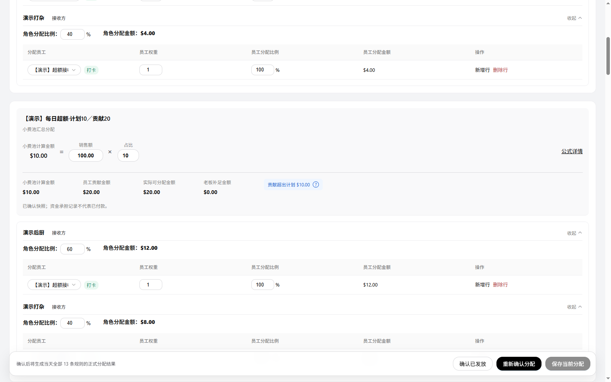

图：C＞P时的资金说明，当前完整应用实际操作；隔离演示数据，64ddec8f，2026-10-27。

| 字段 | 逻辑说明 |
| --- | --- |
| 规则名称 | 当前规则块的保存名称。 |
| 计算模式 | 小费池汇总分配；金额计算后按接收组与员工分配。 |
| 公式基数 | 来源条件过滤后的金额；可编辑值只影响当次分配草稿，不改来源订单。 |
| 公式占比 | 百分数输入，10表示10%；修改重算本次草稿。 |
| 公式详情 | 展开来源基数、比例和结果，关闭不写账。 |
| 小费池计算金额 | 规则的金额计算目标P。 |
| 员工贡献金额 | 已确认取快照C；未确认是按当前事实试算。 |
| 实际可分配金额 | 独立贡献路径D=max(P,C)，作为接收预算。 |
| 老板补足金额 | 独立贡献路径E=max(P−C,0)；草稿前缀预计，仅C与P不同的对照区显示，不代表已付款。 |
| 贡献超计划提示 | 只在C>P的规则显示差额和对照，点击说明展开／收起。 |
| 贡献不足提示 | 只在C<P的规则显示差额、老板补足及采用金额。 |
| 贡献员工 | 显示营业额项扣除角色内员工、个人营业额、扣除占比、应扣与实际扣除。不受接收资格限制。 |
| 应扣金额 | 按本营业额项入池金额及个人营业额占比得到；草稿前缀预计。 |
| 可扣余额 | 扣除本项前，员工当前还可用于贡献的原始小费。 |
| 实际扣除 | min(应扣金额,可扣余额)；确认前为预计，不转嫁差额。 |
| 少扣金额 | 应扣与实际扣除的差额，存在少扣时展示原因。 |
| 扣除占比 | 个人营业额除以扣除角色员工个人营业额合计；独立于接收方权重。 |

### 贡献方与接收方标签

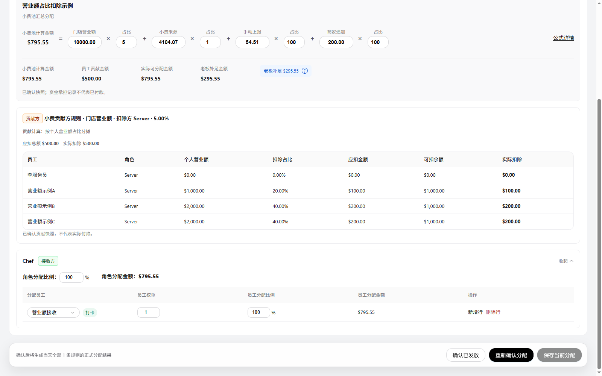

图：功能分支真实日期明细页面，2026-11-03。

| 字段 | 逻辑说明 |
| --- | --- |
| 贡献方标签 | 橙色文字、浅橙底，标识本规则的扣除员工及金额。 |
| 接收方标签 | 绿色文字、浅绿底，标识本规则的接收员工及分得金额。 |
| 双重身份 | 同一员工既贡献又接收时分别展示两种身份及金额，不用净额替代。 |
| 商家承担提示 | 无员工贡献，由商家承担；员工扣除为0。 |
| 贡献明细缺失 | 提示无法查看贡献依据；缺失字段显示“—”，不将缺失数据作为0或重算已确认数据。 |

#### 余额不足的实际扣除

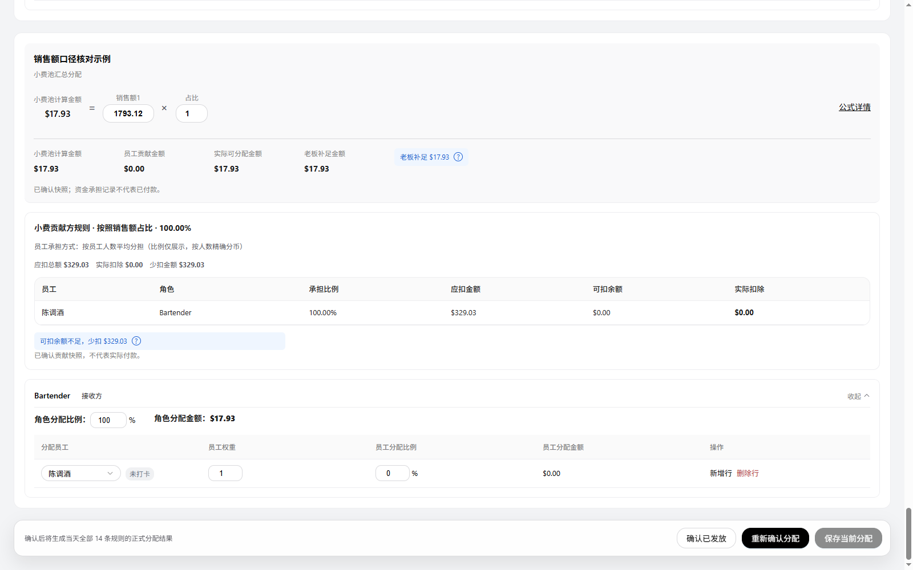

图：隔离普通贡献配置的实际计算结果；应扣329.03、可扣0、实扣0、少扣329.03，差额不转嫁。64ddec8f。该示例规则仅用于截图取证，非默认配置。

### 接收组与员工行

| 字段 | 逻辑说明 |
| --- | --- |
| 接收角色／组 | 同一配置行的共同预算组，可折叠查看。 |
| 角色分配比例 | 组占比；同层合计须符合100%约束。 |
| 角色分配金额 | 由该池实际可分配金额和组占比得到。 |
| 分配员工 | 选择当前门店及接收范围员工；真实考勤标签保持。 |
| 员工权重 | 规则默认值，可调整当日采用值；0合法，不修改规则默认。 |
| 分配工时 | 工时方式适用，普通按日可明确修改或补录；不反写考勤。 |
| 有效订单笔数 | 订单方式的事实依据；只读，不用销售额代替。 |
| 员工分配比例 | 自动来自加权基数；普通工时方式可明确改为人工最终比例。 |
| 员工分配金额 | 从池分得金额A，不等同分配后F。 |
| 新增行 | 加入本次分配草稿，不创建员工目录；参与及依据必须有效。 |
| 删除行 | 移除本次草稿行，重算相关分配，不删除员工。 |

### 页面操作

| 字段 | 逻辑说明 |
| --- | --- |
| 返回汇总 | 恢复来源视角、筛选和位置；有未保存调整先保护草稿。 |
| 更新小费数据 | 确认后重新读取来源、重建默认计算；已发放不能更新。 |
| 确认分配 | 首次保存整日所有规则；校验失败留在页面并保留草稿。 |
| 重新确认分配 | 已有分配时按系统规则重新生成；人工结果须确认覆盖。 |
| 保存当前分配 | 已有结果且发生手调时可用；无手调显示“当前系统分配数据未进行手动调整”，不写入。 |
| 确认已发放 | 整日有效快照、无未保存调整且未发放时可登记；发放后锁定编辑。 |

### 营业额扣除明细

图：实际已确认明细，本项应扣总额500，A/B/C应扣100/200/200；其他来源不计入该项应扣总额，2026-11-04。

| 字段 | 逻辑说明 |
| --- | --- |
| 关联营业额项 | 读取来源项ID、名称、比例及扣除角色；不将整个小费池金额作为本项应扣。 |
| 个人营业额 | 当天归属该员工、符合本营业额项口径及取值条件的营业额。 |
| 扣除占比 | 个人营业额÷本扣除角色当前个人营业额合计，显示两位小数。 |
| 应扣总额 | 关联营业额项入池金额；调整当天该项公式基数或比例后同步重算。 |
| 应扣金额 | 本项应扣总额按原始营业额占比精确分币所得，不按显示比例反算。 |
| 可扣余额 | 原始可扣小费减去前序规则／来源项已实扣金额，不包含本轮新分得。 |
| 实际扣除 | min(应扣,可扣余额)；少扣不转给其他员工。实际贡献C按实扣累加。 |

## 6. 分配规则列表

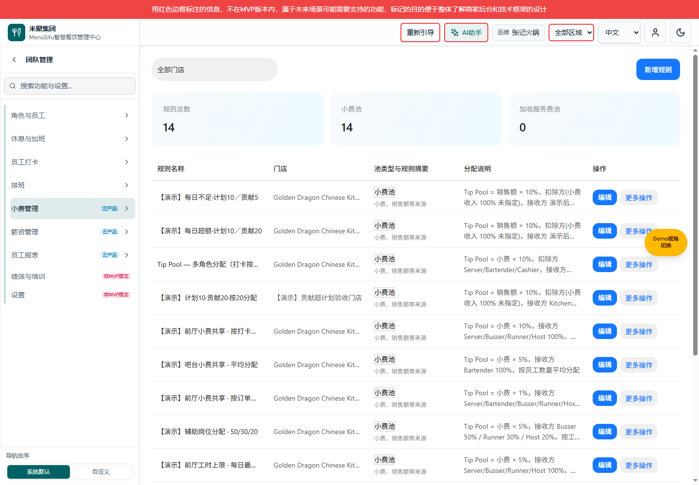

图：当前功能分支实际页面；79e13f27＋TIPOUT-FIGMA-UI-20261104-01，2026-11-04；完整视口，示例金额不作为默认参数。

入口与范围：小费管理→分配规则。

### 筛选与统计

| 字段 | 逻辑说明 |
| --- | --- |
| 门店筛选 | 默认全部门店，可选择指定门店，限制列表及统计。 |
| 规则总数 | 当前筛选规则数量。 |
| 小费池 | 当前筛选中小费池规则数量。 |
| 加收服务费池 | 当前筛选中服务费池规则数量。 |

### 列表与操作

| 字段 | 逻辑说明 |
| --- | --- |
| 规则名称 | 规则保存名称，不是某天的确认结果。 |
| 门店 | 该规则适用的门店。 |
| 池类型与规则摘要 | 显示来源类别及来源摘要。 |
| 分配说明 | 概述金额计算、贡献、接收组、算法及工时配置。 |
| 编辑 | 打开该规则当前配置。 |
| 更多操作／复制 | 克隆配置并生成新规则ID和副本名称；不复制分配或发放结果。 |
| 更多操作／删除 | 打开确认框；确认删除规则配置，取消保留。不会清除已保存的日期快照。 |
| 新增规则 | 直接进入新增页面，在基础信息下方选择小费池类型。 |

## 7. 新增／编辑分配规则

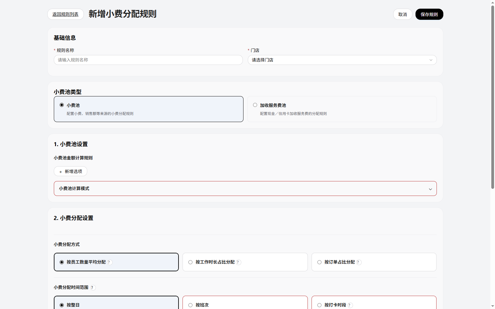

图：新增规则基础信息与页内小费池类型，独立功能分支实际页面，deecdd96及当前修改，2026-11-04。

入口：规则列表新增或编辑。配置属于当前门店的规则模板，保存规则不会直接改写已确认日期结果。

页面分为小费池设置、小费分配设置、小费接收设置、小费贡献设置。各区域的适用字段如下。

### 基础信息与顶部操作

| 字段 | 逻辑说明 |
| --- | --- |
| 规则名称 | 必填，去除首尾空格；为空阻止保存。仅用于识别规则。 |
| 门店 | 必选；决定角色、员工和取值条件候选，不能跨门店复用员工引用。 |

| 保存规则 | 校验名称、门店、金额来源、接收角色和占比、权重、营业额项扣除方及工时配置。成功保存本地规则并返回列表；失败保留输入和页面。 |
| 取消 | 打开“取消编辑”确认框；确定离开则丢弃本次输入并返回列表，取消或关闭确认框继续编辑。 |
| 返回规则列表 | 返回列表；当前未保存输入不写入正式规则。 |

### 小费池类型

图：新增规则默认状态，基础信息下方独立展示小费池类型；完整页面，功能分支实际采集于2026-11-04。

入口：规则列表点击新增规则直接进入新增页面，不经过类型选择弹框。

| 字段 | 逻辑说明 |
| --- | --- |
| 小费池类型 | 单选，必有一个值；普通新增默认小费池。携带poolKind=surcharge的新增地址预选加收服务费池；其他值按小费池初始化。 |
| 小费池 | 提供销售额、小费、手动上报及自定义小费来源，展示小费贡献设置；保存poolKind=tip。 |
| 加收服务费池 | 提供加收服务费与自定义加收来源，隐藏小费贡献设置；保存poolKind=surcharge。 |
| 切换类型 | 没有类型专属配置时直接切换。已有金额来源、贡献项或专项草稿时先确认；取消保留全部草稿，确认清空来源及贡献配置。名称、门店、接收角色、占比和普通分配方式保留。 |
| 编辑规则的类型 | 按已保存poolKind回填，选项只读；编辑地址中的类型参数不能改变已保存类型。 |

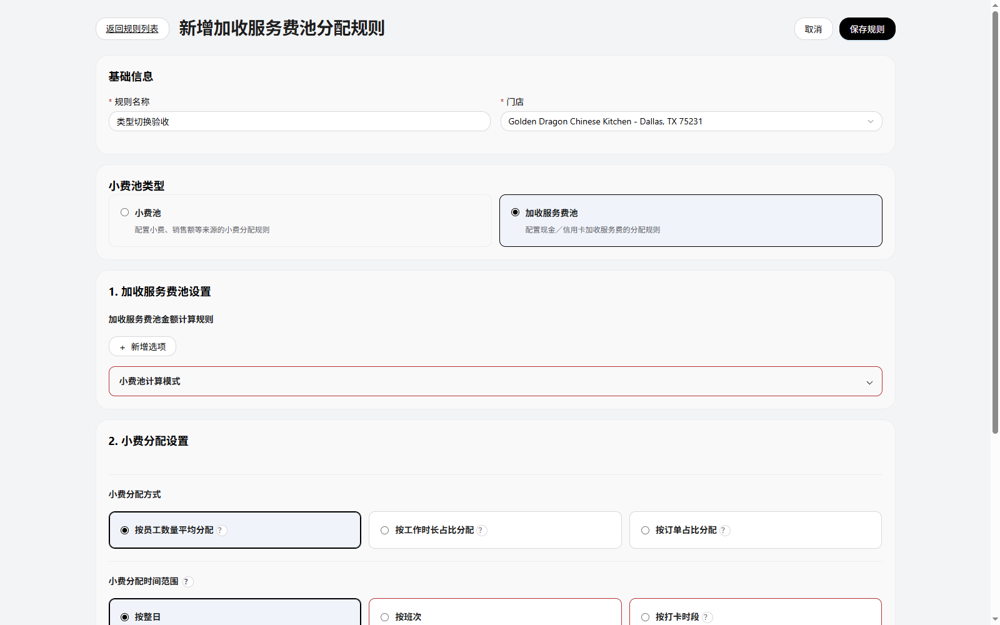

图：新增页选择加收服务费池，标题、金额来源及贡献区域同步，2026-11-04。

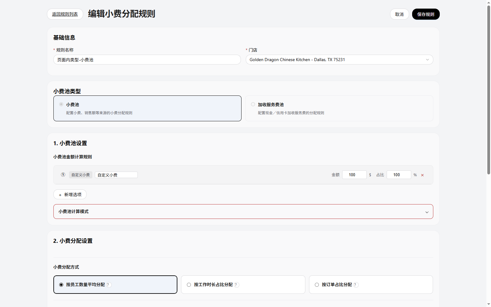

图：已保存规则的类型只读展示，2026-11-04。

### 1. 小费池设置

图：当前应用实际页面，隔离演示数据；来源基线64ddec8f，2026-10-27。对应操作与状态见图像清单。

| 字段 | 逻辑说明 |
| --- | --- |
| 小费池金额计算规则 | 确定金额来源、取值条件和比例；多项结果相加形成计划池金额P。 |
| 新增选项 | 可添加销售额、小费、手动上报小费、自定义小费；加收服务费池按其池类型提供对应来源。每次添加一项。 |
| 计算项名称 | 默认使用来源名称，可编辑，仅标识本计算项。 |
| 来源类型 | 决定基数来源及支持的条件；不能将某来源不支持的条件作为有效配置。 |
| 计算比例 | 默认100；百分数输入，基数×比例÷100。有限非负且不超过100。 |
| 自定义金额 | 自定义来源时填写，默认0；与比例共同计算，不等于某员工贡献金额。 |
| 设置取值条件 | 打开本项独立抽屉，提交应用到当前规则草稿；必填条件不全时不能保存规则。 |
| 删除计算项 | 只移除本规则草稿中的该项。至少保留一个有效金额来源。 |

### 2. 小费分配设置

图：当前应用实际页面，隔离演示数据；来源基线64ddec8f，2026-10-27。对应操作与状态见图像清单。

| 字段 | 逻辑说明 |
| --- | --- |
| 按员工数量平均分配 | 默认。组内合格员工基础值为1，再乘员工权重；权重不同时金额不必相等。 |
| 按工作时长占比分配 | 基础值为本规则采用工时，再乘员工权重。显示分配工时设置。 |
| 按订单占比分配 | 基础值为有效归属订单笔数，再乘员工权重；不使用工时设置。 |
| 分配方式问号 | 点击展开对应说明和算例；不改变选值或保存配置。 |
| 小费分配时间范围 | 按整日处理，同一营业日内计算并分配。金额来源和比例由小费池金额计算规则确定。 |

#### 分配工时设置

图：当前应用实际页面，隔离演示数据；来源基线64ddec8f，2026-10-27。对应操作与状态见图像清单。

仅按工作时长占比分配时展示，作用于每位员工的每日分配基数，不修改考勤记录。

| 字段 | 逻辑说明 |
| --- | --- |
| 按有效打卡工时 | 默认。以有效考勤工时作为采用值。 |
| 每日计入工时上限 | 选择上限模式时必填，0.1—24小时、最多一位小数。按员工逐日取min(有效工时,上限)。 |
| 工时说明问号 | 说明采用值与打卡事实的区别及当前条件，不保存数据。 |
| 明细手动工时 | 当日明细明确录入的采用值优先于规则自动上限；不反写考勤。 |

#### 接收员工打卡要求

图：当前应用实际页面，隔离演示数据；来源基线64ddec8f，2026-10-27。对应操作与状态见图像清单。

位于时间范围下方，与分配方式联动。两个选项互斥，点击卡片主体选择；宽屏两列，窄屏纵向排列。

| 字段 | 逻辑说明 |
| --- | --- |
| 需有有效打卡 | 默认。有有效打卡或明确补录参与依据的员工才进入对应算法计算。 |
| 不限打卡状态 | 不自动纳入所有员工。平均方式仍需有效参与名单；工时方式需有效或明确录入工时；订单方式允许未打卡但有有效归属订单的员工参与。 |
| 资格问号 | 展示当前分配方式下的解释及示例，点击不切换选项。 |

### 3. 小费接收设置

图：当前应用实际页面，隔离演示数据；来源基线64ddec8f，2026-10-27。对应操作与状态见图像清单。

| 字段 | 逻辑说明 |
| --- | --- |
| 接收角色 | 一行可选多个角色，构成共同接收组；组内按员工ID去重。 |
| 占比百分比 | 每行初始0；保存时每组须大于0且不超过100，各组合计100%。组预算＝可分配池金额×本组占比。 |
| 合计 | 当前接收组百分比之和；不是员工权重总和。 |
| 设置员工小费权重 | 先选择角色，再打开该组员工权重弹框。缺省1、0合法、最大1,000,000；不要求合计100%。 |
| 新增角色 | 增加一个接收组，不创建角色目录。 |
| 删除 | 删除当前草稿接收组，重新校验角色占比，不删除员工或已确认快照。 |

### 营业额项扣除设置

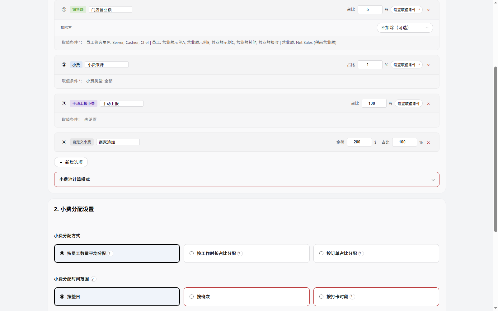

图：小费池设置中的营业额项，扣除方默认空；其他来源不提供扣除方，2026-11-04。

图：营业额项选择单角色，位置在取值条件行上方，2026-11-04。

| 字段 | 逻辑说明 |
| --- | --- |
| 扣除方 | 可选单角色，默认“不扣除”。只在营业额项展示；为空时本项不从员工扣款。 |
| 改选／清空扣除方 | 按新角色员工的个人营业额重新计算；清空时不再产生本项员工扣除。 |
| 删除营业额项 | 同时移除本项扣除方草稿，不影响其他项和已确认快照。 |
| 切换门店 | 扣除方需按新门店重选，不跨门店复用。 |

### 4. 小费贡献设置

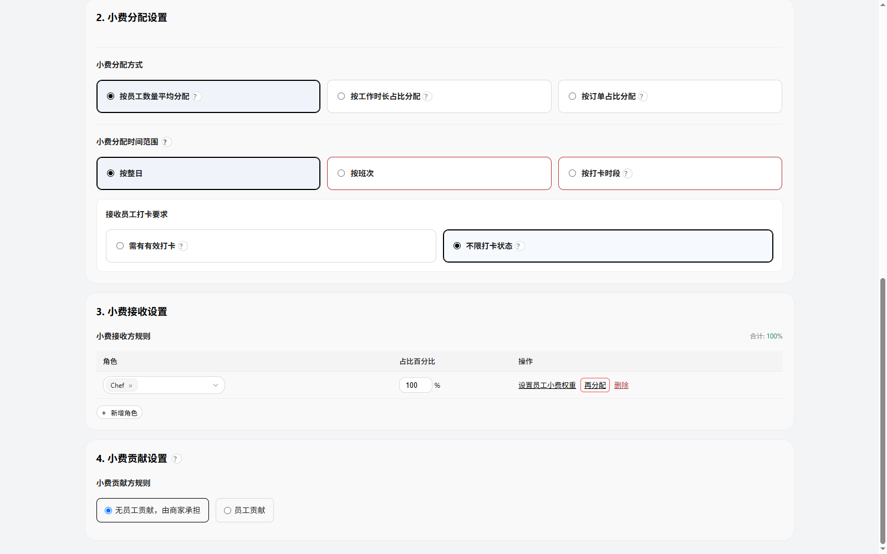

图：普通小费规则的独立贡献设置区块，完整页面背景；功能分支实际页面，2026-11-04。

用途：配置贡献方式及独立贡献规则；无需先添加营业额来源项。贡献员工不由接收员工打卡要求决定。

| 字段 | 逻辑说明 |
| --- | --- |
| 无员工贡献，由商家承担 | 默认选中。不写入独立贡献配置；切换时清空营业额项扣除角色，防止隐藏的扣款仍生效。 |
| 员工贡献 | 展示新增选项与独立贡献规则；保存至少有一条有效独立规则或已配置扣除方的营业额项。 |
| 新增选项 | 可添加按照销售额占比、按照小费收入占比规则。两项可独立配置，多条规则逐条保存。 |
| 贡献占比 | 必填，大于0且不超过100%，最多两位小数；持久化时除以100。 |
| 设置取值条件 | 打开对应来源的取值条件抽屉；角色或员工必须选择一个，二者互斥。条件按贡献项独立保存，不改小费池来源条件。 |
| 删除贡献项 | 删除当前项草稿；不改其他项，不修改已确认分配结果。 |
| 保存规则 | 校验比例、人员范围和规则完整性，保存贡献方式、独立规则与条件；重开回填。无效输入留在编辑页。 |
| 配置冲突 | 独立贡献规则与营业额项扣除方不能同时启用；提示先清空其中一类配置，不覆盖、不重复扣款。 |

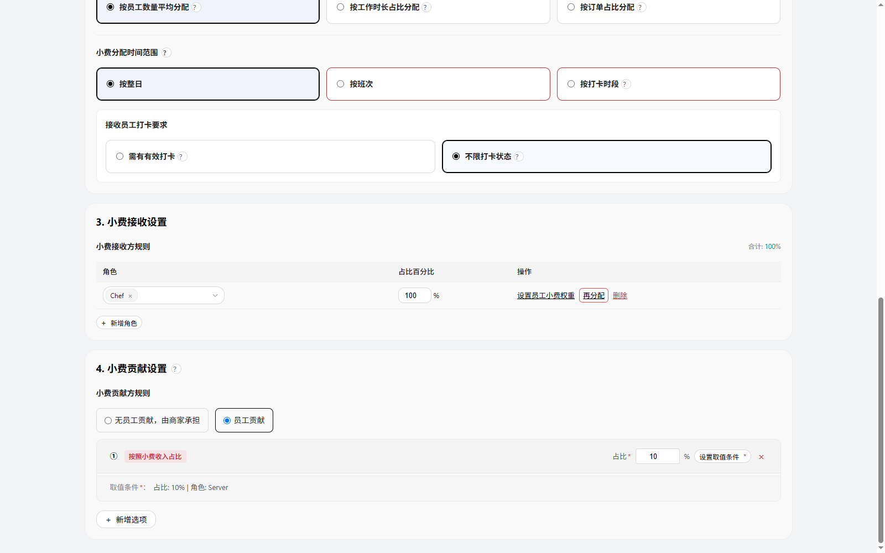

图：小费收入贡献规则，包含贡献比例与角色条件，不提供员工权重设置，2026-11-04。

## 8. 弹框、抽屉及操作结果

### 8.1 主动批量分配范围

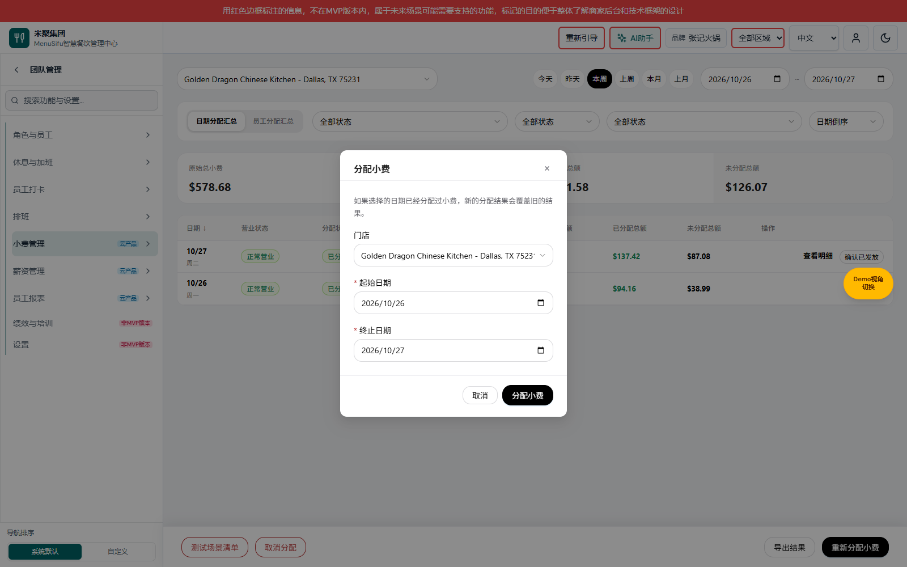

图：当前应用实际页面，隔离演示数据；来源基线64ddec8f，2026-10-27。对应操作与状态见图像清单。

入口与范围：全屏门店日期汇总顶部批量分配／重新分配小费。

| 字段 | 逻辑说明 |
| --- | --- |
| 门店 | 当前操作门店，不能把多店混入一个范围。 |
| 开始日期 | 必填合法日期，包含当天；不得晚于结束日。 |
| 结束日期 | 必填合法日期，包含当天；非法或倒置阻止提交，保留输入。 |
| 分配小费 | 预检范围、跳过未营业／已发放；有人工结果先二次确认。 |
| 取消／关闭 | 不写入，恢复来源查询。 |

主动分配前置校验：规则目录整体为空时提示“请先创建小费分配规则”，约1.5秒后进入规则列表。当前门店无适用规则时提示当前门店没有可用规则，不执行分配。

### 8.2 覆盖人工结果确认

图：覆盖人工调整结果的二次确认，当前完整应用实际操作；隔离演示数据，64ddec8f，2026-10-27。

入口与范围：主动重分配范围包含已保存人工调整时出现。

| 字段 | 逻辑说明 |
| --- | --- |
| 提示正文 | 按系统小费规则重新分配，并覆盖手动调整结果；列出受影响天数和日期。 |
| 重新分配 | 再次核对范围与快照未被其他页面更改后执行。 |
| 取消／关闭 | 保留人工快照，不执行本轮重分配。 |

### 8.3 确认已发放

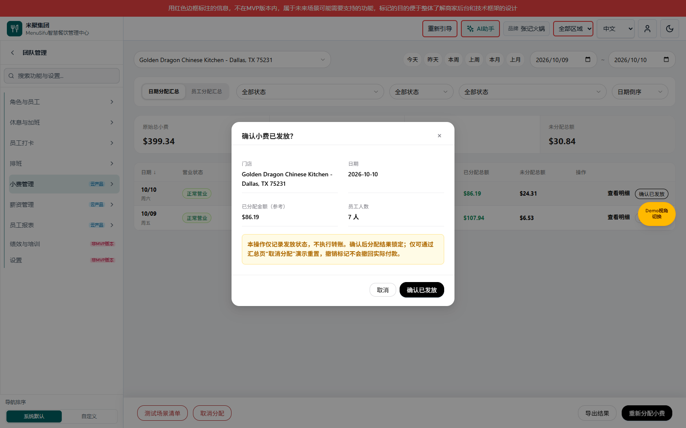

图：日期汇总发放确认，隔离演示数据，64ddec8f；仅打开并取消，未登记发放。

入口与范围：日期汇总行或当日明细；作用于整日全部已确认规则。

| 字段 | 逻辑说明 |
| --- | --- |
| 门店 | 本次发放登记的单一门店。 |
| 日期 | 本次登记的完整营业日，登记范围不因规则筛选缩小。 |
| 已分配金额 | 当前有效快照的接收额合计，用于发放核对。 |
| 接收人数 | 当前有效快照的接收员工数量，不用在职员工总数代替。 |
| 确认已发放 | 保存对应快照ID、版本和哈希的登记，锁定编辑；重复操作不重复生成有效记录。 |
| 取消／关闭 | 不登记，保留待发放；运行中防止重复提交。 |

#### 当日明细发放确认

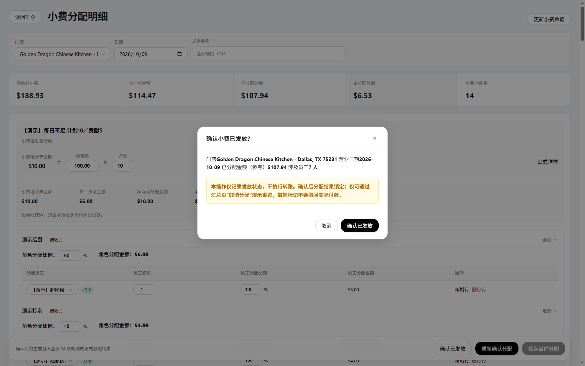

图：当日明细发放确认，隔离演示数据，64ddec8f；仅打开并取消。

#### 发放后只读结果

图：发放后只读结果（当前产品字段区域）。64ddec8f完整应用实际操作，隔离演示数据，2026-10-27。

### 8.4 分配计入工时明细

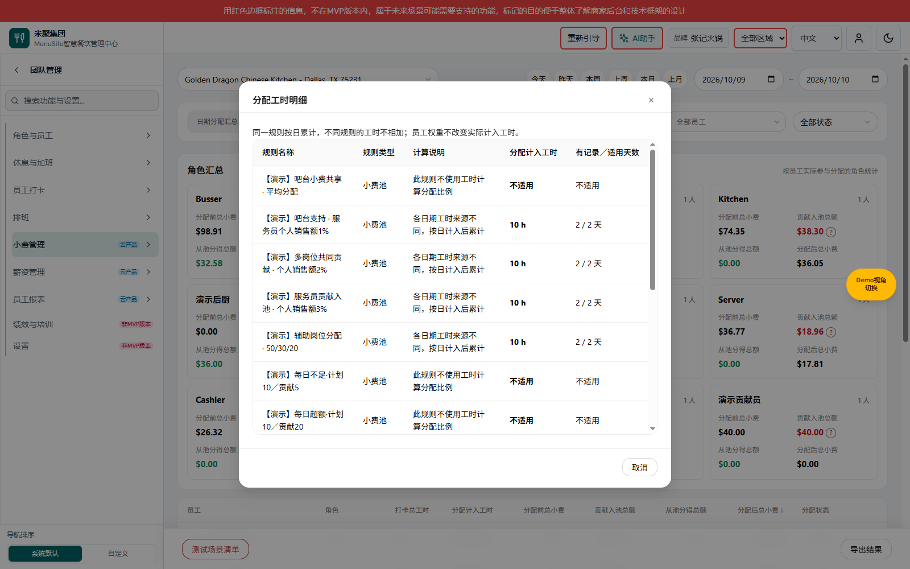

图：员工汇总行打开的只读工时明细，隔离演示数据，64ddec8f。

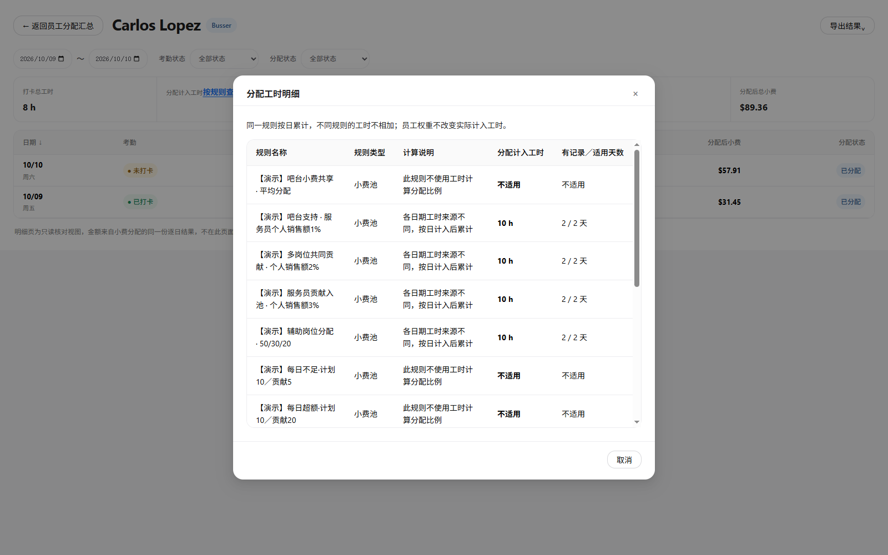

图：员工每日页顶部周期工时入口，隔离演示数据，64ddec8f。

入口与范围：员工汇总行、员工每日页顶部周期摘要或每日行。无记录或不适用的普通文本不可点击。

| 字段 | 逻辑说明 |
| --- | --- |
| 规则名称 | 逐条列出适用规则，不跨规则累加工时。 |
| 规则类型 | 显示所属池类型。 |
| 计算说明 | 说明是否使用工时及实际采用依据；不适用时明确说明。 |
| 分配计入工时 | 同一规则逐日累计；单日入口只显示当天。员工权重不改变计入工时。 |
| 有记录／适用天数 | 展示有工时记录的天数与规则适用天数，不适用时显示不适用。 |
| 关闭／遮罩／Esc | 关闭只读说明，不改筛选、工时或分配结果，并返回触发位置。 |

#### 单日工时明细

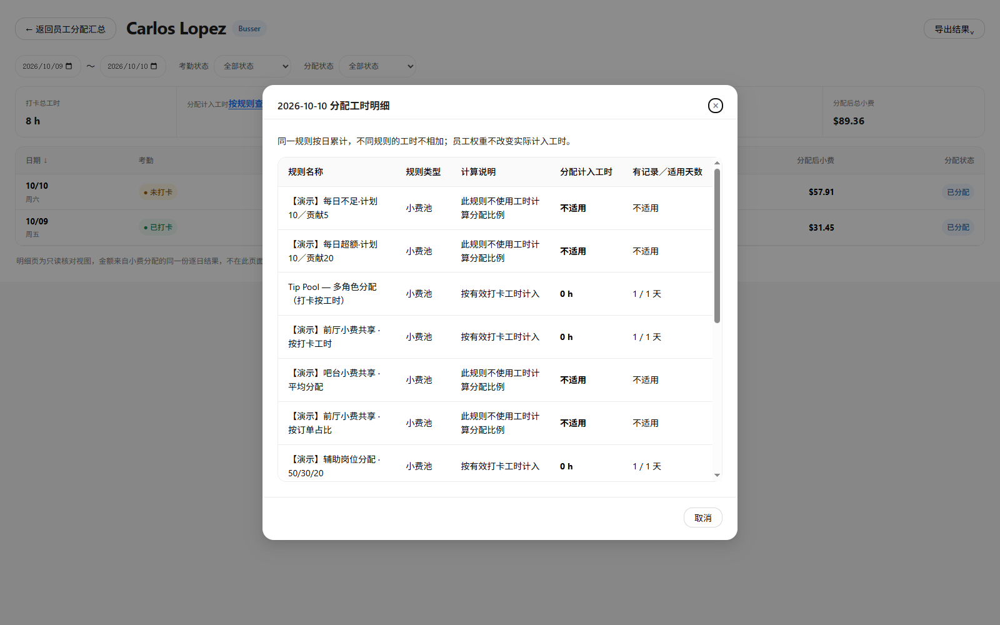

图：员工每日行工时入口，标题标明所选日期；隔离演示数据，64ddec8f。

### 8.5 贡献金额拆分

图：当前应用实际页面，隔离演示数据；来源基线64ddec8f，2026-10-27。对应操作与状态见图像清单。

入口与范围：员工汇总贡献金额旁问号。

| 字段 | 逻辑说明 |
| --- | --- |
| 已分配日期 | 有效分配快照累计的贡献金额。 |
| 待分配日期（预计） | 待分配日期按当前规则试算的贡献，尚未正式扣除。 |
| 合计 | 已分配日期贡献与待分配日期预计贡献之和。 |
| 提示说明 | 待分配金额为试算结果，以实际分配结果为准。 |
| 试算失败 | 显示无法试算及原因，不把部分金额当完整贡献总额。 |
| 关闭说明 | 仅改变展开状态，不执行保存或扣款。 |

### 8.6 公式详情

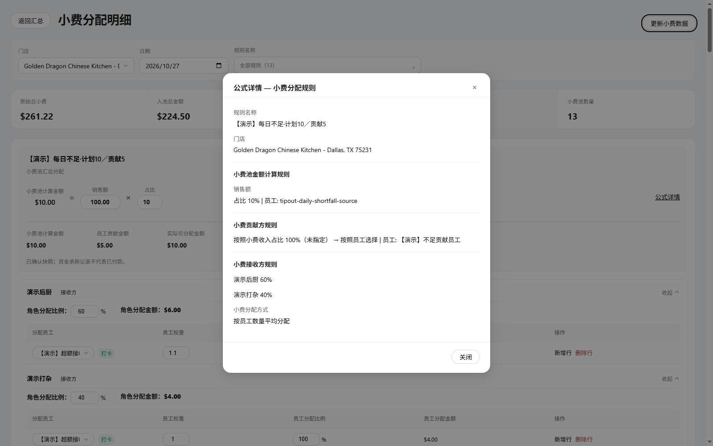

图：当前应用实际页面，隔离演示数据；来源基线64ddec8f，2026-10-27。对应操作与状态见图像清单。

入口与范围：当日明细→公式详情。

| 字段 | 逻辑说明 |
| --- | --- |
| 来源与条件 | 本规则计算项的取值范围。 |
| 基数／比例／金额 | 列出每项计算及总和；不把计划金额解释成实际贡献。 |
| 关闭 | 退出只读详情，不修改草稿。 |

### 8.7 保存当前分配确认

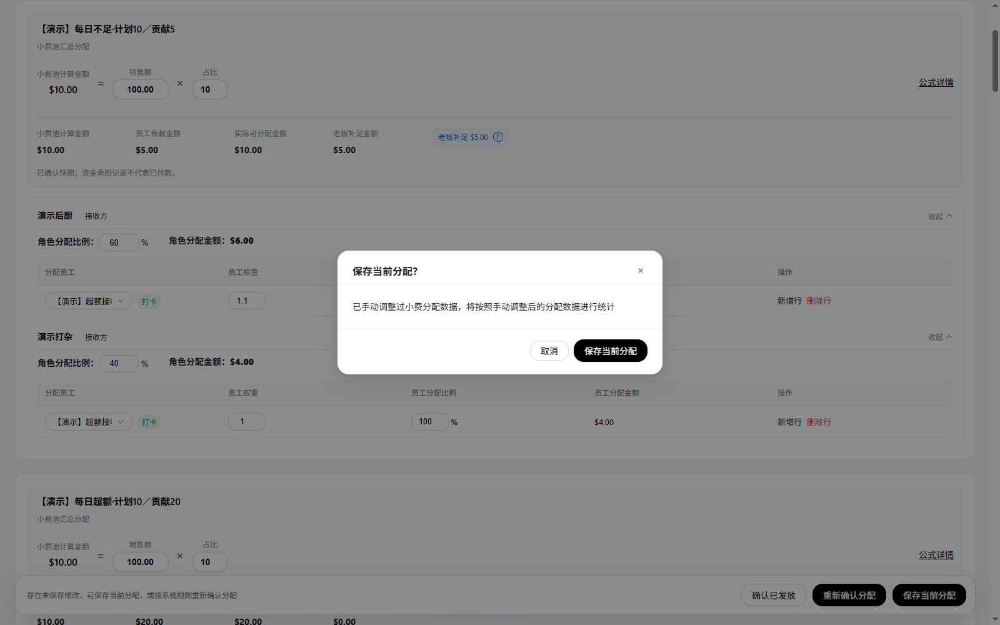

图：当前应用实际页面，隔离演示数据；来源基线64ddec8f，2026-10-27。对应操作与状态见图像清单。

入口与范围：当日明细已有结果，并且发生人工调整后点击保存当前分配。

| 字段 | 逻辑说明 |
| --- | --- |
| 提示 | 已手动调整过小费分配数据，将按照手动调整后的分配数据进行统计。 |
| 保存当前分配 | 保存整日人工快照，更新正式汇总；校验失败保留草稿。 |
| 取消／关闭 | 返回编辑，人工草稿保留。 |

### 8.8 重新确认分配提示

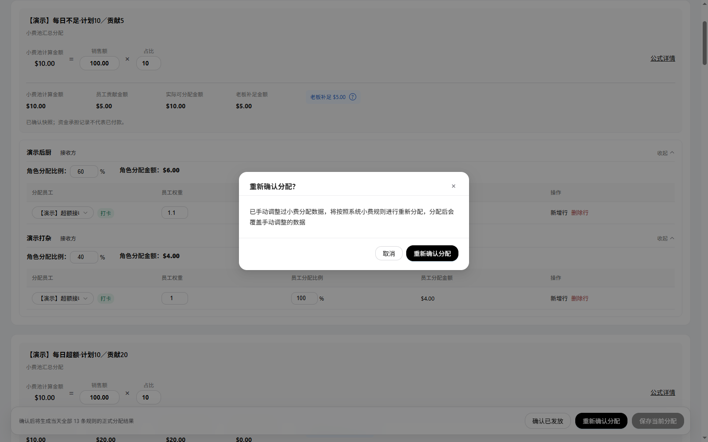

图：当前应用实际页面，隔离演示数据；来源基线64ddec8f，2026-10-27。对应操作与状态见图像清单。

入口与范围：当日明细已有手调数据时点击重新确认分配。

| 字段 | 逻辑说明 |
| --- | --- |
| 提示 | 已手动调整过小费分配数据，将按照系统小费规则进行重新分配，分配后会覆盖手动调整的数据。 |
| 重新确认分配 | 重建系统快照，替换手调结果；不重复叠加扣款。 |
| 取消／关闭 | 保留已有正式结果及页面草稿。 |

### 8.9 无手动调整提示

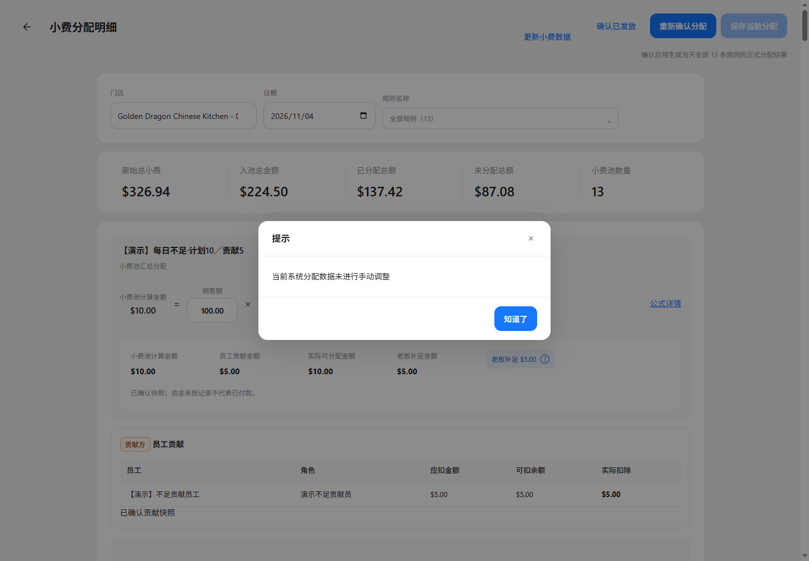

图：当前功能分支实际说明弹框，含遮罩与明细入口背景；79e13f27＋TIPOUT-FIGMA-UI-20261104-01。

入口与范围：无人工调整时点击灰显的保存当前分配。

| 字段 | 逻辑说明 |
| --- | --- |
| 提示 | 当前系统分配数据未进行手动调整。 |
| 知道了 | 仅关闭说明，不写快照。 |

### 8.10 更新小费数据

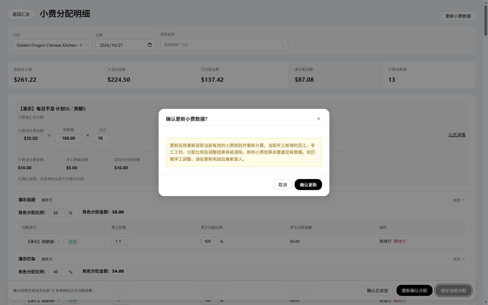

图：当前应用实际页面，隔离演示数据；来源基线64ddec8f，2026-10-27。对应操作与状态见图像清单。

入口与范围：当日明细→更新小费数据。

| 字段 | 逻辑说明 |
| --- | --- |
| 提示与范围 | 确认门店、日期、基准快照及覆盖手调影响。 |
| 确认更新 | 重新读取当日来源并重建默认计算；需要确认的结果不伪称已完成确认。 |
| 取消／关闭 | 不更新，保留当前内容。 |

#### 更新后需要确认的计算

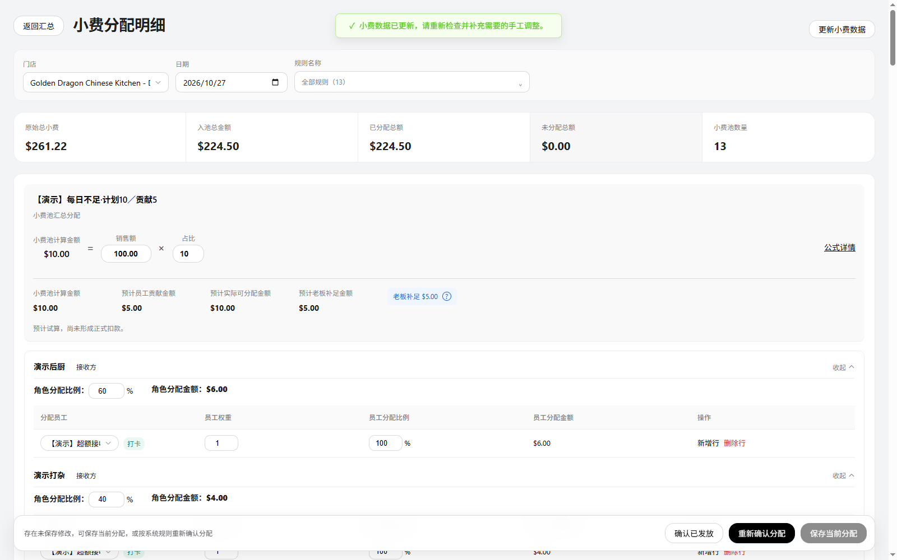

图：当前应用实际页面，隔离演示数据；来源基线64ddec8f，2026-10-27。对应操作与状态见图像清单。

### 8.11 未保存调整保护

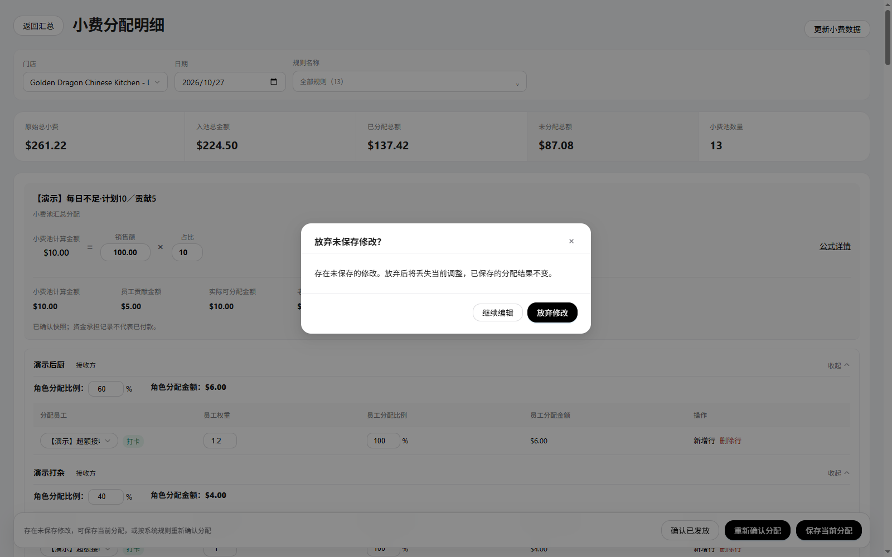

图：当前应用实际页面，隔离演示数据；来源基线64ddec8f，2026-10-27。对应操作与状态见图像清单。

入口与范围：当日明细切店、切日、返回或离开时存在未保存调整。

| 字段 | 逻辑说明 |
| --- | --- |
| 继续编辑 | 取消跳转，保留日期、筛选和草稿。 |
| 放弃调整 | 不保存该草稿，继续目标跳转；正式快照不受影响。 |

### 8.12 切换小费池类型确认

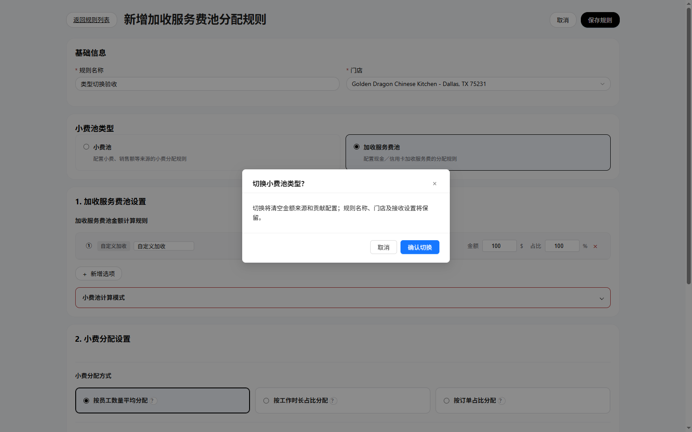

图：已有金额来源时切换类型的页面内确认框，保留完整背景，2026-11-04。

入口：新增规则中切换小费池类型，且存在类型专属配置。

| 字段 | 逻辑说明 |
| --- | --- |
| 提示 | 告知切换将清空金额来源和贡献配置，名称、门店及接收设置保留。 |
| 确认切换 | 清空来源卡片、来源条件、营业额扣除方、独立贡献配置及专项草稿；回到普通汇总分配，更新池类型及可用来源。当前仅改变草稿，保存规则后持久化。 |
| 取消／关闭 | 保留原类型及全部草稿，不写入规则，不执行分配。 |

### 8.13 员工权重

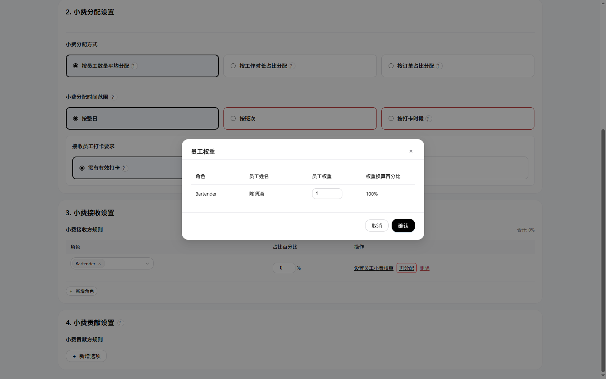

图：当前应用实际页面，隔离演示数据；来源基线64ddec8f，2026-10-27。对应操作与状态见图像清单。

入口与范围：接收组→设置员工小费权重。

| 字段 | 逻辑说明 |
| --- | --- |
| 角色 | 本接收组选择的角色，限定员工候选。 |
| 员工姓名 | 当前门店、所选角色的员工；以稳定身份引用区分同名人员。 |
| 员工权重 | 缺省1、0合法，输入须为有限非负数，最大1,000,000。 |
| 权重换算百分比 | 权重×100%，最多两位小数，1.1显示110%；仅供说明。 |
| 确定 | 应用到当前规则草稿；整页保存后持久化。 |
| 取消／关闭 | 丢弃本次弹框输入。 |

### 8.14 来源／贡献取值条件

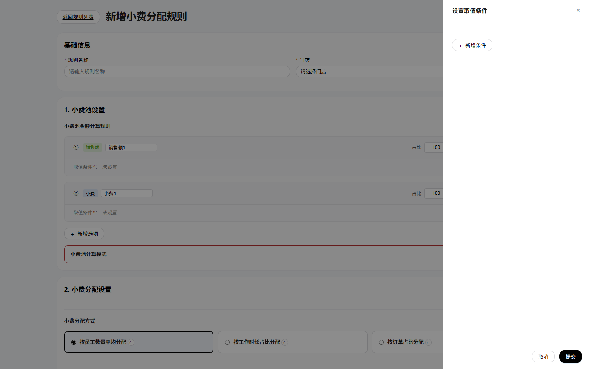

图：取值条件抽屉初始态（尚未添加条件），完整抽屉、遮罩及规则编辑页背景；隔离演示草稿，64ddec8f，2026-10-27。仅打开后取消，未保存规则。

入口与范围：金额计算项或贡献项→设置取值条件。每项独立，菜单只提供该来源可用的维度。

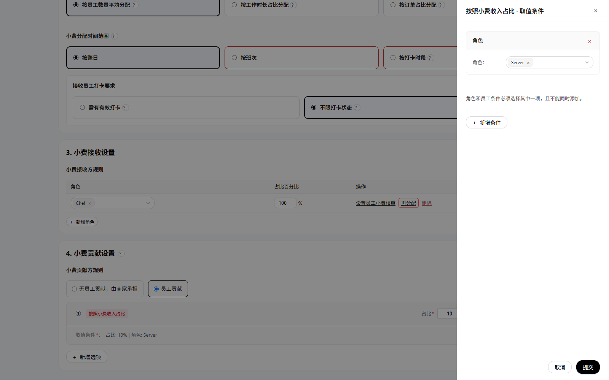

图：小费收入贡献取值条件抽屉与背景规则页，2026-11-04。提交应用到贡献项草稿，取消不应用抽屉输入。

| 字段 | 逻辑说明 |
| --- | --- |
| 角色 | 按来源归属角色过滤，可多选；多值取并集，不配置扣除方，也不决定接收组。 |
| 员工 | 按员工引用过滤，候选受门店与角色限制；与角色维度按界面互斥，不能靠同名串账。 |
| 营业额类型 | 销售额候选为Net Sales（税前营业额）、Gross Sales（总销售额）、Payment Method（支付方式）；是否可计算取决于对应事实，见本节能力边界。 |
| 订单类型 | 限定堂食、外带等当前候选类型。 |
| 支付方式 | 限定来源支付类型；不支持的营业额＋菜单组合不能提交为有效条件。 |
| 区域 | 限定订单发生区域。 |
| 菜单／商品范围 | 按当前来源支持的产品线、分类、菜单组或商品过滤；商品销售额与包含商品订单不是同一口径。 |
| 订单需包含商品 | 限定订单命中条件，不自动把整单金额变成某商品金额。 |
| 营业时间／订单时间 | 起止成对，按来源发生时间过滤；不决定接收员工名单。 |
| 小费类型／订单小费状态 | 按来源选择允许类型或有／无等状态；只过滤来源数据。 |
| 加收类型 | 服务费来源的允许类型。 |
| 新增条件 | 添加当前来源支持的条件维度，候选受当前来源限制。 |
| 删除条件 | 解除本项条件，不改变其他计算项或贡献项。 |
| 提交 | 校验必填、范围、组合，应用到父规则草稿；整页保存后持久化。 |
| 取消／关闭 | 退出抽屉，不保存正式规则。 |

#### 来源条件与校验

| 来源 | 可选条件 | 保存要求 |
| --- | --- | --- |
| 销售额 | 角色、员工、区域、订单类型、菜单、营业额类型、订单小费状态、支付方式、营业时间 | 至少一个有效条件。 |
| 小费 | 角色、员工、区域、订单类型、营业时间、小费类型、订单需包含商品 | 至少一个有效条件。 |
| 手动上报小费 | 角色、员工、营业时间 | 条件可为空。 |
| 加收服务费 | 角色、员工、区域、订单类型、营业时间、小费类型、加收类型 | 至少一个有效条件。 |
| 自定义小费 | 无必填来源条件 | 使用非负金额和计算比例。 |

角色与员工条件互斥。营业额候选为Net Sales（税前营业额）、Gross Sales（总销售额）、Payment Method（支付方式）；选择Payment Method会移除菜单条件并提示，不能再添加菜单条件。

当前贡献资金试算使用的演示事实仅支持Net Sales口径，支付方式支持cash、credit_card；缺少对应事实的销售口径、菜单或加收条件会返回明确错误，不保存分配快照。当前贡献资金试算对手动上报来源先按角色／员工过滤，再累计reportedTips；此分支不应用营业时间过滤。条件能保存不等于当前演示事实能完成试算；应区分配置校验与运行取值校验。

#### 销售额来源条件

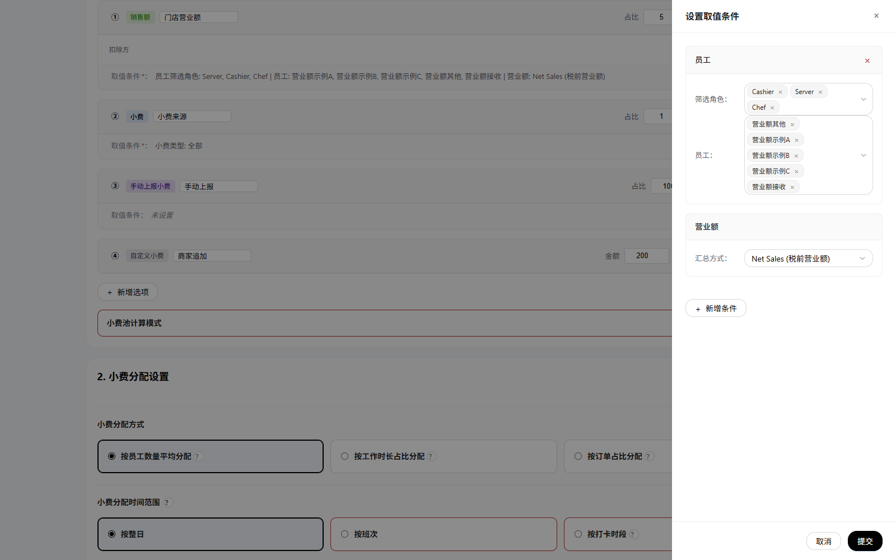

图：销售额取值条件（营业额初始条件），完整抽屉、遮罩及规则编辑页背景；隔离演示草稿，64ddec8f，2026-10-27。仅打开后取消，未保存规则。

#### 手动上报来源条件

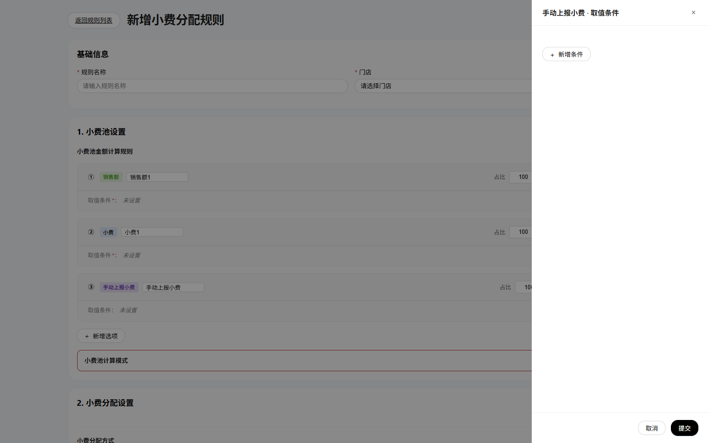

图：取值条件抽屉初始态（尚未添加条件），完整抽屉、遮罩及规则编辑页背景；隔离演示草稿，64ddec8f，2026-10-27。仅打开后取消，未保存规则。

#### 服务费来源条件

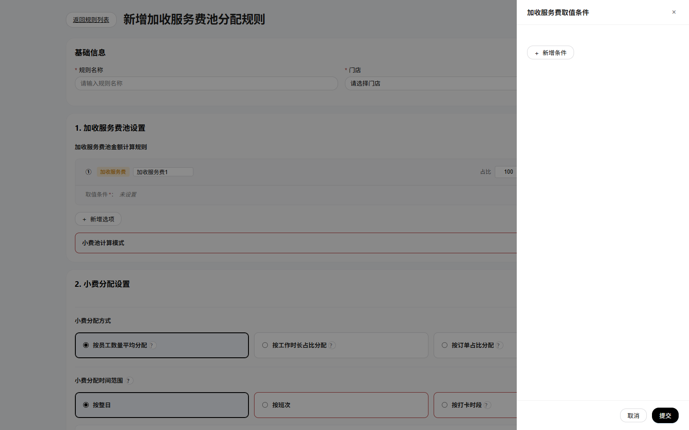

图：取值条件抽屉初始态（尚未添加条件），完整抽屉、遮罩及规则编辑页背景；隔离演示草稿，64ddec8f，2026-10-27。仅打开后取消，未保存规则。

### 8.15 导出与邮件

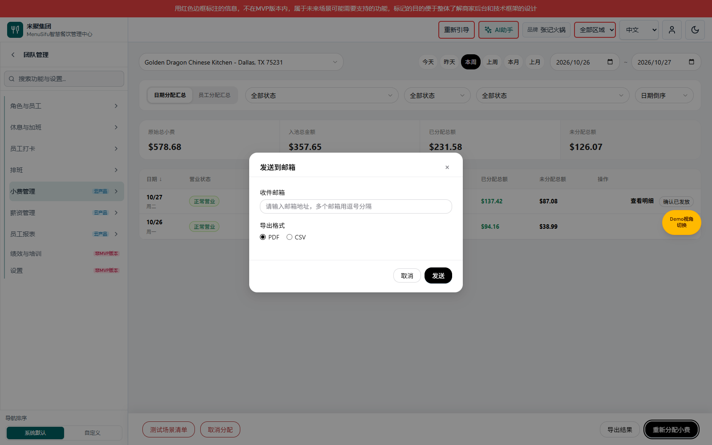

图：当前应用实际页面，隔离演示数据；来源基线64ddec8f，2026-10-27。对应操作与状态见图像清单。

入口与范围：日期、员工或员工每日页面→导出结果。

| 字段 | 逻辑说明 |
| --- | --- |
| CSV | 下载当前视角、门店、合法日期和有效筛选下的数据，日期保留完整信息。 |
| PDF | 日期／员工汇总优先使用jsPDF生成下载，加载或生成失败转浏览器打印预览；员工每日页直接打开打印窗口，由用户另存PDF。弹窗被拦截时提示；不修改账本。 |
| 邮箱地址 | 必填，多个地址用英文逗号分隔，逐个校验格式。 |
| 导出格式 | PDF或CSV单选，默认PDF。 |
| 发送 | 有可导出数据后关闭弹框并显示模拟发送反馈；没有实际邮件服务调用。 |
| 取消／关闭 | 不发送，不修改查询或分配。 |

#### 邮箱格式错误

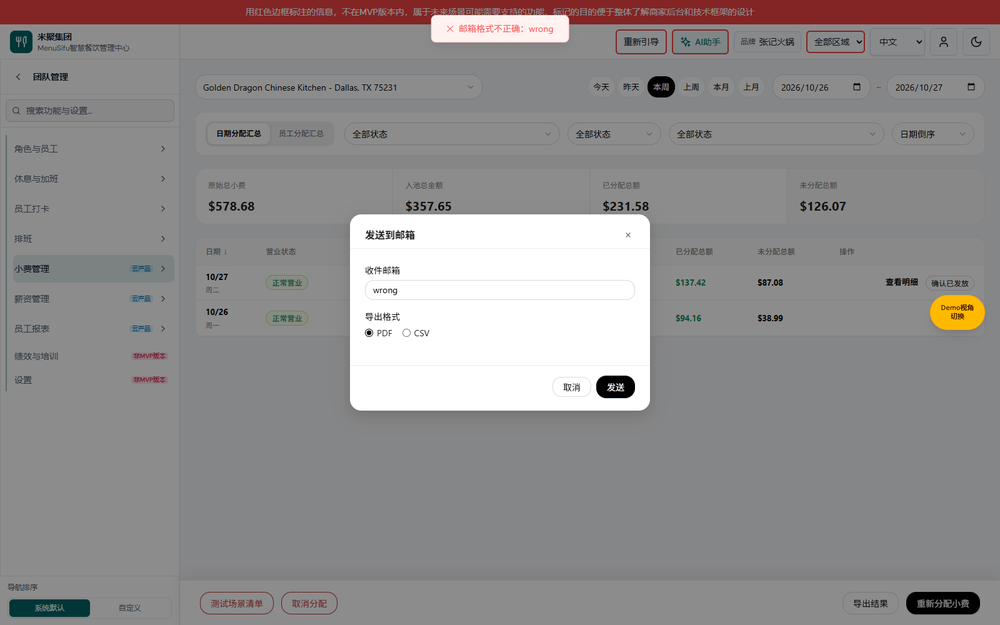

图：当前应用实际页面，隔离演示数据；来源基线64ddec8f，2026-10-27。对应操作与状态见图像清单。

### 8.16 删除规则确认

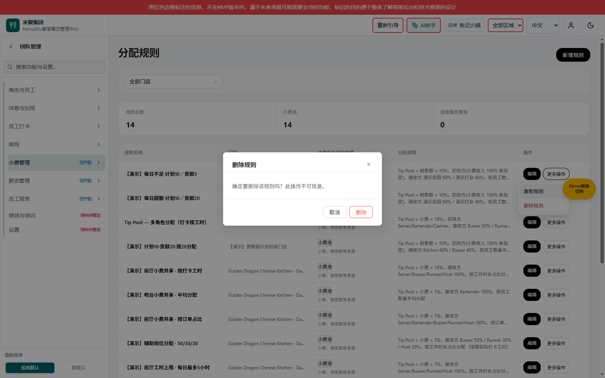

图：当前应用实际页面，隔离演示数据；来源基线64ddec8f，2026-10-27。对应操作与状态见图像清单。

入口与范围：规则列表→更多操作→删除。

| 字段 | 逻辑说明 |
| --- | --- |
| 提示 | 确定要删除该规则吗？此操作不可恢复。 |
| 删除 | 删除当前规则配置，不删除已确认的日期快照。 |
| 取消／关闭 | 保留规则，返回列表。 |

### 8.17 规则编辑取消确认

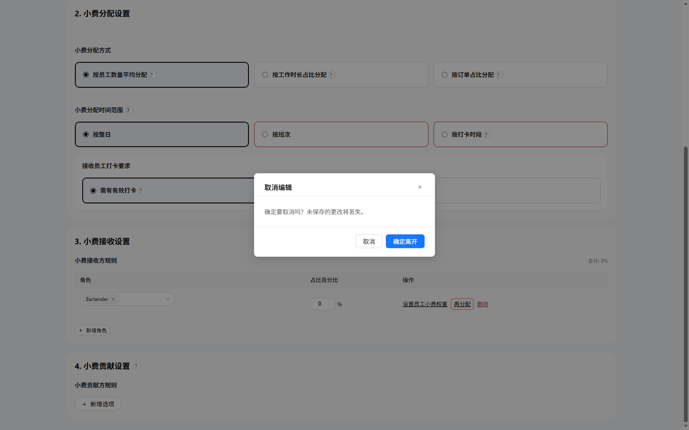

图：当前应用实际页面，隔离演示数据；来源基线64ddec8f，2026-10-27。对应操作与状态见图像清单。

| 字段 | 逻辑说明 |
| --- | --- |
| 提示 | 确定要取消吗？未保存的更改将丢失。 |
| 确定离开 | 不保存输入，返回规则列表；已保存规则与日期快照不受影响。 |
| 取消 | 关闭确认框，保留编辑内容。 |
| 关闭 | 与取消相同，不离开编辑页。 |

## 9. 通用显示与交互

界面使用白色卡片、浅灰分组、蓝色主操作和选中态。以下展示规则不改变字段含义、计算范围与写入时机。

| 字段 | 逻辑说明 |
| --- | --- |
| 返回 | 独立编辑、当日明细和员工每日页：标题左侧48×48方形左箭头按钮；原返回范围、未保存保护保持。 |
| 页面操作位置 | 保存、取消、更新、发放、系统重分配和导出位于页头右侧；明细页操作仍受整日发放状态锁定。 |
| 取值条件面板 | 居中显示，桌面宽度1000px；保留遮罩与入口页面背景，内容区滚动、底部固定取消与提交；取消不应用输入。 |
| 窄屏布局 | 页头操作换行并靠右；表格在区域内横向滚动，面板保持在视口内。 |
| 金额0／无结果— | 真实0显示0.00；尚未确认接收或最终金额显示—；计算异常显示原因，不用0掩盖。 |
| 负号与颜色 | 贡献为扣除方向，但计算对象中贡献金额仍为非负数；接收方向为加项。 |
| 空结果 | 筛选无匹配时显示空态，不清空来源、规则或确认快照。 |
| 日期上下文 | 日期行展示MM/DD与星期，内部查询、快照和导出保留完整日期。 |
| 页面内确认 | 保存、覆盖、取消、发放等弹框显示具体范围；确认前不写数据，运行中防重复。 |
| 焦点与关闭 | 可关闭的说明／确认框支持返回触发位置；自动分配运行中不能关闭，有失败才显示重试。 |
| 整日操作范围 | 规则筛选、角色收起只影响显示，保存与发放仍为当前门店日全部规则。 |

截图与验证范围：[逐操作覆盖清单](小费管理逐操作覆盖清单.md)／[当前图像清单](assets/tips-current-scope-20261027/manifest.json)。正文不使用其他状态的图替代未重现结果。
