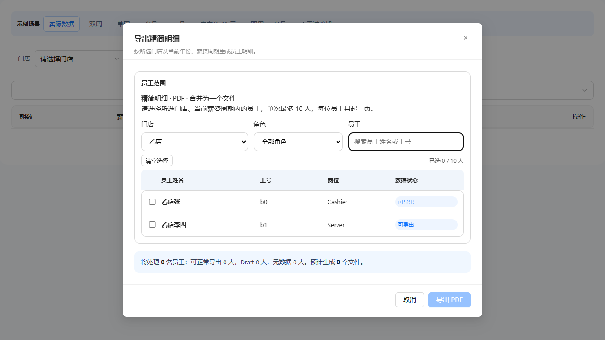

# 薪资管理需求文档（个人规范版）

版本 V1.3；变更 PAYROLL-20261008-BATCH-COPY；业务基线为 2026-10-08 用户确认的 A 方案及门店/角色/员工组合筛选。
变更历史：V1.3 / PAYROLL-20261008-BATCH-COPY 删除弹框副标题、明细/PDF/合并格式说明及人数分页说明三处文案，规则不变；V1.2 增加组合筛选与切店清空；V1.1 定义 A 方案的 10 人 PDF 导出。
职责：按页面元素描述本次批量导出调整，与 [产品说明 V1.3](./payroll-需求分析.md)、[研发说明 V1.3](./payroll-报表功能设计.md) 同一业务定义。
范围：仅本次批量导出页面，不声称覆盖薪资管理所有历史功能。其他页面未迁移。

## 批量导出详情下拉

待补页面图片：57520 实现页面，展开菜单状态；视觉伴侣不是实际页面截图。

入口：薪资管理顶部“批量导出详情”。用途：先确定输出的明细类型。

| 字段｜操作 | 逻辑说明 |
|---|---|
| 批量导出详情 | 点击展开/收起菜单，复用导出 ADP 报表的下拉样式。 |
| 精简明细 | 打开居中“导出精简明细”弹框；本次产物固定为精简 PDF。 |
| 详细明细 | 打开居中“导出详细明细”弹框；本次产物固定为详细 PDF。 |

## 导出员工选择弹框

图注：2026-10-08 / V1.2，57520 加载的真实组件隔离测试，虚拟“乙店”与员工数据、默认未选状态；仅验证布局及交互，不代表登录后的业务数据。真实业务场景及满 10 人截图仍待补。 此图为历史 V1.2 状态，V1.3 已删除副标题与两行说明，最新截图待补。

用途：默认当前门店，允许切换权限范围内其他门店；始终取当前年份、当前薪资周期的数据。每次打开清空上次选择，切换门店也清空选择；不修改主页面门店。 弹框不展示“按所选门店及当前年份、薪资周期生成员工明细。”、“详细/精简明细 · PDF · 合并为一个文件”和“请选择所选门店、当前薪资周期内的员工，单次最多 10 人，每位员工另起一页。”三处说明，10 人与 PDF 约束仍生效。

| 字段｜操作 | 逻辑说明 |
|---|---|
| 标题 | 随入口显示导出精简明细或导出详细明细，不可编辑。 |
| 导出约束（非独立展示字段） | 仅 PDF、合并一个文件、每名员工另起一页；不再显示明细/PDF/合并格式说明行。 |
| 门店筛选 | 默认当前门店；只展示项目现有门店权限范围，可单选其他店。切店清空勾选、角色及搜索，更新员工和角色选项。无权限或当前周期无数据不能导出，不伪造员工。 |
| 角色筛选 | 默认全部角色，选项来自所选门店本期员工的角色去重；按角色精确匹配，保留已选员工。 |
| 员工搜索 | 姓名、员工 ID 或 ADP 工号包含匹配；空值不过滤，与门店、角色同时生效，搜索不清空选择。 |
| 员工姓名 | 当前周期员工名称，用于识别导出对象。 |
| 工号 | 使用员工记录 ID；缺失展示 —。不增加新的身份编号。 |
| 岗位 | 员工角色描述，缺失展示 —。 |
| 数据状态 | 沿用可导出、Draft 信息不完整、Draft 未确认、无数据分类；不是新的薪资确认状态。 |
| 勾选框 | 默认不选，最多 10 人；满 10 人禁用未选项，仍可取消已选项。 |
| 已选人数 | 全部已选 ID 数，包括角色/搜索隐藏项，显示 N/10；满额提示已达上限。 |
| 清空选择 | 清除全部选中 ID，包括角色/搜索隐藏项，不修改员工资料。 |
| 取消／关闭 | 关闭选择弹框，不启动导出，不保存选择。 |
| 导出 PDF | 0 人禁用；1–10 人校验当前上下文和任务占用，通过后启动任务并关闭弹框。失败则保留选择提示原因。旧格式偏好不能覆盖入口明细和 PDF。 |

## 导出反馈

待补页面图片：实际任务面板的完成／部分失败状态。

入口：导出任务启动后。沿用现有非阻塞任务面板。

| 字段｜操作 | 逻辑说明 |
|---|---|
| 进度 | 实际准备、生成、合并和完成状态，不使用模拟成功定时器。 |
| 无数据项 | 明确列出员工姓名及未生成原因，不能静默跳过。 |
| 失败项 | 显示员工与错误原因；全失败不提供空文件。 |
| 下载文件 | 真实产物生成后下载合并 PDF，文件内仅含成功员工。 |
| 重试失败员工 | 沿用失败项重试流程，仍受 10 人上限限制。 |

## 交付缺口

本次页面截图待补；现有历史文档的全模块权威入口仍需治理确认。本文件不替代完整历史规格，不将旧说明自动确认为新决策。
