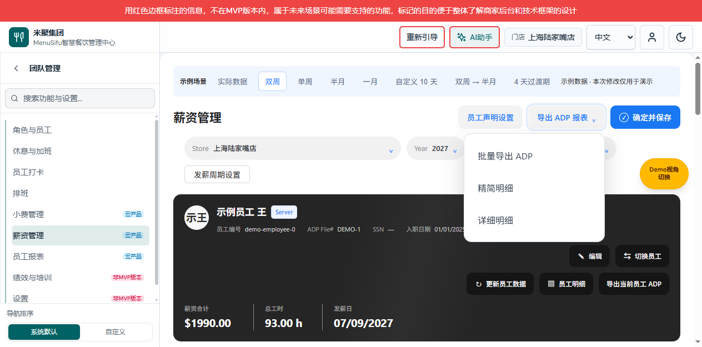
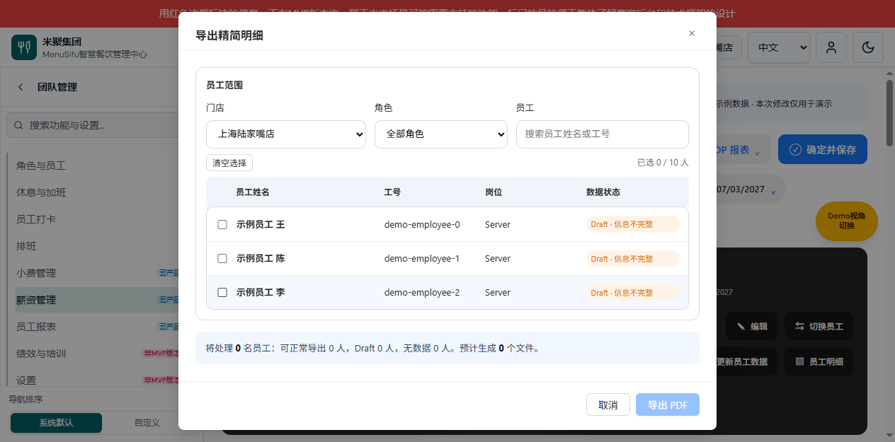
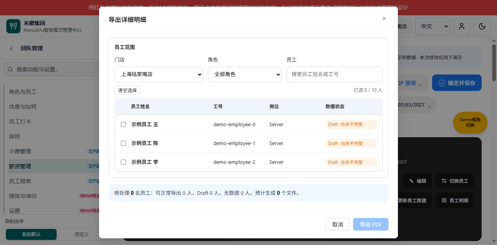

# 薪资管理需求文档（个人规范版）

## 2026-10-10 批量导出菜单收敛（V1.9）

变更编号 PAYROLL-20261010-EXPORT-MENU-SIMPLIFY；共同业务基线：用户明确将批量导出 ADP 改为导出 ADP，移除独立精简明细、详细明细入口。三份配对版本 V1.9：[产品权威](./payroll-需求分析.md)、[研发说明](./payroll-报表功能设计.md)、[个人规范版](./薪资管理需求文档（个人规范版）.md)。历史版本中的三项／四项菜单仅为历史记录，当前菜单以本节为准。

### 薪资工作台／批量导出菜单

图注：65023 / V1.9 / 2026-10-10，真实薪资工作台，双周示例数据，下拉已展开。

用途／入口：薪资工作台顶部批量导出按钮。菜单仅保留以下两项，不改变既有导出范围、校验和结果。

| 字段｜操作 | 逻辑说明 |
|---|---|
| 批量导出 | 入口名称及展开／收起行为不变。展开仅按顺序显示导出 ADP、导出明细。 |
| 导出 ADP | 中文显示导出 ADP，英文 Export ADP；沿用 export-batch-adp 动作和 export.batchAdp 国际化键，仅更名，不改为当前员工导出。范围、未保存校验、CSV 输出及取消／失败处理均不变，无新增数据字段或写入。 |
| 导出明细 | 打开 V1.8 定义的批量导出员工信息弹框，仍默认精简，可在弹框切换详细；保留员工多选、门店／角色／员工筛选、最多 10 人与 PDF 限制。 |

独立精简明细与详细明细菜单按钮从 DOM 移除，不只隐藏，不再提供固定类型的直接入口；弹框内 summary／detailed 单选和对应模板继续保留。员工卡片导出当前员工 ADP 不受影响。验收：菜单恰好两项且顺序正确；点击导出明细可见两个格式单选；静态菜单检查、类型校验及浏览器显示检查通过。本次未实际生成导出文件，历史跨角色与 10 人补测缺口仍保持原状态。

## 2026-10-10 统一导出明细员工选择（V1.8）

变更编号：PAYROLL-20261010-UNIFIED-DETAIL-PICKER。共同基线：用户确认新增导出明细入口，复用切换员工布局，支持员工多选、信息类型切换和角色筛选。配对版本 V1.8：[产品权威](./payroll-需求分析.md)、[研发说明](./payroll-报表功能设计.md)、[个人规范版](./薪资管理需求文档（个人规范版）.md)。本节为当前有效定义；下方 V1.7 及以前的三项菜单描述为历史状态，不再代表当前菜单。

### 批量导出员工信息弹框

图注：65023 预览 / 2026-10-10 / V1.8，真实页面，双周示例数据，精简信息默认、未选择员工状态。沿用切换员工的头像、行选中与双栏布局，不改变原切换员工的单选行为。

用途／入口（V1.9 同步）：批量导出下拉依次显示导出 ADP、导出明细。点击导出明细打开本弹框，不切换工作台当前员工；精简／详细选择仅在弹框内提供。

| 字段｜操作 | 逻辑说明 |
|---|---|
| 导出明细 | 点击关闭下拉并打开统一弹框。每次打开默认精简信息、当前门店、无员工选择及无角色限制；年份与薪资周期承接工作台。 |
| 导出精简信息 | 单选，值 summary，打开默认选中；与详细互斥，使用既有精简 PDF 模板。切换不清空员工选择。 |
| 导出详细信息 | 单选，值 detailed，使用既有详细 PDF 模板。切换不清空员工选择，不变更薪资数据。 |
| 门店 | 沿用既有门店数据与筛选。变更门店重新加载当前年份／薪资周期员工，清空已选员工、角色及搜索条件，避免跨门店混合导出。 |
| 员工搜索 | 按姓名或工号过滤当前门店员工，与角色条件同时满足；搜索不清除已选员工。无匹配时显示空结果。 |
| 全部角色 | 默认不限角色。点击清空角色筛选，不清空员工选择。 |
| 角色复选项 | 来源为当前门店候选员工的非空 role，去重排序。多项采用 OR；未勾选任何角色视为全部。与门店和搜索采用 AND。改变角色不自动勾选员工，不清空筛选后隐藏的已选员工。 |
| 员工复选项 | 左栏显示头像、姓名和角色，通过 employee ID 唯一标识选择。允许多选、最多 10 人；达到 10 人禁用未选员工，已选仍可取消。原员工数据状态、无数据及任务校验规则不变。 |
| 已选人数 | 统计本次全部已选 ID，包括筛选后隐藏项，显示 N / 10，不是当前可见员工数。 |
| 清空选择 | 清空全部已选员工，不改变当前信息类型和筛选条件。 |
| 确认导出 | 0 人禁用；1–10 人可点击，执行原批量任务校验，参数固定 selected 范围、PDF 格式、merged 合并文件，detailType 使用当前单选值。启动成功关闭弹框并显示原任务进度，完成下载 PDF；启动失败保留弹框与输入并提示错误，不宣称导出成功。 |
| 关闭／Escape | 关闭弹框，不启动任务、不生成文件、不修改员工绑定或当前员工；焦点回到批量导出。 |

验收算例：选择王、陈两人，切换详细后两人仍选中，确认导出使用 detailed；勾选 Server 后只显示该角色，取消全部角色限制后恢复候选；无选择时不可确认，选 10 人后第 11 人不可选。原精简／详细独立入口仍锁定对应类型。当前预览示例仅有 Server，跨角色多项联合筛选和 10 人上限仍需使用足量真实数据补测；本次不宣称历史全文和图片覆盖缺口已闭合。

## 2026-10-10 批量导出入口文案更新（V1.7）

变更编号 PAYROLL-20261010-BATCH-EXPORT-LABEL；共同基线：用户确认顶部“导出 ADP 报表”改为“批量导出”。三份文档配对版本均为 V1.7：[产品说明](./payroll-需求分析.md)、[研发说明](./payroll-报表功能设计.md)、[个人规范版](./薪资管理需求文档（个人规范版）.md)。仅变更入口名称，菜单仍依次为批量导出 ADP、精简明细、详细明细；员工卡片“导出当前员工 ADP”不变。中文为“批量导出”，英文为 Batch Export，保持原展开、关闭和导出规则，无新增数据字段或写入。验收：顶部入口显示新名称，三个菜单操作仍可用。下面 V1.5、V1.6 截图中的旧入口文字仅作历史位置参考，V1.7 名称以本节为准。

## 版本记录：V1.6

日期 2026-10-10；变更编号 PAYROLL-20261010-CURRENT-ADP-HERO。配对：[产品说明 V1.6](./payroll-需求分析.md)、[研发说明 V1.6](./payroll-报表功能设计.md)。共同基线：用户确认将当前员工 ADP 按钮迁移到员工明细右侧，其他导出行为沿用原定义。

## 薪资工作台／员工卡片操作区

图注：65023 / V1.6，2026-10-10 真实页面，双周示例数据，按钮第二行默认状态。

入口：薪资工作台当前员工卡片右侧。第一行仍为编辑、切换员工；第二行更新员工数据、员工明细、导出当前员工 ADP，按从左到右顺序展示。作用范围为当前员工、当前薪资周期。

| 字段｜操作 | 逻辑说明 |
|---|---|
| 更新员工数据 | 第二行第一项，原刷新员工流程不变。 |
| 员工明细 | 第二行第二项，打开原当前员工的薪资明细；原详细／精简视角及打印行为不变。 |
| 导出当前员工 ADP | 第二行第三项，紧邻员工明细右侧；颜色、大小、圆角使用相同按钮样式。中文显示“导出当前员工 ADP”，英文沿用 Export Current ADP。点击使用当前员工和薪资周期，先执行原未保存检查，允许继续后打开原 ADP Report 弹框；打开不自动导出 CSV、不保存薪资、不修改确认状态。取消未保存确认不打开报表，原输入保留；报表的 CSV 导出校验、成功下载、失败提示和关闭规则保持原行为。 |

验收：顶部下拉没有当前员工 ADP 重复入口；员工卡片第二行三项顺序正确；点击右侧新位置能打开当前员工的原 ADP Report。

## 版本记录：V1.5

日期 2026-10-10；变更编号 PAYROLL-20261010-EXPORT-MENU。配对：[产品说明 V1.5](./payroll-需求分析.md)、[研发说明 V1.5](./payroll-报表功能设计.md)。共同基线：用户确认将两种批量明细合并至导出 ADP 报表下拉。本文仍独立维护，历史模块覆盖缺口不变。

## 2026-10-10 员工声明功能定向整合记录

范围版本 V1.4；变更编号 PAYROLL-20261010-DECLARATION-INTEGRATION。承接已有员工声明实现，不新增业务决策；保留 V1.3 批量 PDF 和筛选口径。仅整合声明模板管理、员工绑定、声明展示及导出依赖，不合并来源分支的小费、菜单等其他变更。

配对：[产品说明 V1.4](./payroll-需求分析.md)、[研发说明 V1.4](./payroll-报表功能设计.md)。以下仅登记恢复入口，原批量导出章节继续有效。

### 薪资工作台／员工声明设置入口

待补页面图片：65022 薪资工作台，员工声明设置入口恢复后的完整页面截图。

| 字段｜操作 | 逻辑说明 |
|---|---|
| 员工声明设置 | 工作台顶部按钮，打开现有全屏声明模板管理，使用现有组织和门店上下文；打开不保存模板、不确认薪资。 |

### 员工声明设置／返回

待补页面图片：65022 员工声明设置全屏页面。

| 字段｜操作 | 逻辑说明 |
|---|---|
| 返回薪资管理 | 关闭设置并返回原工作台；不提交薪资、不发布模板。 |
| 新增语言模板 | 打开现有模板编辑弹框；取消不创建模板；字段和发布规则承接已有声明专项方案，本记录不新增定义。 |
版本 V1.3；变更 PAYROLL-20261008-BATCH-COPY；业务基线为 2026-10-08 用户确认的 A 方案及门店/角色/员工组合筛选。
变更历史：V1.3 / PAYROLL-20261008-BATCH-COPY 删除弹框副标题、明细/PDF/合并格式说明及人数分页说明三处文案，规则不变；V1.2 增加组合筛选与切店清空；V1.1 定义 A 方案的 10 人 PDF 导出。
职责：按页面元素描述本次批量导出调整，与 [产品说明 V1.3](./payroll-需求分析.md)、[研发说明 V1.3](./payroll-报表功能设计.md) 同一业务定义。
范围：仅本次批量导出页面，不声称覆盖薪资管理所有历史功能。其他页面未迁移。

## 薪资工作台／批量导出下拉

图注：65023 / V1.6，2026-10-10 实际页面，双周示例数据，共用菜单展开状态，仅包含批量 ADP、精简明细、详细明细。

入口：薪资管理顶部“批量导出”。用途：选择批量 ADP 导出或员工明细形式。移除独立“批量导出详情”按钮，现行三个选项按下表顺序展示；当前员工 ADP 入口见上方员工卡片章节。

| 字段｜操作 | 逻辑说明 |
|---|---|
| 批量导出 | 点击展开/收起唯一导出菜单；默认收起，外部点击或 Escape 收起。打开菜单不保存、不生成文件。 |
| 批量导出 ADP | 第一项，保留原 ADP 批量导出与确认流程，使用原薪资周期和门店范围。 |
| 精简明细 | 第二项，关闭菜单，打开下节员工选择弹框，标题为“导出精简明细”；产物固定为精简 PDF，保留门店、角色、员工筛选与 10 人上限。取消不导出，焦点返回批量导出。 |
| 详细明细 | 第三项，关闭菜单，打开同一员工选择弹框，标题为“导出详细明细”；产物固定为详细 PDF，保留同样筛选与人数规则。取消不导出，焦点返回批量导出。 |

## 导出员工选择弹框

图注：2026-10-10 / V1.5，65023 真实页面双周示例数据；分别从共用菜单进入精简、详细明细，默认未选。满 10 人及生产数据状态截图仍待补。

用途：默认当前门店，允许切换权限范围内其他门店；始终取当前年份、当前薪资周期的数据。每次打开清空上次选择，切换门店也清空选择；不修改主页面门店。 弹框不展示“按所选门店及当前年份、薪资周期生成员工明细。”、“详细/精简明细 · PDF · 合并为一个文件”和“请选择所选门店、当前薪资周期内的员工，单次最多 10 人，每位员工另起一页。”三处说明，10 人与 PDF 约束仍生效。

| 字段｜操作 | 逻辑说明 |
|---|---|
| 标题 | 随入口显示导出精简明细或导出详细明细，不可编辑。 |
| 导出约束（非独立展示字段） | 仅 PDF、合并一个文件、每名员工另起一页；不再显示明细/PDF/合并格式说明行。 |
| 门店筛选 | 默认当前门店；只展示项目现有门店权限范围，可单选其他店。切店清空勾选、角色及搜索，更新员工和角色选项。无权限或当前周期无数据不能导出，不伪造员工。 |
| 角色筛选 | 默认全部角色，选项来自所选门店本期员工的角色去重；按角色精确匹配，保留已选员工。 |
| 员工搜索 | 姓名、员工 ID 或 ADP 工号包含匹配；空值不过滤，与门店、角色同时生效，搜索不清空选择。 |
| 员工姓名 | 当前周期员工名称，用于识别导出对象。 |
| 工号 | 使用员工记录 ID；缺失展示 —。不增加新的身份编号。 |
| 岗位 | 员工角色描述，缺失展示 —。 |
| 数据状态 | 沿用可导出、Draft 信息不完整、Draft 未确认、无数据分类；不是新的薪资确认状态。 |
| 勾选框 | 默认不选，最多 10 人；满 10 人禁用未选项，仍可取消已选项。 |
| 已选人数 | 全部已选 ID 数，包括角色/搜索隐藏项，显示 N/10；满额提示已达上限。 |
| 清空选择 | 清除全部选中 ID，包括角色/搜索隐藏项，不修改员工资料。 |
| 取消／关闭 | 关闭选择弹框，不启动导出，不保存选择。 |
| 导出 PDF | 0 人禁用；1–10 人校验当前上下文和任务占用，通过后启动任务并关闭弹框。失败则保留选择提示原因。旧格式偏好不能覆盖入口明细和 PDF。 |

## 导出反馈

待补页面图片：实际任务面板的完成／部分失败状态。

入口：导出任务启动后。沿用现有非阻塞任务面板。

| 字段｜操作 | 逻辑说明 |
|---|---|
| 进度 | 实际准备、生成、合并和完成状态，不使用模拟成功定时器。 |
| 无数据项 | 明确列出员工姓名及未生成原因，不能静默跳过。 |
| 失败项 | 显示员工与错误原因；全失败不提供空文件。 |
| 下载文件 | 真实产物生成后下载合并 PDF，文件内仅含成功员工。 |
| 重试失败员工 | 沿用失败项重试流程，仍受 10 人上限限制。 |

## 交付缺口

本次共用菜单和两种明细选择弹框已补截图；满 10 人与任务反馈截图待补。现有历史文档的全模块权威入口仍需治理确认。本文件不替代完整历史规格，不将旧说明自动确认为新决策。
