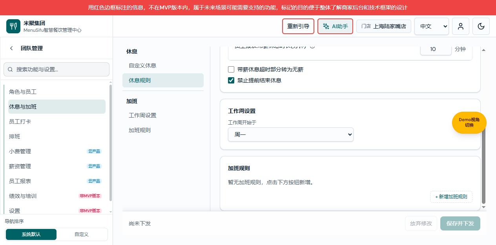

# 权限管理中心：权威产品与交互方案 V3.33

## 子导航查看权限快捷开关（PERM-SUBMENU-VISIBILITY-20261019-01，当前有效）

整合记录（2026-10-19）：用户授权将两项共同交付，功能提交fe91324b（角色只读详情）、8492a994（子导航快捷开关）。保留双方规则并合入main；下列功能分支“未提交/未合并”描述为单项开发时快照，不再代表本次交付状态。合并后13项相关专项回归及TypeScript、隔离构建复核；只读目录不出现新开关，真实浏览器交互/截图仍待验收。

验证状态：12项专项/相关回归、TypeScript、diff检查及Vite隔离构建通过；211个真实页面首次开启均可见且无新增edit授权。功能分支codex/permission-submenu-visibility-20261019（main@4b926b1a、未提交），预览58209；真实浏览器交互和新截图待补，不把服务启动/登录页视为验收。

版本记录：2026-10-19，产品V3.33／研发V2.33／个人V2.33。配套：[产品V3.33](2026-09-23-permission-management-center-authoritative.md) · [研发V2.33](权限管理中心业务规格说明书（研发交付版）.md) · [个人V2.33](权限管理中心需求文档（个人规范版）.md)。本节替代历史“核心控制页在子导航表仅显示状态、不提供二态”的规定。本次整合同时包含V3.32/V2.32角色只读详情与V3.33/V2.33子导航快捷开关，两项定义共同生效。

父模块或中间导航的“子导航查看权限”表，直接列出每个实际子菜单及不可见/可见开关，保留配置权限按钮进入同一子页面。无论子页面属于内容核心、设置页面或普通入口，均采用共用行；不再只有状态标签。只读员工视图和菜单效果预览不显示开关。

开关的选中状态取同一角色的最终生效权限，与子页面标题/内容授权联动，不新增独立菜单权限快照。隐藏页面只关闭原页面grant，保留其内容、编辑及特殊操作配置；重新可见优先恢复原配置，无已有允许内容时仅开启基本只读内容，首次设置页面限制为只读。该快捷操作不新增任何编辑/导出/删除等动作授权。

上级导航隐藏时不能开启子导航，控件禁用；深层依赖或历史拒绝仍导致不可见时，整笔操作失败且不写部分草稿，提示进入配置权限处理。不自动开放祖先、兄弟或所有后代。点击已选状态不制造未保存变更。成功后加入原草稿，沿用保存/取消和确认流程；纯查看不写授权。

示例：角色与员工可见，员工管理和岗位管理均不可见时，单独开启员工管理，只读员工内容可见，岗位管理不变；员工管理原有编辑配置在隐藏期间保留，重新开放后按原配置生效。复杂局部功能仍通过配置权限进入页面调整。


## 角色生效权限只读详情（PERM-ROLE-VIEW-20261019-01，当前有效）

验证状态：10项专项/相关权限回归、TypeScript、diff检查与Vite隔离构建通过；构建保留原有大包与动态/静态导入警告。功能分支codex/permission-role-view-20261019，基线main@4b926b1a，预览58208，未提交。浏览器实页交互/真实数据与新截图待补；不以启动成功或登录页代表验收。

版本记录：2026-10-19，产品V3.32／研发V2.32／个人V2.32。配套：[产品V3.32](2026-09-23-permission-management-center-authoritative.md) · [研发V2.32](权限管理中心业务规格说明书（研发交付版）.md) · [个人V2.32](权限管理中心需求文档（个人规范版）.md)。新增角色只读查看入口；历史“角色编辑保留完整目录”继续有效，不把角色只读详情等同于编辑页。

角色列表中的角色名称改为“查看权限”链接，打开独立只读详情；原操作列“编辑权限”仍打开完整授权编辑目录，不以只读视图替代配置入口。详情标题展示角色名称和查看权限标记，保留返回列表、查看菜单效果、编辑权限入口，不显示保存更改/取消草稿按钮。

只读详情以现有roleAccess计算该角色实际生效权限，包含继承获得的权限；不是只检查grants是否有显式配置。隐藏不可见菜单和空父分类，保留层级及顺序；默认首个可访问页面，选择失效时回退。页面详情显示已授权的内容、操作、功能设置项及对应只读/可编辑状态；不可见内容、被禁止操作、无有效授权的分类不展示。合并的导出等可见功能只有其既有依赖均允许时显示，不能因角色原始配置曾允许而展示已被上限或祖先拒绝的权限。

无可访问菜单时显示“该角色暂无可访问菜单”；角色不存在时显示“角色不存在”，不以其他角色代替。搜索仅在可访问目录内查找，不能恢复被过滤节点。查看和搜索不修改角色、授权版本或日志，不触发未保存提示；真实账号鉴权、角色联合及员工权限视图语义不变。编辑权限仍完整展示所有目录和配置项，新增授权后按既有保存流程生效。

验收：角色继承得到只读设置时须可查看；父级拒绝则子页即使原始允许也不列出；点击角色名进入只读页无写入控件，点击编辑权限进入原可编辑页能看到未授权目录；空角色显示专用空状态。


## 员工生效菜单过滤（PERM-STAFF-EFFECTIVE-20261019-01，当前有效）

验证状态：9项专项/相关回归、TypeScript、diff检查及Vite隔离构建通过；功能分支预览58207（基线a2f31a8d，未提交）。浏览器实页、真实数据交互和新截图待补，未宣称实页验收通过。角色/范围/存储契约不变，未切换生产鉴权。

版本记录：2026-10-19，产品V3.31／研发V2.31／个人V2.31。配套：[产品V3.31](2026-09-23-permission-management-center-authoritative.md) · [研发V2.31](权限管理中心业务规格说明书（研发交付版）.md) · [个人V2.31](权限管理中心需求文档（个人规范版）.md)。本节细化员工仅角色授权下的生效菜单展示；历史完整只读目录要求不再适用于员工详情，角色配置与角色内继承不变。

目标：员工详情“门店与权限→当前门店生效权限”只展示该员工在所选门店实际可访问的菜单，不再以完整授权目录解释无权限项。取当前员工草稿的角色联合结果，沿用范围、祖先、内容依赖及兼容拒绝门槛；只读与可编辑页面均保留，无权限菜单隐藏，空父分类递归隐藏，保留原顺序和层级。多个角色取最终求值，不逐角色分别列目录。

首次进入默认选中首个可访问页面；切换门店或增删角色绑定重新计算，原选中项仍可访问则保留，否则回到首个可访问页面，无页面时显示“该员工在当前门店暂无可访问菜单”。搜索只作用于已过滤目录，父分类命中时仍只展示有权限后代；无匹配显示“没有可显示的菜单”，不恢复无权限项。右侧目录详情中的子导航列表同样过滤。

只改变员工详情和该员工菜单预览的展示；具体功能授权状态仍只读展示，角色编辑保留完整目录，分配角色、保存、取消和草稿提示不变。不修改授权、版本、审计或存储，不新增鉴权能力。删除绑定后展示当前草稿效果，保存前不代表已持久化。

验收：A店角色联合可访问甲/乙页面，丙拒绝，则仅显示甲/乙及必要祖先；B店无适用授权则空状态；祖先拒绝时即使子页有原始允许配置也不显示。角色编辑仍可查看和设置所有目录。


## 员工仅角色授权与清除个人例外（PERM-STAFF-ROLE-ONLY-20261019-01，当前有效）

版本记录：2026-10-19，产品V3.30／研发V2.30／个人V2.30。配套：[产品V3.30](2026-09-23-permission-management-center-authoritative.md) · [研发V2.30](权限管理中心业务规格说明书（研发交付版）.md) · [个人V2.30](权限管理中心需求文档（个人规范版）.md)。本节替代下文全部员工个人例外、跟随角色/个人覆盖及其入口的历史有效定义；角色内的页面/分类/功能继承不变。

用户明确选择方案2：清除个人例外，不迁移为专用角色。员工仅通过角色及指定门店/动态品牌/动态区域范围获得权限，多个适用角色仍按原联合规则生效。员工详情移除设置个人例外入口，生效权限仅供查看；员工列表和概览移除个人例外数量。保留分配角色、移除绑定、账号状态、保存和取消。

首次读取旧本地权限数据时，先保留原始快照，再清空全部员工全部门店（含失效门店）的个人例外，记录审计并切换为roles-only。原例外曾增加权限的员工可能失去该权限，原例外曾收紧权限的员工可能恢复角色权限，这是本次明确选择的结果。角色定义、角色绑定、门店范围、账号信息不变；不创建新角色，不更改原商家RBAC或真实账号服务。

验证边界：专项RED/GREEN、迁移/备份/失败/幂等/旧窗口/角色范围及只读渲染，相关权限回归与TypeScript。测试使用合成快照，不宣称用户当前浏览器历史数据已清除；真实页面/保存/首次迁移E2E和截图待补。仅本地权限中心，不切换生产业务鉴权。

## 移除单独配置辅助文案（PERM-NO-LOCAL-LABEL-20261019-01，当前有效）

版本记录：2026-10-19，产品V3.29／研发V2.29／个人V2.29。配套：[产品V3.29](2026-09-23-permission-management-center-authoritative.md) · [研发V2.29](权限管理中心业务规格说明书（研发交付版）.md) · [个人V2.29](权限管理中心需求文档（个人规范版）.md)。本节替代历史中单独配置提示的展示要求，其他权限定义不变。

功能设置项手动选择不可见、可见不可编辑或可编辑后，不展示“单独配置”辅助文案。该提示从共用权限控件统一移除，覆盖所有设置页面；保留三态选中与禁用状态、继承关系和已保存授权，不改变业务能力。

校验：844个页面/模式渲染无单独配置文案，渲染前后授权数据不变；既有继承及页面三态专项回归。实页浏览器验收待补，生产鉴权未切换。

## 权限继承首次选中与状态统一（PERM-INHERIT-ACTIVE-20261019-01，当前有效）

版本记录：2026-10-19，产品V3.28／研发V2.28／个人V2.28。配套：[产品V3.28](2026-09-23-permission-management-center-authoritative.md) · [研发V2.28](权限管理中心业务规格说明书（研发交付版）.md) · [个人V2.28](权限管理中心需求文档（个人规范版）.md)。本节统一替代下文历史中要求展示混合/复核提示的表述，其余模块权限范围不变。

页面标题、分类上限、功能项统一按有效权限选中，不需要再点击一次已选中的可编辑。未单独配置的设置项继承父项；明确的不可见/只读例外保留。移除权限编辑各模式中的“部分配置，需复核”及类似混合状态提示；历史不一致按最严格有效值展示，不因移除提示自动升级权限。

兼容边界：仅当旧page访问键缺失且本角色/员工门店已有明确read/edit页面总授权时承接页面read；明确旧page hidden不被覆盖。仅有默认gate edit、没有页面访问授权或明确gate授权时仍默认拒绝。上级导航拒绝继续优先。

验证：新增RED/GREEN复现，覆盖首次继承、明确拒绝、只读上限、禁用校验、角色与员工门店隔离、渲染无写入；844页/模式组合无复核提示。必要浏览器E2E与实页截图待补，不宣称完整验收；仅本地权限中心配置模型，不切换业务iframe生产鉴权。

## 自助餐规则统一页面授权（PERM-BUFFET-20261019-01，当前有效）

版本记录：2026-10-19，产品V3.27／研发V2.27／个人V2.27。配套：[产品V3.27](2026-09-23-permission-management-center-authoritative.md) · [研发V2.27](权限管理中心业务规格说明书（研发交付版）.md) · [个人V2.27](权限管理中心需求文档（个人规范版）.md)。本节替代前厅V3.26中自助餐逐项授权的定义，其他范围不变；下方旧版本为历史。

自助餐规则仅保留标题右上角的页面三态，不在正文展示自助餐规则管理、复制或启用/禁用的独立授权。不可见隐藏整页及全部操作；可见不可编辑仅查看；可编辑统一允许新增、修改、删除、复制、启用与禁用。此页不再允许逐个操作收紧。其他前厅页面沿用原定义。

保持原导航、业务路由、订阅和数据；仅本地权限配置/效果模型，不切换业务iframe生产鉴权。脚本验证与真实浏览器验收分开记录。

## 前厅页面权限（PERM-FOH-20261019-01，当前有效）

版本记录：2026-10-19，产品V3.26／研发V2.26／个人V2.26。配套：[产品V3.26](2026-09-23-permission-management-center-authoritative.md) · [研发V2.26](权限管理中心业务规格说明书（研发交付版）.md) · [个人V2.26](权限管理中心需求文档（个人规范版）.md)。以下历史版本记录保留；本节替代本次前厅页面旧层级，其他模块定义不变。

前厅管理中心→店中店管理（品牌管理、设置）；品类管理（基础配置、菜单配置、特殊品类、渠道与展示）；分类管理（分类与菜单、分类设置）；菜单下单限制（自助餐规则、每轮菜品互斥/组合、其他设置）。父菜单仅控制可见性，各子页面标题提供不可见/可见不可编辑/可编辑。独立操作权限节点不再展示，操作归属实际页面。其他未列出导航不变。

页面隐藏时下级全部不生效；页面只读时局部不能设为可编辑，但可进一步隐藏；页面可编辑后可对局部收紧。明确选择页面只读/可编辑时，同步当前页内容/动作的默认值；隐藏保留局部原值。已有设置项沿用父级继承与显式局部例外；旧操作缺失不自动补写授权，旧拒绝键及门控保留。角色和员工门店例外分别存储，不修改其他门店。取消不保存，失败沿用原错误处理。

本次只调整本地权限配置/预览模型及菜单显示名称，不切换生产业务授权，不改变配置数据、订阅及保存下发规则。专项覆盖层级、三态、局部上限、员工门店隔离；浏览器实页与截图验收待补。

## 营销与素材页面统一三态（PERM-MARKETING-20261019-01）

版本记录：2026-10-19，产品V3.25配对研发/个人V2.25；本节替代上述四页原二态定义，其他历史章节保持原范围。

配套：[产品V3.25](2026-09-23-permission-management-center-authoritative.md) · [研发V2.25](权限管理中心业务规格说明书（研发交付版）.md) · [个人V2.25](权限管理中心需求文档（个人规范版）.md)。共同基线V3.25，生产鉴权未切换。

屏保、广告、海报Pro及素材中心的图片素材，标题右上角统一配置不可见、可见不可编辑、可编辑。不新增分类侧栏，不在功能授权正文重复页面总授权。不可见隐藏页面及操作；只读保留查看并拒绝编辑；可编辑启用本页写操作。素材上传、新建分类、重命名、移动、裁剪纳入同一编辑授权。原导航、路由和上级隐藏门禁不变；历史仅查看不自动升级编辑。

验收：专项校验页面三态、旧只读兼容、操作联合、祖先拒绝与正文无重复；实页渲染待补。本次仅权限中心配置/效果模型，不修改业务iframe生产鉴权。

> 更新日期：2026-10-19<br>
> 状态：已确认方案同步；可视化伴侣为交互原型，不代表生产功能已交付。<br>
> 适用范围：商家后台权限中心、角色、员工账号、门店授权、页面与功能权限及效果预览。

> 最新变更：`PERM-MARKETING-20261019-01`，营销与素材页面三态。<br>
> 配套：[研发交付版 V2.25](权限管理中心业务规格说明书（研发交付版）.md) · [个人规范版 V2.25](权限管理中心需求文档（个人规范版）.md)。共同基线V3.25；生产鉴权未切换。

## 独立业务页与设置分类布局（PERM-STANDALONE-20261019-01）

版本记录：2026-10-19，产品V3.24配对研发/个人V2.24。对独立业务页替代旧版“一律保留分类侧栏”的要求，真实设置分类仍保留。

权限结构跟随实际业务页面，不按设置项或分组数量推断。真实后台已无分类侧栏的折扣管理、附加费与服务费、门店档案、营业时间，权限编辑统一为页面标题及右侧三态＋直接展示页内权限项，不再重复分类侧栏、分类名称和本分类权限上限。页内设置项仍独立配置，页面上限及默认继承不变。

排查215个页面，14个单分类候选中4个为上述独立页。其余10个保留实际分类：门店设置、排班规则设置、会员设置、评价设置、通知设置、设备设置、数据与备份、高级与诊断、前厅品牌菜单设置、促销设置。员工打卡规则等多分类设置同样保留，不全局删除单分类。

旧分类权限不直接丢弃：四页将原分类门控合入页面总授权，旧hidden/read限制继续生效；标题显示合并后最严格状态，管理员明确选择页面三态时同步原分类键。逐项独立值和员工其他门店配置不变，不因隐藏界面而默默放开旧拒绝。角色历史不一致按最严格值显示；员工部分个人例外沿用部分配置需复核规则。

真实页面与权限编辑共享分类侧栏展示判断，保持原路由、旧授权键、订阅、草稿与业务数据不变。没有生产鉴权切换。本轮模板/解析器回归不代替实页渲染，浏览器图片与实际页面验收待补。

## 页面隐藏与独立功能授权联动（PERM-PAGE-ACTION-20261019-01）

版本记录：2026-10-19，产品V3.23配对研发/个人V2.23。有效权限规则沿用，补齐配置界面联动；替代页面隐藏时正文仍可开启辅助功能的旧交互。

以薪资报表为例：标题选不可见时，正文导出操作、切换员工、编辑员工统一显示选中不可见并禁用选择，不允许开启可见。标题自身仍可设置只读或可编辑，避免无法重新打开页面。仅遮蔽显示与阻断交互，不把原功能配置改写成hidden。

标题选可见不可编辑或可编辑时，正文三个功能分别独立设置不可见/可见，不自动全开；恢复页面可见后展示先前保存的功能决定。只读薪资仍可单独允许编辑员工或导出，不把页面只读作为这些独立动作的编辑上限。小费分配导出等同类独立功能适用相同页面隐藏联动；设置类页面沿用既有三级最严格限制，本轮不改变。

父目录不可见也会使页面实际不可见并阻断正文功能。角色、员工个人例外与只读/预览使用同一有效权限，原继承及跨门店隔离不变。UI事件再次拒绝页面隐藏时开启功能，不依赖按钮样式作为唯一防线。无生产鉴权、数据范围、存储schema及业务计算变更。实页渲染及本轮截图待补，已知grouped-edit旧脚本基线失败不扩展修复。

## 隐藏继承父级文案（PERM-RESTORE-20261019-02）

版本记录：2026-10-19，产品V3.22配对研发/个人V2.22。覆盖V3.21中“保留继承父级标识”的展示要求。

所有设置权限分类和设置项不再展示“继承父级”文案，且不恢复已移除的恢复继承操作。仅去掉提示，不删除底层逐级继承、选中状态、历史标记或父级上限；单独配置和员工跟随角色保持原规则。本轮与移除恢复继承入口一同提交合并，不自动推送。角色/员工/只读/预览及默认继承有效值继续回归，实页渲染/配图待补。

## 移除恢复继承操作（PERM-RESTORE-20261019-01）

版本记录：2026-10-19，产品V3.21配对研发/个人V2.21。本节替代此前为设置类提供“恢复继承”按钮的要求。

以休息与加班→设置→休息设置为例，分类与逐项权限下不再提供恢复继承按钮；其他同类设置页复用一致处理。保留继承父级/单独配置状态标识、三态选择、默认逐级继承及上级最严格限制。员工个人例外的跟随角色不是本次移除对象。

已存在继承标记与独立hidden/read/edit均保留，不迁移或自动清除。未单独配置的项继续动态继承，明确选择三态仍为独立决定；UI不提供手动恢复父级继承入口，也不因选择值恰与父级相同而自动转为继承。不增加新的重置流程。保存、取消、父级阻断及权限计算不变。

验证覆盖215页四模式共860次无操作入口检查，并回归默认继承/旧标记重载；实际浏览器渲染与截图待补。历史grouped-edit脚本基线失败仍未扩展修复。

## 移除权限范围说明问号（PERM-HELP-20261019-01）

版本记录：2026-10-19，产品V3.20配对研发/个人V2.20。本节替代旧版保留权限问号的展示要求。

权限编辑、员工权限只读和菜单效果预览统一不展示权限范围说明问号及对应悬浮/聚焦说明。包括标题主授权、正文独立功能和设置项，不仅隐藏图标，还不生成说明浮层及无效可访问关联。页面权限控件、功能名称、正文范围段落、父级阻断和继承状态提示保留；不删除业务规则或更改授权键、继承、保存与生效逻辑。其他业务页面帮助不在本次范围。

验证覆盖215页四模式共860次模板渲染；实页截图和浏览器渲染待补。旧grouped-edit脚本在main存在基线失败，本轮仅同步其已失效的tooltip展示断言，不据此宣称全仓通过。

## 页面标题授权文案精简（PERM-HEADING-20261019-01）

版本记录：2026-10-19，产品V3.19配对研发/个人V2.19。替代历史将业务编辑名称随主授权一起移到标题的展示方式。

以休息与加班→加班规则为例，标题右上角不再显示“编辑加班规则”，统一仅保留不可见/可见不可编辑/可编辑及旁边的问号。所有同类主业务页面共用该展示。问号保留原范围说明，不变为业务操作入口。只读和菜单效果预览显示实际状态，不在标题放业务示例编辑按钮。正文独立功能行名称、帮助和示例不受影响。

本次仅展示精简，不修改授权键、三态选择、上下级限制、继承、保存、业务计算或生产鉴权。专项覆盖24个同类页面的角色/员工/只读/预览；浏览器实页截图待补，不以模板测试冒充实际渲染验收。

## 设置权限默认逐级继承（PERM-SETTING-20261019-02）

版本记录：2026-10-19，产品V3.18配对研发/个人V2.18。本节替代V3.17“未授权设置项始终默认拒绝、上级仅作中性上限”的定义，其余页面/分类结构与上级约束不变。

页面→分类→设置项：未单独配置的分类跟随页面，未单独配置的设置项跟随分类。页面或分类选read时，继承子项默认选read，仅可进一步选hidden，edit禁用；父级edit时，继承子项默认选edit，可单独收紧到read/hidden。父级hidden仍阻断下级。此为动态继承而非点击父级时批量写入子项。

子项显示“继承父级”或“单独配置”，并提供“恢复继承”。明确点击三态即成为独立配置；之后父级切换不覆盖该值，实际权限仍取父级上限与局部值最严格者。恢复继承只清除当前项独立值，不改同级。已存hidden/read/edit均视为既有独立决策保留，不自动判断为误配置。

员工个人例外中“跟随角色”与“继承父级”不同：跟随角色删除当前门店个人决定；继承父级则让该项跟随当前门店有效父级，可与角色中该项独立值不同。均不扩大员工/门店数据范围，不影响其他门店。保存、取消、冲突保护沿用既有流程。

明确影响：在已可访问的设置页，原来缺省hidden的未配置设置项现在可继承到read/edit，未来新增设置项也如此；这是本次已确认的业务语义变化，不宣称“完全无权限扩展”。旧页面/祖先hidden仍拒绝，旧明确子项hidden仍保留。页面总上限既有缺省edit不变，全部子项明确隐藏时保留空页过滤。非设置页面的独立业务对象与导出授权不变。

验收：休息与加班→设置→休息设置，父级read时未配置子项选read且edit禁用；父级edit时默认edit；单项hidden跨父级切换保留；恢复继承后动态跟随。角色、门店个人例外、存储重载与相关回归覆盖；实页渲染和本轮配图待补。

## 设置类页面三级上限（PERM-SETTING-20261019-01）

版本记录：2026-10-19，产品V3.17配对研发/个人V2.17。本节替代历史“单设置页删除分类、分类批量改写逐项设置”的规则；非设置页沿用已确认主授权/独立功能分工。

凡有设置分类与设置项的权限页面，标题右侧提供页面总权限，分类内容顶部提供分类权限，每项提供设置项权限，均为不可见/可见不可编辑/可编辑。只有一个分类或设置项也保留三级结构与分类侧栏，供后续扩展。分类权限是独立上限，不再批量覆盖逐项配置。

实际设置权限取原页面门控、页面上限、分类上限、设置项及既有依赖中最严格者。页面或分类不可见阻断下级；页面只读时，分类及逐项的可编辑选项禁用，只能选不可见或可见不可编辑；分类只读时同样限制逐项。原已保存的edit保留但当前仅查看，上级恢复edit后按原配置生效。修改上级不写下级、不影响同级。员工按当前门店个人例外/跟随角色规则计算。

新增上限缺省为中性edit，仅表示不额外收紧，绝不授予原本未授予的页面/设置项；旧页面hidden仍拒绝。管理员明确修改页面上限时同步旧页面门控，依旧不自动打开祖先；所有核心设置均隐藏时保留既有空页过滤。小费分配、薪资报表的独立导出/编辑员工授权不改。

验收以员工打卡→规则设置为例：页面read，局部edit禁用、旧edit实际read；页面edit且分类hidden只隐藏该分类；恢复上限后原edit恢复。相关脚本通过，实页截图与浏览器渲染待补，未切换生产鉴权。

## 页面主授权与功能授权分工（PERM-PAGE-20261019-02）

版本记录：2026-10-19，产品V3.16配对研发/个人V2.16。本节替代下方V3.15关于“复杂页一律只显示状态”的表述，其余生效规则不变。

当页面拥有唯一覆盖全部核心内容的业务对象时，不论是否存在导出等辅助功能，页面标题右侧统一配置不可见、可见不可编辑、可编辑；功能授权不重复展示该页面主授权。小费分配标题设置三态，正文仅保留导出操作两态（含发送结果到邮箱）。薪资报表标题设置薪资三态，正文保留导出、切换员工、编辑员工各自两态；只读薪资仍允许独立授予编辑员工。

多个独立业务对象/设置的页面不将其中一个误认为整页权限，继续展示有效状态及逐项功能配置；无核心登记页面保留二态。父目录仍为可见/不可见，不因本轮变成整目录编辑开关。父级关闭阻断下级且保留配置；本轮不改变持久化键、继承、有效权限、草稿或生产鉴权。

验收：小费/薪资标题唯一三级配置、正文无重复主授权、辅助功能独立；覆盖角色、员工跟随、只读与预览模式。实页渲染与截图待补，不以登录页代替验收。

## 页面与功能授权统一交互（PERM-PAGE-20261019-01）

版本记录：2026-10-19，产品V3.15配对研发/个人V2.15。此前记录保留。
待补本轮单对象页、复杂页、上级阻断及历史冲突状态图片和实页E2E；浏览器读取策略受限。

| 页面类型 | 唯一配置入口与生效规则 |
|---|---|
| 父目录 | 保留不可见/可见；关闭阻断全部下级，不改写下级配置。 |
| 单业务对象或单设置页 | 标题旁只保留不可见/可见不可编辑/可编辑（员工可跟随角色），删除重复业务授权行和单分类侧栏；不可见同时隐藏页面及内容，其他状态分别允许查看或编辑。 |
| 多功能/多设置页 | 标题仅显示实际可见状态，各业务或设置独立配置；至少一个核心内容可见才显示页面。导出、切换员工、编辑员工等辅助权限不单独打开页面；只读薪资可继续独立允许编辑员工或导出。 |
| 无核心业务资源登记的页 | 保留唯一页面可见开关，去掉重复“查看页面”行；有独立操作的继续按原授权，不猜测其主业务。 |
| 子导航总览 | 按PERM-SUBMENU-VISIBILITY-20261019-01统一提供不可见/可见快捷开关及配置权限入口；开关与原页面权限联动，不新增独立权限快照。 |

父级不可见时明确提示“上级…不可见，配置已保留，暂不生效”，允许查看已有配置但不编辑下级。旧页面键与原内容/操作键均保留；旧页面拒绝不会因有下级允许而自动放开，页面拒绝与内容允许冲突显示需复核，管理员重新选择核心权限才同步旧页面门控。个人继承同步删除相关页面与核心例外，仅作用当前门店，不自动打开上级。

多项核心内容全隐藏后，页面不显示，避免空壳；导出等辅助项不能独自触发可见。设置分类与逐项控制在多项页面保留，批量核心设置同样显式同步页面门控。仅改变权限配置/模拟效果，不接入生产鉴权，不改变既有薪资/小费等业务计算。历史重复页面二态和对象三态并存的展示定义由本节替代。

验证：专项先RED后GREEN；全目录215页布局检查（21单对象/41多功能/153无核心登记）、只读薪资独立编辑员工、导出不打开空页、门店继承、历史复核及父级提示通过。相关回归与类型检查通过；menu-row历史47数量断言在main同样失败（实际68），本轮未修改。实页与配图待补，Build skipped（无构建边界）。

## 编辑员工与字段可见性（PERM-PAYROLL-20261019-02）

版本记录：2026-10-19，产品V3.14配对研发/个人V2.14；旧记录保留。
待补本轮编辑、员工只读与预览实页图片及E2E，浏览器读取策略受限。

薪资报表主授权为薪资管理三态、导出操作两态、切换员工两态、编辑员工两态。编辑员工“不可见”隐藏入口并禁止编辑，“可见”显示入口且允许编辑员工资料，不要求薪资管理可编辑；薪资内容或报表不可见时不生效。薪资管理可编辑仅包含更新考勤、修改/保存薪资，不再自动授权编辑员工。员工/门店数据范围不变，周期和声明设置不变。

删除敏感字段权限表及ADP ID、SSN、薪资金额的独立控件。这三字段统一随薪资内容展示；用户已明确确认：旧hidden值不再阻断其可见性，因此本次确实扩大此前被字段隐藏策略限制的展示范围。原字段键及角色/个人例外值保留为历史兼容，不删除、不自动覆盖，但不参与生效计算；薪资内容不可见仍阻断字段及导出。导出、切换权限不因此自动授权。

新增编辑员工入口门控默认不可见，原edit-employee动作键和值保留，只有内容与新门控均可见、原动作允许时才有效。明确设置可见同时允许原编辑动作；跟随角色同时删除两键个人例外；历史不一致显示部分配置需复核，不自动提高。显式保存/取消/失败保护不变，未切换生产鉴权或修改业务数据。专项先RED后GREEN、十项相关回归及tsc通过；实页与配图待补，Build skipped（无构建边界）。

## 薪资管理权限归属（PERM-PAYROLL-20261019-01）

历史版本记录：本节“敏感字段独立限制”及“薪资可编辑包含编辑员工”的定义已被PERM-PAYROLL-20261019-02替代，其他页面归属与导出/切换范围沿用。

版本记录：2026-10-19，产品V3.13配对研发/个人V2.13；旧版本保留。
待补本轮编辑、员工只读和预览图片及E2E；浏览器读取策略受限，旧截图仅作问题证据。

| 页面／授权 | 已确认范围 |
|---|---|
| 薪资报表／薪资管理 | 不可见/可见不可编辑/可编辑；包含员工资料及薪资内容的查看、编辑员工资料、更新考勤、修改并保存薪资。 |
| 薪资报表／导出操作 | 独立不可见/可见；可见包含当前/批量PDF、CSV、ADP、打印、发送邮箱；无需薪资可编辑，但必须薪资内容及既有敏感字段可见。 |
| 薪资报表／切换员工 | 独立不可见/可见，仅控制入口；不授予额外员工或门店数据，不改变数据范围。薪资内容不可见则不生效。 |
| 发薪周期设置／发薪周期管理 | 独立三态，可编辑包含新增、修改、删除周期规则；原键和值保留，移出报表权限列表。 |
| 员工声明设置／员工声明管理 | 独立三态，可编辑包含新增、修改、保存、发布、新版本、删除草稿、停用、分配员工；不再显示在薪资报表中。 |

主授权下单列敏感字段权限，SSN、ADP ID、薪资金额仍按既有独立授权门控，不因选择薪资可编辑或导出可见自动开放。原操作和内容键保留，新增导出/切换门控缺省不可见；历史不一致标记需复核，不自动取较高权限。员工跟随角色同步删除该组合全部个人例外、仅作用当前门店；保存、取消与并发失败保护沿用。三个页面受同一薪资管理父级控制，但关闭报表不阻断独立周期/声明页。

仅调整权限配置及效果预览，不切换生产鉴权，不改工资计算、支付、声明发布或周期业务逻辑。专项RED为原报表仍包含员工/声明/周期三个混合对象，GREEN覆盖新三项、资源归属、敏感依赖、只读导出/切换、同级独立、门店覆盖、继承及保存失败；相关回归、类型检查通过。实页和配图待补，Build skipped（无构建边界）。旧薪资动作集中在报表及单操作控件定义由本节替代。

## 小费管理权限导航（PERM-TIPS-20261019-01）

版本记录：2026-10-19，产品V3.12配对研发/个人V2.12；此前版本记录保留。
待补调整后角色编辑、员工只读、预览图片和E2E，浏览器读取策略限制下未验收。

小费管理仅小费分配、分配规则两个二级入口，与实际后台一致。小费分配页仅两行授权：①小费分配：不可见/可见不可编辑/可编辑，统一包含分配与明细内容、更新数据、确认分配、确认已发放、批量分配和取消分配；②导出操作：不可见/可见，统一包含PDF、CSV及发送邮箱。不可编辑的角色可独立获得导出权限；小费分配不可见时导出不生效。不再逐项展示上述动作。

分配规则管理统一不可见/可见不可编辑/可编辑，可编辑包含新增/修改/删除/复制规则，不再单列复制授权；不包含分配结果操作。历史组合内状态不同显示部分配置需复核，不自动提高或写入权限；明确选择才同步原键。员工按门店覆盖/继承、保存与取消沿用，预览隐藏无权内容和操作。父级关闭阻断下级，同级不受影响。导出整体只有所有原动作均允许才显示可见；历史部分允许不扩展成全部允许。新增导出内容门控默认不可见。

本轮只改本地权限配置与效果预览，不改小费计算、金额、分配业务状态或生产执行。专项先RED后三菜单改两菜单GREEN；八项回归及tsc通过。历史分配明细平级菜单及复制独立授权的表述由本节替代；实页验收缺口保留，Build skipped（无构建边界）。

## 排班表统一授权（PERM-SCHEDULE-20261019-01）

本轮补充确认：排班下删除虚拟“操作权限”入口，仅展示排班表、班次、规则设置。班次页面承接原班次管理内容及编辑班次组合，支持不可见/可见不可编辑/可编辑；规则设置直接展示真实设置项74（打卡是否必须匹配当日排班）的相同三态，不添加重复分类侧栏。旧入口键保留为不可见兼容门控，避免原拒绝被绕过；显式调整排班父导航同步兼容门控，员工跟随角色同步移除两个例外。规则设置是新增授权点，缺省不可见，不自动复制团队设置授权；不改变业务配置值与生产鉴权。

版本记录：2026-10-19，产品V3.11、研发/个人V2.11；此前V3.10记录保留为历史。

待补页面图片：角色编辑、员工只读及菜单预览；浏览器读取策略受限，实页尚未验收。

排班表仅一个“排班管理”功能授权：不可见隐藏内容与所有操作；可见不可编辑仅查看；可编辑允许排班表全部变更，包含调整、保存/批量保存、清除、恢复默认及同步下周。后三项不再单列授权。不含班次定义和规则设置权限，其他模块不变；页面查看及祖先门控仍保留。

保留原四操作键和值，不自动写入迁移；新增排班内容权限缺省隐藏。历史内容与操作授权不一致显示“部分配置，需复核”，不预选更高状态；管理员显式选择后统一写入。预览仅当全部编辑操作有效允许时展示整体可编辑；部分允许降为只读。员工跟随角色同时删除本组合所有个人例外，按门店隔离；保存/取消及并发规则不变。旧文中“班次包含保存排班”以及排班表操作独立配置的描述为历史，由本节替代。

验证：专项先RED后GREEN，三态、mixed复核、继承、独立操作控件移除及班次未改测试通过；七项回归和类型检查通过。旧grouped-edit测试在main亦因休息与加班归属断言失败，非本次引入。实页E2E/图片未完成，本地build跳过（无构建边界）；生产执行未切换。

> 本次版本记录：2026-10-19，V3.10；共同变更MENU-OTHER-CATEGORY-20261019-01，配对产品V3.10／研发V2.10／个人V2.10。此前版本记录及未闭合项保留。

## 角色编辑 → 菜单下单规则 → 其他设置（MENU-OTHER-CATEGORY-20261019-01）


图注：2026-10-19，main@5aaeee2d 上的功能预览；父级不可查看时九项授权保持禁用，截图未保存或扩展生产授权。

本次补齐专用其他设置页的同源分类。仍处于本地权限配置及效果预览范围；业务页面生产鉴权未切换。

| 字段／操作 | 逻辑说明 |
|---|---|
| 页面权限 | 保留 page:/operations/queue-call/menu-order-limits/other。分类不是新的page或独立授权层；模块、父导航或本页不可查看时，分类授权禁用，有效字段权限为隐藏，原配置保留。 |
| 下单时间间隔 | 分类interval，按顺序展示588、589、590、591四项，标题与业务侧栏一致。 |
| 命中后授权 | 分类auth，按顺序展示646、595、596三项，标题与业务侧栏一致。 |
| 积分菜限制 | 分类points，按顺序展示594、527两项，标题与业务侧栏一致。 |
| 逐项资源 | 九项注册为setting:/operations/queue-call/menu-order-limits:<seq>，parent均为上述other页面；type=setting，seq为原数值编号，path为原other页面。标题由共享分类定义取值，无单位、不接受空seq或重复键。原业务存储键不迁移。 |
| 新权限默认值 | 缺少grant默认hidden，既有角色不自动获得新增权限，不从其他设置页复制授权；原有资源、角色和员工例外保持原值。 |
| 隐藏 | 当前字段配置hidden，本地效果预览隐藏该字段；类别全部成员不可见时过滤空类别。 |
| 可见不可编辑 | 当前字段配置read，本地效果预览显示只读；不会开放父页。 |
| 可编辑 | 当前字段配置edit，仍受父级门控及员工角色继承约束，不自动开启模块或其他页面。 |
| 批量设置本分类 | 只对当前类成员写hidden/read/edit，分别为4、3、2个键；不写相邻分类或父页。后续允许逐项覆盖，保存／取消沿用权限编辑器既有行为。 |
| 分类选择 | 只切换当前页显示的授权行，不保存角色，不修改业务规则；角色、员工只读／个人例外及效果预览读取同一分类定义。 |
| 父级恢复 | 恢复原父页查看权限后，字段按保留的原grant重新计算；例如points成员原edit，父页hidden时有效hidden，父页恢复read后有效edit。 |

正常与边界算例：interval批量read只写四项，auth原edit仍edit；interval全部hidden时预览移除该类，auth可见时仍保留；预览不显示分类批量操作。专项脚本覆盖这些分支，浏览器核对4/3/2成员及父级禁用。既有26个通用catalog／104类的分类契约不变，本次另补专用页3类9项；不重复计入通用catalog统计。完整权限验收的餐位平面图保存区历史缺口保留。

## 设置分类侧栏与分类授权（SETTINGS-CATEGORY-20261019-01）

本节为用户2026-10-19最新明确决策：设置分类与业务页侧栏同源，取代此前“设置详情全宽、没有分类侧栏”的展示要求；自定义休息、加班规则、门店档案和营业时间等非分类设置页仍直接展示功能。基线 main@8201b9d7；本次只在现有本地权限配置/效果预览范围实现，不声称已经切换生产业务鉴权。

### 角色编辑 → 休息与加班 → 设置 → 休息设置


图注：2026-10-19，功能worktree本地角色草稿，分类批量设为只读；未保存到生产系统。

| 字段／操作 | 逻辑说明 |
|---|---|
| 设置页面查看权限 | 沿用 page:/team/breaks-overtime/settings 的独立门控；父导航或本页不可查看时，分类内操作禁用且原设置值保留。 |
| 分类侧栏 | 休息设置、工作周设置按业务页顺序展示；角色编辑、员工只读/个人例外、效果预览使用同一分类集合。选中分类仅筛选本页授权行，不保存业务数据。 |
| 批量设置本分类 | 当前分类的全部setting键统一设置为隐藏、可见不可编辑或可编辑；不是新权限资源，不写相邻分类、不隐式开启父级或兄弟页。单项后续仍可调整。 |
| 隐藏 | 将本分类成员的原grant写为hidden；父页保持原值。预览过滤这些功能，若整类无可见成员，则不显示该分类。 |
| 可见不可编辑 | 将成员原grant写为read；预览显示只读标签，无编辑示例动作。 |
| 可编辑 | 将成员原grant写为edit；有效权限仍受父级和原有关联资源限制。 |
| 部分配置 | 当前分类内原grant不一致时展示部分配置，无统一选择态；逐项授权保留各自值。 |
| 带薪休息时长 | 原 setting:/team/breaks-overtime:paid-break-minutes 三态，不改业务字段329的存储或默认值。 |
| 超时部分转无薪 | 原 setting:/team/breaks-overtime:convert-excess 三态，属于休息设置。 |
| 禁止提前结束休息 | 原 setting:/team/breaks-overtime:block-early 三态，属于休息设置。 |

### 角色编辑 → 工作周设置


图注：同版本同角色草稿，切换工作周分类；其授权保持原值，证明休息分类批量不影响工作周。

| 字段／操作 | 逻辑说明 |
|---|---|
| 工作周开始于 | 唯一成员为原 setting:/team/breaks-overtime:week-start；单项三态和分类批量使用同一键，不创建新的全局设置。 |
| 设置分类成员 | registerBreaksPages 使用 BREAKS_OVERTIME_SETTING_GROUPS 生成两组sections；四个setting的parent仍为原settings子页面，字段键及默认拒绝策略不变。 |

### 效果预览


图注：本地角色草稿预览；休息设置只读、工作周隐藏。预览仅说明有效权限，不执行业务操作。

| 字段／操作 | 逻辑说明 |
|---|---|
| 可见分类 | 仅当当前分类至少一个成员有效权限非hidden时出现；初始分类隐藏时选取首个可见分类。 |
| 功能行 | 只显示选中分类中有效权限可见的功能，不泄漏其他分类无权项。 |
| 只读／可编辑 | 沿用原预览标签及演示按钮；预览不提供分类批量或真实授权写入入口。 |
| 关闭 | 关闭预览，保留原角色/员工权限草稿；不提交权限。 |

### 员工门店权限只读／例外


图注：本地演示员工与门店的只读权限视角；当前无权项按原规则显示有效状态，未伪造已授权数据。

| 字段／操作 | 逻辑说明 |
|---|---|
| 只读模式 | 同样使用分类侧栏，展示当前选中分类成员的有效权限，不显示分类批量编辑入口。 |
| 个人例外 | 在已开启个人例外编辑时，分类批量仅写当前员工、当前门店的原有成员键；其他门店与角色不变。 |
| 跟随角色 | 删除当前分类成员的当前店个人覆盖键，重新计算继承；不将当时的角色值复制为个人授权。 |
| 保存／失败／取消 | 沿用原草稿、确认保存、版本冲突、审计与取消流程；分类切换不是保存，持久化失败不能宣称成功。 |

### 全部设置目录的一致性与实现边界

- settings-category-model统一前厅、打印、财务、订单和门店归类；26目录104分类与权限分类的ID、顺序、名称和成员保持同源。业务页面仍施加产品版本、预设、订阅和设置可见条件；权限配置并不自动开通这些能力。
- 员工打卡rules的开收工与工时／登出门禁／打卡凭证沿用TEAM_CLOCK_IN_SETTING_GROUPS，新增业务分类侧栏，不改变原9个设置点或clock子页门控。
- 订单设置权限仅承接实际设置页的21项四分类；原446/447键保留并归位到真实折扣管理、附加费与服务费权限页。两个页面使用独立page键、缺省拒绝，不自动复制旧settings授权；原role与员工grant值保持。
- 门店设置的营业提醒恢复分类侧栏，单项seq582仍使用旧key；门店档案与营业时间不新增重复分类列。没有既定分类的单业务对象页面不人为拆组。
- 批量逻辑applyCategoryGrant只通过categorySettingKeys筛选既有setting并使用applyResourceGrant写入；categoryGrantValue从原成员值判定统一/部分配置，不新增类别枚举、版本迁移或后台API。

验收算例：三个休息成员初始edit、工作周edit → 批量休息read后前三项read、工作周仍edit；休息全hidden时预览隐藏休息分类且保留工作周；父设置page hidden时全部有效hidden但原grant保留；员工A店休息覆盖hidden不影响B店，A店批量跟随角色删除三个覆盖键后恢复角色值。上述逻辑及保存往返专项通过，浏览器验证分类批量只读、相邻分类隔离、员工只读及预览过滤；未保存测试草稿为生产权限。完整权限脚本在餐位平面图旧data-floor-plan-save-area处失败，已在main@8201b9d7复现；其余本次专项、相关导航回归与tsc通过。原生放弃确认框自动化存在浏览器阻塞，未宣称该流程本次验收通过。

## 休息与加班子页面（PERM-20261019-02）

待补页面图片：本轮编辑、员工授权/只读及效果预览；旧截图仅为问题证据，浏览器策略限制下实页尚未验收。

团队管理 → 休息与加班 → 自定义休息、加班规则、设置。自定义休息和加班规则直接展示功能授权；设置子页按 SETTINGS-CATEGORY-20261019-01 展示休息设置和工作周设置分类侧栏；排班不在本次范围。自定义休息承接原休息管理内容和编辑操作，加班规则承接原加班规则管理内容和编辑操作，设置承接原四个设置点。沿用原授权键和值，不迁移或自动写入。

旧休息与加班页面键保留为父导航门控；新增三个page键缺省不可查看，管理员明确授权后才生效。父级关闭阻断全部下级但保留配置；子级独立不影响同级。员工门店覆盖、继承、保存/取消和预览过滤沿用原规则；不修改真实业务页面、订阅或生产鉴权。

验证：新增测试先RED（子菜单为空）后GREEN，覆盖三子页、原资源归属、各展示模式无侧栏、父级阻断/同级独立/缺省拒绝及跨店隔离；七项相关回归和类型检查通过。实页E2E与配图未完成；未触及构建边界，本地Build跳过。历史§2.2.6页内分类规则由本节取代。

## 门店信息二级页面权限（PERM-20261019-01）

布局核验 `PERM-STYLE-20261019-02`：门店档案与营业时间保留全宽业务授权，设置按 SETTINGS-CATEGORY-20261019-01 恢复营业提醒分类侧栏。项目菜单树、页面标题、页面查看控件、三态授权和滚动保持原规则；仅调整排版，版本及业务基线不变。角色编辑、员工授权/只读及效果预览统一使用该布局，其他页面保留原分类导航。专项渲染RED/GREEN覆盖三页各模式及其他页不受影响；实页图片与浏览器验收待补，不能以渲染测试替代。

待补页面图片：角色编辑、员工只读与菜单效果预览的本轮实页；用户提供的旧合并入口截图仅为问题证据，不代表修复后验收。

权限树直接复用实际导航的名称、顺序和路由：门店信息 → 门店档案、营业时间、设置，不再显示“门店档案、营业时间与设置”的合并入口。选中各二级页面，在右侧配置该页面可查看/不可查看及对应功能项的隐藏/可见不可编辑/可编辑。

| 页面／元素 | 行为与验收 |
|---|---|
| 门店档案 | 独立页面查看权限；只展示一个“门店档案”功能授权，统一覆盖基本信息417及品牌标识素材433（含Logo），不单列品牌标识分类或Logo权限。 |
| 营业时间 | 独立页面查看权限；展示营业时间418，以及源目录存在时的583；不混入营业提醒。 |
| 设置 | 保留原page:/stores/settings授权键，仅展示剩余设置项（当前营业提醒582）。 |
| 门店信息父级 | 关闭阻断全部二级页面；保留下级原配置，重新开启后按各自配置生效。关闭某个二级页面不影响同级。 |
| 历史授权 | 原setting:/stores/settings:<seq>键和值保留，不批量改写数据；新增profile/hours页面键无授权时默认拒绝，管理员明确授权后才显示其内容。 |
| 员工与预览 | 使用同一目录及设置项归属，沿用按门店覆盖/跟随角色；预览隐藏无权二级菜单及对应功能项。 |

门店档案合并授权采用不可见/可见不可编辑/可编辑（设置控件的“隐藏”等同不可见）；显式选择后同步原417与433授权，员工“跟随角色”同时移除两项个人例外。历史原始授权不同则展示“部分配置，需复核”，不预选更高状态、不自动写入；预览与只读结果取两项有效权限较低值。模块和页面关闭仍优先生效；取消不写入，保存沿用原校验及审计。其余独立功能授权不合并。

不改变真实业务导航、订阅/预设门控、业务设置存储或跨页面草稿，也不切换生产鉴权。验证范围：针对性RED/GREEN、休息加班回归及类型检查；通用权限回归在main同样失败于餐位平面图data-floor-plan-save-area。浏览器策略限制下未完成实页验收；本地Build跳过（未触及构建边界），CI状态未知。

## 菜单树样式核验（PERM-STYLE-20261019-01）

本次为纯视觉排版调整，产品V3.6、研发/个人V2.6及PERM-20261016-01业务基线不变；三份记录使用同一样式编号。

待补页面图片：移除层级竖线后的权限编辑/只读/预览实页。旧图中竖线仅为历史样式参考，不代表本次效果已浏览器验收；此前浏览器读取策略受限，本次不绕过。

权限菜单各层级不显示前置装饰竖线，以原缩进和展开箭头表达层级；菜单与详情区域边界仍保留。只调整展示，不改菜单可见性、功能授权、继承、保存或预览过滤。

## 2026-10-14 实现修复与验证（历史：PERM-FIX-20261014-01）

下述为当时修复快照；角色与员工的“操作权限”独立入口已由 §2.2.8 替代，排班等其他父页面不在本次调整范围。

导航改为父子菜单后，原父页面操作权限仍应保留。此次修复恢复既定权限目录完整性，不改变业务授权口径，合入时沿用 main 最新产品 V3.5／研发 V2.5／个人 V2.5 基线，不提升业务版本。

故障：目录只登记叶子页面，旧功能分支打卡／排班父路径的既有操作权限失去所属页面，导致权限总览及其他权限中心页面加载失败。修复：导航父项有已登记动作时，保留原 `page:<父路径>` 及原 action 键，并在权限目录对应父项下显示可选的“操作权限”节点；子导航页面继续独立登记。该节点仅供权限编辑，不新增商家业务路由；既有授权和持久化数据不迁移、不改写。真正未注册菜单的动作引用仍报错，不以跳过校验掩盖缺失。

| 字段／元素 | 验证定义 |
|---|---|
| 父目录下的操作权限 | 来源为已有动作登记；仅有动作的父项保留原页面资源，可在权限编辑右侧查看与配置原动作。仍受既有模块及页面授权约束。 |
| 打卡操作权限 | main 保留 PERM-20261014-09 三个独立逻辑页面及 registerClockPages；补卡、记录休息挂在打卡管理，既有 action 键保留，不新增打卡操作权限节点。 |
| 排班操作权限 | 保留 page:/team/shift-scheduling，动作使用 main 现行对象组合登记（如 manage-shift），不回退旧动作拆分；排班表、班次、规则设置继续分别出现。 |
| 权限总览 | 目录构建完成后正常展示统计与最近变更，不再提示“操作权限对应的菜单不存在”。 |

验证：`npx.cmd tsx scripts/verify-permission-center.ts` 修复前因 /team/clock-in 报错（RED），修复后通过（GREEN）：29 模块、156 菜单页面、117 动作，含父键保留、子页面登记及编辑器可选性回归；`npx.cmd tsc --noEmit` 通过。真实浏览器验证总览、角色列表及打卡／排班操作权限显示，控制台无错误。未修改授权数据，未进行生产 API 或全模块业务写入验证。本地 build 跳过：未触及构建边界；CI build 状态未知。


## 1. 文档效力与版本

本文件是本轮用户确认后的统一产品与交互依据，取代 [2026-09-21 重设计方案](2026-09-21-permission-management-center-redesign.md) 的现行效力。旧方案保留为历史，不得将其中与本文件冲突的设计直接用于开发。原实施计划需要重新对齐，不能据其任务勾选推断当前实现状态。

| 版本 | 日期 | 变更 |
|---|---|---|
| V3.9 | 2026-10-19 | SETTINGS-CATEGORY-20261019-01：业务设置与权限同源分类、分类批量与逐项三态、预览过滤；产品V3.9／研发V2.9／个人V2.9 |
| V3.8 | 2026-10-19 | PERM-20261019-02：休息与加班三子页面、原键归属与独立门控、无详情侧栏；研发/个人V2.8 |
| V3.7 | 2026-10-19 | PERM-20261019-01：门店信息真实二级页面与独立门控、设置归属、原键保留；配对研发/个人V2.7 |
| V3.6 | 2026-10-16 | PERM-20261016-01：员工/岗位授权归属实际页面；旧键/拒绝兼容，父导航显式修改及员工继承同步；配对研发/个人V2.6 |
| V3.5 | 2026-10-14 | PERM-20261014-09：三个独立打卡页面门控，实际操作归属及9设置，新增点默认拒绝；配对研发/个人 V2.5 |
| V3.4 | 2026-10-14 | PERM-20261014-08：共享真实休息/加班导航，四分类及4个默认拒绝设置点；预览隐藏无权分类、切换后Esc保草稿；配对研发/个人 V2.4 |
| V3.3 | 2026-10-14 | PERM-20261014-07：30 个业务对象统一三态，关联 33 个编辑/保存动作；特殊动作独立、纯查看/字段两态，保留旧资源及混合值；配对研发/个人 V2.3 |
| V3.2 | 2026-10-14 | PERM-20261014-06：登记 31 个内容区域和 3 个敏感字段、关联动作依赖；无权动作隐藏、只读设置无编辑入口；新增点默认拒绝；配对研发/个人 V2.2 |
| V3.1 | 2026-10-14 | PERM-20261014-05：扩展 28 个同对象组合，连同分类共 29 组；非 CRUD 独立，精确提示，新点默认拒绝；当前 99 权限动作；配对研发/个人 V2.1 |
| V3.0 | 2026-10-14 | PERM-20261014-04：分类三项合并为编辑分类及问号说明，新合并点默认禁止、旧键保留，当前 146 动作；配对研发/个人 V2.0 |
| V2.9 | 2026-10-14 | PERM-20261014-03：新增 31 个真实动作，薪资 21 项、员工编辑 2 项、小费 8 项；新增项默认禁止；配对研发 V1.9、个人 V1.9 |
| V2.8 | 2026-10-14 | PERM-20261014-02：菜单名称和查看控件同行靠右，员工继承/只读同位置，点击不联动折叠；配对研发 V1.8、个人 V1.8 |
| V2.7 | 2026-10-14 | PERM-20261014-01：补齐所有中间导航独立查看权限、直接父子门控和旧数据兼容；配对研发 V1.7、个人 V1.7 |
| V2.6 | 2026-10-13 | PERM-20261013-08：门店管理单目录、集团/品牌分层，各自权限键和路由保留，配对研发 V1.6、个人 V1.6 |
| V2.5 | 2026-10-13 | PERM-20261013-07：29 模块、148 菜单页均有可配置内容，已有动作扩展到 117 项，配对研发 V1.5、个人 V1.5 |
| V2.4 | 2026-10-13 | PERM-20261013-06：按钮、弹框标题及新审计记录统一使用“编辑角色”，配对研发 V1.4、个人 V1.4 |
| V2.3 | 2026-10-13 | PERM-20261013-05：删除主页面“本地权限工作台”标签及本地存储提示条，配对研发 V1.3、个人 V1.3 |
| V2.2 | 2026-10-13 | PERM-20261013-04：移除主页面 Tab，仅通过项目导航切换；概览统计仅展示；配对研发 V1.2、个人 V1.2 |
| V2.1 | 2026-10-13 | PERM-20261013-03：设置分类、功能项列表分别限制高度、独立滚动，配对研发 V1.1、个人 V1.1 |
| V2.0 实现记录 | 2026-10-13 | PERM-20261013-01：商家后台本地配置工作台接入；配对研发 V1.0、个人版 V1.0；生产执行仍未切换 |
| V1.0（历史方案） | 2026-09-21 | 资源类型、角色基线、人员例外、鉴权与审计初步方案 |
| V2.0 | 2026-09-23 | 按门店计算权限、四入口、员工与账号合并、全屏编辑、真实导航与设置分类、独立按钮权限、完整效果预览、邮箱邀请 |

本文件区分三种状态：**已确认规则**是产品目标；**原型覆盖**是本地模拟；**待定/待接入**不能当作已上线能力。涉及组织授权边界的未决事项见第 9 节。

## 2. 核心权限规则

### 2.2.8 员工与岗位：页面归属

待补页面图片：角色编辑的员工管理、岗位管理及其预览状态，PERM-OPEN-05；本次未完成浏览器验收，不用旧合并页图冒充新布局。

角色与员工下仅员工管理、岗位管理两个真实页面，不单列“操作权限”。员工页面配置员工管理三态（不可见、可见不可编辑、可编辑），编辑包含已有新增/删除/修改及对应保存；岗位页面配置岗位管理三态，编辑仅含已存在的新增/修改，不虚构删除。页面查看仍独立两态。

页面关闭阻断自身内容和操作，不影响同级；角色与员工父导航关闭阻断两页，配置原值保留。员工门店例外、继承、当前草稿预览及保存失败行为不变。内容/动作的原键和值不迁移、不丢弃，权限所属页面改为实际员工/岗位页。

旧“操作权限”页键保留为不可见的兼容校验，不是新菜单/新授权项；父导航有效可见需要原导航及旧页门控均允许。任一拒绝时，父导航显示不可查看，两页被阻断，不能因为移动入口绕过旧拒绝。管理员显式选择父导航可查看/不可查看时，同时写入这两个旧键；员工选择跟随角色时删除本店两个例外。新角色不自动开门；旧导航升级也不能给兼容校验自动补允许。原操作页关闭而原导航开放的历史配置，现按更严格的父级关闭显示，须管理员复核开启；不会静默开放。

验收：员工可编辑、岗位只读时各页仅显示本对象行；关闭员工页面不改变岗位，只在对应页面预览隐藏员工内容/按钮；关闭父导航全部阻断且恢复后保留原值；旧页拒绝必须继续生效；A店个人例外不能影响B店。只改本地配置/预览，不宣称真实业务按钮/API已接管。

### 2.1 角色、范围、员工例外

- 角色定义可复用的功能权限；员工绑定角色时指定适用范围。同一员工可以在 A 店是店长，在 B 店是查看员。
- 授权绑定必须包含员工、角色、范围类型与范围标识；不得只保存一个员工全局角色集合。
- 范围默认选择指定门店；品牌、区域为动态范围，覆盖其当前及未来纳入的门店。动态范围影响必须在授权确认时说明。
- 个人例外仅保存相对角色基线的差异，至少以“员工 + 门店 + 资源”区分，不能把 A 店例外带到 B 店。
- 当前门店内，适用的多个角色按允许并集合并；设置项取 `edit > read > hidden`。个人明确禁止覆盖角色允许，个人额外允许仍受组织/授权边界约束，恢复继承则删除该例外的作用。
- 默认拒绝；未知或失效资源不得自动开放。新增角色空白权限为默认选项，复制只复制功能权限，不复制成员绑定。
- 移除某个角色绑定不删除其他角色或个人例外；没有角色不等于一定没有权限，应继续计算个人例外和硬约束。

### 2.2 最小权限颗粒度

| 类型 | 配置状态 | 规则 |
|---|---|---|
| 模块 / 每级子导航 / 页面 | 不可查看、可查看 | 每个真实节点独立授权；可查看不自动开放下级或操作 |
| 可编辑业务对象 | 不可见、可见不可编辑、可编辑 | 同对象内容及实际新增/删除/修改、明确对应保存合成一行；不同对象分别配置，见 §2.2.5 |
| 纯查看内容 / 敏感字段 | 不可见、可见 | 没有直接编辑能力的不造可编辑选项；字段仍受所属内容区域门控 |
| 独立按钮 / 特殊业务动作 | 不允许、允许 | 导出/打印/发布/发放等不包含在对象可编辑中；仍受父级及内容/字段依赖 |
| 单个设置项 | 隐藏、可见不可编辑、可编辑 | 可见与可操作分别控制，不以整个设置页的编辑权限替代 |
| 员工个人例外 | 继承、明确允许、明确禁止 | 设置项额外表达只读/编辑；按选定门店生效 |

父模块、任意中间导航或页面隐藏时，整个下级子树（含页面、内容、字段、动作、设置）均不生效，但保留所有下级配置；重新开放父级后按原配置重新计算。更改一个子导航不会修改其同级授权，开放父级也不批量开放子级。例如商品中心/商品管理可查看，调味管理不可查看、标签管理可查看时，隐藏调味全部子页面，标签已授权子页面继续显示。面向使用者的效果预览不展示无权动作的整行名称、说明及按钮；设置只读保留展示而无编辑入口，隐藏设置不显示。管理配置界面仍展示完整权限目录便于授权，不等同于使用者页面。后端仍必须独立拒绝非法操作。

兼容既有本地数据：补齐此前不存在的中间导航门控，只保持原页面/动作/设置生效结果，不新增原先未允许的业务权限；保留角色、个人例外、绑定范围与原始存储。读取只生成兼容视图，下一次成功保存持久化；存储失败保留草稿。新角色、新增导航默认拒绝，不反复执行兼容开放。

每个页面只登记真实存在的按钮和业务动作，不能给所有页面机械生成统一“新增/编辑/删除/导出/审核”。资源键稳定，不随名称及导航排序改变；页面、动作、设置必须有可追溯的源码控制点，生产动作还需关联服务端策略。

所有实际菜单页均须有配置内容：设置页显示分类与设置项，业务页显示统一对象授权及独立特殊动作；没有独立内容或动作的页面显示“查看页面”权限行。品牌总览、门店概览等只读页面不补造新增/删除操作，也不展示“功能权限暂未接入”的空白页。查看页面复用原页面资源，不另造重复权限点。

### 2.2.1 页面按钮补齐（PERM-20261014-03）


图：角色权限编辑 → 团队管理 → 薪资管理，编辑员工允许，其余动作默认禁止；2026-10-14 项目实页，PERM-20261014-03，独立无成员测试角色。

薪资管理 `/team/payroll-report` 当前展示 17 个权限动作：编辑员工信息、保存员工薪资、更新考勤数据、当前员工薪资明细 PDF/CSV/邮件、当前员工 ADP、批量 ADP、批量薪资明细、打印，以及组合“编辑薪资声明模板”、声明保存/发布/新版本/停用/分配和组合“编辑发薪周期规则（演示）”。只合并同对象 CRUD，不提供统一“整页面可编辑”替代其他动作；21 项是 PERM-20261014-03 的历史快照。周期规则仍受原演示模式及待生效状态限制，不增加正式发布能力。

角色与员工页底层组合“编辑员工”覆盖新增/删除/修改，“编辑岗位”覆盖实际新增/修改；保存员工信息底层键保留，但在 §2.2.5 员工管理三态中与内容/编辑一起设置，不再独立显示。新增或修改最终提交仍需编辑及保存均允许。旧分拆键留作历史复核、不生效。小费明细的更新/确认分配/确认发放及汇总批量分配/取消/导出/邮件不合并，不改变金额、状态、发放规则或触发实际业务。

31 个新增动作对现有及新角色均默认禁止，不从页面可查看、系统角色或旧导航兼容推导允许。只改当前资源的草稿；保存/取消/冲突/失败沿用公共流程。父级关闭阻断并保留动作原值；个人例外按员工和门店隔离。同一动作的工具栏与行内入口应共用资源，预览按钮只是效果展示。生产接入时必须在入口、最终提交、导出/打印服务分别校验权限和原业务前置条件；目前未完成该接入。

例如薪资页面及编辑员工所需身份内容可见、编辑员工允许、PDF 禁止、CSV 禁止：预览可点编辑，两个导出入口不出现；改成编辑禁止、PDF 允许且其所需内容/字段全部可见，只显示 PDF，CSV 仍不出现。批量导出独立于单人导出，仍按 §2.3 校验全部目标门店。`/team/reports/payroll` 是另一统计菜单，不能冒用管理页面的编辑权限。


图：历史 PERM-20261014-03 薪资预览，灰色无权按钮已由 PERM-20261014-06 的隐藏方式取代（见 §2.2.4），不作为现行按钮展示依据。预览不执行业务，关闭或 Esc 保留编辑选择与草稿。

本轮校验：新增动作及目录、导航/同行布局回归、TypeScript 与独立构建通过；浏览器完成编辑/导出两种相反组合、页面阻断恢复、保存刷新及 Esc 草稿保护。没有验证生产按钮或后端接口鉴权，也未提交/推送。其余生产与截图缺口继续按 §9 登记。

### 2.2.2 分类管理合并编辑权限（PERM-20261014-04）


图：前厅管理中心 → 分类管理，编辑分类默认禁止，问号显示说明／2026-10-14 项目实页，PERM-20261014-04。

在 `/operations/queue-call/classification-settings` 将“新增分类”“编辑分类”“删除分类”合并为一项“编辑分类”，允许即包含新增、删除、修改；禁止则三种均不允许。名称右侧同一行加 `?`，鼠标悬停、点击聚焦或键盘 Tab 聚焦显示“编辑权限包含新增、删除、修改”；移开且失去焦点后隐藏，不修改草稿、不保存、不跳转。角色编辑、员工只读/个人例外和效果预览共用该说明；其他同对象菜单按下一节扩展。

“编辑菜单配置”仍为独立点，不从编辑分类推导允许；导出、打印、设置及不同业务对象的动作不合并。父级门控与按店例外不变。该组合替代本页三个独立点，不与旧点并列生效。

使用新组合资源；旧三项角色及个人配置保留用于复核，不再参与当前计算，也不自动映射为新组合允许。即使旧三项全允许，新组合缺失仍默认禁止，需管理员重新确认；这是防止旧“只允许修改”升级为“可删除”的保守处理，不声称无损兼容。未知/退役点默认拒绝。配置保存和失败沿用原流程；未切换生产业务按钮及 API 鉴权。


图：历史 PERM-20261014-04 分类预览；现行预览须分类内容可见才显示已允许的编辑分类，无权菜单配置入口隐藏。该图灰色按钮已被 PERM-20261014-06 替代，不执行真实业务。

验收：统一表显示分类管理三态及独立编辑菜单配置，不再另列分类内容/编辑分类；分类可编辑联动内容 read 与组合 edit。问号三种触发均可读且不变更权限；父级关闭后原值保持但被阻断；保存刷新值保留。旧三项数据不被删除或自动扩大授权。

### 2.2.3 其他菜单同对象编辑（PERM-20261014-05）


图：绩效与培训／编辑课程允许、发布课程与编辑评估禁止／2026-10-14 项目实页，PERM-20261014-05。

当前已登记的多操作对象采用同样规则，共新增 28 个组合，连同编辑分类为 29 组。具体对象见个人版 §3.3、稳定键与退役成员见研发版 §5.3。休息和加班、区域和桌台、员工和岗位等分别配置，不能按整页合并；仅实际具有的操作参与，岗位/评估/消息模板/Option/下单限制规则提示“新增、修改”，eMenu/Kiosk/CDS/商品调味提示“删除、修改”，不虚构缺失操作。其余组合提示“新增、删除、修改”。

除 §2.2.5 明确映射的同对象对应保存外，导出、打印、邮件、复制、发布、启停、分配、批量配置、布局及学习等非 CRUD 点仍独立。权限中心角色管理只合并新建/删除/资料修改，不包含“编辑权限”；资金类确认/发放及付款记录新增不因文案近似并入。素材上传/移动/裁剪不是同一 CRUD 集，不机械合并；只有单一操作的页面不造新权限。

新组合使用新键默认禁止，退役成员的角色/员工例外仍留存，不自动换成组合允许；复制已有角色也不会推导新组合授权。允许一个组合不改变同页面其他组合/非 CRUD/其他门店；上级门控、草稿及保存失败处理沿用原规则。仅覆盖当前已登记的实际控制点；外部系统或尚未实现按钮仍属 PERM-OPEN-03，不宣称全站运行时已接入。


图：历史 PERM-20261014-05 组合预览；现行预览须课程内容可见才显示已允许编辑课程，无权发布入口隐藏。该图灰色按钮已被 PERM-20261014-06 替代，不执行真实业务。

验收：其他组合逐项源码和说明匹配，角色/员工/预览共享同一目录；同页独立组合不联动；问号只说明；旧数据不扩大授权。28 新组减少 47 个配置控件，当前有效动作 99 项（146−47），不减少实际业务操作覆盖。

### 2.2.4 页面内容、字段与操作依赖（PERM-20261014-06）


图：历史 PERM-20261014-06 薪资分区编辑；内容/操作两块已被 §2.2.5 的统一授权表替代，字段依赖仍适用，不作为当前布局依据。

页面可查看只决定能否进入。纯静态页面没有独立内容或动作时只配置页面查看；同对象内容及编辑按 §2.2.5 统一三态，纯查看内容/字段保持两态，独立特殊动作仍逐项禁止/允许；功能设置另按三态控制，不用一个“整页可编辑”替代。底层仍是稳定内容、字段、动作及设置资源键，不为任意 DOM 元素自动造权限。

本轮共登记 31 个内容区域、3 个敏感字段：29 个同对象编辑组对应各自对象内容；薪资另有员工身份信息和薪资明细内容、ADP ID/SSN/薪资金额字段。其余页面和字段未全面盘点，不机械生成敏感字段。对象内容以真实业务控制点为来源证据，尚不是生产 DOM/数据投影绑定。新增内容/字段缺失值均不可见，不从旧页面或动作允许推导可见；旧原始授权保留，已有动作可能因新内容尚未开放而被阻断，需管理员复核。

| 对象或操作 | 已确认规则 |
|---|---|
| 内容区域与字段 | 同级独立；字段依赖所属区域，区域关闭时字段原值保留但不可见；区域恢复后按字段原值计算。 |
| 同对象组合编辑 | 除页面及祖先可见、动作允许外，必须对应对象内容可见。课程内容隐藏不影响评估内容；分类内容隐藏阻断编辑分类。其他明确关联的复制/保存/发布等操作同样受对应内容门控，完整映射见研发版 §5.4。 |
| 薪资编辑员工信息 | 依赖员工身份信息可见；不据此开放薪资保存或导出。 |
| 更新考勤／保存员工薪资 | 分别依赖薪资明细内容／薪资金额可见，动作仍需单独允许。 |
| 薪资 PDF、CSV、邮件、批量明细、打印 | 当前明细涉及薪资金额与 SSN，保守要求二者及所属内容均可见，否则入口隐藏；不承诺自动生成删减字段的真实导出。 |
| 单人／批量 ADP | 除金额和 SSN 外还要求 ADP ID 可见；单人及批量仍各自授权。 |
| 所需内容隐藏 | 祖先/依赖门控仅阻断有效结果、保留原值；§2.2.5 明确选择对象不可见则主动将其映射编辑/保存设 hidden，独立特殊动作及字段原值仍保留。不能用个人允许绕过隐藏祖先或依赖。 |


图：薪资预览只展示四项可见示例内容及编辑员工入口，SSN 名称/值和关联导出入口均不出现／同版本实页。示例不读取真实业务数据。


图：自动登出时间只读，仅展示设置名称与只读状态，没有编辑入口／同版本实页；不展示真实设置值。

预览过滤不可见内容/字段的整行及样例，无权动作入口不出现；同对象内容与已允许编辑入口现在合在一行。可见页面即使全部授权隐藏仍保留页面入口，统一表显示“没有可显示的内容或可操作功能”，设置为空仍显示“没有可显示的设置项”；没有可见后代的纯目录移除。所有权限、例外仍走既有草稿、保存确认、版本检查和失败保留流程。当前仅配置和示例预览；实际页面数据裁剪、运行时按钮/路由和服务端读写/导出保护为 PERM-OPEN-03。

### 2.2.5 同对象三态统一授权（PERM-20261014-07）


图：角色与员工／员工管理可编辑、岗位管理不可见，问号说明包含对应保存／2026-10-14 项目实页，PERM-20261014-07，独立无成员测试角色。

同对象内容与操作统一为“功能授权”表，不再分成两块；已有真实页内分类的页面按 §2.2.6 先选分类，只显示该类对象或设置，不把整页平铺。30 个对象行由29个组合及薪资身份编辑组成，底层不变，共联动30内容/33编辑保存键。员工管理包含编辑和保存信息；班次包含编辑和保存排班；声明模板包含编辑和保存草稿，其余对应一个实际编辑动作。需区域/桌台共同授权的保存布局、敏感金额的保存薪资仍独立，不自动塞入多个对象。

| 状态／情形 | 规则 |
|---|---|
| 不可见 | 当前对象 content=hidden，已映射编辑/保存=hidden；使用者预览整行隐藏。只改该对象，不清子字段或独立特殊动作的原值，但其有效结果继续受门控。 |
| 可见不可编辑 | content=read，全部已映射编辑/保存=hidden；预览保留示例及只读状态，无编辑按钮或编辑说明。 |
| 可编辑 | content=read，全部已映射编辑/保存=edit；允许实际存在的 CRUD 及对应保存，预览显示一个模拟编辑入口，不重复保存行。不是全页面可编辑。 |
| 特殊操作 | 导出、打印、发布、发放、分配、启停、复制等独立列在同一表；对象可编辑不改这些键，不突破它们自己的内容依赖或业务条件。 |
| 纯查看内容及字段 | 没有对应编辑的薪资明细内容和 ADP ID/SSN/金额字段仍为两态，不造编辑能力；原字段门控和输出依赖不变。 |
| 员工跟随角色 | 删除当前员工当前门店该对象映射的内容及编辑/保存覆盖键，一次恢复继承；不改其他店和独立动作。 |
| 旧部分授权／混合覆盖 | 例如内容 read、编辑 edit、对应保存 hidden，或仅部分键继承：三个状态均不自动选中，展示“部分配置，需复核”，原值不改；管理员明确选态后才连写映射键。预览若可见但不是全部编辑/保存允许则只读，不偷偷补允许。 |


图：员工管理可见不可编辑，无编辑入口／同版本实页。


图：员工管理内容和模拟编辑按钮同一行，没有单独保存行／同版本实页。


图：对象都不可见时保留已允许页面，显示统一空态／同版本实页。

父级关闭继续阻断、原选态保留，恢复后按原键计算；同级、对象、门店独立。点击只更新草稿，取消/失败/冲突按原流程保留或放弃，不触发真实业务。八个权限脚本、tsc 和独立构建（553 模块）通过；浏览器实测三态、问号、父级保留恢复、保存刷新及 Esc，薪资旧混合值和独立特殊操作仍在。员工逐店实页及全站运行时仍为后续缺口，不自动提交/推送。

### 2.2.6 休息与加班：按实际后台分类授权


图：真实商家后台休息/加班分组及四分类，当前视口为规则与工作周区域／2026-10-14 项目实页，PERM-20261014-08；未修改业务设置。


图：权限编辑 → 自定义休息，采用项目菜单/分类导航/授权项三栏／同版本实页，独立无成员测试角色。

本节原页内分类方案为历史：现行按PERM-20261019-02在休息与加班下展示自定义休息、加班规则、设置三个独立子页面；详情无分类侧栏，原功能键归属对应子页面。

| 分类 | 当前授权项 |
|---|---|
| 自定义休息 | 休息管理三态，沿用原休息内容及编辑组合键；不显示加班权限。 |
| 休息规则 | 带薪休息时长(分钟)、带薪休息超时部分转为无薪、禁止提前结束休息，逐项设置三态。 |
| 工作周设置 | 工作周开始于，设置三态；不授予加班规则编辑。 |
| 加班规则 | 加班规则管理三态，沿用原内容及编辑组合键；不显示休息对象。 |

4 个新设置授权点缺失默认隐藏，不从页面可见、系统标识、休息或加班编辑推导允许；旧对象和团队设置329键/值不搬移、不复制授权。带薪休息时长来源于共享业务字段，但本页权限点是独立页面上下文，当前不复制业务数据；生产如何统一共享字段接口策略仍须 PERM-OPEN-03 接入，不能把此本地预览当作真实字段保护。

预览按实际有效授权删除隐藏项和无可见内容的分类，没有可见分类时保留已允许页面并提示“没有可显示的分类”。只读设置无编辑按钮；可编辑按钮仅模拟。原业务限制（例如带薪时长>0才可开启超时转无薪）不被权限允许替代，当前配置不读取真实开关/业务值，也不改变工资计算或保存业务配置。

分类切换保持中间导航滚动、右侧新项从顶部显示。预览点击页面/分类后恢复焦点到新按钮，Esc仅关闭预览，保留原编辑分类、搜索、草稿。保存/取消/失败仍沿用既有单次版本写入。PERM-08时设置总计465；PERM-09新增员工打卡逻辑页面及9设置，当前目录统计见 §2.2.7。

### 2.2.7 员工打卡：三个独立页面权限


图：角色编辑/员工打卡，打卡管理与规则设置可查看、考勤记录关闭；2026-10-14本地工作台实页，PERM-09。

员工打卡入口下按真实后台页签顺序展示打卡管理、考勤记录、规则设置，三者分别设置不可查看/可查看。它们是同一实际地址的独立逻辑页面，不新增虚构路由。入口关闭阻断三者及全部动作/设置；子页关闭不影响同级；只改变有效结果，不清空下级原值，重新开启后按原配置恢复。

| 页面 | 授权范围 |
|---|---|
| 打卡管理 | 页面两态；补卡、记录休息分别禁止/允许，拒绝的操作在预览整行隐藏，不把整个页面打包为编辑权限。 |
| 考勤记录 | 当前为查询/静态查看页，仅页面两态；不编造新增、删除或导出权限。 |
| 规则设置 | 页面两态；开收工与工时、登出门禁、打卡凭证为真实展示分类，不另设分类权限；对应9项设置分别隐藏/可见不可编辑/可编辑。 |

规则名称、序号和分类见研发 §5.7、个人 §3.7。迟到宽限仍属于后台已有未来版本标记，本次可配置不代表生产启用。设置权限不读取/修改实际设置值。旧员工打卡入口键和两动作键保留，旧团队设置键也保留；新增三页面/9设置默认拒绝，不自动复制旧授权。旧角色需管理员明确复核三个页面后才重新生效，角色系统标记不自动授权。

验收示例：入口可见、打卡管理可见且补卡允许、考勤记录关闭、规则设置可见且重置开工只读，则预览仅有打卡管理/规则设置，补卡显示，记录休息隐藏，重置开工无编辑入口。关闭打卡管理仅隐藏该页及补卡；关闭入口全部阻断；恢复入口/子页后保留原允许值。同一员工A店关闭打卡管理不影响B店。

当前29模块、17中间导航、152逻辑页面、99动作、31内容/3字段、474设置；通用groups仍26，页内sections现包括休息与加班及员工打卡规则设置。生产路由、DOM、接口执行及数据过滤仍未接入。

### 2.3 按门店计算与跨店操作

```text
确认账号可登录与目标门店
→ 筛选覆盖该门店的有效角色绑定及个人例外
→ 在已确定的授权硬边界内合并角色基线
→ 应用当前门店个人例外（明确禁止优先）
→ 应用父级及内容/字段依赖、组织视角、产品与资源有效性约束
→ 同时校验目标数据范围
→ 得到该员工在该门店的页面、内容、字段、动作、设置权限
```

切换门店必须重新计算功能权限，不是只切换查询条件。权限缓存和解释结果必须区分员工、门店与授权/资源版本，避免跨店复用。

跨店批量操作必须对全部选中对象有权才允许执行；列出无权对象，由用户主动移除，禁止静默跳过或用任一门店的权限代替全部门店。服务端执行前逐对象再次校验。此规则不承诺所有跨店业务具备事务原子性，业务失败与回滚策略需各业务另行定义。

## 3. 信息架构与布局

权限中心统一为四个主入口：**权限总览、角色与功能权限、员工与账号、变更记录**，仅通过项目导航切换；各主页面不重复展示这四个入口的 Tab，概览统计也不作为跨主页面切换按钮。员工授权和登录账号合并到同一人员工作台，但业务授权与账号安全分区管理、分开鉴权。员工详情内的三个业务页签，以及编辑、成员详情等业务操作入口保留。

### 3.1 权限总览

提供角色、员工、授权及例外的只读汇总，进入对应管理页面使用项目导航。高风险授权、临时权限到期、失效来源等治理队列属于后续生产能力，不以原型统计卡片代表已实现治理。

### 3.2 角色与功能权限

- 列表展示角色、成员数与操作；成员数可点击查看成员。
- 操作直接展示“编辑角色、编辑权限、复制、删除”，不收进“更多”。
- 编辑角色调整名称与描述，不改变角色 ID、权限及员工绑定；名称必填且唯一，最多 30 字，描述可选且最多 160 字，记录前后变化。弹框标题和新审计记录使用“编辑角色”，既有历史日志不改写。
- 新增角色采用约 520px 的紧凑弹框：清晰标题、名称、描述、空白/复制权限来源、取消与主按钮。复制不复制成员。
- 删除需确认；仍有关联成员的角色阻止删除并提示先处理绑定；系统角色保护属于生产约束。
- “编辑权限”打开应用视口内的全屏工作页，参照小费规则新增流程：隐藏外层导航，顶部返回与对象标题，底部固定保存/取消区域。不是调用浏览器 Fullscreen API。
- 保存前展示差异与影响对象；离开未保存编辑需确认，不能静默丢弃。

### 3.3 员工与账号

列表统一展示员工身份、登录邮箱、账号状态、门店角色摘要、例外及“管理详情”，提供搜索与状态筛选。管理详情为全屏页面，包含三个页签：

1. **门店与权限**：顶部单选门店下拉框；当前门店角色、个人例外与最终权限。
2. **登录与安全**：账号状态、邀请状态、登录凭据及会话管理。
3. **变更记录**：当前员工的授权与账号操作历史。

门店不再用左侧卡片列表。切换门店刷新当前门店授权与权限结果，并退出个人例外编辑状态；未保存草稿按门店隔离保留，保存/取消及离开确认覆盖整个员工草稿，不能静默覆盖其他门店修改。

默认查看最终权限，点击“设置个人例外”后才能调整；每项可恢复继承。分配角色采用范围与角色选择、确认两步；品牌绑定标明影响品牌门店。移除品牌绑定时说明跨门店影响。角色变更与例外变更都需可解释来源。

停用账号阻断登录但保留授权；撤销门店角色不会停用账号。创建/邀请、停启账号、重置凭据、撤销会话，与管理员工业务权限分别控制，不能因为入口合并而自动互相授予。

### 3.4 变更记录

角色资料与权限、员工角色范围与例外、账号/邀请操作均记录操作人、对象、时间、前后值；生产还需记录资源版本、门店范围、原因和授权边界依据。全局记录与员工内记录共用数据来源。历史名称保留快照，不能因角色改名而失去可读性。

## 4. 编辑器：保持真实后台导航


图：角色权限编辑／集团、品牌视角的查看开关在菜单名称右侧／2026-10-14 项目实页，PERM-20261014-02。以下 PERM-20261014-01 图片保留为规则历史证据，其下置控件布局已由本图替代。


图：默认演示员工／进入个人例外编辑，“跟随角色/不可查看/可查看”在名称右侧同行，未改权限值或保存／同一实现版本。


图：角色权限编辑／商品管理、调味隐藏、标签可查看／2026-10-14 项目实页，PERM-20261014-01；独立演示会话的无成员测试角色。


图：商品管理关闭／下级禁用但原选中值保留／同一实现版本。员工例外、设置项及其他状态截图仍待补。

- 左侧按项目实际模块、页面、设置及分类层级展示可展开导航树；顺序、名称、归属与商家后台保持一致，不平铺全部页面。
- 权限配置需要同时覆盖集团与品牌视角时，仅展示一个“门店管理”目录，其下为“集团视角”“品牌视角”，各有门店列表/门店概览和原模块可见性控件。公共目录只负责组织导航，不新增权限、不把两套授权合并；原 group-store-list/brand-store-list 资源及路由保留，面包屑注明视角。编辑和预览同样展示，避免两组同名一级菜单。
- 左侧每个真实中间导航提供不可查看/可查看；导航名称点击选中，箭头点击只展开/折叠。右侧选中导航时展示完整祖先面包屑、当前导航权限及直接子导航权限；选中页面时展示页面、已登记内容/字段、真实动作或设置项。不可查看祖先使下级控件禁用，保留已配置选中值，提示“上级导航不可查看”；内容/依赖阻断原因按 §2.2.4。只读员工管理视角展示完整配置及最终状态，个人例外支持跟随角色。
- 左侧已有查看开关必须位于对应菜单名称的右侧，与名称同一行，并在同一层级右对齐，不能另起一行放在菜单下面。员工例外的“跟随角色/不可查看/可查看”和只读状态使用同一位置；预览不显示授权控件。为同行布局提供足够栏宽，控件不换行，长名称可省略但保留完整名称提示。切换查看状态只改当前授权，不触发展开/折叠、不切换右侧对象、不回到树顶部；菜单名称和展开箭头保留原操作。此变更不新增叶子侧栏开关，不调整右侧页面功能控件，不更改父子门控或默认值。
- 设置页按后台实际分类展示，分类导航替代“设置分组”下拉框；前厅员工端/顾客端等层级不能混在一个列表中。其他模块采用相同方式。
- 导航与分类来自同一项目数据源及命名规则，避免维护第二套手工菜单。真实子导航均为权限对象；设置页内部分类和门店管理公共展示目录只组织内容，不新增独立权限语义。
- 点击模块、菜单、分类或调整权限保留当前导航滚动位置；不要因重绘跳到顶部。更换编辑对象时不能错误恢复上一个对象的状态。
- 设置分类区域（含员工端、顾客端分段）与右侧功能项列表各自占用编辑器标题下的可用高度。内容超过本区域高度时显示滚动条，鼠标所在区域只滚动该区域，到达边界不带动相邻区域或外层页面；页面标题和查看权限控件保留在顶部。切换分类保留分类导航位置、右侧新分类从顶部展示；调整权限保留两区位置。编辑、员工权限及效果预览共用此行为。
- 保留必要的名称、状态、错误、未保存提示及风险确认；移除模块/页面数量、源码路径、技术路由、重复说明等干扰文案。必要解释可按需展示，不删除安全提示。
- 四个主页面标题区不再展示“本地权限工作台”标签，也不展示“配置保存于此浏览器；生产鉴权与真实邀请服务尚未接入，现有业务权限不会被自动替换。”提示条。相关实现边界仍在文档记录；具体账号操作中的已有说明本次不变。

## 5. 菜单与操作效果预览


图：预览／调味子树隐藏、标签及描述标签可见、空配方目录移除／2026-10-14 项目实页，PERM-20261014-01。

- 与编辑器使用同一真实导航树及权限计算结果，完整呈现授权后可见的层级，而不是只显示当前模块或独立平铺列表。
- 过滤不可见导航及其整个子树、不可见页面/内容/字段/设置及无权动作；没有可见后代的纯目录移除。可见叶子页面即使没有可见内容或动作仍保留页面空态，不自动隐藏页面。
- 可点击页面和设置分类查看结果；内容/字段仅展示可见项及示例，设置只读无编辑入口，可编辑项有模拟编辑按钮；动作只展示已允许且依赖成立的入口，无权整行隐藏。
- 角色预览使用该角色当前草稿；员工预览使用当前选定门店的角色与个人例外合成结果。预览不能把草稿自动保存。
- 预览中的页面、分类和菜单搜索状态独立于编辑器；在预览切换门店列表等菜单后关闭，不改变编辑器原选择或权限值，左侧选中项与右侧内容始终对应。
- 原型预览只演示交互和权限效果，不调用真实新增、删除、支付、密码或其他业务操作。

## 6. 邮箱邀请创建员工账号

- 使用约 560px 单列弹框，图标与标题、简短说明、右上关闭、员工姓名、邮箱、底部取消/发送邀请，避免堆叠说明文字。
- 姓名和邮箱必填；去除首尾空格，校验邮箱格式，姓名上限 30 字、邮箱上限 254 字；邮箱按大小写不敏感方式查重。
- 发起后显示“待接受邀请”，账号不作为已激活处理，默认不授予业务权限。
- 支持重新发送与撤销邀请；“邀请已撤销”与已启用、已停用、未开通分别展示。撤销邀请不删除员工及既有授权。
- 已有邮箱包括被撤销邀请的邮箱，不重复创建员工，应管理原记录并按状态重新邀请。邀请相关变更进入审计。
- 原型仅模拟发起、重发及撤销；真实邮件发送、接受链接、令牌安全、过期时长与接受流程尚需生产接入和细化，不能对外宣称已发送邮件。

## 7. 生产安全与迁移约束

1. 前端隐藏、禁用、只读不是安全边界；页面读取、动作执行、设置写入必须由服务端校验资源及门店范围。无权直接访问返回明确无权状态，接口按协议拒绝。
2. 授权不能超过操作者有效功能、组织及数据边界；客户端不得伪造授权边界。具体委派模型见待定项，不能由原型存储实现代替。
3. 保护最后一个有效超级管理员；高风险变更二次确认与原因、并发版本冲突、不可篡改审计属于生产要求。
4. 若启用临时权限，必须每次请求按服务端时间校验有效期，不能只依靠登录快照或定时刷新。
5. 迁移旧全局角色时必须明确每条绑定的范围，不得直接按全门店开放；无法确定范围的记录需人工复核。旧权限保留回滚依据。
6. 对未知动作默认拒绝；逐页完成动作清单、前端控制点、后端策略映射及覆盖测试后才能声称完整按钮级权限落地。
7. 生产切换前完成新旧结果对照、跨店隔离、API 绕过测试与回滚验证。可点击原型不能作为生产发布闸门通过的证据。

## 8. 可视化伴侣覆盖与验证边界

历史原型入口：`.superpowers/brainstorm/permissions-reassessment-20260922/08-project-navigation.html`，旧服务为 `http://localhost:58182/`。本次开发检出未包含该历史文件，旧地址不作为当前预览入口；当前项目预览为 `http://127.0.0.1:58183/#/permissions/roles`，需演示登录。历史原型采用模拟人员、门店与本地存储，不修改真实业务授权。

导航来源包括 `src/config/navigation.ts`、设置目录、`src/config/module-settings-subnav.ts`、`src/main.ts` 的设置导航规则和 `src/i18n.ts`。由 `export-navigation.cjs` 导出快照，不是运行时实时读取后台接口；项目导航变化后必须重新导出并验证。

2026-09-23 历史原型记录：29 个模块、148 个页面入口、26 个设置页面、461 个设置项。数字用于维护核验，不在日常配置页面展示；不等同于所有生产页面与动态定制导航均已接入。当前项目接入结果见下文。

2026-09-23 历史原型的按钮级权限仅覆盖下列 3 个实际页面、11 项动作（不是本轮最新覆盖范围）：

| 页面 | 原型已接入动作 | 代码依据 |
|---|---|---|
| 调味管理 `/brand-products/seasoning-mgmt/seasoning` | 新增 Option、编辑 Option、启用/停用 Option、分类管理、批量配置、编辑商品调味、删除商品调味 | `src/emenu-local/seasoning/seasoning-page.ts`、`seasoning-overview-ui.ts`、`seasoning-option-library-ui.ts` |
| 角色 `/permissions/roles` | 新增角色、编辑权限、删除角色 | `src/permissions/rbac-ui.ts` |
| 员工授权 `/permissions/staff` | 保存员工授权 | `src/permissions/rbac-ui.ts` |

历史原型其他页面曾显示“功能权限暂未接入”，当前项目编辑器已移除该空白展示。本次开发检出目录包含 29 模块、17 中间导航、152 逻辑页面、26 设置页、99 权限动作及 31 内容区域/3 敏感字段（尚未提交到 main）；每个菜单页都有页面查看、设置项、内容或动作配置。内容/字段只覆盖本轮登记对象，不代表全站盘点。财务收银记录按实际付款记录与钱箱记录两个子页面展示，编辑和预览使用同一目录。

新增动作目录位于 `src/permissions/center-actions.ts`，逐项保存来源文件和实际控件标识，涵盖权限中心、团队、餐位、品类/分类、硬件、消息、财务及可核实的本地嵌入页。新增资源默认拒绝，已有配置不自动扩权。外部服务内部未提供的操作不推测、不从统一 CRUD 模板生成；菜单配置覆盖不等于外部服务或全站运行时鉴权已完成。

已有回归脚本位于同一原型目录：`page-actions.test.cjs`、`module-settings.test.cjs`、`scroll-position.test.cjs`、`invitations.test.cjs`，分别覆盖动作独立性与门店隔离、设置分类及预览、滚动保持、邀请校验及模拟状态。脚本通过不代表后端安全或全部浏览器视觉验收完成；近期分类、按钮权限、邀请及全屏调整仍需实际浏览器整体验收。

## 9. 待定与后续接入

- **委派授权边界**：历史个人授权快照与组织授权边界的取舍、角色后续扩权、授权人离职后的复核/撤权机制尚未最终确认。旧 V1.0 的 `FunctionalGrantCeiling` 快照不是已重新确认的最终方案；未确认前不能按任一候选方案放宽授权。
- **品牌级/集团级资源**：不属于单店的功能如何授权与计算，需要单独确定；不能任取一个门店权限代表品牌级权限。
- **完整动作目录**：其余页面逐项审计注册，补齐独立控制与服务端策略。
- **生产账号与安全**：邀请邮件与接受流程、凭据及会话服务、版本冲突、临时授权、风险治理与不可篡改审计待接入。
- **实施计划**：按本版本重排任务，明确前后端负责人、接口、迁移规则和发布闸门；本次同步不表示已实施上述生产能力。

## 10. 验收清单

| 场景 | 预期 |
|---|---|
| 同人 A 店允许组合编辑、B 店禁止组合编辑 | 单选切店后重新计算；B 店不能借用 A 店动作权限 |
| 课程内容可见，编辑课程允许、发布课程和编辑评估禁止 | 同对象 CRUD 合并生效；不同对象及非 CRUD 独立，预览后两项入口隐藏，目标生产接口须拒绝对应操作 |
| 薪资金额可见、SSN 隐藏、PDF 原值允许 | 预览无 SSN 名称/样例及 PDF 入口；恢复 SSN 及全部祖先后 PDF 按原值显示；其他店不复用本店例外 |
| 设置项 read／edit／hidden | 分别仅展示只读、展示模拟编辑入口、整项隐藏；设置页可见且项全隐藏时保留页面空态 |
| 隐藏页面后重新开放 | 下级暂不生效但配置不丢失 |
| 商品管理可查看，调味不可查看、标签可查看 | 调味全部下级隐藏，标签已授权页面可见；修改调味不改变标签 |
| 关闭商品管理再恢复 | 调味、标签均暂时失效；恢复后按各自原配置计算，不批量改下级 |
| 任意深度导航与旧数据 | 导航兼容保持仍有效资源的原结果；CRUD 合并的退役旧点按 §2.2.3 保留数据但不生效，新组合默认禁止；未来新导航默认拒绝 |
| 设置隐藏/只读/编辑 | 导航、控件与生产写入校验一致 |
| 多角色与个人禁止/恢复继承 | 仅合并当前门店适用角色，禁止优先，恢复后按基线计算 |
| 跨店批量含无权对象 | 阻止执行，列出对象，用户主动移除后重新校验 |
| 真实菜单与分类预览 | 顺序层级一致；移除隐藏项及空祖先，不平铺 |
| 菜单点击与权限切换 | 导航滚动位置保持，无强制跳顶 |
| 员工与角色全屏编辑 | 可返回、保存、取消；离开未保存状态有保护 |
| 角色资料、复制、删除 | 不误改 ID/权限绑定，复制无成员，有成员禁止删除 |
| 邮箱邀请与重复邮箱 | 必填格式校验、去重、待接受状态、重发撤销记录正确；明确模拟边界 |
| 停用账号与撤销门店绑定 | 前者阻断登录保留权限，后者不影响账号及其他范围 |

上表为业务验收目标，不是全部已通过的测试报告。

## 11. 2026-10-13 本地实施状态

集成验证记录 `PERM-20261013-MAIN-01`：两个权限中心提交应用到 main 基线 `df289390` 后，目录回归、TypeScript 检查及独立 Vite 构建通过。main 当前导航比原功能分支多 2 个页面，现为 150 菜单页；历史版本中的 148 页保留为当时快照。仅同步实施证据，产品 V2.6、研发 V1.6、个人 V1.6 业务版本不变，生产与浏览器验收缺口不变。

定位修复记录 `PERM-20261013-02`：新建角色弹框受全局样式重置影响出现在视口左上角，已为共用权限弹框显式恢复视口水平、垂直居中，并限制短视口高度以允许内容滚动。仅修复既定展示行为，产品业务基线仍为 V2.0；配对研发 V1.0、个人 V1.0，同步记录此实现修复。当前截图是修复前证据，修复后的浏览器视觉验证仍待补。

本轮按用户确认先落地本地范围。商家后台入口 `#/permissions/overview`、`#/permissions/roles`、`#/permissions/staff`、`#/permissions/change-log` 已接入新工作台，旧账号 URL 兼容进入员工与账号。企业级 M 平台暂保留原实现。

- 已编写：角色资料/复制/删除保护、全屏权限编辑、员工三页签、单选门店、两步分配角色、个人例外与恢复继承、真实导航和分类、效果预览、本地邀请状态与审计。
- 本地数据存储为 `menusifu:permission-center-local:v4`；首次只读映射旧角色、账号与明确范围。旧全局授权范围不明确时标记需复核，不自动全门店开放；不覆盖旧 key。
- **运行边界**：本轮为集成到项目的本地配置工作台。新配置在工作台计算与预览中生效，尚未接管全站实际登录、导航、业务按钮或服务端鉴权；停启账号不改变旧登录服务。按 PERM-20261013-05 移除主页面标签和提示条，实际边界保留在本文，不能把“保存”视为真实账号停用或生产授权下发。
- 邮件只记录本地邀请，按钮使用“记录邀请”，不声称邮件已发送；凭据重置、会话撤销无真实服务，不提供伪成功。
- 程序测试覆盖：按店隔离、角色并集后父级门控、个人覆盖、动态范围、跨店全量拒绝、目录覆盖、预览过滤、版本冲突、删除保护与存储失败。具体命令与验证状态见研发版。
- 浏览器连接连续超时，当前界面尚未完成真实浏览器验收，文档页面图片待补。不得据类型检查和单元测试声称视觉验收通过。

未闭合：`PERM-OPEN-01` 委派边界、`PERM-OPEN-02` 品牌/集团资源、`PERM-OPEN-03` 全站运行时路由/DOM/按钮绑定、其余内容/字段/动作登记、读取字段裁剪和真实写入/导出服务端鉴权、`PERM-OPEN-04` 生产账号服务、`PERM-OPEN-05` 剩余页面浏览器验证及配图。它们不因本次本地界面开发自动成为已实现，状态与配套两份文档一致。

## 12. 2026-10-14 多级导航实施验证

PERM-20261014-01：16 个中间导航权限点、直接父子门控、同级隔离及兼容视图已实现。导航回归、原权限回归、TypeScript 和独立 Vite 构建通过（550 模块，保留既有打包警告）。独立测试角色实页验证了调味隐藏/标签可见、父级关闭保留子值、恢复不联动同级、预览关闭保持选择、保存刷新保持权限；对应截图见 §4、§5。预览弹框恢复既有设计的宽版尺寸以同时展示完整树和详情。

本轮只关闭上述导航场景的浏览器/图片子项，不代表员工账号、其余页面、生产 API 或全站业务导航已验收。当前服务 `http://127.0.0.1:58183/`；本次变更按用户授权独立提交，不自动推送。

## 13. 2026-10-14 同行布局变更

PERM-20261014-02 仅调整菜单控件位置、点击隔离及对应图文；权限数据/计算不变。本轮代码和文档不自动提交或推送。验证记录见配套研发版 §6；生产与剩余页面验收缺口继续有效。

同行结构回归、原导航/权限回归、TypeScript 和独立构建通过（550 模块）。角色集团/品牌菜单的名称与控件中心同高、控件在右；切换查看保持展开、选中和树 scrollTop，键盘折叠/恢复正常。员工只读和例外模式分别检查 45 个标题，错位项均为 0。截图见 §4；仅覆盖本轮布局，不代表全员工流程或生产鉴权已验收。

### 本地 main 集成验证（2026-10-14）

`PERM-20261014-LOCAL-MAIN-01`：以远端基线 `4f245e7d` 合并权限分支 `1d1ffef5`（含5个权限提交），无冲突。10个权限回归、TypeScript检查及独立Vite构建通过（557模块）；远端CI构建产物未覆盖。本记录仅同步本地main的实施/验证状态，产品V3.5、研发/个人V2.5业务版本与PERM-09定义不变；尚未推送GitHub或切换生产鉴权，既有待确认/截图缺口保留。

合入验证补充：main 已采用 V3.5／V2.5 的对象组合权限及打卡逻辑页。本次兼容节点仅在父路径缺少页面资源时补建，避免重复既有页面键；旧功能分支截图及 117 动作计数仅是修复前基线验证证据，main 实际计数以最新回归输出为准。
