# 权限管理中心需求文档（个人规范版）

## 角色选择与固定操作栏（PERM-ASSIGN-LAYOUT-20261020-01，当前有效）

版本：2026-10-20，产品 V3.46／研发 V2.46／个人 V2.46。配套：[产品](2026-09-23-permission-management-center-authoritative.md) · [研发](权限管理中心业务规格说明书（研发交付版）.md) · [个人](权限管理中心需求文档（个人规范版）.md)。续作 main@10b19c80 的分配弹框功能分支，保留上一项提示删除变更。

### 分配角色 · 选择范围

页面图片待补：角色选择右侧查看按钮、内容滚动与底部操作栏状态；用户提供旧图仅用于问题定位，尚未完成新版实页验收。

| 字段或操作 | 逻辑说明 |
| --- | --- |
| 角色说明 | 不再显示所选角色 description，包含“门店全量管理，含财务与报表操作”；只隐藏此弹框描述，不删除角色数据或修改其他页面。 |
| 角色选择 | 沿用必填和原角色来源。未选择时查看按钮禁用；选择有效角色后启用。 |
| 查看角色权限 | 与选择框同行，位于右侧，不提交表单；打开当前所选角色只读权限，关闭后保留原范围选择。 |
| 底部操作栏 | 分配弹框及下一步确认弹框均采用最大 88vh 的纵向布局；标题和底部操作栏不随正文滚动，正文独立滚动且不遮挡按钮。下一步／确定原名称保留，取消关闭均不新增绑定。 |
| 确定 | 沿用原校验、草稿绑定和员工详情保存逻辑；无新字段、接口、授权、金额计算或持久化行为。错误展示仍可见。 |

实现与验证：只使用专用弹框 class，不改变其他弹框；角色 ID 校验和绑定回调不变。结构回归覆盖按钮位置、初始禁用、描述移除、滚动布局和原写入逻辑。需实页补验低高度窗口正文滚动、footer 常驻、切换角色及关闭权限查看后范围保留。

## 分配确认提示精简（PERM-ASSIGN-NOTE-20261020-01，当前有效）

版本记录：2026-10-20，产品V3.45／研发V2.45／个人V2.45。配套：[产品](2026-09-23-permission-management-center-authoritative.md) · [研发](权限管理中心业务规格说明书（研发交付版）.md) · [个人](权限管理中心需求文档（个人规范版）.md)。基线main@10b19c80，独立功能分支未提交。

### 确认分配角色弹框

待补页面图片：去掉确认后加入草稿提示的弹框；新版实页未验收。入口：员工详情→分配角色→下一步。

| 字段／操作 | 逻辑说明 |
|---|---|
| 原确认后加入草稿提示 | 删除整段文案和空占位，不影响其他提示。 |
| 员工／角色／授权范围／门店快照提示 | 保留原摘要及静态授权说明。 |
| 确定 | 仍仅生成绑定加入员工草稿，保存员工详情后才持久化；未改接口、状态或权限规则。 |
| 取消／关闭 | 不分配角色，保留其他既有草稿。 |

专项验证文案移除且原按钮/绑定写入/mark保留，回归品牌/员工授权；不以脚本代替浏览器验收。

## 范围弹框同宽与移除动态区域（PERM-SCOPE-WIDTH-20261020-01，当前有效）

版本记录：2026-10-20，产品V3.44／研发V2.44／个人V2.44。配套：[产品](2026-09-23-permission-management-center-authoritative.md) · [研发](权限管理中心业务规格说明书（研发交付版）.md) · [个人](权限管理中心需求文档（个人规范版）.md)。起始本地main@c97b1534（包含已合并未推送品牌选择功能），独立codex/permission-scope-width-20261020。

分配角色及修改门店的范围选择弹框创建时固定使用品牌选择同一宽度min(920px,96vw)，指定门店/品牌之间切换不缩放，不影响其他角色、确认和只读抽屉宽度。新授权范围只保留指定门店和品牌，移除动态区域。品牌左右选择、门店全选/单选及静态门店快照不变。

既有regions绑定不删除/迁移：编辑时初始显示禁用选项“原授权范围（保留）”，下方只读列原ID；不再提供区域复选修改。打开、取消或不变确认时保留原mode/ids，读取不从缺失checkbox清空范围。明确选择指定门店/品牌后再次确认转换摘要，确认后仅改该条绑定草稿，保存员工详情后生效。原brands兼容仍保留，scopeMatches/resolveAccess对旧动态范围继续有效；移除选项不代表批量回收历史授权。

实现：scopePickerOptions新列表不含regions；仅initial.mode=regions补禁用保留项；bindScopePicker固定add宽度类，regions分支只读，remember跳过regions保留初始集合。新/旧动态范围转换沿用确认流程，其他字段、存储schema、接口、审计及金额计算不变。验收：两个新模式宽度相同，切换不抖动，新分配无动态区域，旧区域无变化/取消不写、明确转换后静态且不扩到未来门店。

个人规范图片待补：指定门店与品牌同宽、两项新下拉、旧区域保留状态及转换确认；未完成浏览器实页/新截图验证，不把单元检查或启动当作实页验收。

## 品牌分组门店选择（PERM-BRAND-STORES-20261020-01，当前有效）

版本记录：2026-10-20，产品V3.43／研发V2.43／个人V2.43。配套：[产品](2026-09-23-permission-management-center-authoritative.md) · [研发](权限管理中心业务规格说明书（研发交付版）.md) · [个人](权限管理中心需求文档（个人规范版）.md)。起始main@1673ea2a，当前独立分支未提交。

### 分配角色／修改授权门店：品牌左右选择

待补页面图片：品牌模式首次进入、全选、半选、跨品牌保留、搜索空态；本变更新版截图未验收，不以用户旧单列图代表新布局。

用途／入口：员工详情→分配角色或某角色行修改门店→授权范围选择品牌。二者复用同一选择器。

| 字段／操作 | 逻辑说明 |
|---|---|
| 授权范围 | 新分配仅指定门店/品牌，默认指定当前查看门店；两模式固定同宽。选择品牌仅切换左右选择器，不自动勾选品牌或全部门店。旧区域只读保留按PERM-SCOPE-WIDTH-20261020-01执行。 |
| 左侧品牌列表 | 按现有门店归属分组，真实品牌名称来自项目品牌资料，显示已选/总家数；未知名称明确标识，不增候选范围。 |
| 品牌行 | 点击切换右侧该品牌全部候选门店；首次主动选择默认全选其当前门店；之后切回保留先前选择。 |
| 品牌复选框 | 全选该品牌/清空该品牌；部分门店勾选时显示半选；清空后再访问不自动补选。 |
| 搜索品牌 | 按品牌名/ID匹配左侧；仅过滤显示，不清掉原勾选或自动选择。 |
| 右侧标题／门店 | 当前品牌名及全部门店，门店名称主展示、编号辅助；未选左侧品牌提示请选择左侧品牌。 |
| 搜索门店 | 按当前品牌门店名称/ID过滤，隐藏项的勾选保留；无匹配有空态。 |
| 全选该品牌 | 支持全选/取消全选，作用于当前品牌全部候选门店，明确家数，不限搜索结果；不影响其他品牌。 |
| 门店单选 | 可逐店增减，多品牌选择并存；勾选会同步品牌全选/半选与数量。 |
| 已选家数 | 所有品牌已选门店ID去重数；可为0，但不允许0提交。 |
| 未来新增门店提示 | 明确按已选门店授权，未来新增门店不自动加入；即使当前品牌全选也同样。 |
| 下一步／确定 | 至少一家，校验失败留在原弹框；分配确认按品牌+门店列摘要并说明静态快照，确定仅加入草稿，保存员工详情后生效。 |
| 取消／关闭 | 不加入或修改授权；已存在员工草稿不丢失。 |

### 原动态品牌授权：兼容及明确转换

待补页面图片：原动态品牌编辑、转换确认、取消返回状态。

用途／入口：对已存在scope.mode=brands的绑定点修改门店。

| 字段／操作 | 逻辑说明 |
|---|---|
| 动态品牌（原授权） | 仅原动态绑定提供，初始选中，展示真实品牌名称及原ID；保留动态包含未来门店语义。 |
| 改选品牌／指定门店 | 用户主动按新方式勾选门店，不在打开/切换模式时改原绑定；提交前再次确认从动态范围改为目标门店范围。 |
| 确认更改授权范围 | 展示目标品牌/门店及未来新增不自动加入说明；确定只更新这条绑定的草稿，取消不转换。其他角色不受影响。 |
| 动态区域入口 | 新分配及其他范围编辑不再提供；原区域绑定仅只读保留，不更改原授权，见PERM-SCOPE-WIDTH-20261020-01。 |

静态授权保存后列表显示指定门店，重新编辑初始仍是指定门店，品牌仅为选择方式，不伪造动态品牌来源。

## 员工详情辅助文案精简（PERM-STAFF-COPY-20261019-01，当前有效）

版本记录：2026-10-19，产品V3.42／研发V2.42／个人V2.42。配套：[产品](2026-09-23-permission-management-center-authoritative.md) · [研发](权限管理中心业务规格说明书（研发交付版）.md) · [个人](权限管理中心需求文档（个人规范版）.md)。当前未提交精简分支续作，起始main@2128e5e7。

删除三处展示文案：登录与安全底部“账号变更仅保存在本地权限工作台；实际登录、凭据及会话服务尚未接入。”；共享角色/员工详情标题右侧“本地配置 · 业务鉴权尚未切换”；员工角色表标题下“查看该员工的全部角色及授权门店。”。移除整个对应p/span，不留空占位。保留标题、账号状态、操作按钮、角色表、关闭及草稿保存。仅删展示，不代表已接入真实登录/凭据/会话/业务鉴权，账号变更确认中的真实行为说明保持。无新增字段、接口、授权、计算、存储或审计。

专项检查三处模板均不存在，账号/角色操作和保存仍存在，并运行员工/抽屉回归。个人规范页面图片待补：登录与安全、员工角色表、共享标题精简状态；不以旧截图作为新验收。实际浏览器交互尚未验证。

## 员工生效权限遮罩关闭（PERM-STAFF-BACKDROP-20261019-01，当前有效）

版本记录：2026-10-19，产品V3.41／研发V2.41／个人V2.41。配套：[产品](2026-09-23-permission-management-center-authoritative.md) · [研发](权限管理中心业务规格说明书（研发交付版）.md) · [个人](权限管理中心需求文档（个人规范版）.md)。基线main@2128e5e7，续作原精简分支。

### 员工生效权限抽屉：关闭

待补页面图片：点击灰色遮罩前、关闭回员工角色表后的状态／本变更功能分支；用户旧截图仅用于定位目标，不能替代新效果证据。

用途／入口：员工详情→查看员工生效权限。

| 字段／操作 | 逻辑说明 |
|---|---|
| 外侧灰色遮罩 | 完整主指针点击后关闭当前员工生效权限抽屉，回到原查看入口，不保存、不修改或丢弃员工已有草稿。 |
| 抽屉内部空白／文字／控件 | 不触发遮罩关闭；选择门店、搜索和导航照常操作。 |
| 跨界拖动／取消手势／右键 | 不作为遮罩点击关闭，避免选择文字或操作控件时误关。 |
| ×／底部关闭／Escape | 保留原关闭方式与焦点返回行为。 |
| 其他编辑弹框 | 不在此次范围，不启用遮罩关闭。 |

前次两段说明及查看菜单效果按钮仍保持删除；事件单元测试与原抽屉回归分别记录，不宣称完成浏览器实页验收。

## 员工生效权限抽屉精简（PERM-STAFF-EFFECTIVE-CLEAN-20261019-01，当前有效）

版本记录：2026-10-19，产品V3.40／研发V2.40／个人V2.40。配套：[产品](2026-09-23-permission-management-center-authoritative.md) · [研发](权限管理中心业务规格说明书（研发交付版）.md) · [个人](权限管理中心需求文档（个人规范版）.md)。基线main@2128e5e7，按用户截图明确删减。

### 员工生效权限抽屉

待补页面图片：删除指定说明及按钮后的抽屉／正常、切店、空态；用户提供旧图作为删除目标，不将其当新效果截图。

用途／入口：员工详情→门店与权限→查看员工生效权限。

| 字段／操作 | 逻辑说明 |
|---|---|
| 员工标题 | 保留“员工名·员工生效权限”。 |
| 查看门店／当前生效角色 | 原单选和适用角色标签保留；切店只更新查看结果。 |
| 员工·门店·草稿／已保存配置说明 | 整段删除，包括仅供查看不执行真实操作的文案；不改变实际读取当前草稿的行为。 |
| 当前查看／各角色单独权限说明 | 整段删除，包括实际以合并结果为准的文案；联合权限计算不变。 |
| 查看菜单效果／返回权限详情 | 本抽屉按钮及效果切换一并删除，不影响其他角色页面预览。 |
| 菜单／分类／搜索／内部权限说明 | 沿用原只读权限视图，不删除用户未指定的内部说明，不增加编辑入口。 |
| 空态／关闭 | 原三类空态、关闭/×/Escape及焦点返回不变，不写入权限或丢弃草稿。 |

## 员工生效权限按需抽屉（PERM-STAFF-EFFECTIVE-DRAWER-20261019-01，当前有效）

版本记录：2026-10-19，产品V3.39／研发V2.39／个人V2.39。配套：[产品](2026-09-23-permission-management-center-authoritative.md) · [研发](权限管理中心业务规格说明书（研发交付版）.md) · [个人](权限管理中心需求文档（个人规范版）.md)。基线main@eb4dff28；本节替代下方常驻生效权限定义，全部角色表和角色操作不变。

### 门店与权限：默认页面

待补页面图片：仅角色授权表及工具栏入口，PERM-STAFF-EFFECTIVE-DRAWER-20261019-01功能分支；不得用旧常驻布局截图代表新状态。

用途／入口：员工与账号→管理详情→门店与权限。

| 字段／操作 | 逻辑说明 |
|---|---|
| 已分配角色表 | 继续列全部角色、门店和三项操作；不再在下方占用大块空间显示生效权限。 |
| 查看员工生效权限 | 表格右上次要按钮，打开右侧只读抽屉；角色/门店为空仍可打开并解释原因。 |
| 分配角色／行操作／保存取消 | 沿用上一变更，不因抽屉改版改变保存、生效及解除范围。 |

### 员工生效权限只读抽屉

待补页面图片：精简后的默认详情、切店、有角色无菜单、无角色、无门店。菜单效果和草稿辅助文案已移除；实页验收未完成。

用途／入口：默认页面查看员工生效权限，右侧打开，不离开员工编辑页。

| 字段／操作 | 逻辑说明 |
|---|---|
| 标题 | 员工名·员工生效权限，明确查询对象。 |
| 查看门店 | 初始第一家或本次详情已查看门店，单选；切店只重算抽屉，主角色表不变，不标脏；无门店时禁用并说明暂无可选门店。 |
| 当前生效角色 | 当前门店scope匹配且角色有效的去重角色，角色失效不计入；无角色显示暂无适用角色。 |
| 配置来源提示 | 已按PERM-STAFF-EFFECTIVE-CLEAN-20261019-01删除整段文案，仍按当前草稿计算。 |
| 权限菜单／分类／搜索 | 原联合权限过滤，只显示可访问菜单；只读查看、支持导航/分类/搜索，切店重置分类/搜索并回退可访问页面，不授予权限。 |
| 各角色单独权限 | 已按PERM-STAFF-EFFECTIVE-CLEAN-20261019-01删除整段文案，实际权限求值不变。 |
| 有角色无菜单空态 | 当前门店匹配到N个角色，但合并后暂无可访问菜单，请检查角色权限配置。N按有效角色去重，不按绑定条数。 |
| 无角色空态 | 该员工在当前门店暂无适用角色，请先分配角色。 |
| 无门店空态 | 暂无可选门店，暂时无法查看门店生效权限。 |
| 查看菜单效果／返回权限详情 | 本抽屉入口及效果切换已按PERM-STAFF-EFFECTIVE-CLEAN-20261019-01删除。 |
| 关闭／×／Escape | 关闭抽屉并回到原触发按钮；不改变既有草稿，不产生保存、授权或未保存提示。 |

## 员工视角角色与门店授权（PERM-STAFF-ROLE-SCOPE-20261019-01，当前有效）

版本记录：2026-10-19，产品V3.38／研发V2.38／个人V2.38。配套：[产品](2026-09-23-permission-management-center-authoritative.md) · [研发](权限管理中心业务规格说明书（研发交付版）.md) · [个人](权限管理中心需求文档（个人规范版）.md)。基线main@eb4dff28。替代顶部查看门店及仅列命中绑定的旧布局；以下为当前元素定义。

### 员工详情：门店与权限

待补页面图片：全部角色表及按需门店权限抽屉／有绑定、无绑定、动态范围、失效引用、未保存草稿；功能分支permission-staff-role-scope，尚未完成浏览器实页验收，不以旧图代替。

用途／入口：员工与账号→管理详情→门店与权限。先回答员工有哪些角色及授权门店，再查看指定门店最终权限。

| 字段／操作 | 逻辑说明 |
|---|---|
| 已分配角色 | 当前员工全部绑定，不受只读抽屉门店选择影响；无绑定显示尚未分配角色。 |
| 角色名称 | 按绑定查角色；相同角色不同范围独立行，缺失显示已失效角色。 |
| 范围标签 | 指定门店、动态品牌或动态区域，与原scope一致。 |
| 授权门店 | 主显示名称、辅显示ID；原失效ID显示已失效门店，不隐藏或删除。动态范围显示当前匹配门店和范围原标识、未来新增/纳入提示；无匹配显示空态但范围保留。 |
| 共N家，查看全部 | 超过两家才出现，展开完整名单；不改授权或标脏。 |
| 查看权限 | 打开下述只读角色权限弹层，角色失效时禁用；不离开员工草稿。 |
| 修改门店 | 编辑该条绑定原范围；不改角色权限或其他绑定。 |
| 解除角色 | 确认完整范围后仅解除该行绑定，非只移除当前查看门店。 |
| 分配角色 | 独立上方按钮；选择角色后可看权限，选择范围后确认，仅加入草稿。 |
| 查看员工生效权限 | 原下方常驻区域已移除，改角色表右上次要按钮及只读抽屉，详见PERM-STAFF-EFFECTIVE-DRAWER-20261019-01。 |
| 查看门店 | 仅抽屉内单选，初始项目候选第一项或上次查看门店；切换只重算抽屉，不改角色范围/草稿。 |
| 当前生效角色 | 当前门店命中的有效角色去重，无角色提示暂无适用角色。 |
| 当前页面各角色权限说明 | 已按PERM-STAFF-EFFECTIVE-CLEAN-20261019-01移除；当前角色标签和原联合权限结果保留。 |
| 生效权限 | 保留只读过滤，隐藏无权限菜单及空分类；本抽屉菜单效果入口及草稿来源说明已移除，实际仍按当前草稿求值。 |
| 保存／取消 | 增改解除均由保存更改后持久化；取消、离开保护及失败保留草稿不变。 |

### 查看角色权限弹层

待补页面图片：角色权限弹层／有权限、空权限、搜索；本变更未伪造截图。

入口：角色列表行查看权限或分配弹框查看角色权限。

| 字段／操作 | 逻辑说明 |
|---|---|
| 标题／说明 | 角色名及描述；描述为空提示暂无描述；强调仅查看，不改变员工授权。 |
| 菜单／局部分类／搜索 | 复用角色只读权限视图，仅展示有权限菜单和已授权功能，查询与选中状态只在弹层内，不影响员工门店结果。 |
| 关闭／取消／Escape | 返回原入口，保留员工已有草稿，不新增变更。 |

### 修改门店弹框

待补页面图片：原范围、搜索、动态范围及空选错误。

入口：指定角色授权行修改门店；当前员工与角色只读。

| 字段／操作 | 逻辑说明 |
|---|---|
| 范围类型 | 新选择仅指定门店/品牌；brands仅原动态品牌编辑保留，regions仅原绑定禁用保留、原ID只读，不提供新区域选择；详见PERM-SCOPE-WIDTH-20261020-01。 |
| 搜索／范围候选 | 名称或编号搜索，不删除被隐藏的勾选；未知原范围明确标识并保持选中，取消选择是用户明确操作。 |
| 确定 | 至少一项；失败留原绑定不变。成功仅改该binding.scope、进入草稿；同集合重复确认不标脏。 |
| 取消／关闭 | 不改绑定；其他未保存修改保留。 |

### 分配及解除确认弹框

待补页面图片：分配角色选择／确认、解除角色完整范围确认，来源本次功能分支。

| 字段／操作 | 逻辑说明 |
|---|---|
| 分配选择角色 | 必填，选中后看描述并支持只读查看权限。 |
| 分配选择范围 | 默认指定当前查看门店；品牌模式首次主动选择某品牌时全选其门店，可单选/清空，实际保存门店ID；原动态区域保留。 |
| 分配确认摘要／确定 | 列员工、角色、完整门店或动态范围，确定生成新绑定加入草稿，保存后生效。 |
| 解除摘要／解除角色 | 列员工、角色及全部受影响范围，说明不只是当前查看门店；确定只删该binding.id，其他绑定不动，保存后生效。 |
| 取消／关闭 | 均不加入/删除绑定，不改变权限。 |

## 分配角色确认按钮文案（PERM-ASSIGN-CONFIRM-20261019-01，当前有效）

版本记录：2026-10-19，产品V3.37／研发V2.37／个人V2.37。配套：[产品](2026-09-23-permission-management-center-authoritative.md) · [研发](权限管理中心业务规格说明书（研发交付版）.md) · [个人](权限管理中心需求文档（个人规范版）.md)。与当前未提交的移除总览改动共同保留。

员工详情→分配角色→确认分配角色弹框，主按钮由加入草稿改为确定。仅改按钮文案；点击仍将绑定加入当前草稿、关闭当前确认框，该提示文案已由PERM-ASSIGN-NOTE-20261020-01删除，保存员工详情后才持久化；取消、关闭、角色/范围和账号状态弹框不变。未新增接口/授权/状态，来源基线main@29b4b927。

个人规范页面图片缺口：该确认弹框主按钮为确定的新截图待补。文案专项及既有权限回归验证，不宣称已完成浏览器实页验收。

## 移除商户权限总览（PERM-NO-OVERVIEW-20261019-01，当前有效）

验证状态：11项专项/相关回归、TypeScript、diff及Vite隔离构建通过；功能分支codex/permission-no-overview-20261019，基线main@29b4b927，预览58211，未提交。实页交互及新截图待补，脚本不代替浏览器验收。

版本记录：2026-10-19，产品V3.36／研发V2.36／个人V2.36。配套：[产品](2026-09-23-permission-management-center-authoritative.md) · [研发](权限管理中心业务规格说明书（研发交付版）.md) · [个人](权限管理中心需求文档（个人规范版）.md)；导航配套：[产品V2.13](../../项目文档/侧栏导航布局-门店版与连锁版.md) · [研发V2.12](../../项目文档/侧栏导航业务规格说明书（研发交付版）.md) · [个人V2.12](../../项目文档/侧栏导航需求文档（个人规范版）.md)。本节替代历史四入口及总览统计的有效定义，历史截图与故障记录保留并标为历史。

### 权限管理中心：项目导航与默认页面

待补页面图片：导航仅三个菜单且默认角色列表，来源main@29b4b927独立功能分支；旧总览截图仅作历史，不作为当前页面。

| 字段／操作 | 逻辑说明 |
|---|---|
| 角色与功能权限 | 第一个子菜单及默认页面；保留已有角色查看/编辑能力，不因更换入口新增授权。 |
| 员工与账号 | 第二个子菜单，原列表与详情行为不变。 |
| 变更记录 | 第三个子菜单，仍可独立查看现有日志。 |
| 权限总览 | 从商户导航和页面内容中移除，不再展示统计卡片及重复最近变更。 |
| 旧总览地址／父路径 | 自动转到角色列表，不显示旧统计，不清理或修改历史配置。 |
| M平台总览 | 不受影响，仍沿用平台自己的权限中心。 |
| 保存／异常 | 纯导航无保存/脏状态；角色和日志读取错误仍沿用既有错误处理。 |

验收：三个菜单及顺序、默认角色列表、旧地址兼容、平台隔离、未知退休授权保存不变且不扩权。浏览器实页交互和新截图待补。

## 父级标题直接切换可见性（PERM-PARENT-HEADER-20261019-01，当前有效）

版本记录：2026-10-19，产品V3.35／研发V2.35／个人V2.35。配套：[产品V3.35](2026-09-23-permission-management-center-authoritative.md) · [研发V2.35](权限管理中心业务规格说明书（研发交付版）.md) · [个人V2.35](权限管理中心需求文档（个人规范版）.md)。本补充随当前未提交的子页面三态功能交付；替代角色编辑中父级标题仅展示状态的旧定义，其他授权语义不变。

### 角色编辑：父级页面标题右侧

待补页面图片：门店信息父级标题二态开关、与左侧同步、祖先隐藏禁用及只读状态；基线main@6a868db6。当前未取得新实页截图，不使用旧状态标签截图冒充修改结果。

入口：角色与功能权限→编辑权限→左侧选中父模块或中间目录。

| 字段／操作 | 逻辑说明 |
|---|---|
| 不可见 | 与左侧同一父菜单写入同一授权，后代不生效但配置保留。 |
| 可见 | 恢复父级可访问，后代按原局部设置生效，不批量开放子项。 |
| 选中／禁用 | 与左侧复用同一控件；上级祖先隐藏时保留原配置，沿用禁用及原因提示。 |
| 子导航列表 | 继续使用V3.34的子页面三态、纯目录二态，无配置权限按钮。 |
| 保存／取消 | 成功操作进入原角色草稿，按原确认保存／取消规则处理。 |
| 只读详情／员工／预览 | 右上角只显示最终状态，不支持直接修改。 |

验证边界：67个父级标题、211个子页面及14项相关权限回归；TypeScript与隔离构建复核。功能分支codex/permission-submenu-three-state-20261019，基线6a868db6，原预览58210，未提交。浏览器实页操作和新截图仍待验收。

## 子导航页面三态及移除配置入口（PERM-SUBMENU-THREE-STATE-20261019-01，当前有效）

验证状态：14项专项/相关权限回归、TypeScript、diff及Vite隔离构建；211个页面三态选中值与实际标题逐页比对通过，旧授权中性上限对照不扩大。功能分支codex/permission-submenu-three-state-20261019，基线main@6a868db6，未提交；浏览器实页交互、新截图待补，不以服务启动代替实页验收。

版本记录：2026-10-19，产品V3.34／研发V2.34／个人V2.34。配套：[产品V3.34](2026-09-23-permission-management-center-authoritative.md) · [研发V2.34](权限管理中心业务规格说明书（研发交付版）.md) · [个人V2.34](权限管理中心需求文档（个人规范版）.md)。本节替代V3.33/V2.33对子页面二态开关及保留配置权限入口的定义；旧二态适配器仅保留为内部兼容，不作为当前页面UI。

### 角色编辑：父级子导航查看权限

待补页面图片：角色与员工下员工管理/岗位管理三态列表、纯目录二态、上级隐藏禁用、只读查看；版本基线main@6a868db6，未使用旧二态截图冒充新结果。

入口：角色与功能权限→编辑权限→选择父模块或中间导航。

| 字段／操作 | 逻辑说明 |
|---|---|
| 子页面名称 | 保留实际页面名称、顺序及直接层级。 |
| 不可见 | 页面及受控内容不生效，选择状态与子页面标题一致。 |
| 可见不可编辑 | 页面可查看，受其页面上限/主对象控制的编辑操作不可提升为可编辑；局部仍可设置更严格的不可见。 |
| 可编辑 | 开启同一页面的编辑上限或既有主对象编辑；局部已有更严格状态按原继承/显式覆盖规则保留。 |
| 独立功能 | 导出、切换员工等继续按原独立授权处理，切换主对象三态不默认授予特殊动作。 |
| 纯目录 | 不展示可编辑选项，仅不可见/可见。 |
| 配置权限 | 从父表移除，不再显示按钮。 |
| 左侧菜单 | 仍可点击子页面进入局部设置，不新增导航入口或改变路由。 |
| 上级不可见 | 禁用子页面可见不可编辑/可编辑，不能越过上级授权。 |
| 只读详情／员工／预览 | 仅展示对应状态，无三态编辑按钮。 |
| 保存／取消 | 成功修改进入原草稿，确认保存后生效；重复点击已选值、查看与搜索不制造未保存状态，失败保留原草稿。 |

示例：父表将员工管理设为可见不可编辑，其页面标题同步显示只读；改为可编辑后主对象编辑生效，岗位管理不变。纯目录角色与员工自身依旧只有可见/不可见。

## 子导航查看权限快捷开关（PERM-SUBMENU-VISIBILITY-20261019-01，历史二态方案，页面UI已由V3.34/V2.34替代）

整合记录（2026-10-19）：用户授权将两项共同交付，功能提交fe91324b（角色只读详情）、8492a994（子导航快捷开关）。保留双方规则并合入main；下列功能分支“未提交/未合并”描述为单项开发时快照，不再代表本次交付状态。合并后13项相关专项回归及TypeScript、隔离构建复核；只读目录不出现新开关，真实浏览器交互/截图仍待验收。

验证状态：12项专项/相关回归、TypeScript、diff检查及Vite隔离构建通过；211个真实页面首次开启均可见且无新增edit授权。功能分支codex/permission-submenu-visibility-20261019（main@4b926b1a、未提交），预览58209；真实浏览器交互和新截图待补，不把服务启动/登录页视为验收。

版本记录：2026-10-19，产品V3.33／研发V2.33／个人V2.33。配套：[产品V3.33](2026-09-23-permission-management-center-authoritative.md) · [研发V2.33](权限管理中心业务规格说明书（研发交付版）.md) · [个人V2.33](权限管理中心需求文档（个人规范版）.md)。本节替代历史“核心控制页在子导航表仅显示状态、不提供二态”的规定。本次整合同时包含V3.32/V2.32角色只读详情与V3.33/V2.33子导航快捷开关，两项定义共同生效。

### 角色编辑：团队管理→角色与员工→子导航查看权限

待补页面图片：父目录显示员工管理、岗位管理两态开关，以及禁用上级/重新开启/只读查看状态。来源基线main@4b926b1a，功能分支未提交；实页截图未验收，不用用户旧状态图代替新结果。

用途／入口：角色与功能权限→编辑权限→选择有子导航的父模块或中间导航；其他有子导航目录复用同一结构。

| 字段／操作 | 逻辑说明 |
|---|---|
| 子导航名称 | 保留实际业务菜单名、顺序和直接层级，不平铺所有后代。 |
| 不可见 | 隐藏该页面及其生效内容；保留页面下原有局部功能与编辑配置，不清空角色其他授权。 |
| 可见 | 显示同一页面的生效状态；优先恢复已有配置，没有可恢复允许内容时只开启基本只读内容，不额外授予编辑或特殊动作。 |
| 当前选中 | 按实际生效权限计算；非不可见为可见，不以另建字段记录。 |
| 上级不可见 | 可见按钮禁用；不得绕开祖先或旧拒绝门槛开放子菜单。 |
| 配置权限 | 进入对应子页面，继续设置页面读写及局部功能权限，保持同一草稿。 |
| 员工管理示例 | 可单独开启只读员工内容，不同时授权岗位管理或员工编辑/保存。 |
| 已有编辑配置 | 隐藏期间保留；重新开放且原配置有效时恢复，不把可见等同于新授予可编辑。 |
| 失败 | 页面仍受限制则提示进入配置权限处理，不写部分授权、不制造未保存状态。 |
| 保存／取消 | 成功切换进入原草稿，保存确认后持久化；取消沿用原规则放弃草稿，重复点击已选状态不制造修改。 |
| 只读／预览 | 只展示状态，无快捷修改开关；员工权限仍由角色生效计算。 |

验证缺口：真实页面交互和新截图待补；本次整合同时包含角色只读详情，详情视图继续保持只读。

## 角色生效权限只读详情（PERM-ROLE-VIEW-20261019-01，当前有效）

验证状态：10项专项/相关权限回归、TypeScript、diff检查与Vite隔离构建通过；构建保留原有大包与动态/静态导入警告。功能分支codex/permission-role-view-20261019，基线main@4b926b1a，预览58208，未提交。浏览器实页交互/真实数据与新截图待补；不以启动成功或登录页代表验收。

版本记录：2026-10-19，产品V3.32／研发V2.32／个人V2.32。配套：[产品V3.32](2026-09-23-permission-management-center-authoritative.md) · [研发V2.32](权限管理中心业务规格说明书（研发交付版）.md) · [个人V2.32](权限管理中心需求文档（个人规范版）.md)。新增角色只读查看入口；历史“角色编辑保留完整目录”继续有效，不把角色只读详情等同于编辑页。

### 角色与功能权限：角色列表

待补页面图片：角色名可点击且保留操作列编辑权限；功能基线main@4b926b1a，未用旧列表图冒充本次截图。

入口：权限管理中心→角色与功能权限。

| 字段／操作 | 逻辑说明 |
|---|---|
| 角色名称 | 保留角色名称与系统标记；名称为查看权限链接，打开对应角色只读详情，不进入编辑。 |
| 编辑权限 | 沿用原操作入口，完整展示可配置目录和功能项，可新增/收回权限。 |
| 其他列表字段／操作 | 描述、成员数、编辑角色、复制及删除的原行为与限制不变。 |

### 查看角色权限：只读详情

待补页面图片：有权限角色、空角色、搜索无匹配、只读分类及返回编辑状态；来源功能分支main@4b926b1a。浏览器实页与截图尚未验收。

用途／入口：点击角色名称；仅查看该角色本身最终生效权限，非员工多个角色合并结果。

| 字段／操作 | 逻辑说明 |
|---|---|
| 标题／标记 | 标题为所点角色名称，标记查看权限；缺失角色显示角色不存在。 |
| 当前角色生效权限 | 仅显示非不可见菜单与必要祖先，隐藏空分类；继承权限按最终状态显示，顺序层级不变。 |
| 默认页面 | 首个可访问页面；原选中菜单仍有效时保留，失效时回退并清空原分类选择。 |
| 搜索菜单 | 仅检索有权限的目录，父分类命中不恢复拒绝子项；无匹配显示没有可显示的菜单。 |
| 页面权限状态 | 沿用既有页面授权定义，仅以只读标签呈现，不提供三态编辑按钮。 |
| 功能／内容／操作 | 只列已授权项，隐藏不可见内容、禁止操作和不可见设置，显示可见、仅查看、可操作或可编辑的实际状态。 |
| 设置分类 | 没有已授权功能项的分类隐藏，进入已授权分类查看其允许项。 |
| 空角色 | 显示该角色暂无可访问菜单，不显示员工或门店字样。 |
| 编辑权限 | 跳转同一角色的原编辑页，展示完整目录，包括未授权项；仍须按既有流程保存。 |
| 查看菜单效果 | 沿用示意预览，仅演示被授权菜单，不执行真实操作。 |
| 返回／返回角色列表 | 回到角色与功能权限列表，无草稿变更，不显示未保存警告。 |
| 保存更改／取消 | 只读页不展示；不写授权、日志或版本。 |

示例：角色A允许菜单甲及只读设置乙，菜单丙拒绝，则只读详情仅显示甲与乙及其必要分类；编辑权限页仍能找到丙并配置。

## 员工生效菜单过滤（PERM-STAFF-EFFECTIVE-20261019-01，当前有效）

验证状态：9项专项/相关回归、TypeScript、diff检查及Vite隔离构建通过；功能分支预览58207（基线a2f31a8d，未提交）。浏览器实页、真实数据交互和新截图待补，未宣称实页验收通过。角色/范围/存储契约不变，未切换生产鉴权。

版本记录：2026-10-19，产品V3.31／研发V2.31／个人V2.31。配套：[产品V3.31](2026-09-23-permission-management-center-authoritative.md) · [研发V2.31](权限管理中心业务规格说明书（研发交付版）.md) · [个人V2.31](权限管理中心需求文档（个人规范版）.md)。本节细化员工仅角色授权下的生效菜单展示；历史完整只读目录要求不再适用于员工详情，角色配置与角色内继承不变。

### 员工详情：门店与权限→当前门店生效权限

待补页面图片：新员工生效菜单列表、有权限/无权限/搜索/切换门店状态；来源功能分支基线main@a2f31a8d。当前无实页截图，不使用旧完整目录图冒充本次结果。

用途／入口：权限管理中心→员工与账号→管理详情→门店与权限；查看当前员工在所选门店实际可访问菜单，仍为只读。

| 字段／操作 | 逻辑说明 |
|---|---|
| 查看门店 | 沿用门店选项；切换后按该门店适用角色联合求值，不产生授权变更。 |
| 分配角色／移除绑定 | 保留既有草稿操作；列表立即体现当前草稿计算，保存后才持久化。 |
| 菜单目录 | 只展示最终非不可见菜单；只读和可编辑均保留，不展示拒绝菜单及空分类，顺序和层级不变。 |
| 选中菜单 | 初始选择首个可访问页面；原项失效后自动回退首个页面，并清空原分类选择；原项仍可访问则保留。 |
| 搜索菜单 | 仅搜索已授权目录；父分类命中不恢复无权限子菜单，无匹配显示没有可显示的菜单。 |
| 页面／目录详情 | 选中页面继续只读查看功能状态；选中父目录时子导航表不展示无权限项。 |
| 全部无权限 | 显示该员工在当前门店暂无可访问菜单，不展示无权限目录或默认品牌总览。 |
| 查看菜单效果 | 采用相同员工范围过滤；仅为权限示意，不执行实际业务。 |
| 角色编辑 | 不适用本过滤；仍展示完整目录以便调整授权。 |
| 保存／取消 | 沿用原草稿语义，纯查看、过滤、搜索、切换门店均不制造未保存变更。 |

示例：角色甲允许页面A，角色乙允许页面B，页面C无有效权限，则列表只显示A、B与必要分类。切换到不属于绑定范围的门店后显示无权限空状态。

## 员工仅角色授权与清除个人例外（PERM-STAFF-ROLE-ONLY-20261019-01，当前有效）

版本记录：2026-10-19，产品V3.30／研发V2.30／个人V2.30。配套：[产品V3.30](2026-09-23-permission-management-center-authoritative.md) · [研发V2.30](权限管理中心业务规格说明书（研发交付版）.md) · [个人V2.30](权限管理中心需求文档（个人规范版）.md)。本节替代下文全部员工个人例外、跟随角色/个人覆盖及其入口的历史有效定义；角色内的页面/分类/功能继承不变。

待补页面图片：员工列表无个人例外列、员工详情无例外入口且权限只读、分配角色及确认保存、迁移审计状态；基线main@7de9d465。浏览器实页验收受限，不以登录页代替验收。

| 字段／操作 | 逻辑说明 |
|---|---|
| 员工列表 | 保留员工、登录邮箱、账号状态、门店角色、操作五列；移除个人例外数量。 |
| 查看门店 | 切换查看该门店适用角色及其生效权限，不产生新授权。 |
| 分配角色 | 选择已有角色及门店/品牌/区域范围，确认加入草稿，保存员工详情后生效。 |
| 移除绑定 | 只移除选定绑定，其他绑定保留；保存后可能收回对应范围权限。 |
| 当前门店生效权限 | 仅展示角色联合后当前门店实际可访问菜单，隐藏无权限菜单和空分类；页面/功能状态不可直接编辑，详见PERM-STAFF-EFFECTIVE-20261019-01。 |
| 设置个人例外 | 不展示，不支持通过旧事件写入新例外。 |
| 历史个人例外 | 依据本次方案2全部清除，恢复完全按角色范围生效；不创建专用角色。 |
| 保存／取消 | 分配角色、移除绑定、账号状态沿用现有确认保存/草稿取消；首次历史数据迁移是读取时完成的独立操作，不属于可取消的页面草稿。 |
| 迁移备份 | 同一浏览器来源localStorage中保留迁移前原始快照，仅供人工导出/回溯；当前版本重新载入旧例外仍会清理，备份不作为继续启用例外的入口。 |

示例：收银角色不允许导出、员工旧例外允许导出，清除后不能导出；角色允许编辑、旧例外只读，清除后按角色可编辑；员工未获得B店范围，清除B店旧例外后不能访问B店。

验证边界：专项RED/GREEN、迁移/备份/失败/幂等/旧窗口/角色范围及只读渲染，相关权限回归与TypeScript。测试使用合成快照，不宣称用户当前浏览器历史数据已清除；真实页面/保存/首次迁移E2E和截图待补。仅本地权限中心，不切换生产业务鉴权。

## 移除单独配置辅助文案（PERM-NO-LOCAL-LABEL-20261019-01，当前有效）

版本记录：2026-10-19，产品V3.29／研发V2.29／个人V2.29。配套：[产品V3.29](2026-09-23-permission-management-center-authoritative.md) · [研发V2.29](权限管理中心业务规格说明书（研发交付版）.md) · [个人V2.29](权限管理中心需求文档（个人规范版）.md)。本节替代历史中单独配置提示的展示要求，其他权限定义不变。

待补页面图片：员工打卡→规则设置，手动选择可编辑后的设置项；基线main@10ca6fbd。当前浏览器实页验收受限，脚本不代替截图。

| 字段／操作 | 逻辑说明 |
|---|---|
| 三态按钮 | 维持不可见／可见不可编辑／可编辑的原选中、禁用和保存逻辑。 |
| 单独配置提示 | 不展示，无论手动选择哪一种权限。 |
| 继承与显式例外 | 保留底层记录，去掉文案不等于恢复继承或删除手动授权。 |
| 跟随角色 | 员工门店例外中的原操作保留。 |

校验：844个页面/模式渲染无单独配置文案，渲染前后授权数据不变；既有继承及页面三态专项回归。实页浏览器验收待补，生产鉴权未切换。

## 权限继承首次选中与状态统一（PERM-INHERIT-ACTIVE-20261019-01，当前有效）

版本记录：2026-10-19，产品V3.28／研发V2.28／个人V2.28。配套：[产品V3.28](2026-09-23-permission-management-center-authoritative.md) · [研发V2.28](权限管理中心业务规格说明书（研发交付版）.md) · [个人V2.28](权限管理中心需求文档（个人规范版）.md)。本节统一替代下文历史中要求展示混合/复核提示的表述，其余模块权限范围不变。

待补页面图片：员工打卡→规则设置，页面/分类/子项首次打开的选中、禁用，及明确拒绝、员工门店例外；基线main@507616a1。浏览器实页验收受限，脚本渲染不能代替真实截图。

| 字段／操作 | 逻辑说明 |
|---|---|
| 页面总权限 | 显示真实有效状态；不可见时不再同时显示可编辑已选中，可点击总权限重新授权。 |
| 分类及功能项 | 没有单独配置时立即继承并选中父项有效值；无需重复点击页面可编辑。 |
| 明确局部限制 | 显式不可见、只读保留；父级收紧时显示收紧后的有效状态，不覆盖原grant。 |
| 页面不可见 | 子分类/子项选中不可见并禁用，不能开启可见或编辑。 |
| 提示文案 | 不展示部分配置、需复核或混合状态提示；有历史差异时仍按实际限制显示。 |
| 保存／取消 | 初始化渲染不写入、不制造未保存状态；保存和取消沿用原角色/门店草稿机制。 |

示例：已保存gate=edit、旧page缺失，首次进入即可查看且未单配子项选可编辑；旧page明确hidden时整页有效不可见；某子项明确read时继续只读。

验证：新增RED/GREEN复现，覆盖首次继承、明确拒绝、只读上限、禁用校验、角色与员工门店隔离、渲染无写入；844页/模式组合无复核提示。必要浏览器E2E与实页截图待补，不宣称完整验收；仅本地权限中心配置模型，不切换业务iframe生产鉴权。

## 自助餐规则统一页面授权（PERM-BUFFET-20261019-01，当前有效）

版本记录：2026-10-19，产品V3.27／研发V2.27／个人V2.27。配套：[产品V3.27](2026-09-23-permission-management-center-authoritative.md) · [研发V2.27](权限管理中心业务规格说明书（研发交付版）.md) · [个人V2.27](权限管理中心需求文档（个人规范版）.md)。本节替代前厅V3.26中自助餐逐项授权的定义，其他范围不变；下方旧版本为历史。

待补页面图片：自助餐规则权限页，标题三态及正文无独立授权，角色/员工/只读/预览四种状态；基线main@63f93073。浏览器实页验收受限，登录页不视为通过。

入口：编辑权限→前厅管理中心→菜单下单限制→自助餐规则。

| 字段／操作 | 逻辑说明 |
|---|---|
| 不可见 | 隐藏整页和全部操作。 |
| 可见不可编辑 | 仅查看，不能新增、修改、删除、复制或启用/禁用。 |
| 可编辑 | 统一授予上述全部操作，无独立功能开关。 |
| 历史部分配置 | 显示部分配置需复核；明确选择后三态及旧操作键同步。 |
| 保存／取消 | 沿用原角色或员工门店草稿与保存机制；取消不写入，失败不宣称成功。 |

保持原导航、业务路由、订阅和数据；仅本地权限配置/效果模型，不切换业务iframe生产鉴权。脚本验证与真实浏览器验收分开记录。

## 前厅页面权限（PERM-FOH-20261019-01，当前有效）

版本记录：2026-10-19，产品V3.26／研发V2.26／个人V2.26。配套：[产品V3.26](2026-09-23-permission-management-center-authoritative.md) · [研发V2.26](权限管理中心业务规格说明书（研发交付版）.md) · [个人V2.26](权限管理中心需求文档（个人规范版）.md)。以下历史版本记录保留；本节替代本次前厅页面旧层级，其他模块定义不变。

前厅管理中心→店中店管理（品牌管理、设置）；品类管理（基础配置、菜单配置、特殊品类、渠道与展示）；分类管理（分类与菜单、分类设置）；菜单下单限制（自助餐规则、每轮菜品互斥/组合、其他设置）。父菜单仅控制可见性，各子页面标题提供不可见/可见不可编辑/可编辑。独立操作权限节点不再展示，操作归属实际页面。其他未列出导航不变。

待补页面图片：上述11页标题三态及局部权限，上级隐藏/只读、员工门店例外。基线main@9aef00a3；当前浏览器验收受限，不以登录页代替验收。

| 字段／操作 | 逻辑说明 |
|---|---|
| 父菜单不可见／可见 | 不可见阻断全部下级，配置保留；可见后仍按各页面授权。 |
| 页面不可见 | 隐藏本页内容/操作，下级显示不可见且不能开启。 |
| 页面可见不可编辑 | 仅查看，下级可再隐藏，不允许编辑。 |
| 页面可编辑 | 可执行本页操作，下级可进一步收紧。 |
| 局部设置 | 基础配置分年龄/品类；菜单配置分编辑/复制；分类与菜单分分类维护/菜单；渠道与展示含特殊品类展示和品类模式；分类设置含分类模式。 |
| 其他设置分类 | 保留下单时间间隔、命中后授权、积分菜限制，不混入其他页面。 |
| 保存／取消 | 复用现有角色与员工门店草稿；取消不写入，保存失败不报告成功。 |

本次只调整本地权限配置/预览模型及菜单显示名称，不切换生产业务授权，不改变配置数据、订阅及保存下发规则。专项覆盖层级、三态、局部上限、员工门店隔离；浏览器实页与截图验收待补。

> V2.25；2026-10-19；变更编号 `PERM-MARKETING-20261019-01`。 

## 屏保、广告、海报Pro与图片素材页面（PERM-MARKETING-20261019-01）

版本记录：2026-10-19，产品V3.25配对研发/个人V2.25；本节替代上述四页原二态定义，其他历史章节保持原范围。

配套：[产品V3.25](2026-09-23-permission-management-center-authoritative.md) · [研发V2.25](权限管理中心业务规格说明书（研发交付版）.md) · [个人V2.25](权限管理中心需求文档（个人规范版）.md)。共同基线V3.25，生产鉴权未切换。

待补页面图片：四个页面的标题三态、只读及上级隐藏状态。来源基线main dc1227de，本轮浏览器实际渲染受限，未提供截图验收。

入口：编辑权限→营销中心→屏保/广告/海报Pro；或素材中心→图片素材。

| 字段 | 逻辑说明 |
|---|---|
| 不可见 | 隐藏当前页面及编辑入口，上级不可见时本页配置保留但不生效。 |
| 可见不可编辑 | 查看页面内容，不能进行本页写操作。历史可查看保持只读。 |
| 可编辑 | 可查看并执行当前页面编辑；图片素材包括上传、分类新建、重命名、移动、裁剪。 |
| 保存更改 | 沿用原角色/员工门店授权保存；取消不保存草稿；失败不宣称成功。 |
| 页面结构 | 三态仅在标题右侧，正文不重复总权限、不新增分类栏。 |

验收：专项校验页面三态、旧只读兼容、操作联合、祖先拒绝与正文无重复；实页渲染待补。本次仅权限中心配置/效果模型，不修改业务iframe生产鉴权。
> [产品权威 V3.25](2026-09-23-permission-management-center-authoritative.md) · [研发交付版 V2.25](权限管理中心业务规格说明书（研发交付版）.md)。 
> 共同基线V3.25：营销与素材页面三态；仅本地配置/预览。

## 折扣管理：独立页面权限（PERM-STANDALONE-20261019-01）

待补页面图片：折扣管理/附加费与服务费的平铺权限，角色、员工只读、预览和旧分类拒绝状态；旧带侧栏截图不代替新版本验收。

版本记录：2026-10-19，个人V2.24配对产品V3.24/研发V2.24。入口：编辑权限→订单中心→折扣管理。

| 字段／操作 | 逻辑说明 |
|---|---|
| 页面标题与三态 | 保留折扣管理及页面不可见/可见不可编辑/可编辑；旧分类拒绝合并在这里，按最严格值显示，不静默丢弃。员工跟随角色沿用原机制。 |
| 分类侧栏与分类上限 | 不再展示重复折扣管理侧栏和本分类权限上限，不新增其他中间层。 |
| 折扣设置 | 直接展示于页面内容区，保留原设置项三态、默认继承与独立收紧；不修改实际折扣预设和算法。 |
| 明确修改页面权限 | 同步旧分类兼容键，解除隐藏门控的不一致；不批量覆盖逐项独立值，也不影响其他门店。 |
| 草稿与保存 | 仍按现有草稿、保存/取消/版本冲突/失败流程处理，不自动保存或切换生产鉴权。 |

## 同类独立页及保留设置分类

待补页面图片：门店档案、营业时间平铺权限与真实设置分类保留的对照状态。

附加费与服务费、门店档案、营业时间与折扣管理采用相同页面结构，逐项名称沿用原定义。门店“设置”、排班规则设置及其余真实设置分类继续显示分类侧栏，即使仅一分类或一设置项；不按数量简单删除。本节对四个独立页替代旧版一律保留三级分类的展示要求，其他权限规则保持原样。

## 薪资报表：页面与功能授权联动（PERM-PAGE-ACTION-20261019-01）

待补页面图片：页面hidden遮蔽下方选择、页面read独立功能可选、恢复旧功能配置、员工门店例外状态；旧截图仅定位需求，不作本轮实页验收。

版本记录：2026-10-19，个人V2.23配对产品V3.23/研发V2.23。入口：编辑权限→团队管理→薪资管理→薪资报表。

| 字段／操作 | 逻辑说明 |
|---|---|
| 页面不可见 | 导出操作、切换员工、编辑员工均显示不可见被选中，选择控件禁用；原功能值只保留，不清除。 |
| 页面可见不可编辑 | 页面仅允许查看薪资本体；下方三功能仍可分别设置不可见/可见，编辑员工不要求薪资本体可编辑。 |
| 页面可编辑 | 页面主编辑按原规则允许，下方功能仍独立授权，不因页面edit自动全部允许。 |
| 页面恢复可见 | 下方重新显示原保存值；原可见恢复为可见、原不可见继续不可见，不批量改写。 |
| 原配置与保存 | 仅切换页面不改正文功能grant；草稿、保存、取消及失败保护沿用原流程。页面隐藏时不能通过功能控件开启授权。 |
| 父级与门店 | 祖先不可见仍阻断；个人当前门店隐藏不影响其他门店。菜单效果预览按实际有效权限过滤。 |

小费分配导出等同类独立功能沿用此联动，设置类页面上限和默认继承不变。

## 分类与逐项：不显示继承父级提示（PERM-RESTORE-20261019-02）

待补页面图片：门店信息→设置等页面无“继承父级”文案的编辑/只读/预览状态；截图缺口不以旧图代替。

版本记录：2026-10-19，个人V2.22配对产品V3.22/研发V2.22。

| 字段／操作 | 逻辑说明 |
|---|---|
| 继承父级文案 | 分类和设置项均不再展示，无替代提示或恢复按钮。 |
| 三态选中与父级限制 | 未单独配置仍按父级默认选中；上级read禁止局部edit，hidden继续阻断，既有独立值保留。 |
| 其他状态 | 单独配置、员工跟随角色、父级阻断和冲突提示按原逻辑保留。 |

仅展示精简，底层继承、存储、草稿、保存/取消/异常保护不变。本节替代旧版保留继承父级标识的要求。

## 休息设置：不提供恢复继承操作（PERM-RESTORE-20261019-01）

待补页面图片：移除按钮后的分类、逐项三态、继承状态及员工只读/预览状态；旧截图仅定位需求。

版本记录：2026-10-19，个人V2.21配对产品V3.21/研发V2.21。入口：编辑权限→休息与加班→设置→休息设置。

| 字段／操作 | 逻辑说明 |
|---|---|
| 恢复继承 | 分类及设置项均移除按钮，不能从页面触发恢复操作；不新增替代入口。 |
| 三态与状态 | 保留不可见/可见不可编辑/可编辑及继承父级/单独配置标识；未单独配置仍默认继承，明确三态选择仍形成独立决定。 |
| 上级限制 | 上级read继续禁用局部edit，hidden继续阻断下级；原配置保留且不影响同级。 |
| 历史数据 | 已存继承标记和独立值仍按原规则生效，不自动删除；选择与父级相同的值不会自动恢复继承。 |
| 员工跟随角色 | 仍保留原员工角色继承方式，本次不移除。 |

所有同类设置权限统一处理。保存/取消/失败保护不变。本节替代旧章节“提供恢复继承按钮”的有效要求。

## 权限编辑与预览：去掉问号（PERM-HELP-20261019-01）

待补页面图片：无问号版本的角色编辑、员工只读和菜单效果预览；不使用旧带问号截图代替验收。

版本记录：2026-10-19，个人V2.20配对产品V3.20/研发V2.20。入口：权限管理中心→编辑角色权限或员工权限→任意页面。

| 字段／操作 | 逻辑说明 |
|---|---|
| 权限范围问号 | 标题、正文功能和设置项均不再展示；没有悬停/聚焦说明浮层，不新增替代入口。 |
| 权限控件 | 保留既有二态/三态、跟随角色和恢复继承；状态及点击后果不变。 |
| 功能名称及提示 | 保留正文名称、范围段落、父级阻断、继承/单独配置及冲突提示；不删业务规则。 |
| 只读与预览 | 同样无问号和浮层，仍使用相同有效权限，不增加授权按钮或业务动作。 |

本节替代历史“保留问号权限范围说明”的展示要求，授权与保存规则不变。

## 加班规则：标题授权（PERM-HEADING-20261019-01）

待补页面图片：新版本角色编辑、只读、菜单效果预览的标题三态和问号；用户旧截图用于定位问题，不冒充新版本验收图。

版本记录：2026-10-19，个人V2.19配对产品V3.19/研发V2.19。入口：编辑权限→团队管理→休息与加班→加班规则。

| 字段／操作 | 逻辑说明 |
|---|---|
| 页面标题 | 左侧仍为加班规则，保持原导航与选中状态。 |
| 右上角三级权限 | 保留不可见/可见不可编辑/可编辑，删除“编辑加班规则”等重复名称，不新增业务编辑按钮。员工可跟随角色，上级阻断和独立配置不变。 |
| 问号 | 位于授权控件旁，保留原权限范围说明和可访问关联；可通过原悬停/聚焦交互查看，不改变权限。 |
| 只读与预览 | 展示实际权限状态；标题不放演示编辑按钮。正文独立功能名称和演示保留。 |

所有同类页面共用相同规则。仅调整展示，不改变选择后的草稿、保存/取消/失败保护、权限键、继承或业务数据。

## 休息与加班设置：默认继承（PERM-SETTING-20261019-02）

待补页面图片：本轮继承read、继承edit、独立hidden、恢复继承及员工角色/父级差异状态；用户旧截图仅用于定位需求，不作为实现验证图。

版本记录：2026-10-19，个人V2.18配对产品V3.18/研发V2.18。入口：编辑权限→团队管理→休息与加班→设置→休息设置。

| 字段／操作 | 逻辑说明 |
|---|---|
| 页面标题右侧三态 | 控制整页上限；父级read使继承分类和设置项默认read，父级edit默认edit。hidden阻断全部下级；不改写子项。 |
| 分类三态 | 未单独配置时继承页面；可收紧为read/hidden。页面read时本分类edit禁用。 |
| 逐项三态 | 带薪休息时长、超时转无薪、禁止提前结束等未单独配置时继承所属分类。父级read默认选read，可选hidden；父级edit默认选edit，可选read/hidden。单击三态即建立独立决定。 |
| 继承父级标识 | 表示三态当前跟随有效父级，后续父级变化会动态跟随；不是逐项复制。 |
| 单独配置标识 | 表示该项已有独立hidden/read/edit；父级变化不覆盖，但实际权限不高于父级。已有隐藏值不会自动改成继承。 |
| 恢复继承 | 清除当前项独立值并恢复父级跟随，不改同级；员工仅影响当前门店。合并设置关联键同步恢复，避免留有隐形门控。 |
| 跟随角色 | 仅员工个人例外提供；删除当前项个人决定，使用角色结果，与恢复继承父级不同。 |
| 保存与取消 | 选择先进入草稿，保存成功后持久化；取消不写入；失败或版本冲突沿用现有保护。保存后重载仍保留继承选择。 |

本节替代历史“未配置设置项默认不可见”的定义：已可访问的设置页，缺省项和未来新增项可随父级变为read/edit。原明确hidden/read/edit保留，旧页面及祖先拒绝继续阻断，不自动扩大门店范围。单设置项同样适用，三级结构不精简。

## 员工打卡规则设置：三级权限（PERM-SETTING-20261019-01）

待补页面图片：新标题三级权限、分类上限、局部edit禁用及上级恢复状态；用户旧截图仅作需求参考，不作为本轮实现验收图。

版本记录：2026-10-19，个人V2.17配对产品V3.17/研发V2.17。入口：编辑权限→团队管理→员工打卡→规则设置。

| 字段／操作 | 逻辑说明 |
|---|---|
| 标题右侧页面总权限 | 不可见隐藏整页；可见不可编辑限制所有局部最多只读；可编辑再由分类和逐项判断。不批量覆盖局部值。 |
| 分类侧栏 | 沿用实际分类开收工与工时、登出门禁、打卡凭证；点击切换当前分类，不改变授权与其他分类配置。即使只有一分类/一设置项也保留。 |
| 本分类权限上限 | 不可见阻断本分类，read仅查看，edit由逐项决定。页面read时本分类edit禁用；不影响同级或重写设置项。 |
| 单个设置项 | 三态逐项保存。页面或分类read时edit禁用，只允许hidden/read；原edit保留但实际read，恢复上级edit后原配置生效。 |
| 员工跟随角色 | 删除当前门店对应上限/项的个人例外，重新按角色计算；不影响其他门店。页面自身继承沿用旧页面门控同步规则。 |
| 保存／取消与失败 | 当前修改仍先进入草稿；保存成功后持久化；取消不写入；保存冲突或失败沿用已有错误保护，不伪造成功。 |

## 单项设置页

待补页面图片：门店档案等单设置项的标题、分类和逐项三级结构。

单项不再把其控件提升后删除分类/设置行；标题控制整页上限，分类控制局部上限，设置项仍独立。此节替代下方历史单项精简规则。缺省新增上限为中性edit，不新增原页面或项的访问权；上级hidden阻断且保留原配置。多个设置页依同一规则复用，不改变非设置页的独立功能授权。

## 小费分配：页面与功能分工（PERM-PAGE-20261019-02）

待补页面图片：本轮标题三态、正文仅导出的编辑/只读/预览状态截图；不使用旧图冒充新版本。

版本记录：2026-10-19，个人V2.16配对产品V3.16/研发V2.16。入口：编辑角色权限 → 团队管理 → 小费管理 → 小费分配。

| 字段／操作 | 逻辑说明 |
|---|---|
| 标题右侧页面主授权 | 不可见隐藏页面与分配内容；可见不可编辑仅查看；可编辑允许既定更新、确认分配、确认发放、批量和取消操作。员工可选择跟随角色。默认与现有授权一致，冲突显示需复核，不自动升级。 |
| 功能授权 | 不再显示小费分配自身三级行，仅保留页面内独立功能。 |
| 导出操作 | 不可见隐藏导出/邮箱入口，可见允许PDF、CSV及发送结果到邮箱；页面隐藏时保留设置但不生效，不要求页面可编辑。 |
| 保存／取消 | 明确选择后按现有草稿与保存流程处理；取消不持久化，失败保留待处理修改；不自动提交Git或切换生产鉴权。 |
| 上级关闭 | 下级配置保留、暂不生效，并提示上级名称；标题授权禁用。 |

## 薪资报表：同类页面

待补页面图片：标题薪资三态、正文独立功能状态。

标题配置薪资不可见/可见不可编辑/可编辑；正文仅保留导出、切换员工、编辑员工独立授权。只读薪资仍可独立授予编辑员工。多个未合并业务对象的复杂页保持逐项配置，不将一个对象误作整页控制。此定义替代下方历史“薪资／小费标题只显示状态、核心业务行保留”的表述。

## 单对象页面：以排班表为例（PERM-PAGE-20261019-01）

版本记录：2026-10-19，个人V2.15配对产品V3.15/研发V2.15；旧定义保留为历史。待补本页编辑/只读/预览图，不用旧双控件截图冒充新版本验收。
入口：团队管理 → 排班 → 排班表。

| 字段／操作 | 逻辑说明 |
|---|---|
| 标题旁唯一授权 | 不可见/可见不可编辑/可编辑；分别隐藏页面与内容、仅查看、允许既定排班表全部编辑。员工保留跟随角色选项。 |
| 原排班管理行 | 不再重复展示，正文保留范围说明；原page/content/action键仍在，明确选择时联动写入，不自动放开历史拒绝。 |
| 历史冲突 | 原页面拒绝但内容允许显示需复核，无高状态预选；重新选择核心授权后同步页面。 |
| 上级不可见提示 | 明确指出上级名称，提示配置已保留、暂不生效；下级不可编辑，但可以查看原配置。 |

## 多功能页面：以薪资报表／小费分配为例

待补本轮实页图片；入口仍为各真实页面。

| 字段／操作 | 逻辑说明 |
|---|---|
| 标题右侧状态 | 只展示有效可见/不可见，不再单独切换页面查看。 |
| 核心业务授权 | 原功能行保留；至少一项核心内容可见才显示页面，全部核心隐藏则页面不显示。 |
| 辅助授权 | 导出、切换员工、编辑员工等仍独立；不能单独打开内容隐藏的页面。只读薪资仍可独立编辑员工或导出，不设整页只读上限。 |
| 分类和逐项设置 | 多设置页保留真实分类；单设置页合并为唯一三态，不再重复分类。 |

## 目录、纯查看及无核心登记页面

待补目录及纯查看状态图。

| 字段／操作 | 逻辑说明 |
|---|---|
| 父目录开关 | 不可见/可见，保留父级阻断、不删除下级配置。 |
| 无核心登记页面 | 保留标题旁唯一二态，删除正文重复查看行；有独立操作仍沿用已有控制，不擅自归类为全页可编辑。 |
| 子导航总览 | 统一显示不可见/可见快捷开关及配置权限按钮；按PERM-SUBMENU-VISIBILITY-20261019-01复用原页面grant和最终状态，只读视图不提供开关。 |
| 保存／继承／预览 | 保留显式保存/取消、并发失败保护；核心选择同步页面兼容键；个人继承同步删除对应页面例外，仅作用当前门店。预览隐藏全核心不可见页。 |

全目录215页布局及相关回归、类型检查通过；main已有menu-row数量常量失败未修复。实页E2E/截图待补。旧页面二态与对象三态并存的布局由上述定义替代。

## 薪资报表：编辑员工（PERM-PAYROLL-20261019-02）

版本记录：2026-10-19，个人V2.14配对产品V3.14/研发V2.14。旧版本保留。
待补本轮编辑、员工只读及预览页面图片，旧图不作为调整后验收证据，浏览器读取受限。
入口：薪资管理 → 薪资报表。

| 字段／操作 | 逻辑说明 |
|---|---|
| 编辑员工 | 独立不可见/可见；不可见隐藏入口并禁止编辑，可见显示入口且允许编辑员工资料。只读薪资也可独立授权，薪资内容不可见时不生效。 |
| 薪资管理 | 三态保留，可编辑仅更新考勤和修改/保存薪资，不再包含编辑员工。 |
| 原敏感字段权限区域 | 删除整组标题、ADP ID/SSN/薪资金额三项控件；字段统一随薪资内容展示，不再分别设置。 |
| 历史字段隐藏 | 原值保留，但即便为不可见也不再遮挡字段；此展示范围变化已由用户确认，薪资内容隐藏仍遮挡全部。 |
| 历史编辑员工允许 | 新编辑入口默认不可见，不自动授权；旧内容/入口/动作不一致提示需复核，明确选可见后统一写入。 |
| 跟随角色／保存 | 员工跟随角色移除本入口和编辑动作两项例外；门店范围、显式保存、取消及失败保护不变。 |
| 导出／切换 | 保持独立两态，不受薪资可编辑控制；薪资内容不可见时不生效。 |

十项回归与类型检查通过，实页E2E及图片待补；不改周期和声明设置，不切换生产鉴权。

## 薪资报表：主授权与敏感字段（PERM-PAYROLL-20261019-01）

历史记录：本节敏感字段表和薪资编辑包含编辑员工的定义不再生效，以PERM-PAYROLL-20261019-02为准；其他页面及动作归属沿用。

版本记录：2026-10-19，个人V2.13配对产品V3.13/研发V2.13。旧记录保留。
待补该页编辑、员工只读和预览图片，浏览器策略受限，未完成实页验收。
入口：团队管理 → 薪资管理 → 薪资报表。

| 字段／操作 | 逻辑说明 |
|---|---|
| 薪资管理 | 不可见隐藏薪资资料及操作；可见不可编辑仅查看；可编辑允许编辑员工资料、更新考勤、修改及保存薪资。不包含周期或声明设置。 |
| 导出操作 | 不可见/可见，覆盖当前及批量PDF/CSV/ADP、打印、邮箱；不要求可编辑，薪资内容或所需敏感字段隐藏时不生效。 |
| 切换员工 | 不可见/可见，单独控制员工选择入口；不扩大员工数据范围，不影响其他门店。薪资内容隐藏时不生效。 |
| 敏感字段权限 | 主表下单列ADP ID、SSN、薪资金额，沿用原不可见/可见，不因主授权选择而自动改变。 |
| 需复核／跟随角色 | 组合旧值不一致提示部分配置，未明确选择不写入；跟随角色删除该组合所有个人例外，保留敏感字段独立配置。 |
| 保存／取消 | 沿用显式保存、并发版本和失败保护；取消不落盘。预览隐藏未授权内容及整组操作。 |

## 发薪周期设置：发薪周期管理

待补该独立页图片；入口为薪资管理 → 发薪周期设置，不能用报表图替代。

| 字段／操作 | 逻辑说明 |
|---|---|
| 发薪周期管理 | 不可见/可见不可编辑/可编辑，分别对应隐藏、仅查看、允许新增修改删除规则；原键和值保留，不在薪资报表显示。 |

## 员工声明设置：员工声明管理

待补该独立页图片；入口为薪资管理 → 员工声明设置。

| 字段／操作 | 逻辑说明 |
|---|---|
| 员工声明管理 | 不可见/可见不可编辑/可编辑；可编辑包含新增修改保存、发布、创建新版本、删除草稿、停用模板及分配员工，不混入薪资报表。 |
| 页面独立 | 周期和声明受薪资管理父导航限制，关闭报表页不阻断它们，仍按各自页面与功能授权生效。 |

十项回归与类型检查通过；实页E2E及配图待补。未切换生产鉴权，不改工资计算、周期/声明业务写入。

## 小费管理 → 小费分配／分配规则（PERM-TIPS-20261019-01）

版本记录：2026-10-19，个人V2.12配对产品V3.12/研发V2.12，旧记录保留。
待补编辑、员工只读及预览图片；浏览器策略受限，旧截图只为问题证据。

| 字段／操作 | 逻辑说明 |
|---|---|
| 小费管理 | 只显示小费分配、分配规则，父级关闭阻断二者。 |
| 小费分配 | 仅一组三态：不可见隐藏分配与明细内容及操作；可见不可编辑仅查看；可编辑统一允许更新数据、确认分配、确认已发放、批量分配、取消分配。原五操作不再分别展示。 |
| 导出操作 | 独立不可见/可见二态；可见包含导出PDF/CSV和发送邮箱。不要求小费分配可编辑，但小费分配不可见时不生效；新门控默认不可见。 |
| 分配规则管理 | 不可见隐藏规则/编辑；可见不可编辑仅查看；可编辑包含新增、修改、删除、复制，不再单列复制控件。 |
| 复核／继承 | 组合内原值不一致显示部分配置需复核，不自动提升；员工跟随角色删除本组合全部例外，仅影响选中门店。导出部分允许时预览不展示整组入口，管理员选择可见后统一允许三操作。 |
| 保存／预览 | 保存及取消沿用原保护；预览隐藏无权菜单/内容及动作，不改变真实分配状态或金额。 |

原明细平级菜单和复制独立授权描述由本节替代。八项回归、类型检查通过；实页E2E及配图待补，未提交合并。

## 排班表：排班管理（PERM-SCHEDULE-20261019-01）

同轮补充：排班菜单只含排班表、班次、规则设置，不再显示“操作权限”。待补调整后的三个页面图片，旧图仅为问题证据。

| 页面／元素 | 逻辑说明 |
|---|---|
| 班次 → 班次管理 | 不可见隐藏班次内容/操作，可见不可编辑仅查看，可编辑允许原新增/修改/删除班次组合操作；原键值保留，历史不一致提示复核。 |
| 规则设置 → 打卡匹配排班 | 真实后台74号配置项，支持不可见/可见不可编辑/可编辑，默认不可见；不复制团队设置权限，不修改实际开关值。 |
| 兼容父门控 | 旧操作页不展示，但保留旧拒绝效果；显式设置排班父级时同步处理，员工跟随角色同时移除对应例外。 |
| 页面切换与布局 | 三页面各自控制，右侧直接展示对应授权；班次/规则权限不归入排班表的“可编辑”。 |

版本记录：2026-10-19，个人V2.11配对产品V3.11/研发V2.11；旧V2.10记录保留。
待补角色编辑、员工只读及预览实页图片；浏览器策略限制下未验收。
入口：团队管理 → 排班 → 排班表。

| 字段／操作 | 逻辑说明 |
|---|---|
| 排班管理 | 唯一功能授权行，保留问号说明，不单列清除/恢复/同步控件；不改变页面可查看门控。 |
| 不可见 | 隐藏排班内容及全部表内操作入口。 |
| 可见不可编辑 | 仅查看排班，不能调整、保存、清除、恢复默认或同步下周。 |
| 可编辑 | 允许排班表内全部编辑，包括上述操作；不含班次定义或规则设置的编辑权限。 |
| 部分配置，需复核 | 历史内容与四操作不一致时显示，无三态预选；显式选择统一写入，不自动取较高权限。 |
| 跟随角色 | 员工场景同时移除本组合全部五项例外，其他门店不变。 |
| 预览／保存 | 预览只在全部编辑允许时展示整体可编辑，部分允许仅只读；保存/取消沿用草稿和失败保护。 |

旧页内独立表操作定义及“班次包含保存排班”均由本节替代，原动作键和值保留，新内容默认隐藏。七项回归与类型检查通过；grouped-edit旧目录断言在main也失败，实页与配图待补。

> 本次版本记录：2026-10-19，V2.10；共同变更MENU-OTHER-CATEGORY-20261019-01，配对产品V3.10／研发V2.10／个人V2.10。此前版本记录及未闭合项保留。

## 角色编辑 → 菜单下单规则 → 其他设置（MENU-OTHER-CATEGORY-20261019-01）

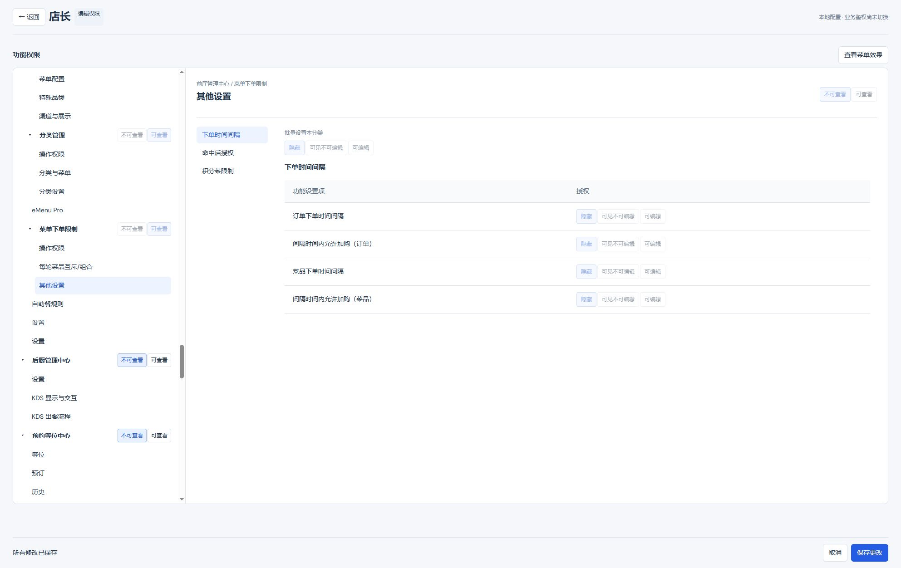

图注：2026-10-19，main@5aaeee2d 上的功能预览；父级不可查看时九项授权保持禁用，截图未保存或扩展生产授权。

本次补齐专用其他设置页的同源分类。仍处于本地权限配置及效果预览范围；业务页面生产鉴权未切换。

| 字段／操作 | 逻辑说明 |
|---|---|
| 页面权限 | 保留 page:/operations/queue-call/menu-order-limits/other。分类不是新的page或独立授权层；模块、父导航或本页不可查看时，分类授权禁用，有效字段权限为隐藏，原配置保留。 |
| 下单时间间隔 | 分类interval，按顺序展示588、589、590、591四项，标题与业务侧栏一致。 |
| 命中后授权 | 分类auth，按顺序展示646、595、596三项，标题与业务侧栏一致。 |
| 积分菜限制 | 分类points，按顺序展示594、527两项，标题与业务侧栏一致。 |
| 逐项资源 | 九项注册为setting:/operations/queue-call/menu-order-limits:<seq>，parent均为上述other页面；type=setting，seq为原数值编号，path为原other页面。标题由共享分类定义取值，无单位、不接受空seq或重复键。原业务存储键不迁移。 |
| 新权限默认值 | 缺少grant默认hidden，既有角色不自动获得新增权限，不从其他设置页复制授权；原有资源、角色和员工例外保持原值。 |
| 隐藏 | 当前字段配置hidden，本地效果预览隐藏该字段；类别全部成员不可见时过滤空类别。 |
| 可见不可编辑 | 当前字段配置read，本地效果预览显示只读；不会开放父页。 |
| 可编辑 | 当前字段配置edit，仍受父级门控及员工角色继承约束，不自动开启模块或其他页面。 |
| 批量设置本分类 | 只对当前类成员写hidden/read/edit，分别为4、3、2个键；不写相邻分类或父页。后续允许逐项覆盖，保存／取消沿用权限编辑器既有行为。 |
| 分类选择 | 只切换当前页显示的授权行，不保存角色，不修改业务规则；角色、员工只读／个人例外及效果预览读取同一分类定义。 |
| 父级恢复 | 恢复原父页查看权限后，字段按保留的原grant重新计算；例如points成员原edit，父页hidden时有效hidden，父页恢复read后有效edit。 |

正常与边界算例：interval批量read只写四项，auth原edit仍edit；interval全部hidden时预览移除该类，auth可见时仍保留；预览不显示分类批量操作。专项脚本覆盖这些分支，浏览器核对4/3/2成员及父级禁用。既有26个通用catalog／104类的分类契约不变，本次另补专用页3类9项；不重复计入通用catalog统计。完整权限验收的餐位平面图保存区历史缺口保留。

## 设置分类侧栏与分类授权（SETTINGS-CATEGORY-20261019-01）

本节为用户2026-10-19最新明确决策：设置分类与业务页侧栏同源，取代此前“设置详情全宽、没有分类侧栏”的展示要求；自定义休息、加班规则、门店档案和营业时间等非分类设置页仍直接展示功能。基线 main@8201b9d7；本次只在现有本地权限配置/效果预览范围实现，不声称已经切换生产业务鉴权。

### 角色编辑 → 休息与加班 → 设置 → 休息设置

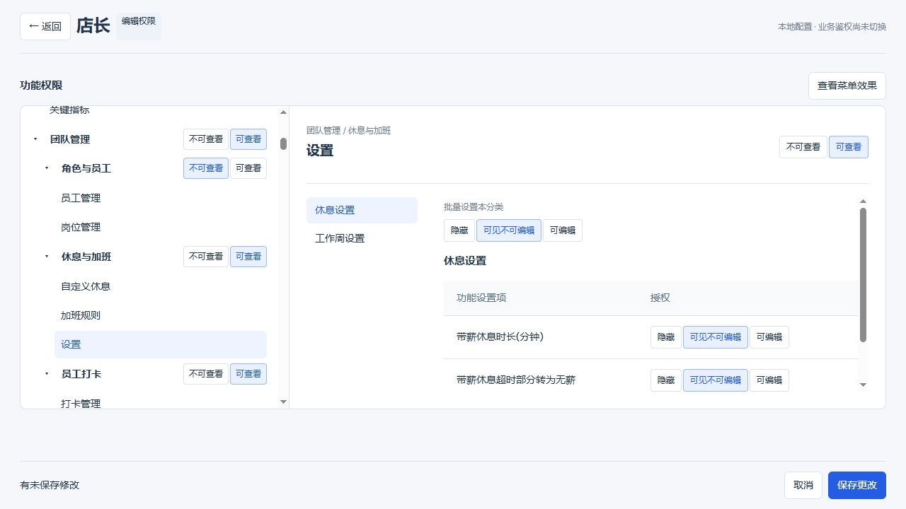

图注：2026-10-19，功能worktree本地角色草稿，分类批量设为只读；未保存到生产系统。

| 字段／操作 | 逻辑说明 |
|---|---|
| 设置页面查看权限 | 沿用 page:/team/breaks-overtime/settings 的独立门控；父导航或本页不可查看时，分类内操作禁用且原设置值保留。 |
| 分类侧栏 | 休息设置、工作周设置按业务页顺序展示；角色编辑、员工只读/个人例外、效果预览使用同一分类集合。选中分类仅筛选本页授权行，不保存业务数据。 |
| 批量设置本分类 | 当前分类的全部setting键统一设置为隐藏、可见不可编辑或可编辑；不是新权限资源，不写相邻分类、不隐式开启父级或兄弟页。单项后续仍可调整。 |
| 隐藏 | 将本分类成员的原grant写为hidden；父页保持原值。预览过滤这些功能，若整类无可见成员，则不显示该分类。 |
| 可见不可编辑 | 将成员原grant写为read；预览显示只读标签，无编辑示例动作。 |
| 可编辑 | 将成员原grant写为edit；有效权限仍受父级和原有关联资源限制。 |
| 部分配置 | 当前分类内原grant不一致时展示部分配置，无统一选择态；逐项授权保留各自值。 |
| 带薪休息时长 | 原 setting:/team/breaks-overtime:paid-break-minutes 三态，不改业务字段329的存储或默认值。 |
| 超时部分转无薪 | 原 setting:/team/breaks-overtime:convert-excess 三态，属于休息设置。 |
| 禁止提前结束休息 | 原 setting:/team/breaks-overtime:block-early 三态，属于休息设置。 |

### 角色编辑 → 工作周设置

图注：同版本同角色草稿，切换工作周分类；其授权保持原值，证明休息分类批量不影响工作周。

| 字段／操作 | 逻辑说明 |
|---|---|
| 工作周开始于 | 唯一成员为原 setting:/team/breaks-overtime:week-start；单项三态和分类批量使用同一键，不创建新的全局设置。 |
| 设置分类成员 | registerBreaksPages 使用 BREAKS_OVERTIME_SETTING_GROUPS 生成两组sections；四个setting的parent仍为原settings子页面，字段键及默认拒绝策略不变。 |

### 效果预览

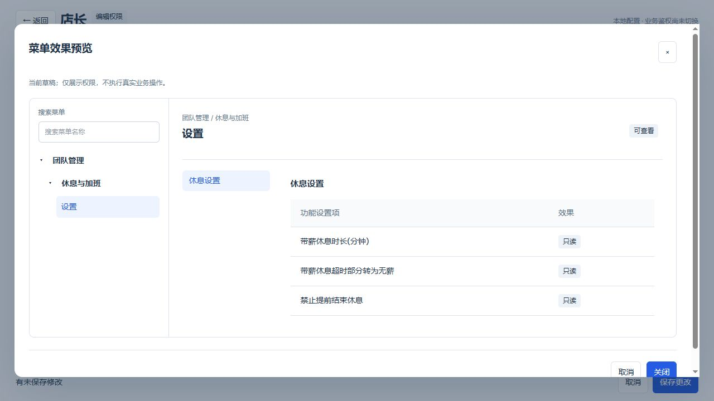

图注：本地角色草稿预览；休息设置只读、工作周隐藏。预览仅说明有效权限，不执行业务操作。

| 字段／操作 | 逻辑说明 |
|---|---|
| 可见分类 | 仅当当前分类至少一个成员有效权限非hidden时出现；初始分类隐藏时选取首个可见分类。 |
| 功能行 | 只显示选中分类中有效权限可见的功能，不泄漏其他分类无权项。 |
| 只读／可编辑 | 沿用原预览标签及演示按钮；预览不提供分类批量或真实授权写入入口。 |
| 关闭 | 关闭预览，保留原角色/员工权限草稿；不提交权限。 |

### 员工门店权限只读／例外

图注：本地演示员工与门店的只读权限视角；当前无权项按原规则显示有效状态，未伪造已授权数据。

| 字段／操作 | 逻辑说明 |
|---|---|
| 只读模式 | 同样使用分类侧栏，展示当前选中分类成员的有效权限，不显示分类批量编辑入口。 |
| 个人例外 | 在已开启个人例外编辑时，分类批量仅写当前员工、当前门店的原有成员键；其他门店与角色不变。 |
| 跟随角色 | 删除当前分类成员的当前店个人覆盖键，重新计算继承；不将当时的角色值复制为个人授权。 |
| 保存／失败／取消 | 沿用原草稿、确认保存、版本冲突、审计与取消流程；分类切换不是保存，持久化失败不能宣称成功。 |

### 全部设置目录的一致性与实现边界

- settings-category-model统一前厅、打印、财务、订单和门店归类；26目录104分类与权限分类的ID、顺序、名称和成员保持同源。业务页面仍施加产品版本、预设、订阅和设置可见条件；权限配置并不自动开通这些能力。
- 员工打卡rules的开收工与工时／登出门禁／打卡凭证沿用TEAM_CLOCK_IN_SETTING_GROUPS，新增业务分类侧栏，不改变原9个设置点或clock子页门控。
- 订单设置权限仅承接实际设置页的21项四分类；原446/447键保留并归位到真实折扣管理、附加费与服务费权限页。两个页面使用独立page键、缺省拒绝，不自动复制旧settings授权；原role与员工grant值保持。
- 门店设置的营业提醒恢复分类侧栏，单项seq582仍使用旧key；门店档案与营业时间不新增重复分类列。没有既定分类的单业务对象页面不人为拆组。
- 批量逻辑applyCategoryGrant只通过categorySettingKeys筛选既有setting并使用applyResourceGrant写入；categoryGrantValue从原成员值判定统一/部分配置，不新增类别枚举、版本迁移或后台API。

验收算例：三个休息成员初始edit、工作周edit → 批量休息read后前三项read、工作周仍edit；休息全hidden时预览隐藏休息分类且保留工作周；父设置page hidden时全部有效hidden但原grant保留；员工A店休息覆盖hidden不影响B店，A店批量跟随角色删除三个覆盖键后恢复角色值。上述逻辑及保存往返专项通过，浏览器验证分类批量只读、相邻分类隔离、员工只读及预览过滤；未保存测试草稿为生产权限。完整权限脚本在餐位平面图旧data-floor-plan-save-area处失败，已在main@8201b9d7复现；其余本次专项、相关导航回归与tsc通过。原生放弃确认框自动化存在浏览器阻塞，未宣称该流程本次验收通过。

## 休息与加班：子页面授权（PERM-20261019-02）

待补编辑、员工只读及预览实页图片；当前浏览器策略限制下尚未验收，不以旧截图替代。此前页内分类定义均为历史，以本节为准。

入口：编辑角色或员工门店权限 → 团队管理 → 休息与加班。

| 字段／操作 | 逻辑说明 |
|---|---|
| 休息与加班 | 父导航；关闭阻断三个子页，保留原配置，开启后按子页自身权限生效。 |
| 自定义休息 | 子页面独立可查看/不可查看；右侧直接展示休息管理统一三态，覆盖原内容及编辑休息动作。 |
| 加班规则 | 子页面独立可查看/不可查看；右侧直接展示加班规则管理三态，不受休息子页关闭影响。 |
| 设置 | 子页面独立可查看/不可查看；按休息设置和工作周设置两组分类展示原四项三态，依据 SETTINGS-CATEGORY-20261019-01。 |
| 详情侧栏 | 自定义休息和加班规则不增分类列；设置显示两组功能分类，保留项目菜单树及各自滚动。 |
| 初始与历史授权 | 原键及值保留，新子页缺省不可查看；不自动复制父级授权。 |
| 员工／预览 | 单店覆盖与跟随角色沿用；预览隐藏无权页面和功能。保存/取消不改变其他门店，失败处理沿用原规则。 |

专项RED/GREEN、相关权限回归与类型检查通过；浏览器E2E和图片待补。排班未修改。

## 门店信息：二级页面权限配置（PERM-20261019-01）

布局核验 `PERM-STYLE-20261019-02`（纯排版，版本及业务基线不变）：本节三个页面不再展示详情内的分类侧栏。待补对应页面图片及浏览器验证；旧图不作为调整后验收证据。

| 字段／区域 | 逻辑说明 |
|---|---|
| 详情分类侧栏 | 门店档案、营业时间无重复分类入口；设置显示营业提醒分类，依据 SETTINGS-CATEGORY-20261019-01。 |
| 功能授权表 | 页面标题下直接全宽展示本页全部授权行，沿用不可见/只读/可编辑控件；旧分类选择值不裁切条目。 |
| 项目菜单树 | 保留原导航切换、层级及页面查看权限。 |
| 只读与效果预览 | 同样无详情分类侧栏；预览按原有效权限过滤，无可见项显示原空态。 |
| 滚动及保存 | 授权列表沿用自身滚动，保存/取消/草稿及员工门店范围不变。 |

待补页面图片：调整后的角色编辑、员工门店权限与预览；本轮浏览器读取受限，旧截图只作问题证据。

用途/入口：编辑角色权限或员工门店权限，展开门店信息，直接选中门店档案、营业时间或设置，不经过合并入口。

| 字段／操作 | 逻辑说明 |
|---|---|
| 门店信息 | 父级可查看/不可查看；关闭阻断全部下级但不删除下级配置。 |
| 门店档案 | 二级菜单，右侧保留本页查看权限，功能区域直接展示一个“门店档案”授权行，包含基本信息和Logo；不显示内部分类侧栏，不单列品牌标识素材。 |
| 营业时间 | 二级菜单，独立可查看/不可查看，功能项来自418及目录存在时的583；不影响门店档案/设置。 |
| 设置 | 二级菜单，保留原页面授权，展示其他设置项，当前营业提醒582。 |
| 页面查看控件 | 在右侧配置所选页面；上级不可查看时不可编辑。新增页面无授权时不可查看，不自动复制旧合并入口的权限。 |
| 功能项授权 | 隐藏/可见不可编辑/可编辑，保留旧设置项授权键和值，受所属页与父级阻断。 |
| 门店档案统一授权 | 隐藏（不可见）/可见不可编辑/可编辑；显式选择同步基本信息及Logo旧授权，未保存不落盘。员工跟随角色同时删除两项个人例外。 |
| 部分配置，需复核 | 历史两项状态不同显示此提示，三态均不预选；管理员明确选择统一状态后提示消失。未复核时预览/只读按两项有效权限较低值展示，不自动取较高权限。 |
| 员工授权 | 三页结构相同，沿用单选门店及跟随角色，不改变其他门店。 |
| 菜单效果预览 | 使用当前有效授权，只显示可查看的二级页及可见功能项；隐藏hours不隐藏profile。 |
| 保存／取消 | 继续沿用原显式保存、并发校验及取消草稿规则；目录构建不自动写入或迁移授权。 |

验收缺口：实页E2E及截图未完成。针对性回归、休息加班回归与类型检查通过；通用权限回归存在main可复现的餐位平面图来源控件断言失败；未改变生产鉴权。

## 菜单树样式核验（PERM-STYLE-20261019-01）

本次为纯视觉排版调整，产品V3.6、研发/个人V2.6及PERM-20261016-01业务基线不变；三份记录使用同一样式编号。

待补页面图片：移除层级竖线后的权限编辑/只读/预览实页。旧图中竖线仅为历史样式参考，不代表本次效果已浏览器验收；此前浏览器读取策略受限，本次不绕过。

用途/入口：角色编辑、员工门店权限及菜单效果预览中的共享权限菜单树。

| 字段/元素 | 逻辑说明 |
|---|---|
| 菜单前竖线 | 所有层级不显示装饰竖线；不影响可见授权结果。 |
| 缩进 | 保留原内容横向偏移，层级仍通过缩进区分。 |
| 展开/收起箭头 | 保留，点击规则、当前项及滚动位置不变。 |
| 菜单右侧权限控件 | 保留同行位置与现有行为，不调整授权范围。 |
| 菜单/详情分隔线 | 保留，不属于此次删除的菜单层级竖线。 |

## 2026-10-14 实现修复与验证（历史：PERM-FIX-20261014-01）

此为历史修复记录；角色与员工的独立操作权限入口由 §3.8 替代，排班等本轮不变。

导航改为父子菜单后，原父页面操作权限仍应保留。此次修复恢复既定权限目录完整性，不改变业务授权口径，合入时沿用 main 最新产品 V3.5／研发 V2.5／个人 V2.5 基线，不提升业务版本。

故障：目录只登记叶子页面，旧功能分支打卡／排班父路径的既有操作权限失去所属页面，导致权限总览及其他权限中心页面加载失败。修复：导航父项有已登记动作时，保留原 `page:<父路径>` 及原 action 键，并在权限目录对应父项下显示可选的“操作权限”节点；子导航页面继续独立登记。该节点仅供权限编辑，不新增商家业务路由；既有授权和持久化数据不迁移、不改写。真正未注册菜单的动作引用仍报错，不以跳过校验掩盖缺失。

| 字段／元素 | 验证定义 |
|---|---|
| 父目录下的操作权限 | 来源为已有动作登记；仅有动作的父项保留原页面资源，可在权限编辑右侧查看与配置原动作。仍受既有模块及页面授权约束。 |
| 打卡操作权限 | main 保留 PERM-20261014-09 三个独立逻辑页面及 registerClockPages；补卡、记录休息挂在打卡管理，既有 action 键保留，不新增打卡操作权限节点。 |
| 排班操作权限 | 保留 page:/team/shift-scheduling，动作使用 main 现行对象组合登记（如 manage-shift），不回退旧动作拆分；排班表、班次、规则设置继续分别出现。 |
| 权限总览 | 目录构建完成后正常展示统计与最近变更，不再提示“操作权限对应的菜单不存在”。 |

验证：`npx.cmd tsx scripts/verify-permission-center.ts` 修复前因 /team/clock-in 报错（RED），修复后通过（GREEN）：29 模块、156 菜单页面、117 动作，含父键保留、子页面登记及编辑器可选性回归；`npx.cmd tsc --noEmit` 通过。真实浏览器验证总览、角色列表及打卡／排班操作权限显示，控制台无错误。未修改授权数据，未进行生产 API 或全模块业务写入验证。本地 build 跳过：未触及构建边界；CI build 状态未知。

## 版本记录

| 版本 | 日期 | 变更 | 配对版本 |
|---|---|---|---|
| V2.9 | 2026-10-19 | SETTINGS-CATEGORY-20261019-01：业务设置与权限同源分类、分类批量与逐项三态、预览过滤；产品V3.9／研发V2.9／个人V2.9 | 产品V3.9、研发V2.9 |
| V2.8 | 2026-10-19 | PERM-20261019-02：三子页逐项授权与无详情侧栏，旧键保留、新页默认拒绝 | 产品V3.8、研发V2.8 |
| V2.7 | 2026-10-19 | PERM-20261019-01：门店信息三页、设置归属、缺省拒绝及预览过滤；实页图待补 | 产品V3.7、研发V2.7 |
| V2.6 | 2026-10-16 | PERM-20261016-01：员工/岗位页面归属、兼容父门控、跟随角色及隔离；浏览器配图待补 | 产品V3.6、研发V2.6 |
| V2.5 | 2026-10-14 | PERM-20261014-09：员工打卡三个页面及三规则分类逐项授权、默认拒绝、八实页图/预览证据 | 产品 V3.5、研发 V2.5 |
| V2.4 | 2026-10-14 | PERM-20261014-08：休息/加班分组与四分类、4设置三态、预览无权过滤和Esc保草稿，补7实页对照图 | 产品 V3.4、研发 V2.4 |
| V2.3 | 2026-10-14 | PERM-20261014-07：统一功能授权表、对象三态及跟随角色、部分配置复核、预览同一行和统一空态，补六张实页图 | 产品 V3.3、研发 V2.3 |
| V2.2 | 2026-10-14 | PERM-20261014-06：内容/字段两态、依赖提示、隐藏无权整行及示例、只读无编辑入口；新增三张实页图 | 产品 V3.2、研发 V2.2 |
| V2.1 | 2026-10-14 | PERM-20261014-05：扩展 28 个同对象编辑组、实际子集问号提示，当前 99 动作；旧键保留/需复核，补配置与预览图 | 产品 V3.1、研发 V2.1 |
| V2.0 | 2026-10-14 | PERM-20261014-04：分类合并编辑和问号悬停/点击/聚焦说明，新组合默认禁止、旧配置复核，补实页图 | 产品 V3.0、研发 V2.0 |
| V1.9 | 2026-10-14 | PERM-20261014-03：薪资/员工/小费新增 31 项动作，逐按钮禁止/允许、禁用效果及 Esc 草稿保护，补两张实页图 | 产品 V2.9、研发 V1.9 |
| V1.8 | 2026-10-14 | PERM-20261014-02：菜单名称右侧同行展示查看开关/员工继承/只读状态，补操作隔离和实页图 | 产品 V2.8、研发 V1.8 |
| V1.7 | 2026-10-14 | PERM-20261014-01：逐级导航查看控件、父阻断/恢复、同级隔离和子导航右侧区域 | 产品 V2.7、研发 V1.7 |
| V1.6 | 2026-10-13 | PERM-20261013-08：门店管理归为一个目录，集团/品牌各自授权，预览不改变编辑菜单 | 产品 V2.6、研发 V1.6 |
| V1.5 | 2026-10-13 | PERM-20261013-07：每个菜单显示具体配置，补齐已有动作和财务子菜单，纯查看页有查看权限行 | 产品 V2.5、研发 V1.5 |
| V1.4 | 2026-10-13 | PERM-20261013-06：“编辑资料”改为“编辑角色”，同步弹框标题与操作说明 | 产品 V2.4、研发 V1.4 |
| V1.3 | 2026-10-13 | PERM-20261013-05：移除主页面工作台标识及存储说明提示条 | 产品 V2.3、研发 V1.3 |
| V1.2 | 2026-10-13 | PERM-20261013-04：四主页面移除重复 Tab，统计只读，保留业务详情入口 | 产品 V2.2、研发 V1.2 |
| V1.1 | 2026-10-13 | PERM-20261013-03：分类和功能项独立滚动，补齐滚动/切换后果 | 产品 V2.1、研发 V1.1 |
| V1.0 | 2026-10-13 | 首次整理本轮本地工作台页面、字段与操作后果 | 产品 V2.0、研发 V1.0 |

## 公共规则

**P1 本地边界**：新工作台仅保存当前浏览器的权限配置、邀请与账号状态，计算结果在编辑/效果预览中可查看。未接管真实登录及全站业务鉴权，不发真实邮件。不以“已保存”代表线上授权成功。

**P2 草稿**：角色或员工详情修改后为未保存；员工所有门店共用一次保存草稿但例外按门店隔离。返回、取消及路由离开需确认放弃；刷新使用浏览器离开提示。保存异常保留草稿。

**P3 权限**：导航/页面两态；同对象内容/编辑/对应保存合成三态，纯查看内容/字段两态、特殊动作独立、设置三态。任何父级隐藏使下级不生效但不清原值，同级不联动；特殊动作仍需全部登记内容/字段依赖可见。员工同店角色并集后应用个人值，未知资源拒绝。仅旧导航按研发 §4 兼容；新内容默认不可见，旧混合配置不自动升级，按 §3.5 复核。预览隐藏无权对象/动作，不灰显；管理目录完整。

**P4 写入**：保存前展示影响和前后值，确认后校验版本再写入；失败在弹框展示错误并保留输入。本地账号状态和权限配置的操作不是实际安全服务调用。

**P5 图片缺口**：此前浏览器连接超时；导航、同行布局、按钮和组合编辑已补对应版本实页图；PERM-20261014-06 补内容/字段编辑、隐藏效果及只读设置三张图。旧 PERM-03/04/05 的灰色无权按钮截图仅作历史，已由本轮隐藏规则替代。其余页面及状态仍就近登记待补，不以本轮图片代表全模块验收，也不以父页面图代替弹框。

本次新增权限总览及回归截图，其他历史图片缺口保持。

## 1. 权限总览（历史截图及字段定义，已移除）

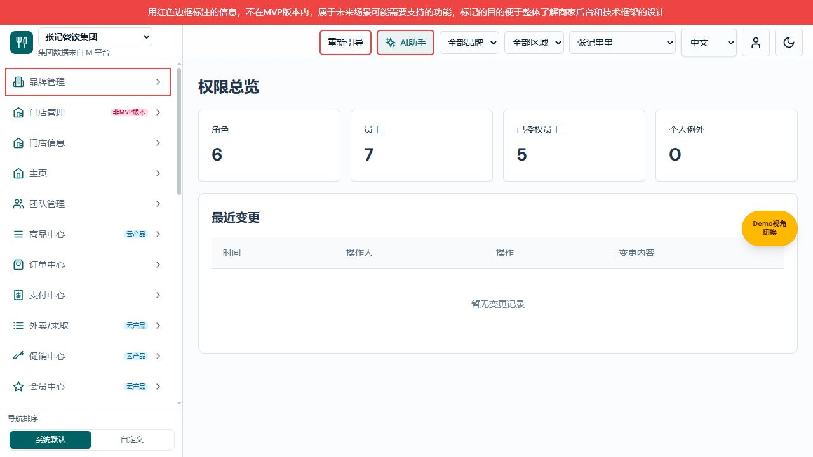
图注：权限总览／演示数据、空变更记录／2026-10-14 本地实现，PERM-FIX-20261014-01；仅覆盖本次实际状态。

历史用途为查看本地统计；当前入口和统计区域已移除，旧地址转角色列表。以下截图/统计字段仅保留历史追溯，不作为有效页面要求。

### 项目导航与统计

当前仅三个入口出现在项目导航，主页面不重复展示Tab；下表总览和统计项为历史，角色、员工、变更记录入口仍有效。员工详情业务分区继续保留。

主页面标题区不展示“本地权限工作台”标识，标题下不再展示本地存储/鉴权说明提示条。P1 的实际实现范围继续有效，具体操作说明保持原样。

| 字段 | 逻辑说明 |
|---|---|
| 权限总览 | 已移除；旧 `#/permissions/overview` 转角色列表。 |
| 角色与功能权限 | 点击进入角色列表；不修改配置。 |
| 员工与账号 | 点击进入合并列表；账号和业务权限仍分区。 |
| 变更记录 | 点击进入全局日志。 |
| 角色数 | roles 数组长度，整数；包括系统角色；无角色为 0；读取失败显示错误，不当成 0。只读，不支持点击跳转。 |
| 员工数 | employees 数组长度，按员工 ID 唯一；邀请中的员工也计入。只读，不支持点击跳转。 |
| 已授权员工 | bindings 非空的员工数，每人计一次；如 3 人分别 2/0/1 条绑定，计 2 人。不是在线人数或实际可登录人数。只读，不支持点击跳转。 |
| 个人例外 | 各员工各门店 overrides 键数量之和；显式禁止也计入，不是员工数。如 A 员工两店各 1 项、B 员工 3 项，合计 5。只读，不支持点击跳转。 |

### 最近变更

复用第 5 节日志元素。当前本地实现显示已保存记录，不冒充高风险治理看板；后续治理队列仍待接入。

## 2. 角色与功能权限列表

> 待补页面图片：角色列表／有数据、搜索无结果／本地实现版本 PERM-20261013-01。

入口：角色与功能权限。对象：角色，不受员工详情所选门店限制。

| 字段 | 逻辑说明 |
|---|---|
| 搜索角色名称 | 文本，默认空；输入立即按角色名称包含关系筛选，空值显示全部；只影响当前列表，不改统计或授权。 |
| 新建角色 | 打开第 2.1 节弹框，默认空白权限；点击本身不创建数据。 |
| 角色 | 保存的 name，系统角色追加系统标识。 |
| 描述 | 保存的 description，空值展示 —。 |
| 成员数 | 存在至少一条该角色绑定的员工数，按员工去重；点击第 2.3 节成员弹框。 |
| 编辑角色 | 携带角色 ID 打开第 2.1 节编辑态，仅改名称描述，权限编辑仍通过“编辑权限”操作。 |
| 编辑权限 | 携带角色 ID 进入第 3 节全屏编辑，不进入“更多”。 |
| 复制 | 打开第 2.1 节复制态，复制 grants，生成新 ID，不复制员工绑定。 |
| 删除 | 系统角色或成员数非 0 时禁用并解释原因；否则打开第 2.2 节确认。保存层再次校验，不只依靠禁用按钮。 |
| 暂无匹配角色 | 筛选结果为空时展示，不清除搜索或提供假数据。 |

### 2.1 新建／编辑角色／复制角色弹框

实现修复记录 `PERM-20261013-02`：弹框以整个视口水平、垂直居中；内容超过可用高度时弹框内部滚动。已补充显式居中样式。业务版本不变（产品 V2.0、研发 V1.0、本文 V1.0），修复后截图与真实浏览器确认仍待补。

> 待补页面图片：新建默认态、编辑态、复制态、重名错误态／本地实现版本 PERM-20261013-01；三种状态图片均待补。

入口：第 2 节相应操作。弹框约 560px 内部公共宽度；产品建议新建约 520px 的细节尺寸仍需视觉验收，不将代码尺寸当作新决策。

| 字段 | 逻辑说明 |
|---|---|
| 标题 | 随入口显示新建角色、编辑角色或复制角色。 |
| 角色名称 | 必填字符串、去首尾空格、最多 30 字；编辑回填旧名，复制追加“副本”作为可修改建议值；提交校验同名（排除自身）。超长复制建议仍须修改到长度内。 |
| 描述 | 可空，最多 160 字，编辑/复制回填；无单位。 |
| 初始功能权限 | 仅新建态出现，下拉单选；默认空白权限，也可复制现有角色 grants。选来源不带成员。 |
| 保存 | 验证必填、长度、重名及版本；成功持久化新/旧角色、写审计、关闭并刷新列表；失败不关闭。 |
| 取消 | 不写数据，不生成角色；关闭弹框回列表。 |
| 关闭／Esc | 与取消一致，焦点返回入口。 |
| 错误提示 | 必填、重名、版本冲突或存储失败时在弹框内展示，不以成功提示覆盖。 |

### 2.2 删除角色确认弹框

> 待补页面图片：删除确认及删除被拒绝状态／本地实现版本 PERM-20261013-01。

| 字段 | 逻辑说明 |
|---|---|
| 确认说明 | 提示删除不可恢复；只针对所选角色。 |
| 删除 | 再校验系统标记、成员绑定、版本；成功移除该角色并写前后日志，不删除员工；失败保留弹框与数据。 |
| 取消／关闭 | 保留角色，不写审计。 |

### 2.3 角色成员弹框

> 待补页面图片：成员列表／无成员状态／本地实现版本 PERM-20261013-01。

| 字段 | 逻辑说明 |
|---|---|
| 员工姓名 | 按员工 ID 去重后展示；点击携带员工 ID 进入全屏管理详情；不隐含更改授权。 |
| 暂无成员 | 没有匹配绑定时显示。 |
| 关闭 | 返回角色列表，不写数据。 |

## 3. 角色权限全屏编辑

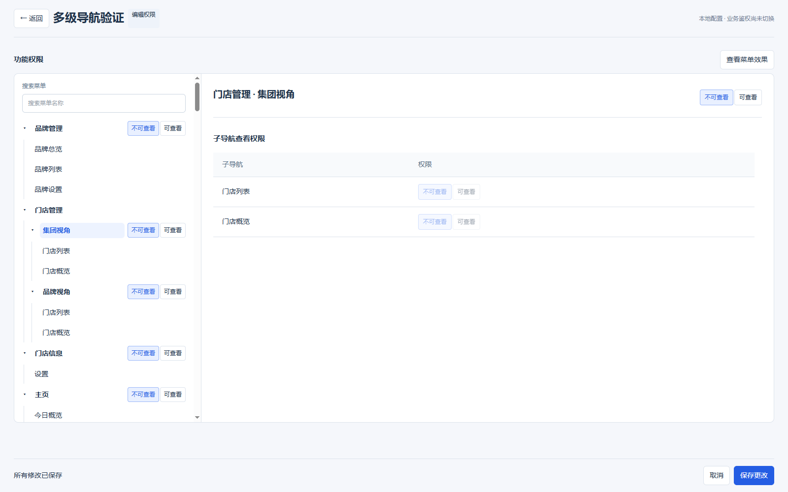
图：角色导航编辑／名称与查看开关同行、同级右对齐／2026-10-14 项目实页，PERM-20261014-02。下列 PERM-20261014-01 图片仅保留规则证据，其中控件放在名称下方的旧布局已替代。

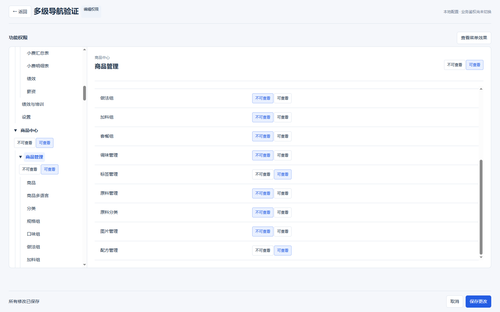
图：商品管理／调味隐藏、标签可查看／2026-10-14 项目实页，PERM-20261014-01，独立测试角色。

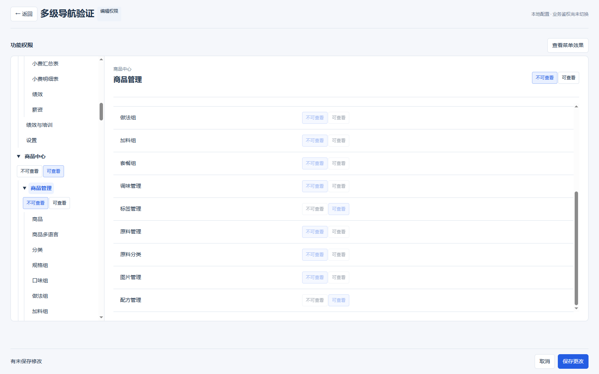
图：商品管理关闭／下级禁用并保留配置／同版本实页。薪资动作图片见 §3.1，设置分类其他状态仍待补。

入口：角色列表编辑权限。对象：角色草稿，影响其所有范围内成员；页面占应用视口而非浏览器全屏模式。

### 顶部与底部

| 字段 | 逻辑说明 |
|---|---|
| 角色名称 | 当前编辑角色名称，仅定位；修改名称去资料弹框。 |
| 返回 | 返回角色列表；有草稿按 P2 确认，取消离开继续编辑。 |
| 本地配置说明 | 按 P1 标明尚未切换业务鉴权。 |
| 有未保存修改 | 任一权限改变后出现；保存成功清除，失败保留。 |
| 取消 | 确认丢弃当前对象草稿，返回列表，不回退此前已保存数据。 |
| 保存更改 | 无变更不重复写入；有变更打开第 6 节确认，不直接持久化。 |

### 菜单与权限区域

| 字段 | 逻辑说明 |
|---|---|
| 搜索菜单 | 名称模糊匹配，实时筛选树；命中父导航时显示其子树及必要祖先，不改变权限值；预览搜索不突破隐藏限制。 |
| 导航展开箭头 | 每级真实导航展开/折叠；不改变选中对象和授权，编辑重绘保留展开状态与滚动。 |
| 导航名称 | 点击选中当前模块或中间导航，右侧显示本导航和直接子导航权限；点击名称不同时折叠，不修改权限。 |
| 门店管理目录 | 仅展示一个共同目录，展开后为集团视角/品牌视角；该目录只展开导航，没有合并授权开关。 |
| 集团视角 | 包含集团门店列表/概览，使用原集团模块可见性及页面权限；修改不改变品牌视角授权。 |
| 品牌视角 | 包含品牌门店列表/概览，使用原品牌模块可见性及页面权限；修改不改变集团视角授权。 |
| 模块不可查看／可查看 | 位于当前模块名称右侧同一行；独立模块开关。点击不折叠菜单、不切换右侧对象，保持树滚动；关闭后下级不生效但不删除保存值。 |
| 子导航不可查看／可查看 | 位于对应二级、三级或更深菜单名称右侧同行；取当前角色保存值，新角色默认不可查看。只改当前键加入草稿，不修改同级或子级配置，不触发展开或选择。任意祖先不可查看时禁用，并保留原选中值和禁用原因；控件不换行，名称超长省略并可查看完整 title。 |
| 子导航查看权限区域 | 选中中间导航时展示其直接下级名称及独立控件；不一次平铺全部后代。切换选择保留左侧滚动，右侧新列表从顶部显示。 |
| 页面菜单 | 当前开发目录29模块/17中间导航/152逻辑页面，员工打卡按真实三个页签展开，见 §3.7；不等于已发布main。财务收银记录保留付款记录/钱箱记录。点击只切换右侧，导航不回顶部。 |
| 祖先面包屑 | 按一级到直接父级展示完整业务名称，以 / 分隔，不显示技术资源键；门店目录的集团/品牌模块注明视角。 |
| 当前导航／页面标题 | 与左侧选中项对应；父隐藏不切到其他页面，仍可检查原配置。 |
| 页面不可查看／可查看 | 单选状态；不自动授予新增/编辑等动作。任意祖先隐藏时不可操作，恢复父级后按原值计算。 |
| 上级导航不可查看 | 下级禁用控件的原因提示；不是清除配置。依次开放祖先后控件恢复，可继续编辑；同级不受当前子导航的关闭影响。 |
| 功能授权列表 | 不再分内容/操作两块；无分类页为同一表，休息与加班按 §3.6 四分类；员工打卡按 §3.7 三页面，规则设置三分类。99动作/31内容/3字段，当前474设置；数量不等于每页控件数。 |
| 禁止／允许 | 仅独立特殊操作保留单选；统一对象的编辑及对应保存不重复显示。父页面不可查看或所需内容/字段不可见时禁用，保留原值。 |
| 查看页面 | 未登记独立动作的菜单显示此权限行，复用页面资源，选择不可查看/可查看；没有新增/删除等实际业务控件时不补造操作。不会再出现“功能权限暂未接入”的空白区；外部系统内部权限不据此声称已接入。 |
| 设置分类 | 与实际后台分类和员工端/顾客端分段一致；占标题下可用高度，超高显示本区域滚动条。鼠标在分类区域只滚动分类，边界不带动功能列表或外层页面；点击切换分类保留本区域位置、不修改权限。 |
| 功能项列表滚动区域 | 右侧独立限高，超高显示自己的滚动条；鼠标在此区域只滚动功能项，不带动分类。切换分类从顶部显示新分类项；调整权限保留列表当前位置。标题和页面可见控件不随列表滚走。 |
| 功能设置项 | 真实设置名称，一行一项；不显示技术序号、源码和重复描述。 |
| 隐藏 | 设置效果完全不显示；保存原其他项。 |
| 可见不可编辑 | 设置效果可查看，预览只读状态，无编辑入口；不是把编辑按钮灰显。 |
| 可编辑 | 设置效果可查看且可操作，仍受父级门控。 |
| 查看菜单效果 | 打开第 7 节，使用当前草稿，不保存也不执行业务。 |

### 3.1 薪资管理：逐按钮权限

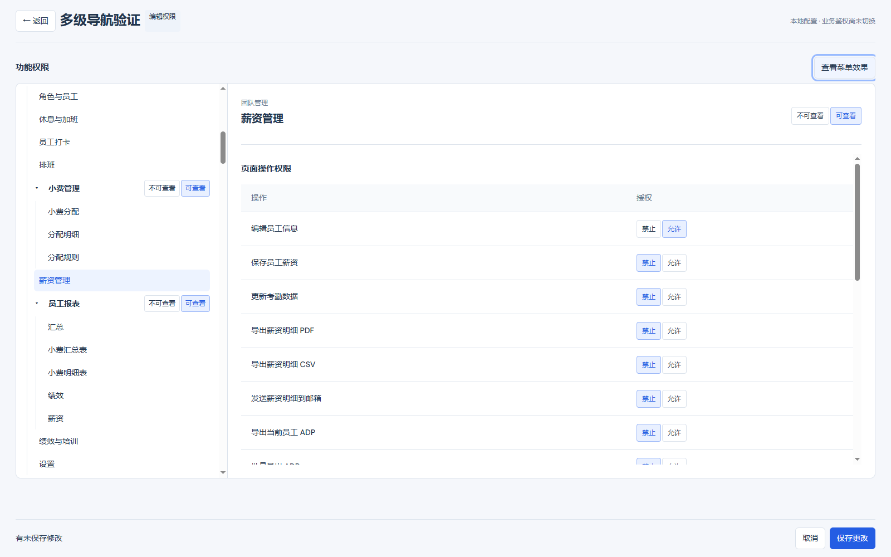
图：角色权限编辑中选择薪资管理／编辑员工允许、保存及导出默认禁止／2026-10-14 项目实页，PERM-20261014-03。滚动下方可见其余动作；并非真实薪资业务页的鉴权截图。

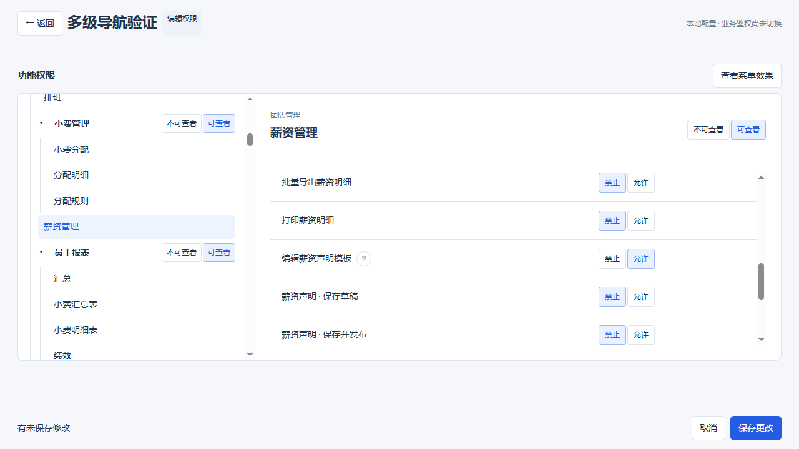
图：薪资声明模板 CRUD 合并，保存/发布/打印仍独立／2026-10-14 项目实页，PERM-20261014-05。上图为历史位置参考，声明和周期的分拆行已由以下组合替代。

入口：角色列表 → 编辑权限 → 团队管理 → 薪资管理。对象是当前角色的授权草稿，不是修改某员工薪资。下表是底层动作含义；当前员工身份编辑、声明编辑/保存、周期编辑已与对象内容合为 §3.5 三态行，不重复显示，其他动作仍单行禁止/允许。祖先及内容/字段门控、保存/取消/冲突按 P2–P4，员工个人只作用所选门店。

下表定义每行权限控制的业务对象；当前配置/预览不执行这些操作，实际执行接入仍为 PERM-OPEN-03。权限允许也不能绕过原页面业务状态、校验、数量与数据范围约束。

| 字段 | 逻辑说明 |
|---|---|
| 编辑员工信息 | 当前员工身份信息编辑；允许不同时授予薪资保存、导出或其他员工编辑页权限。 |
| 保存员工薪资 | 当前员工/门店/周期的薪资确定并保存；独立于身份信息编辑。 |
| 更新考勤数据 | 当前员工考勤数据更新；不同时允许保存薪资。 |
| 导出薪资明细 PDF | 当前员工明细 PDF 导出；不允许 CSV 或批量导出。 |
| 导出薪资明细 CSV | 当前员工明细 CSV 导出；不允许 PDF、ADP 或批量导出。 |
| 发送薪资明细到邮箱 | 当前员工明细邮件入口；与文件导出独立，不表示真实邮件服务已接通。 |
| 导出当前员工 ADP | 当前员工 ADP CSV；与薪资明细 CSV 的数据用途不同，分别配置。 |
| 批量导出 ADP | 选定员工批量 ADP；不从单人 ADP 推导允许，目标门店逐个计算。 |
| 批量导出薪资明细 | 选定员工明细导出任务；由原业务定义格式、数量及失败处理，权限不改变它们。 |
| 打印薪资明细 | 当前员工明细打印；不同时开放文件导出。 |
| 编辑薪资声明模板 | 合并语言模板新增/删除/草稿修改，问号说明实际三项；已发布/停用查看不算修改。新组合缺省禁止，旧三项留存复核。 |
| 薪资声明 · 保存草稿 | 底层保存键保留，当前与声明内容/编辑合到声明模板管理三态，不重复显示；目标执行新建/修改仍须编辑及保存均允许。 |
| 薪资声明 · 保存并发布 | 独立发布；目标执行阶段还须组合编辑及保存允许，不反向开放其他点。 |
| 薪资声明 · 创建新版本 | 当前模板创建新版本；原版本状态限制保留。 |
| 薪资声明 · 停用模板 | 停用已发布模板；原状态及校验不变。 |
| 薪资声明 · 分配员工 | 为目标员工选择模板/批量分配；不扩大员工或门店范围。 |
| 编辑发薪周期规则（演示） | 合并演示新增/删除/修改；原待生效状态约束及生产只读保留，不增加正式发布能力。 |

角色与员工的编辑员工/编辑岗位底层按 §3.3 组合，当前UI按 §3.5 与各自内容合成三态，员工对应保存也纳入该行。小费明细更新/确认分配/确认发放及汇总批量分配/取消/导出/邮件仍独立；不修改金额计算或发放定义，不执行业务。

### 3.2 分类管理：编辑能力及问号

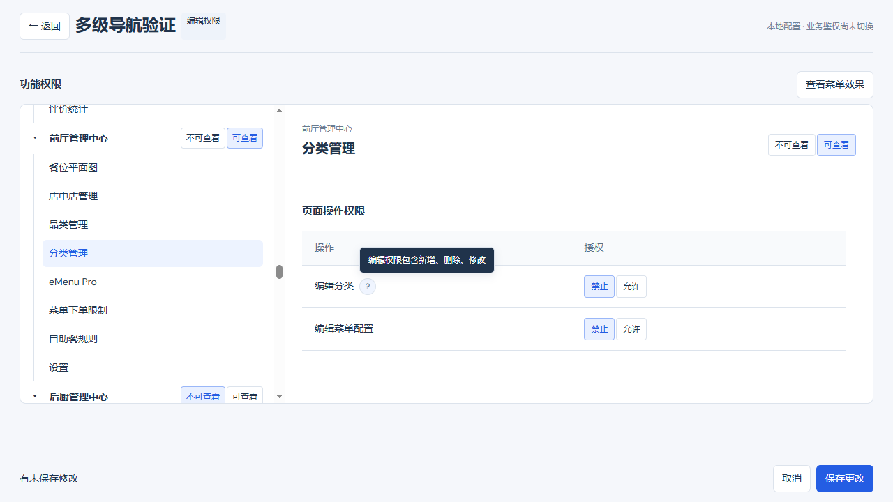
图：历史 PERM-20261014-04 分类组合说明，当前已改分类管理三态；本页当前三态图待补，不以其他对象图代替。

本节定义底层编辑分类范围；当前行名“分类管理”，内容/编辑合为三态，见 §3.5，不重复显示分拆控件。

入口：编辑权限中选择分类管理；对象为角色动作草稿，员工同一界面按单选门店查看及例外编辑。这里不执行真实分类修改。

| 字段 | 逻辑说明 |
|---|---|
| 分类管理 | 一行统一授权；不可见/只读/可编辑同时设置分类内容与组合编辑，旧三种 CRUD 分拆数据留存不自动升级；菜单配置独立。 |
| ? | 在分类管理右侧，辅助名称“分类管理权限说明”；悬停/聚焦/Tab 显示三态及实际新增/删除/修改说明，不写权限或导航。 |
| 问号说明 | 包含“编辑权限包含新增、删除、修改”及三态/特殊操作独立说明，紧邻名称，不增加行；预览只读时不展示编辑说明，已可编辑时可查看。 |
| 不可见／可见不可编辑 | 分别设置 content hidden/read 与组合 hidden；只读没有编辑入口；数据缺失仍默认拒绝，旧部分值需复核。 |
| 可编辑 | content read 与组合 edit，实际 CRUD 均允许，仍受祖先及业务条件限制；关父级保留原值。 |
| 编辑菜单配置 | 保留独立禁止/允许；编辑分类允许不会联动该行。 |

点击授权后按 P2/P4 保存；取消不写入，失败或冲突保留草稿。员工跟随角色删除当前店本对象内容及组合编辑覆盖，其他店/旧退役键/独立动作保留。

验收例：旧只允许编辑、不允许删除 → 新组合默认禁止，不自动放大为可删除；配置组合允许后预览出现可点编辑分类，菜单配置保持禁止；父页面关闭阻断组合，恢复后原允许恢复。问号三种打开方式均不改变禁止/允许状态。

### 3.3 其他菜单：按对象组合编辑

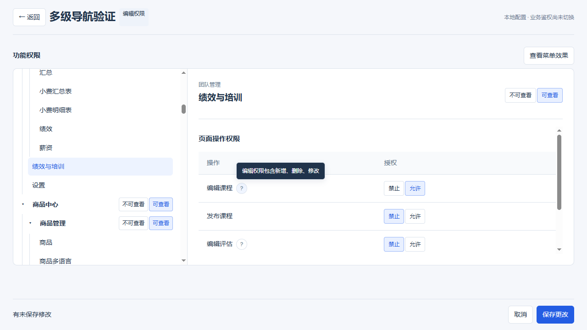
图：历史 PERM-20261014-05 培训分拆编辑说明；当前为课程/评估管理三态，当前对应页面三态图待补。

本节列实际编辑范围；当前每个对象内容/编辑及明确对应保存合成 §3.5 三态，不重复底层动作。只有明确对应保存联动，其他非 CRUD 独立。

入口同 §3，选择实际菜单后按 §3.5 显示对象管理三态、右侧问号；点击联动对应内容/编辑及明确保存草稿。员工按单选门店、旧混合值保留需复核，失败/取消依 P2/P4；其他对象和导出/打印/复制/发布/启停不联动。下表名称仅定义实际编辑能力，非重复 UI 操作行。

下表逐个定义 28 个扩展组合。待补页面图片：角色资料组合、调味、休息与加班、班次、平面图、品类、消息模板、各设备、员工/岗位、分配规则、下单限制、自助餐规则对应编辑/预览状态（PERM-OPEN-05）；培训图不代替这些页面验收。薪资声明图见 §3.1，发薪周期组合状态图仍待补。

| 字段 | 逻辑说明 |
|---|---|
| 权限中心／编辑角色 | 新建、删除、修改角色资料；不含独立“编辑权限”或复制。 |
| 调味／编辑 Option | 新增、修改 Option；实际未登记删除，问号只列两项，启停独立。 |
| 调味／编辑商品调味 | 删除、修改商品调味；问号不含新增，分类管理/批量配置独立。 |
| 休息与加班／编辑休息 | 休息新增、删除、修改；不联动加班规则。 |
| 休息与加班／编辑加班规则 | 加班规则新增、删除、修改；不联动休息。 |
| 排班／编辑班次 | 班次新增、删除、修改；对应保存排班当前纳入班次三态；清除/恢复/同步下周仍独立。 |
| 绩效与培训／编辑课程 | 课程新增、删除、修改；发布、学习、完成及评估独立。 |
| 绩效与培训／编辑评估 | 评估新增、修改；无实际删除，问号不提示删除。 |
| 餐位平面图／编辑区域 | 区域新增、删除、修改；桌台、调整/保存布局独立。 |
| 餐位平面图／编辑桌台 | 桌台新增、删除、修改；区域、布局独立。 |
| 品类管理／编辑年龄分组 | 年龄分组新增、删除、修改；品类及菜单配置独立。 |
| 品类管理／编辑品类 | 品类新增、删除、修改；年龄分组及菜单复制/编辑独立。 |
| 消息模板／编辑模板 | 模板新增、修改；启用/禁用独立，无假删除项。 |
| 支付设备／编辑支付设备 | 实际 PAX 新增、设备删除/修改；不造其他设备新增能力。 |
| 打印机／编辑打印机 | 打印机新增、删除、修改。 |
| 钱箱／编辑钱箱 | 钱箱新增、删除、修改；钱箱策略独立。 |
| eMenu／编辑 eMenu 设备 | 删除、修改；启停独立，无假新增项。 |
| Kiosk／编辑 Kiosk 设备 | 删除、修改，无假新增项。 |
| CDS／编辑 CDS 设备 | 删除、修改，无假新增项。 |
| 税控机／编辑税控机 | 新增、删除、修改；启停独立。 |
| 来电显示／编辑来电显示 | 新增、删除、修改；启停独立。 |
| 薪资／编辑薪资声明模板 | 语言模板新增、删除、草稿修改及对应保存当前纳入模板管理三态；发布/新版本/停用/分配独立，原状态限制保留。 |
| 薪资／编辑发薪周期规则（演示） | 规则演示新增、删除、修改；原待生效/生产只读限制不变。 |
| 角色与员工／编辑员工 | 员工新增、删除、修改及对应保存当前纳入员工管理三态，底层最终提交仍需编辑与保存均允许。 |
| 角色与员工／编辑岗位 | 岗位新增、修改；实际无删除，问号不提示删除。 |
| 分配规则／编辑分配规则 | 小费规则新增、删除、修改；复制独立，不改变算法。 |
| 菜单下单限制／编辑下单限制规则 | 新增规则、修改人数/轮次区间；数量复制独立，无假删除项。 |
| 自助餐规则／编辑自助餐规则 | 新增、删除、修改；复制及启停独立。 |

全三项组合的问号为“编辑权限包含新增、删除、修改”；新增+修改及删除+修改组合只显示实际两项。只有一项操作或不属于同对象 CRUD 的上传/移动/裁剪等仍保留原行，不机械改成可修改全部。

验收例：课程管理可编辑、评估管理不可见/发布禁止 → 预览只见课程管理及模拟编辑，后两项隐藏；评估不联动课程。旧全部 CRUD 允许、新组合缺失仍拒绝；父级关闭保留原值、其他店不复用例外。底层99动作/29CRUD组合不变，当前统一控件数按 §3.5，不减少来源覆盖。

### 3.4 内容来源与敏感字段依赖

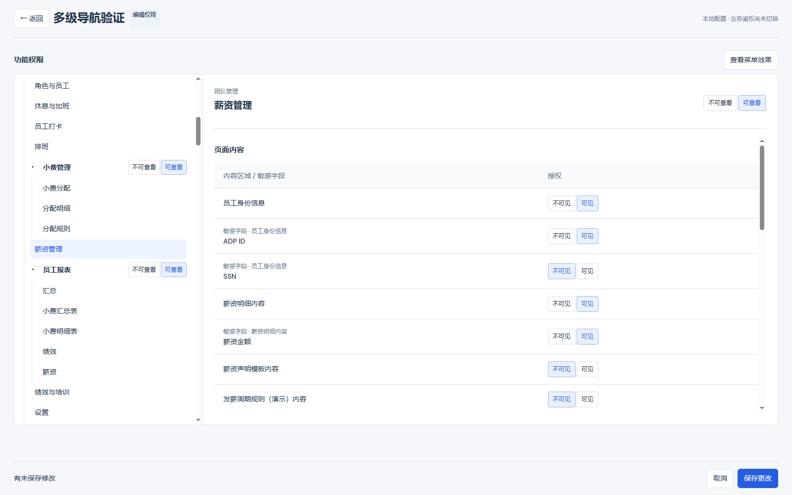
图：历史 PERM-20261014-06 薪资分区配置；当前对象/操作布局已被 §3.5 统一授权表替代，敏感字段及依赖仍适用。

用途：分别决定当前角色进入可见页面后可看到哪些已登记内容和字段，不是修改实际员工资料。入口沿 §3.1；员工门店个人例外复用此区域、仅作用于所选门店。员工视角及其他对象区域状态图待补（PERM-OPEN-05），不能用本图代替。31 内容区域/3 字段的稳定键、来源及全部动作依赖见研发版 §5.4；其他实际字段未全量盘点。

| 字段／操作 | 逻辑说明 |
|---|---|
| 页面内容组织 | 内容与操作统一列在“功能授权”表，不再单独设页面内容标题；纯静态且未登记独立内容的页面不补空泛区域。 |
| 对象内容名称 | 29 个同对象组合及薪资身份编辑分别作为“对象管理”三态行；底层仍登记对应内容。不同对象独立，真实控制点是来源证据，不是生产区域绑定。 |
| 员工身份信息 | 薪资页内容区域，可见不自动开放其 ADP ID/SSN；不可见使二字段及依赖身份的编辑员工失效，不影响独立薪资明细区域。 |
| ADP ID | 身份信息下敏感字段，隐藏则 ADP 导出失效；可见仍需动作独立允许。预览样例 ADP-001，不读取真实值。 |
| SSN | 身份信息下敏感字段；隐藏时名称和样例均不出现在使用者预览，也阻断相关薪资导出/邮件/打印，原动作允许保留。可见样例为掩码示例，不据此定义实际脱敏规则。 |
| 薪资明细内容 | 独立区域，隐藏阻断薪资金额字段及更新考勤入口，不改变员工身份区域原值。 |
| 薪资金额 | 明细下敏感字段；隐藏阻断薪资保存和相关导出/邮件/打印；可见预览 5,000.00 明确为示例，不代表业务金额。 |
| 敏感字段标签 | 名称下方显示“敏感字段 · 所属内容名称”，解释直属关系，不提供编辑值功能。 |
| 纯查看内容／字段不可见 | 单选 hidden；缺失默认不可见，只改该资源键，父级关闭不清下级，同级不联动。可编辑对象的不可见按 §3.5 联动映射键。 |
| 纯查看内容／字段可见 | 单选 read；只开放当前资源，不自动授予动作或子字段，不能覆盖隐藏祖先，不显示假“可编辑”选项。 |
| 字段跟随角色 | 员工个人选择后只删除当前店该字段键；对象跟随角色按 §3.5 删除其全部映射键。 |
| 所属内容不可见 | 字段父区域隐藏时的禁用原因；原选中值保留，恢复区域后按原值计算。 |
| 所需页面内容不可见 | 关联动作任一 requires 隐藏时的禁用原因；只有全部依赖和祖先可见才恢复配置控件/效果，不清动作原值。 |
| 组合编辑依赖 | 底层每个编辑需要对应内容可见；当前可编辑三态会一起写 content read+映射动作 edit。课程隐藏阻断编辑/发布/学习，评估独立；特殊动作允许不自动开放内容。 |
| 导出及打印依赖 | 薪资 PDF/CSV/邮件/批量明细/打印要求金额与 SSN 可见；单人/批量 ADP 另要求 ADP ID。保守隐藏入口，不自动裁剪真实导出；后续接口防泄漏仍未接入。 |
| 旧授权复核 | 新内容/字段仍缺省不可见；内容及编辑/保存不能完整映射三态时显示 §3.5 部分配置，原值保留，不自动扩大或清除。 |

### 3.5 同对象统一授权字段

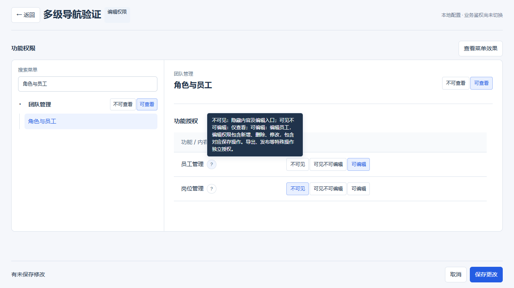
图：角色与员工／员工管理可编辑、岗位不可见；问号说明包含实际 CRUD 和对应保存／2026-10-14 实页，PERM-20261014-07，独立无成员测试角色。

用途：同一业务对象的查看、编辑和对应保存一次配置，不把整个页面作为统一可编辑对象。入口：角色编辑或员工门店个人例外 → 具体页面。员工管理与岗位管理、区域与桌台、课程与评估均分别一行。共30行映射30内容和33编辑/保存键；特殊操作66项保持独立，另1个只读内容/3字段两态；非导航非设置授权控件共100，底层仍99动作。所有对象名及源控制点沿 §3.2–3.4/研发 §5.5；其他对象及员工逐店实页截图待补（PERM-OPEN-05）。

| 字段／操作 | 逻辑说明 |
|---|---|
| 功能授权 | 没有页内分类时为单一列表，有分类时按 §3.6 只展示所选类；对象表头功能/内容及授权，高度受限独立滚动，切换授权保留位置、不带动菜单。 |
| 员工管理 | 聚合员工内容、编辑员工（实际新增/删除/修改）和保存员工信息；三态不重复展示原三行。岗位、独立特殊操作不联动。 |
| 岗位管理 | 聚合岗位内容及实际新增/修改岗位，没有虚构删除或额外保存能力；员工三态不改变此行。 |
| 员工信息管理 | 薪资身份内容与编辑员工信息合并；ADP ID/SSN 仍分别两态，不包含薪资保存或任何输出权限。 |
| 薪资声明模板管理 | 合并模板内容、编辑模板和保存草稿；发布/新版本/停用/分配保留独立动作，原状态限制不变。 |
| 班次管理 | 合并班次内容、编辑班次、保存排班；清空/重置/复制等特殊动作独立。 |
| 不可见 | content hidden+映射编辑/保存 hidden；仅更新当前对象草稿，不删子字段/独立动作原值，最终结果仍受内容门控。预览隐藏对象整行。 |
| 可见不可编辑 | content read+全映射编辑/保存 hidden；预览保留样例及只读标签，无编辑按钮/编辑说明。不是禁止导出：导出仍独立授权并检查字段依赖。 |
| 可编辑 | content read+全映射编辑/保存 edit；一次联动，不是先开放内容再单选操作。包含问号列明实际能力，但不改特殊操作或子字段。 |
| 问号 | 名称右侧；悬停、点击聚焦/Tab 聚焦说明三态、真实 CRUD/对应保存和特殊操作独立；不改草稿。没有实际删除的对象不声称删除。 |
| 跟随角色 | 仅员工个人编辑提供；删除当前店本对象内容及全部映射编辑/保存覆盖键，角色并集+父链重新计算，不影响其他店或特殊操作。全部继承时选中此态。 |
| 部分配置，需复核 | 旧 read/edit/hidden、content hidden/动作 edit 或个人部分覆盖部分继承时，三个状态都不选中。只展示提示不自动改值；明确选态后才整组连写。预览内容可见但编辑/保存未全允许时保守只读。 |
| 上级导航不可查看 | 页面或祖先关闭时三态控件禁用、原选态保留；恢复上级后按原键计算，不把原可编辑改成隐藏。 |
| 特殊操作 | 仍在同一表下方独立禁止/允许；除明确对应保存外，导出/打印/发布/发放/分配/启停/复制等不并入对象三态。保存布局依赖区域+桌台、保存薪资依赖只读金额，当前也独立。 |
| 保存／取消／失败 | 点击只更新角色 grants 或员工当前店 overrides 并置dirty；保存一次确认/版本写入/审计，失败保留整份草稿。取消/离开确认放弃，不触发真实业务、邮件、导出或在线授权。 |

#### 旧部分配置及独立操作

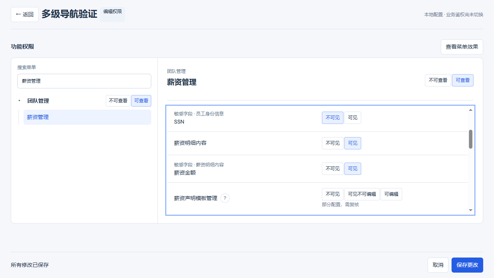
图：薪资声明旧部分授权，三态未选中且需复核，敏感字段仍两态／同版本实页。

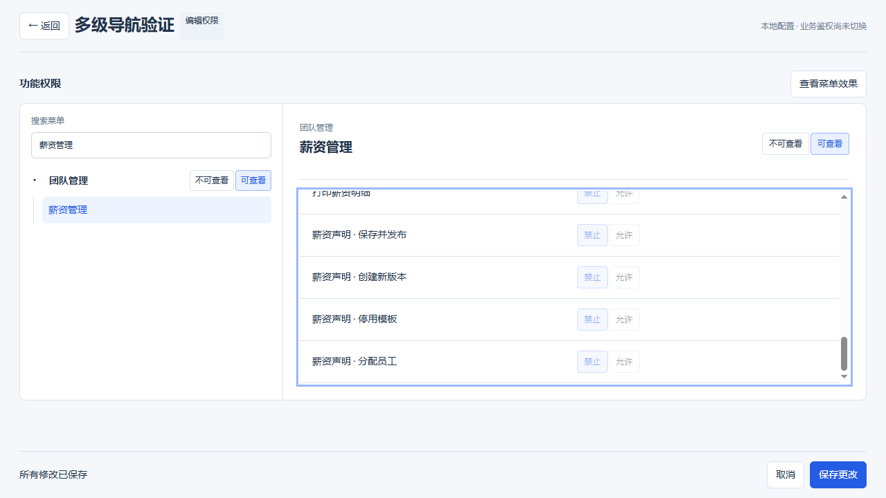
图：薪资授权表下部，发布/新版本/停用/分配单独授权，依赖隐藏时禁用／同版本实页。

验收：员工由不可见改可编辑→内容 read、编辑/保存 edit，岗位不变；再改只读→内容 read、两动作 hidden；改隐藏→全部 hidden。父页面关闭不清原三态；保存刷新保持。A 店只读不影响 B 店编辑，恢复继承删除本店映射覆盖；门店算例已回归，员工逐店实页仍待补。

### 3.6 休息与加班：分类导航与自定义休息

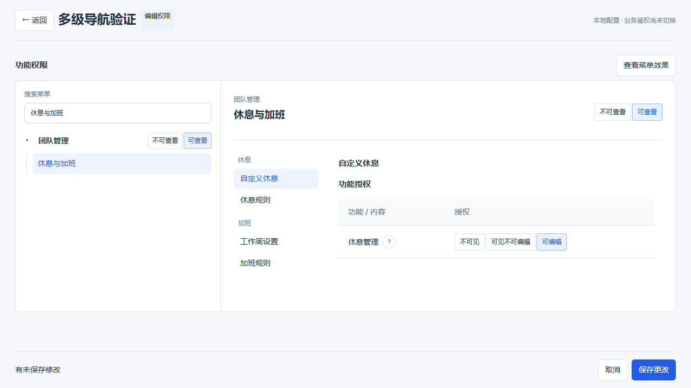
图：项目菜单/分类/当前授权三栏，自定义休息可编辑／2026-10-14项目实页，PERM-20261014-08，独立无成员测试角色；不执行真实业务。

入口：角色编辑 → 团队管理 → 休息与加班；员工门店个人例外同结构，但本轮员工逐店图片待补（PERM-OPEN-05）。两分组/四分类共用真实后台导航数据，不是权限中心另造导航。每类分别切换，不把整页两个对象平铺。

| 字段／操作 | 逻辑说明 |
|---|---|
| 休息 | 中间分类导航分组标题，包含自定义休息/休息规则，只有展示组织作用，不设置权限或折叠整个模块。 |
| 加班 | 分组标题，包含工作周设置/加班规则，不改变休息授权。 |
| 自定义休息 | 默认编辑分类；点击只定位该分类，右侧标题一致，显示休息管理；不联动加班对象。 |
| 休息规则 | 点击右侧显示三项设置，见 §3.6.1，不赋权或写业务配置。 |
| 工作周设置 | 点击显示工作周开始于，见 §3.6.2，不自动授予加班规则编辑。 |
| 加班规则 | 点击显示加班规则管理，见 §3.6.3，不显示休息管理。 |
| 休息管理 | 保留原内容/编辑映射，三态按 §3.5；可编辑包含实际新增/删除/修改，不新造编辑点、时长配置不包括在该对象中。 |
| 分类／权限列表滚动 | 分别独立限高；点击分类保持中间导航位置，右侧新分类从顶部显示。调整授权保留当前位置，不带动其他区域。 |
| 分类切换后草稿 | 点击只切换当前类，其他分类已改键留存；父级关闭保留所有原值，重新开放按原值计算。 |
| 保存/取消/失败 | 所有分类共用一次角色或员工详情保存确认、版本检查/审计；失败保留全部草稿；取消按P2放弃。无真实新增、设置写入或工资计算。 |

### 3.6.1 休息规则授权

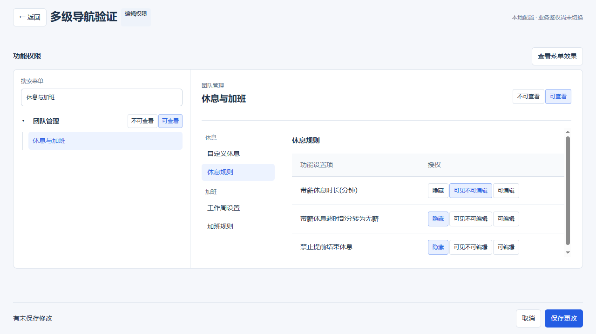
图：带薪时长只读，超时转无薪/禁止提前结束隐藏／同版本实页。

用途：控制可见页面内真实休息规则设置项的展示和编辑入口，非修改实际值。

| 字段／操作 | 逻辑说明 |
|---|---|
| 带薪休息时长(分钟) | 对应实际329业务字段，名称含业务单位但本控件设置的是权限而非分钟数；本页新授权缺失默认隐藏，旧团队设置329授权不搬移/复制。不显示真实时长。 |
| 带薪休息超时部分转为无薪 | 实际开关的独立设置权限，缺失隐藏；允许不代表开关被开启。真实业务需带薪时长>0才可开启，本地权限配置不改变该条件。 |
| 禁止提前结束休息 | 独立设置权限，缺失隐藏；可编辑不改变开关当前值或休息计算。 |
| 隐藏 | 当前设置hidden，预览整项隐藏；不改其他设置/对象。 |
| 可见不可编辑 | read，预览名称与只读状态，无编辑按钮；没有真实值读取。 |
| 可编辑 | edit，预览名称和模拟编辑入口；点击不修改设置业务值，原业务状态条件仍须生产检查。 |
| 员工跟随角色 | 仅个人编辑显示；删除当前门店本项例外，按本店角色和父链重算，其他店不变。 |

### 3.6.2 工作周设置授权

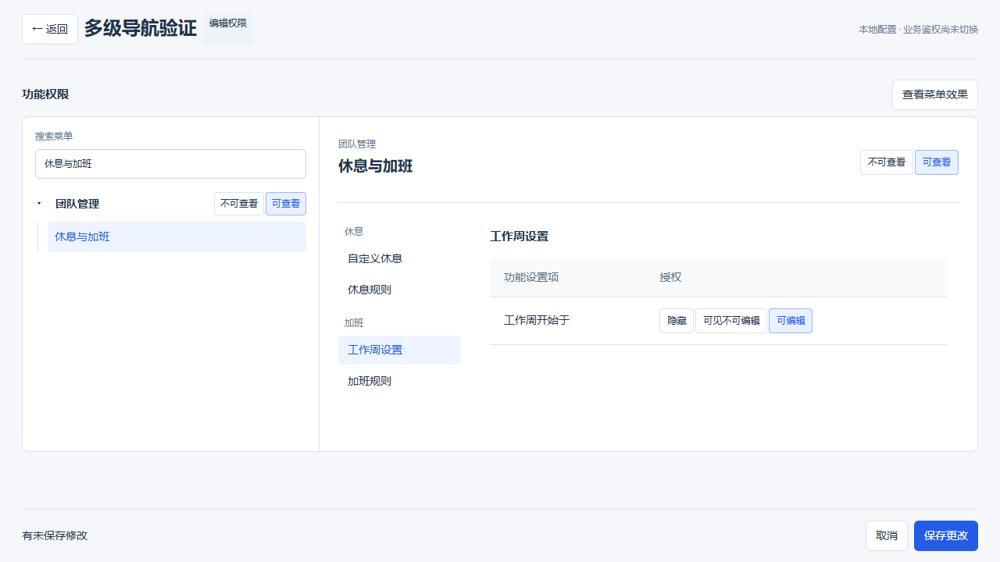
图：工作周开始于可编辑／同版本实页。

用途：控制真实工作周开始日设置的可见与编辑入口；并非此处选择周一或调整加班计算。

| 字段／操作 | 逻辑说明 |
|---|---|
| 工作周开始于 | 来源实际工作周选择控件，本页独立setting授权，缺失隐藏；与加班规则CRUD独立。不读取当前星期值、不修改周累计口径。 |
| 隐藏／可见不可编辑／可编辑 | 分别hidden/read/edit，父页面及祖先隐藏时控件禁用、原值保留；保存/取消同公共流程。员工个人另有继承态。 |

### 3.6.3 加班规则授权

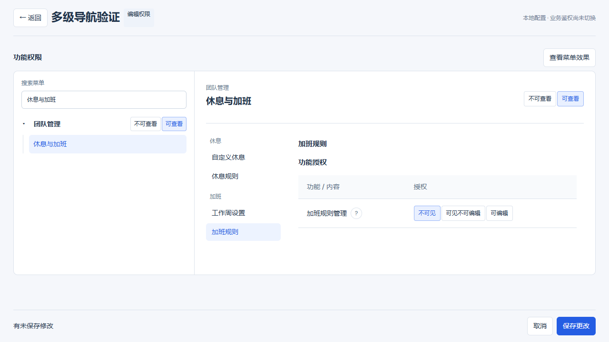
图：加班规则管理不可见，休息类已配置但不显示在此类／同版本实页。

用途：授权实际加班规则对象，不调整日/周工时阈值、倍率或规则数量。

| 字段／操作 | 逻辑说明 |
|---|---|
| 加班规则管理 | 沿用原内容/编辑组合，三态按 §3.5；可编辑包含实际新增、删除、修改，仍受原规则约束。休息管理和工作周权限不联动。 |
| 问号 | 名称右侧说明实际CRUD和三态，悬停/聚焦不改权限；原业务四计算口径限制不被授权替代。 |

### 3.7 员工打卡：页面级授权总览

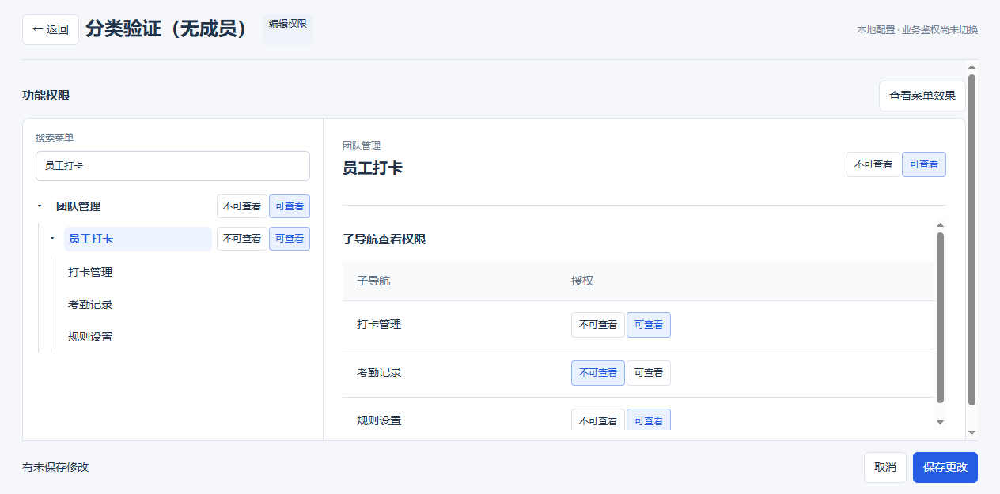
图：打卡管理/规则设置可查看，考勤记录关闭；无成员测试角色，2026-10-14本地实页，PERM-09。

入口：角色编辑或员工门店个人例外→团队管理→员工打卡。沿用真实三个页签，不新增实际URL。当前只配置/预览，不改真实业务页面的登录、筛选、考勤计算或数据。

| 字段 | 逻辑说明 |
|---|---|
| 员工打卡 | 原入口独立两态；关闭阻断三个子页及操作/设置，保留下级已配置值。开启不自动授予子页。 |
| 打卡管理 | 独立页面两态；开启后再分别配置补卡/记录休息，不影响考勤记录或规则设置。 |
| 考勤记录 | 独立页面两态，默认不可查看；关闭仅隐藏自身。 |
| 规则设置 | 独立页面两态，默认不可查看；开启不自动授权其中9个设置。 |
| 页面切换 | 点击左树名称仅切换右侧授权范围与面包屑，不保存、不改变授权，保留左树位置；页面切换右侧列表从顶部显示。 |
| 员工门店例外 | 对同一资源可跟随角色或明确配置；继承删除当前门店例外，A店变更不影响B店。逐店浏览器截图待补，OPEN-05。 |

新增三个页面及9设置均默认拒绝；原入口/动作键、旧团队设置键保留但不复制新授权。旧角色须明确复核页面开启；不是系统角色默认全开。

#### 3.7.1 打卡管理／功能授权

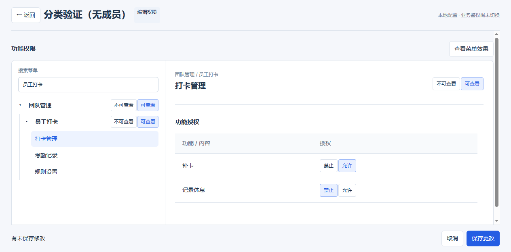
图：补卡允许，记录休息禁止；2026-10-14 本地实页。

入口：§3.7点击打卡管理。范围为当前角色，或当前员工选中门店。

| 字段 | 逻辑说明 |
|---|---|
| 页面可查看 | 不可查看/可查看；有效值受团队管理和员工打卡入口共同门控，父级关闭时控件禁用，不能绕过上级。 |
| 补卡 | 默认禁止；允许对应实际data-clock-adjust入口/补卡确认流程，不包含记录休息。权限编辑只改授权草稿，不执行补卡。 |
| 记录休息 | 默认禁止；允许对应实际休息记录确认动作，不包含补卡，不与另一操作联动。 |
| 禁止／允许 | 点击更新当前资源草稿；预览以有效结果判定，禁止时整行及按钮不显示。保存/冲突/失败/取消沿用 §6，无真实业务写入。 |

#### 3.7.2 考勤记录／查看页面

图：独立页面关闭，未展示伪编辑或导出授权；2026-10-14 本地实页。

入口：§3.7点击考勤记录。现有页面只有筛选与记录查看，未盘点到写入按钮，不新增虚构操作点。

| 字段 | 逻辑说明 |
|---|---|
| 查看页面 | 不可查看/可查看，复用该子页同一个授权键，无独立额外内容键；默认关闭。允许不改变打卡管理/规则设置授权。 |
| 页面状态 | 标题右侧显示计算后可查看/不可查看；非另一个授权字段。父级关闭则配置行禁用。 |

#### 3.7.3 规则设置／开收工与工时

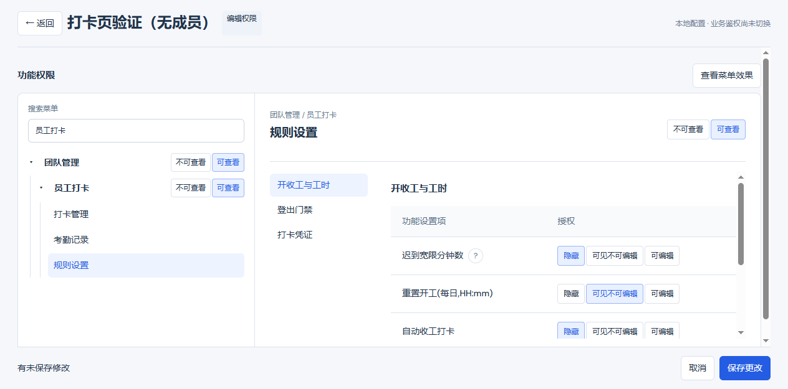
图：重置开工只读，其他项隐藏，迟到宽限按实际后台位于分类首行；2026-10-14 独立无成员测试角色本地实页，已复验排序。

入口：规则设置→开收工与工时。以下均为单项权限，不编辑其分钟数、时间、开关等业务值。标题取实际目录；类型/业务值校验继续由原设置页负责。

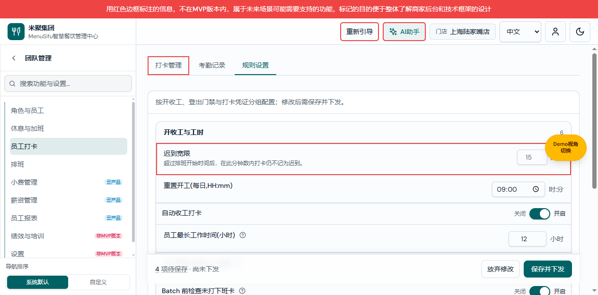
图：实际员工打卡页签及开收工与工时分类对照，迟到宽限仍有未来版本红框；2026-10-14独立演示会话，只查看/切页，未保存业务设置。图中的待下发数值不是权限保存结果。

| 字段 | 逻辑说明 |
|---|---|
| 规则设置页面 | 独立不可查看/可查看；关闭阻断全部三个分类中的设置，并保留单项原授权。 |
| 开收工与工时 | 分类切换按钮，无单独权限字段；点击仅展示当前6设置，保持分类区位置，不保存。 |
| 登出门禁 | 切到 §3.7.4 两设置，不改变开收工授权。 |
| 打卡凭证 | 切到 §3.7.5 一设置，不改变其他授权。 |
| 迟到宽限分钟数 | 对应data-clock-late-grace；独立三态，默认隐藏，后台未来版本标记保留；问号说明配置不代表生产启用。 |
| 重置开工(每日,HH:mm) | 序号72；独立三态，默认隐藏；授权对象为该设置项，不是填写HH:mm。 |
| 自动收工打卡 | 序号73；独立三态，不联动员工最长工作时间。 |
| 员工最长工作时间(小时) | 序号71；独立三态，默认隐藏，不存小时值。 |
| 员工持续工作时长上限 | 序号67；独立三态，与最长工作时间分别配置。 |
| Batch 前检查未打下班卡 | 序号241；独立三态，不授予其他批次动作权限。 |
| 隐藏 | 单项有效不可见；预览整行不显示，不泄露名称或业务值。 |
| 可见不可编辑 | 单项有效只读；预览显示只读标识，无编辑按钮。 |
| 可编辑 | 单项有效可见且可编辑；预览显示示意编辑按钮，不执行实际设置保存。 |
| 保存／取消／失败 | 所有分类共享同一个授权草稿；保存按 §6，取消不写，失败保留草稿；不向旧团队设置上下文同步复制授权。 |

#### 3.7.4 规则设置／登出门禁

图：经理强制登出设置可编辑，企台登出设置隐藏；2026-10-14 本地实页。

入口：§3.7.3 登出门禁；权限三态及保存后果同上一节，各项独立。

| 字段 | 逻辑说明 |
|---|---|
| 在单子还没全部关闭的情况下,允许经理强制登出 | 序号68；默认隐藏，设置项可编辑不表示当前经理已获真实登出权，本任务未接管真实执行。 |
| 在单子全部付完款的情况下,才允许企台登出 | 序号69；默认隐藏；与68分别配置，不按分类批量授予。 |

#### 3.7.5 规则设置／打卡凭证

图：凭证设置隐藏；2026-10-14 本地实页。

入口：§3.7.3 打卡凭证；权限三态及保存后果同 §3.7.3。

| 字段 | 逻辑说明 |
|---|---|
| 下班打卡打印确认小票 | 序号70；独立三态，默认隐藏；控制设置项的展示/编辑，不新增独立打印动作，也不发起真实打印。 |

#### 3.7.6 员工打卡／权限效果预览

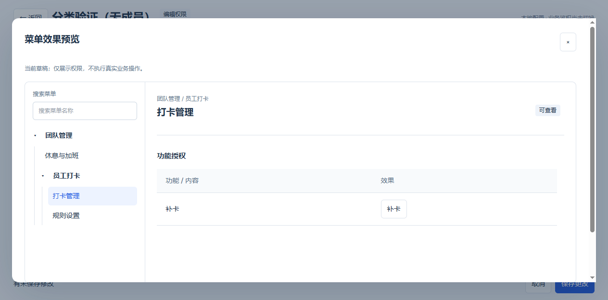
图：仅获准的补卡可见，考勤记录和记录休息不显示；2026-10-14 本地实页。

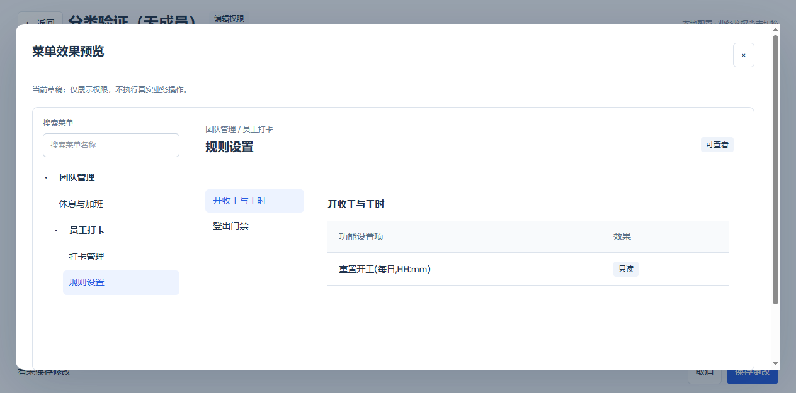
图：仅重置开工只读、登出门禁分类保留，打卡凭证分类隐藏；2026-10-14 本地实页。

入口：查看菜单效果。使用当前授权草稿，页面/操作/设置均按实际父子门控过滤；无可见项的分类隐藏，不读取考勤数据/设置值。点击菜单或分类只切换预览范围。关闭不保存、应保留原编辑草稿。

验收：A店关闭打卡管理不影响B店；父级关闭阻断全部，再开启恢复原值；三页面独立；records不出现假CRUD；rule设置read不显示编辑，hidden不显示项。自动回归覆盖隔离、恢复、持久化及旧数据默认拒绝。浏览器已实测页面/分类切换和预览隐藏/只读、父级禁用而保留子项、保存刷新保留授权、预览切页后Esc保留原编辑标题/草稿。初次连接超时已通过新独立会话完成复验；员工逐店图片等历史OPEN-05仍保留，生产执行未接入。

### 3.8 角色与员工／父导航

待补页面图片：父导航仅员工管理/岗位管理两子项及查看授权，2026-10-16当前分支未浏览器验收，OPEN-05；旧虚拟菜单截图不代表新布局。

入口：角色编辑或员工门店权限→团队管理→角色与员工。

| 字段 | 逻辑说明 |
|---|---|
| 角色与员工 | 独立可查看/不可查看；保留旧操作页拒绝校验，任一旧门控拒绝时显示不可查看。显式选择同步两个原键，关闭阻断两页但不清空下级配置。 |
| 员工管理 | 点击进入本页面对应权限，保持菜单位置，不写授权；见 §3.8.1。 |
| 岗位管理 | 点击只切到本页，不变更员工权限；见 §3.8.2。 |
| 操作权限 | 本目录不再展示，不新增替代页面；旧授权值保留为兼容校验，不丢弃。其他模块同名旧节点非本任务范围。 |
| 跟随角色 | 员工模式下删除当前门店的原导航与兼容门控两项例外；恢复该店角色计算，不影响其他店。 |
| 保存/取消 | 点击授权先改草稿；跨页保留草稿。保存沿 §6，版本冲突/容量失败不部分写入；取消按原确认放弃，未确认保留。 |

#### 3.8.1 员工管理／页面及对象授权

待补页面图片：员工管理编辑及只读/编辑/隐藏预览状态；OPEN-05，尚无当前版本可验证截图。

用途：仅配置员工页面及员工对象，作用当前角色或员工选中门店，不与岗位对象同表混排。

| 字段 | 逻辑说明 |
|---|---|
| 页面可查看 | 两态，默认拒绝；父导航关闭时有效不可查看，控件禁用。关闭本页不改变岗位页。 |
| 员工管理授权 | 默认不可见；不可见隐藏员工内容及编辑入口；可见不可编辑显示内容但无编辑按钮；可编辑包含已登记员工新增/删除/修改与保存，底层manage-employee/save-employee同时设置。 |
| 问号 | 说明实际编辑范围及保存关联，不泛化为其他功能允许；沿原tooltip交互。 |
| 效果预览 | 当前页只显示员工内容/编辑示意，不显示岗位对象、不执行实际业务；无权整行隐藏，页面仍可见时不强制隐藏页面入口。 |

#### 3.8.2 岗位管理／页面及对象授权

待补页面图片：岗位管理编辑及对应预览状态；OPEN-05，尚无当前版本可验证截图。

用途：仅配置实际岗位页面，不改变员工页面或员工保存权限。

| 字段 | 逻辑说明 |
|---|---|
| 页面可查看 | 两态，默认拒绝；父导航阻断保留原值。只关闭本页不影响员工页。 |
| 岗位管理授权 | 三态默认不可见；只读不显示编辑入口；可编辑包含已登记新增/修改，无删除能力，不能在问号中承诺删除。 |
| 问号 | 仅说明岗位真实新增/修改，沿用原提示交互。 |
| 效果预览 | 仅岗位内容及相应示意按钮，无员工内容或保存员工项；关闭预览不保存、保留原编辑上下文和草稿。 |

验收算例：员工可编辑/岗位只读，两页分别呈现一行；关闭员工页不改变岗位；旧操作页拒绝仍阻断父导航，两页不可绕过；显式开启父导航同步旧键、下级原配置恢复。A店例外不影响B店。自动回归已覆盖；真实浏览器及当前配图待补，历史OPEN-03生产执行/OPEN-05保持未关闭。

## 4. 员工与账号列表

> 待补页面图片：员工列表／各账号状态／搜索空结果／本地实现版本 PERM-20261013-01。

| 字段 | 逻辑说明 |
|---|---|
| 员工姓名或邮箱搜索 | 默认空，输入立即按姓名/邮箱包含匹配，大小写不敏感；与状态筛选取交集。 |
| 账号状态筛选 | 单选，默认全部；候选为第 4.2 节五种状态；仅筛选列表。 |
| 邀请员工 | 打开第 4.1 节，不要求输入密码。 |
| 员工 | 员工名称，范围为新工作台所有员工。 |
| 登录邮箱 | 保存值，无账号时 —。 |
| 账号状态 | 展示五态标签，含义见第 4.2 节；本地记录不代表实际服务状态。 |
| 门店角色 | 展示绑定角色名称，无绑定为未授权；migrationReview 为 true 时显示待复核。完整范围在详情查看。 |
| 个人例外 | 该员工所有门店例外键之和，显式禁止计入，0 表示未记录例外。 |
| 管理详情 | 携带员工 ID 打开全屏详情；不会先修改账号。 |

### 4.1 邀请员工弹框

> 待补页面图片：邀请默认、邮箱格式错误、邮箱重复状态／本地实现版本 PERM-20261013-01。

| 字段 | 逻辑说明 |
|---|---|
| 本地邀请说明 | 明确“不发送邮件”，避免产生送达承诺。 |
| 员工姓名 | 必填、去空格、最多 30 字；仅为新员工资料。 |
| 员工邮箱 | 必填、格式校验、最多 254 字、去空格转小写；与所有非空邮箱查重，包括已撤销邀请。 |
| 记录邀请 | 校验通过生成员工 ID、pending 状态、空绑定空例外，写日志；成功关闭刷新；失败保留。生产“发送邀请”待真实邮件接入后使用。 |
| 取消／关闭 | 不新增员工、不发消息、不写日志。 |

### 4.2 员工详情：登录与安全

> 待补页面图片：登录与安全／未开通、待接受、已撤销、启用、停用／本地实现版本 PERM-20261013-01。

入口：管理详情 → 登录与安全。更改当前员工工作台记录，不波及他人。

| 字段 | 逻辑说明 |
|---|---|
| 登录邮箱 | 保存值，空为 —，此页不直接编辑。 |
| 未开通 | 无账号旧员工的初始化状态；不假设可登录。 |
| 待接受邀请 | 本地新增或重发邀请后的 pending；尚不允许据此宣称已激活。 |
| 邀请已撤销 | 撤销 pending 后的 revoked；员工与授权保留。 |
| 已启用 | 初始从旧账号读取或本地启用状态；P1 中真实服务未接入。 |
| 已停用 | 初始旧账号停用或本地停用状态；目标生产行为为阻断登录，本轮尚不接管旧登录。 |
| 重新发送邀请 | pending/revoked 可用；本地确认标题为“重新记录邀请”；加入 pending 草稿，不发送邮件。 |
| 撤销邀请 | 仅 pending 可用；确认后改为 revoked 草稿，不删除人员或绑定。 |
| 停用／启用账号 | enabled/disabled 之间切换草稿；确认时解释本地边界；角色和例外不清除。 |
| 凭据重置／会话撤销 | 尚无真实服务，本轮不提供假成功操作入口；PERM-OPEN-04。 |

#### 账号状态变更确认弹框

> 待补页面图片：邀请重发、撤销、停启确认／本地实现版本 PERM-20261013-01。

| 字段 | 逻辑说明 |
|---|---|
| 影响说明 | 仅更新当前员工本地状态、保留授权；实际服务未调用。 |
| 加入草稿 | 改变当前员工草稿，尚未保存；最终需详情底部保存。 |
| 取消／关闭 | 不改变草稿状态，不写入。 |

### 4.3 员工详情：门店与权限

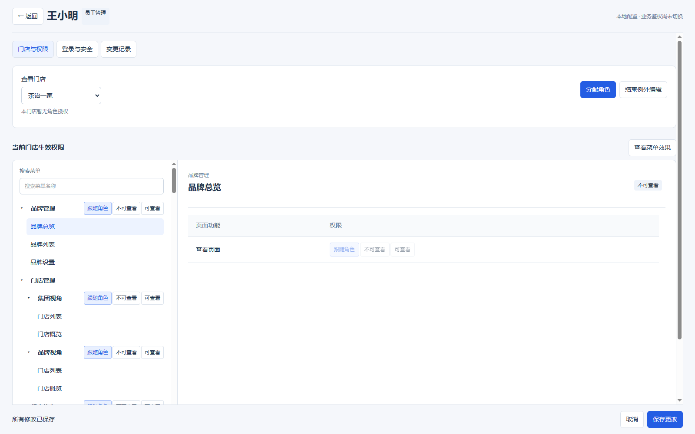
图：项目默认演示员工／已进入个人例外模式，菜单名称右侧同行显示继承/查看状态／2026-10-14 项目实页，PERM-20261014-02；仅检查布局，没有修改或保存该员工权限。默认只读等其他状态图片仍待补。

> 待补页面图片：门店权限默认、无绑定、需复核、例外编辑状态／本地实现版本 PERM-20261013-01。

默认页签为门店与权限，初始选项目门店候选第一项；具体候选范围当前为本地项目门店，生产须受管理者组织边界裁剪（PERM-OPEN-01）。

| 字段 | 逻辑说明 |
|---|---|
| 员工名称 | 当前员工标题；不随门店切换变化。 |
| 门店与权限页签 | 展示角色、范围和效果；切回不丢草稿。 |
| 登录与安全页签 | 进入第 4.2 节，保留其他草稿。 |
| 变更记录页签 | 进入第 4.4 节，仅已保存日志。 |
| 查看门店 | 仅位于员工生效权限抽屉，下拉单选；仅重算抽屉适用角色与权限，不筛选主页面角色表，不写草稿。 |
| 分配角色 | 打开第 4.5 节；默认指定当前门店。 |
| 设置个人例外 | 历史功能，roles-only模式已移除，不是当前入口。 |
| 角色名称 | 全部绑定的角色名称，不受查看门店影响；失效引用标明失效。同角色不同范围保持独立行。 |
| 范围标签 | 指定门店、动态品牌或动态区域；标识来自绑定，不能从当前门店推断整个范围。 |
| 查看权限／修改门店／解除角色 | 使用本次PERM-STAFF-ROLE-SCOPE-20261019-01顶部定义；只读查看角色、单行范围编辑及解除完整绑定，保存后生效。 |
| 旧授权范围需复核 | 原数据为 all/无范围等无法安全映射时展示；新显式分配后解除本地标记，旧数据保留。 |
| 当前门店生效权限 | 历史个人覆盖规则已被PERM-STAFF-ROLE-ONLY-20261019-01替代；当前仅展示所选门店角色联合后的可访问菜单，隐藏无权限菜单和空分类，保持只读。 |
| 跟随角色／明确允许禁止 | 历史个人例外控件，roles-only模式已移除；当前只读查看联合角色结果。 |
| 查看菜单效果 | 第 7 节使用当前门店和整份员工草稿；切店后不可复用前店结果。 |
| 返回／取消／保存 | 共用 P2、P4；保存范围包括此员工已编辑的所有门店及账号草稿。 |

### 4.4 员工详情：变更记录

> 待补页面图片：员工变更记录／空状态／本地实现版本 PERM-20261013-01。

入口为员工详情第三页签；按 employeeId 过滤第 5 节同一日志源。未保存草稿不产生记录；切换页签不保存草稿。时间、操作人、操作、查看前后值和空状态分别沿用第 5 节定义。

### 4.5 分配角色两步弹框

> 待补页面图片：选择范围步骤、动态范围、确认步骤／本地实现版本 PERM-20261013-01。两步独立状态均待补。

| 字段 | 逻辑说明 |
|---|---|
| 角色 | 单选，必填；来自本地角色列表，初始请选择。 |
| 授权范围 | 新选择仅stores/brand-stores默认stores；brands仅原动态品牌绑定编辑，regions仅原区域绑定的禁用保留值；brand-stores保存为stores。 |
| 范围候选 | 指定门店默认当前门店；品牌左右列表及静态门店规则按PERM-BRAND-STORES-20261020-01，至少一家；区域仍按原动态规则。 |
| 下一步 | 校验角色和范围后打开确认，不写数据；失败保持第一步。 |
| 确认角色及范围 | 显示刚选内容；动态范围提示包含未来新增或纳入门店。 |
| 确定 | 确认框列员工、角色及完整范围；生成独立绑定，更新全部角色列表及下方当前店结果，仍需详情保存。 |
| 取消／关闭 | 本步骤未加入绑定时不产生授权；可重新发起。 |

### 4.6 移除绑定确认弹框

> 待补页面图片：指定门店移除、动态范围移除／本地实现版本 PERM-20261013-01。

| 字段 | 逻辑说明 |
|---|---|
| 影响提示 | 明确列员工、角色及整条授权完整范围，非只移除当前查看门店；其他绑定保留，roles-only无个人例外。 |
| 解除角色 | 从草稿删除对应binding.id，重新计算当前店结果；不停止账号，最终需保存。 |
| 取消／关闭 | 保留原绑定。 |

## 5. 全局变更记录

> 待补页面图片：全局日志、展开详情、空结果／本地实现版本 PERM-20261013-01。

| 字段 | 逻辑说明 |
|---|---|
| 搜索 | 文本默认空；输入立即匹配操作人、操作或对象 ID；不修改日志。 |
| 时间 | 保存时生成 ISO 值，页面按浏览器本地时间显示；从新到旧。 |
| 操作人 | 当前会话名称，无上下文为本地管理员，不是服务端身份认证证据。 |
| 操作 | 已保存的操作名称；模拟邀请标记未发送邮件。 |
| 查看前后值 | 展开对象 JSON 快照；前后对象可定位角色/员工，包含范围和例外；不显示密码。 |
| 变更前 | 本次保存前的持久化对象；新建为 null。 |
| 变更后 | 本次保存对象；删除为 null。 |
| 暂无变更记录 | 无记录或筛选不命中时展示，不能伪造初始审计。 |

## 6. 保存更改确认弹框

> 待补页面图片：角色影响、员工跨店草稿、版本冲突、存储失败／本地实现版本 PERM-20261013-01。

| 字段 | 逻辑说明 |
|---|---|
| 影响说明 | 角色显示绑定员工去重人数；员工显示仅当前员工但包括所有已编辑门店。 |
| 变更前后值 | 展开显示已保存对象与当前草稿，不以当前单个页面代替完整保存范围。 |
| 确认保存 | 校验版本、数据及删除保护后单次本地写入；成功关闭弹框、刷新、清 dirty、写日志。 |
| 取消／关闭 | 不写入，保留详情草稿继续编辑。 |
| 版本冲突 | 其他窗口已保存时拒绝覆盖；提示刷新重新编辑，现有草稿仍在。生产合并能力待接入。 |
| 存储失败 | 显示失败，不清草稿、不显示成功；配额不足也遵守此规则。 |

## 7. 菜单效果预览

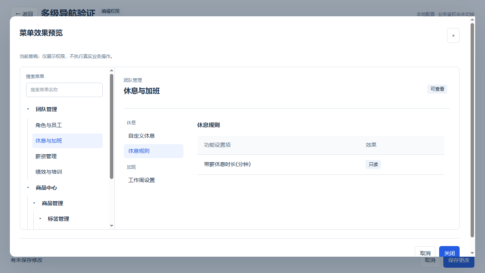
图：仅带薪时长可见，只读无按钮；隐藏的两个设置及加班规则分类不显示／2026-10-14实页，PERM-20261014-08。

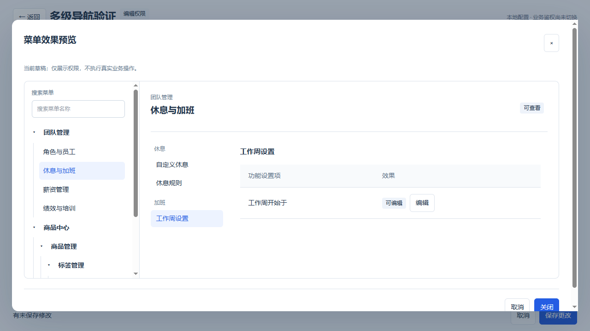
图：工作周开始于展示可编辑及模拟按钮／同版本实页，不读取/修改实际设置值。

图：员工管理同一行展示样例及可见不可编辑，无编辑按钮／2026-10-14 实页，PERM-20261014-07。

图：员工管理样例、可编辑标签和一个模拟编辑入口，不重复保存／同版本实页。

图：对象全隐藏但页面允许，展示统一空态，不泄露隐藏对象名称／同版本实页。

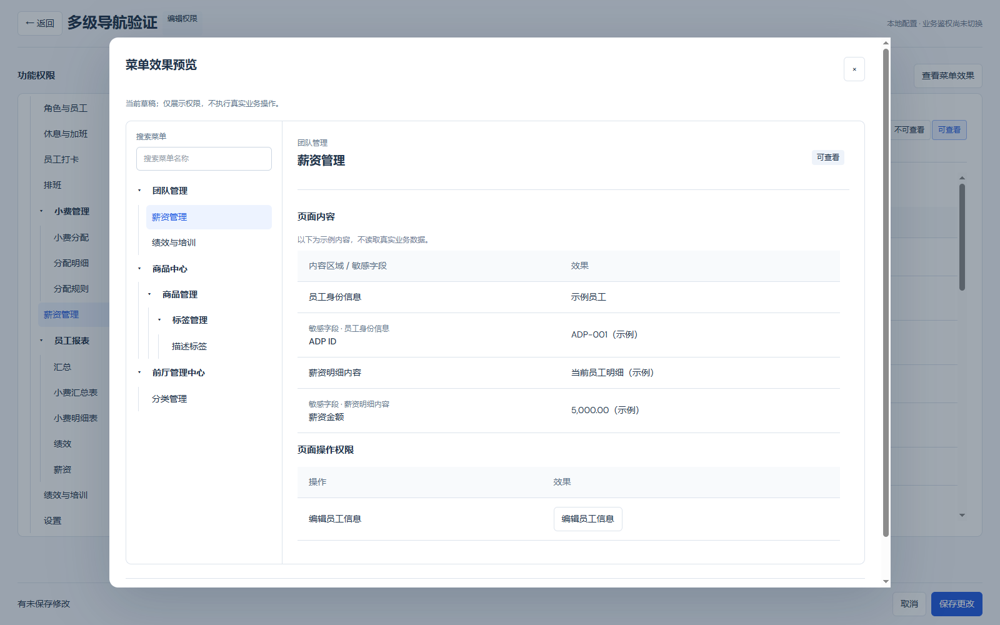
图：历史 PERM-20261014-06 薪资预览，隐藏内容/字段和输出规则仍适用，分区布局已被本节统一授权预览替代。

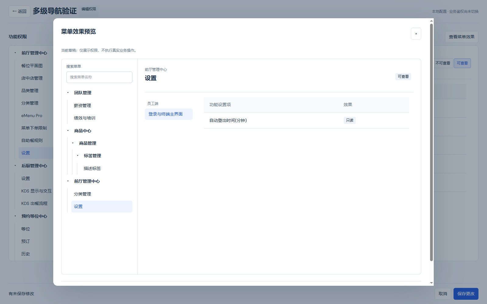
图：前厅设置 → 自动登出时间只读，无编辑入口／同版本实页；不读取实际设置值。

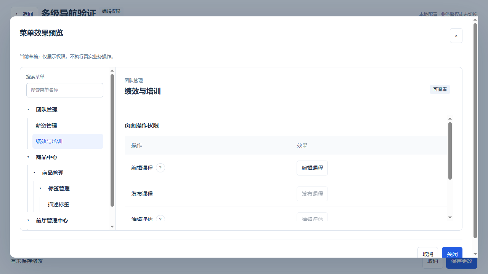
图：历史 PERM-20261014-05 课程预览，灰色无权动作已被本轮整行隐藏取代；组合需课程内容可见才显示，不执行课程业务。

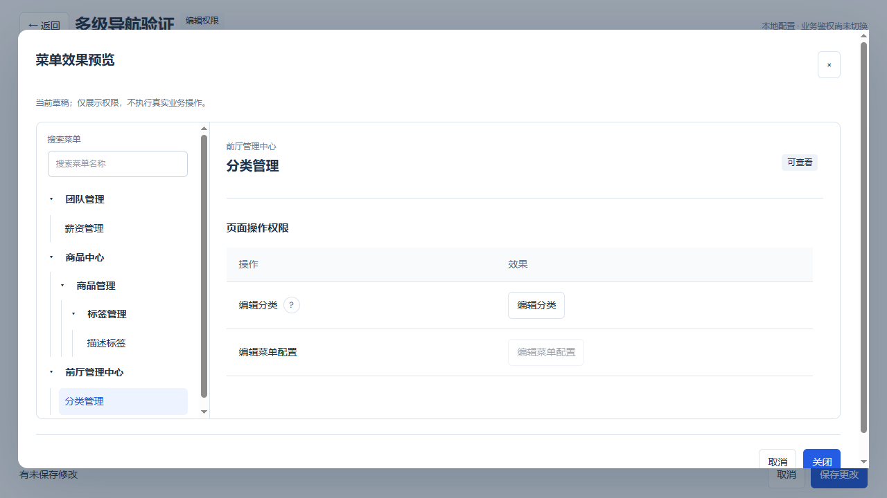
图：历史 PERM-20261014-04 分类预览；现行分类内容须可见、无权菜单配置整行隐藏，灰色展示不再生效，不执行真实业务。

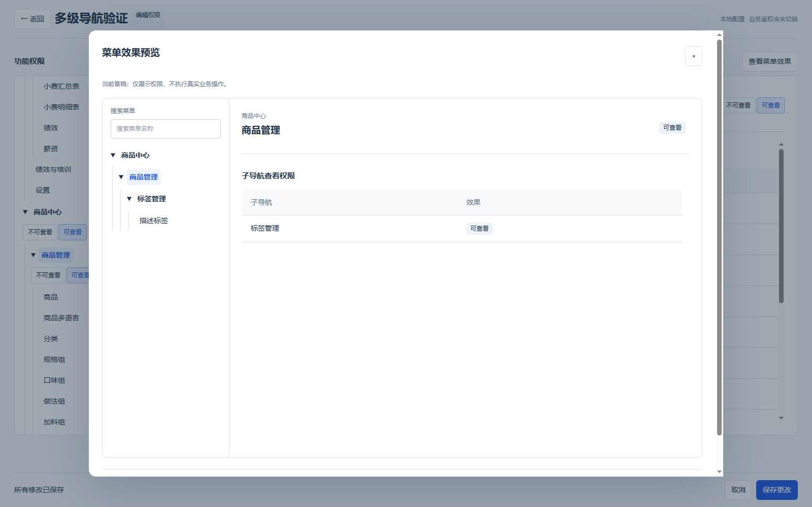
图：调味子树隐藏，标签管理及描述标签可见／2026-10-14 项目实页，PERM-20261014-01。仅导航结果仍适用；无可见菜单状态及员工视角图片仍待补。

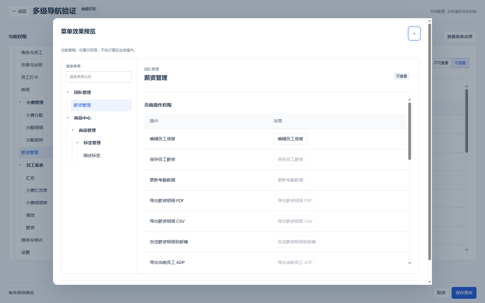
图：历史 PERM-20261014-03 薪资预览；灰色无权动作已被本轮整行隐藏取代，现行内容与按钮效果以本节首图为准。员工预览状态仍待补。

入口：角色或员工详情。展示当前草稿，员工携带单选门店；不跳真实业务页面。

| 字段 | 逻辑说明 |
|---|---|
| 预览说明 | 标明当前草稿/员工门店和仅展示权限，不执行真实操作。 |
| 菜单树 | 使用与编辑相同数据及完整父级链；隐藏不可见导航整个子树及不可见页面，没有可见后代的纯目录移除。页面自身可见时即使全部内容/动作/设置隐藏也保留页面空态；调味关闭不影响标签。 |
| 菜单搜索 | 只筛选预览树，不改原授权。 |
| 页面点击 | 切换右侧预览内容，不持久化、不发业务请求。 |
| 设置／页内分类 | 同真实结构，休息与加班按 §3.6；分类无任何可见对象/设置时移除，分组无可见分类时不显示标题；超高独立滚动，切换保留位置。 |
| 功能项列表 | 与编辑器同样独立滚动；分类切换后从顶部展示，鼠标滚动不带动相邻分类或外层弹框。 |
| 内容区域／字段 | 仅有效 read 时展示名称及样例；hidden 整行隐藏（包括字段名称/说明/样例），管理编辑的完整目录不受此过滤。 |
| 示例内容说明 | 显示“以下为示例内容，不读取真实业务数据。”，值来自目录注册并转义，不是实际员工记录。 |
| 只读标签与编辑按钮 | read 仅展示名称和只读标签、没有编辑按钮；edit 显示可编辑及模拟按钮；hidden 整项不出现。未展示真实设置值。 |
| 对象统一行 | content hidden 整行隐藏；可见且全部映射编辑/保存有效 edit 时样例/可编辑标签/模拟主编辑按钮同一行；否则只读无编辑入口/说明，不重复保存行。 |
| 独立动作按钮 | 仅有效 edit 且祖先/依赖成立时展示，其余整行隐藏，不执行业务、不灰显无权入口。 |
| 没有可显示的内容或可操作功能 | 统一表没有任何可见内容/对象/独立操作时显示，不列举隐藏名称；已允许页面入口仍保留。 |
| 没有可显示的设置项 | 页面可见但全部设置不可见时显示，不把页面变成不存在或误作静态页。 |
| 没有可显示的分类 | 休息与加班页面可见但全部分类授权隐藏时显示，页面入口仍保留，不列举隐藏名称。 |
| 没有可显示的菜单 | 当前权限全部隐藏或搜索无匹配时展示。 |
| 关闭／取消／Esc | 返回编辑，原页面/分类/搜索/草稿保留，不保存；预览切换后焦点恢复到新按钮且不带动滚动，Esc保持在弹框处理，不向外层重绘丢草稿。 |

## 验收与未闭合

PERM-20261014-08：九权限脚本、tsc、独立构建（555模块）通过；7实页图已检查，真实商家页四分类对照。独立无成员角色实测四分类、独立设置与对象、只读/编辑预览及无权过滤；切换预览分类后的焦点/Esc草稿保护、保存刷新通过。4新设置默认拒绝、旧329原值不复制，原26通用设置目录及99动作等数量不变。员工逐店和其他页面截图仍待补，生产鉴权/业务值写入未接入，不自动提交/推送。

PERM-20261014-07：八个权限脚本、tsc 和独立构建（553 模块）通过；30行/33动作映射、三态同步、无重复保存、mixed 无扩权、只读字段、独立动作、门店/继承/保存及父恢复均回归。独立无成员角色实页完成三态/问号/父保留恢复/保存刷新/Esc；薪资混合与特殊动作有对应图片，六张新图均检查。不代表生产接入；员工逐店及其余页面图片继续待补，未自动提交/推送。

PERM-20261014-06：七个权限脚本、tsc 和独立 Vite build（552 模块）通过；31 内容/3 字段源码来源、默认拒绝、门店例外、依赖/循环、保存/非法值、无权整行隐藏、只读无入口和设置全隐藏空态均回归。独立无成员角色实页验证 SSN/PDF 隐藏与恢复、身份区域门控、只读设置、保存刷新及 Esc；三个新图见 §3.4/§7。未执行真实业务或接入生产鉴权，不自动提交/推送。以下灰色无权按钮及旧计数仅属历史。

PERM-20261014-05：28 组全部来源、准确说明、旧授权不升级、保留非 CRUD、门店/预览/保存与错误回归通过；六个权限脚本、tsc、独立 Vite build 成功（551 模块）。独立无成员角色实页验证培训多对象独立、两项提示、预览、声明与 PDF 独立、保存刷新；新图见 §3.1/§3.3/§7。仍仅本地配置/预览，其他业务页截图及生产鉴权未完成；未自动提交/推送。以下 PERM-04/03 记录及计数是历史快照。

PERM-20261014-04：组合目录/三个控制点、旧授权不升级、保留退役数据、角色/员工/预览说明、门店例外和父门控回归通过；其余权限脚本、类型及独立构建通过。浏览器实测问号 hover/click/Tab focus，权限不变；预览、父阻断、保存刷新通过，截图见 §3.2/§7。当前 146 项动作；仍未接入生产业务与 API，也未批量合并其他页面。不自动提交/推送。

PERM-20261014-03：动作目录及源码控制点、默认禁止、编辑/导出互不联动、父级阻断与门店例外、预览与保存回归通过；类型检查及独立构建通过。独立无成员测试角色在浏览器实测两个方向的编辑/导出组合、父页面阻断/恢复、保存刷新、Esc 保留选择与草稿，截图见 §3.1/§7。仍未接管真实业务操作及后端鉴权；其他页面及状态图片缺口保持，不自动提交或推送。

集成验证记录 `PERM-20261013-MAIN-01`：main `df289390` 基线上权限回归、TypeScript 检查及独立构建通过，实际导航为 150 菜单页（原功能分支为 148 页）。仅更新实施核验信息，产品 V2.6、研发 V1.6、本文 V1.6 业务版本不变；下列生产、图片和浏览器验收缺口不变。

按产品权威 §10 场景逐一验收；领域、目录及存储脚本通过不替代浏览器交互验收。PERM-20261014-01 的导航回归、原权限回归、类型检查、构建通过；独立角色实测调味/标签同级隔离、父级关闭/恢复、预览/保存刷新，截图见 §3、§7。其余页面图片和浏览器状态覆盖仍不完整。

PERM-20261014-02：菜单同行回归、原导航/权限回归、类型检查及构建通过；角色控件实际在名称右侧中心对齐，点击不改变展开/选择/滚动。员工只读和例外模式的 45 个控件标题均无错位，实页图见 §3、§4.3。此验收仅关闭本轮控件布局子项，生产与其他状态验收缺口不变。

- PERM-OPEN-01：委派授权边界未定。
- PERM-OPEN-02：品牌/集团自身资源授权未定。
- PERM-OPEN-03：全站运行时路由/DOM/按钮绑定、其他页面内容/字段/动作登记、读取字段裁剪和真实写入/导出服务端鉴权待接入。
- PERM-OPEN-04：真实邮件、接受邀请及账号安全服务待接入。
- PERM-OPEN-05：本轮角色导航编辑/父级阻断/菜单预览已补实页图；剩余员工视角、其他逐页图片和浏览器状态待补。

### 本地 main 集成验证（2026-10-14）

`PERM-20261014-LOCAL-MAIN-01`：以远端基线 `4f245e7d` 合并权限分支 `1d1ffef5`（含5个权限提交），无冲突。10个权限回归、TypeScript检查及独立Vite构建通过（557模块）；远端CI构建产物未覆盖。本记录仅同步本地main的实施/验证状态，产品V3.5、研发/个人V2.5业务版本与PERM-09定义不变；尚未推送GitHub或切换生产鉴权，既有待确认/截图缺口保留。

## 打卡操作权限视角（修复验证）

图注：角色权限编辑／总部管理员演示状态／2026-10-14 本地实现 PERM-FIX-20261014-01。图中禁用状态来自当前角色模块授权，不代表修复自动开放权限。

此图为原功能分支修复验证历史证据。合入 main 后以 PERM-20261014-09 为准：入口为员工打卡 → 打卡管理，补卡和记录休息由该页面承接；不新建打卡操作权限节点。

| 字段 | 逻辑说明 |
|---|---|
| 操作权限节点 | 点击在右侧显示原打卡动作；不修改授权，不切换商家业务页。 |
| 补卡 | 原 adjust-clock 动作键；允许／禁止沿用既有授权与父级门禁。 |
| 记录休息 | 原 break 动作键；允许／禁止沿用既有授权与父级门禁。 |

## 排班操作权限视角（修复验证）

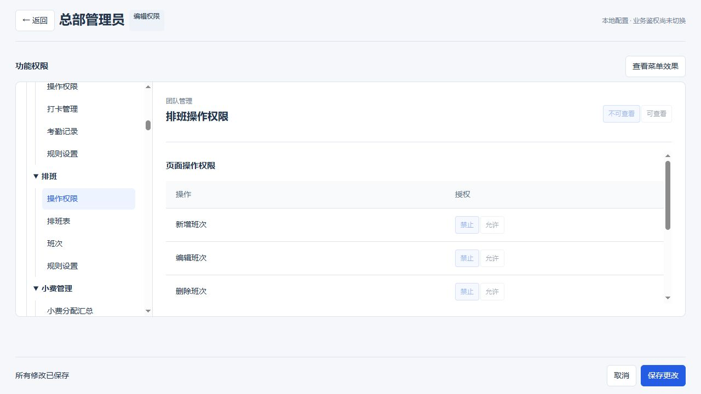
图注：角色权限编辑／总部管理员演示状态／2026-10-14 本地实现 PERM-FIX-20261014-01。

入口：角色与功能权限 → 编辑权限 → 团队管理 → 排班 → 操作权限。

| 字段 | 逻辑说明 |
|---|---|
| 操作权限节点 | 点击在右侧显示原排班动作；原键保留，不新增授权。 |
| 新增班次 | 保留 create-shift，沿用原父级门禁。 |
| 编辑班次 | 保留 edit-shift，沿用原父级门禁。 |
| 删除班次 | 保留 delete-shift，沿用原父级门禁。 |
| 保存／批量保存排班 | 保留原动作键与既有允许／禁止规则。 |
| 清除排班 | 保留原动作键与既有允许／禁止规则。 |
| 恢复默认排班 | 保留原动作键与既有允许／禁止规则。 |
| 同步下周排班 | 保留原动作键与既有允许／禁止规则。 |

上述入口仅定位动作设置。保存、更改取消及例外授权流程沿用正文既有定义，本次只验证显示且未写入授权。

合入验证补充：main 已采用 V3.5／V2.5 的对象组合权限及打卡逻辑页。本次兼容节点仅在父路径缺少页面资源时补建，避免重复既有页面键；旧功能分支截图及 117 动作计数仅是修复前基线验证证据，main 实际计数以最新回归输出为准。
