# 自助餐规则业务规格说明书（研发交付版）

版本 V1.8；产品：[融合设计 V1.9](2026-09-07-buffet-scene-step-fusion-design.md)；个人版：[V1.8](自助餐规则需求文档（个人规范版）.md)。共同变更编号BUFFET-LIST-20261109-02。基线main@a5e04242，功能分支codex/buffet-no-advanced-20261109，未提交。列表仅4项筛选，无高级区；11列及规则配置、保存和权限定义不变。历史通过Git追溯。

## 全新规则：仅最终保存

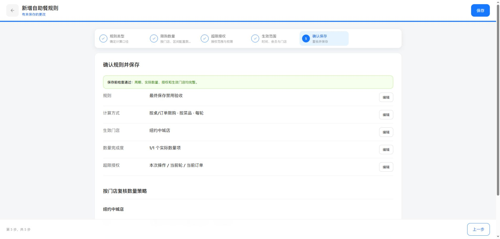

图：功能分支外部Chrome，基线main@493bbbb8。

| 字段／链路 | 定义 |
| --- | --- |
| transientCreate | 仅编辑会话的布尔标记。入口无ruleId、无draftId且非copy的自助餐新建会话为true；id=null、status=disabled仅作为未持久化会话容器，不作为仓库记录。已有编辑、复制、历史草稿不加标记。 |
| initializeDraftRule | 新建仍构造仅模板模式的完整表单模型，但返回前不调用saveRules，不push记录，不把URL改成draftId。 |
| saveEditorDraft／markEditorDirty | transientCreate时前者仅返回成功以兼容场景确认，后者仅设置dirty和页头提示；不写sessionStorage恢复缓存、不调度900ms自动保存。其他流程不变。 |
| persistNewBuffetRule | 在repository.mutateEnvelope锁内读取最新rules＋drafts分配数字ID，clone会话并删除瞬时标记，再buildCompatibilityRule(prepared, disabled)，仅将结果push到rules。publishedConfig=null，不生成或更改snapshots/currentSnapshotId。一次仓库写入完成，保留其余记录。 |
| savedRuleId | 仅原子写入成功后记在当前会话，重复保存直接返回已存ID；失败不置值、不中途占持久ID。存储锁失败、配额失败等沿用异常路径保留输入。 |
| saveTransientBuffetRuleAndReturn | 仅末步可执行，拒绝只读及保存重入。validateAll失败定位步骤；执行中按钮禁用，成功清dirty并返回；失败恢复按钮允许重试。保存后不调用publishDraft或prepareActivation。 |
| beforeunload | 仅新建脏会话或脏选品弹框触发浏览器原生保护。明确放弃及保存成功后清dirty，不以退出动作保存草稿。 |
| 列表返回上下文 | sessionStorage中只暂存列表筛选、展开状态与滚动位置，不存表单。返回读取一次后清除；列偏好保持原存储。缓存失败不阻断保存，也不写入草稿。 |

算例：仓库rules有ID2、drafts有ID9，最终保存分配ID10且仅增加rules；失败后仓库保持不变，再次成功仍只增加一条；另一会话随后保存读取最新数据分配ID11。运行快照ID保持原值，只有列表启用流程能把该禁用记录纳入运行。

验收证据：84项自助餐脚本通过；外部Chrome完成新建五步→页头保存→返回列表已禁用，及退出继续编辑／放弃、返回筛选保留。浏览器存储配额失败和原生刷新提示未独立注入验收，由函数回归及实现检查覆盖；不宣称真实门店下发或POS启用验收。

## 自助餐规则列表：查询与列投影

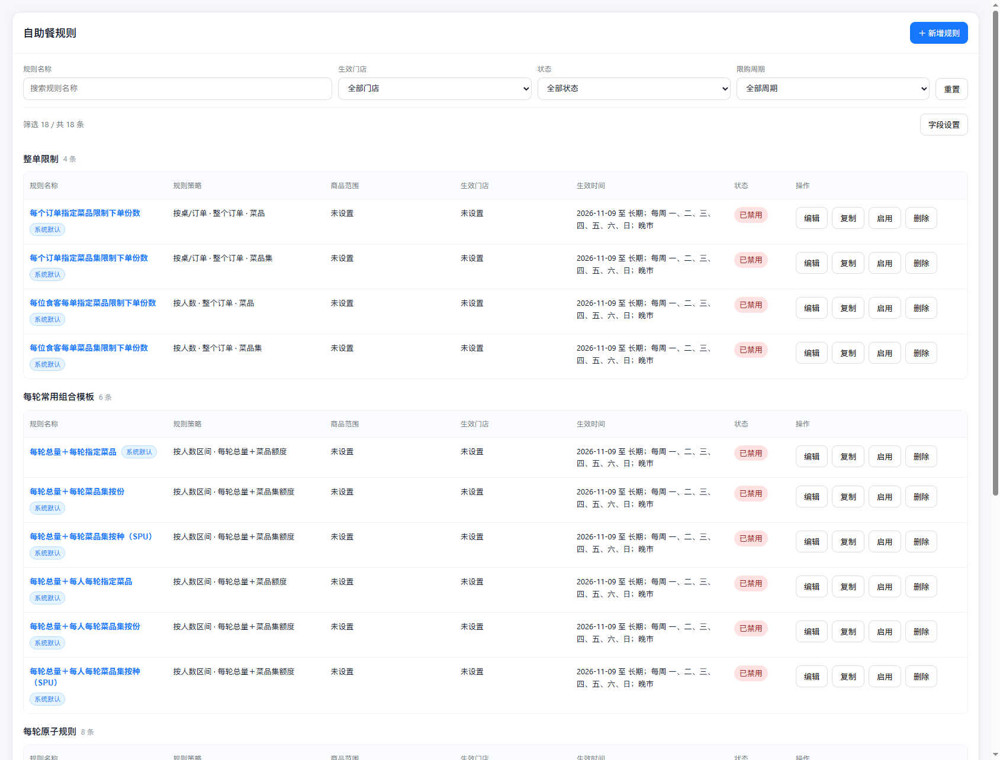

| 字段／对象 | 定义 |
| --- | --- |
| 查询边界 | 列表只接受keyword/storeId/status/period四个筛选键，不提供高级区，旧高级键不参与过滤。 只读现有作者配置，不改变仓库、状态、权限或发布快照。configFor读取顺序不变。 |
| keyword | trim后名称子串，英文大小写折叠；不匹配legacyCapabilities。空不限。 |
| storeId | 空或当前项目门店目录ID，匹配deployStoreIds，非participatingStoreIds。 |
| status | 空或管理状态枚举；历史草稿兼容，无新草稿写入。 |
| period | 空或order_lifetime/per_round/multi_round；成员匹配enabledPeriods，旧记录回退period。 |
| 生效时间摘要 | 日期、日历循环、时段独立格式化，会员非全部时标记。缺字段明确无法核对，摘要不是执行结果。 |
| 商品范围摘要 | 同店场景并集跨店汇总；同店同产线同商品跨场景一次，异店或异产线分别计数。显示前三个去重名称、总数及产线，完整文字title可查看；未知目录标识部分无法核对。 |
| authorization | 授权开关＋allowedScopes逐一配scopePermissions；关闭显示不允许授权，缺角色明确未设置，不读取单一permission代替。 |
| 列白名单 | 11个ID：name,strategy,productScope,effectiveStores,effectiveTime,status,actions,partyRanges,roundRanges,authorization,description。前三个固定项为name/status/actions。默认7项为名单前7。 |
| 偏好版本 | version=2；读取版本1和2，旧默认7列直接迁移为新默认7列。自定义选择中partyScenario→partyRanges，effectiveDate/activityPeriod/businessHours→effectiveTime，authorizationScopes/requiredPermission→authorization。剔除其他旧ID、去重、补回固定列，无有效列则默认。 |
| 偏好写入 | 沿用profile.storage.listColumnsKey本机模块作用域，不声称账户隔离。勾选只写临时draftColumns；确认setItem成功后替换visibleColumns，异常保留临时选择、旧展示及旧偏好。 |
| 返回上下文 | 保持列表四项筛选与位置的会话缓存，进入新建／查看／编辑／复制前记录；读取一次，不持久化表单。旧缓存只恢复现有键。 |

### 字段弹层

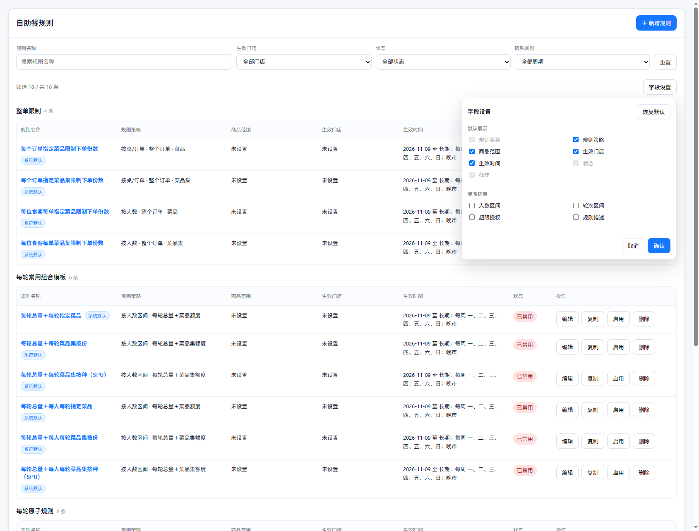

图：2026-11-09，功能分支基于main@a5e04242，列表仅四项筛选。

算例：周期包含整单＋每轮，筛选每轮仍匹配。旧缓存带objectKey、effectiveAt、targetType或advancedOpen时全部忽略，只恢复现有名称、门店、状态、周期。商品范围按原场景并集摘要展示，移除高级筛选不删除商品或时间配置。

验证与缺口见[清单](2026-11-07-buffet-list-delivery-gaps.md)，不将当前本地目录验证等同生产菜单或真实下单验证。

## 超限授权 → 配置与兼容

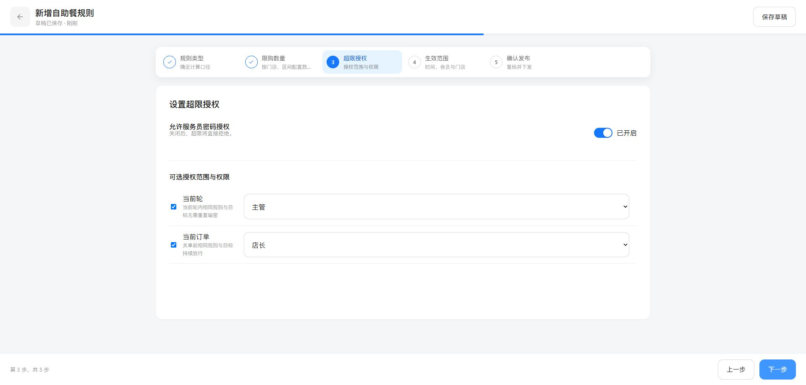

图：2026-11-06 功能分支外部 Chrome，授权开启。

| 字段／处理 | 定义 |
| --- | --- |
| authorization.enabled | 布尔；保持原默认值。false 显示硬性拒绝，不展示范围权限。true 展示范围权限且校验至少一个范围、各范围权限非空。 |
| allowedScopes／scopePermissions | 数组及范围到角色名称的映射；当前轮与当前订单可选，纯整单不展示当前轮。沿用已有历史范围兼容，不新增权限、不修改凭证验证。 |
| defaultScope／reasonRequired | 历史兼容字段，不在自助餐编辑页、复核摘要、列表可选列展示。无用户编辑入口，伪造的隐藏字段 change 事件忽略。不批量清空历史值；原范围变更及纯整单规范化仍按原逻辑维护数据。 |
| 保存与发布校验 | 编辑步骤与 profile 发布／重新启用校验均不要求 defaultScope 有值或属于 allowedScopes；仍校验范围非空及每个权限非空。非自助餐共享编辑器保留默认范围校验及原因设置。 |
| 保存失败与取消 | 沿用草稿保护，不借隐藏字段迁移历史配置，不产生额外发布或门店下发。 |

验收算例：allowedScopes=[round]、scopePermissions.round=主管 时，defaultScope 缺失、空、operation、round、order 均不因默认范围阻断；reasonRequired 缺失同样不阻断。allowedScopes=[] 或 round 权限为空仍失败。关闭授权仍硬性拒绝。外部终端原因输入和真实密码认证未在本任务验证。

## 配置额度 → 分轮次额度标签

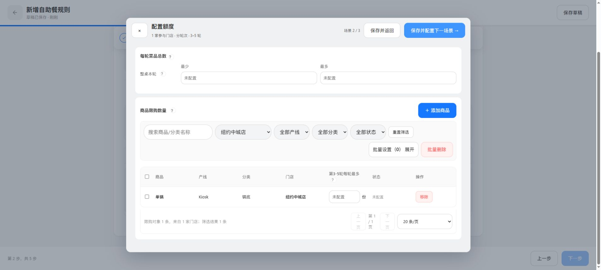

图：外部 Chrome，隔离草稿第3–5轮场景。

| 字段／映射 | 定义 |
| --- | --- |
| combo.period | 仅 multi_round 使用轮次区间前缀；per_round、order_lifetime 沿用固定周期标签。组合模板按当前打开的周期判断，不把整单区块误标为分轮次。 |
| combo.roundIndex | 当前场景的零起始索引；读取 draft.roundRanges[roundIndex]，不读取界面当前高亮菜单或其他门店的筛选值。切换场景重新生成标签，不缓存上个区间。 |
| roundRanges.min／max | 正整数轮号，max=null 为开放区间。闭区间“第min-max轮”，单轮“第min轮”，开放“第min轮起”。min=max 时不重复写“每轮”，不输出第2-2轮。 |
| 主额度 | 区间前缀＋每轮最多；单轮前缀＋最多。人均／整桌在区间前缀后保留“每人／整桌”：第3-5轮每人每轮最多、第3-5轮整桌每轮最多。 |
| 菜品集共享额度 | 按份、按种使用相同范围标签；保留单位、开关、perPersonMax／perTableMax 映射，不改变有效性判断和计算。 |
| 商品保护 | 整单保持每种整单最多份数；分轮次为第min-max轮每轮每种最多份数，单轮为第min轮每种最多份数，开放为第min轮起每轮每种最多份数。 |
| 批量设置 | renderScenarioBulkFields 复用商品列定义，保持表头和批量输入同一标签；批量选择范围、写入字段及取消行为不变。 |
| 缺失／非法区间 | 不拼接 undefined、NaN 或虚构轮号；显示通用每轮标签，合法性仍由现有区间校验阻止不合法配置继续。标签函数不修复、不写入草稿。 |

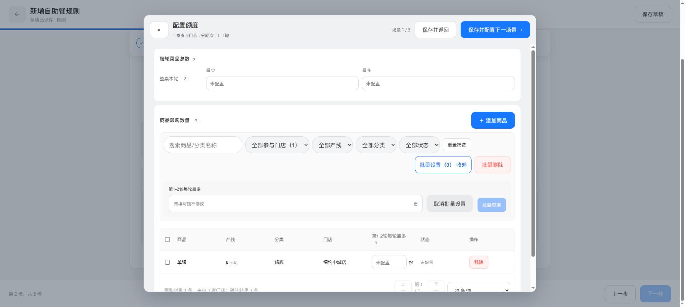

图：第1–2轮场景展开批量设置；表头与批量输入均为第1-2轮每轮最多。

测试口径：1–2、3–5、单轮2、6起、缺失区间、人均／整桌、菜品集共享与商品保护，以及整单／普通每轮不变。第1–2轮上限3时，各轮分别最多3份；label生成前后草稿序列化完全一致。验证资料见对应实施计划，不以文案调整改变运行规则。

本文定义模板及主体锁定、分轮次额度标签与相关字段映射；完整业务范围以产品文档为准。其他页面的展开与验证缺口独立登记，不将代码事实作为新增业务决策。

## 新增规则第一步

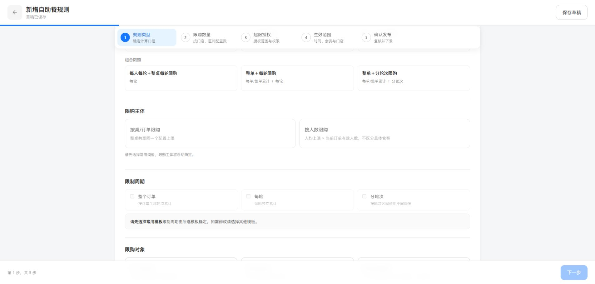

图：外部 Chrome，未选模板的新增隔离草稿。preset_only 模式下，`buffetTemplateFieldLocked(draft, "subject")` 始终返回 true，界面 disabled 与 changeChoice 事件防护共用该判定。初始 subject 为 null，两个按钮均不选中、opacity=.56；空值不自动转换为 order 或 party_size。模板卡片不受主体禁用影响。

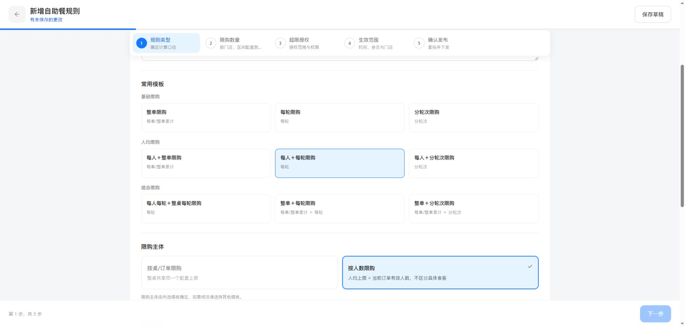

图：点击人均每轮模板后，applyBuffetTemplate 写入 party_size，两个主体仍 disabled；已选项蓝色、opacity=1。提示按有效预设是否存在切换：无预设显示“请先选择常用模板，限购主体将自动确定。”，有预设显示“限购主体由所选模板确定，如需修改请选择其他模板。”不新增持久化字段；历史无 preset_only 标记的规则不额外加锁。

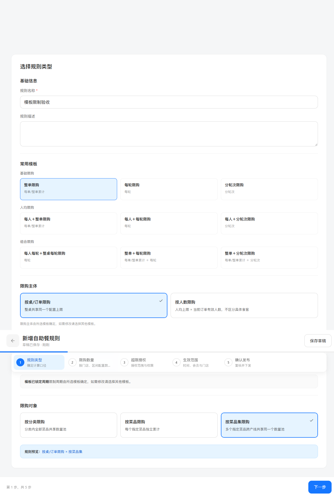

图：功能分支真实隔离演示，规则类型第一步，非生产记录。

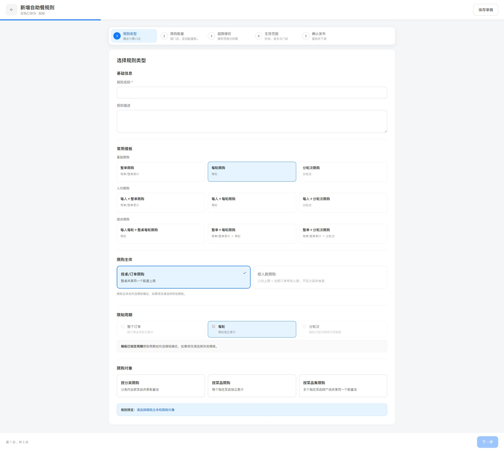

图：本次样式分支，按桌主体选中。原图仅作为结构参考。

样式范围限定 `.olf-choice.is-locked:disabled`：cursor 为 default；非 is-selected 透明度 .56，与只读周期一致；is-selected 透明度 1，沿用原蓝色边框、背景和勾选。悬停样式仅匹配 `.olf-choice:not(:disabled):hover`，禁用项不响应；不改 disabled 判定、事件或持久化字段。

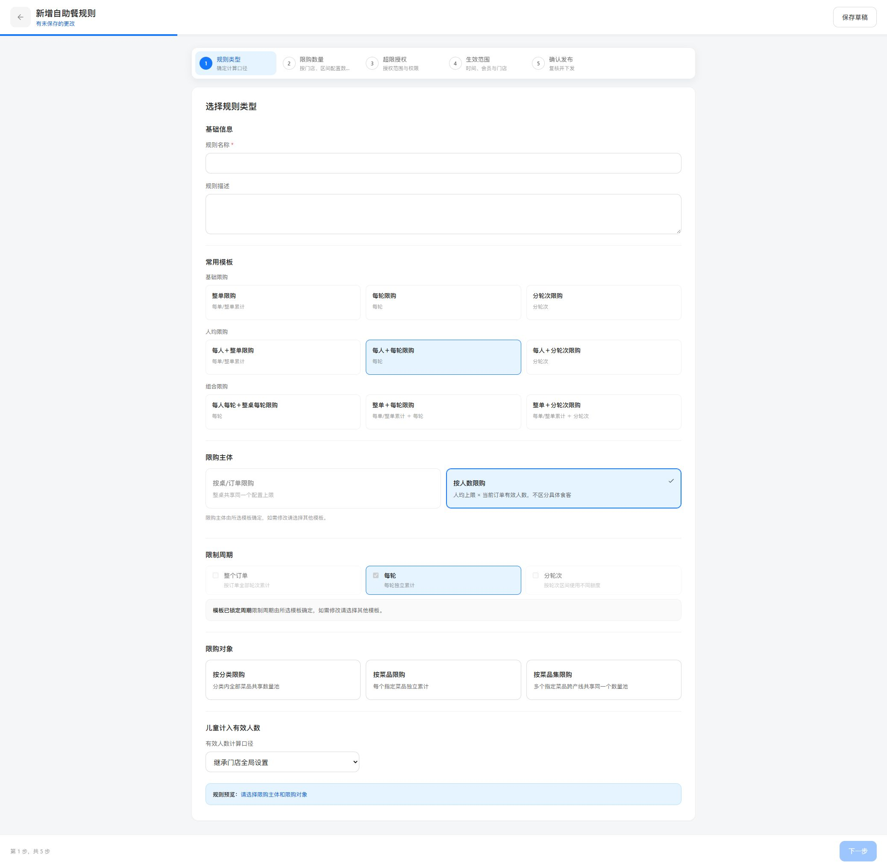

反向算例：选择每人＋每轮后，party_size 选中且 opacity=1，order 未选且 opacity=.56；两个按钮均 disabled。未选模板的 preset_only 草稿中两个主体均灰显禁用，均无选中态。正常对象按钮保持原悬停行为。验证脚本：`scripts/verify-buffet-subject-disabled-style.mjs` 与 `scripts/verify-buffet-template-only.mjs`。

| 字段 | 逻辑说明 |
| --- | --- |
| buffetTemplateSelectionMode | 字符串；本次及之后通过无来源新建入口创建草稿时写入 `preset_only`，保存在 editorDraft 并沿用现有持久化链；不得在载入规范化时补默认值。历史空值为兼容模式，不是数据错误。复制沿用来源模式，不强制迁移历史自定义记录。 |
| buffetTemplateId | 字符串；仅模板模式必须匹配 periodTemplates 中非 hidden、非 custom 的现有预设。空值、未知值、custom 校验失败，提示“请选择常用模板，不支持自定义规则配置”。保存不完整草稿仍允许；进入后续步骤和发布使用原校验链拦截。 |
| subject | 枚举 order／party_size，初始 null；仅模板模式下无论是否已选模板，主体按钮和直接变更事件均锁定。由模板 presetSubject 写入，不靠用户选择。与预设不一致时报模板预设错误，不默默覆盖数据。历史兼容模式沿用其编辑限制。 |
| targetType | 原枚举 category／dish／dish_set；九个模板未预设该字段，继续用户选择并执行兼容校验及原对象切换清理。未来预设声明 presetTargetType 时统一只读判断支持该字段，不新增候选。 |
| enabledPeriods | 字符串数组；由模板 periods 复制；展示只读；未选模板显示无选中周期。直接周期变更事件、selectSingleBuffetPeriod 均对仅模板模式返回，不改草稿。校验按集合比较模板周期，不受数组顺序影响。 |
| periodPolicies.blocks | 模板应用时初始化原有 totalEnabled／targetEnabled／sameDishEnabled；不是新的用户可修改结构入口。继续由 deriveBuffetQuantityBlocks 根据实际已配额度推导，不要求始终与初始化布尔值完全相等，否则会误伤空额度和正常额度编辑。 |
| buffetTemplateModified | 仅模板模式下，修改对象、区间及额度不置 true；历史模式原逻辑保留。不使用该标记代替模板和周期校验。 |

## 切换模板事务

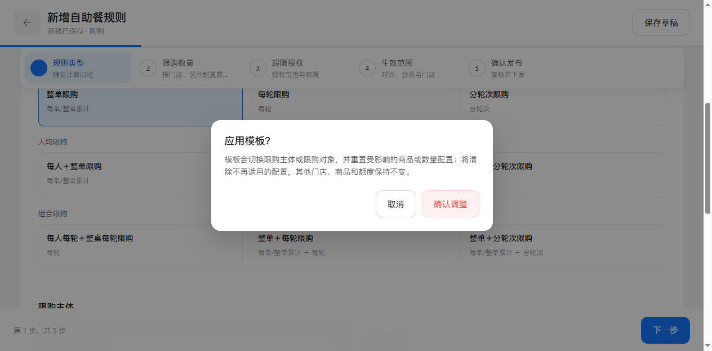

图：整单已有额度，切换人均整单触发“应用模板？”；功能分支隔离演示。

沿用 requestBuffetStructureChange：先克隆草稿，在副本应用预设并计算影响；无影响直接替换；有影响显示确认，确认替换当前草稿、标脏并走原保存链；取消只关闭重绘，不写副本。不增加远端接口、权限或新事务承诺。

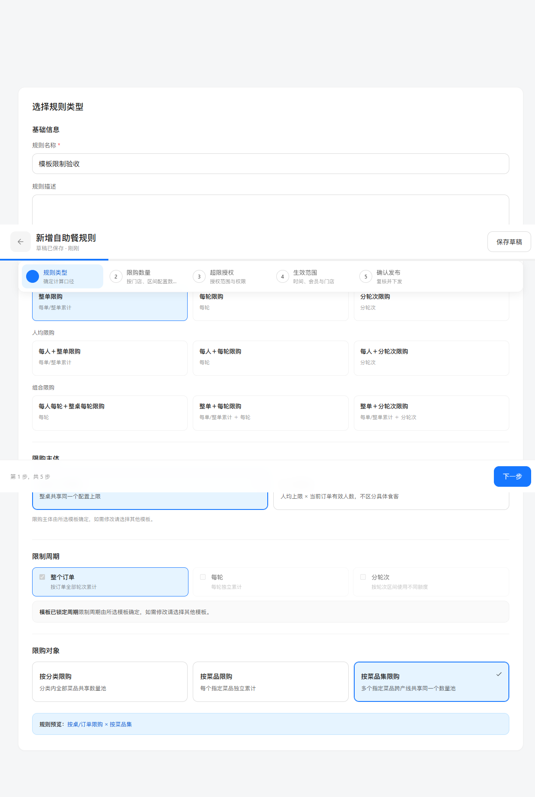

取消结果：保留原 order-basic、主体 order 及原额度。

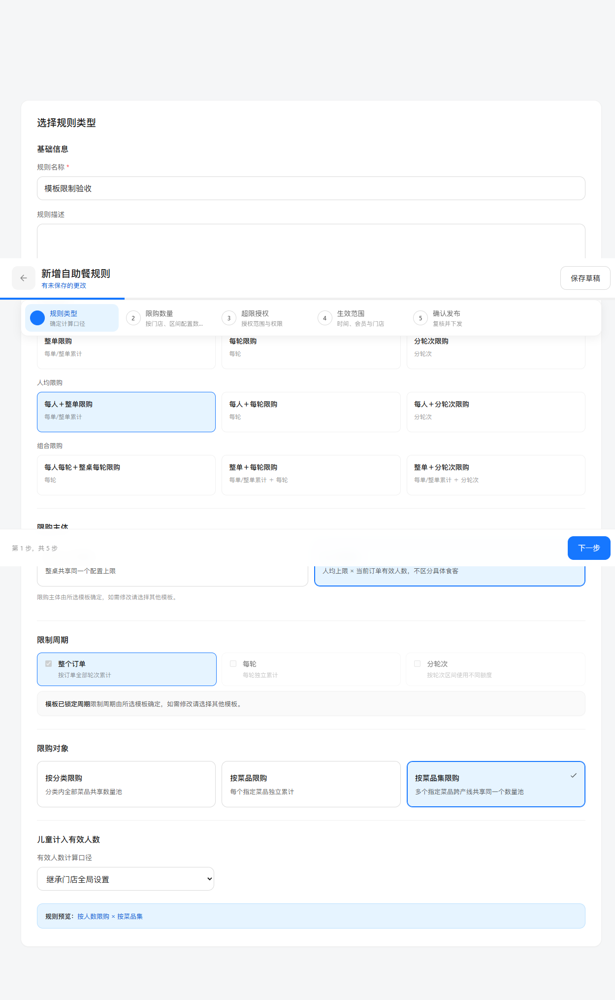

确认结果：模板 party-order-basic、主体 party_size，只清理现有结构影响机制认定的数据。失败不得伪称已保存；沿用原存储失败提示与恢复方式。

## 后续额度不锁定

图：整单菜品集 8 份及 2 种可输入，功能分支隔离演示。商品、门店、人数／轮次区间、授权、生效范围不在本次锁定范围。

## 测试及覆盖边界

| 算例 | 预期 |
| --- | --- |
| 新规则无模板／custom／未知 ID | 第一步拒绝继续；非法 custom 应用不改当前草稿 |
| 九模板逐一应用 | 对应主体与周期只读，目标对象仍可选择，规则类型校验通过 |
| 改 DOM 强行触发主体／周期事件 | 事件防护拒绝，不创建自定义配置 |
| 预设主体或周期数据被改写 | 业务校验返回“规则类型与模板预设不一致，请重新选择常用模板” |
| 菜品集 8 份＋2 种 | 可同时填写、保存；模式不阻止原额度推导 |
| 有额度切人均，取消／确认 | 取消不变；确认沿原结构清理；与模板切换前快照分别核对 |
| 保存重载 | 模式与预设身份保留，主体周期继续只读 |
| 历史记录无模式标记 | 不自动增加标记，不批量迁移，保留旧自定义编辑与发布兼容逻辑 |

自动验证：scripts/verify-buffet-template-only.mjs，另运行原有字段顺序、周期、系统默认、双计量、V4 校验及模板适用性脚本。逐操作截图清单见个人版；存储失败、历史编辑的真实浏览器截图尚未补齐，不宣称全部操作截图完整。
