# 自助餐规则需求文档（个人规范版）

版本 V1.9；产品：[融合设计 V1.10](2026-09-07-buffet-scene-step-fusion-design.md)；研发：[V1.9](自助餐规则业务规格说明书（研发交付版）.md)。共同变更编号BUFFET-LIST-20261109-03。共同业务基线main@5253b17f，功能分支codex/buffet-period-column-20261109。列表4项筛选、12项可展示字段，默认7列；规则配置、保存和权限定义不变。历史通过Git追溯。

## 全新规则：会话与最终保存

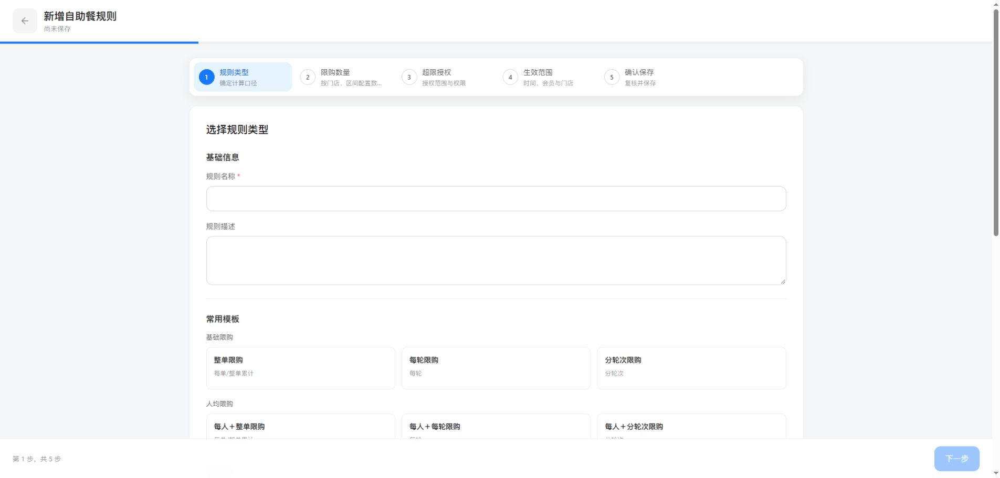

图：2026-11-07，外部Chrome，功能分支基于main@493bbbb8；首步无保存草稿，步骤五为确认保存。

入口：列表“新增规则”。仅全新会话采用本节；已有规则编辑、复制及历史草稿不批量迁移。文中“编辑配置／作者配置”是表单模型，不代表全新规则有草稿业务状态。

| 字段／操作 | 逻辑说明 |
| --- | --- |
| 尚未保存／有未保存的更改 | 页面状态提示，不是规则管理状态。输入只保留在当前页面，不写入规则仓库、草稿集合或恢复缓存；刷新确认离开后不恢复。 |
| 下一步／上一步 | 保留五步配置和对应校验。前四步无页面级保存，步骤切换不新增规则记录。 |
| 场景内保存并返回 | 确认当前额度面板内容并返回数量步骤，只修改当前会话，不是正式保存或下发。 |
| 生效门店 | 继续在第四步选择，仍为有商品配置的参与门店非空子集；保存后不自动启用。 |

### 第五步：确认保存

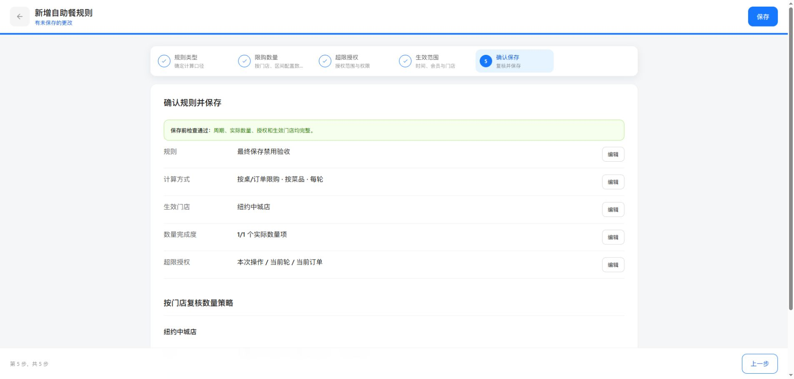

图：每轮按菜品验收规则；页头右侧单一保存，底部仅上一步，无下发入口。

| 字段／操作 | 逻辑说明 |
| --- | --- |
| 保存前检查 | 复用完整validateAll检查规则类型、对象、周期、额度、区间、授权、日期及生效门店。失败定位对应步骤，不新增记录。 |
| 规则／计算方式／生效门店／数量完成度／超限授权 | 沿用复核字段及编辑入口，不设置默认授权范围或原因。实际额度按门店复核，不因改为保存而省略。 |
| 保存 | 仅末步页头显示，点击执行中禁用；完整校验通过后一次性新增禁用正式规则。成功提示“保存成功，规则已禁用”并返回列表；失败提示“保存失败，当前输入已保留，请重试”，停留保留输入、允许重试，不重复插入。 |
| 保存后默认禁用提示 | 明确保存不下发、不启用，后续在列表手动启用并按原权限重新校验。 |
| 上一步 | 回第四步，不保存正式规则；不在底部重复保存按钮。 |

### 未保存退出确认

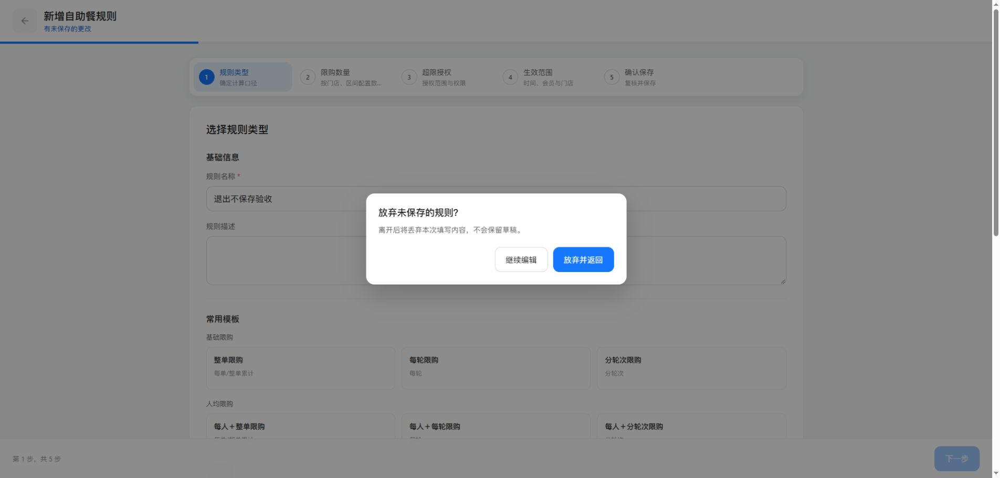

| 字段／操作 | 逻辑说明 |
| --- | --- |
| 返回规则列表 | 无修改直接返回；有修改（包含未提交选品）显示“放弃未保存的规则？”，说明离开将丢弃填写，不保留草稿。 |
| 继续编辑／关闭弹框 | 只关闭确认，保留输入。 |
| 放弃并返回 | 丢弃本次内存配置并返回，不删除已有正式规则，不新建草稿。 |
| 浏览器刷新／关闭 | 未保存修改时调用浏览器原生离开保护；确认离开不恢复输入，取消则留在当前页面。浏览器是否显示原生提示受其策略约束，不能保证所有终端都拦截。 |

### 保存后的规则列表

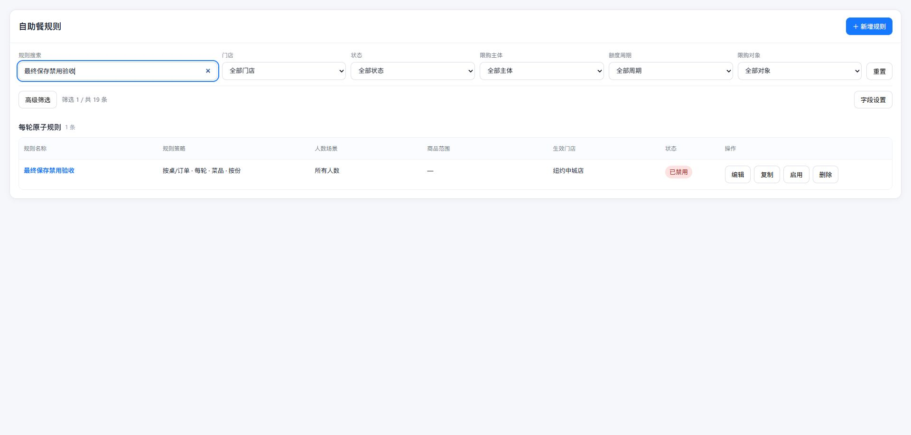

| 字段／操作 | 逻辑说明 |
| --- | --- |
| 已禁用 | 新建保存成功的管理状态；正式记录可在列表查看，不能视为已下发或已生效。 |
| 启用 | 沿用原角色权限、冲突和静态可满足性等完整启用校验，成功后才进入运行快照。 |
| 返回上下文 | 从列表新建时保留原筛选、列偏好及列表位置；保存或放弃返回后恢复。新增记录不匹配筛选时不强行清空筛选。 |
| 历史草稿 | 旧记录与兼容入口保留，本次全新规则不产生该状态；不得据此删除历史内容。 |

## 自助餐规则列表

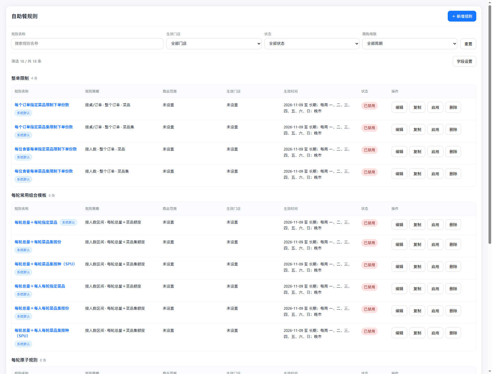

图：2026-11-09，功能分支基于main@a5e04242；本机预览数据，非线上记录。列表用于找规则、核对范围与日常维护，不展示跨场景具体额度值。

入口：菜单下单规则 → 自助餐规则。作用对象为本机现有规则作者配置；不以列表查询执行下单。

### 筛选区域

| 字段 | 逻辑说明 |
| --- | --- |
| 规则名称 | 空表示不限制；去首尾空格、不区分英文大小写匹配名称子串；不检索内部KPOS能力。 |
| 生效门店 | 默认全部，按deployStoreIds匹配；区别于商品来源门店。选择后立即与其他三项取交集，不改变规则配置。 |
| 状态 | 默认全部，按管理状态匹配；启用不代表当前适用。历史草稿仍兼容，全新规则不产生草稿。 |
| 限购周期 | 全部、整单、每轮、分轮次；组合规则包含所选周期即满足该项。 |
| 重置 | 清空名称、门店、状态、周期四项；不改变列偏好或业务数据。 |

不同筛选条件取交集。列表不提供高级筛选、涉及商品、限购对象或日期时间查询；不将这些条件转移到常驻区。旧返回缓存只恢复现有四项，不应用隐藏条件。重置清空四项，不改变列设置。商品范围和生效时间通过只读列表摘要及详情核对，业务配置未删除。

### 列表字段与字段设置弹层

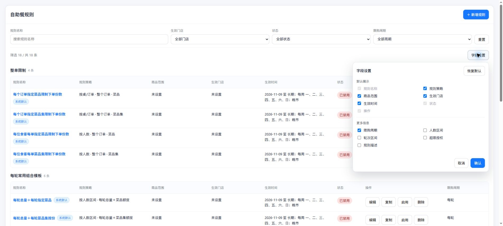

图：2026-11-09，外部Chrome功能分支预览，基线main@5253b17f；字段设置展开，限购周期已勾选。

| 字段 | 逻辑说明 |
| --- | --- |
| 规则名称 | 默认且固定，保留规则打开入口和系统默认标识。 |
| 规则策略 | 默认；主体＋周期＋对象，组合模板保留总量组合说明，不附加单一计量方式。 |
| 商品范围 | 默认；汇总实际场景商品名称、参与门店数、按门店＋产线＋商品去重数及产线。长内容可查看完整标题；未知目录明确提示，不用编码替代正常名称。 |
| 生效门店 | 默认；已配置的生效门店及数量，无配置为未设置。 |
| 生效时间 | 默认；日期、活动周期、时段合并摘要，指定会员时标记限指定会员；具体会员等级进入详情。 |
| 状态 | 默认且固定；保留管理状态，不新增“生效中”。 |
| 操作 | 默认且固定；原编辑、复制、启禁用、删除及校验不变。 |
| 限购周期（列表列） | “更多信息”的可选复选框，默认未勾选；读取规则已配置周期，只读展示整个订单、每轮、多轮（分轮次）。组合按配置顺序用＋连接，如整个订单＋每轮，无有效值为—。勾选只改变临时选择，确认保存成功后增加该列；取消、外部关闭不生效；刷新沿用已保存选择。与筛选区域的限购周期互不修改，不调整规则数据。 |
| 人数区间 | 额外可选，默认隐藏。 |
| 轮次区间 | 额外可选，默认隐藏；非分轮次显示不适用。 |
| 超限授权 | 额外可选，默认隐藏；关闭显示不允许授权，开启按范围与对应角色配对展示。 |
| 规则描述 | 额外可选，默认隐藏；空显示—。 |
| 字段设置 | 共12列；名称、状态、操作固定；其余9项可调整。仅分默认展示、更多信息两组。 |
| 确认／取消 | 只有确认成功写入本机当前模块偏好后改变表格；取消或外部关闭丢弃临时勾选。失败保留弹层和选择，原偏好不变。 |
| 恢复默认 | 临时恢复默认7列，确认后生效；旧偏好映射有效的合并列并剔除删除列，不清空筛选。 |

不提供旧调研、覆盖、独立主体／对象、计量方式、具体限额、参与门店、产线、商品数量、配置进度、独立权限、拆分时间或会员列。商品数和产线通过商品范围摘要展示；详细额度进入查看全部配置，业务字段未删除。

范围：当前项目本地菜单选择器目录及本机模块偏好；不声称已接入生产门店实时菜单、账户隔离偏好或真实POS执行。差异和待验证项见[交付缺口](2026-11-07-buffet-list-delivery-gaps.md)。

### 交互补充

| 字段／操作 | 逻辑说明 |
| --- | --- |
| 规则名称输入 | 输入即应用；空恢复该项不限，不清空其他条件。 |
| 结果数 | X为所有条件AND后的规则数，Y为本次加载记录总数。无结果有重置入口；读取失败显示错误与重试，不伪装0条。 |
| 字段复选框 | 三个固定项禁用且勾选；其他项仅修改弹层内临时选择，确认前表格不变。 |
| 确认 | 本机模块列偏好保存成功后关闭弹层并刷新表格；失败原表格不变，显示“保存失败，请重试；原列设置未改变”，可继续重试。 |
| 取消／点击弹层外 | 关闭并放弃临时勾选，筛选和既有列配置保持。 |
| 长摘要 | 表格最多三行，悬停title查看完整摘要；具体人数、轮次、会员及限额进入详情核对。 |
| 编辑／复制／查看返回 | 进入前记录当前列表上下文；返回重新加载后恢复四项筛选和滚动位置。修改后不再满足条件的规则不强留。 |

验收：页面无高级筛选按钮及商品／对象／时间控件；旧缓存不隐藏结果；四项筛选交集工作。字段12项，默认7列；限购周期可勾选、取消、确认隐藏或展示，刷新保留；恢复默认需确认并隐藏周期列。保存失败保持原表格及临时选择，可重试。列表不新增“生效中”状态。

## 新增／编辑规则 → 第三步超限授权

图：2026-11-06 外部 Chrome，功能分支预览，授权开启；不代表所有五步及异常状态截图完整。

图：同一隔离草稿关闭授权后的硬性拒绝状态。

用途：第二步数量配置通过后进入，设置超限是否允许密码授权及允许范围。

| 字段／操作 | 逻辑说明 |
| --- | --- |
| 允许服务员密码授权 | 新草稿沿用默认开启。关闭后隐藏范围权限并显示“硬性拒绝：规则超限后不会出现服务员密码放行入口。”；开启后恢复配置，至少一个范围和各范围权限必填。 |
| 当前轮 | 复选框；非纯整单规则展示。描述当前轮内相同规则与目标无需重复输密；不扩大到整个订单。 |
| 当前轮权限 | 对应范围启用时可选角色，未启用时禁用；新草稿默认主管。沿用角色候选，不改变员工权限体系。 |
| 当前订单 | 复选框；关单前相同规则与目标持续放行，仍受凭证批准数量等约束。 |
| 当前订单权限 | 对应范围启用时可选角色，未启用时禁用；新草稿默认店长。 |
| 下一步 | 校验已启用授权至少有一个范围且每个范围有权限；成功进入生效范围并保留草稿，失败留在本步显示原错误。隐藏默认范围不再参与校验。 |
| 上一步／保存草稿 | 保持原步骤返回与草稿保存行为，不发布、不清空历史授权值。保存失败保持输入以便重试。 |

本页无默认授权范围及授权原因设置，不留空白占位；复核摘要与列表可选列也不展示。历史数据兼容和外部终端边界见研发版“配置与兼容”。

本文按页面元素说明模板选择、主体锁定及分轮次额度标签。其他五步页面字段和逐操作截图的未覆盖范围独立登记，不以已有截图数量代替完整性验收。

## 新增规则 → 第一步规则类型

图：外部 Chrome，新增规则未选模板状态。作用对象为新建的仅模板模式草稿，不改变历史兼容记录的编辑规则。

| 字段／操作 | 逻辑说明 |
| --- | --- |
| 未选模板／限购主体 | 按桌和按人数均灰显禁用，初始不选中任何主体，不接受鼠标或键盘更改。 |
| 主体提示 | 未选模板显示“请先选择常用模板，限购主体将自动确定。”提示本身无交互和写入。 |
| 选择模板 | 可点击任一适用模板，自动确定并显示对应主体；不因主体被禁用而禁用模板。 |

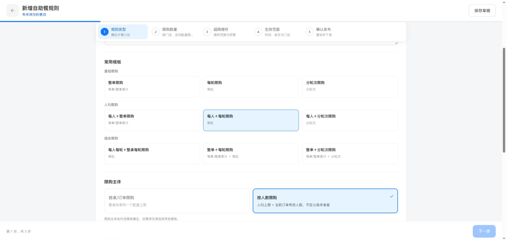

图：选择每人＋每轮后，按人数蓝色只读、按桌灰显禁用；限购对象继续可选，后续字段仍按其校验规则处理。无商品额度的草稿直接应用模板；有影响的切换继续使用下文确认弹框。

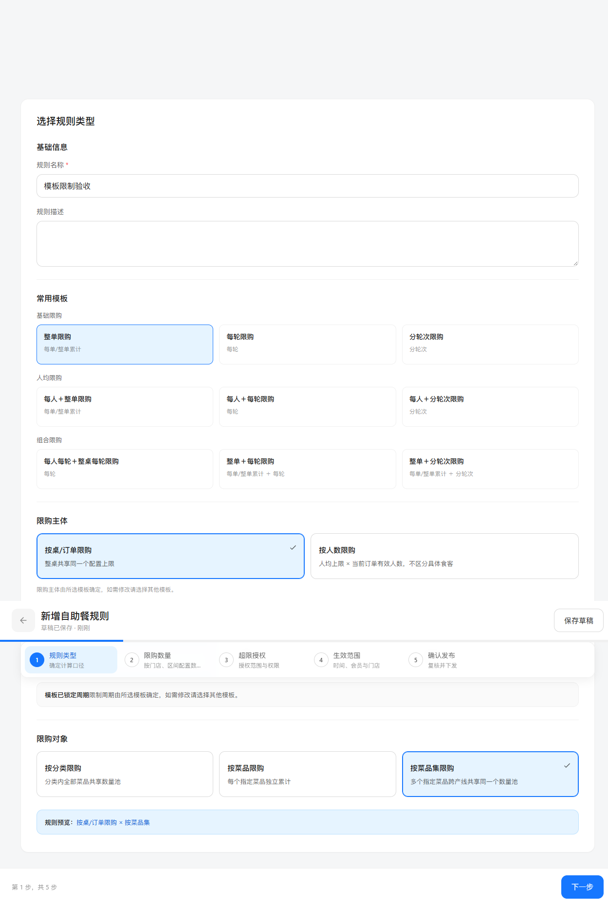

图：第一步整单限购已选状态，功能分支真实隔离演示，不是生产操作历史。

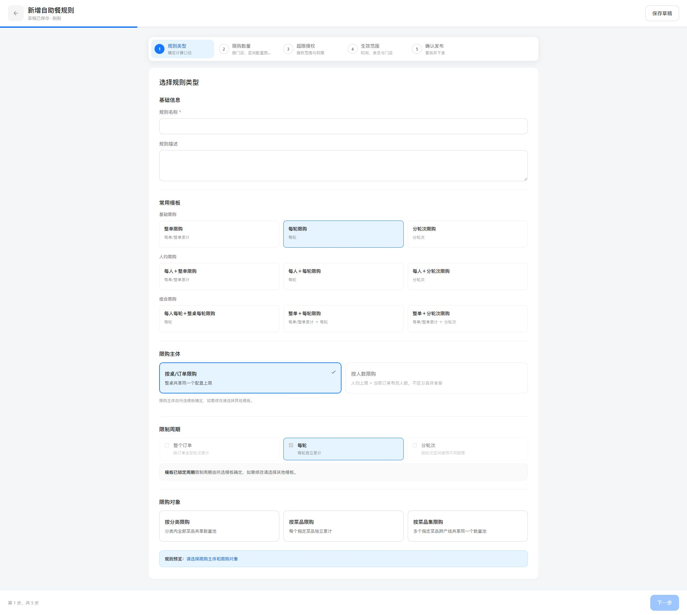

图：本次样式分支，每轮模板选中；原图仅作布局参考。按桌主体蓝色只读、按人数主体灰显，两者均不可点击。灰显程度与限制周期一致，禁用项无悬停高亮。

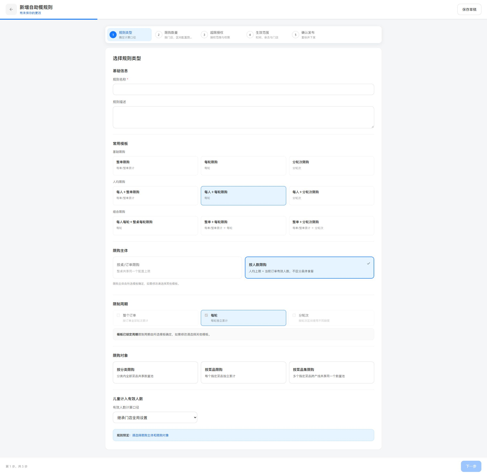

操作：点击每人＋每轮模板 → 按人数主体蓝色只读，按桌主体灰显。未新增确认分支，继续沿用原有数据影响确认；本图为无商品、无额度的隔离草稿，不代表生产操作历史。

入口：自助餐规则列表的新增规则。作用于当前新建草稿，历史记录及历史草稿编辑不自动迁移。

### 基础信息

| 字段 | 逻辑说明 |
| --- | --- |
| 规则名称 | 原必填文本、最多 60 字，模板不填写或覆盖名称；为空不能进入下一步，可保存不完整草稿。 |
| 规则描述 | 原选填文本、最多 200 字；模板不覆盖，空值表示未填写。 |

### 常用模板

| 字段 | 逻辑说明 |
| --- | --- |
| 基础限购 | 整单限购、每轮限购、分轮次限购，按此顺序三列展示；数量金额不在此输入。 |
| 人均限购 | 每人＋整单、每人＋每轮、每人＋分轮次；选择后主体为按人数，周期为相应周期。 |
| 组合限购 | 每人每轮＋整桌每轮、整单＋每轮、整单＋分轮次；具体额度仍需进入第二步配置，不因名称自动生效。 |
| 模板卡片 | 单选，初始未选；未选不能继续。选择后预设主体和周期只读，点击另一卡片允许更换；存在数据影响时先确认，见下节。 |
| 自定义入口 | 新增流程不显示自定义分组和卡片；不能通过选择单周期转为自定义。不是删掉历史自定义记录。 |
| 限购主体 | 未选模板时两项均灰显禁用且无默认选中；选中模板后预设值蓝色只读，另一项灰显（透明度 .56），与周期一致，不提供悬停高亮。更换主体需选其他模板。未预设对象、具体商品和数值不因主体只读而整体禁用。 |
| 限制周期 | 只读显示模板的整个订单／每轮／分轮次；未选模板时不选中任何周期。组合模板同时显示两个周期，不可单独取消。说明：“限制周期由所选模板确定，如需修改请选择其他模板。” |
| 限购对象 | 按分类、按菜品、按菜品集，九模板均未预设，用户仍可选；切换有商品或额度影响时沿用原确认与清理，不把未预设对象误锁死。 |
| 下一步 | 名称、模板、主体、对象及周期校验通过后进入限购数量，携带当前草稿；不代表发布。缺失或非法模板阻止继续并保留输入。 |
| 保存草稿 | 沿用原存储流程，保留仅模板模式和选中项；刷新及重新打开仍只读。存储失败不显示成功。待补页面图片：保存失败状态，本次未构造受控存储异常。 |

## 模板切换 → 影响确认弹框

入口图：第一步模板卡片。当前草稿已有菜品集额度时，点击人均模板。

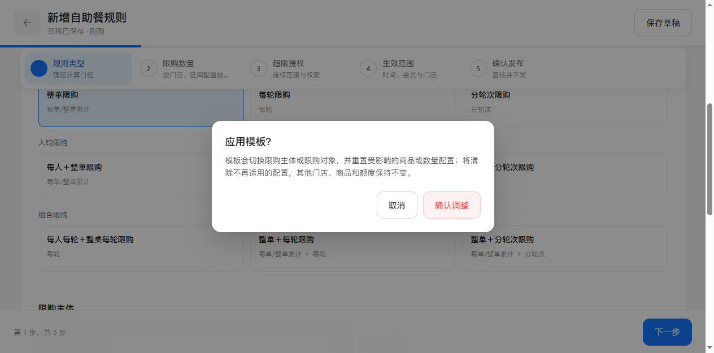

图：已有整单额度切换人均整单，真实隔离演示确认态。

| 字段 | 逻辑说明 |
| --- | --- |
| 应用模板？ | 原有结构变更确认标题；只在有受影响商品或数量时显示。无影响则直接选中模板，不增加无意义确认。 |
| 影响说明 | 展示主体／对象变化或被移除周期及原机制将清理的配置；不声明全部门店或所有额度必然清空。 |
| 取消 | 放弃待应用副本，保留原模板、商品与额度，关闭弹框返回第一步；不写入新模板。 |
| 确认调整 | 按既有影响处理写入新模板结构并标为待保存；其他不受影响数据保留，不等于正式发布。 |

### 取消结果

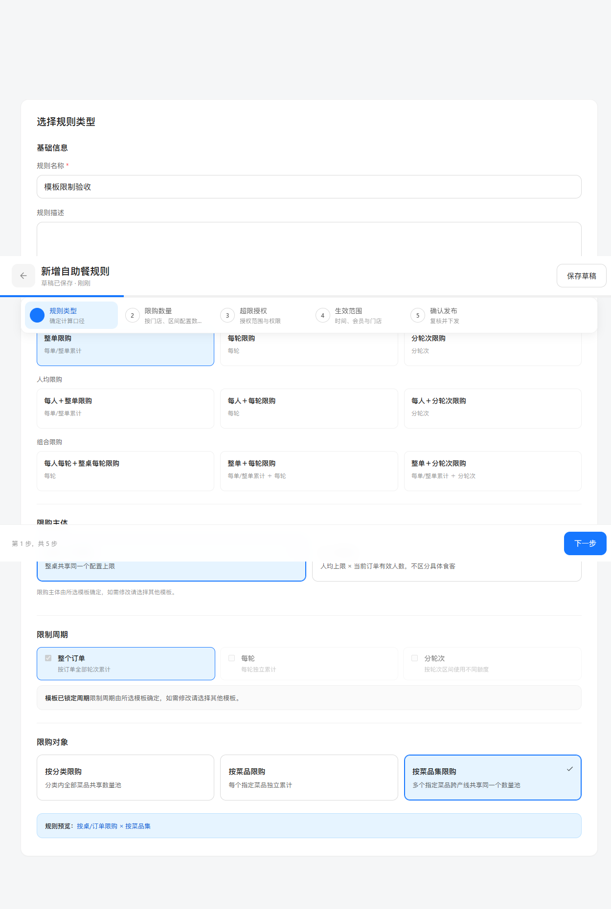

原整单模板和主体保持，原 8 份、2 种额度保留；不会因预览过另一模板就丢失额度。

### 确认结果

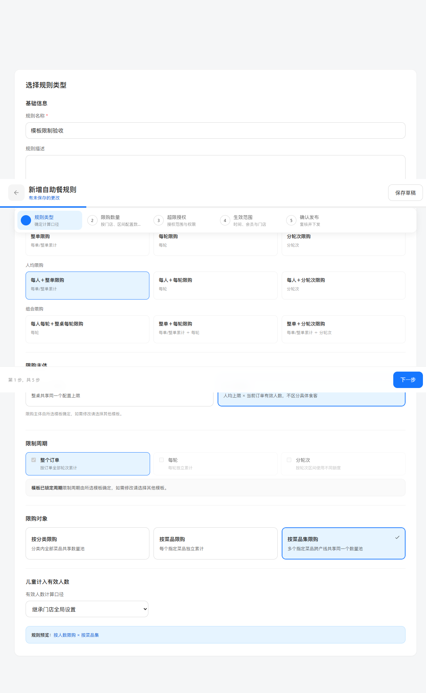

人均整单模板选中，按人数及整个订单只读；受影响额度按原结构切换机制清理，需重新配置，不把原固定 8 份直接解释为每人 8 份。

## 第二步 → 配置额度

图：外部 Chrome，分轮次规则第1–2轮配置额度，隔离演示数据。入口为第二步的轮次场景卡片，作用于当前场景；不同周期、区间和门店额度仍独立。

| 字段／操作 | 逻辑说明 |
| --- | --- |
| 商品限购数量表头 | 由当前轮次区间显示“第1-2轮每轮最多”“第3-5轮每轮最多”；并非整个区间最多。填写3时区间内每一轮分别最多3份。 |
| 单轮区间 | 仅第2轮显示“第2轮最多”；无重复的“第2-2轮”或“第2轮每轮”。 |
| 开放区间 | 6轮及以上显示“第6轮起每轮最多”，包括第6轮及之后各轮，原累计方式不变。 |
| 人均／整桌额度 | 保留主体，例如“第1-2轮每人每轮最多”“第1-2轮整桌每轮最多”；不能因增加区间丢失人数计算含义。 |
| 菜品集共享／商品保护 | 共享额度保留份／种单位；商品保护显示“第1-2轮每轮每种最多份数”。仍限制单个商品份数，不与种数混用。 |
| 普通每轮／整单 | 维持每轮最多／每单最多等原周期标签，不加第1轮起等虚构区间。 |
| 保存并配置下一场景 | 沿用场景保存校验，切换后标题和表头来自新场景轮次范围；未因标签切换修改其他场景数量。 |

### 配置额度 → 切换场景结果

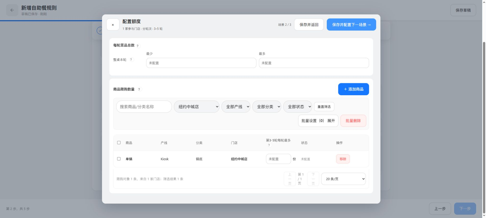

图：从第1–2轮切换到第3–5轮后，表头为第3-5轮每轮最多。

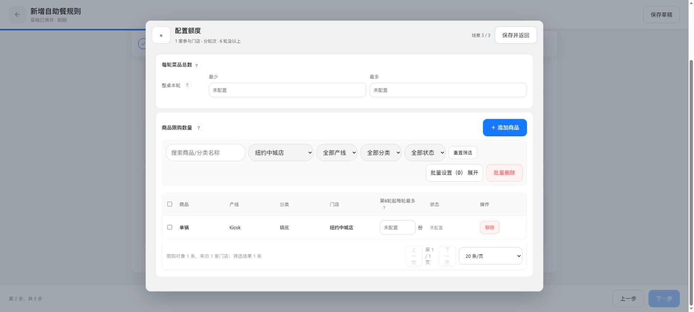

图：开放区间表头为第6轮起每轮最多，继续独立按各轮统计。

### 配置额度 → 批量设置

图：当前第1–2轮展开批量设置，批量输入与商品表头同为第1-2轮每轮最多。展开本身不写额度；输入、应用及取消沿用原规则，未勾选商品时不能批量应用。

单轮、人均、多周期组合与菜品集的规则以同一标签映射生成；上述四图为按桌分轮次实拍，不替代其他场景的独立画面。完整截图范围见对应实施计划。

图：本次功能分支整单菜品集额度演示，8 份与 2 种同时填写。

| 字段 | 逻辑说明 |
| --- | --- |
| 添加商品 | 仍允许选择门店及商品，不被模板锁定禁用；沿用原选择、取消与确认逻辑，本次没有新增限制。 |
| 按份限制 | 原场景级开关与份数输入仍可编辑；演示填 8 表示该整单菜品集最多 8 份，不是每个商品各 8 份。 |
| 按种限制（SPU） | 原场景级开关与种数输入仍可编辑；填 2 表示最多两种，和份数同时限制；未因模板锁定变成二选一。 |
| 保存并返回 | 保存当前场景并返回数量页，沿用原校验；模板锁定不替代额度完整性检查。 |
| 授权及生效范围 | 后续步骤原可编辑能力不变；本次不新增权限或门店生效规则。待补页面图片：后续第三／四步本次未逐操作重验。 |

## 本次逐操作覆盖清单

| 页面／操作 | 操作后画面与结果 | 图片／正文 | 状态 |
| --- | --- | --- | --- |
| 选择每轮模板／切换每人每轮 | 主体两项灰显与选中角色反转，均只读 | 新增 order.jpg／party.jpg；第一步 | 已实际点击、截图及样式值核对 |
| 新建／选择模板 | 九模板，主体周期只读 | template-selected；第一步 | 已截图、VM 九模板验证 |
| 选择未预设对象 | 菜品集可选、进入数量页 | template-selected／quota-editable | 已实际操作 |
| 添加商品／确认 | 两商品进入当前配置 | quota-editable | 已实际操作；独立添加弹框截图待补 |
| 打开额度／双计量输入 | 8 份和 2 种 | quota-editable；额度节 | 已截图与输入 |
| 切换模板／显示确认 | 应用模板弹框 | switch-confirm；切换节 | 已截图 |
| 取消模板切换 | 原模板保留 | switch-cancelled；取消节 | 已截图 |
| 确认模板切换 | 人均模板应用 | switch-applied；确认节 | 已截图 |
| 保存／重新加载 | 仍是人均模板且主体只读 | 复用 switch-applied 展示相同结果 | 已实际重载，结果字段核对 |
| 非法入口／历史兼容 | 拒绝新增 custom；历史不迁移 | VM 验证脚本 | 自动验证，独立浏览器状态图待补 |
| 存储失败／第三四步 | 不伪称保存成功／保持原行为 | 对应章节缺图标记 | 本次未构造或逐操作重验 |

截图仅覆盖本次列明状态，不宣称全部五步操作截图完整。无 Git 提交、合并或推送。
