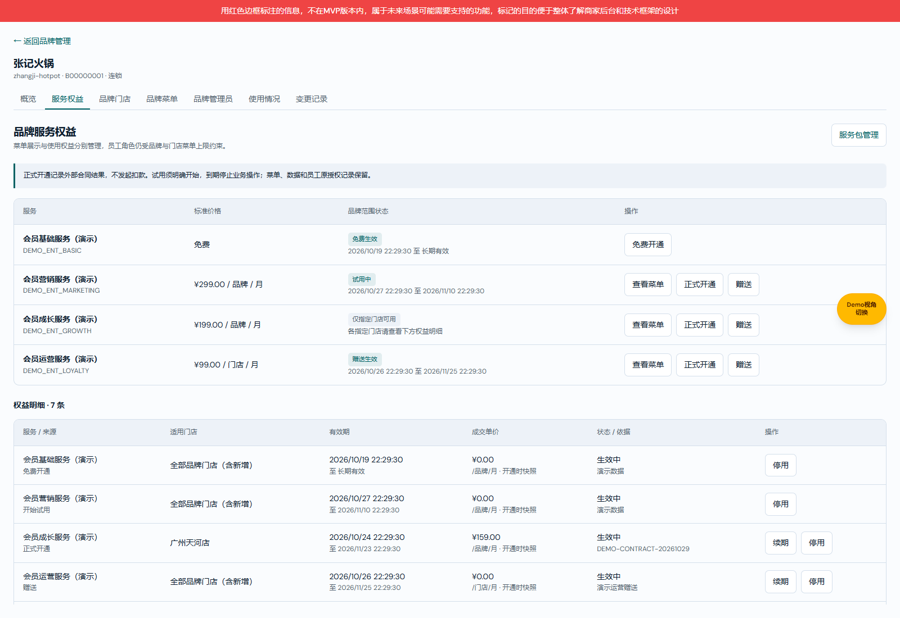

# 服务权益默认演示数据

基线main@2c9c794a；分支codex/service-rights-demo-20261029；目录D:/Projects/new-bp-worktrees/service-rights-demo-20261029/admin-web；预览端口5267。

范围仅为用户明确要求的演示数据补齐，不改变业务规则或菜单/员工授权。本项目规则规定测试数据与验证资料独立维护，不写入产品需求正文。

## 数据清单

| 服务 | 标准价格 | 菜单来源 |
| --- | --- | --- |
| 会员基础服务（演示） | 免费 | 当前已发布目录的会员列表 |
| 会员营销服务（演示） | 299元/品牌/月，试用14天 | 当前已发布目录的短信营销任务 |
| 会员成长服务（演示） | 199元/品牌/月，试用14天 | 当前已发布目录其他会员页面之一 |
| 会员运营服务（演示） | 99元/门店/月，试用14天 | 当前已发布目录其他会员页面之一，与上述菜单不重复 |

所有菜单按目录真实节点ID绑定，不制造新菜单。目录不足时等待，不生成空服务。

张记火锅：免费长期、营销试用中、成长服务指定本品牌一家门店正式开通（成交159元）、运营赠送生效、成长历史试用结束、运营历史付费到期（成交79元）、营销历史赠送已停用，共7条。保留真实MID关联、UTC期限、开通来源、成交快照及可读审计，演示合同不表示真实购买。

茶语一家：免费及试用已结束；MenuSifu NA Demo：免费及营销正式开通（成交249元）；Sakura Sushi Group与Burger Co. West：免费及运营赠送。仅对实际存在的五个固定预设品牌补齐，不向新增品牌普遍授予权益。

## 安全与持久化

- 使用独立pkg-ent-demo/ent-demo身份与演示标签。旧服务包、用户已有权益和菜单配置保持不变。
- 首次可用目录加载后补齐，snapshot.entitlementDemoVersion=1记录完成；已有浏览器数据也可补齐一次。
- 日期以首次补齐时刻为锚点，刷新不延长期限、不复活停用、不重复试用、不重复审计；人为修改后不自动重置。
- 遇预留服务ID冲突跳过补齐，不覆盖同ID对象。
- 演示权益参与原有权益判定，仍受品牌/门店菜单和账号角色约束，不自动修改菜单上限。仅为本地原型测试用途。

## 验证

verify-service-entitlement-demo.ts：4服务/7权益状态、门店范围、价格快照与日期幂等。

verify-service-entitlement-demo.cjs：从默认数据进入品牌页，核对免费/试用/正式/赠送/到期/停用，刷新存储一致、真实发布菜单可预览、无页面错误。另执行tsc、原服务存储及权益规则回归。

截图为5267功能分支隔离浏览器实采；明细表可继续滚动查看历史状态。用户已授权提交、合并及推送，实际交付提交以Git历史为准。
