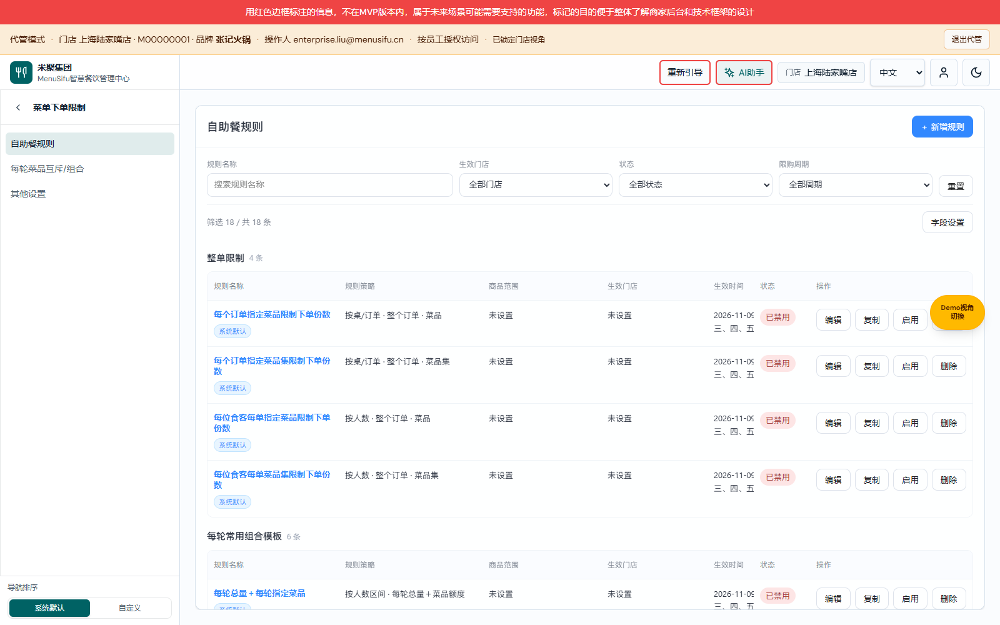

# 订阅缓存配额与导航修复验证

业务入口：[产品权威 V1.29](../../需求文档/服务与订阅/服务与订阅产品权威需求文档.md) · [研发 V1.29](../../需求文档/服务与订阅/服务与订阅业务规格说明书（研发交付版）.md) · [个人规范 V1.29](../../需求文档/服务与订阅/服务与订阅需求文档（个人规范版）.md)。纯修复不变更业务版本。

变更编号 SUBSCRIPTION-READ-QUOTA-20261109-01。基线main@19cd7ea4；分支codex/subscription-quota-nav-20261109，未提交。真实源码目录为当前worktree，功能端口5304；main的5190未应用此修复。

## 根因及修复边界

Chrome主线页面点击前厅管理中心无变化；控制台QuotaExceededError指向订阅存储reader的自动迁移写入，经serviceEntitlementData、订阅筛选及导航guard冒泡。旧reader把缓存写失败当读取失败，再seed写入，最终异常中断导航。

修复只有一个生产文件：src/config/subscription-service-store.ts。有效存储先规范化为原快照，深拷贝上做既有demo迁移；自动缓存配额失败返回原快照，原数据及权限不变。不缓存权限决策，不忽略新的外部存储变化。首次初始化缓存因配额无法写入时仅供当前读取会话使用；显式用户写入仍严格成功后才通知。非配额异常继续抛出；存储不可读、JSON损坏、未知schema不重建权限、不覆写数据。

没有清理浏览器数据，没有删除记录，没有扩大订阅或角色授权。没有修改导航、商品、支付、下单或部署逻辑。三份业务文档V1.29正文不变，只互链本纯修复记录。

## TDD与类型检查

- RED：新增verify-subscription-read-quota.cjs在旧代码因QuotaExceededError从reader逃逸而失败。
- GREEN：同一测试通过；覆盖失败迁移不在内存新增demo权益、禁用记录和protectedRoutes保留、无fallback重写、警告每页一次、下一次读取获取最新数据、首次缓存失败不阻断读取、显式保存失败无通知、正常保存通知、读失败和损坏数据不seed。
- node node_modules/typescript/bin/tsc --noEmit通过。
- 原有verify-subscription-service.ts、verify-service-entitlements.ts、verify-service-entitlement-demo.ts、verify-subscription-navigation-default.ts与verify-subscription-operations-ui.cjs通过。
- tsx未作为本地依赖安装，采用项目既有npx --no-install tsx命令及现有缓存运行，无新依赖或lockfile变更。

## 浏览器E2E

图：2026-11-09，功能分支5304，Chrome隔离测试数据；门店代管使用既有真实入口，未改生产权限。

- 原生verify-service-entitlements.cjs通过：菜单树与服务发布、品牌权益、取消、真实门店代管、锁定／试用／精确到期、免费服务、一次性试用、成交快照、指定门店、异店拒绝及只读存储门禁。
- 新增verify-subscription-read-quota-browser.cjs通过：只在隔离浏览器中对订阅key注入持续QuotaExceededError；重载后经前厅→菜单下单组→自助餐实际iframe成功。
- 同一测试比对存储原文完全不变；失败迁移版本未在内存升级；显式保存仍抛错；无权益上下文的服务仍拒绝；页面无pageerror、只有一次自动缓存警告。
- 初版专项脚本的入口预设不正确（尚未进入M平台即调用门店代管），以及发布菜单沿用旧标题导致选择器超时，均为测试夹具问题。已改走既有M平台→真实门店代管入口，并兼容同组发布标题“菜单下单限制／菜单下单规则”；没有因此改生产导航或权限。

## 构建与未验证项

Build skipped：未触及依赖、入口、编译期环境、分块、构建或嵌入包边界；TypeScript检查和真实Vite运行已验证。CI Build unknown，本次未提交／推送，不假定CI已成功。

隔离注入与已复现主线错误同类，但没有清理或修改用户5190浏览器原数据，也尚未把功能代码合入main。用户原Profile修复后的原地验收需在获授权合并后完成。未验收真实远端权益接口、线上部署或其他模块的全局存储超额故障。

开发依赖沿用已验证main的node_modules junction（包清单不变）；宿主源码与dist全部来自本功能worktree。完整原生E2E截图另作本机任务产物，不作为新增业务需求。
