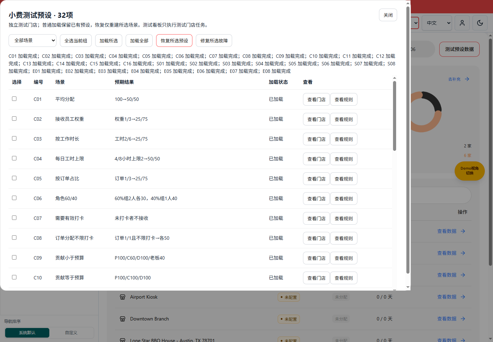
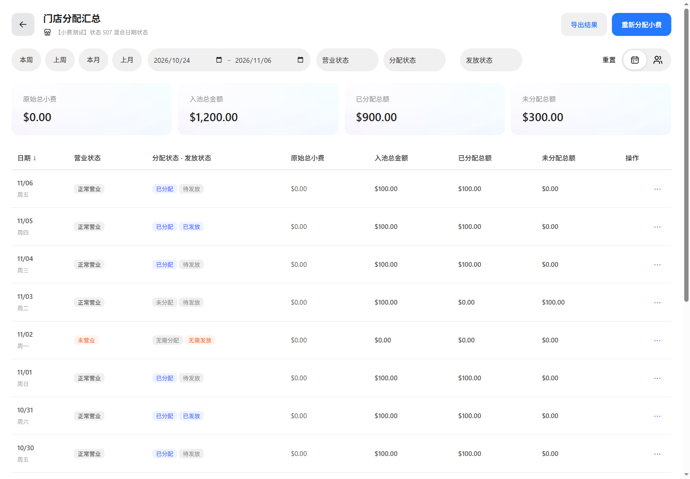
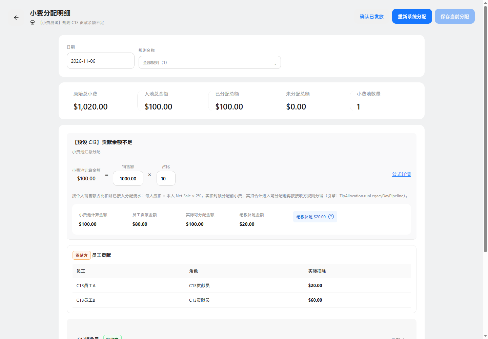
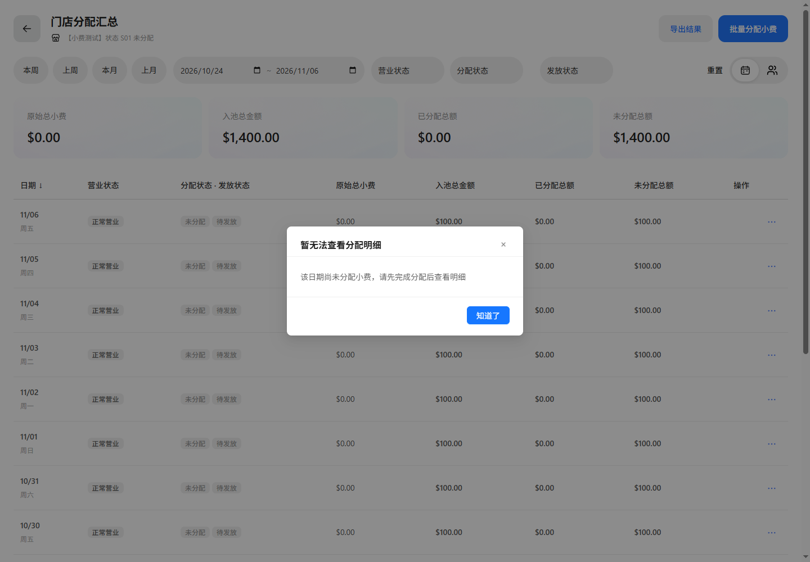
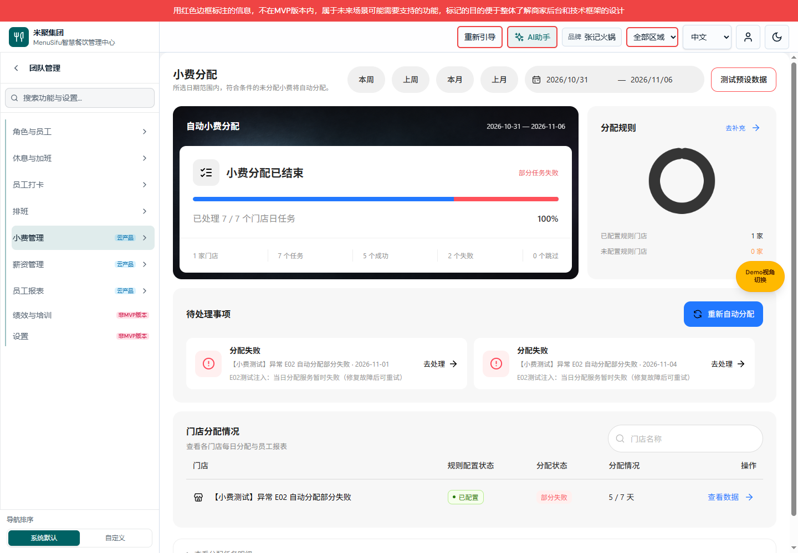
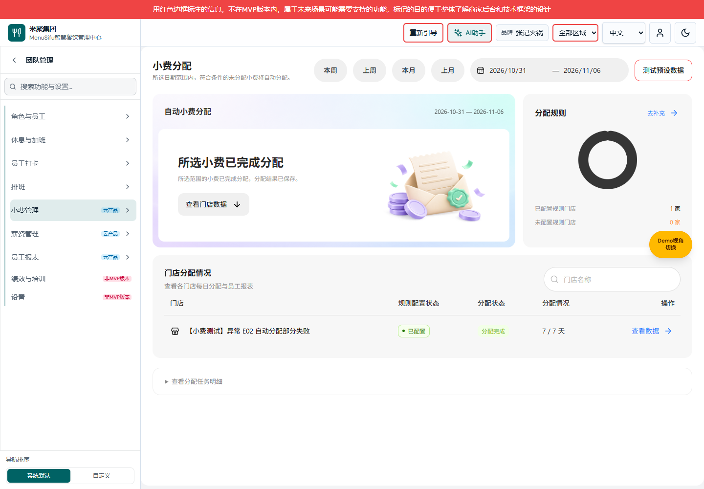

# 小费管理测试预设

版本：v1；基线：main@7763d92f；分支：codex/tips-test-presets-20261106。

## 使用入口

小费看板或门店汇总 → 红框“测试预设数据”。32项分为规则计算、日期与发放状态、自动分配与异常三组，每项独立门店及员工。选择场景后加载，也可以加载全部。

- 普通加载保留已加载场景，避免覆盖手动修改。
- 恢复所选预设需要再次确认场景范围；仅重建所选预设规则、员工及其已加载日期的分配和发放记录。共享存储损坏或编号冲突时拒绝恢复。
- 单项加载直接进入对应门店汇总或测试看板；加载全部后使用每行“查看门店／前往测试看板／查看规则”。
- 规则算例为当天，状态为近14天，自动任务为近7天；金额固定，日期随加载当天生成。
- 测试员工使用独立存储tipout-test-preset-roster-v1。测试门店只在显式测试路由中进入小费门店适配器，不修改权限。普通看板不自动处理测试门店。

## 状态和金额核对

S07同一门店包含未分配、系统已分配、已发放、手动调整和未营业；已保存手动状态通过进入当日明细查看。S03通过现有提交及确认发放API生成匹配的snapshotId/version/hash。S04的接收结果为60/40，allocationSource为manual。

C13应扣40/60，实际扣20/60；C=80、P=100，老板补20，不向B转移差额。C14按员工营业额1000/2000/2000分摊500，实扣100/200/200。

S01可复现未分配日期的明细拦截。S08即使金额为0也有有效分配快照，可进入明细。

## 自动任务及故障修复

E01正常任务；E02/E04每第三个日期中第二个日期注入任务异常；E03所有任务注入异常。进行中由真实队列产生，不预存永久进行中状态。

打开测试预设 → 选择对应E场景 → 修复所选故障 → 关闭 → 重试失败日期。E07同时将预设接收占比恢复到100%；E08仅在测试事实读取路径报错，修复后重新打开该测试看板。

E05已有有效结果，不创建新任务。E06真实引擎结果为池100、已分配0、未分配100；不把未分配余额伪装成任务失败。

## 验证

Node：verify-tipout-test-presets.mjs、verify-tipout-test-preset-scope.mjs；专项测试及TypeScript检查见验证记录。浏览器验证全部32项加载、接收金额、明细、发放关联、手动结果、失败与修复重试。

[32项覆盖清单](测试预设覆盖说明.md) · [验证记录](验证记录.md)
