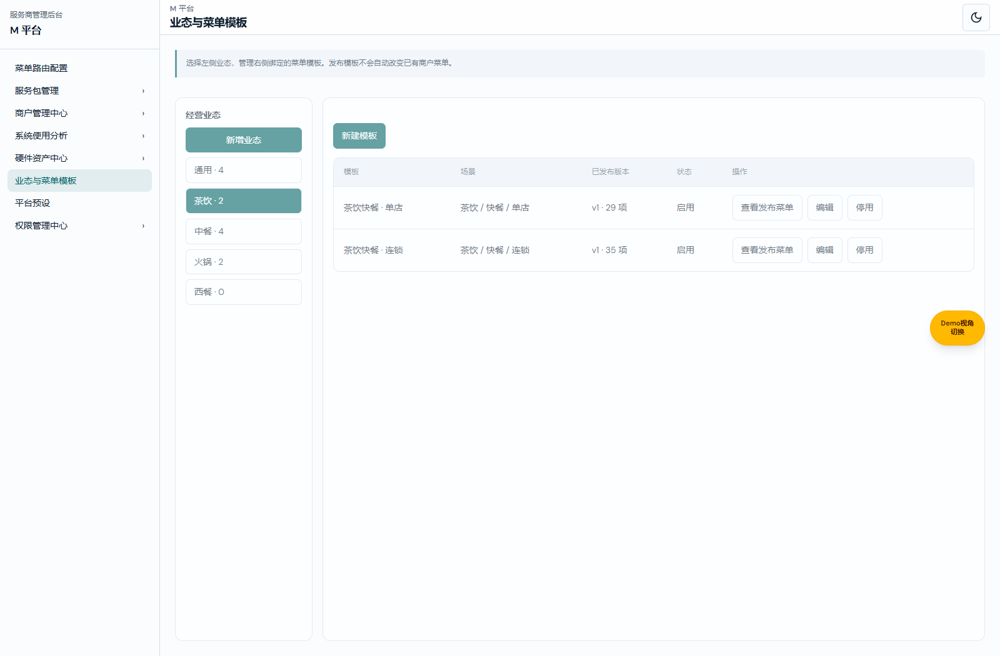
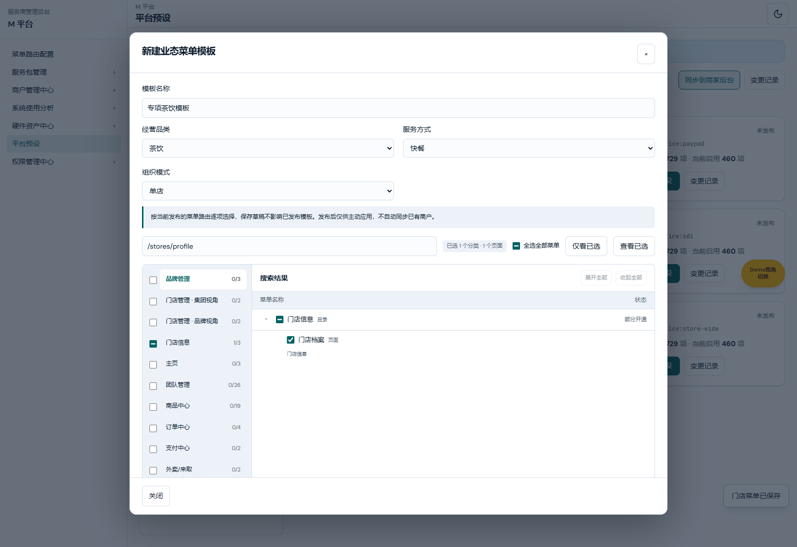
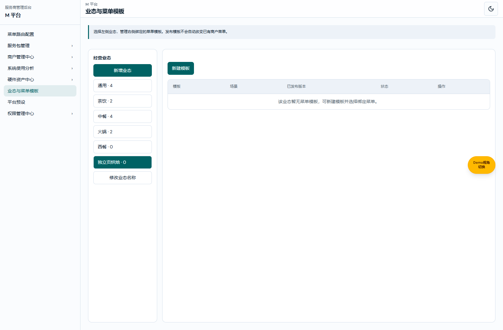
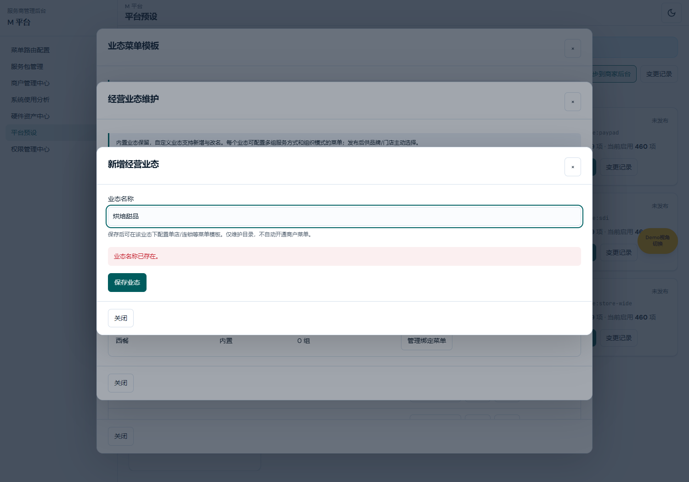
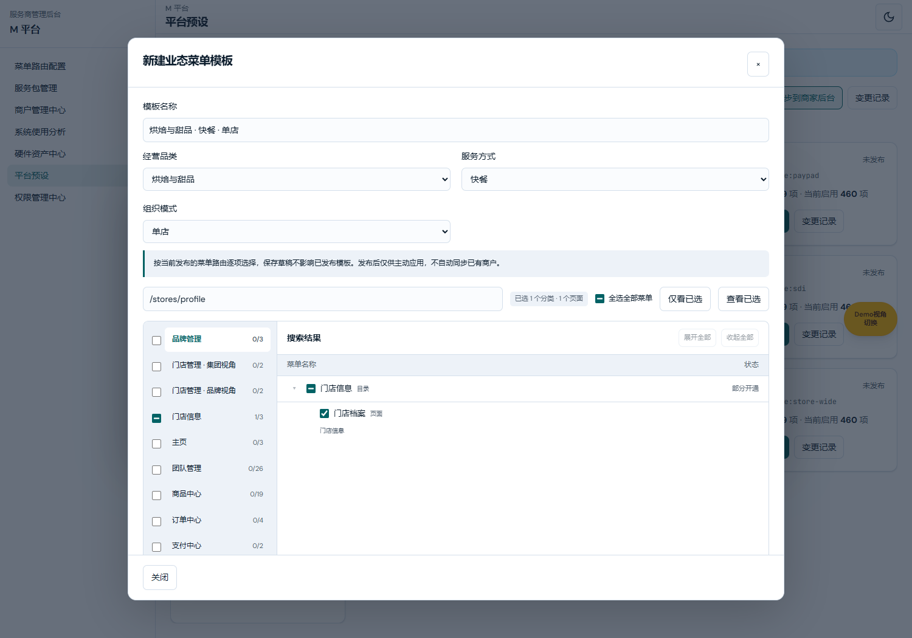
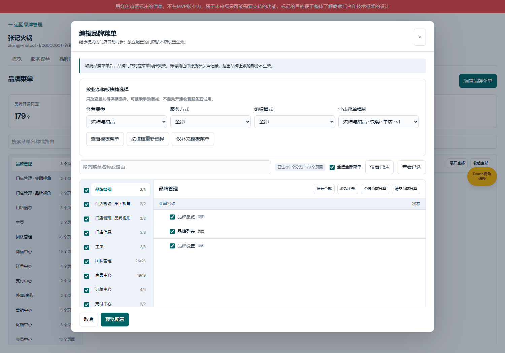

# 业态菜单模板业务规格说明书（研发交付版）

版本：V1.2 · 2026-10-29 · BUSINESS-TEMPLATE-PAGE-20261029-71。

配对：[产品权威 V1.2](./业态菜单模板产品权威需求文档.md) · [研发交付 V1.2](./业态菜单模板业务规格说明书（研发交付版）.md) · [个人规范 V1.2](./业态菜单模板需求文档（个人规范版）.md)。

共同基线：用户确认的业态模板批量选择方案，起始main@55f13b06；职责：字段、状态、计算、异常与测试。

[交付验证与独立缺口](../../verification/business-menu-templates-20261029/README.md)。

## 公共业务规则

1. 模板是快捷批量选择，不是新的授权上限。菜单唯一来源为M已发布菜单路由，保留原始节点键；选择祖先用于结构展示，不自动加入未选兄弟或子节点。
2. 品类、服务方式、组织模式独立。模板选择不修改品牌基础资料、产线或组织属性，不改变原平台预设运行时过滤规则。
3. 应用有替换、仅补充两种。先核对差异，再确认应用到当前编辑选择，最后沿用品牌/门店原配置预览与保存。应用、搜索、查看、取消均不直接写品牌菜单。
4. 门店可选范围=品牌显式开通范围∩门店视角范围。继承门店不独立应用模板；切换独立配置后可用。批量保存逐店校验归属与品牌配置版本。
5. 模板菜单与收费服务分离。勾选收费菜单不表示已购买、不开始试用、不产生扣款，实际可用仍受服务权益和员工角色约束。
6. 草稿不用于商户应用。仅启用且有发布版本的模板进入选择列表；停用不删除历史。发布/停用不自动覆盖既有品牌和独立门店；继承门店继续跟随品牌菜单。
7. 应用确认重新核验模板revision、启用状态和发布版本；最终保存仍校验品牌/门店配置版本。失败保留输入与编辑上下文，不覆盖新配置。
8. 发布至少包含一个当前有效页面；拒绝失效节点。应用时已经失效或超范围的节点不选择，并列出明细，不映射为其他菜单。
9. 当前编辑会显示模板来源与额外选择/取消节点数；最终保存将模板ID、名称、版本及差异数写入原变更记录。已保存菜单是独立结果，不建立模板实时同步关系。
10. 默认提供茶饮快餐、中餐正餐、中式快餐、火锅正餐、通用快餐、外卖专营，各有单店/连锁组合，共12个模板。选择有限具体页面，平台可编辑；未匹配到当前目录的默认路径不创建虚拟菜单。

## 数据对象

| 字段 | 类型、含义与约束 |
| --- | --- |
| id | string，系统生成稳定模板ID；默认bt-场景-模式，新建UUID。名称可变，引用ID不变。 |
| revision | 整数，每次草稿保存、发布、启停递增；保存必须等于打开时版本，不符拒绝。 |
| enabled | boolean，默认true；控制新应用入口，不回写商户。 |
| draft.name | string，trim后1..60字必填。 |
| draft.category | general/tea/chinese/hotpot/western或现有M自定义业态ID，必填，保存时校验目录中存在。 |
| draft.mode | dining/fast/delivery，必填枚举。 |
| draft.org | single/chain，必填枚举。 |
| draft.keys | string[]，当前菜单目录原始节点键去重；补齐必要祖先，不隐式扩展兄弟和后代。 |
| releases | 发布快照数组，保留历史；应用读取最后一个版本。 |
| release.version | max历史版本+1，从1开始。 |
| release.at | ISO日期字符串，浏览器当前时刻；用于演示发布记录。 |
| release场景/名称/keys | 发布时克隆草稿，后续草稿修改不改变快照。 |
| initialMenuSource | 品牌创建可选来源字符串，空则无模板；保存创建变更记录。 |
| 菜单变更source | 沿用品牌/门店审计字段，追加模板ID/名称/版本及额外选择/取消节点数。 |

## 计算与状态

令C为当前菜单键集合，A为允许范围（品牌为C；门店为品牌上限∩门店视角），T为模板发布键，B为当前选择。

有效模板键E=补齐祖先(T∩A∩C)∩A；替换结果N=E；仅补充结果N=B∪E。新增=N−B，关闭=B−N。失效=T−C，超范围=(T∩C)−A。均按原始节点键去重计数，不将结构节点数写成页面数。额外选择=N−E，人工取消=E−N（同一编辑会话内后续手动调整时重新计算）。

例：B={目录,A}，T={目录,B,失效X}，允许={目录,A,B}。仅补充N={目录,A,B}，新增1关闭0、失效1；替换N={目录,B}，新增1关闭1。若B页面超出门店上限，则不选择并列明原因。

新模板：草稿无发布→发布v1；有发布模板保存草稿→旧发布继续生效；发布→追加v2；停用→不再提供新应用，历史商户菜单不变；重新启用→继续提供最新已发布版本。无删除或自动同步任务。

## 权限与异常

模板写入要求M平台预设当前路径、可访问页与页edit权限；发布/启停再要求presets.publish操作edit。只读可浏览管理与已发布树，调用存储方法写入也拒绝。品牌和门店原写权限不变。

保存重新读取当前路由目录，拒绝失效键；发布至少一个isPage。应用确认再读模板revision/启用状态；最终保存使用原brandConfigurationVersion防覆盖。模板停用和发布不修改商户存储。当前实现沿用localStorage，服务端权限、并发事务与多设备一致性为独立交付缺口。

## 测试算例

1. 草稿模板无发布：应用列表不出现；发布后出现v1；修改草稿后应用仍为v1。
2. 已选A，模板B：补充保留A，替换列出关闭A。取消差异确认不改变选择，确认应用不写品牌；最终确认保存才写。
3. 门店上限不含B：B不选择、超范围计数+1；直接调用保存同样拒绝。
4. 模板未知X：应用不映射X，失效+1；发布含X直接报错。
5. revision打开时1、另一操作变2：保存/应用确认拒绝旧版本，保留输入。
6. 发布/停用前后商户存储完全相同；原继承/独立模式规则不变。
7. 页read或publish操作deny：按钮不提供且存储方法拒绝。角色权限编辑器不出现模板。
8. 创建品牌使用模板后人工增减：核对弹框显示最终树和来源，创建记录保留模板ID/版本。

## 模板管理与编辑核对

图注：2026-10-29，codex/business-menu-templates-20261029，起始main@812692fe，5268功能预览实采。

图注：2026-10-29，codex/business-menu-templates-20261029，起始main@812692fe，5268功能预览实采。

完整页面元素定义见个人规范文档，字段枚举与本节单点定义一致。

## 左侧业态维护区域

图注：2026-10-29，codex/business-type-maintenance-20261029，起始main@55f13b06，5269功能预览实采；新增与改名共用字段布局，图示为新增状态。

| 字段／操作 | 逻辑说明 |
| --- | --- |
| 入口 | M平台 → 业态与菜单模板，左侧直接新增、选择业态及修改自定义业态名称；原平台预设新增也复用同一名称校验。 |
| 业态名称 | 内置经营品类加M现有自定义业态目录，不创建第二份自定义目录。 |
| 来源 | 内置/自定义；内置名称保留，自定义支持新增和改名。 |
| 菜单模板 | 按当前草稿关联该业态的模板组数；同一业态可绑定多组服务方式/组织模式菜单。 |
| 新增业态 | 具有平台预设页写权限才显示。 |
| 改名 | 只提供给自定义业态，保持稳定ID，既有菜单绑定不变；模板名称是独立字段，不自动改名。 |
| 管理绑定菜单 | 点击左侧业态后，右侧仅列该业态模板；无绑定时显示明确空状态，点击新建模板后预填当前业态；可编辑已有模板或新增不同服务方式/组织模式组合。 |
| 只读 | 可查看业态及绑定列表，无新增/改名入口；存储方法也拒绝写入。 |

## 新增／编辑经营业态弹框

图注：2026-10-29，codex/business-type-maintenance-20261029，起始main@55f13b06，5269功能预览实采；新增与改名共用字段布局，图示为新增状态。

| 字段／操作 | 逻辑说明 |
| --- | --- |
| 业态名称 | 必填，trim后1至30字。与内置业态、既有自定义名称不区分大小写去重；编辑自身原名除外。 |
| 保存业态 | 校验当前M页面写权限、名称、重名；改名再校验打开时旧名称，过期拒绝。新增生成custom-UUID并写入现有M自定义目录；成功关闭并刷新维护列表，失败保留输入。 |
| 关闭/取消 | 有未保存输入时提示是否放弃；未确认保存不创建或改名。 |
| 新增后菜单 | 初始不自动绑定任何菜单；需在该业态右侧新建模板、选择当前已发布菜单、保存或发布模板。 |

## 按业态管理绑定菜单

图注：2026-10-29，codex/business-type-maintenance-20261029，起始main@55f13b06，5269功能预览实采；新增与改名共用字段布局，图示为新增状态。

| 字段／操作 | 逻辑说明 |
| --- | --- |
| 经营品类 | 进入配置时预填所选业态；包含当前全部自定义业态选项。 |
| 模板名称 | 无绑定时默认生成“业态名称 · 快餐 · 单店”，仍可编辑。 |
| 菜单 | 复用当前已发布菜单树逐项管理，支持手动增减。 |
| 服务方式/组织模式 | 同一业态可有多组场景模板，沿用既有选择与发布规则。 |
| 发布 | 仍要求原独立发布权限；不自动覆盖已有商户。草稿不出现在品牌可用模板列表。 |

## 品牌开通使用自定义业态

图注：2026-10-29，codex/business-type-maintenance-20261029，起始main@55f13b06，5269功能预览实采；新增与改名共用字段布局，图示为新增状态。

| 字段／操作 | 逻辑说明 |
| --- | --- |
| 业态筛选 | 读取同一自定义目录；选择后只列该业态启用且已发布的模板。 |
| 品牌基础信息业态 | 品牌创建第一步展示完整经营业态选项，包含新增项，不再截断前八项。 |
| 应用菜单 | 沿用替换/补充、差异确认、手工增减和最终保存。业态维护或改名不自动改变品牌和门店授权。 |

[业态维护验证与独立缺口](../../verification/business-type-maintenance-20261029/README.md)。

## 独立入口与权限边界

独立页面复用既有presets查看/编辑及publish权限资源，不自动为角色新增权限。无查看权限时侧栏入口隐藏且直达地址拒绝；只读账号可切换业态并查看已发布模板，不能新增/改名/保存/发布。品牌创建和菜单编辑工具栏提供“管理业态与模板”链接，沿用当前业务草稿离开保护。页面继续读取原自定义业态与模板存储键，不迁移ID、发布版本或商户菜单。

[独立页面验证](../../verification/business-template-page-20261029/README.md)。
