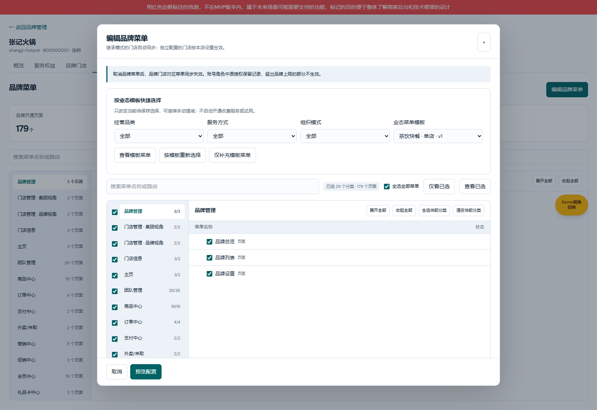
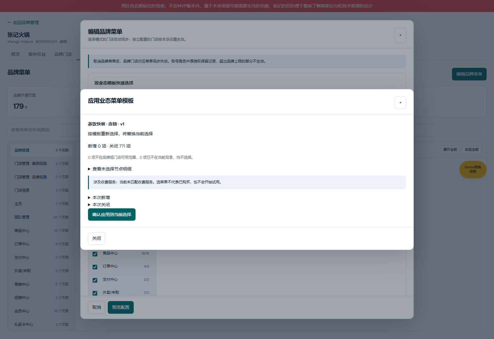
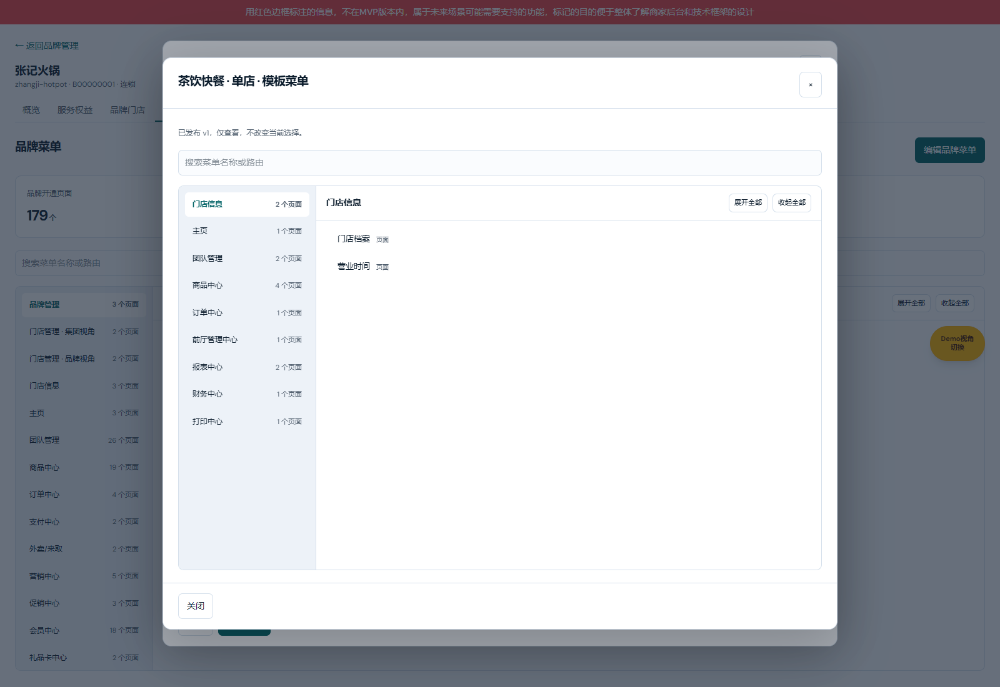
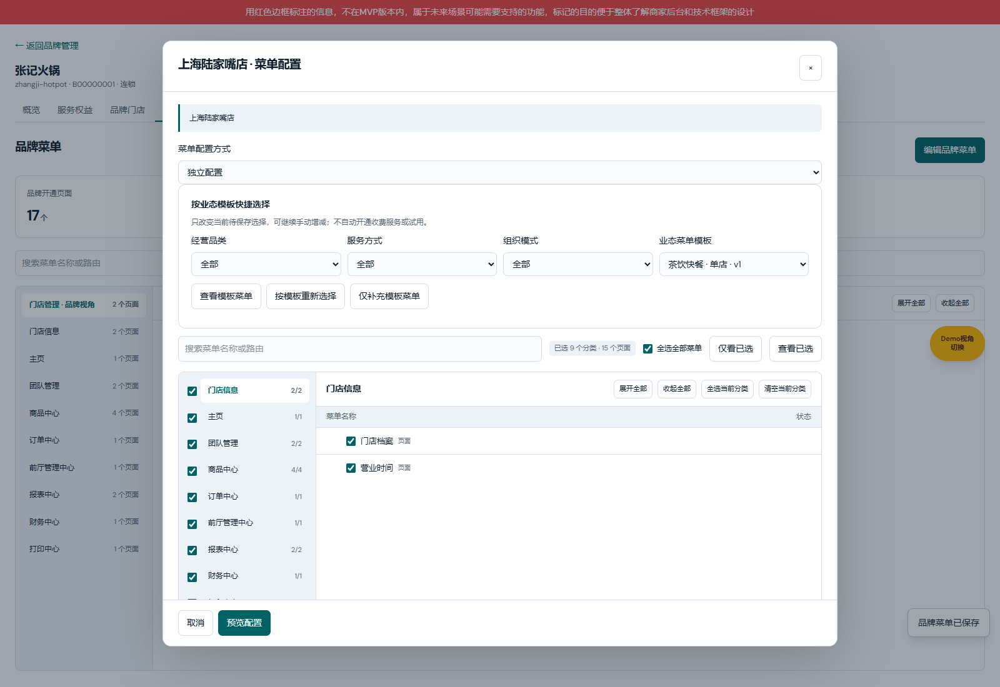
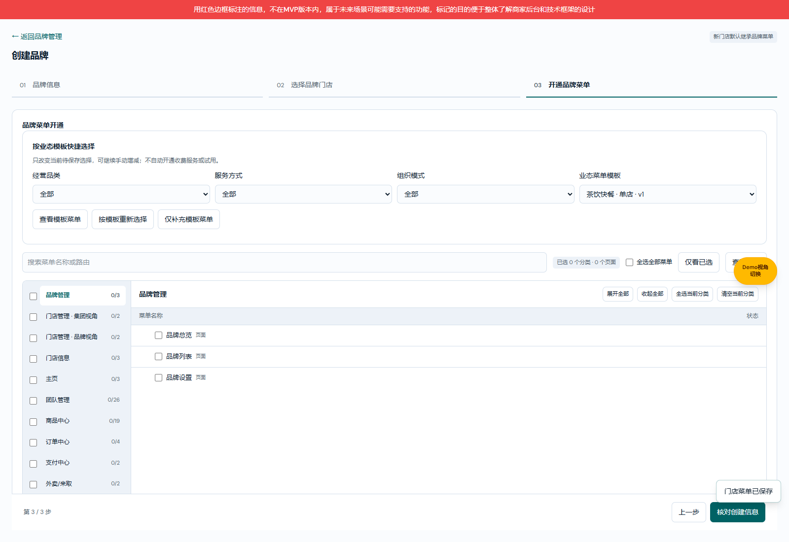
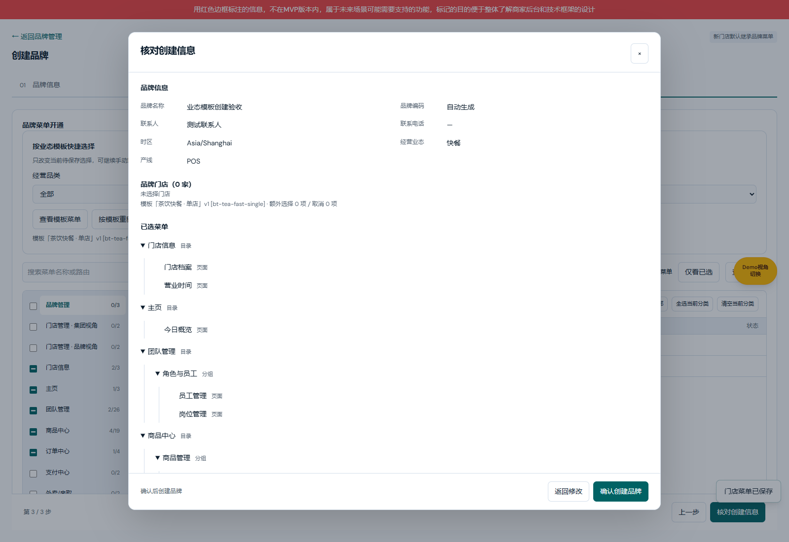

# 业态菜单模板产品权威需求文档

版本：V1.2 · 2026-10-29 · BUSINESS-TEMPLATE-PAGE-20261029-71。

配对：[产品权威 V1.2](./业态菜单模板产品权威需求文档.md) · [研发交付 V1.2](./业态菜单模板业务规格说明书（研发交付版）.md) · [个人规范 V1.2](./业态菜单模板需求文档（个人规范版）.md)。

共同基线：用户确认的业态模板批量选择方案，起始main@55f13b06；职责：范围、业务规则与验收依据。

[交付验证与独立缺口](../../verification/business-menu-templates-20261029/README.md)。

## 公共业务规则

1. 模板是快捷批量选择，不是新的授权上限。菜单唯一来源为M已发布菜单路由，保留原始节点键；选择祖先用于结构展示，不自动加入未选兄弟或子节点。
2. 品类、服务方式、组织模式独立。模板选择不修改品牌基础资料、产线或组织属性，不改变原平台预设运行时过滤规则。
3. 应用有替换、仅补充两种。先核对差异，再确认应用到当前编辑选择，最后沿用品牌/门店原配置预览与保存。应用、搜索、查看、取消均不直接写品牌菜单。
4. 门店可选范围=品牌显式开通范围∩门店视角范围。继承门店不独立应用模板；切换独立配置后可用。批量保存逐店校验归属与品牌配置版本。
5. 模板菜单与收费服务分离。勾选收费菜单不表示已购买、不开始试用、不产生扣款，实际可用仍受服务权益和员工角色约束。
6. 草稿不用于商户应用。仅启用且有发布版本的模板进入选择列表；停用不删除历史。发布/停用不自动覆盖既有品牌和独立门店；继承门店继续跟随品牌菜单。
7. 应用确认重新核验模板revision、启用状态和发布版本；最终保存仍校验品牌/门店配置版本。失败保留输入与编辑上下文，不覆盖新配置。
8. 发布至少包含一个当前有效页面；拒绝失效节点。应用时已经失效或超范围的节点不选择，并列出明细，不映射为其他菜单。
9. 当前编辑会显示模板来源与额外选择/取消节点数；最终保存将模板ID、名称、版本及差异数写入原变更记录。已保存菜单是独立结果，不建立模板实时同步关系。
10. 默认提供茶饮快餐、中餐正餐、中式快餐、火锅正餐、通用快餐、外卖专营，各有单店/连锁组合，共12个模板。选择有限具体页面，平台可编辑；未匹配到当前目录的默认路径不创建虚拟菜单。

## 用户流程

M平台维护模板并发布 → 品牌创建/菜单编辑或独立门店选择模板 → 查看差异 → 应用到当前选择 → 人工增减 → 原配置预览 → 最终保存。继承门店在品牌变更后按原规则同步。

## 业态与菜单模板：独立管理页面

图注：2026-10-29，codex/business-menu-templates-20261029，起始main@812692fe，5268功能预览实采。

| 字段／操作 | 逻辑说明 |
| --- | --- |
| 业态菜单模板 | M平台侧栏 → 业态与菜单模板，独立页面/m-platform/business-menu-templates；只读可查看。原平台预设保留跳转链接。 |
| 页面切换 | 从M平台侧栏切换；未保存的模板编辑继续受原放弃确认保护。 |

## 新建／编辑模板弹框

图注：2026-10-29，codex/business-menu-templates-20261029，起始main@812692fe，5268功能预览实采。

| 字段／操作 | 逻辑说明 |
| --- | --- |
| 模板名称 | 必填，去首尾空白，1至60字；只作名称，不作为唯一ID。 |
| 未保存关闭 | 关闭或Escape时有改动则弹出独立放弃确认；取消确认保留编辑内容，确认放弃不写入。 |

## 品牌菜单配置：按业态快捷选择

图注：2026-10-29，codex/business-menu-templates-20261029，起始main@812692fe，5268功能预览实采。

| 字段／操作 | 逻辑说明 |
| --- | --- |
| 经营品类筛选 | 默认全部，按发布版本的经营品类筛选模板，不自动勾菜单。 |
| 取消 | 沿用原未保存修改保护，不保存菜单和模板来源。 |

## 应用模板差异确认弹框

图注：2026-10-29，codex/business-menu-templates-20261029，起始main@812692fe，5268功能预览实采。

| 字段／操作 | 逻辑说明 |
| --- | --- |
| 模板名称/版本 | 本次使用的发布快照，不引用草稿。 |
| 关闭/Escape/遮罩 | 不应用，不写入。 |

## 模板只读菜单预览

图注：2026-10-29，codex/business-menu-templates-20261029，起始main@812692fe，5268功能预览实采。

| 字段／操作 | 逻辑说明 |
| --- | --- |
| 菜单树 | 按当前发布目录展示模板发布版本的选择，支持原搜索与树展开收起；菜单显示不授予访问权限。 |
| 关闭 | 回到原选择界面，不改变待保存菜单。 |

## 独立门店菜单配置

图注：2026-10-29，codex/business-menu-templates-20261029，起始main@812692fe，5268功能预览实采。

| 字段／操作 | 逻辑说明 |
| --- | --- |
| 继承品牌菜单 | 隐藏模板工具栏和可编辑树；继续使用品牌已开通且门店视角可见的菜单。 |
| 保存 | 校验当前品牌配置版本及门店归属，拒绝超范围键，不扩大员工权限。模板来源进入变更记录。 |

## 创建品牌：菜单开通步骤

图注：2026-10-29，codex/business-menu-templates-20261029，起始main@812692fe，5268功能预览实采。

| 字段／操作 | 逻辑说明 |
| --- | --- |
| 模板工具栏 | 位于品牌菜单开通步骤，与品牌编辑使用相同逻辑。仅辅助选择菜单，不修改第一步已填写的业态、产线或品牌资料。 |
| 手动选择 | 可额外增加或取消，来源与差异在核对创建信息中显示。 |

## 核对创建信息弹框

图注：2026-10-29，codex/business-menu-templates-20261029，起始main@812692fe，5268功能预览实采。

| 字段／操作 | 逻辑说明 |
| --- | --- |
| 模板来源 | 展示本次应用的模板名称、ID、版本及额外选择/取消数。 |
| 返回修改 | 保留当前选择，不创建品牌。 |

## 验收依据

同一已选菜单，补充不得删除；替换须预览关闭。草稿不出现在应用列表，停用不改变已保存商户；只读账号无写入口，存储写入也拒绝。门店不能开通品牌或门店视角以外的键。查看、应用和最终保存分开计时验证；最终审计包含模板来源。

## 左侧业态维护区域

图注：2026-10-29，codex/business-type-maintenance-20261029，起始main@55f13b06，5269功能预览实采；新增与改名共用字段布局，图示为新增状态。

| 字段／操作 | 逻辑说明 |
| --- | --- |
| 入口 | M平台 → 业态与菜单模板，左侧直接新增、选择业态及修改自定义业态名称；原平台预设新增也复用同一名称校验。 |
| 业态名称 | 内置经营品类加M现有自定义业态目录，不创建第二份自定义目录。 |
| 来源 | 内置/自定义；内置名称保留，自定义支持新增和改名。 |
| 菜单模板 | 按当前草稿关联该业态的模板组数；同一业态可绑定多组服务方式/组织模式菜单。 |
| 新增业态 | 具有平台预设页写权限才显示。 |
| 改名 | 只提供给自定义业态，保持稳定ID，既有菜单绑定不变；模板名称是独立字段，不自动改名。 |
| 管理绑定菜单 | 点击左侧业态后，右侧仅列该业态模板；无绑定时显示明确空状态，点击新建模板后预填当前业态；可编辑已有模板或新增不同服务方式/组织模式组合。 |
| 只读 | 可查看业态及绑定列表，无新增/改名入口；存储方法也拒绝写入。 |

## 新增／编辑经营业态弹框

图注：2026-10-29，codex/business-type-maintenance-20261029，起始main@55f13b06，5269功能预览实采；新增与改名共用字段布局，图示为新增状态。

| 字段／操作 | 逻辑说明 |
| --- | --- |
| 业态名称 | 必填，trim后1至30字。与内置业态、既有自定义名称不区分大小写去重；编辑自身原名除外。 |
| 保存业态 | 校验当前M页面写权限、名称、重名；改名再校验打开时旧名称，过期拒绝。新增生成custom-UUID并写入现有M自定义目录；成功关闭并刷新维护列表，失败保留输入。 |
| 关闭/取消 | 有未保存输入时提示是否放弃；未确认保存不创建或改名。 |
| 新增后菜单 | 初始不自动绑定任何菜单；需在该业态右侧新建模板、选择当前已发布菜单、保存或发布模板。 |

## 按业态管理绑定菜单

图注：2026-10-29，codex/business-type-maintenance-20261029，起始main@55f13b06，5269功能预览实采；新增与改名共用字段布局，图示为新增状态。

| 字段／操作 | 逻辑说明 |
| --- | --- |
| 经营品类 | 进入配置时预填所选业态；包含当前全部自定义业态选项。 |
| 模板名称 | 无绑定时默认生成“业态名称 · 快餐 · 单店”，仍可编辑。 |
| 菜单 | 复用当前已发布菜单树逐项管理，支持手动增减。 |
| 服务方式/组织模式 | 同一业态可有多组场景模板，沿用既有选择与发布规则。 |
| 发布 | 仍要求原独立发布权限；不自动覆盖已有商户。草稿不出现在品牌可用模板列表。 |

## 品牌开通使用自定义业态

图注：2026-10-29，codex/business-type-maintenance-20261029，起始main@55f13b06，5269功能预览实采；新增与改名共用字段布局，图示为新增状态。

| 字段／操作 | 逻辑说明 |
| --- | --- |
| 业态筛选 | 读取同一自定义目录；选择后只列该业态启用且已发布的模板。 |
| 品牌基础信息业态 | 品牌创建第一步展示完整经营业态选项，包含新增项，不再截断前八项。 |
| 应用菜单 | 沿用替换/补充、差异确认、手工增减和最终保存。业态维护或改名不自动改变品牌和门店授权。 |

[业态维护验证与独立缺口](../../verification/business-type-maintenance-20261029/README.md)。

## 独立入口与权限边界

独立页面复用既有presets查看/编辑及publish权限资源，不自动为角色新增权限。无查看权限时侧栏入口隐藏且直达地址拒绝；只读账号可切换业态并查看已发布模板，不能新增/改名/保存/发布。品牌创建和菜单编辑工具栏提供“管理业态与模板”链接，沿用当前业务草稿离开保护。页面继续读取原自定义业态与模板存储键，不迁移ID、发布版本或商户菜单。

[独立页面验证](../../verification/business-template-page-20261029/README.md)。
