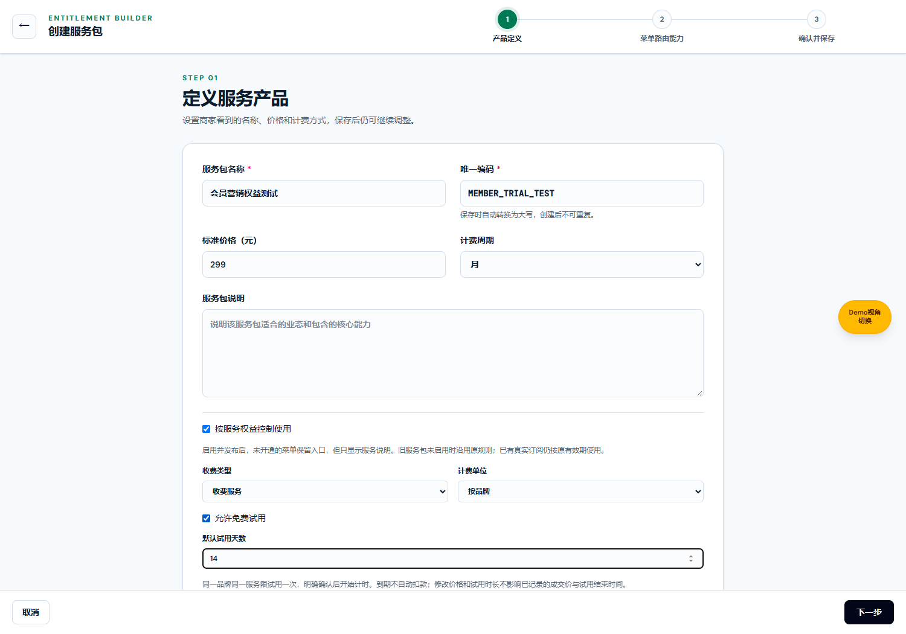
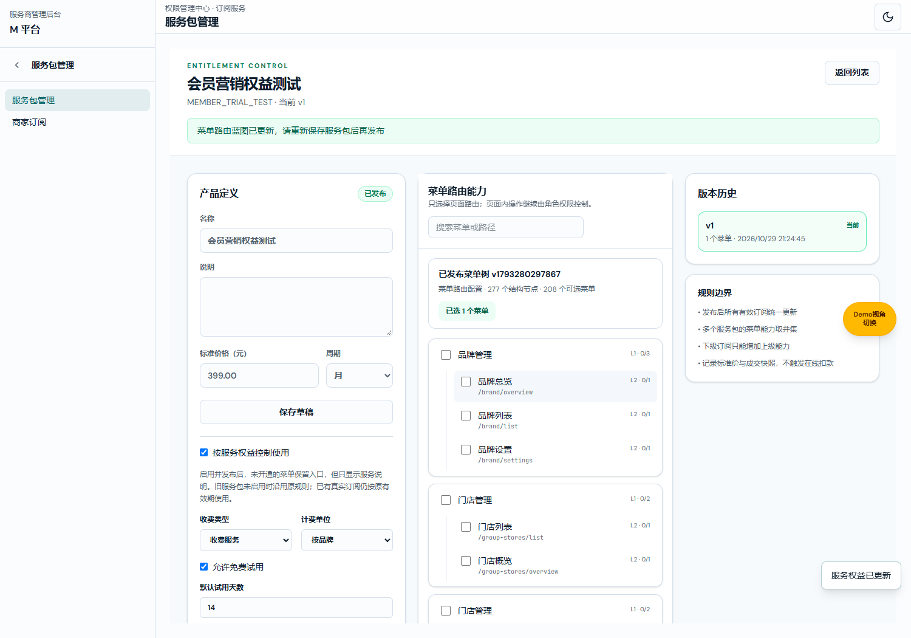

# 服务与订阅业务规格说明书（研发交付版）

版本：V1.1 · 日期：2026-10-29 · 变更编号：SERVICE-MENU-PREVIEW-20261029-68。

配对：[产品权威 V1.1](./服务与订阅产品权威需求文档.md) · [研发交付 V1.1](./服务与订阅业务规格说明书（研发交付版）.md) · [个人规范 V1.1](./服务与订阅需求文档（个人规范版）.md)。

共同业务基线：服务目录和定价、品牌权益范围与期限、B菜单可见与可用分离；起始main@d5aca580。职责：同一业务的字段、状态、计算和测试契约。

独立交付缺口与验证：[记录](../../verification/service-entitlements-20261029/README.md)。

## 公共业务规则

1. 菜单来自M平台当前已发布路由目录，不维护第二份菜单树。服务可以选择一个或多个页面，同一页面可由多个服务提供。价格附着于服务，菜单勾选只控制展示上限。
2. 菜单实际使用须同时满足：品牌/门店菜单上限、员工角色授权、当前主体范围、品牌账号状态和有效服务权益。服务开通不增加员工角色、其他门店或未展示菜单权限。
3. 旧服务未启用权益控制时继续原订阅过滤和原价格展示规则；演示sub-demo记录不代表真实开通。新建服务默认勾选权益控制；旧服务明确启用并发布才接入新规则，不自动赠送或补付费权益。
4. 免费和收费分别定义。免费服务的标准价必须为0，收费服务标准价必须大于0。金额以最小货币单位整数保存，页面按币种格式展示；计费单位为品牌或门店，周期为月/季度/年/一次性，均不触发自动扣费。
5. 免费权益需明确免费开通。收费权益来源为一次试用、正式开通或赠送。正式开通保存外部合同/开通依据、成交金额、币种、单位、周期和发布版本快照；赠送金额为0并记录原因。修改标准价不覆盖已有成交价。
6. 权益适用范围为全部品牌门店（含新增）或指定当前品牌门店。指定范围至少一家且全部归属于当前品牌。品牌总览不能把某一门店权益扩大为全品牌；切换到不覆盖门店时禁止使用。
7. 试用仅对允许试用的收费服务开放，天数为1至90的整数。每品牌每服务最多一次，历史停用记录仍占用资格。勾选菜单、打开页面或打开确认弹框均不消耗资格；提交确认后以当前时间起算。
8. 有效区间为开始时间≤当前时间<结束时间。免费可长期；正式和赠送需填写晚于当前时间的结束时刻。试用结束时刻=确认时刻+试用天数×86400000毫秒。试用和免费不提供续期；转正式另建付费权益，不覆盖试用历史。
9. 正式/赠送续期必须晚于原到期时刻与当前时刻，保留原成交快照并记录审计。停用立即失效，要求原因，保留原记录。一个来源到期或停用，不影响同一页面其他仍有效且覆盖当前主体的服务来源。
10. 无有效权益时，在原菜单可见范围内显示服务说明、价格、原因和联系入口，不挂载业务页面或展示业务数据。到期不删除数据，不重置角色，不自动扣费。当前品牌已启用Admin可明确开始试用；普通员工无试用/正式开通权。
11. M操作沿用商家订阅创建/续期/停用操作资源与当前管理页写权限；只读用户可看权益，无写入口，存储操作也验证身份权限。发布/停用/回滚原操作权限继续有效。
12. 权益控制启用后不能清除该控制；历史受控路径保留，停用、移除绑定、回滚均不能变成无配置放行。免费父页面不放行独立收费子页面，以最具体受控路径判定。未明确品牌/门店的跨品牌视角不能借用其他品牌权益。
## M平台：创建服务包／编辑服务包

待补页面图片：独立编辑商业设置状态；下图仅代表创建状态。

图注：2026-10-29，codex/service-entitlements-20261029，起始main@d5aca580，5265功能预览实采。入口：M平台 → 服务包管理 → 创建服务包；编辑从服务包详情进入。

| 字段／操作 | 逻辑说明 |
| --- | --- |
| 服务包名称 | 必填，显示服务的业务名称，创建向导最多60字。 |
| 唯一编码 | 必填，去首尾空白转大写，不能与已有服务编码重复，创建后作为稳定业务标识。 |
| 说明 | 可空，作为B端服务介绍，不承载额外权限规则。 |
| 标准价格 | 元输入，最多两位小数，保存为分；免费为0、收费大于0，异常值拒绝。 |
| 计费周期 | 月、季度、年、一次性；保存到服务发布版本和正式成交快照。 |
| 按服务权益控制使用 | 新服务默认选中；旧服务需明确选中并发布。启用后不可直接清除；发布提示未开通品牌将锁定相关页面。 |
| 收费类型 | 免费/收费，明确选择，不以菜单名称或是否勾选推断。 |
| 计费单位 | 按品牌/按门店，定义成交单价单位，不代替适用门店范围。 |
| 允许免费试用 | 仅收费服务可开启，免费服务勾选时校验失败。 |
| 默认试用天数 | 开启试用时必为1至90整数，不修改既有试用记录endAt。 |
| 菜单路由能力 | 使用当前已发布菜单树，目录结构与路由一致；至少选一个有效可选节点，可多选服务共享菜单。 |
| 保存草稿 | 保存当前产品定义及菜单选择，不改变生效版本；失效菜单按现有保存校验处理。 |
| 保存并发布／校验并发布 | 创建不可变版本并使服务当前菜单绑定生效；标准价格、试用政策不覆盖历史成交/试用快照。 |
| 取消／退出 | 沿用当前向导草稿保护，未保存内容不成为品牌权益。 |

### 已发布服务详情

入口：服务包管理 → 对应服务。名称、标准价格、商业设置与菜单路由能力按上表编辑。版本历史可查看、回滚；权益控制不会因回滚旧版本解除。涉及价格合法性冲突的回滚拒绝并保留当前版本。
## M平台：品牌详情 → 服务权益

图注：同一5265功能预览实采。入口：商户管理中心 → 品牌管理 → 品牌详情 → 服务权益；需要商家订阅查看权限。品牌菜单页仍负责展示上限。

| 字段／操作 | 逻辑说明 |
| --- | --- |
| 服务 | 展示已启用权益控制的服务名称、编码，包括停用服务的状态说明。 |
| 标准价格 | 当前发布的价格、币种、计费单位和周期；不覆盖权益明细成交快照。 |
| 品牌范围状态 | 无权益显示未开通，全品牌有效显示免费/试用/正式/赠送；仅指定门店有效时明确提示查看明细，不显示全品牌可用。 |
| 免费开通 | 对免费服务建立全品牌或指定门店长期权益，收费服务不能通过该操作零价开通。 |
| 开始试用 | 有试用资格时显示，打开确认框不计时；提交后建立一次试用记录。 |
| 正式开通 | 记录外部开通的成交价、有效期和依据，不模拟支付成功或发起扣款。 |
| 赠送 | 记录0元权益、到期时间及赠送原因。 |
| 权益来源 | 免费、试用、正式、赠送独立记录，试用转正式新增记录。 |
| 适用门店 | 全部门店含新增或指定门店名称；不能跨品牌选门店。 |
| 有效期 | 显示开始及结束精确时刻，无结束为长期。 |
| 成交单价 | 展示开通时币种/金额/品牌或门店/周期快照。 |
| 状态／依据 | 生效中、待生效、试用已结束、已到期、已停用；展示外部依据或原因。 |
| 续期 | 仅正式与赠送且未停用的记录可办理，结束须晚于原结束及当前时刻。 |
| 停用 | 要求原因，立即使本记录退出权益并集，其他有效来源保留。 |
| 服务变更记录 | 时间、操作者、服务、范围、开通依据或续期/停用原因，记录不输出密码。 |
| 商家订阅入口 | 新权益明细显示来源、成交价，并链接至对应品牌服务权益；旧订阅仍按原流程管理。 |

### 开始试用确认弹框

| 字段／操作 | 逻辑说明 |
| --- | --- |
| 服务／试用说明 | 名称、当前价格、试用天数、到期不自动扣费说明。 |
| 适用门店范围 | 默认全部品牌门店，可改指定；指定模式须至少选一家当前品牌门店。 |
| 预计结束 | 当前时刻加政策天数，仅说明；真正结束以提交确认时刻计算。 |
| 确认开始试用 | 重新校验身份、资格、服务状态、门店归属后写入；重复提交不产生第二次资格。 |
| 取消／×／Esc／遮罩 | 关闭不写入，不消耗试用资格，仍在当前页面。 |

### 正式开通／赠送弹框

待补页面图片：赠送状态；下图仅代表正式开通状态。免费开通的专属确认框图片亦待补，详见独立交付缺口。

| 字段／操作 | 逻辑说明 |
| --- | --- |
| 服务与标准价格 | 当前服务说明，告知仅记录外部开通，不扣款。 |
| 适用门店范围 | 同试用范围校验，与计费单位独立。 |
| 成交单价 | 正式开通必填正金额，最多两位小数，保存金额分与单位快照；赠送为0。 |
| 到期时间 | 默认当前起30天，可编辑，按当前设备时区输入并保存UTC精确时刻，须晚于当前时间。 |
| 外部合同／开通记录编号 | 正式必填，作为开通依据；不用于支付扣款。 |
| 赠送原因 | 赠送时必填，代替合同编号。 |
| 确认 | 重新校验后写入，成功刷新权益列表并提示；失败保留弹框与输入。 |
| 取消 | 不生成权益，不改变原菜单或合同记录。 |
## B平台：收费页面入口与服务状态

图注：同一功能分支实采，真实品牌/门店身份与角色上限仍先行校验；只有原菜单可见者能够进入该说明页。

| 字段／操作 | 逻辑说明 |
| --- | --- |
| 原菜单入口 | 沿用品牌/门店和员工角色过滤；受控页面追加当前服务状态，不因未付费直接隐藏已配置入口。 |
| 服务名称／说明 | 从当前服务定义读取，业务页面与数据不挂载。 |
| 标准价格 | 从当前服务发布配置读取，不作为该品牌已付价格。 |
| 状态原因 | 未开通、试用已结束、已到期、已停用、服务已停用、不在适用门店、仅指定门店可用或菜单已移出服务分别说明。 |
| 免费试用N天 | 仅当前品牌已启用Admin、允许试用且历史未试用者可见，点击打开试用确认框。 |
| 联系服务商开通／续期 | 告知确认合同、价格和门店范围，由服务商记录外部开通；不自动创建申请或付款。 |
| 无具体品牌／门店 | 提示先选明确范围，不借用其他品牌权益。 |

### 试用生效页

| 字段／操作 | 逻辑说明 |
| --- | --- |
| 剩余天数 | max(0,ceil((结束毫秒−当前毫秒)/86400000))，同时显示精确结束时刻；天数只作提示。 |
| 业务内容 | 通过服务校验后继续原页面实现及员工操作权限，不新增原页面没有的业务能力。 |
| 联系服务商 | 显示正式开通途径，普通员工无开通写入口。 |

### 试用结束页

| 字段／操作 | 逻辑说明 |
| --- | --- |
| 到期校验 | 到达结束时刻自动重新判断并移除受控业务内容；恢复浏览器焦点及权益变化时重新核对，业务操作前再判断。 |
| 试用资格 | 已试用不再显示重新试用按钮；仍可由服务商正式开通或赠送。 |
| 原数据 | 不删除；当前锁定页不展示业务数据。免费服务及其他有效服务来源维持原授权。 |
| 页面/角色切换 | 按新的门店、品牌和账号重新计算，不缓存上一主体的可用状态。 |

## 数据与计算契约

| 对象／字段 | 类型、来源与约束 |
| --- | --- |
| ServiceCommercialPolicy.chargeType | free/paid；显式商业策略可选，缺失表示旧兼容，不凭价格推断免费权益。 |
| billingUnit | brand/store；单价单位，不扩展访问范围。 |
| trialEnabled／trialDays | boolean与integer；开启时收费且1至90，关闭时不按天数自动产生试用。 |
| ServicePackage/Draft/Release.commercial | 三处共同保存策略；仅发布把草稿变成生效版本。 |
| priceMinor | 安全整数，最小货币单位；收费>0，免费=0。 |
| MerchantSubscription.entitlementKind | free/trial/paid/gift，旧记录缺失继续原定义。 |
| subjectType／subjectId | 新权益固定brand与实际merchantId；所选门店不能改变主体归属。 |
| scopeMode／storeIds | all/selected与string[]；all覆盖当前及新增门店，selected非空且逐个核对当前品牌归属。 |
| startAt／endAt | ISO时间，开始包含、结束排除；正式/赠送endAt必填，trial由提交时刻计算，free可空。 |
| agreedPriceMinor／agreedCurrency | 成交价整数与币种，正式输入，试用/免费/赠送为0。 |
| agreedBillingUnit／agreedBillingInterval | 开通时单位与周期快照，标准价/政策调整不更新。 |
| releaseId／reference | 开通时发布版本ID、外部记录或赠送原因；发布版本仍可追溯。 |
| disabledAt／disabledBy／disableReason | 停用精确时刻、操作者和必填原因，不删除原记录。 |
| protectedRoutes | 历史受控packageId、routeNodeId和path；发布/回滚维护，仅控制不放行。 |
| audit | 操作、权益ID、品牌服务名称、范围、时间、操作者及依据；失败不写入成功记录。 |

授权计算：最具体受控路径→对应服务集合→当前主体和范围→有效时间→任意有效来源允许，再与现有品牌菜单和角色权限相交。正式优先于试用作状态解释，解释优先级不改变并集。历史受控子路径仍阻止免费父路径绕过；当前版本移除页面即不授予该旧页面。

| 测试算例 | 预期 |
| --- | --- |
| 确认时间10月29日10:00，试用14天 | 结束11月12日10:00；10:00前有效，结束同刻无效。 |
| 标准299元，成交199元，标准改399元 | 原成交19900分、原币种/周期/单位不变。 |
| 试用14天后，政策改30天 | 原结束时刻不变，不能再开启第二次。 |
| 试用已停用再申请 | 资格仍已用，拒绝。 |
| 上海有效，广州不覆盖 | 上海继续原角色检查；广州不允许使用。 |
| 同页服务A到期、服务B有效 | 可用，服务A到期不关闭B。 |
| 免费父菜单、收费子菜单无权益 | 子菜单锁定，不按父菜单免费放行。 |
| 跨品牌、NaN价格、非法结束时间 | 拒绝写入，保存前数据不变。 |
| 旧服务没有commercial字段 | 维持旧导航默认与真实订阅逻辑，不自动收费/锁定。 |
## M平台：续期服务权益弹框

入口：品牌服务权益明细 → 续期；5265功能分支实采。

| 字段／操作 | 逻辑说明 |
| --- | --- |
| 新的到期时间 | 必填，当前设备时区输入，必须晚于原到期时刻及当前时刻。仅正式开通、赠送且未停用记录可操作。 |
| 确认续期 | 校验权限、记录状态和时间，更新结束时刻；保留成交快照，追加审计。失败保留输入。 |
| 取消／关闭 | 不修改期限，不写入审计。 |

## M平台：停用服务权益弹框

入口：品牌服务权益明细 → 停用；5265功能分支实采。

| 字段／操作 | 逻辑说明 |
| --- | --- |
| 停用原因 | 必填，去首尾空白后不得为空，页面最多200字。 |
| 确认停用 | 校验权限和记录状态，写入停用时刻、操作人及原因；该来源立即失效，保留历史。其他有效服务来源不受影响。 |
| 取消／关闭 | 不停用，不写入。 |

## 品牌服务权益：收费服务查看菜单

图注：2026-10-29，codex/service-menu-inspect-20261029，起始main@05b0d001，5266功能分支实采。入口：品牌详情 → 服务权益 → 收费服务 → 查看菜单。

| 字段／操作 | 逻辑说明 |
| --- | --- |
| 查看菜单 | 收费服务显示；沿用品牌详情及商家订阅查看权限，只读账号亦可查看。打开弹框，不跳转、不修改授权、不产生开通或试用。 |
| 服务名称 | 当前服务名称，用于明确预览对象。 |
| 服务发布版本 | 根据当前activeReleaseId读取发布版本，菜单来自该版本routeNodeIds；不读取草稿，也不代表历史合同开通版本。未发布显示暂无已发布菜单。 |
| 配置节点数 | 当前发布版本去重后的绑定节点数，包含暂时不在当前路由目录的配置节点；不等同实际可使用页面数。 |
| 菜单树 | 与当前已发布路由目录按节点ID匹配，仅保留已绑定节点及其结构祖先；不带出未绑定兄弟或子菜单。目录不代表单独授予权限。显示名称与路由，按原层级缩进。 |
| 展开／收起 | 有子级的目录默认展开，可点击折叠，仅改变本次预览展示状态。 |
| 搜索菜单 | 默认空，按名称或路由搜索预览树；保留命中节点的祖先，无结果显示没有匹配的菜单。清空后恢复完整已配置树。 |
| 失效配置提示 | 已绑定ID不在当前已发布目录时显示缺失节点数量，提示到服务包管理核对；不补选其他菜单。 |
| 服务已停用 | 仍可核对当前发布版本菜单，明确标记停用，不代表可使用。 |
| 关闭／Escape／遮罩 | 关闭弹框返回当前品牌页面，保留列表上下文，不写入服务、品牌菜单、权益或审计。切换路由亦清理弹框。 |
| 加载失败 | 提示菜单目录加载失败，请稍后重试；不改动数据。 |

验收：发布版本绑定短信营销、草稿改为会员列表时，预览仅展示发布版本短信营销及祖先；只读账号可看；关闭与搜索均不写入服务快照。
