# 服务与订阅需求文档（个人规范版）

版本：V1.29 · 日期：2026-10-30 · 变更编号：SUBSCRIPTION-ENTITLEMENT-ACTIONS-20261030-102。

配对：[产品权威 V1.29](./服务与订阅产品权威需求文档.md) · [研发交付 V1.29](./服务与订阅业务规格说明书（研发交付版）.md) · [个人规范 V1.29](./服务与订阅需求文档（个人规范版）.md)。

共同业务基线：服务目录和定价、品牌权益范围与期限、B菜单可见与可用分离；起始main@2692eae7。职责：按页面、图片、区域与字段逐项交付。

独立交付缺口与验证：[版本详情验证](../../verification/service-version-detail-20261030/README.md) · [详情页直接操作验证](../../verification/package-detail-direct-actions-20261030/README.md) · [操作浮层与提示验证](../../verification/package-action-feedback-20261030/README.md) · [服务包生命周期验证](../../verification/service-package-lifecycle-20261030/README.md) · [当前／历史权益验证](../../verification/rights-current-history-20261030/README.md) · [权益明细抽屉验证](../../verification/rights-detail-drawer-20261030/README.md) · [权益页签验证](../../verification/brand-rights-tabs-20261030/README.md) · [服务变更记录验证](../../verification/service-rights-audit-clean-20261030/README.md) · [权益分组改版验证](../../verification/brand-rights-overview-20261030/README.md) · [记录](../../verification/service-entitlements-20261029/README.md) · [基础经营版演示数据验证](../../verification/basic-menu-demo-20261030/README.md)。

## 商家订阅：商业权益操作

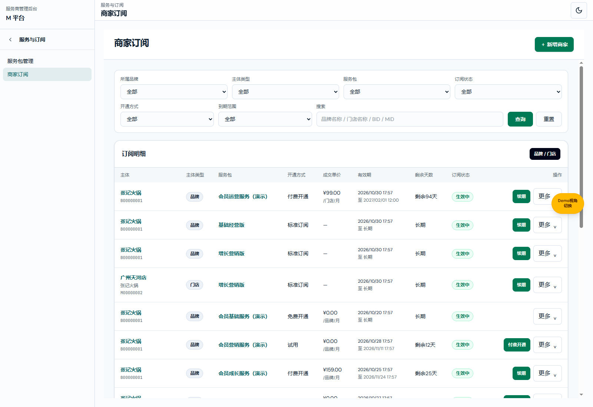

图注：2026-10-30，codex/subscription-entitlement-actions-20261030，main@2692eae7，端口61438，外部Chrome隔离演示数据实采。

验证及未闭合截图：[商业权益操作验证](../../verification/subscription-entitlement-actions-20261030/README.md)。

| 字段／操作 | 逻辑说明 |
| --- | --- |
| 更多 | 每条商业权益均显示。复用服务包悬浮菜单，提供查看详情、操作记录、品牌服务权益查询；未停用且未到期记录按权限提供停用。 |
| 免费开通 | 长期免费不提供续期；历史限时免费到期或已停用时，可按当前免费政策新建免费权益。 |
| 试用／付费开通 | 试用不允许延期或再次试用；具备新增权限且服务上架运行时提供付费开通，创建新记录，保留试用记录及资格消耗。 |
| 付费记录／续期 | 仅生效中且服务上架运行时显示；新结束时间必须晚于当前及原结束时间，保留成交快照及开通依据。价格或合同变化通过新开通处理。 |
| 赠送记录／延长赠送 | 仅生效中且服务上架运行时显示；金额保持0，新的结束时间同续期校验；延长原因去空格后1至200字，保存到本次审计快照，不覆盖原赠送原因。 |
| 再次开通／再次赠送 | 到期或已停用的付费／赠送记录按新增权限提供；创建新ID，从办理时开始，原记录不改写，保留历史空档。默认带入原适用范围，成交价、期限和依据重新确认。 |
| 停用 | 按当前记录办理；确认展示直接品牌、适用门店数、服务提供菜单数、实际失去及其他订阅仍覆盖菜单数。原因去空格后1至200字；确认立即停止该记录，其他有效来源继续提供能力。 |
| 适用门店与计数 | 指定门店不扩大到全部品牌门店。各品牌／门店上下文分别计算，菜单关联求和；失去数为操作前有效集合减操作后有效集合，保留数为本记录提供集合与操作后有效集合交集。 |
| 权限／服务状态 | 新开通使用新增权限，延长使用续期权限，停用使用停用权限；渲染及存储均校验。服务下架或停用时不提供新开通及延长，历史详情仍可查。 |
| 确认／取消／失败 | 续期和停用弹框五分钟过期；权益、服务、门店归属或生效／结束边界变化时要求重新查看。成功关闭并刷新列表；失败保留输入并显示原因；取消、关闭和查看均不写入。 |

### 操作：展开更多

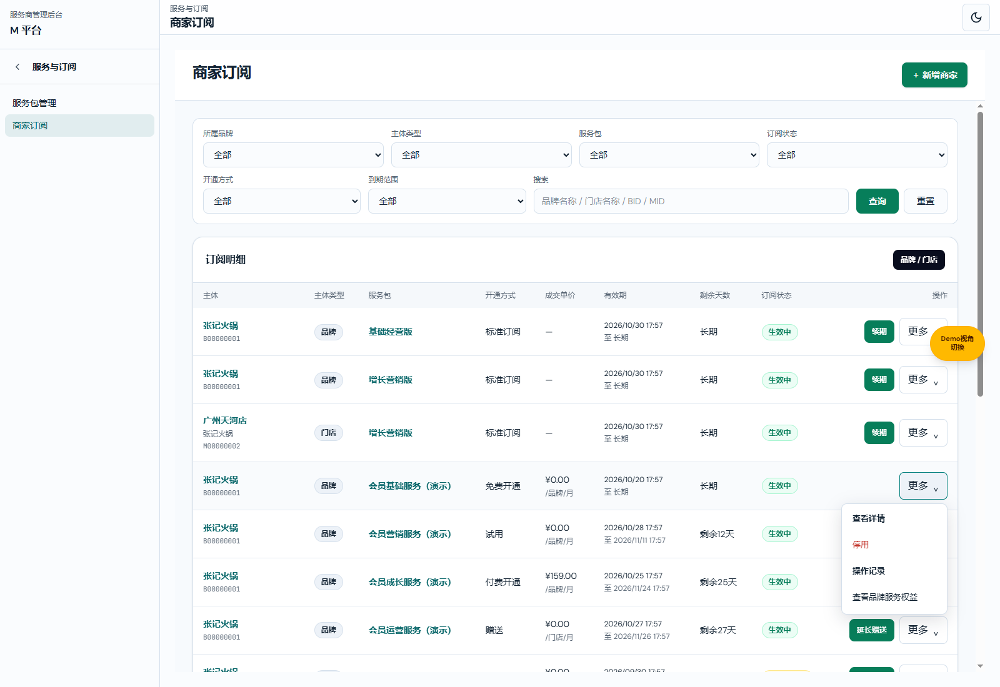

图注：2026-10-30，codex/subscription-entitlement-actions-20261030，main@2692eae7，端口61438，外部Chrome隔离演示数据实采。

免费权益与其他方式共用悬浮操作菜单；详情、记录与品牌服务权益为查询入口。

### 操作：付费续期

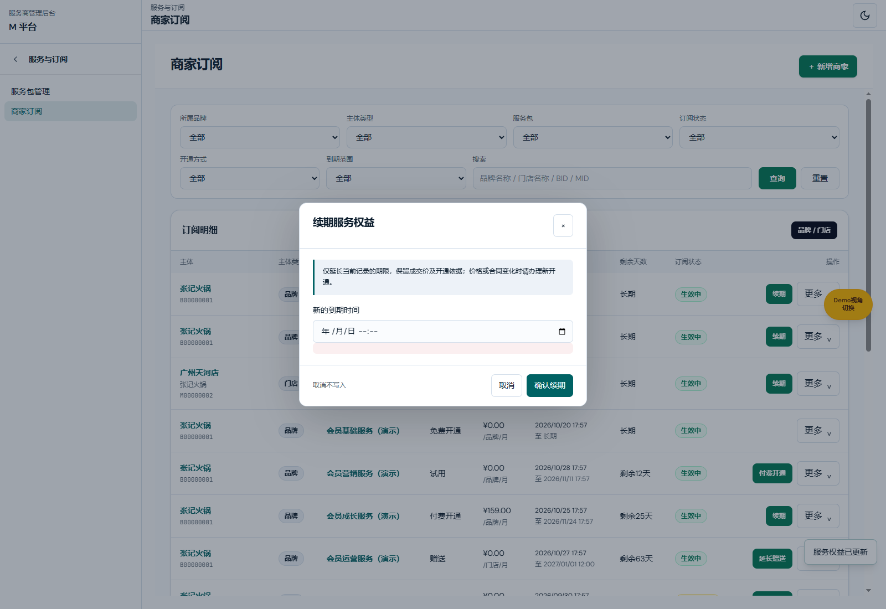

图注：2026-10-30，codex/subscription-entitlement-actions-20261030，main@2692eae7，端口61438，外部Chrome隔离演示数据实采。

输入晚于当前及原期限的结束时间；保留成交快照，取消不写入。

### 操作：延长赠送

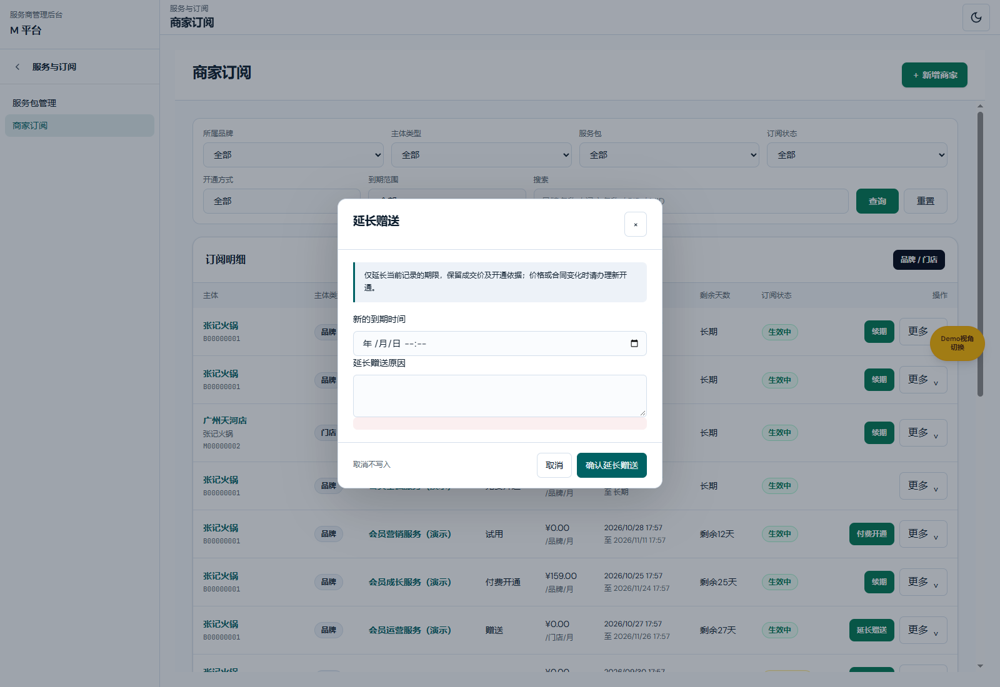

图注：2026-10-30，codex/subscription-entitlement-actions-20261030，main@2692eae7，端口61438，外部Chrome隔离演示数据实采。

新的到期时间与延长原因均必填；原因去空格后1至200字，记录到本次审计，不覆盖原赠送依据。

### 操作：试用转付费

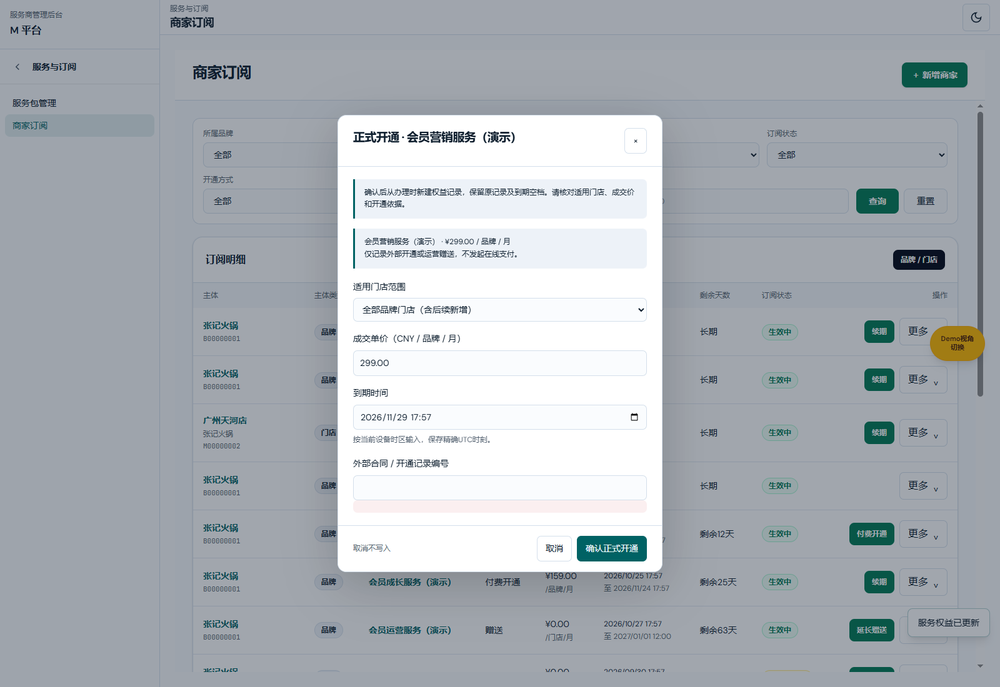

图注：2026-10-30，codex/subscription-entitlement-actions-20261030，main@2692eae7，端口61438，外部Chrome隔离演示数据实采。

从试用记录携带原门店范围进入付费开通；确认成交价、期限和依据后新建权益，试用历史与资格保留。

### 操作：到期后再次开通

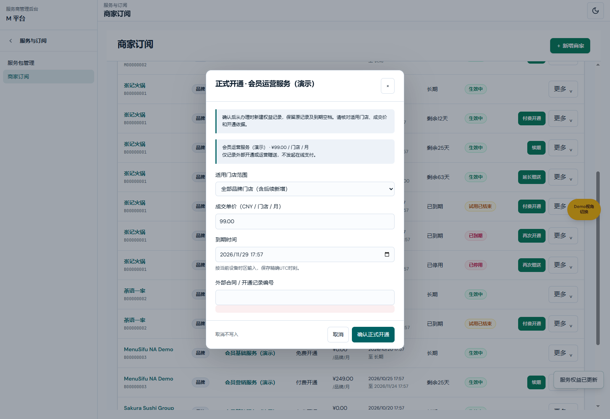

图注：2026-10-30，codex/subscription-entitlement-actions-20261030，main@2692eae7，端口61438，外部Chrome隔离演示数据实采。

携带原适用范围，重新确认交易字段；新记录从办理时开始，旧记录和到期空档保留。

### 操作：停用权益

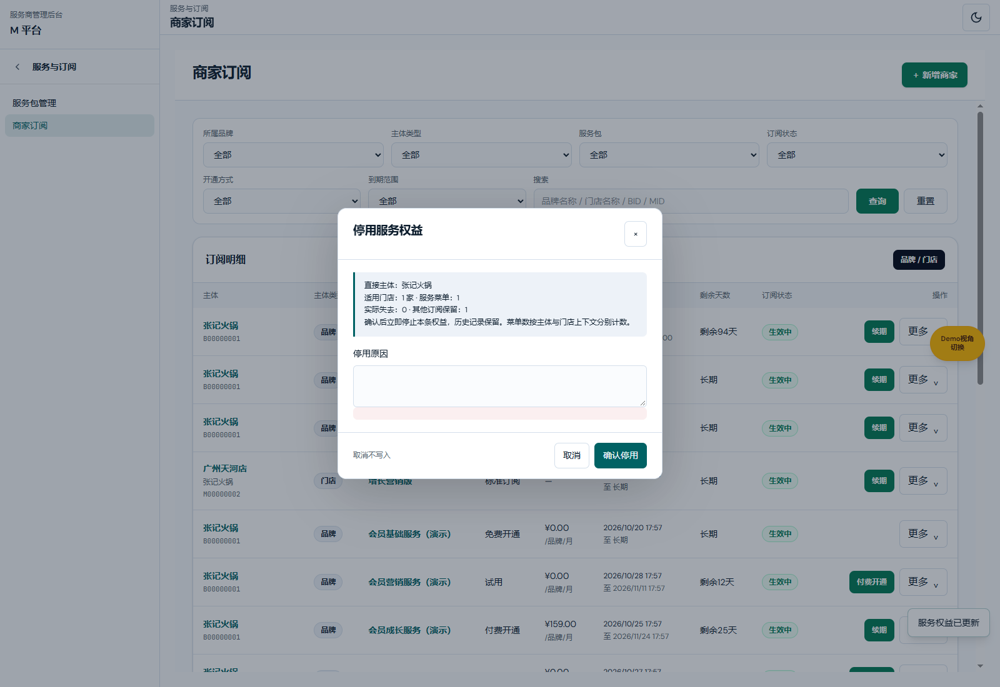

图注：2026-10-30，codex/subscription-entitlement-actions-20261030，main@2692eae7，端口61438，外部Chrome隔离演示数据实采。

确认提示直接品牌、适用门店、服务菜单、实际失去及其他订阅保留数；原因必填。取消不写入，确认立即失效。

### 操作：查看详情

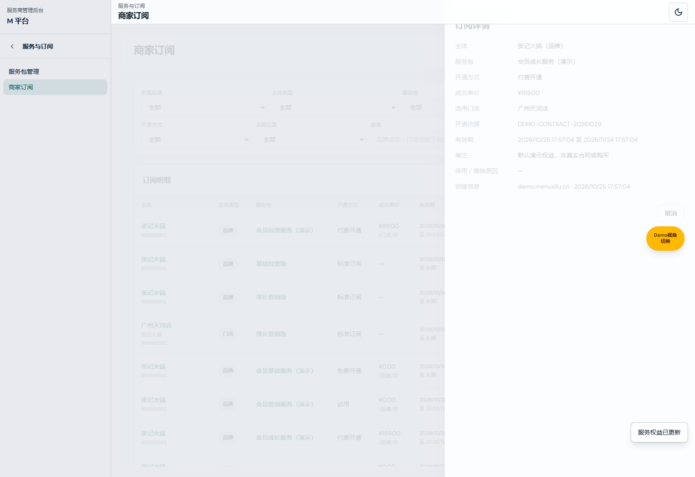

图注：2026-10-30，codex/subscription-entitlement-actions-20261030，main@2692eae7，端口61438，外部Chrome隔离演示数据实采。

当前记录展示主体、服务包、开通方式、成交价、适用门店、开通依据、期限、备注及创建信息；关闭返回列表。

### 操作：查看操作记录

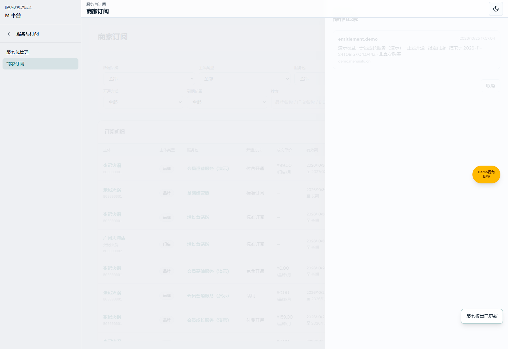

图注：2026-10-30，codex/subscription-entitlement-actions-20261030，main@2692eae7，端口61438，外部Chrome隔离演示数据实采。

仅查询当前记录的历史动作、前后变更、操作者及时间；查看与关闭不更改权益。

## 页面：商家订阅状态驱动操作

待补页面图片：订阅列表各状态与“主操作 + 更多”布局、“更多”悬浮展开态及视口底部向上展开态，功能实现后实采。

### 列表操作区域

| 字段／操作 | 逻辑说明 |
| --- | --- |
| 待生效主操作 | 显示编辑；点击打开大尺寸编辑抽屉。 |
| 待生效更多 | 立即生效、撤销、查看详情、操作记录。撤销不等于删除，记录转为已作废。 |
| 生效中主操作 | 显示续期；点击打开新的到期时间弹框。 |
| 生效中更多 | 调整到期时间、停用、查看详情、操作记录。核心字段不提供编辑入口。 |
| 历史记录 | 已到期、已停用、已作废均可显示重新开通；旧记录本身永久只读，重新开通只复制来源信息并创建新记录。 |
| 禁用操作 | 因服务包下架、停用、主体缺失或权限不足暂不可用时，保留禁用态并就近展示原因。 |
| 商业权益 | 提供按方式与状态匹配的主操作及更多，详见商业权益操作区域。 |

### 操作：展开与关闭“更多”

待补页面图片：订阅明细“更多”默认向下展开、底部向上展开、键盘焦点和关闭后状态实采图。

| 字段／操作 | 逻辑说明 |
| --- | --- |
| 更多按钮 | 直接复用服务包管理的触发器、菜单及普通／危险／禁用／键盘焦点样式；点击在按钮附近打开悬浮菜单，不改变当前订阅行高度。`Enter`／`Space` 开关，`ArrowDown`／`ArrowUp` 分别打开并聚焦首／末项。 |
| 展开方向 | 默认右对齐向下；下方空间不足时向上；菜单不得越出视口，内容过多时内部滚动。 |
| 单实例 | 打开本行菜单时关闭其他行菜单；再次点击同一按钮关闭。 |
| 外部关闭 | 点击菜单外、滚动表格／列表／页面、窗口缩放、切换路由时关闭；菜单内部滚动保持打开。 |
| 键盘操作 | 打开后聚焦首个操作项；方向键在全部项目间循环，`Home`／`End` 到首尾，`Enter`／`Space` 执行可用项；`Escape` 关闭并返回“更多”按钮；`Tab`／`Shift+Tab` 关闭后按正常正向／反向顺序离开菜单。 |
| 禁用操作 | 禁用项仍可聚焦，展示可见原因并供读屏读取，但 `Enter`／`Space` 不执行；全部项目禁用时聚焦首项以便读取原因。 |
| 选择操作 | 先关闭菜单，再打开原确认弹框、抽屉或执行原操作；状态、权限、禁用原因及业务后果不变。 |

### 操作：编辑待生效订阅

待补页面图片：编辑抽屉、字段变更对比、保存成功及失败状态。

编辑抽屉逐项展示主体类型、主体、服务包、生效时间、到期时间、成交单价、计价依据和备注。保存确认展示原值与新值；校验失败保留输入并显示具体字段错误。成功提示“订阅已更新，将按新的生效时间生效”。

### 操作：立即生效、停用与撤销

待补页面图片：三个操作的影响确认弹框、原因输入、处理中、成功和失败状态。

| 操作 | 确认内容与结果 |
| --- | --- |
| 立即生效 | 展示主体、继承门店、新增菜单和重复覆盖菜单；确认后从当前时间生效并刷新能力。 |
| 停用 | 展示直接主体、继承门店、菜单提供数、实际失去数和仍覆盖数；原因必填，确认后立即退出能力计算。 |
| 撤销 | 仅待生效可用，待生效不提供停用；提示当前能力不减少但未来能力取消；原因去空格后 1 至 200 字，确认后状态为已作废且不可恢复。 |

### 操作：续期与调整到期时间

待补页面图片：续期弹框、提前结束影响提示及时间校验结果。

续期必须晚于原结束时间和当前时间，不修改原成交价。缩短到期时间须满足当前时间＜新结束时间＜原结束时间；长期订阅要求原结束时间为空且新结束时间晚于当前时间，首次设置结束时间按缩短处理，并要求提前结束权限、1 至 200 字原因、影响预览与审计；需要立即结束时引导停用。

### 操作：查看详情与操作记录

待补页面图片：详情抽屉和操作记录页签。

详情展示主体、服务包及开通版本、菜单能力、开通方式、成交价、有效期、状态、备注、创建与最近操作、停用／撤销原因。操作记录按时间倒序展示动作、前后值、影响摘要、原因、操作者与时间。

### 操作：重新开通

待补页面图片：从历史记录进入的预填新增弹框和新记录创建结果。

从已到期、已停用或已作废记录预填主体、服务包、成交信息和备注；不复制时间和历史原因。只有同时具备查看与新增权限、且服务包运行并上架时显示入口。提交前明确“创建新订阅，不恢复或覆盖原订阅”。

### 服务包附加状态与影响计数

订阅生命周期标签与服务包状态分开显示。服务包下架不影响已有生效订阅，待生效记录到达原时间仍自动生效，但只能修改到期时间和备注，主体、服务包、原开始时间与成交快照锁定，立即生效、续期和重新开通禁用；服务包停用时暂停能力，生效中记录只读，待生效记录可改选服务或撤销。

影响弹框按品牌／门店上下文分别计算菜单关联后求和，同一菜单在不同门店分别计数。立即生效展示新增与已覆盖菜单；停用／提前结束展示实际失去与仍由其他订阅覆盖菜单。预览五分钟过期，服务包版本、其他订阅或品牌门店范围变化后必须重新打开。

## M平台导航与页面归属

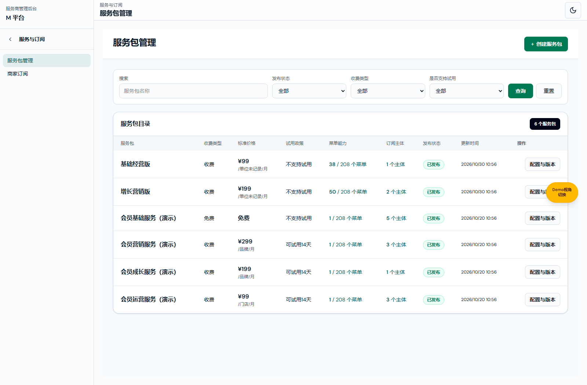

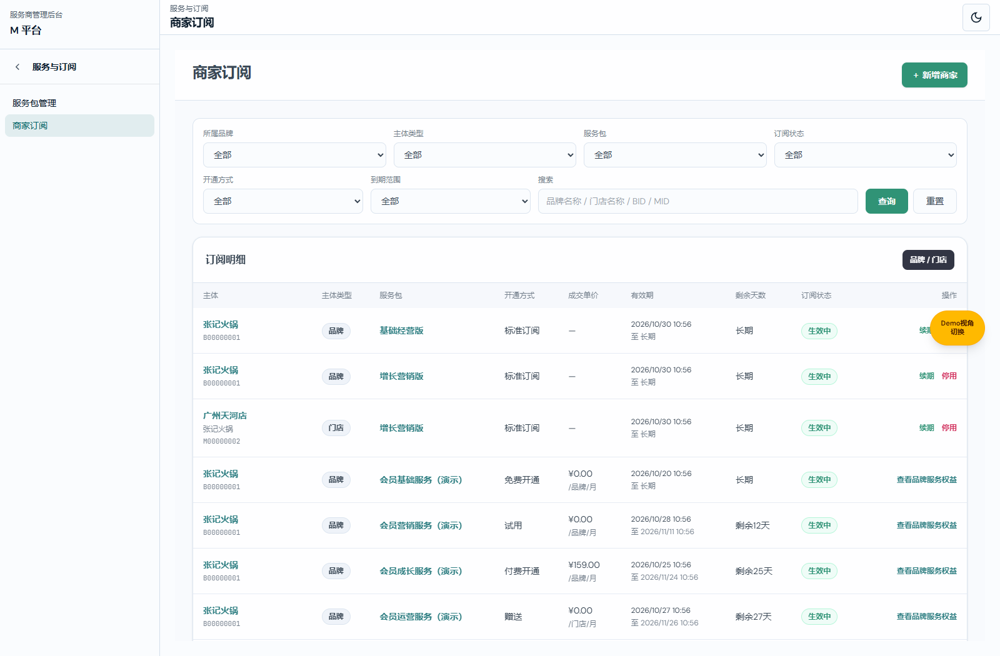

图注：2026-10-30，codex/services-subscriptions-nav-20261030，起始main@fb170718，5289功能预览实采。

| 字段／操作 | 逻辑说明 |
| --- | --- |
| 一级菜单 | 服务与订阅，归集服务产品与商家开通记录；不再以服务包管理作为父级名称。 |
| 服务包管理 | 独立二级页面，页面标题同名，维护服务产品、定价、试用、菜单配置及版本。沿用现有subscription-services路由、services模块ID和页面权限ID。 |
| 商家订阅 | 独立二级页面，页面标题同名，维护品牌／门店订阅、成交单价、期限与状态。沿用merchant-subscriptions路由及subscriptions页面权限ID。 |
| 页面归属提示 | 两页面顶部模块／面包屑统一显示服务与订阅，不显示旧权限管理中心·订阅服务归属文案。 |
| 父子导航 | 沿用公共父子滑层及返回一级交互；两个页面不合成页签，既有链接、筛选、菜单及主体预览、创建、发布、续期和停用逻辑不变，不新增授权或财务能力。 |

## 公共业务规则

商家订阅仅支持品牌与门店。历史集团记录只作存储兼容，不参与列表、统计、开通或有效能力；品牌向门店继承与门店增配继续生效。

1. 菜单来自M平台当前已发布路由目录，不维护第二份菜单树。服务可以选择一个或多个页面，同一页面可由多个服务提供。价格附着于服务，菜单勾选只控制展示上限。
2. 菜单实际使用须同时满足：品牌/门店菜单上限、员工角色授权、当前主体范围、品牌账号状态和有效服务权益。服务开通不增加员工角色、其他门店或未展示菜单权限。
3. 旧服务未启用权益控制时继续原订阅过滤和原价格展示规则；演示sub-demo记录不代表真实开通。新建服务默认勾选权益控制；没有订阅历史的无历史订阅的旧服务明确启用并发布才接入新规则；已有订阅历史时保留商业计费口径，不自动赠送或补付费权益。
4. 免费和收费分别定义。免费服务的标准价必须为0，收费服务标准价必须大于0。金额以最小货币单位整数保存，页面按币种格式展示；计费单位为品牌或门店，周期为月/季度/年/一次性，均不触发自动扣费。
5. 免费权益需明确免费开通。收费权益来源为一次试用、正式开通或赠送。正式开通保存外部合同/开通依据、成交金额、币种、单位、周期和发布版本快照；赠送金额为0并记录原因。修改标准价不覆盖已有成交价。
6. 权益适用范围为全部品牌门店（含新增）或指定当前品牌门店。指定范围至少一家且全部归属于当前品牌。品牌总览不能把某一门店权益扩大为全品牌；切换到不覆盖门店时禁止使用。
7. 试用仅对允许试用的收费服务开放，天数为1至90的整数。每品牌每服务最多一次，历史停用记录仍占用资格。勾选菜单、打开页面或打开确认弹框均不消耗资格；提交确认后以当前时间起算。
8. 有效区间为开始时间≤当前时间<结束时间。免费可长期；正式和赠送需填写晚于当前时间的结束时刻。试用结束时刻=确认时刻+试用天数×86400000毫秒。试用和免费不提供续期；转正式另建付费权益，不覆盖试用历史。
9. 仅生效中的正式/赠送记录可延长，服务须已上架且运行中；赠送延长须填写1至200字原因。到期或停用后再次开通创建新记录，从办理时开始并保留历史空档。新的结束时间必须晚于原到期时刻与当前时刻，保留原成交快照并记录审计。停用立即失效，要求原因，保留原记录。一个来源到期或停用，不影响同一页面其他仍有效且覆盖当前主体的服务来源。
10. 无有效权益时，在原菜单可见范围内显示服务说明、价格、原因和联系入口，不挂载业务页面或展示业务数据。到期不删除数据，不重置角色，不自动扣费。当前品牌已启用Admin可明确开始试用；普通员工无试用/正式开通权。
11. M操作沿用商家订阅创建/续期/停用操作资源与当前管理页写权限；只读用户可看权益，无写入口，存储操作也验证身份权限。发布/停用/回滚原操作权限继续有效。
12. 权益控制启用后不能清除该控制；历史受控路径保留，停用、移除绑定、回滚均不能变成无配置放行。免费父页面不放行独立收费子页面，以最具体受控路径判定。未明确品牌/门店的跨品牌视角不能借用其他品牌权益。
## M平台：商家订阅品牌／门店维度与统一列表

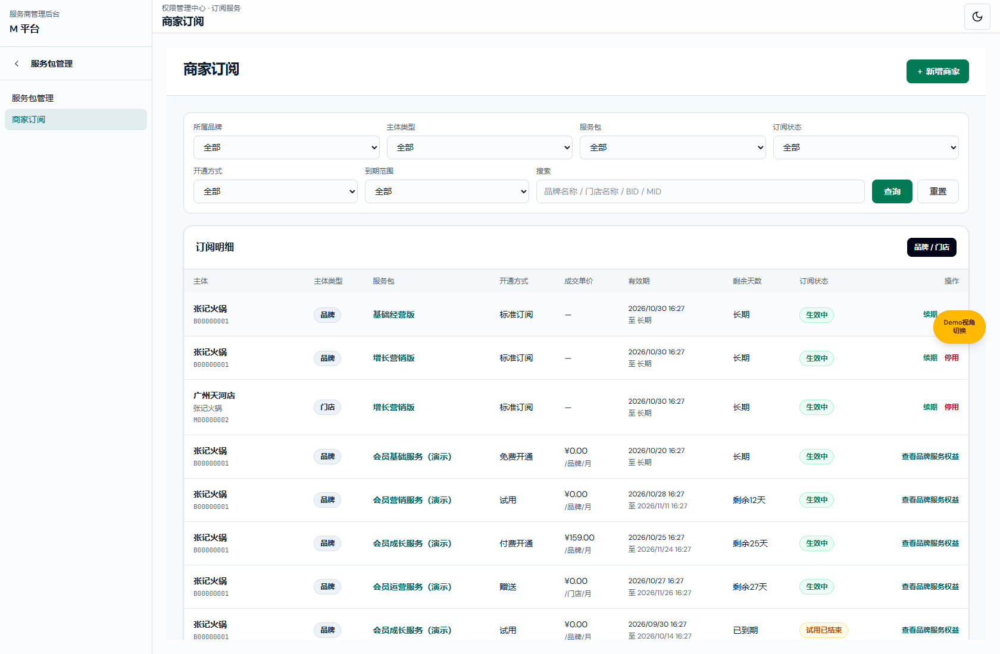

图注：2026-10-30，codex/subscriptions-brand-store-20261030，起始main@bcd20cf8，5278功能预览实采。入口：商家订阅。

| 字段／操作 | 逻辑说明 |
| --- | --- |
| 支持主体 | 仅品牌、门店；不提供集团入口、选项、列表行或统计维度。品牌菜单能力可向所属门店继承，门店可继续增配；集团不参与菜单能力合并。 |
| 历史集团记录 | 保留存储原记录及审计，不自动删除或转换为品牌／门店；不展示、不计入服务包订阅主体统计、不参与有效能力来源或已配置订阅门禁，也不允许新建、续期或停用集团记录。 |
| 列表行 | 普通订阅及免费／试用／正式／赠送权益共用同一模板；字号、单元格间距、行分隔线、主体类型标签、状态标签和右对齐操作区一致。 |
| 主体 | 主行品牌或门店名称为按钮，点击在当前列表弹框展示对应主体基本信息；次行显示品牌BID或门店MID；缺少品牌公共编号时退回原主体ID，不把技术ID替换成推测编号。 |
| 主体类型 | 品牌／门店，使用相同标签样式。 |
| 服务包 | 仅展示可点击的名称，点击查看菜单；不展示英文服务编码或开通方式，无服务包显示未知服务包。 |
| 开通方式 | 独立位于服务包与成交单价之间。无entitlementKind为标准订阅，free为免费开通、trial为试用、paid为付费开通、gift为赠送；保留原记录含义，不推断历史标准订阅为收费或免费。此字段为本次权益获取方式，收费／免费是服务定价属性，不混作同一分类。 |
| 成交单价 | 独立位于开通方式与有效期之间。只读开通时agreedPriceMinor、agreedCurrency、agreedBillingUnit、agreedBillingInterval快照；金额按分除100，币种格式保留两位小数，次行显示品牌／门店及月／季度／年／一次性。明确零金额显示¥0.00，不代表已收款；不从当前服务包价格推算。历史无金额或金额为负数、非整数／非有限值时显示—；存在金额但币种、单位或周期缺失时明确标记未记录，不默认补品牌／月或当前标准价。 |
| 有效期 | 第一行开始时刻，第二行结束时刻；按设备本地时区展示中文年月日时分，无结束为至长期，非法历史时间显示—。不输出原始UTC ISO字符串，不改变存储时刻或到期判断。 |
| 状态 | 订阅生命周期独立判定为已作废／已停用／待生效／生效中／已到期；到期试用标记试用已结束。服务包已下架／已停用／未发布／缺失作为同列附加标签，不覆盖生命周期；成交价快照统一放在成交单价列。 |
| 操作 | 相同小字号及间距。普通未停用订阅保留续期／停用；商业权益按方式及状态提供主操作与更多，包含品牌服务权益全屏查询入口。移除集团不新增员工授权或商业服务开通资格。 |
| 服务包订阅主体统计 | 仅统计服务包直接且未停用的品牌／门店订阅，按主体类型+主体ID去重。包含待生效和已到期记录，不包含集团、已停用记录及仅通过继承获得能力的门店；不代表实时生效主体数。点击数量查看同口径明细。 |

### 服务包目录：菜单能力与订阅主体

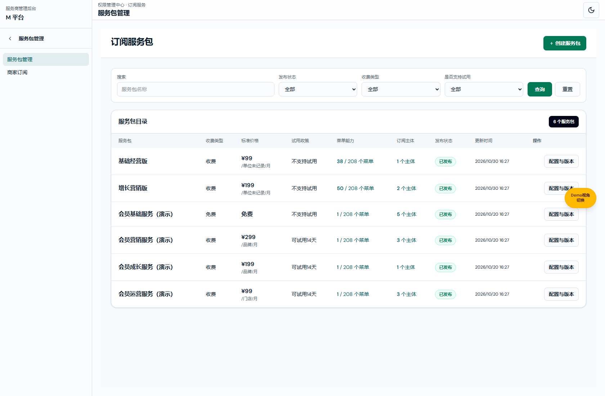

图注：2026-10-30，codex/subscription-list-filters-20261030，起始main@e94df384，5287功能分支目录实采；菜单及主体弹框沿用已验证图片。

| 字段／操作 | 逻辑说明 |
| --- | --- |
| 服务包名称 | 仅展示服务包中文名称，不展示名称下方的英文编码；编码仍保留为内部唯一标识，不修改存储、绑定或查找逻辑。 |
| 菜单能力 | 显示当前服务发布版本配置节点数／当前路由目录可选菜单数，沿用既有计数。数字为按钮，点击在当前页打开下方菜单弹框，不进入编辑页面、不写入配置。零数量仍可打开空状态。 |
| 订阅主体 | 数量与明细共同按主体类型+主体ID分组；范围遵循服务包订阅主体统计。点击数量在当前页打开主体弹框，零数量显示暂无订阅主体。 |

#### 服务包菜单弹框

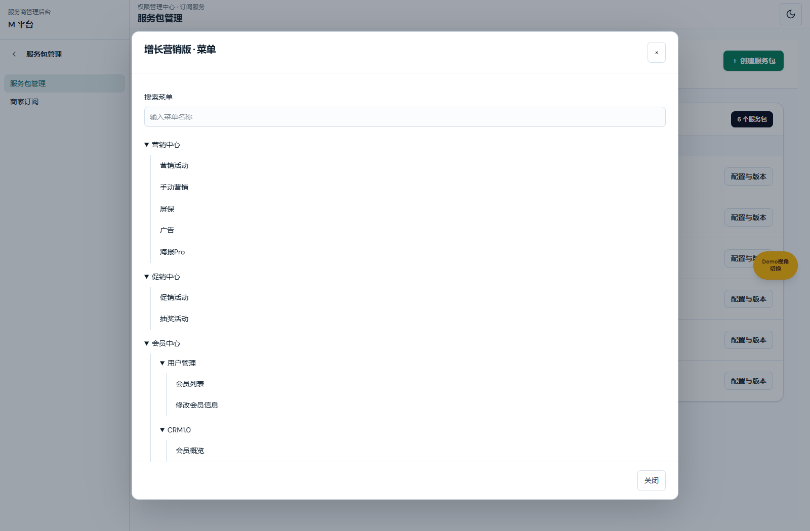

入口：服务包目录的菜单能力数量。复用服务包菜单弹框：读取当前发布版本绑定节点及必要祖先，不展示未绑定兄弟菜单；支持搜索、层级折叠和关闭。无发布版本显示暂无已发布菜单，缺失节点保留必要提示，不改变权限或订阅。

#### 服务包订阅主体弹框

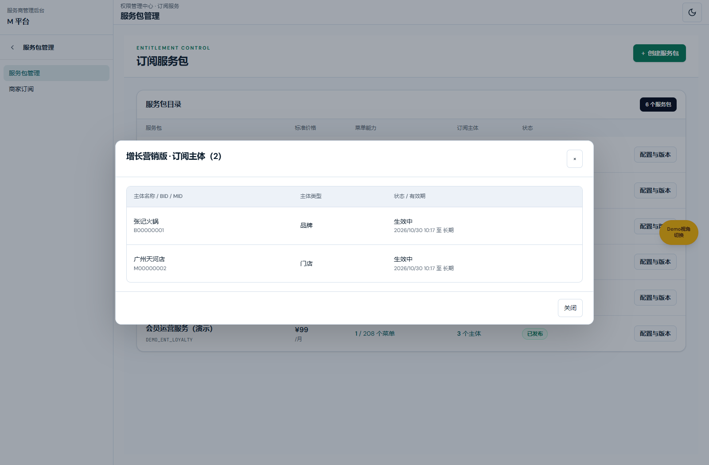

用途：核对所选服务包直接关联的品牌／门店及订阅期限，只读、不跳转。

| 字段／操作 | 逻辑说明 |
| --- | --- |
| 标题 | 服务名·订阅主体（去重主体数），与目录数量一致。打开时重新读取订阅数据。 |
| 主体名称 | 品牌／门店当前名称；实体不存在显示主体已移除并保留记录ID。不提供跳转。 |
| BID／MID | 品牌展示公开BID，缺失回退记录subjectId；门店展示MID，不显示服务包英文编码。 |
| 主体类型 | 品牌或门店，无集团。 |
| 状态 | 每条记录展示订阅生命周期主状态；服务包异常另展示附加标签，不因展示明细而改变任一维度状态。 |
| 有效期 | 每条订阅展示起止本地时间至分钟，无结束时刻显示长期，非法时间显示—。同一主体多段期限集中在同一主体行并列，不能合并为连续有效区间。 |
| 关闭 | 顶部×、底部关闭、Escape及遮罩外侧点击关闭，恢复原页面与焦点，不保存、不修改数据；路由切换清理弹框。 |
| 空数据 | 无符合统计范围的记录时显示暂无订阅主体，保留关闭操作。 |

验收：同主体新增一段订阅不增加主体数量；不同类型即使同ID也分别计数；集团、已停用记录不计入；明细行数等于目录数量。零主体、实体缺失及非法时间可正常查看与关闭。

### 新增商家订阅：品牌／门店选择

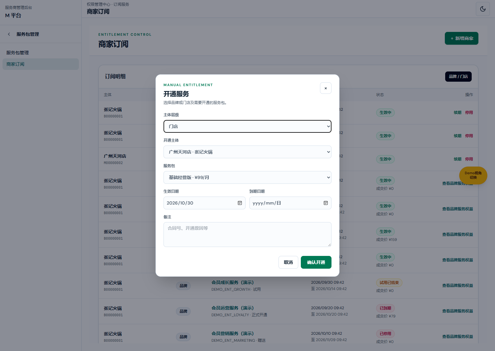

| 字段／操作 | 逻辑说明 |
| --- | --- |
| 主体层级 | 默认品牌，仅品牌／门店；不提供集团。 |
| 开通主体 | 品牌读取现有可选品牌，门店读取现有品牌门店；切换类型刷新主体列表与默认第一项，无可选项时禁止提交。 |
| 服务包 | 沿用已发布服务包及原商业设置校验；本调整不改变原开通流程或计费规则。 |
| 生效日期 | 默认当前日期，沿用原日期转换和有效性校验。 |
| 到期日期 | 可空表示长期；填写时必须晚于生效日期，沿用原时刻区间与重叠校验。 |
| 备注 | 沿用原可选备注及保存规则。 |
| 确认开通 | 类型必须为brand或store，接口同样拒绝group及其他类型；合法品牌/门店沿用原服务状态、有效期及重叠校验。成功刷新列表，失败保留输入并显示原因。 |
| 取消／关闭 | 不创建订阅，保留原列表；只读账号仍不能开通或变更。 |

## 列表查询与展示

### 服务包管理

图注：2026-10-30，codex/subscription-list-filters-20261030，main基线e94df384，5287功能分支实采。入口：M平台服务包管理。

| 字段／操作 | 逻辑说明 |
| --- | --- |
| 搜索 | 默认空，按服务包名称包含匹配，不区分大小写，去除首尾空格，不匹配隐藏英文编码。 |
| 发布状态筛选 | 默认全部，可选未发布／已发布，按是否存在当前发布版本判定；停用服务仍有发布版本。服务状态另以已上架／已下架／已停用筛选。 |
| 收费类型筛选 | 默认全部，可选免费／收费；优先使用服务商业政策chargeType，历史无政策时仅以标准价0判免费、非0判收费，不修改权益控制规则。 |
| 是否支持试用 | 默认全部，可选支持试用／不支持试用，按商业政策trialEnabled判断，缺失视为不支持；不代表当前品牌具备试用资格。 |
| 收费类型列 | 展示免费／收费，与筛选共用判定。 |
| 标准价格列 | 免费显示免费；收费显示币种金额及计费单位／周期。单位取商业政策brand或store，历史缺失显示单位未记录，不推断品牌／门店。沿用月／季度／年／一次性；不覆盖已有成交价。 |
| 试用政策列 | 支持时显示可试用N天，否则显示不支持试用；N取当前商业政策trialDays。 |
| 更新时间列 | 当前服务包updatedAt，按设备本地时间显示年月日时分；非法值显示—，不表示某主体续期时间。 |
| 数量及操作 | 菜单能力、去重订阅主体及编辑与版本沿用各自已定义入口，筛选不改变数量计算范围。顶部服务包总量仍为全目录数量。 |

### 商家订阅

图注：同一基线5287实采。入口：M平台商家订阅。第一行组织范围与状态，第二行开通方式、期限、搜索及操作；不折叠更多筛选。

| 字段／操作 | 逻辑说明 |
| --- | --- |
| 所属品牌筛选 | 默认全部，取当前品牌清单。品牌订阅按自身品牌，门店订阅按当前门店merchantId对应品牌匹配。品牌选定后保留主体类型／服务包等条件，共同AND匹配。 |
| 主体类型筛选 | 默认全部，仅品牌／门店，集团始终不参与列表。 |
| 服务包筛选 | 默认全部，包含当前各发布状态的服务包，按packageId匹配，不因服务停用隐藏历史订阅。 |
| 订阅状态筛选 | 默认全部，只筛选生命周期，可选待生效／生效中／已到期／已停用／已作废。已到期试用在列表标记试用已结束并归入已到期；本次不新增服务包状态筛选，服务包异常只作为行内附加标签。 |
| 开通方式筛选 | 默认全部，标准订阅／免费开通／试用／付费开通／赠送；无entitlementKind为标准订阅，其余依次free／trial／paid／gift，不因免费成交价推断开通方式。 |
| 到期范围筛选 | 默认全部，未来7天／未来30天／已到期／长期有效。以查询时刻now及endAt匹配：未来N天为now<endAt≤now+N×86400000；已到期为endAt≤now；长期为无endAt；非法结束时间不匹配上述时间选项。此条件仅筛选结束时刻，可与状态组合，不暗示记录当前可用。 |
| 搜索 | 默认空，支持品牌名、门店名、BID、MID包含匹配，不区分大小写，去首尾空格。门店记录同时匹配所属品牌名及BID。 |
| 门店所属品牌 | 主体名称下展示当前门店归属品牌，再展示MID；缺失品牌显示所属品牌未记录，品牌订阅无需重复品牌名。 |
| 开通方式列 | paid显示付费开通，其余与开通方式筛选同口径；不改变已有记录来源或业务状态。 |
| 剩余天数列 | 每次页面渲染／查询时计算。任一日期非法显示—；已作废、已停用、待生效直接显示生命周期状态；生效记录无结束为长期，endAt≤now为已到期，0<endAt-now<86400000为今日到期，其余显示剩余ceil((endAt-now)/86400000)天。服务包附加状态不替代期限；该列不保证菜单实际授权可用，不承诺实时倒计时。 |
| 订阅状态列 | 沿用公共判定及试用已结束标签，独立于成交价展示。 |
| 原有字段及操作 | 服务包菜单预览、成交单价、有效期、续期、停用和品牌权益入口沿用原定义；不扩大只读用户操作权限，不新增购买或自动扣费。 |

### 主体名称入口

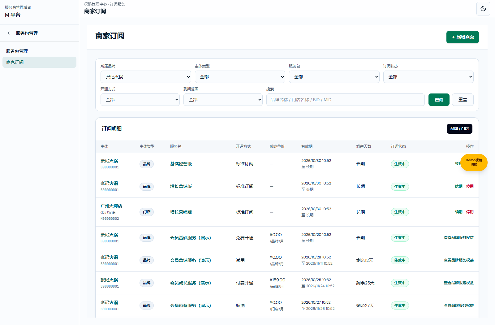

图注：2026-10-30，codex/subscription-subject-info-20261030，起始main@fb8063e6，5288功能预览实采。入口：商家订阅列表主体名称；名称下保留BID／MID与门店所属品牌。

| 字段／操作 | 逻辑说明 |
| --- | --- |
| 主体名称 | 品牌及门店名称均为按钮，按记录subjectType、subjectId读取当前主体信息，在当前页面展示对应只读弹框。不跳转商户管理，不切换主体、不代登录、不创建账号或修改订阅。 |
| 当前页面上下文 | 不重新挂载列表；打开及关闭均保留当前已应用筛选条件、列表位置和行数。 |

#### 品牌基本信息弹框

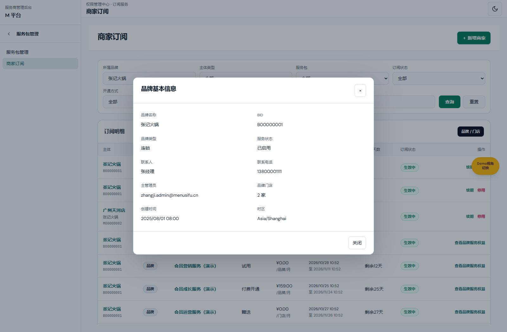

用途：查看订阅所对应品牌的当前资料；来源getMerchantById(subjectId)，不使用订阅建立时的历史品牌快照。缺少主体时沿用下方异常规则。

| 字段／操作 | 逻辑说明 |
| --- | --- |
| 标题 | 品牌基本信息，不追加内部英文编码。 |
| 品牌名称 | 当前品牌name，只读。 |
| BID | 当前品牌公开bid，缺失回退订阅subjectId，便于核对历史记录。 |
| 品牌类型 | orgType=chain为连锁，single-store为单店。 |
| 服务状态 | 使用商户管理统一getMerchantStatusLabel映射，不代替订阅记录状态。 |
| 联系人 | 当前品牌contactName；缺失为—。 |
| 联系电话 | 当前品牌contactPhone；缺失为—，不提供拨号或编辑。 |
| 主管理员 | 当前品牌primaryAdminEmail；缺失为—，不展示密码。 |
| 品牌门店 | getMerchantStores(subjectId)当前归属门店去重数量，单位家，0正常展示；不代表已开通服务或活跃门店数量。 |
| 创建时间 | createdAt按设备本地时间展示年月日时分；缺失或非法为—。 |
| 时区 | 当前品牌timezone原值；缺失为—。 |

#### 门店基本信息弹框

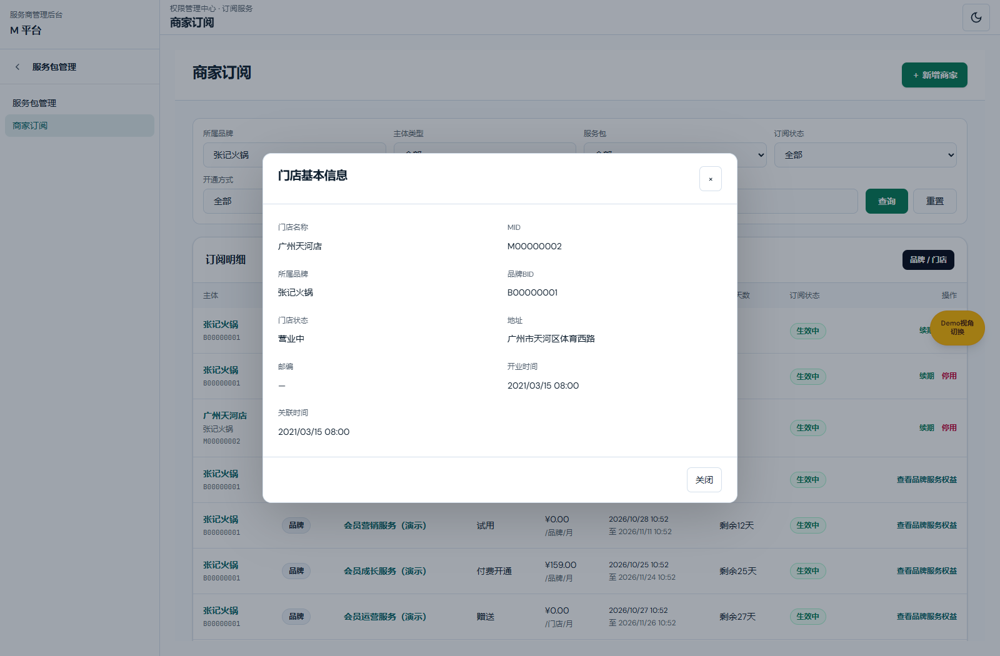

用途：查看订阅所对应门店的当前资料；来源getStoreById(subjectId)，所属品牌读取门店merchantId对应品牌。

| 字段／操作 | 逻辑说明 |
| --- | --- |
| 标题 | 门店基本信息，不追加内部英文编码。 |
| 门店名称 | 当前门店name。 |
| MID | 当前门店storeId。 |
| 所属品牌 | 当前门店merchantId对应品牌名称；品牌已移除或缺失显示—。 |
| 品牌BID | 所属品牌公开bid，缺失为—，不将门店ID替作品牌BID。 |
| 门店状态 | 复用getStoreStatusLabel，与商户管理一致，不等同于服务订阅状态。 |
| 地址 | 门店address；缺失为—。 |
| 邮编 | 门店postalCode原值；缺失为—。 |
| 开业时间 | 门店openedAt按设备本地时间展示年月日时分；缺失或非法为—。 |
| 关联时间 | 门店mountedAt按设备本地时间展示年月日时分；缺失或非法为—。 |

#### 共用弹框行为

| 字段／操作 | 逻辑说明 |
| --- | --- |
| 信息范围 | 仅基本资料，无集团维度、内部英文编码、配置入口或表单；读取现有主体资料，不新增数据源。字段空值为—，长文本允许换行。 |
| 关闭 | 顶部×、底部关闭、Escape或遮罩外侧点击关闭，恢复名称按钮焦点；不保存、不写入，不改变筛选或路由。切换路由时清理弹框，已移除按钮不恢复焦点。 |
| 主体缺失 | 显示主体不存在或已移除，无法读取基本信息；品牌保留BID／记录ID，门店保留MID，内容为订阅subjectId；不显示其他伪造资料，仍可关闭。 |
| 非法类型 | 只支持brand/store，其他类型不打开弹框；不新增集团访问。 |
| 验收 | 品牌、门店分别匹配正确记录；空值／非法时间／主体移除可关闭；打开与关闭不改变订阅存储、筛选或列表位置，名称可用键盘操作。 |

### 共用查询交互

| 字段／操作 | 逻辑说明 |
| --- | --- |
| 筛选布局 | 默认全部展开，控件高度40px，标签在上。宽屏服务包一行，商家订阅两行；窄屏按一／两列换行，表格在自身区域横向滚动，不撑破页面。 |
| 查询 | 点击查询或搜索框内回车，读取当前表单并应用；输入或选择本身不立即改变结果。所有非空条件AND组合；仅影响当前列表，不写入服务包、订阅或权限数据。 |
| 重置 | 清除当前列表全部条件并立即恢复全部记录，不修改另一列表条件。 |
| 条件保留 | 两个列表各自保存本次页面会话已应用条件；页面重新挂载及返回列表仍使用各自条件，整页刷新恢复全部。未查询输入不保证跨页面保留。 |
| 无匹配数据 | 表格显示没有符合条件的服务包／订阅记录，保留筛选与重置入口。 |
| 日期边界示例 | 查询时刻T：结束=T判已到期；结束=T+1毫秒判今日到期且命中未来7天；结束=T+1天显示剩余1天；结束=T+7天命中未来7天，结束=T+7天+1毫秒不命中。 |

## M平台：服务包目录与商家订阅列表

图注：2026-10-30，codex/subscription-list-filters-20261030，main基线e94df384，5287功能预览实采。

| 字段／操作 | 逻辑说明 |
| --- | --- |
| 服务包目录标题区域 | 仅展示中文页面标题、创建服务包操作与目录；不展示ENTITLEMENT CONTROL英文装饰标题；不展示产品组合说明或有效订阅跟随新版本的说明文案。发布和回滚规则仍按公共规则执行。 |
| 商家订阅标题区域 | 仅展示中文页面标题，不展示ENTITLEMENT CONTROL英文装饰标题；展示新增商家操作及订阅明细；仅包含品牌／门店，不展示记录数量与状态计算说明行。 |
| 订阅列表状态 | 保留每条记录的状态标签、有效期及操作；按原始生效与到期时间判定，隐藏说明文案不改变计算。 |

## M平台：订阅明细 → 点击服务包名称

图注：2026-10-30，codex/subscription-menu-preview-20261030，起始main@ccb5fd2c，5276功能预览实采。入口：商家订阅 → 订阅明细。

| 字段／操作 | 逻辑说明 |
| --- | --- |
| 服务包名称 | 每条服务包仍存在的订阅记录，将服务包名称作为可点击入口，打开已配置菜单弹框；覆盖旧订阅、免费、试用、正式开通及赠送，不要求收费服务。名称使用按钮语义并声明弹框，支持键盘聚焦与Enter／Space。操作列不增加独立查看菜单按钮，原续期／停用或品牌权益入口保留。 |
| 页面上下文 | 点击服务包名称在当前页面打开只读弹框，不跳转服务包配置或品牌详情，关闭后仍保留订阅列表位置。 |
| 可见权限 | 沿用商家订阅页面查看权限；只读账号可查看与搜索，不需要品牌管理写权限。服务包不存在时不提供菜单入口。 |

### 服务包菜单弹框

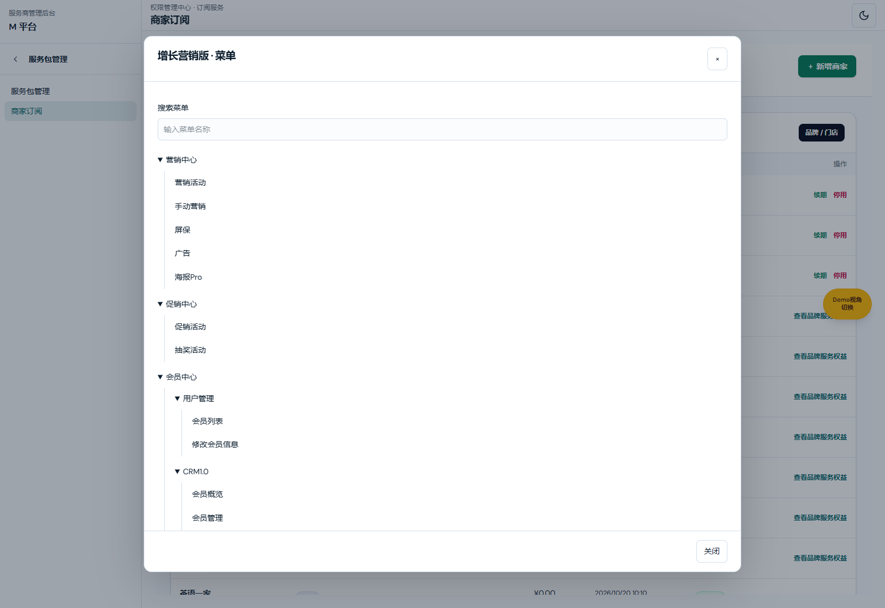

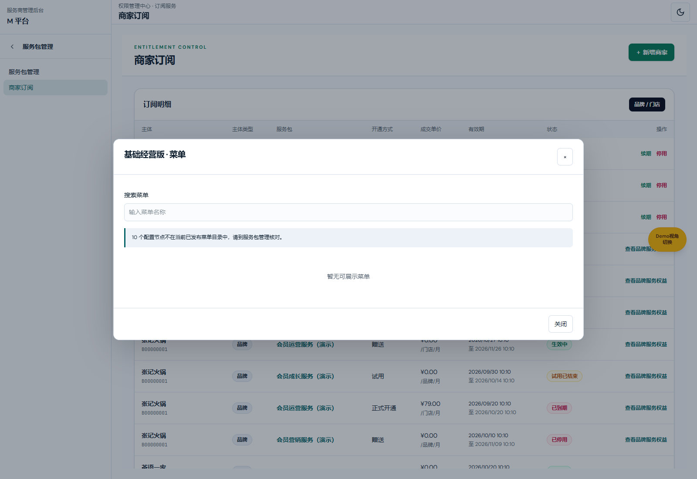

| 字段／操作 | 逻辑说明 |
| --- | --- |
| 服务名称 | 根据该订阅packageId读取服务包名称，标题为服务名·菜单。 |
| 简洁展示 | 无顶部发布版本、节点数或使用约束说明区；节点无已配置菜单／目录标记及路由路径，页脚仅保留关闭按钮，不展示重复只读提示。保留缺失节点、无发布版本、搜索无结果等必要异常提示。 |
| 菜单数据来源 | 读取服务包activeReleaseId对应的当前发布版本，与现有订阅统一跟随版本规则一致；不读未发布草稿或合同快照版本。 |
| 菜单树 | 读取当前已发布路由目录，只展示服务包绑定节点及必要结构祖先，不补选兄弟菜单；只展示菜单名称与层级，不展示目录／已配置菜单标记或路由路径。 |
| 搜索菜单 | 按名称或路径过滤，保留匹配节点的结构祖先；无结果显示没有匹配的菜单，清空恢复完整预览。 |
| 历史节点 | 发布版本绑定的节点不在当前目录时提示数量并引导到服务包管理核对，不把其他菜单映射为该节点。 |
| 空状态 | 无发布版本显示暂无已发布菜单；有版本但无可展示节点显示暂无可展示菜单。 |
| 停用状态 | 已停用服务仍可查看当前发布配置，不展示发布说明区；预览本身不表示该订阅当前可用。 |
| 关闭／×／Escape／遮罩 | 关闭弹框，不写入服务包、订阅或菜单权限，不更改有效期，不触发试用或扣款；切换路由关闭预览。 |
| 加载失败 | 菜单目录加载失败时提示稍后重试；服务包不存在时提示刷新页面，不展示其他服务数据。 |

## M平台：服务包上下架、停用与删除

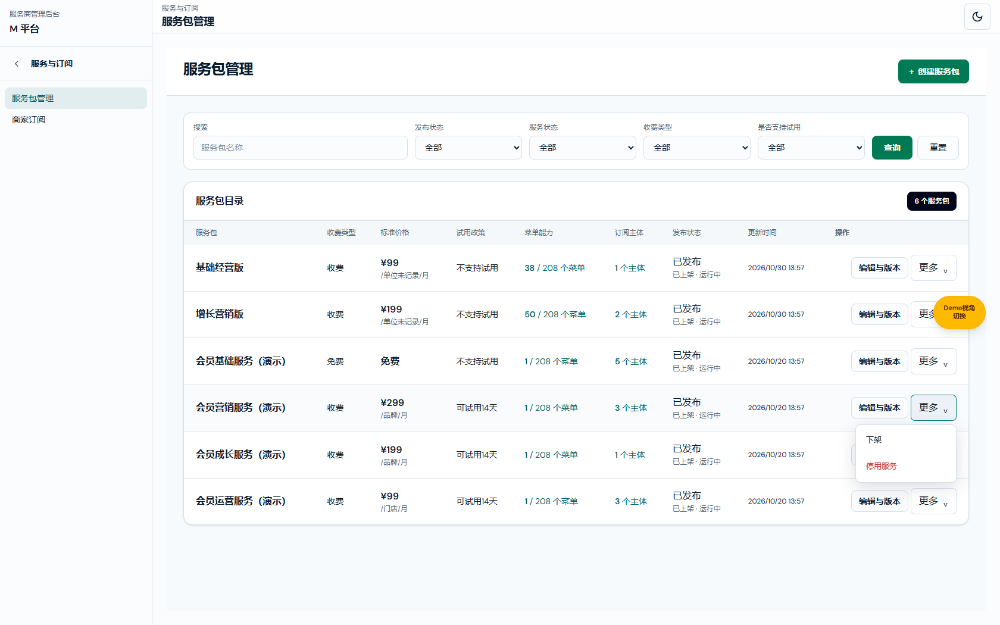

图注：2026-10-30，codex/package-action-feedback-20261030，起始main@5d012ef1，端口5298实采。入口：服务包管理；编辑与版本进入独立详情，列表中的其他操作收在更多按钮下方的下拉浮层中，不改变表格行高；详情页右上角直接展示可用操作，不提供更多入口。

| 字段／操作 | 逻辑说明 |
| --- | --- |
| 发布状态 | 有当前发布版本为已发布，无发布版本为未发布。与上下架及运行状态分别展示，停用不删除发布版本。 |
| 服务状态 | 未发布为草稿；已发布且运行中为已上架或已下架；停止提供服务为已停用。旧已发布服务未记录上下架字段时按已上架兼容，旧停用仍停用。 |
| 编辑与版本 | 页面查看权限允许进入；写入须有服务包编辑权限。保存草稿不影响已发布能力，发布后菜单跟随当前版本。 |
| 商业计费口径 | 存在任何订阅或权益记录，包括到期、停用及历史集团记录，禁止修改收费类型、币种、计费单位和周期；表单相应控件禁用，存储层同样拒绝。商业模式变化应新建服务包。 |
| 可调整字段 | 名称、说明、标准价及试用政策可以编辑发布；标准价和试用政策仅用于后续开通，不回填成交价、不重算已开始试用期限。 |
| 列表更多 | 点击在按钮下方靠右展示竖向操作浮层，不撑高表格；空间不足时向上避让，视口变化或外部滚动关闭。运行中提供下架或重新上架及停用；停用后提供恢复；未使用草稿提供删除。仅显示已授权动作，停用及删除使用危险色。 |
| 浮层关闭与键盘 | 再次点击更多、点击外部或Escape关闭；Escape恢复更多按钮焦点。打开聚焦首项；上下方向键、Home、End选择，Enter执行，Tab退出浮层。一次只打开一个菜单，不修改数据。 |
| 删除条件 | 服务从未发布、没有当前发布版本、没有任何历史发布版本且没有任何订阅或权益记录。曾经发布或曾被使用的服务均不能删除，不能通过停用或下架解除限制。 |
| 未保存保护 | 在编辑页面执行生命周期操作前，必须先保存草稿或放弃修改；不静默丢弃输入。 |
| 影响范围 | 列出该服务未单独停用、开始合法且未到结束时刻的有效或待生效记录。品牌及门店分别去重；品牌范围读取当前归属门店，指定范围仅交集覆盖。名单区分直接订阅主体及品牌权益覆盖门店；不是订阅主体统计列口径，也不是最终失去所有菜单授权的数量。 |
| 权限 | 上下架、停用、恢复、删除分别需要对应动作及页面写权限；只读不显示更多写入入口，直接调用存储操作同样拒绝。发布和回滚沿用各自动作权限。 |
| 数据与审计 | 操作成功记录服务包ID、名称、动作、操作者、时间及停用原因。下架、停用和恢复不改订阅起止、成交快照、员工权限和业务数据；删除只移除符合条件的包及草稿，审计保留。 |

### 操作提示与结果反馈

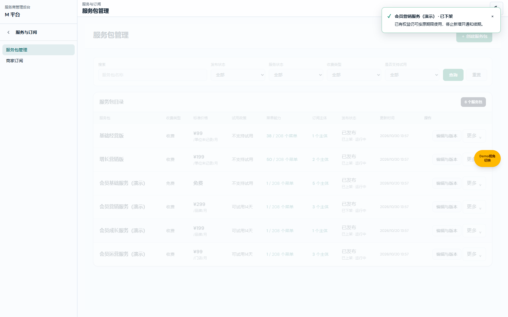

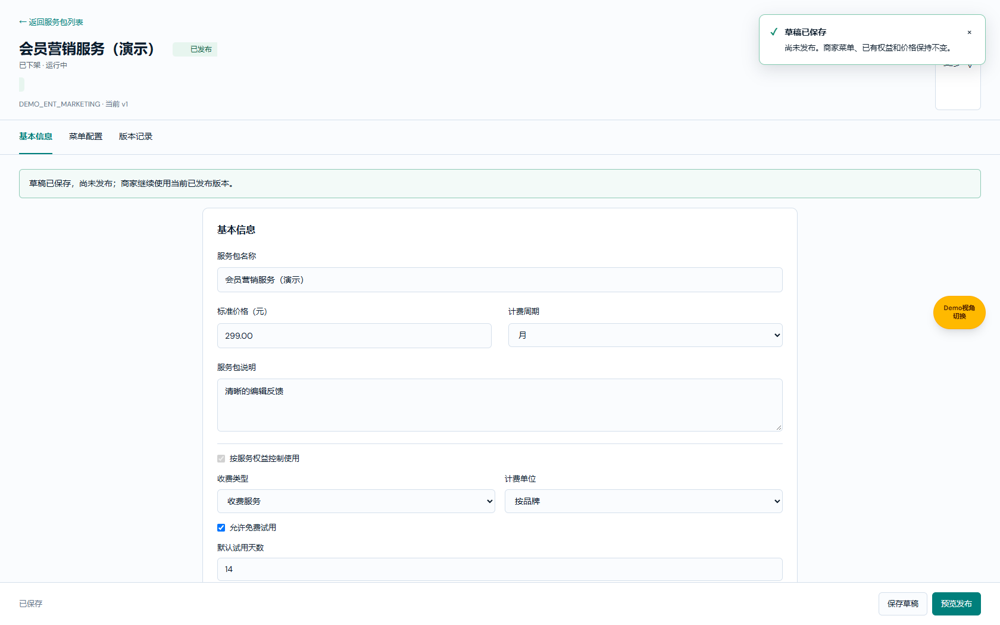

图注：同一功能分支5298实采。入口：列表或详情执行生命周期操作；编辑页点击保存草稿。

| 字段／操作 | 逻辑说明 |
| --- | --- |
| 确认弹框结构 | 标题明确动作；正文先展示操作对象及分条后果，再展示影响范围，最后按需展示输入与错误。固定底部取消与具体动作按钮，不使用模糊的确认或预览变更。 |
| 风险样式 | 下架、上架和恢复用提示色；停用、删除、放弃未保存修改及有移除菜单的发布预览用危险色提示卡。停用、删除及放弃修改确认按钮使用危险色；图标与文字同时说明，不只依赖颜色。 |
| 影响范围 | 品牌、门店及权益记录数分别展示；名单默认收起，可按需查看；弹框不展示统计口径说明段落。统计及其他服务的授权判定不变。 |
| 成功提示 | 生命周期成功展示服务名、操作结果及直接后果；成功后才关闭确认并刷新。结果浮层可手动关闭，约7秒后自动消失，不抢焦点。 |
| 保存草稿 | 直接校验并保存，不增加二次风险确认；成功明确尚未发布，商家继续使用当前版本。保存失败以错误样式在当前编辑区域提示，输入保留。 |
| 编辑与发布 | 编辑本身不下发；发布预览按对象、菜单新增／移除、影响范围分区。成功显示发布版本及相关订阅已更新，保留成交价和期限。 |
| 失败提示 | 生命周期错误显示于原弹框；发布／回滚的确认冲突或校验失败也保留原弹框，显示具体原因；不误显示成功。关闭后可重新预览。 |

### 下架确认

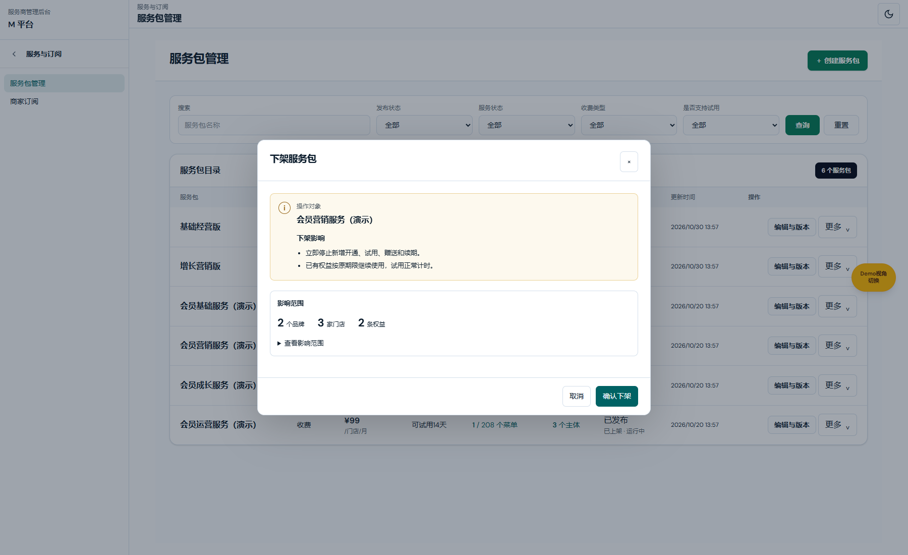

图注：同一功能分支实采。入口：已上架服务 → 列表更多或详情页对应按钮 → 下架。

| 字段／操作 | 逻辑说明 |
| --- | --- |
| 服务名称 | 展示目标服务中文名称，防止操作错项。 |
| 影响提示 | 黄色提示卡展示操作对象及下架影响：立即停止新增开通、试用、赠送和续期；已有权益按原期限继续使用，试用正常计时，不暂停、不顺延。 |
| 查看影响范围 | 默认收起，可展开查看品牌／门店名单及有效或待生效标识；不跳转页面。 |
| 确认下架 | 重新校验权限、服务状态与预览快照；成功更新下架状态和审计，刷新列表。失败保留弹框并显示原因。 |
| 取消／关闭／Escape | 关闭确认，不写入、不改变现有权益；回到更多按钮，不重新展开操作浮层。 |

### 重新上架确认

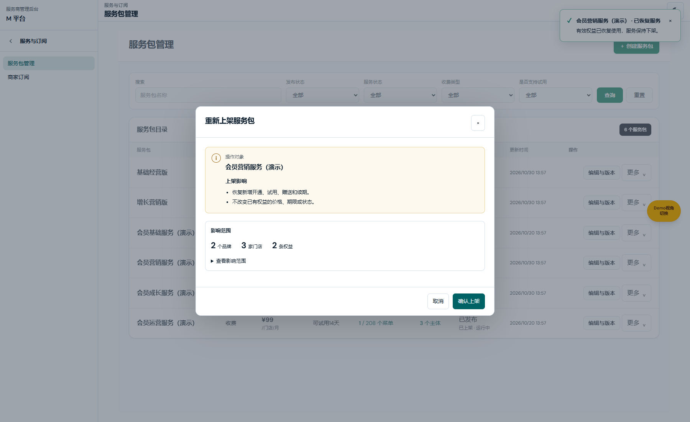

图注：同一功能分支实采。入口：已下架且运行中的服务 → 列表更多或详情页对应按钮 → 重新上架。

| 字段／操作 | 逻辑说明 |
| --- | --- |
| 影响提示 | 上架允许新增开通、试用、赠送及续期，既有记录不变；不恢复已停用或已到期权益。 |
| 确认上架 | 必须已有发布版本且运行中；不发布草稿、不新增订阅。校验通过后更新状态及审计。 |
| 取消／关闭／Escape | 不修改服务状态。 |

### 停用服务确认

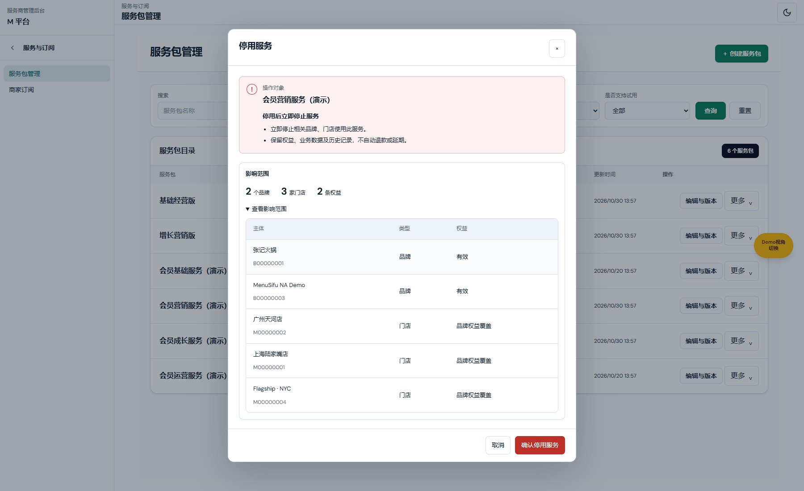

图注：同一功能分支实采，包含影响名单及原因校验。入口：已发布且运行中的服务 → 列表更多或详情页对应按钮 → 停用服务。

| 字段／操作 | 逻辑说明 |
| --- | --- |
| 影响提示 | 危险色提示卡展示服务名及立即停止服务的后果；权益、业务数据及历史记录保留，不自动退款或延期。其他服务来源仍独立判定。确认停用服务按钮使用危险色。 |
| 停用原因 | 必填，去首尾空格后1至200字；展示必填标识及输入提示。空白不写入，焦点回原因输入框并标记无效；错误以独立告警区显示，保留弹框与原输入。 |
| 确认停用服务 | 校验权限、状态与预览快照，保存停用原因，服务设为停用并下架，立即停止该服务的商业权益与旧标准订阅能力。单条订阅本身不被改为停用。 |
| 取消／关闭／Escape | 不停用，已有配置与权益保留。 |

### 恢复服务确认

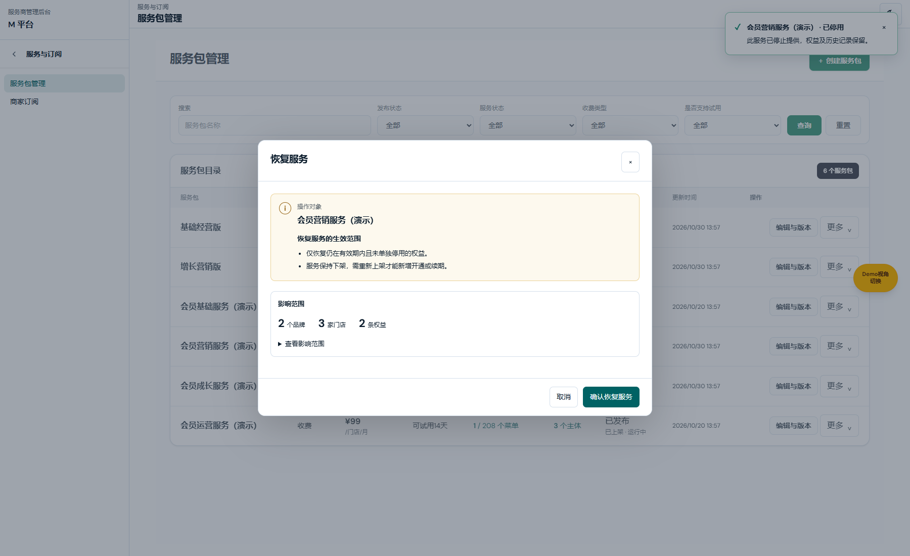

图注：同一功能分支实采。入口：已停用且有发布版本的服务 → 列表更多或详情页对应按钮 → 恢复服务。

| 字段／操作 | 逻辑说明 |
| --- | --- |
| 影响提示 | 仍在有效期内且未单独停用的权益恢复该服务能力；到期、单独停用的权益不恢复；试用不重新开始。 |
| 确认恢复服务 | 服务恢复运行并保持下架，需另行上架才能新增开通及续期。写审计，不改订阅期限、价格或历史记录。 |
| 取消／关闭／Escape | 不恢复服务。 |

### 删除草稿确认

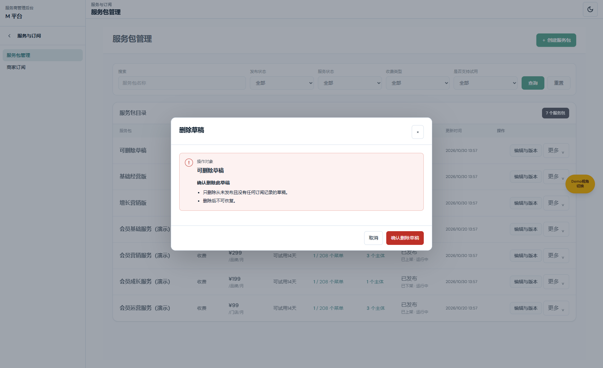

图注：同一功能分支实采。入口：从未发布且从未被订阅的草稿 → 列表更多或详情页对应按钮 → 删除草稿。

| 字段／操作 | 逻辑说明 |
| --- | --- |
| 影响提示 | 显示服务名，说明仅删除未使用草稿且不可恢复。已发布或曾有订阅的服务不提供入口。 |
| 确认删除草稿 | 再次校验删除条件及权限，成功删除服务与其草稿，保留审计。详情页删除成功返回服务包列表；列表操作刷新当前列表。 |
| 取消／关闭／Escape | 不删除，保留草稿。 |
| 预览失效 | 任一生命周期弹框打开后，包、草稿、发布版本或相关订阅变化，确认拒绝执行并提示关闭后重新预览，不覆盖其他修改。 |

## M平台：创建服务包／编辑服务包

待补页面图片：独立编辑商业设置状态；下图仅代表创建状态。

图注：2026-10-30，codex/service-copy-trim-20261030，起始main@3af2b3fb，5273功能预览实采。入口：M平台 → 服务包管理 → 创建服务包；编辑从服务包详情进入。

| 字段／操作 | 逻辑说明 |
| --- | --- |
| 页面说明文案 | 创建页不展示产品定义副标题、编码大写／去重说明、权益控制说明、页面入口与角色边界说明、菜单来源／结构节点／可选菜单统计、确认保存副标题。权益控制说明在共享商业设置区域同样隐藏；校验、授权、订阅与保存发布规则保持有效。 |
| 服务包名称 | 必填，显示服务的业务名称，创建向导最多60字。 |
| 唯一编码 | 必填，去首尾空白转大写，不能与已有服务编码重复，创建后作为稳定业务标识。 |
| 说明 | 可空，作为B端服务介绍，不承载额外权限规则。 |
| 标准价格 | 元输入，最多两位小数，保存为分；免费为0、收费大于0，异常值拒绝。 |
| 计费周期 | 月、季度、年、一次性；保存到服务发布版本和正式成交快照。 |
| 按服务权益控制使用 | 新服务默认选中；旧服务需明确选中并发布。启用后不可直接清除；发布提示未开通品牌将锁定相关页面。 |
| 收费类型 | 免费/收费，明确选择，不以菜单名称或是否勾选推断。 |
| 计费单位 | 按品牌/按门店，定义成交单价单位，不代替适用门店范围。 |
| 允许免费试用 | 仅收费服务可开启，免费服务勾选时校验失败。 |
| 默认试用天数 | 开启试用时必为1至90整数，不修改既有试用记录endAt。 |
| 菜单路由能力 | 使用当前已发布菜单树，目录结构与路由一致；至少选一个有效可选节点，可多选服务共享菜单。 |
| 保存草稿 | 保存当前产品定义及菜单选择，不改变生效版本；失效菜单按现有保存校验处理。 |
| 保存并发布／预览发布 | 创建不可变版本并使服务当前菜单绑定生效；标准价格、试用政策不覆盖历史成交/试用快照。 |
| 取消／退出 | 沿用当前向导草稿保护，未保存内容不成为品牌权益。 |

### 服务包详情：基本信息

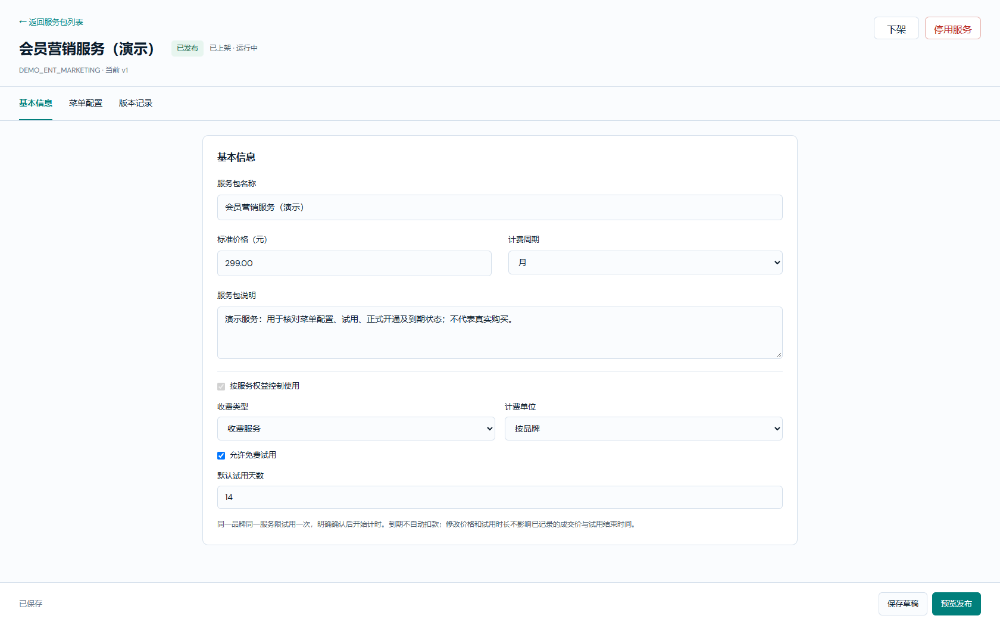

图注：2026-10-30，codex/package-detail-direct-actions-20261030，起始main@ca68b247，5299功能预览实采。入口：服务包管理 → 编辑与版本。

| 字段／操作 | 逻辑说明 |
| --- | --- |
| 页面入口与布局 | 从服务包目录点击编辑与版本，在当前标签页进入独立全屏详情路由；隐藏M平台侧栏与外层页头，不新开浏览器标签。返回服务包列表恢复常规平台布局；直接访问详情亦使用同一全屏页面，仍须具备原页面查看权限。 |
| 顶部摘要 | 展示当前服务包名称、编码、状态和当前发布版本；无发布版本显示尚未发布。名称在草稿保存后不替代发布摘要，发布成功才更新当前产品。 |
| 三个页签 | 基本信息、菜单配置、版本记录；默认基本信息。同一服务包切换页签不保存，不清空输入；支持键盘左右键与Home/End切换。 |
| 服务包名称 | 必填、最多60字，先保留在页面编辑态；空名称保存失败并保留输入。 |
| 标准价格 | 元输入、最多两位小数，转分保存；拒绝非有限值、负数，商业免费／收费约束见公共规则。 |
| 计费周期 | 月／季度／年／一次性，保留原枚举；选择仅更新待保存值。 |
| 服务包说明 | 可空、最多300字，跨页签保留。 |
| 商业设置 | 按服务权益控制使用、收费类型、计费单位、允许免费试用、默认试用天数分别沿用创建表单字段约束；不能取消已经启用的权益控制。 |
| 未保存状态 | 底部显示有未保存修改或已保存；以字段与菜单集合相对当前持久化草稿比较，菜单顺序不构成差异。 |
| 保存草稿 | 统一位于底部。重新校验名称、金额、商业设置、失效菜单及草稿revision；成功保存产品和菜单待发布草稿，当前商家可用版本保持不变。失败保留输入，提示具体原因。 |
| 预览发布 | 位于底部主按钮，先校验但不写入，打开发布确认；无菜单禁止发布。 |
| 顶部操作按钮 | 右上角直接展示当前可用动作，无更多折叠：已上架显示下架／停用服务；已下架显示重新上架／停用服务；已停用显示恢复服务；未使用草稿显示删除草稿。按钮按权限显示，固定常规高度，窄屏可换行；停用与删除用危险色。 |
| 操作保护 | 复用原确认弹框、权限及未保存编辑保护；点击取消返回原操作按钮焦点；有未保存编辑时先保存或放弃。列表仍使用更多下拉浮层。 |
| 返回／离开 | 有修改时显示独立放弃确认；刷新／关闭使用浏览器未保存提醒。不在页签切换时提示离开。 |
| 只读 | 可切换页签、搜索菜单及查看版本；字段、保存、菜单变更、发布、停用和回滚拒绝执行。发布、停用、回滚沿用原动作权限；上下架、恢复、删除分别独立授权。 |

### 服务包详情：菜单配置

图注：同一功能预览，左侧分类与右侧当前菜单树；未保存菜单不写入存储。

| 字段／操作 | 逻辑说明 |
| --- | --- |
| 菜单分类 | 左侧按已发布目录顺序展示名称与已选／可选数量；切换只改变定位，不修改选择；原始ID用于区分同名分类，不另造菜单目录。 |
| 菜单树 | 右侧展示当前分类及层级。父项全选该父项当前可选页面；保留原路由ID和父子关系，非可选目录不作为页面能力。 |
| 搜索 | 按名称或路径查找当前全部已发布分类，清空后返回当前分类；不丢失编辑内容或光标。 |
| 仅看已选 | 切换当前视图筛选，不改变待保存集合；无已选结果显示空状态。 |
| 全选当前分类 | 选择当前分类全部有效可选页面，不选择其他分类。 |
| 清空当前分类 | 只移除当前分类页面，保留其他分类。 |
| 展开全部／收起全部 | 只改变当前树的折叠状态，不改变菜单选择。 |
| 已选数量 | 当前编辑集合与已发布有效可选页面交集的去重数量，不含失效ID，不等于历史版本菜单数量。 |

### 失效菜单明细与移除确认

| 字段／操作 | 逻辑说明 |
| --- | --- |
| 历史菜单需要处理 | 待编辑ID不属于当前可选目录时显示数量；展开可看历史名称、路径及原ID。名称优先当前可用节点或已知旧目录，路径可回溯受控路径；无法获取明确显示名称／路径未留存，不猜测映射。 |
| 保存限制 | 有失效项时阻止详情页保存和发布，保留原ID及输入，不静默过滤。 |
| 移除失效菜单 | 独立确认后只从页面待保存集合移除；未保存前不写入草稿，已发布版本不变。取消、关闭、Escape均保留原集合。 |

### 发布确认

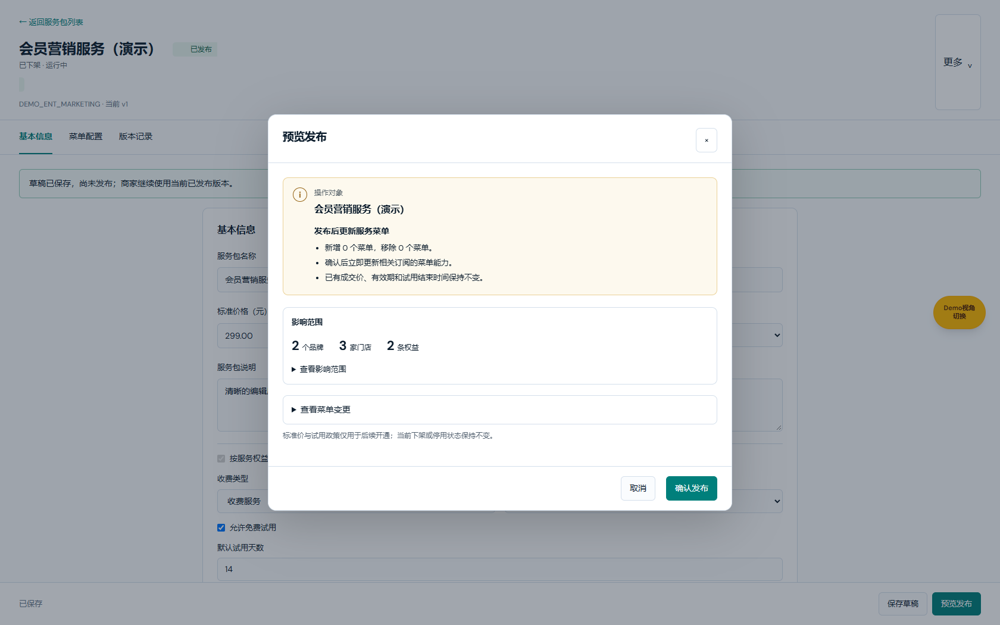

| 字段／操作 | 逻辑说明 |
| --- | --- |
| 发布差异 | 对比当前有效发布版本与页面待保存菜单集合，显示新增／移除数量及可展开菜单名称明细；同时展示影响品牌、门店及记录数量和可展开名单。首次发布以空集合比较。 |
| 确认发布 | 再校验页面写权限及发布操作权限，按原草稿revision保存后发布不可变新版本，更新顶部摘要与编辑基线；相关订阅按原发布规则更新。成交价、订阅及试用期限不改写，标准价和试用政策仅作用后续开通；下架和停用状态不因发布改变。确认前包或订阅变化时须重新预览。 |
| 取消／关闭／Escape | 不保存、不发布，保留编辑内容。 |
| 保存或发布失败 | 保存失败在编辑页显示错误并保留输入；发布确认后失败则在原弹框错误区说明，不自动关闭弹框、不显示成功。草稿版本冲突不覆盖新草稿；若保存成功而发布失败，已保存草稿保留、发布版本不变。 |

### 版本记录

| 字段／操作 | 逻辑说明 |
| --- | --- |
| 版本 | 按版本号倒序，展示vN。 |
| 发布时间 | 使用发布记录publishedAt的本地日期时间。 |
| 菜单数量 | 该不可变版本的routeNodeIds数量，保留历史失效节点。 |
| 状态 | 当前activeReleaseId对应项标记当前版本，其余为历史版本。 |
| 查看详情 | 在当前页打开版本详情弹框，按版本ID展示摘要及分组菜单；不将当前服务包菜单覆盖所选历史版本。字段及异常详见版本详情弹框。 |
| 回滚 | 当前版本不提供回滚；历史版本可确认回滚。存在未保存编辑时先阻止并提示保存或放弃；沿用原回滚、商业策略合法性与受控路径保留规则。 |

### 版本详情弹框

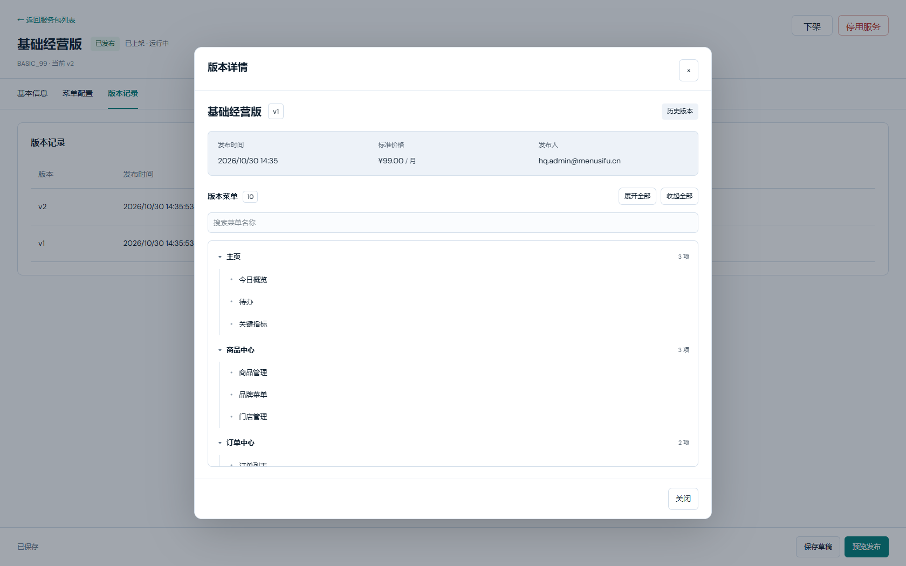

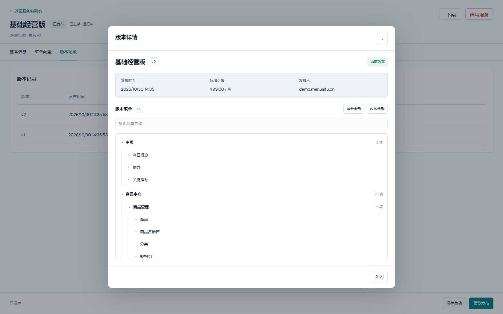

图注：2026-10-30，codex/service-version-detail-20261030，基线main@19470be0，5300功能预览实采。入口：版本记录 → 查看详情；只读查看所选releaseId对应的发布记录。

| 字段／操作 | 逻辑说明 |
| --- | --- |
| 弹框布局 | 居中展示，宽度最大960px且不超出视口，整体不超过90%视口高度；摘要、菜单分区清晰，正文及菜单区允许滚动，关闭区保持可见。窄屏摘要纵向排列。 |
| 服务名称 | 使用所选发布版本的name，不用当前服务包名称覆盖历史名称。 |
| 版本号 | 使用所选记录version，显示vN。 |
| 版本状态 | 所选记录ID等于当前服务包activeReleaseId为当前版本，否则为历史版本；不代表该服务当前可用。 |
| 发布时间 | 使用所选发布记录publishedAt，本地年月日时分；无效显示未记录。 |
| 标准价格 | 使用所选版本priceMinor和currency，金额按币种格式化；免费政策且价格为0显示免费。缺少有效金额显示未记录，不以当前标准价或成交价回填。 |
| 计费方式 | 读取该版本commercial.billingUnit及billingInterval，展示品牌／门店与月／季度／年／一次性；未记录单位时不猜测品牌或门店，无效周期显示周期未记录，不展示month等内部枚举。 |
| 发布人 | 使用所选版本publishedBy，空值显示未记录，不替换为当前操作者。 |
| 版本菜单数量 | 对该发布记录routeNodeIds去重计数，祖先仅用于组织层级，不计入版本新增能力；不读取当前包activeReleaseId的其他菜单来补齐。 |
| 菜单树 | 仅展示所选版本绑定菜单及必要祖先；名称与结构先按当前已发布目录精确ID识别，其余按保留的旧目录资料分组。只展示名称、层级和各组绑定数量，无路由路径或整段英文ID。 |
| 搜索菜单名称 | 默认空，不区分大小写，去首尾空格；只在该版本菜单中查找，保留匹配祖先。匹配分组名时保留该组已绑定子项；无匹配显示没有匹配的菜单，清空恢复完整版本菜单。 |
| 展开全部／收起全部 | 默认展开分组；按钮只改变菜单树展示，不修改发布配置。 |
| 未配置菜单 | 版本绑定集合为空时显示该版本未配置菜单，不用当前版本菜单替代。 |
| 关闭 | 顶部×、底部关闭、Escape及遮罩外点击关闭，恢复原查看详情按钮焦点；切换路由清理弹框，不改变页签与发布配置。 |
| 只读 | 可打开详情、搜索、展开和关闭；弹框无保存、发布、回滚或服务状态变更操作。 |

#### 历史资料缺失与窄屏

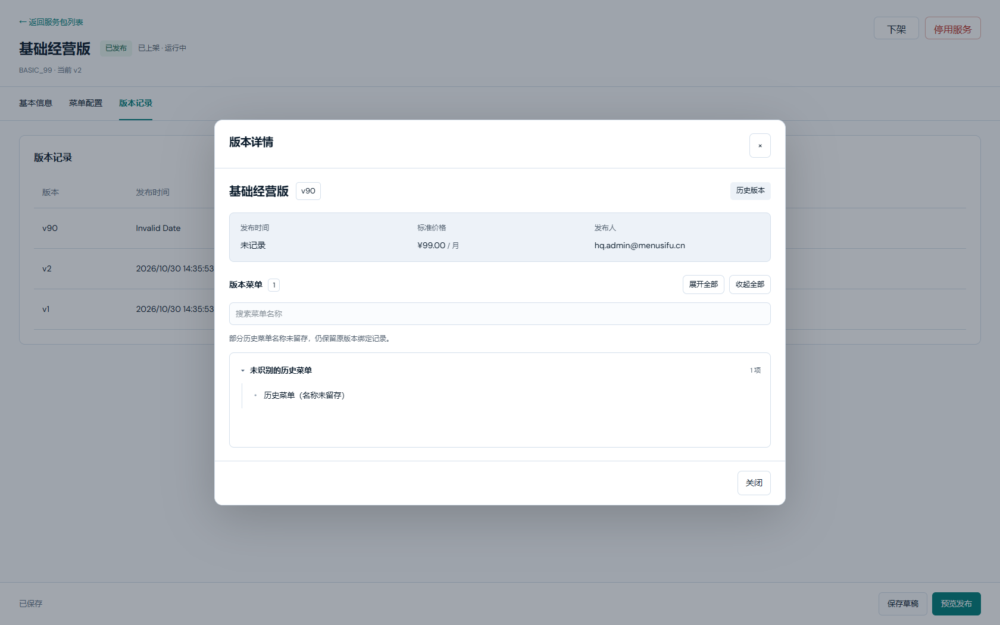

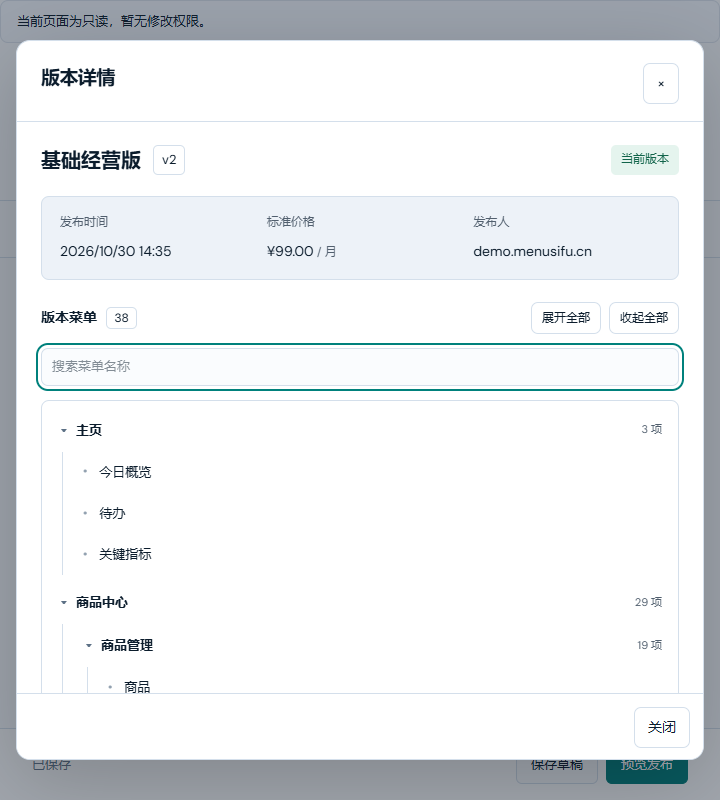

| 字段／操作 | 逻辑说明 |
| --- | --- |
| 未识别历史菜单 | 当前目录及保留旧目录都无法精确识别的原绑定项归入未识别的历史菜单，名称显示历史菜单（名称未留存）；保留原ID参与计数，不擅自映射同名菜单。 |
| 历史名称边界 | 旧发布记录没有完整菜单名称／结构快照。此处基于精确ID可识别资料组织展示，不宣称是发布当时完整目录还原，不新增或删除版本绑定。 |
| 窄屏 | 弹框边距保留，信息字段自动纵排，菜单区独立滚动，底部关闭可见；只读字段和行为与桌面一致。 |

### 回滚确认

| 字段／操作 | 逻辑说明 |
| --- | --- |
| 确认回滚 | 按原回滚操作权限执行，将所选历史版本设为当前版本并重新加载草稿基线；不清除已经启用的权益控制。保留上下架与运行状态，冻结已有订阅的商业计费口径；预览后包或订阅变化则拒绝回滚。 |
| 取消／关闭／Escape | 不回滚，停留版本记录。 |

### 未保存修改离开确认

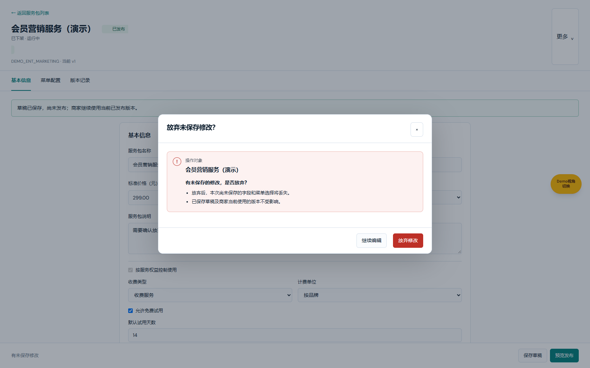

| 字段／操作 | 逻辑说明 |
| --- | --- |
| 操作对象与风险 | 展示服务名称，明确本次未保存字段及菜单将丢失，已保存草稿和商家当前版本不受影响。 |
| 继续编辑 | 关闭提示，停留编辑页，保留未保存输入和菜单选择。 |
| 放弃修改 | 危险色动作；清除本页内存编辑态后执行原目标导航，不覆盖已保存草稿。 |
| 取消／关闭／Escape | 停留当前服务包，保留字段、菜单和当前页签。 |
## M平台：订阅明细 → 品牌服务权益全屏页

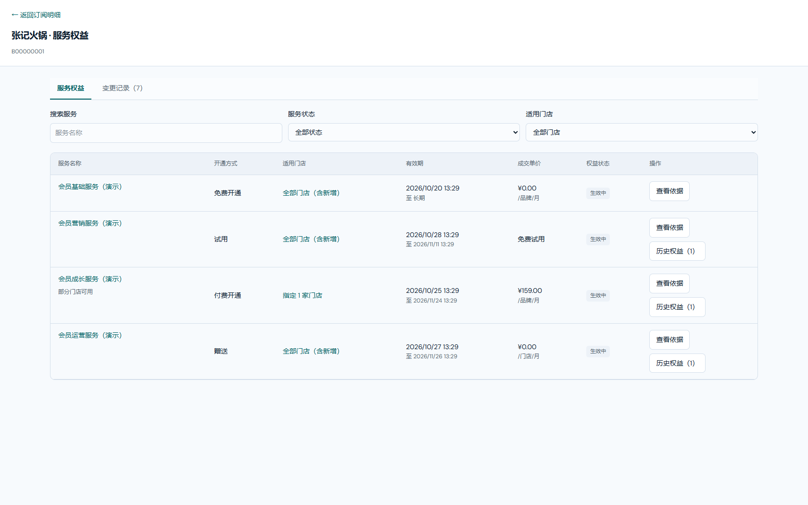

图注：2026-10-30，codex/rights-detail-drawer-20261030，起始main@aa0090e6，5293功能预览实采。入口：商家订阅 → 查看品牌服务权益。

| 字段／操作 | 逻辑说明 |
| --- | --- |
| 查看品牌服务权益 | 当前标签页进入订阅模块独立全屏路由/m-platform/permissions/merchant-subscriptions/brands/{brandId}/services；隐藏平台侧栏与外层页头，不进入品牌管理，不新开浏览器标签。 |
| 品牌名称 | 页头展示对应品牌名称与公开BID，不展示内部英文编码；品牌不存在时展示明确空状态及返回入口，不推断为其他品牌。 |
| 服务权益列表 | 当前及待生效权益直接按记录展示，同一服务合并名称；记录保留各自范围、期限、成交价及状态，不展示英文编码、服务说明或标准价格。 |
| 历史权益 | 仅有历史记录的服务显示历史权益（N），点击在当前页面右侧抽屉查看历史，不重复当前权益。 |
| 变更记录页签 | 顶部独立页签直接展示本品牌权益变更记录表格，不再使用页面底部外层折叠；详情仍按行内展开。 |
| 菜单预览 | 免费及收费服务名称均为菜单预览入口，以只读弹框展示；关闭返回当前全屏权益页。 |
| 只读范围 | 不提供免费开通、试用、正式开通、赠送、续期或停用操作，不提供跳出到服务包管理的链接；原品牌管理页面能力保持原规则。 |
| 访问权限 | 使用商家订阅页面查看权限；只读账号可展开记录、使用三项筛选、查看适用门店及菜单，只将这些具体浏览控件纳入只读允许清单；开通、续期和停用仍按原动作权限拦截。只读账号可查看，不额外要求品牌管理权限。深链接和刷新遵循相同权限，不扩大授权。 |
| 返回订阅明细 | 恢复列表的普通平台布局、原地址及当前会话记录的滚动位置；浏览器返回亦可恢复。直接访问权益页没有历史列表位置时从列表默认位置返回。 |
| 空状态 | 无权益时使用品牌权益同一空状态；不通过查看动作自动开通服务。缺失品牌显示品牌不存在，并提供返回入口。 |
| 数据保护 | 打开、刷新、返回与查看菜单均不写入服务、菜单、订阅或有效期，不消耗试用资格。 |
## M平台：品牌详情 → 服务权益

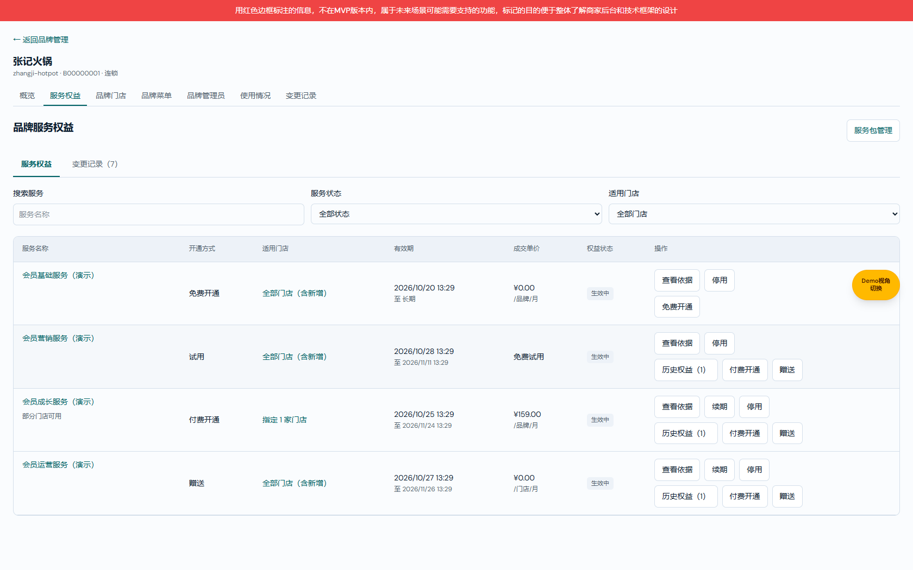

图注：5295功能分支实采，当前权益直接展示；同一组件用于品牌管理可操作页和订阅只读全屏页，后者不提供写入操作。入口仍需商家订阅查看权限，不改变服务实际授权计算。

| 字段／操作 | 逻辑说明 |
| --- | --- |
| 顶部说明区域 | 不展示规则说明文案及其折叠入口；既有合同、试用、保留数据及角色授权规则继续生效，必要操作提示仍在对应确认弹框中。记录成交单价保留，抽屉不展示服务说明及标准价格。 |
| 搜索服务 | 默认空，按服务名称不区分大小写包含匹配，去除首尾空格，输入即时生效。 |
| 服务状态筛选 | 默认全部状态；生效中、试用中、部分门店可用、待生效、未开通、已到期、试用已结束、已停用、服务已停用、无可用门店、日期异常，匹配服务汇总状态。 |
| 适用门店筛选 | 默认全部门店；选择后仅保留覆盖该门店的当前或待生效记录。服务名称及服务级入口移动至第一条匹配记录，不合并各记录期限和价格；无匹配记录的服务隐藏。 |
| 服务名称 | 已有商业政策的服务及本品牌已有权益记录的服务各一组；不重复展示上下两张服务表。仅展示服务名，点击预览当前发布菜单；不显示英文编码或单独查看菜单按钮。服务被移除但仍有权益时保留服务已移除组和记录，不丢失历史依据。 |
| 服务汇总状态 | 优先沿用serviceAccess的服务停用／全品牌／门店范围计算。全品牌有效且采用试用权益为试用中，其余为生效中；无全品牌权益但至少一家当前品牌门店可用为部分门店可用。仅绑定已移除或不属当前品牌的门店、无实际覆盖时为无可用门店。其余使用既有结果；仅指定范围记录在全品牌视角没有直接结果时，待生效记录标待生效，否则取最近相关记录的已停用／到期／试用已结束或日期异常状态，不将已存在的历史权益显示为从未开通。不能以多家指定门店拼成全品牌授权。 |
| 适用范围 | 主列表列名为适用门店。按单条权益展示全部门店（含新增）或指定去重数量，不聚合成新的授权范围。 |
| 适用范围点击 | 打开该记录自己的适用门店弹框；全部范围读取当前品牌门店，指定范围保留绑定MID。不跳转、不修改。 |
| 到期情况 | 主列表列名为有效期，逐记录展示起止本地年月日时分；无结束为长期，非法为—。不合并连续期限或构造统一到期。 |
| 权益明细 | 当前及待生效记录直接在主列表展示，无权益明细入口。同服务多条记录合并名称，每条保留独立范围、期限、成交价、权益状态及续期／停用。无当前记录时显示无当前权益；从未开通过显示未开通，按权限保留开通入口。 |
| 开通方式 | 每记录独立展示免费开通、试用、付费开通或赠送，与状态分开。 |
| 成交单价 | 使用原成交快照的币种、金额、单位和周期，缺金额为—；零价试用显示免费试用。不得以服务标准价回填。 |
| 权益状态 | 单条记录按已停用、日期异常、试用已结束／已到期、待生效、生效中判定，不代表服务最终可用性。服务汇总状态用于筛选；部分门店可用、服务已停用等在名称下提示。 |
| 历史权益（N） | 有历史才展示，只查看该服务历史；与顶部操作审计的变更记录独立。 |
| 开通操作 | 仅可管理页且有对应权限、服务已发布且上架运行时显示；免费显示免费开通，收费保留具备资格时开始试用、付费开通、赠送。只是入口名称简化，不改变确认弹框、试用资格、费用校验或写入规则。 |
| 变更记录页签 | 在顶部与服务权益并列，按时间倒序直接展示本品牌商业权益关联的记录；独立服务、操作及日期筛选，首次20条，显示更多每次增加20条，详见下节。不受服务权益页签筛选影响。 |
| 无匹配服务 | 显示没有符合条件的服务，筛选仍可更改；无权益不自动开通。 |

### 服务权益／变更记录页签

图注：5293功能预览实采。品牌管理中的服务权益区域与商家订阅独立全屏页复用同一实现；不增加一级导航，不改变路由或品牌上下文。

| 字段／操作 | 逻辑说明 |
| --- | --- |
| 页签位置 | 在品牌标题／BID之后、当前页签筛选之前。服务权益及变更记录并列，滚动时页签栏在内容区域顶部保持可见。 |
| 默认页签 | 首次进入及整页刷新默认服务权益；当前页面会话按品牌记住最近选择，重新挂载保留。切换其他品牌各自独立。 |
| 服务权益 | 展示按服务分组的当前记录、筛选与历史权益入口，不在底部重复变更记录。 |
| 变更记录（N） | N为该品牌符合记录范围的总数，含演示与历史记录，不代表新增或未读数量。零条仍可进入空状态。 |
| 切换 | 仅隐藏当前面板、显示目标面板，不跳路由、不请求开通、不写入。两个面板的筛选互不作用，记录行内详情与已加载行保留。打开历史权益抽屉时不能操作背景页签，先关闭抽屉后再切换。 |
| 浏览位置 | 切换前保存当前内容滚动位置，切回恢复；目标首次进入从顶部开始。仅当前页面会话有效，不写入localStorage。 |
| 键盘 | tablist／tab／tabpanel关联明确，当前页签aria-selected为true。左右方向键循环切换，Home／End到首／尾页签；切换后焦点在目标页签，Tab进入其可见内容。 |
| 只读 | 仅明确的页签、记录筛选、重置与显示更多控件允许浏览；不改变开通、续期、停用或数据写入权限。 |

### 历史权益右侧抽屉

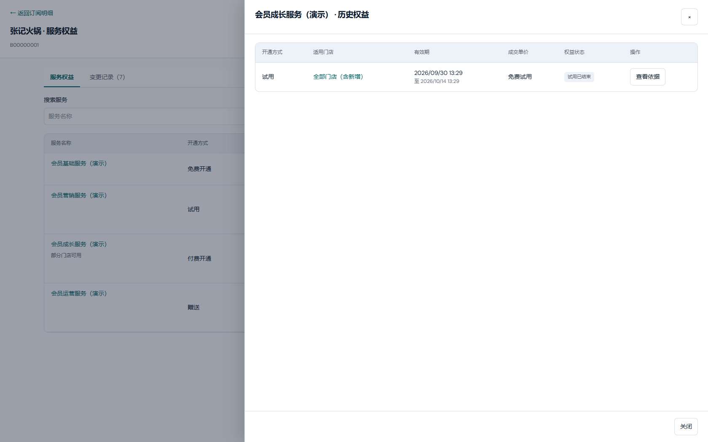

图注：2026-10-30，codex/rights-current-history-20261030，main@73a57c94基线，5295功能预览实采。

| 字段／操作 | 逻辑说明 |
| --- | --- |
| 历史权益（N） | 主列表按服务提供入口，仅N大于0时显示。N为该服务非当前记录数；包括已到期、已停用和日期异常，不等于变更事件数。 |
| 标题 | 服务名称·历史权益，不展示英文编码或重复的当前状态。 |
| 展示内容 | 直接展示历史记录表，不含当前权益、不再嵌套历史折叠；保留开通方式、适用门店、有效期、成交单价、权益状态和操作。 |
| 当前／历史边界 | 当前为未停用、开始时间有效且无结束或结束晚于当前时刻的记录，含待生效；其余进入历史。结束恰好等于当前时刻即归历史。非法结束不得当作长期。 |
| 位置与尺寸 | 右侧展示，桌面宽度为1100px与92vw较小值，≤900px时满宽；正文独立滚动，标题和关闭区固定可见。 |
| 关闭 | ×、底部关闭、Escape或遮罩外点击关闭，恢复列表筛选、页签、滚动和入口焦点，不写入。 |
| 记录操作 | 仅生效中的paid／gift记录按权限允许续期／延长赠送；未停用且未到期记录按权限允许停用；到期和已停用记录在商家订阅办理再次开通。均绑定原记录ID，不按整项服务批量操作。取消确认返回原上下文；成功重新挂载列表并清理旧抽屉。 |
| 页面清理 | 路由变化或源页面移除时清理抽屉及子弹框，不遗留跨品牌信息。 |
| 只读 | 允许查看历史、门店和依据；无开通、续期、停用按钮，存储层权限仍独立校验。 |

### 开通说明／停用原因弹框

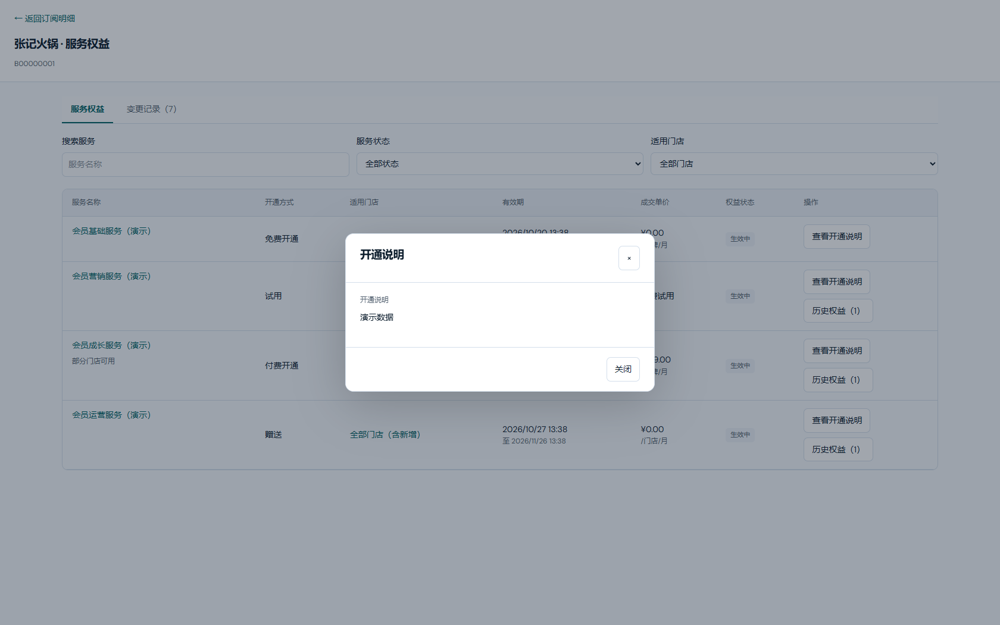

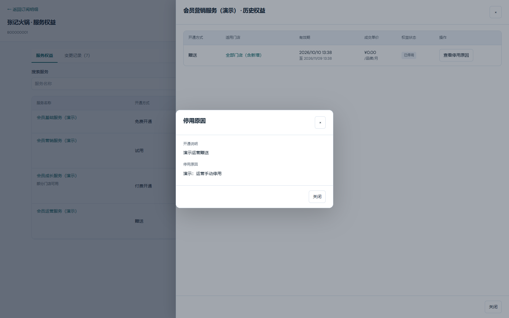

图注：2026-10-30，codex/rights-explanation-labels-20261030，main@4565207a基线，5296功能预览实采。入口：主列表或历史权益的查看开通说明／查看停用原因。

| 字段／操作 | 逻辑说明 |
| --- | --- |
| 查看开通说明／查看停用原因 | reference或disableReason存在才显示；记录已停用且有停用原因时显示查看停用原因，其他显示查看开通说明。按钮及弹框标题保持对应。无内容隐藏，不增加数据列。 |
| 开通说明 | 展示该记录reference原文；付费为操作人员填写的外部合同／开通记录编号，赠送为赠送原因，演示记录为预设文本。不自动读取或核验合同、订单及支付凭证。转义HTML、保留换行，长文本换行；空值隐藏。 |
| 停用原因 | 展示该记录disableReason，来自停用操作填写；同时保留原开通说明供追溯。不使用其他记录或当前服务状态推断。 |
| 关闭 | ×、关闭、Escape和遮罩外点击关闭；若来源为历史抽屉则返回抽屉，否则返回列表。恢复入口焦点，不修改业务数据。 |

### 适用门店弹框

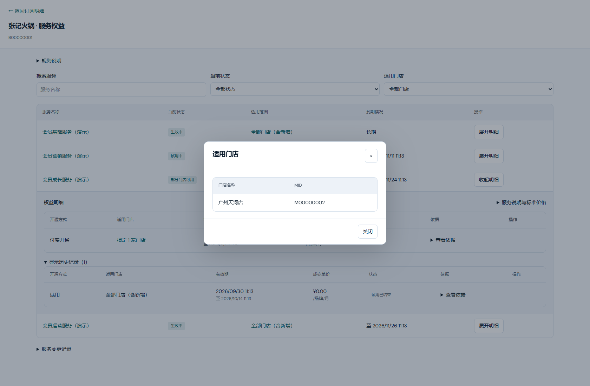

| 字段／操作 | 逻辑说明 |
| --- | --- |
| 门店名称 | 只解析当前品牌归属门店；已移除或跨品牌的指定MID显示门店已移除或不属于当前品牌，不读取其他品牌门店名称。 |
| MID | 展示权益绑定的门店ID；全部范围读取当前品牌门店清单，并说明含新增。 |
| 关闭 | 顶部×、底部关闭、Escape及遮罩外点击关闭，恢复原按钮焦点，筛选及展开状态保留；切换路由清理，不写入。 |
| 空范围 | 无匹配门店时显示暂无匹配门店，仍可关闭。 |

验收：两条分别覆盖A、B店的权益在主列表同服务下显示两行，各显示指定1家及原期限、成交价；筛选A仅保留A行，清空恢复两行。历史抽屉不含当前记录，零历史无入口；查看历史、依据、菜单及门店不写入。

### 变更记录页签

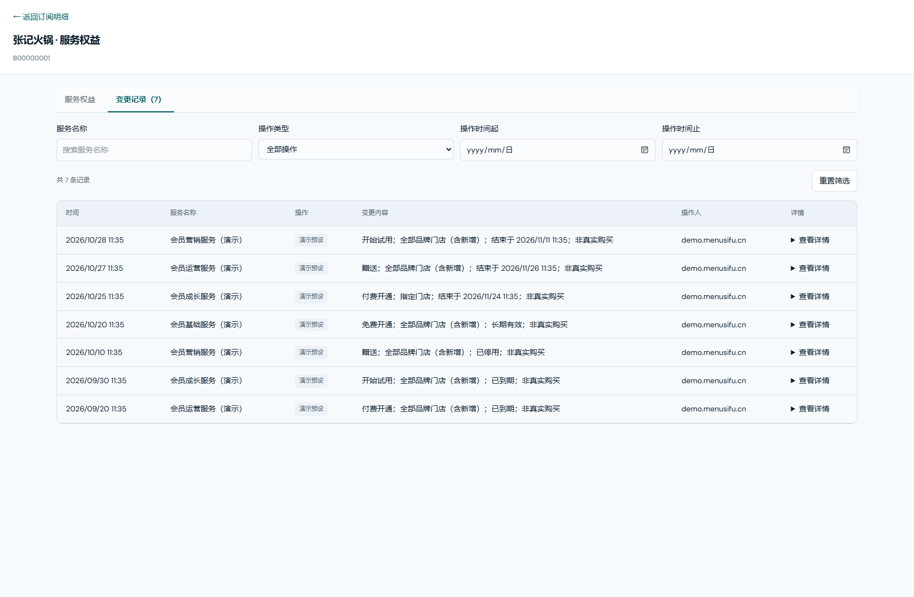

图注：2026-10-30，codex/brand-rights-tabs-20261030，起始main@8544da49，5292功能预览实采。入口：顶部变更记录页签，直接显示筛选与表格，无外层折叠。

| 字段／操作 | 逻辑说明 |
| --- | --- |
| 服务名称筛选 | 默认空，按事件展示的服务名称包含匹配，不区分大小写并去首尾空格；使用事件快照／旧原文名称，不用当前服务改名覆盖事件名。输入即时生效。 |
| 操作类型筛选 | 默认全部操作；免费开通、开始试用、付费开通、赠送、续期、停用、演示预设、开通服务、其他变更。与每行操作列同一映射。选择即时生效。 |
| 操作时间起 | 默认空，为设备本地日期，包含当天00:00及之后的事件；没有下限时不限制起始。 |
| 操作时间止 | 默认空，包含结束当天，采用本地次日00:00作为排他上界，按日历推进一天而非固定毫秒，兼容夏令时。没有上限时不限制结束。指定日期范围时不匹配非法事件时间。 |
| 日期校验 | 起日晚于止日时显示操作时间止不能早于操作时间起，隐藏结果及显示更多，不应用为全部数据；修正日期后重新筛选。 |
| 组合条件 | 三类条件AND组合，不修改原记录。任一条件改变时重新显示匹配的前20条。 |
| 重置筛选 | 清空本页签名称、类型及两端日期，立即恢复全部记录的前20条；不修改服务权益筛选。 |
| 数量提示 | 无筛选差异时显示共N条记录，有筛选时显示筛选结果M条（全部N条）；未加载完时追加已显示K条。页签N保持品牌总数。 |
| 无匹配记录 | 显示没有符合条件的变更记录，保留筛选与重置；品牌本身没有记录时显示暂无服务变更记录。 |
| 记录范围 | audit中objectType=subscription，且objectId关联本品牌商业权益记录；不加入其他品牌或服务包配置日志。保留原事件原文，不通过查看修改历史。 |
| 排序与数量 | 页签显示本品牌记录总条数，不随筛选变化；按事件at倒序，时间相同保留原数组顺序，无效时间置后。首次显示20条，未展示完时提供显示更多记录，每次增加20条直到全部展示；只改变可见行。页签切换保留本页签筛选、已加载条数、行内详情与浏览位置；整页刷新回到服务权益并重置会话状态。 |
| 时间 | 使用事件at，按设备本地时区显示年月日时分，空值为未记录，非法为时间无效。不使用当前权益更新时间替代事件时间。 |
| 服务名称 | 新事件读取事件快照serviceName，服务后续改名不覆盖历史。旧文本事件只在已知格式中读取原文服务名，不能确定时显示服务名称未记录，不把内部ID当作服务名称。 |
| 操作 | entitlement.create按事件快照kind显示免费开通／开始试用／付费开通／赠送；旧开通文本仅识别明确方式，无法识别为开通服务。extend为续期，disable为停用，demo为演示预设，其他为其他变更。不把当前状态反推为历史操作。 |
| 变更内容：开通 | 新事件显示操作时适用范围及起止期限，长期明确显示长期；详细开通方式、金额与依据放在查看详情。 |
| 变更内容：续期 | 新事件显示到期时间：原到期 → 新到期；原到期在修改前捕获，新到期在修改后捕获。旧事件没有原到期快照时不从当前权益反推，查看详情中标未记录。 |
| 变更内容：停用 | 新事件显示权益已停用及当时停用原因；不将其他有效来源一并描述为已停用。 |
| 变更内容：演示与旧文本 | 保留文本明确记录的开通方式、范围及期限信息，以分号分隔，演示事件明确标记演示预设。原文中合法ISO时间转换为本地年月日时分；不推断未记录的字段。 |
| 操作人 | 事件actor原值，空值显示未记录；展示操作人而非当前查看人。 |
| 空记录 | 显示暂无服务变更记录，保留页面其他权益查看能力。 |
| 显示更多权限 | 只读用户可展开、查看详情及显示更多；仅该具体浏览按钮放行，不授予开通、续期或停用权限。 |

#### 事件详情

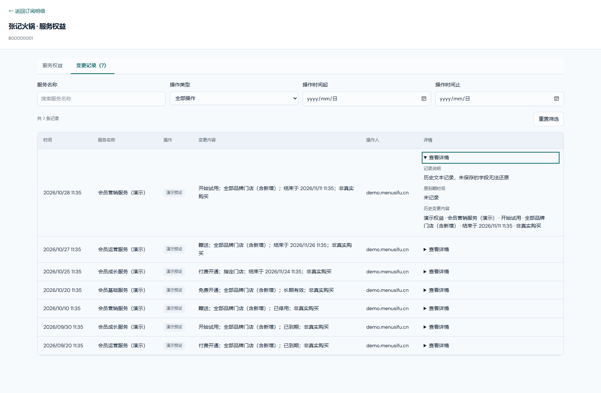

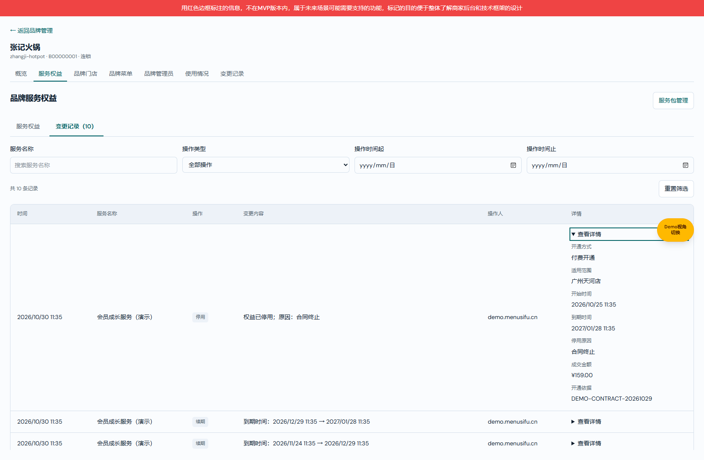

图注：前者为已有文本记录，后者为本地测试续期／停用写入后的实际事件。查看详情为本行内折叠，不跳转、不改动权益。

| 字段／操作 | 逻辑说明 |
| --- | --- |
| 开通方式 | 新快照kind映射；表示该权益来源，不以当前金额或状态重新分类。 |
| 适用范围 | 主列表列名为适用门店。按单条权益展示全部门店（含新增）或指定去重数量，不聚合成新的授权范围。 |
| 开始时间／到期时间 | 事件快照的startAt与endAt；无结束为长期。 |
| 原到期／新到期 | 续期事件才追加展示。previousEndRecorded为true时读取修改前endAt，无结束表示长期；false或历史没有此字段时原到期为未记录。新到期取事件endAt，不取当前订阅endAt。 |
| 成交金额 | 事件保存的agreedPriceMinor以最小货币单位转换为金额，并用当时币种展示；金额未记录时不追加该字段，币种缺失明确标币种未记录。不用当前服务标准价代替。 |
| 开通依据 | 保存事件当时reference，缺失时不追加；合同编号作为业务依据保留。 |
| 停用原因 | 停用事件保存当时disableReason，缺失为未记录；不被后续记录覆盖。 |
| 旧记录说明 | 没有entitlementChange快照的旧事件明确显示历史文本记录，未保存的字段无法还原；原到期为未记录，保留格式化后的历史变更原文。 |
| 数据安全 | 所有服务名称、原因、依据、原文及操作人按文本转义展示，不执行HTML；展开、排序与更多不写入数据。 |

研发字段：SubscriptionAuditEntry新增可选entitlementChange对象，现有schemaVersion与旧audit数组兼容，不回写旧事件。对象包含serviceName、kind、scope、startAt、endAt、previousEndRecorded、previousEndAt、priceMinor、currency、reference、reason。create／extend／disable提交时按当次事件生成独立对象；续期和停用在修改前保存原endAt。订阅数据与本次审计仍在同次snapshot写入，不触发新收费、试用或授权。

验收：先将到期A续为B，再续为C，第一条续期仍显示A→B，第二条显示B→C；停用后显示停用原因，不覆盖前两条快照。旧续期文本仅含新到期时原到期为未记录。存在32条记录时首次20条，显示更多后32条，存储内容不变；无权限用户不能因此执行写入操作。

### 开始试用确认弹框

| 字段／操作 | 逻辑说明 |
| --- | --- |
| 服务／试用说明 | 名称、当前价格、试用天数、到期不自动扣费说明。 |
| 适用门店范围 | 默认全部品牌门店，可改指定；指定模式须至少选一家当前品牌门店。 |
| 预计结束 | 当前时刻加政策天数，仅说明；真正结束以提交确认时刻计算。 |
| 确认开始试用 | 重新校验身份、资格、服务状态、门店归属后写入；重复提交不产生第二次资格。 |
| 取消／×／Esc／遮罩 | 关闭不写入，不消耗试用资格，仍在当前页面。 |

### 正式开通／赠送弹框

待补页面图片：赠送状态；下图仅代表正式开通状态。免费开通的专属确认框图片亦待补，详见独立交付缺口。

| 字段／操作 | 逻辑说明 |
| --- | --- |
| 服务与标准价格 | 当前服务说明，告知仅记录外部开通，不扣款。 |
| 适用门店范围 | 同试用范围校验，与计费单位独立。 |
| 成交单价 | 正式开通必填正金额，最多两位小数，保存金额分与单位快照；赠送为0。 |
| 到期时间 | 默认当前起30天，可编辑，按当前设备时区输入并保存UTC精确时刻，须晚于当前时间。 |
| 外部合同／开通记录编号 | 正式必填，作为开通依据；不用于支付扣款。 |
| 赠送原因 | 赠送时必填，代替合同编号。 |
| 确认 | 重新校验后写入，成功刷新权益列表并提示；失败保留弹框与输入。 |
| 取消 | 不生成权益，不改变原菜单或合同记录。 |
## B平台：收费页面入口与服务状态

图注：同一功能分支实采，真实品牌/门店身份与角色上限仍先行校验；只有原菜单可见者能够进入该说明页。

| 字段／操作 | 逻辑说明 |
| --- | --- |
| 原菜单入口 | 沿用品牌/门店和员工角色过滤；受控页面追加当前服务状态，不因未付费直接隐藏已配置入口。 |
| 服务名称／说明 | 从当前服务定义读取，业务页面与数据不挂载。 |
| 标准价格 | 从当前服务发布配置读取，不作为该品牌已付价格。 |
| 状态原因 | 未开通、试用已结束、已到期、已停用、服务已停用、不在适用门店、仅指定门店可用或菜单已移出服务分别说明。 |
| 免费试用N天 | 仅当前品牌已启用Admin、允许试用且历史未试用者可见，点击打开试用确认框。 |
| 联系服务商开通／续期 | 告知确认合同、价格和门店范围，由服务商记录外部开通；不自动创建申请或付款。 |
| 无具体品牌／门店 | 提示先选明确范围，不借用其他品牌权益。 |

### 试用生效页

| 字段／操作 | 逻辑说明 |
| --- | --- |
| 剩余天数 | max(0,ceil((结束毫秒−当前毫秒)/86400000))，同时显示精确结束时刻；天数只作提示。 |
| 业务内容 | 通过服务校验后继续原页面实现及员工操作权限，不新增原页面没有的业务能力。 |
| 联系服务商 | 显示正式开通途径，普通员工无开通写入口。 |

### 试用结束页

| 字段／操作 | 逻辑说明 |
| --- | --- |
| 到期校验 | 到达结束时刻自动重新判断并移除受控业务内容；恢复浏览器焦点及权益变化时重新核对，业务操作前再判断。 |
| 试用资格 | 已试用不再显示重新试用按钮；仍可由服务商正式开通或赠送。 |
| 原数据 | 不删除；当前锁定页不展示业务数据。免费服务及其他有效服务来源维持原授权。 |
| 页面/角色切换 | 按新的门店、品牌和账号重新计算，不缓存上一主体的可用状态。 |
## M平台：续期服务权益弹框

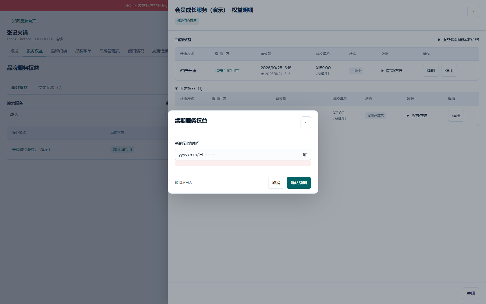

入口：品牌服务权益当前记录或历史权益抽屉 → 续期；5293功能分支实采。

| 字段／操作 | 逻辑说明 |
| --- | --- |
| 新的到期时间 | 必填，当前设备时区输入，必须晚于原到期时刻及当前时刻。仅生效中的付费开通、赠送记录可操作；赠送额外填写1至200字延长原因。 |
| 确认续期 | 校验权限、记录状态和时间，更新结束时刻；保留成交快照，追加审计。失败保留输入。 |
| 取消／关闭 | 不修改期限，不写入审计。 |

## M平台：停用服务权益弹框

入口：品牌服务权益当前记录或历史权益抽屉 → 停用；5293功能分支实采。

| 字段／操作 | 逻辑说明 |
| --- | --- |
| 停用原因 | 必填，去首尾空白后不得为空，页面最多200字。 |
| 确认停用 | 校验权限和记录状态，写入停用时刻、操作人及原因；该来源立即失效，保留历史。其他有效服务来源不受影响。 |
| 取消／关闭 | 不停用，不写入。 |

## 品牌服务权益：服务名称查看菜单

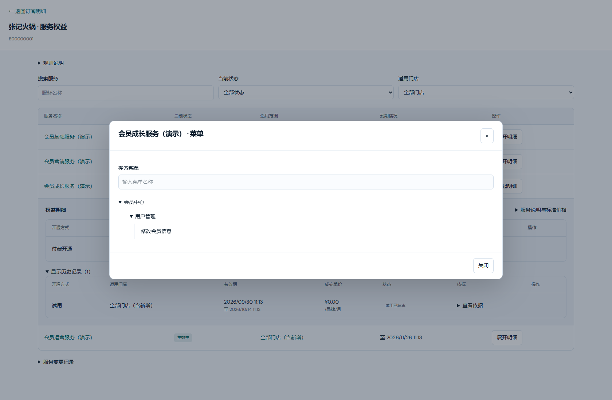

图注：2026-10-30，codex/brand-rights-overview-20261030，起始main@ac6ac061，5290功能预览实采。入口：品牌详情或订阅全屏页 → 服务权益 → 服务名称。

| 字段／操作 | 逻辑说明 |
| --- | --- |
| 服务名称入口 | 免费和收费服务均可通过名称进入；沿用品牌详情及商家订阅查看权限，只读账号亦可查看。打开弹框，不跳转、不修改授权、不产生开通或试用。 |
| 服务名称 | 当前服务名称，标题为服务名·菜单。简洁展示沿用订阅菜单弹框规则：不展示发布版本／节点数说明区、节点标记、路由路径或页脚重复提示。 |
| 菜单数据来源 | 根据当前activeReleaseId读取发布版本，菜单来自该版本routeNodeIds；不读取草稿，也不代表历史合同开通版本。未发布显示暂无已发布菜单。 |
| 菜单树 | 与当前已发布路由目录按节点ID匹配，仅保留已绑定节点及其结构祖先；不带出未绑定兄弟或子菜单。目录不代表单独授予权限。只显示菜单名称，按原层级缩进；不展示路由路径及目录／已配置菜单标记。 |
| 展开／收起 | 有子级的目录默认展开，可点击折叠，仅改变本次预览展示状态。 |
| 搜索菜单 | 默认空，按名称或路由搜索预览树；保留命中节点的祖先，无结果显示没有匹配的菜单。清空后恢复完整已配置树。 |
| 失效配置提示 | 已绑定ID不在当前已发布目录时显示缺失节点数量，提示到服务包管理核对；不补选其他菜单。 |
| 服务已停用 | 仍可核对当前发布版本菜单；不展示发布说明区，预览不代表可使用。 |
| 关闭／Escape／遮罩 | 关闭弹框返回当前品牌页面，保留列表上下文，不写入服务、品牌菜单、权益或审计。切换路由亦清理弹框。 |
| 加载失败 | 提示菜单目录加载失败，请稍后重试；不改动数据。 |

验收：发布版本绑定短信营销、草稿改为会员列表时，预览仅展示发布版本短信营销及祖先；只读账号可看；关闭与搜索均不写入服务快照。
