# 服务与订阅需求文档（个人规范版）

版本：V1.6 · 日期：2026-10-30 · 变更编号：SUBSCRIPTION-BRAND-RIGHTS-20261030-79。

配对：[产品权威 V1.6](./服务与订阅产品权威需求文档.md) · [研发交付 V1.6](./服务与订阅业务规格说明书（研发交付版）.md) · [个人规范 V1.6](./服务与订阅需求文档（个人规范版）.md)。

共同业务基线：服务目录和定价、品牌权益范围与期限、B菜单可见与可用分离；起始main@d5aca580。职责：按页面、图片、区域与字段逐项交付。

独立交付缺口与验证：[记录](../../verification/service-entitlements-20261029/README.md)。

## 公共业务规则

1. 菜单来自M平台当前已发布路由目录，不维护第二份菜单树。服务可以选择一个或多个页面，同一页面可由多个服务提供。价格附着于服务，菜单勾选只控制展示上限。
2. 菜单实际使用须同时满足：品牌/门店菜单上限、员工角色授权、当前主体范围、品牌账号状态和有效服务权益。服务开通不增加员工角色、其他门店或未展示菜单权限。
3. 旧服务未启用权益控制时继续原订阅过滤和原价格展示规则；演示sub-demo记录不代表真实开通。新建服务默认勾选权益控制；旧服务明确启用并发布才接入新规则，不自动赠送或补付费权益。
4. 免费和收费分别定义。免费服务的标准价必须为0，收费服务标准价必须大于0。金额以最小货币单位整数保存，页面按币种格式展示；计费单位为品牌或门店，周期为月/季度/年/一次性，均不触发自动扣费。
5. 免费权益需明确免费开通。收费权益来源为一次试用、正式开通或赠送。正式开通保存外部合同/开通依据、成交金额、币种、单位、周期和发布版本快照；赠送金额为0并记录原因。修改标准价不覆盖已有成交价。
6. 权益适用范围为全部品牌门店（含新增）或指定当前品牌门店。指定范围至少一家且全部归属于当前品牌。品牌总览不能把某一门店权益扩大为全品牌；切换到不覆盖门店时禁止使用。
7. 试用仅对允许试用的收费服务开放，天数为1至90的整数。每品牌每服务最多一次，历史停用记录仍占用资格。勾选菜单、打开页面或打开确认弹框均不消耗资格；提交确认后以当前时间起算。
8. 有效区间为开始时间≤当前时间<结束时间。免费可长期；正式和赠送需填写晚于当前时间的结束时刻。试用结束时刻=确认时刻+试用天数×86400000毫秒。试用和免费不提供续期；转正式另建付费权益，不覆盖试用历史。
9. 正式/赠送续期必须晚于原到期时刻与当前时刻，保留原成交快照并记录审计。停用立即失效，要求原因，保留原记录。一个来源到期或停用，不影响同一页面其他仍有效且覆盖当前主体的服务来源。
10. 无有效权益时，在原菜单可见范围内显示服务说明、价格、原因和联系入口，不挂载业务页面或展示业务数据。到期不删除数据，不重置角色，不自动扣费。当前品牌已启用Admin可明确开始试用；普通员工无试用/正式开通权。
11. M操作沿用商家订阅创建/续期/停用操作资源与当前管理页写权限；只读用户可看权益，无写入口，存储操作也验证身份权限。发布/停用/回滚原操作权限继续有效。
12. 权益控制启用后不能清除该控制；历史受控路径保留，停用、移除绑定、回滚均不能变成无配置放行。免费父页面不放行独立收费子页面，以最具体受控路径判定。未明确品牌/门店的跨品牌视角不能借用其他品牌权益。
## M平台：服务包目录与商家订阅列表

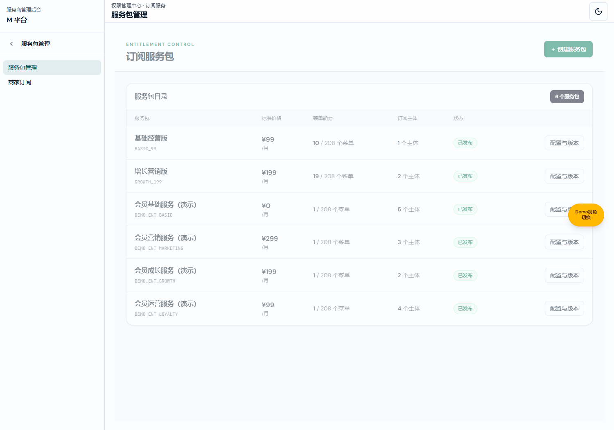

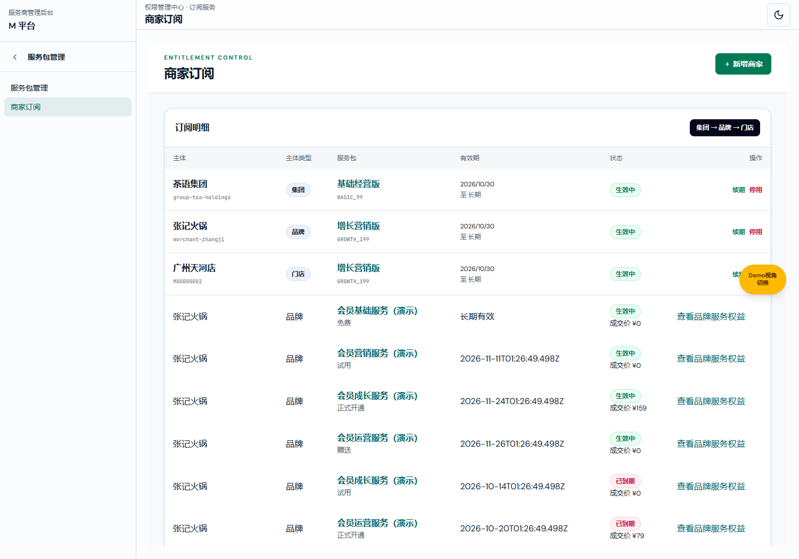

图注：2026-10-30，codex/service-copy-trim-20261030，main@3af2b3fb，5273功能预览实采。

| 字段／操作 | 逻辑说明 |
| --- | --- |
| 服务包目录标题区域 | 展示页面标题、创建服务包操作与目录；不展示产品组合说明或有效订阅跟随新版本的说明文案。发布和回滚规则仍按公共规则执行。 |
| 商家订阅标题区域 | 展示页面标题、新增商家操作及订阅明细；不展示集团／品牌／门店继承说明及记录数量与状态计算说明行。 |
| 订阅列表状态 | 保留每条记录的状态标签、有效期及操作；按原始生效与到期时间判定，隐藏说明文案不改变计算。 |

## M平台：订阅明细 → 点击服务包名称

图注：2026-10-30，codex/subscription-menu-preview-20261030，起始main@ccb5fd2c，5276功能预览实采。入口：商家订阅 → 订阅明细。

| 字段／操作 | 逻辑说明 |
| --- | --- |
| 服务包名称 | 每条服务包仍存在的订阅记录，将服务包名称作为可点击入口，打开已配置菜单弹框；覆盖旧订阅、免费、试用、正式开通及赠送，不要求收费服务。名称使用按钮语义并声明弹框，支持键盘聚焦与Enter／Space。操作列不增加独立查看菜单按钮，原续期／停用或品牌权益入口保留。 |
| 页面上下文 | 点击服务包名称在当前页面打开只读弹框，不跳转服务包配置或品牌详情，关闭后仍保留订阅列表位置。 |
| 可见权限 | 沿用商家订阅页面查看权限；只读账号可查看与搜索，不需要品牌管理写权限。服务包不存在时不提供菜单入口。 |

### 服务包已配置菜单弹框

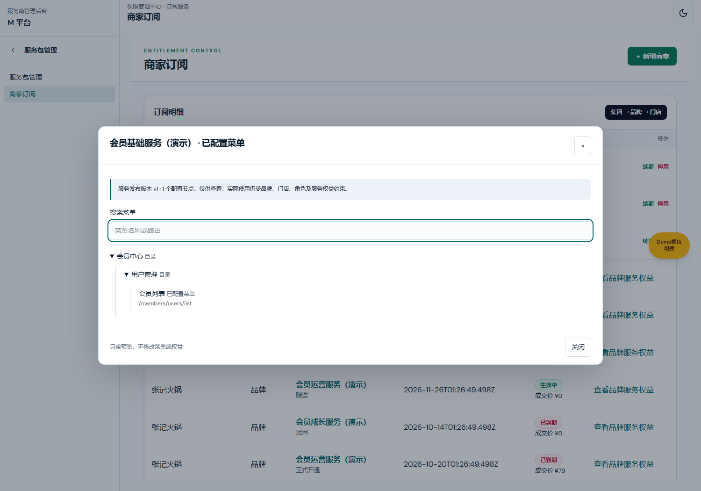

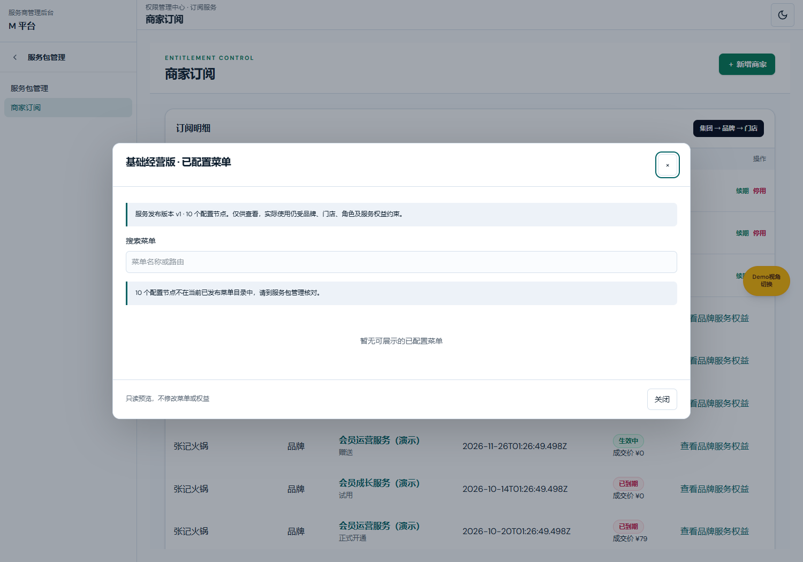

| 字段／操作 | 逻辑说明 |
| --- | --- |
| 服务名称 | 根据该订阅packageId读取服务包名称。 |
| 服务发布版本 | 读取服务包activeReleaseId对应的当前发布版本，与现有订阅统一跟随版本规则一致；不读未发布草稿或合同快照版本。 |
| 配置节点数 | 当前发布版本routeNodeIds去重数量，包含不在当前目录的历史节点，不等于实际可使用页面数。 |
| 菜单树 | 读取当前已发布路由目录，只展示服务包绑定节点及必要结构祖先，不补选兄弟菜单；祖先标记目录，绑定节点标记已配置菜单。 |
| 搜索菜单 | 按名称或路径过滤，保留匹配节点的结构祖先；无结果显示没有匹配的菜单，清空恢复完整预览。 |
| 历史节点 | 发布版本绑定的节点不在当前目录时提示数量并引导到服务包管理核对，不把其他菜单映射为该节点。 |
| 空状态 | 无发布版本显示暂无已发布菜单；有版本但无可展示节点显示暂无可展示的已配置菜单。 |
| 停用状态 | 已停用服务仍可查看当前发布配置，并标记服务已停用；不表示该订阅当前可用。 |
| 关闭／×／Escape／遮罩 | 关闭弹框，不写入服务包、订阅或菜单权限，不更改有效期，不触发试用或扣款；切换路由关闭预览。 |
| 加载失败 | 菜单目录加载失败时提示稍后重试；服务包不存在时提示刷新页面，不展示其他服务数据。 |

## M平台：创建服务包／编辑服务包

待补页面图片：独立编辑商业设置状态；下图仅代表创建状态。

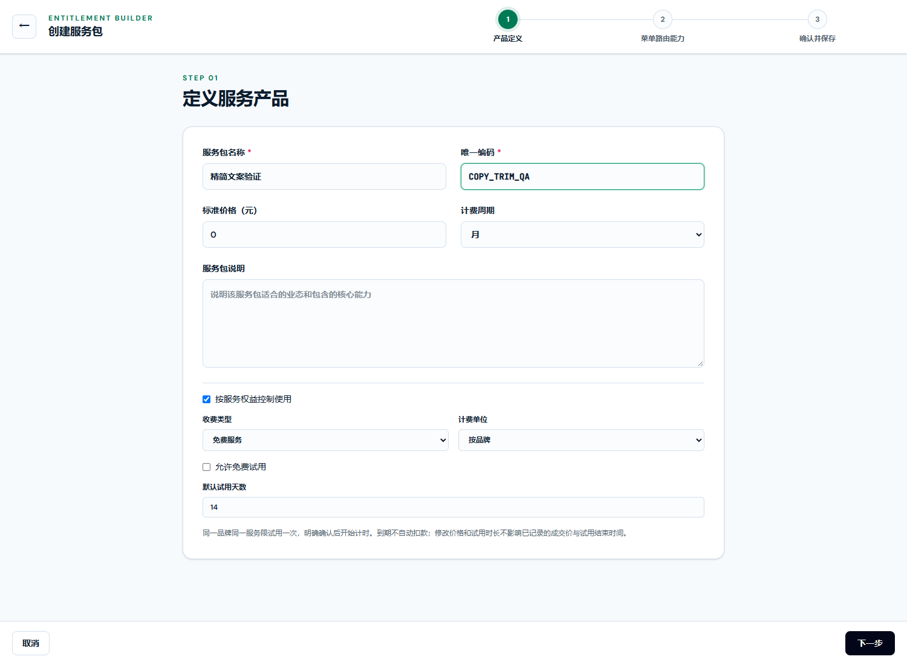

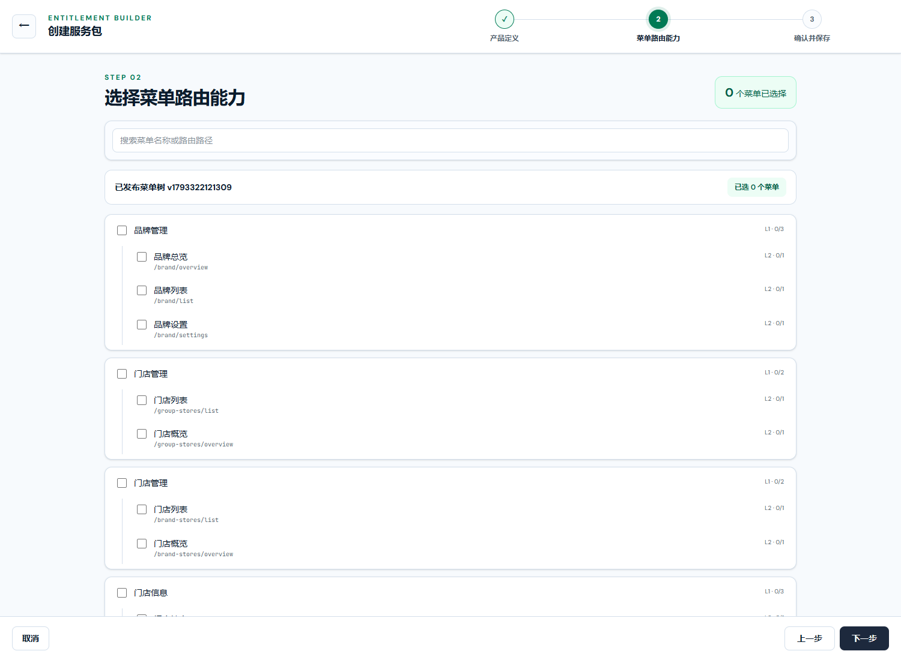

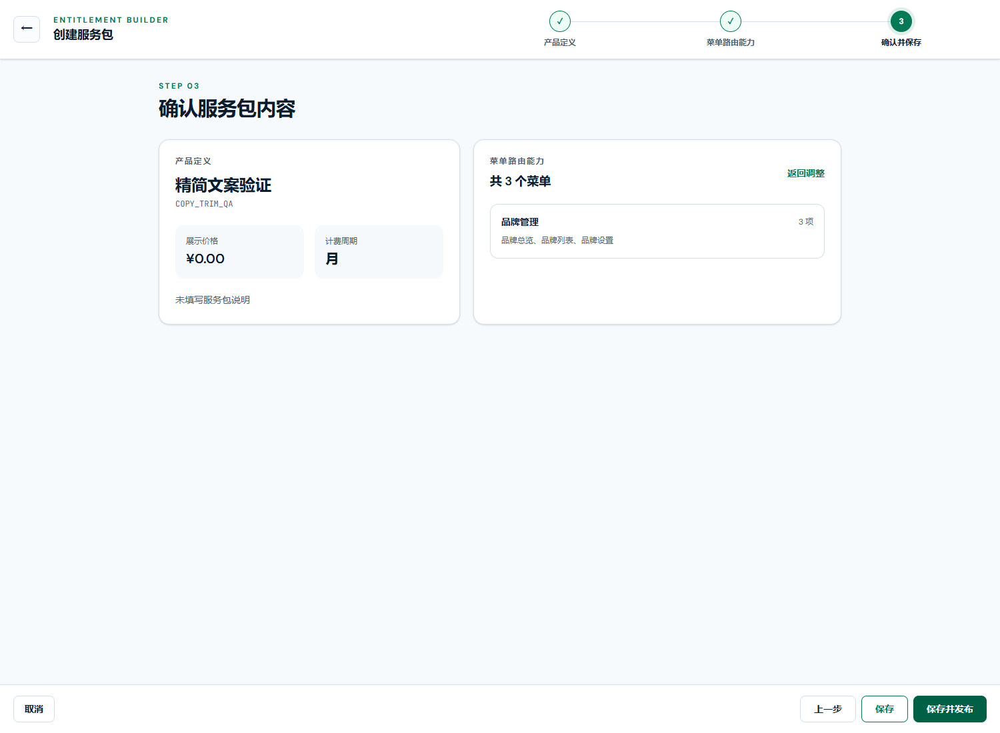

图注：2026-10-30，codex/service-copy-trim-20261030，起始main@3af2b3fb，5273功能预览实采。入口：M平台 → 服务包管理 → 创建服务包；编辑从服务包详情进入。

| 字段／操作 | 逻辑说明 |
| --- | --- |
| 页面说明文案 | 创建页不展示产品定义副标题、编码大写／去重说明、权益控制说明、页面入口与角色边界说明、菜单来源／结构节点／可选菜单统计、确认保存副标题。权益控制说明在共享商业设置区域同样隐藏；校验、授权、订阅与保存发布规则保持有效。 |
| 服务包名称 | 必填，显示服务的业务名称，创建向导最多60字。 |
| 唯一编码 | 必填，去首尾空白转大写，不能与已有服务编码重复，创建后作为稳定业务标识。 |
| 说明 | 可空，作为B端服务介绍，不承载额外权限规则。 |
| 标准价格 | 元输入，最多两位小数，保存为分；免费为0、收费大于0，异常值拒绝。 |
| 计费周期 | 月、季度、年、一次性；保存到服务发布版本和正式成交快照。 |
| 按服务权益控制使用 | 新服务默认选中；旧服务需明确选中并发布。启用后不可直接清除；发布提示未开通品牌将锁定相关页面。 |
| 收费类型 | 免费/收费，明确选择，不以菜单名称或是否勾选推断。 |
| 计费单位 | 按品牌/按门店，定义成交单价单位，不代替适用门店范围。 |
| 允许免费试用 | 仅收费服务可开启，免费服务勾选时校验失败。 |
| 默认试用天数 | 开启试用时必为1至90整数，不修改既有试用记录endAt。 |
| 菜单路由能力 | 使用当前已发布菜单树，目录结构与路由一致；至少选一个有效可选节点，可多选服务共享菜单。 |
| 保存草稿 | 保存当前产品定义及菜单选择，不改变生效版本；失效菜单按现有保存校验处理。 |
| 保存并发布／预览发布 | 创建不可变版本并使服务当前菜单绑定生效；标准价格、试用政策不覆盖历史成交/试用快照。 |
| 取消／退出 | 沿用当前向导草稿保护，未保存内容不成为品牌权益。 |

### 服务包详情：基本信息

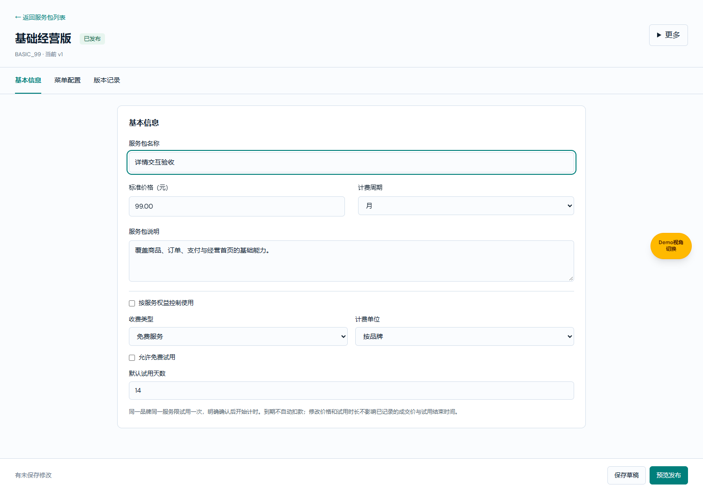

图注：2026-10-30，codex/service-detail-fullscreen-20261030，起始main@ccb5fd2c，5275功能预览实采。入口：服务包管理 → 配置与版本。

| 字段／操作 | 逻辑说明 |
| --- | --- |
| 页面入口与布局 | 从服务包目录点击配置与版本，在当前标签页进入独立全屏详情路由；隐藏M平台侧栏与外层页头，不新开浏览器标签。返回服务包列表恢复常规平台布局；直接访问详情亦使用同一全屏页面，仍须具备原页面查看权限。 |
| 顶部摘要 | 展示当前服务包名称、编码、状态和当前发布版本；无发布版本显示尚未发布。名称在草稿保存后不替代发布摘要，发布成功才更新当前产品。 |
| 三个页签 | 基本信息、菜单配置、版本记录；默认基本信息。同一服务包切换页签不保存，不清空输入；支持键盘左右键与Home/End切换。 |
| 服务包名称 | 必填、最多60字，先保留在页面编辑态；空名称保存失败并保留输入。 |
| 标准价格 | 元输入、最多两位小数，转分保存；拒绝非有限值、负数，商业免费／收费约束见公共规则。 |
| 计费周期 | 月／季度／年／一次性，保留原枚举；选择仅更新待保存值。 |
| 服务包说明 | 可空、最多300字，跨页签保留。 |
| 商业设置 | 按服务权益控制使用、收费类型、计费单位、允许免费试用、默认试用天数分别沿用创建表单字段约束；不能取消已经启用的权益控制。 |
| 未保存状态 | 底部显示有未保存修改或已保存；以字段与菜单集合相对当前持久化草稿比较，菜单顺序不构成差异。 |
| 保存草稿 | 统一位于底部。重新校验名称、金额、商业设置、失效菜单及草稿revision；成功保存产品和菜单待发布草稿，当前商家可用版本保持不变。失败保留输入，提示具体原因。 |
| 预览发布 | 位于底部主按钮，先校验但不写入，打开发布确认；无菜单禁止发布。 |
| 更多 | 停用服务包收在顶部更多中，不与保存发布并列。存在未保存修改时须先保存或放弃，避免停用时丢弃输入。 |
| 返回／离开 | 有修改时显示独立放弃确认；刷新／关闭使用浏览器未保存提醒。不在页签切换时提示离开。 |
| 只读 | 可切换页签、搜索菜单及查看版本；字段、保存、菜单变更、发布、停用和回滚拒绝执行。发布、停用、回滚分别复用原操作权限，无新增授权。 |

### 服务包详情：菜单配置

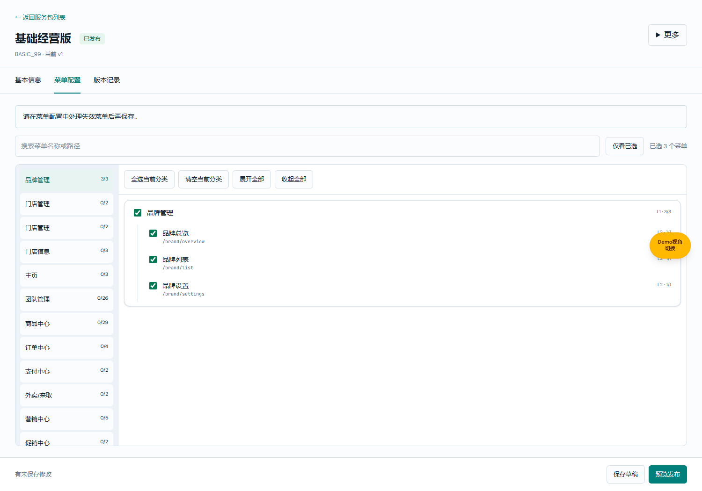

图注：同一功能预览，左侧分类与右侧当前菜单树；未保存菜单不写入存储。

| 字段／操作 | 逻辑说明 |
| --- | --- |
| 菜单分类 | 左侧按已发布目录顺序展示名称与已选／可选数量；切换只改变定位，不修改选择；原始ID用于区分同名分类，不另造菜单目录。 |
| 菜单树 | 右侧展示当前分类及层级。父项全选该父项当前可选页面；保留原路由ID和父子关系，非可选目录不作为页面能力。 |
| 搜索 | 按名称或路径查找当前全部已发布分类，清空后返回当前分类；不丢失编辑内容或光标。 |
| 仅看已选 | 切换当前视图筛选，不改变待保存集合；无已选结果显示空状态。 |
| 全选当前分类 | 选择当前分类全部有效可选页面，不选择其他分类。 |
| 清空当前分类 | 只移除当前分类页面，保留其他分类。 |
| 展开全部／收起全部 | 只改变当前树的折叠状态，不改变菜单选择。 |
| 已选数量 | 当前编辑集合与已发布有效可选页面交集的去重数量，不含失效ID，不等于历史版本菜单数量。 |

### 失效菜单明细与移除确认

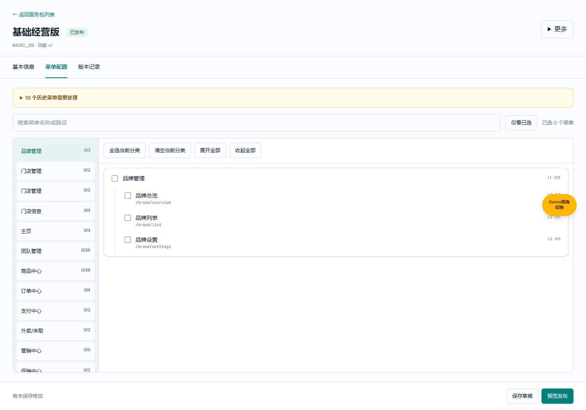

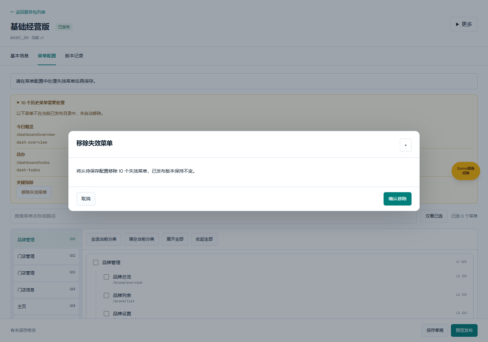

| 字段／操作 | 逻辑说明 |
| --- | --- |
| 历史菜单需要处理 | 待编辑ID不属于当前可选目录时显示数量；展开可看历史名称、路径及原ID。名称优先当前可用节点或已知旧目录，路径可回溯受控路径；无法获取明确显示名称／路径未留存，不猜测映射。 |
| 保存限制 | 有失效项时阻止详情页保存和发布，保留原ID及输入，不静默过滤。 |
| 移除失效菜单 | 独立确认后只从页面待保存集合移除；未保存前不写入草稿，已发布版本不变。取消、关闭、Escape均保留原集合。 |

### 发布确认

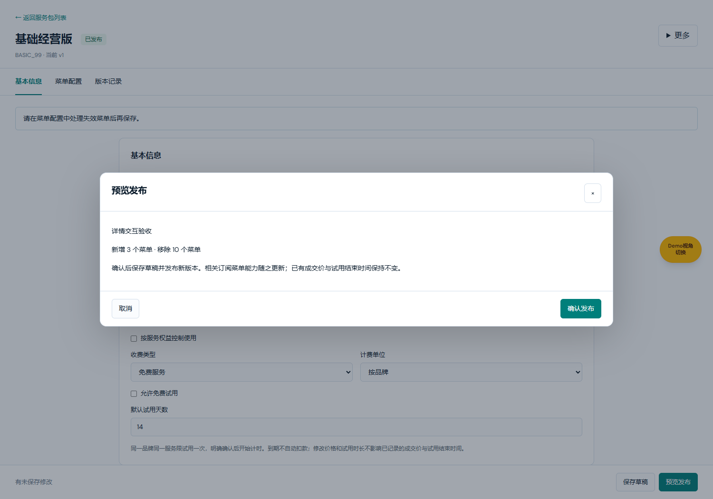

| 字段／操作 | 逻辑说明 |
| --- | --- |
| 发布差异 | 对比当前有效发布版本与页面待保存菜单集合，显示新增／移除数量；首次发布以空集合比较。 |
| 确认发布 | 再校验页面写权限及发布操作权限，按原草稿revision保存后发布不可变新版本，更新顶部摘要与编辑基线；相关订阅按原发布规则更新。成交价与试用期限不被改写。 |
| 取消／关闭／Escape | 不保存、不发布，保留编辑内容。 |
| 保存或发布失败 | 原因就地提示；发生草稿版本冲突不覆盖新草稿。保存成功而随后发布失败时，持久化草稿保留、当前发布版本不变，可修正后重试。 |

### 版本记录与版本详情

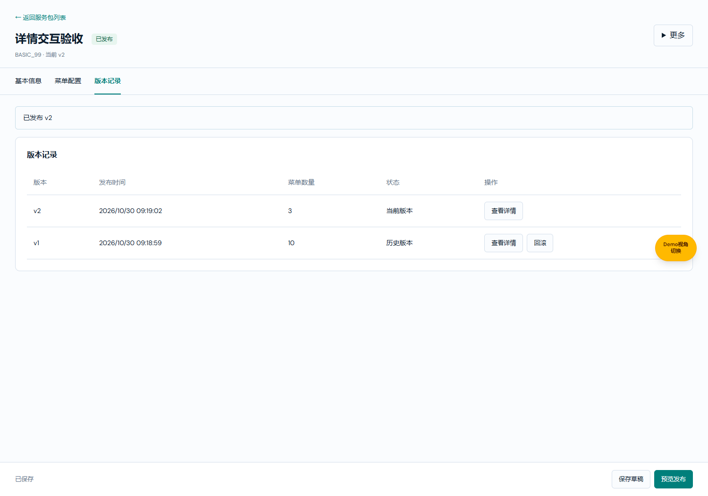

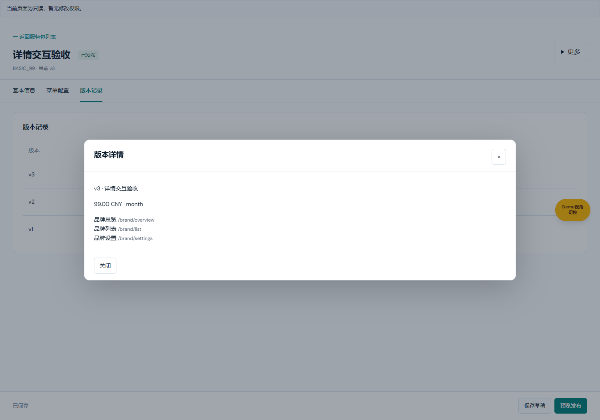

| 字段／操作 | 逻辑说明 |
| --- | --- |
| 版本 | 按版本号倒序，展示vN。 |
| 发布时间 | 使用发布记录publishedAt的本地日期时间。 |
| 菜单数量 | 该不可变版本的routeNodeIds数量，保留历史失效节点。 |
| 状态 | 当前activeReleaseId对应项标记当前版本，其余为历史版本。 |
| 查看详情 | 弹框展示版本名称、价格币种、计费周期及历史绑定菜单；未知历史名称或路径明确标缺失。只读浏览，不修改配置。 |
| 回滚 | 当前版本不提供回滚；历史版本可确认回滚。存在未保存编辑时先阻止并提示保存或放弃；沿用原回滚、商业策略合法性与受控路径保留规则。 |

### 回滚确认

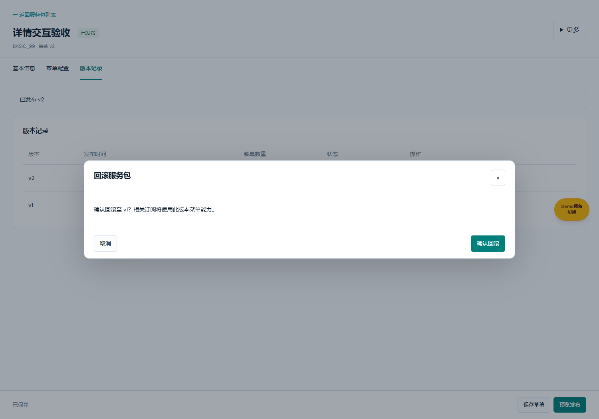

| 字段／操作 | 逻辑说明 |
| --- | --- |
| 确认回滚 | 按原回滚操作权限执行，将所选历史版本设为当前版本并重新加载草稿基线；不清除已经启用的权益控制。 |
| 取消／关闭／Escape | 不回滚，停留版本记录。 |

### 停用确认

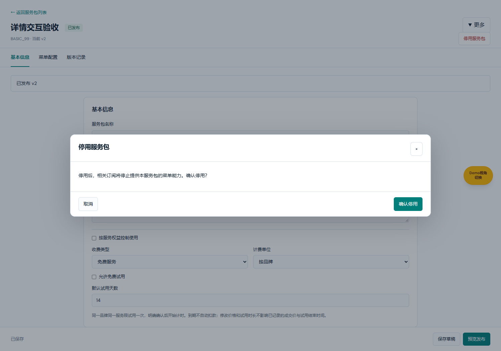

| 字段／操作 | 逻辑说明 |
| --- | --- |
| 确认停用 | 按原停用权限停用服务包，相关订阅停止提供该服务包能力，不删除数据及其他服务来源。 |
| 取消／关闭／Escape | 不停用，保留当前配置。 |

### 未保存修改离开确认

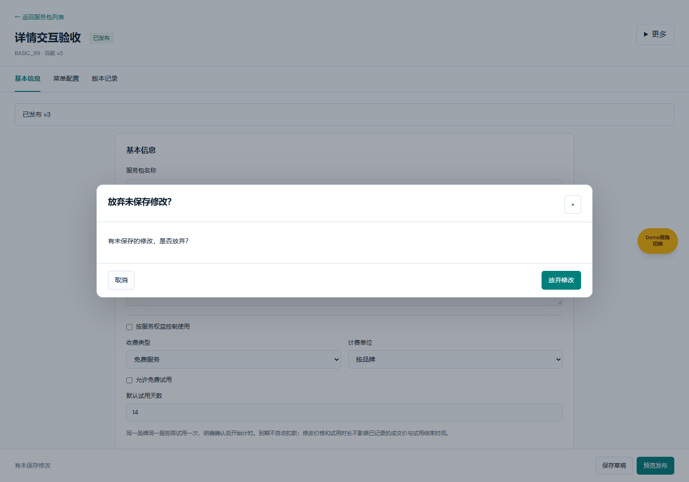

| 字段／操作 | 逻辑说明 |
| --- | --- |
| 放弃修改 | 清除本页内存编辑态后执行原目标导航，不覆盖已保存草稿。 |
| 取消／关闭／Escape | 停留当前服务包，保留字段、菜单和当前页签。 |
## M平台：订阅明细 → 品牌服务权益全屏页

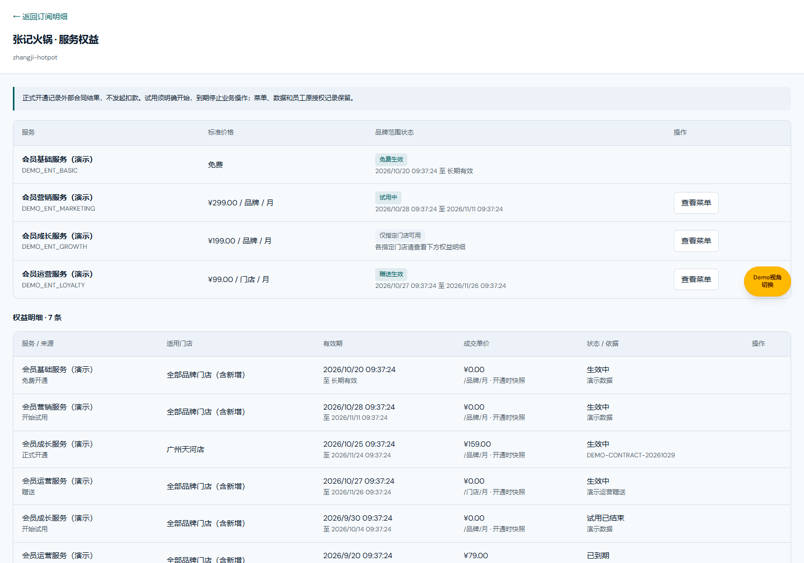

图注：2026-10-30，codex/subscription-brand-rights-dialog-20261030，起始main@38b50372，5277功能预览实采。入口：商家订阅 → 订阅明细 → 查看品牌服务权益。

| 字段／操作 | 逻辑说明 |
| --- | --- |
| 查看品牌服务权益 | 当前标签页进入订阅模块独立全屏路由/m-platform/permissions/merchant-subscriptions/brands/{brandId}/services；隐藏平台侧栏与外层页头，不进入品牌管理，不新开浏览器标签。 |
| 品牌名称 | 页头展示对应品牌名称与编码；品牌不存在时展示明确空状态及返回入口，不推断为其他品牌。 |
| 服务权益汇总 | 复用品牌服务权益同一数据来源与状态计算，展示服务名称、编码、标准价格、品牌范围状态及权益有效期；指定门店范围继续提示查看明细。 |
| 权益明细 | 展示该品牌所有服务／来源、适用门店、有效期、成交单价快照、状态／依据，不局限于当前点击的单条订阅。 |
| 服务变更记录 | 可展开查看该品牌权益关联的时间、操作者及变更内容，无记录显示空状态。 |
| 菜单预览 | 沿用品牌权益中收费服务查看菜单操作，仍以只读弹框展示；关闭返回当前全屏权益页。 |
| 只读范围 | 不提供免费开通、试用、正式开通、赠送、续期或停用操作，不提供跳出到服务包管理的链接；原品牌管理页面能力保持原规则。 |
| 访问权限 | 使用商家订阅页面查看权限；只读账号可查看，不额外要求品牌管理权限。深链接和刷新遵循相同权限，不扩大授权。 |
| 返回订阅明细 | 恢复列表的普通平台布局、原地址及当前会话记录的滚动位置；浏览器返回亦可恢复。直接访问权益页没有历史列表位置时从列表默认位置返回。 |
| 空状态 | 无权益时使用品牌权益同一空状态；不通过查看动作自动开通服务。缺失品牌显示品牌不存在，并提供返回入口。 |
| 数据保护 | 打开、刷新、返回与查看菜单均不写入服务、菜单、订阅或有效期，不消耗试用资格。 |
## M平台：品牌详情 → 服务权益

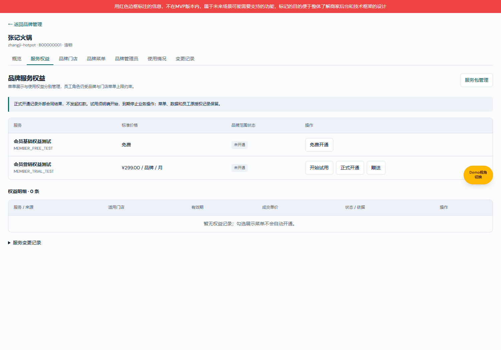

图注：同一5265功能预览实采。入口：商户管理中心 → 品牌管理 → 品牌详情 → 服务权益；需要商家订阅查看权限。品牌菜单页仍负责展示上限。

| 字段／操作 | 逻辑说明 |
| --- | --- |
| 服务 | 展示已启用权益控制的服务名称、编码，包括停用服务的状态说明。 |
| 标准价格 | 当前发布的价格、币种、计费单位和周期；不覆盖权益明细成交快照。 |
| 品牌范围状态 | 无权益显示未开通，全品牌有效显示免费/试用/正式/赠送；仅指定门店有效时明确提示查看明细，不显示全品牌可用。 |
| 免费开通 | 对免费服务建立全品牌或指定门店长期权益，收费服务不能通过该操作零价开通。 |
| 开始试用 | 有试用资格时显示，打开确认框不计时；提交后建立一次试用记录。 |
| 正式开通 | 记录外部开通的成交价、有效期和依据，不模拟支付成功或发起扣款。 |
| 赠送 | 记录0元权益、到期时间及赠送原因。 |
| 权益来源 | 免费、试用、正式、赠送独立记录，试用转正式新增记录。 |
| 适用门店 | 全部门店含新增或指定门店名称；不能跨品牌选门店。 |
| 有效期 | 显示开始及结束精确时刻，无结束为长期。 |
| 成交单价 | 展示开通时币种/金额/品牌或门店/周期快照。 |
| 状态／依据 | 生效中、待生效、试用已结束、已到期、已停用；展示外部依据或原因。 |
| 续期 | 仅正式与赠送且未停用的记录可办理，结束须晚于原结束及当前时刻。 |
| 停用 | 要求原因，立即使本记录退出权益并集，其他有效来源保留。 |
| 服务变更记录 | 时间、操作者、服务、范围、开通依据或续期/停用原因，记录不输出密码。 |
| 商家订阅入口 | 新权益明细显示来源、成交价；查看品牌服务权益进入订阅模块内对应品牌的只读全屏页，不导航到品牌管理。旧订阅仍按原流程管理。 |

### 开始试用确认弹框

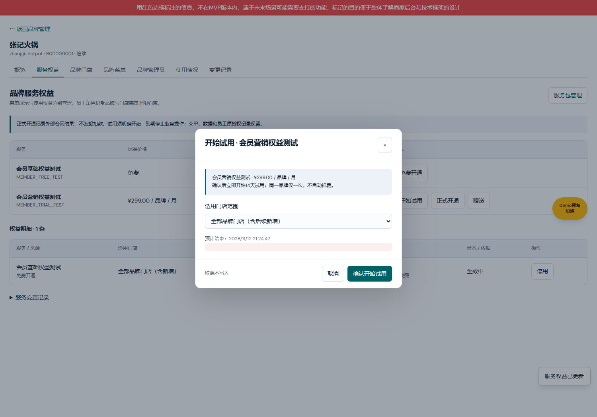

| 字段／操作 | 逻辑说明 |
| --- | --- |
| 服务／试用说明 | 名称、当前价格、试用天数、到期不自动扣费说明。 |
| 适用门店范围 | 默认全部品牌门店，可改指定；指定模式须至少选一家当前品牌门店。 |
| 预计结束 | 当前时刻加政策天数，仅说明；真正结束以提交确认时刻计算。 |
| 确认开始试用 | 重新校验身份、资格、服务状态、门店归属后写入；重复提交不产生第二次资格。 |
| 取消／×／Esc／遮罩 | 关闭不写入，不消耗试用资格，仍在当前页面。 |

### 正式开通／赠送弹框

待补页面图片：赠送状态；下图仅代表正式开通状态。免费开通的专属确认框图片亦待补，详见独立交付缺口。

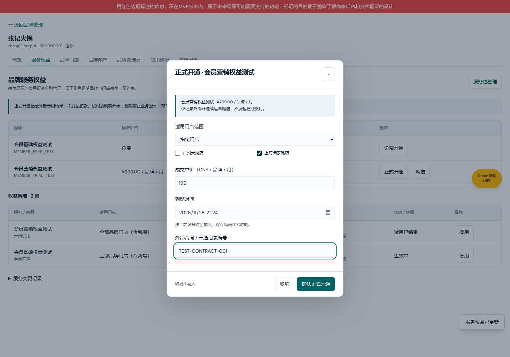

| 字段／操作 | 逻辑说明 |
| --- | --- |
| 服务与标准价格 | 当前服务说明，告知仅记录外部开通，不扣款。 |
| 适用门店范围 | 同试用范围校验，与计费单位独立。 |
| 成交单价 | 正式开通必填正金额，最多两位小数，保存金额分与单位快照；赠送为0。 |
| 到期时间 | 默认当前起30天，可编辑，按当前设备时区输入并保存UTC精确时刻，须晚于当前时间。 |
| 外部合同／开通记录编号 | 正式必填，作为开通依据；不用于支付扣款。 |
| 赠送原因 | 赠送时必填，代替合同编号。 |
| 确认 | 重新校验后写入，成功刷新权益列表并提示；失败保留弹框与输入。 |
| 取消 | 不生成权益，不改变原菜单或合同记录。 |
## B平台：收费页面入口与服务状态

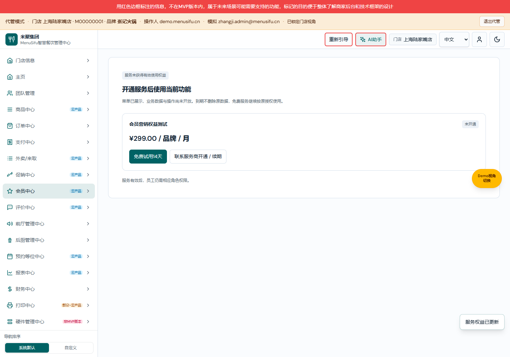

图注：同一功能分支实采，真实品牌/门店身份与角色上限仍先行校验；只有原菜单可见者能够进入该说明页。

| 字段／操作 | 逻辑说明 |
| --- | --- |
| 原菜单入口 | 沿用品牌/门店和员工角色过滤；受控页面追加当前服务状态，不因未付费直接隐藏已配置入口。 |
| 服务名称／说明 | 从当前服务定义读取，业务页面与数据不挂载。 |
| 标准价格 | 从当前服务发布配置读取，不作为该品牌已付价格。 |
| 状态原因 | 未开通、试用已结束、已到期、已停用、服务已停用、不在适用门店、仅指定门店可用或菜单已移出服务分别说明。 |
| 免费试用N天 | 仅当前品牌已启用Admin、允许试用且历史未试用者可见，点击打开试用确认框。 |
| 联系服务商开通／续期 | 告知确认合同、价格和门店范围，由服务商记录外部开通；不自动创建申请或付款。 |
| 无具体品牌／门店 | 提示先选明确范围，不借用其他品牌权益。 |

### 试用生效页

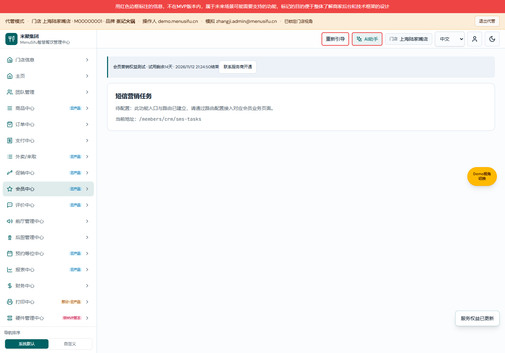

| 字段／操作 | 逻辑说明 |
| --- | --- |
| 剩余天数 | max(0,ceil((结束毫秒−当前毫秒)/86400000))，同时显示精确结束时刻；天数只作提示。 |
| 业务内容 | 通过服务校验后继续原页面实现及员工操作权限，不新增原页面没有的业务能力。 |
| 联系服务商 | 显示正式开通途径，普通员工无开通写入口。 |

### 试用结束页

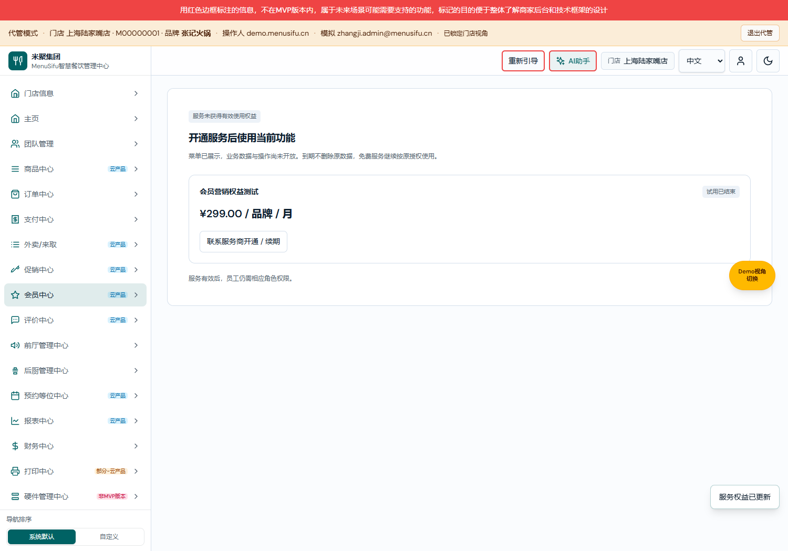

| 字段／操作 | 逻辑说明 |
| --- | --- |
| 到期校验 | 到达结束时刻自动重新判断并移除受控业务内容；恢复浏览器焦点及权益变化时重新核对，业务操作前再判断。 |
| 试用资格 | 已试用不再显示重新试用按钮；仍可由服务商正式开通或赠送。 |
| 原数据 | 不删除；当前锁定页不展示业务数据。免费服务及其他有效服务来源维持原授权。 |
| 页面/角色切换 | 按新的门店、品牌和账号重新计算，不缓存上一主体的可用状态。 |
## M平台：续期服务权益弹框

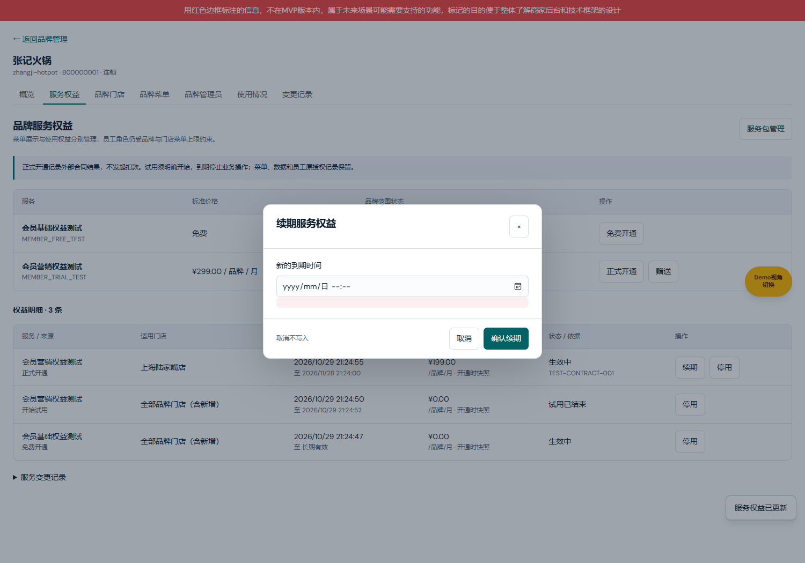

入口：品牌服务权益明细 → 续期；5265功能分支实采。

| 字段／操作 | 逻辑说明 |
| --- | --- |
| 新的到期时间 | 必填，当前设备时区输入，必须晚于原到期时刻及当前时刻。仅正式开通、赠送且未停用记录可操作。 |
| 确认续期 | 校验权限、记录状态和时间，更新结束时刻；保留成交快照，追加审计。失败保留输入。 |
| 取消／关闭 | 不修改期限，不写入审计。 |

## M平台：停用服务权益弹框

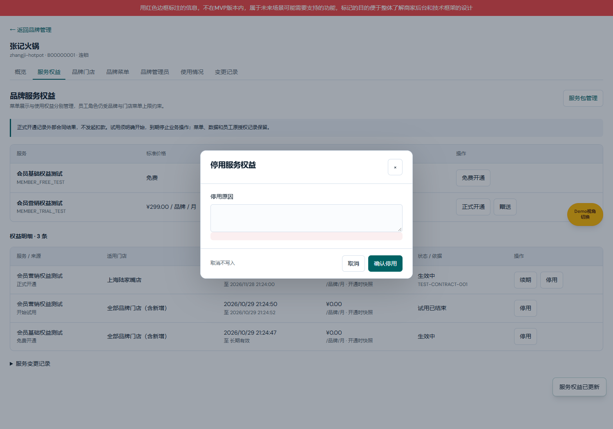

入口：品牌服务权益明细 → 停用；5265功能分支实采。

| 字段／操作 | 逻辑说明 |
| --- | --- |
| 停用原因 | 必填，去首尾空白后不得为空，页面最多200字。 |
| 确认停用 | 校验权限和记录状态，写入停用时刻、操作人及原因；该来源立即失效，保留历史。其他有效服务来源不受影响。 |
| 取消／关闭 | 不停用，不写入。 |

## 品牌服务权益：收费服务查看菜单

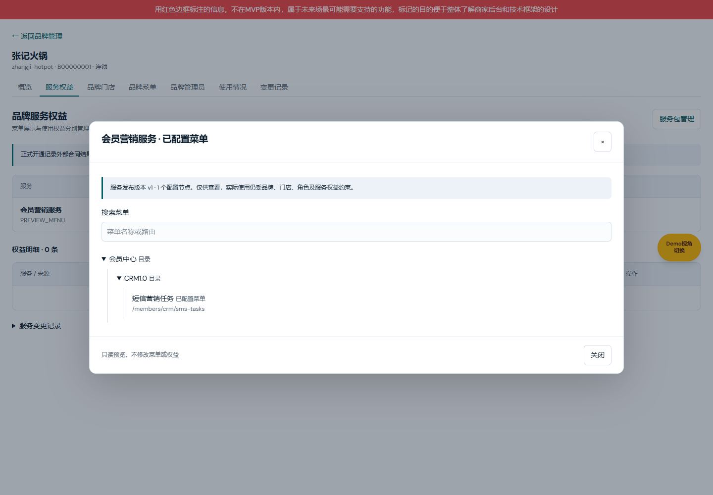

图注：2026-10-29，codex/service-menu-inspect-20261029，起始main@05b0d001，5266功能分支实采。入口：品牌详情 → 服务权益 → 收费服务 → 查看菜单。

| 字段／操作 | 逻辑说明 |
| --- | --- |
| 查看菜单 | 收费服务显示；沿用品牌详情及商家订阅查看权限，只读账号亦可查看。打开弹框，不跳转、不修改授权、不产生开通或试用。 |
| 服务名称 | 当前服务名称，用于明确预览对象。 |
| 服务发布版本 | 根据当前activeReleaseId读取发布版本，菜单来自该版本routeNodeIds；不读取草稿，也不代表历史合同开通版本。未发布显示暂无已发布菜单。 |
| 配置节点数 | 当前发布版本去重后的绑定节点数，包含暂时不在当前路由目录的配置节点；不等同实际可使用页面数。 |
| 菜单树 | 与当前已发布路由目录按节点ID匹配，仅保留已绑定节点及其结构祖先；不带出未绑定兄弟或子菜单。目录不代表单独授予权限。显示名称与路由，按原层级缩进。 |
| 展开／收起 | 有子级的目录默认展开，可点击折叠，仅改变本次预览展示状态。 |
| 搜索菜单 | 默认空，按名称或路由搜索预览树；保留命中节点的祖先，无结果显示没有匹配的菜单。清空后恢复完整已配置树。 |
| 失效配置提示 | 已绑定ID不在当前已发布目录时显示缺失节点数量，提示到服务包管理核对；不补选其他菜单。 |
| 服务已停用 | 仍可核对当前发布版本菜单，明确标记停用，不代表可使用。 |
| 关闭／Escape／遮罩 | 关闭弹框返回当前品牌页面，保留列表上下文，不写入服务、品牌菜单、权益或审计。切换路由亦清理弹框。 |
| 加载失败 | 提示菜单目录加载失败，请稍后重试；不改动数据。 |

验收：发布版本绑定短信营销、草稿改为会员列表时，预览仅展示发布版本短信营销及祖先；只读账号可看；关闭与搜索均不写入服务快照。
