# M 平台入驻商户管理中心业务规格说明书（研发交付版）

> V1.62 · 2026-10-29 · BRAND-STORE-DETAIL-20261029-66
> 配对：[产品 V1.63](./M平台-入驻商户管理中心设计方案.md) · [研发 V1.62](./M平台-入驻商户管理中心业务规格说明书（研发交付版）.md) · [个人规范 V1.62](./M平台-入驻商户管理中心需求文档（个人规范版）.md)
> 职责：当前业务定义与字段规则；验证、变更及交付缺口独立记录。

## 品牌门店：查看门店详情

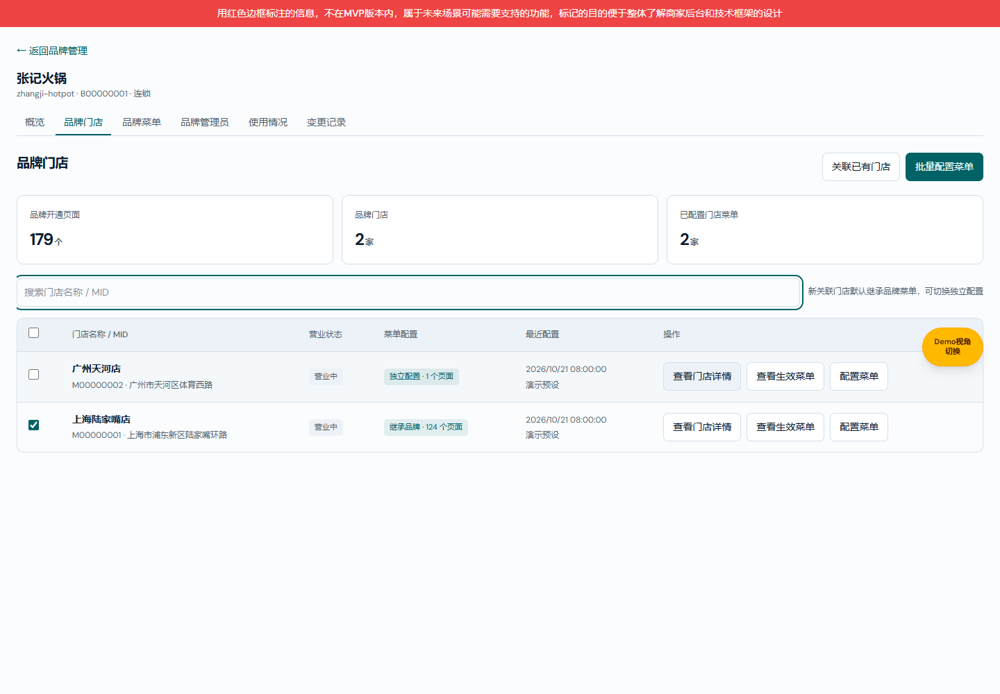

图注：品牌详情 → 品牌门店，2026-10-29，codex/brand-store-detail-modal-20261029，起始main@cb8d6aa8，5263功能预览实采。

用途／入口：M平台 → 商户管理中心 → 品牌管理 → 品牌详情 → 品牌门店 → 对应门店操作区“查看门店详情”。品牌使用情况列表及统计抽屉不提供该管理详情入口；“查看详情”仍打开使用统计抽屉。

| 字段／操作 | 逻辑说明 |
| --- | --- |
| 查看门店详情 | 门店行只读浏览操作；要求品牌门店页和该店概览均可访问，且门店当前归属于当前品牌。点击时重新校验，失败提示无法查看及可能原因，保留列表状态。 |
| 搜索、勾选与滚动 | 打开弹框不重绘品牌门店列表，不清空搜索和勾选；关闭后保留位置。 |
| 查看生效菜单 | 沿用原门店已保存菜单树弹框。 |
| 配置菜单 | 沿用原编辑门店菜单操作及写权限，与只读详情入口独立。 |

### 门店详情弹框：只读概览

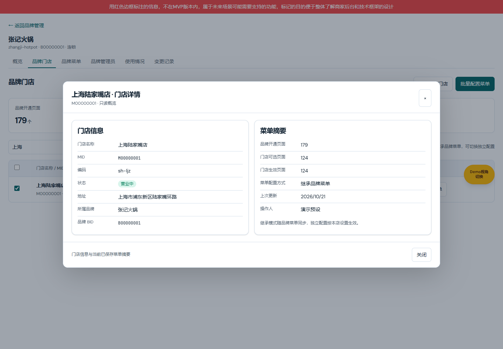

图注：上海陆家嘴店M00000001，背景仍为张记火锅的品牌门店；5263功能预览实采。内容来自同一门店概览渲染与当前有效菜单配置。

| 字段／操作 | 逻辑说明 |
| --- | --- |
| 标题 | 门店名称 · 门店详情，带入所点击门店MID；逐次打开重新读取对应门店。 |
| 门店名称 | 当前管理资料名称，只读。 |
| MID | 当前门店唯一标识，等宽展示，不生成新标识。 |
| 编码 | 当前门店编码，只读。 |
| 状态 | 当前门店营业状态及原有标签。 |
| 地址 | 当前管理地址，无值显示“—”。 |
| 所属品牌 | 当前品牌名称，只读文本，不跳转。 |
| 品牌BID | 当前品牌BID，无值显示“—”。 |
| 品牌开通页面 | 当前品牌菜单候选中已开通且isPage为真的页面数，分组不计数。 |
| 门店可选页面 | 当前品牌门店视角上限中isPage为真的页面数。 |
| 门店生效页面 | 当前门店有效enabledKeys对应的isPage页面数；未配置为0，继承配置按当前有效结果计算。 |
| 菜单配置方式 | 与门店概览共用当前配置模式展示；继承模式随品牌同步，独立模式按本店配置。 |
| 上次更新 | 当前门店配置更新时间，沿用门店概览的日期格式和空值。 |
| 操作人 | 当前门店配置更新人，无值显示“—”。 |
| 关闭／右上角×／Esc／遮罩 | 关闭弹框，恢复原门店行按钮焦点；按钮消失时回品牌门店搜索控件。不改地址和history，不写入配置。 |
| 背景与路由 | 原生模态隔离背景焦点，锁住原列表滚动；离开路由、列表卸载、归属失效或撤权后清理弹框及滚动锁定。 |
| 查看边界 | 弹框仅展示概览，不包含保存、编辑、跳转门店管理的按钮；其他菜单配置仍从品牌门店原有入口执行。独立门店管理和B后台保持各自原流程。 |

实现约束：M品牌门店工作台由宿主注入canView/open回调，B工作台不注入。渲染入口和打开弹框均核对当前品牌org上下文、门店归属及品牌/门店两页访问权限；只读放行仅限详情浏览控件，不授予写操作。原生dialog复用renderStoreDetailOverview只读模式并移除概览跳转操作，关闭清理监听与观察器，恢复原overflow/scrollTop/焦点。页面、统计和写入权限资源目录无变化。

验收：从品牌使用情况核对入口消失；品牌门店选定一家、输入搜索后打开，比较当前MID/字段与配置快照，切换另一门店无串数据；四种关闭方式均保留列表。篡改行目标为其他品牌门店、撤销门店访问时不得打开；只读可查看，路由离开无残留dialog。

验证与限制见[品牌门店详情验证记录](../verification/brand-store-detail-modal-20261029/README.md)。

## 使用情况：当前页面查看门店详情

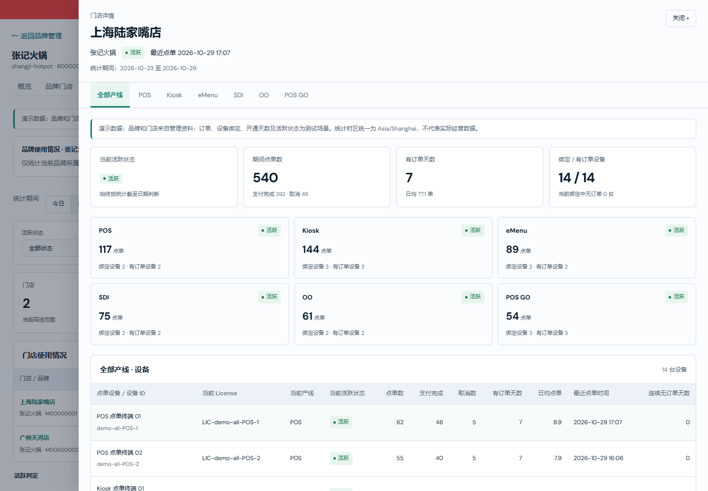

图注：品牌详情 → 使用情况 → 查看详情，2026-10-29，main@cb8d6aa8 起始的隔离功能预览5263实采；背景保留品牌详情。

当前入口规则及实测见[使用情况入口验证](../verification/usage-hide-self-links-20261029/README.md)。

用途／入口：有相应管理页和系统使用分析权限的用户，从品牌或门店详情的“使用情况”查看统计。统计口径、日期范围和已应用筛选沿用对应列表。

| 字段／操作 | 逻辑说明 |
| --- | --- |
| 门店名称、查看详情 | 普通点击在当前管理详情页打开右侧门店抽屉，带入该门店与有效期间；不切换系统分析页面，不更改地址及浏览器历史。 |
| 抽屉范围 | 品牌使用情况仅允许当前品牌所属门店；门店使用情况仅允许当前门店。打开和重新渲染时均校验当前归属，越界、移除或失效范围不展示。 |
| 产线卡片、页签 | 在当前抽屉切换全部产线或指定产线，地址保持不变；内容、设备集合与独立分析采用相同统计定义。 |
| 关闭、Esc、遮罩 | 关闭抽屉，保留已应用筛选、未提交搜索和日期输入、列表滚动位置；焦点回到原门店名称或原“查看详情”入口。入口消失时回列表标题或筛选控件。没有数据写入。 |
| 背景操作 | 抽屉打开期间背景不可点击、聚焦或滚动，键盘焦点保持在抽屉内；关闭或离开页面后恢复原有状态。 |
| 打开详细分析、查看全局分析 | 明确进入独立系统使用分析，分别保留受限上下文或进入全局允许范围。独立分析的地址深链、浏览器前进后退规则仍适用。 |
| 查看品牌详情 | 品牌管理的使用情况列表和抽屉均不展示。门店管理的使用情况仅在品牌资料存在且原品牌管理权限允许时展示，进入品牌概览。 |
| 查看门店详情 | 品牌和门店管理的使用情况列表及抽屉均不展示；品牌下门店的管理信息从本页“品牌门店：查看门店详情”弹框查看。 |
| 独立分析的管理入口 | 独立系统使用分析列表及抽屉继续按原数据与权限条件展示两个管理入口；嵌入页隐藏规则不扩大到独立分析。 |
| 权限与异常 | 沿用独立分析权限及对应管理页权限；只读授权可以查看，撤权后不能继续浏览。页面卸载、真实路由离开或范围失效时清理本地抽屉。 |

### 门店使用情况中的抽屉

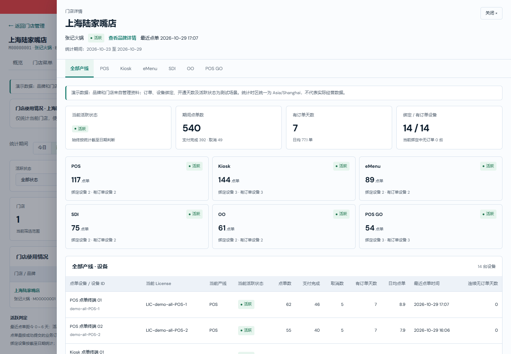

图注：门店详情 → 使用情况，5261功能预览实采；门店范围限定为当前MID。页面规则与本节共用，不另行扩大授权。

### 关闭后恢复当前页面

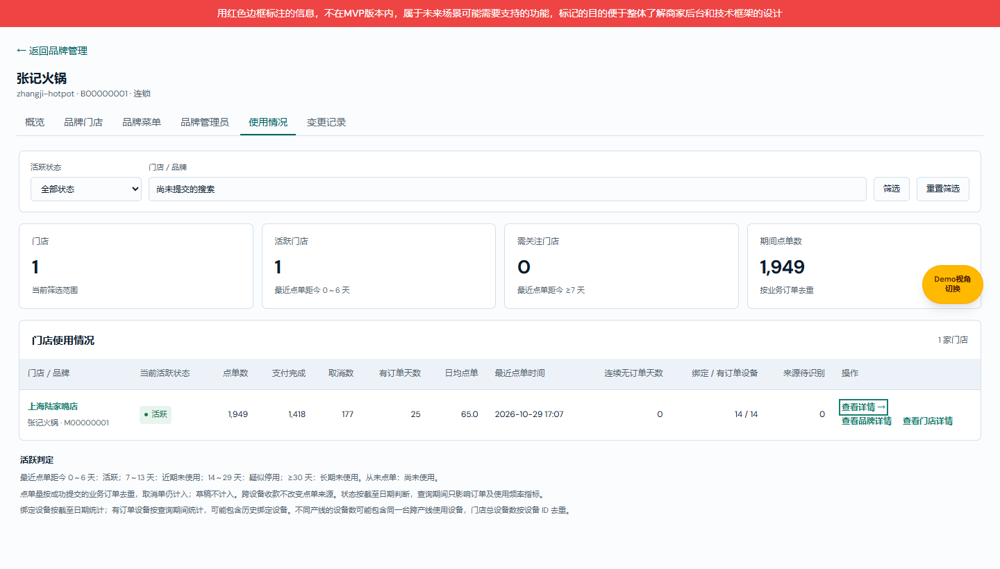

图注：关闭品牌使用情况抽屉后，未提交的搜索及日期输入、原列表和页面位置保留。

实现约束：嵌入模式以组件本地 inlineScope 保存门店／产线状态，独立分析沿用地址解析。上下文变化清空本地范围；当前上下文重新解析目标MID，不能信任链接内的其他品牌上下文。滚动宿主为管理使用情况容器的实际父滚动区。逐层隔离模态分支的兄弟节点并记录原inert，释放时逐项还原；路由监听与模态移除观察器负责离开／同地址卸载清理，关闭函数可重复调用。既有统计、演示数据、权限目录及持久存储契约不变。

验收算例：应用近30天与MID筛选，再输入未提交搜索和日期，滚动后分别从名称、详情入口打开抽屉；切换产线后关闭，地址与history.length不变，输入、已应用结果、滚动及原入口焦点恢复。只读角色可浏览，跨品牌范围和撤权不展示；显式分析入口仍导航。

验证、限制及代码范围见[本地抽屉验证记录](../verification/usage-inline-drawer-20261029/README.md)。本节的本地状态规则仅适用于管理页嵌入模式；下文独立分析地址与深链规则不适用于该模式。

## 管理资料与分析 Demo 共用标识

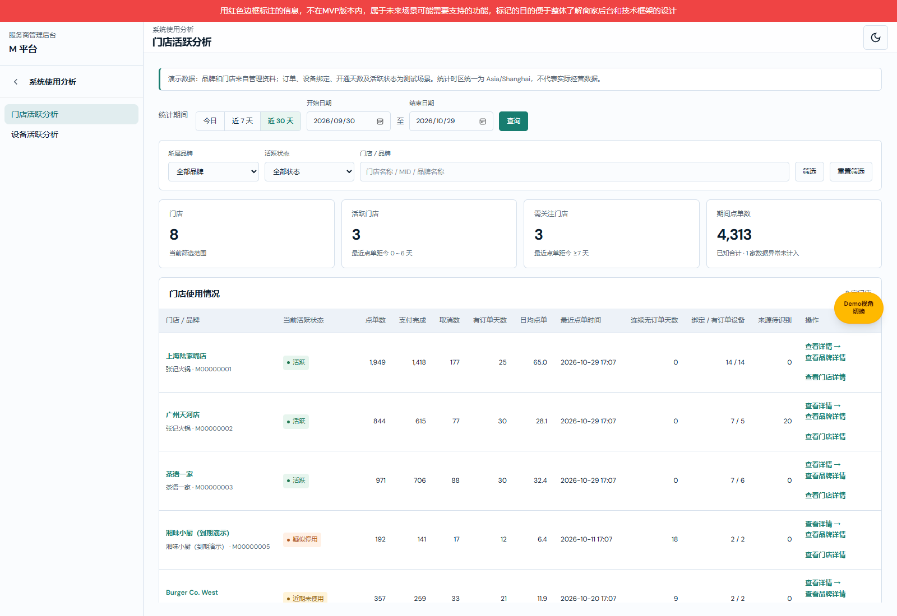

图注：2026-10-29，codex/usage-demo-identities-20261029，起始main@f58bab26，5258隔离功能预览实采；图中统计期间为近30天。品牌、门店名称及MID来自管理中心。

| 字段／操作 | 当前定义 |
| --- | --- |
| 品牌标识 | 分析记录merchantId与管理品牌内部主键一致；所属品牌下拉框使用当前品牌名称，不再使用独立的demo-a/b/c品牌。 |
| 门店标识 | 分析记录、合成订单和License绑定的storeId统一使用管理MID；门店列表在品牌名称后展示MID，搜索支持MID。 |
| 名称与归属 | 每次重绘按管理中心有效门店列表读取当前名称和品牌归属；不按名称、顺序或历史集团推断关联。 |
| 覆盖范围 | 固定8个有效演示MID、默认归属7个品牌；M00000008已由管理去重规则隐藏，不额外恢复。仅对登记MID补充测试事实，新建或其他未登记门店不自动生成订单。 |
| 合并门店 | M00000002同时承载产线差异和来源待识别订单；按MID只显示一家门店，产线取并集，合成业务订单和设备标识保留。 |
| 演示说明 | 列表及门店/设备详情抽屉均提示：品牌门店来自管理资料；订单、绑定、开通天数和活跃状态为测试场景，不代表真实经营。 |
| 日期与时区 | openedOn为合成演示日期，不覆盖管理openedAt；尚未使用文案标注“演示开通/演示绑定”。分析统一Asia/Shanghai，不修改海外门店资料时区。 |
| 设备与License | 沿用稳定演示设备ID、LicenseID及半开绑定区间；不修改真实硬件资产或业务绑定。 |
| 刷新与写入 | 管理名称/归属/有效门店集合或统计截至日变化时更新分析内存；无变化不重建订单。不写回品牌、门店、菜单、账号、权限或服务状态。 |

### 固定演示覆盖

| 管理MID | 默认品牌／门店 | 测试场景 |
| --- | --- | --- |
| M00000001 | 张记火锅／上海陆家嘴店 | 六产线活跃、跨历史产线设备 |
| M00000002 | 张记火锅／广州天河店 | 部分产线长期未用、来源待识别订单、同MID场景合并 |
| M00000003 | 茶语一家／茶语一家 | Kiosk绑定5台、近7天使用3台 |
| M00000004 | MenuSifu NA Demo／Flagship · NYC | 演示开通3天，尚未使用 |
| M00000005 | 湘味小厨（到期演示）／同名门店 | 18天未使用，疑似停用 |
| M00000006 | Sakura Sushi Group／同名门店 | 40天未使用，长期未使用 |
| M00000007 | Burger Co. West／同名门店 | 9天未使用，近期未使用 |
| M00000009 | 张记串串／同名门店 | 数据异常；未知指标显示—，不当作零订单 |

本表名称为默认演示示例；改名或重新关联后，页面以当前管理记录为准，MID不变。服务启停与分析活跃状态分别展示，不因演示订单或异常改变管理员、菜单和服务状态。

### 门店与产线明细

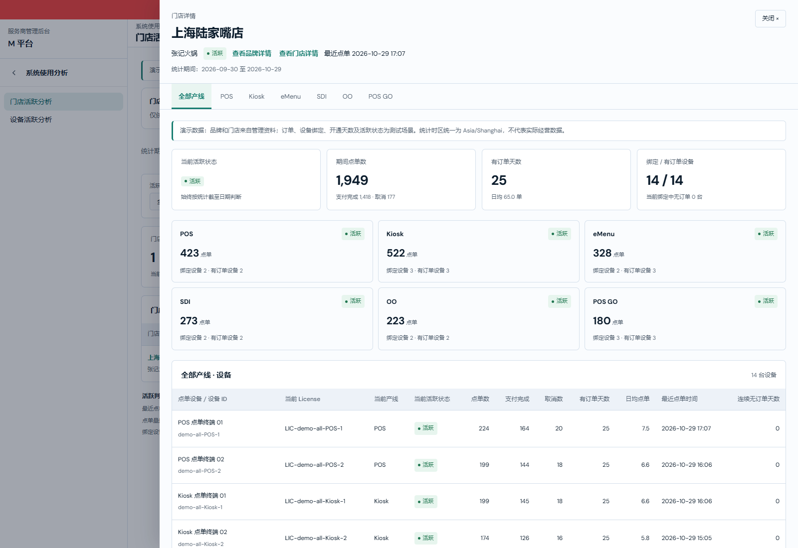

图注：上海陆家嘴店M00000001，近30天、全部产线；同一功能分支实采。

| 字段／操作 | 当前定义 |
| --- | --- |
| 品牌→门店→产线 | 使用同一Dataset和去重订单结果；打开详细分析、产线切换及关闭抽屉保留当前品牌或门店范围。 |
| 可复算示例 | 近7天上海540单、广州178单，张记火锅品牌共718单；广州的20单来源待识别计入门店总数，不分摊产线或设备。 |
| 日均点单 | 示例：上海540÷7=77.1，广州178÷7=25.4；按原有1位小数规则展示。 |
| 品牌与设备互通 | 设备当前归属展示真实管理品牌/门店名称；有对应管理权限时可进入管理概览，详情使用情况可返回分析。 |

### 尚未使用与数据异常

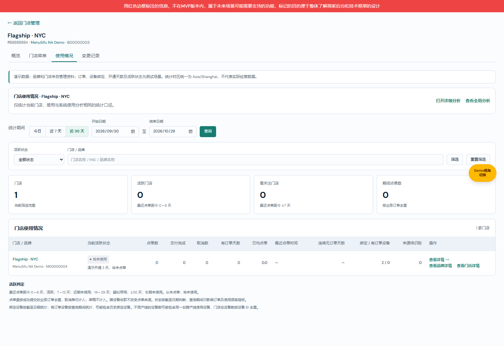

图注：M00000004管理资料仍保留原时区和开通日期，分析中的演示开通天数用于测试。

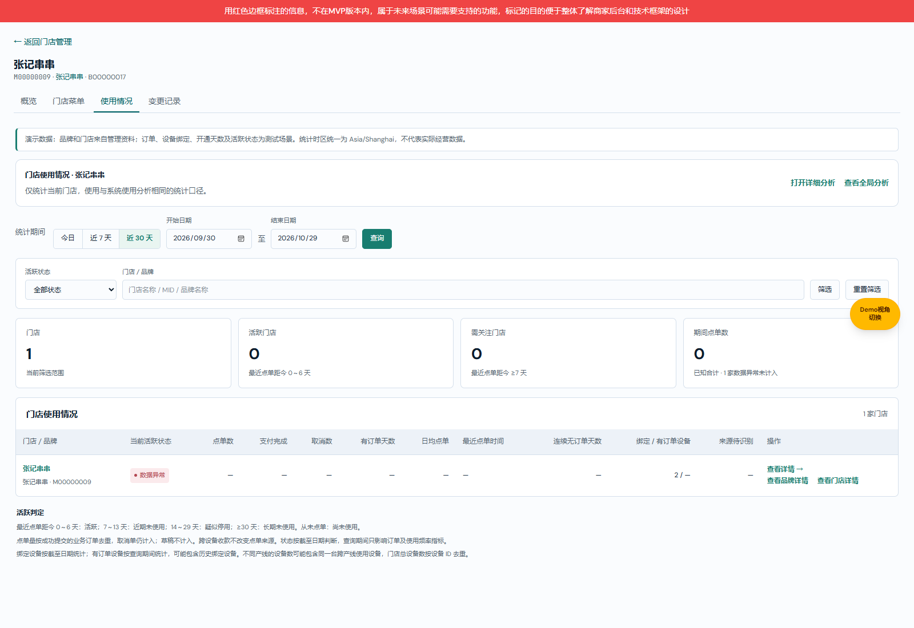

图注：M00000009的异常指标显示—；不会停用品牌、门店或账号。

| 状态／操作 | 当前定义 |
| --- | --- |
| 尚未使用 | 有登记演示数据，但从未点单；与没有匹配数据的空态不同。 |
| 数据异常 | 保留已知设备绑定数，订单及相关频率未知显示—；品牌汇总排除异常部分并注明数量。 |

### 未登记门店

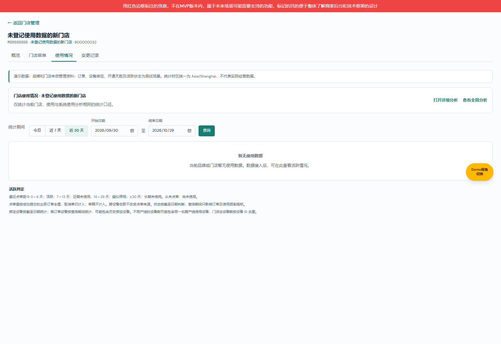

图注：5258独立浏览器上下文中新建的受控测试门店，用于验证空态；该测试创建不写入用户现有浏览器。

| 状态／操作 | 当前定义 |
| --- | --- |
| 新建未登记MID | 继续显示暂无使用数据，不随机套用其他门店场景，不补造历史订单。 |
| 旧门店地址 | demo-all等已登记旧alias按固定表解析到当前MID；目标MID不存在时不恢复旧门店、不转全局统计。 |
| 当前归属范围 | 旧alias解析后仍按当前品牌/MID校验；重新关联后旧品牌不能借旧地址看到已转出的门店。 |

### 研发字段、刷新与兼容规则

| 字段／对象 | 定义 |
| --- | --- |
| ManagedActivityStoreRow | 输入merchantId、merchantName及store.storeId/name/merchantId；来源getEnterpriseStoreList(allEnterprises=true)的当前有效行。函数不修改输入。 |
| ACTIVITY_DEMO_STORE_MIDS | 显式登记demo-all→M1、demo-mixed及demo-unknown→M2、demo-uneven→M3、demo-new→M4、demo-stopped→M5、demo-long→M6、demo-recent→M7、demo-error→M9；此处M数字均补零为8位MID，如M00000001。 |
| createManagedActivityDemo | 调用原纯场景生成器后按登记MID投射管理身份；同MID取产线并集、最早演示openedOn，保留全部业务订单。已知异常优先；未知MID和归属冲突MID不输出统计。 |
| resolveActivityStoreId | 优先数据中精确ID，再用固定alias；目标MID必须存在于当前Dataset，禁止名称模糊匹配。 |
| refreshActivityDemoData | 截至日及按MID排序的身份签名不变则返回false；变化时统一更新Dataset属性及resolvedOrders数组，保持两个导出对象引用稳定。 |
| 输入与去重 | 管理行重复但归属不一致时该MID不生成数据；store.merchantId与行merchantId不一致也拒绝。M2两场景业务ID由同一原生成器递增，不制造ID冲突；重复投递仍由原resolveOrders按MID+业务订单ID去重。 |
| 回归算例 | 8个MID/7个默认品牌；1/7/30/90天，M2点单量等于原mixed+unknown；各店总量=各产线合计+未知来源；同MID转品牌后订单不重生成/不丢失，旧品牌范围不再包含它。 |

## 品牌与门店的使用情况入口

### 品牌详情 → 使用情况

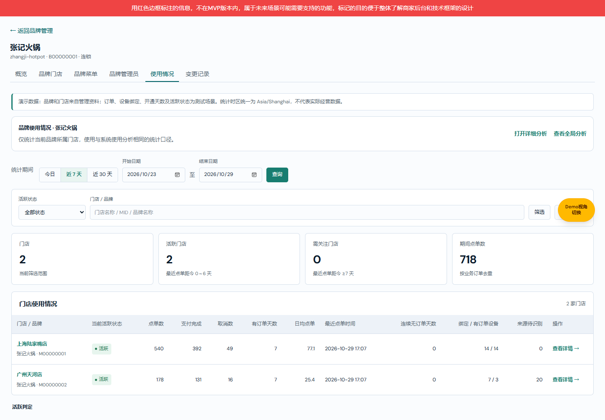

图注：2026-10-29，codex/brand-store-detail-modal-20261029，起始main@cb8d6aa8，5263功能预览实采；品牌所属两个MID直接显示匹配统计，管理详情从品牌门店查看。

入口：商户管理中心 → 品牌管理 → 品牌详情 → 使用情况。

| 字段／操作 | 逻辑说明 |
| --- | --- |
| 使用情况页签 | 品牌详情页签之一，位于品牌管理员之后、变更记录之前。有门店活跃分析权限时展示；只读管理角色也可浏览。 |
| 当前品牌 | 从品牌详情merchantId取得范围，按分析记录merchantId精确匹配。不按名称、BID、排序位置或历史集团推断关联。 |
| 统计期间 | 与全局门店活跃分析共用今日、近7天、近30天及自定义日期校验；期间只影响订单和使用频率，不改变活跃阈值。 |
| 结果列表与指标 | 有匹配记录时复用门店列表、活跃状态和统计卡；只汇总当前品牌范围。搜索、状态筛选和重置均保留品牌范围。 |
| 暂无使用数据 | 未登记或没有当前有效管理记录的MID显示空态，不回退全局；固定登记演示门店显示已匹配测试统计。 |
| 打开详细分析 | 进入系统使用分析中的当前品牌范围；不修改品牌、菜单、账号或订单。 |
| 查看全局分析 | 明确进入全局门店活跃分析，解除当前品牌限定；仍要求分析页面权限。 |

### 门店详情 → 使用情况

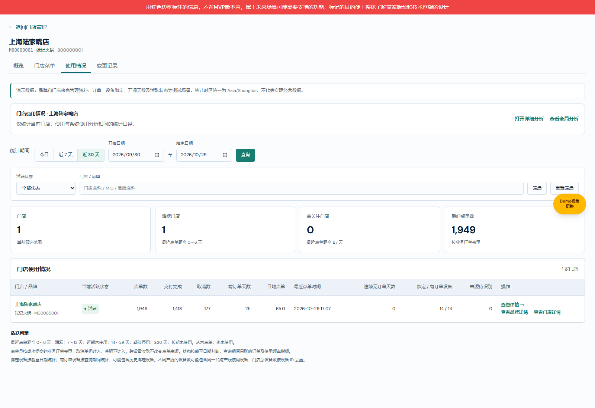

图注：同一5258功能分支实采；当前门店MID直接显示匹配测试统计。

入口：商户管理中心 → 门店管理 → 门店详情 → 使用情况。

| 字段／操作 | 逻辑说明 |
| --- | --- |
| 使用情况页签 | 位于门店菜单之后、变更记录之前；要求门店详情可见及门店活跃分析可见。 |
| 当前门店 | 以storeId/MID精确限定单店，不展示其他门店数据；标题采用当前管理门店名称。 |
| 已匹配的使用数据 | 复用门店活跃列表；进入该店抽屉后查看产线、设备、订单指标，统计和异常口径引用全局分析规则。 |
| 无匹配数据 | 未登记/新建MID显示暂无使用数据；固定登记MID按本节演示规则生成合成绑定及订单，不修改真实资料。 |
| 打开详细分析 | 跳转该店范围的门店活跃分析；下钻及日期变化保留storeId限制。 |
| 只读与写入 | 日期、筛选、下钻及返回只改变浏览状态，不写菜单、服务状态、设备绑定或订单。 |

## 分析上下文与管理页互通

### 系统使用分析 → 品牌范围

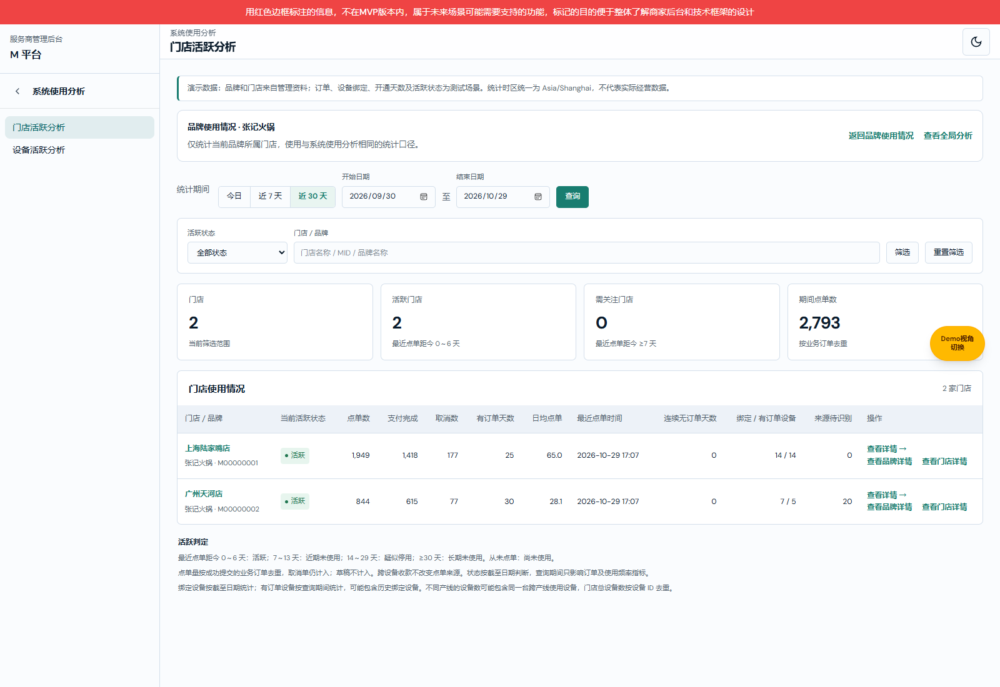

图注：同一5258功能分支实采；独立分析导航与当前品牌范围同时展示。

| 字段／操作 | 逻辑说明 |
| --- | --- |
| 品牌上下文地址 | /m-platform/merchants/activity/context/brand/<merchantId>；品牌范围固定，不提供切换到其他品牌的商户下拉框。 |
| 返回品牌使用情况 | 由已存在的品牌ID构造详情/usage地址，仅在品牌管理权限可访问时展示；不接受外部返回URL。 |
| 查看门店详情 | 按本页“使用情况：当前页面查看门店详情”入口规则控制展示；独立分析要求记录storeId存在、管理归属merchantId一致且拥有门店管理权限，点击进入门店概览。 |
| 查看品牌详情 | 按本页“使用情况：当前页面查看门店详情”入口规则控制展示；独立分析要求分析记录merchantId存在且品牌管理可访问，点击进入品牌概览。 |
| 抽屉关闭 | 保留当前品牌范围，不切到全局；更换产线或设备必须属于当前上下文。 |

### 系统使用分析 → 门店范围

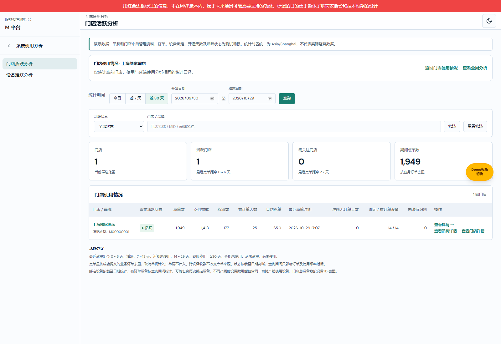

图注：同一5258功能分支实采。

| 字段／操作 | 逻辑说明 |
| --- | --- |
| 门店上下文地址 | /m-platform/merchants/activity/context/store/<storeId>；只查询当前单店，抽屉及产线/设备下钻继承该范围。 |
| 返回门店使用情况 | 校验门店存在与管理页可访问后构造/usage地址；没有管理权限时不显示。 |
| 设备分析的管理入口 | 设备有唯一有效归属、分析与管理主键匹配且目标管理页可访问时，详情展示查看品牌/门店入口；异常或未绑定设备不猜测归属。 |
| 非法地址 | 不合法kind、空ID、解码失败、越范围门店、未知产线或设备显示未找到页面；不自动回退全局查询。 |
| 未知业务ID | 上下文根列表为暂无使用数据；若该ID也不存在于管理资料，不提供返回管理详情的链接。 |

### 目录兼容字段与验收算例

| 字段／操作 | 逻辑说明 |
| --- | --- |
| MState.catalogVersion | 可选字面量2；缺失表示旧目录。readMState校验原记录后返回兼容副本，不因浏览直接写localStorage或递增revision。授权保存将该标记写为2。 |
| 旧角色模块门槛 | 新分析模块键缺失时，原m:module:merchants为read则设read，否则hidden；已有新键保留。各角色分析页grant、员工roleIds、日志与revision不变。 |
| 分离后计算 | 分析页父键仅为m:module:activity-analysis；设置catalogVersion=2后再次读取不复制原商户门槛，防止撤权后重新授予。 |
| 跨角色算例 | A仅有旧商户模块read，B仅有分析页read，员工绑定A+B：旧有效分析可见；兼容后新模块read与页面read并集，仍可见。只绑定B仍不可见。 |
| 隐藏算例 | 旧模块hidden且有分析页read：兼容后仍不可见。主动隐藏新分析模块后保存/刷新也不可见。 |
| 不扩权算例 | 只有商户模块read而无任何分析页grant：复制模块门槛后分析页仍不可见；新创建角色的商户模块read不会自动转换。 |
| 范围算例 | merchant-zhangji范围默认只含M00000001和M00000002；试图下钻茶语M00000003拒绝。旧demo-all解析到M00000001，仍受当前品牌范围校验。 |

## 品牌与门店管理范围

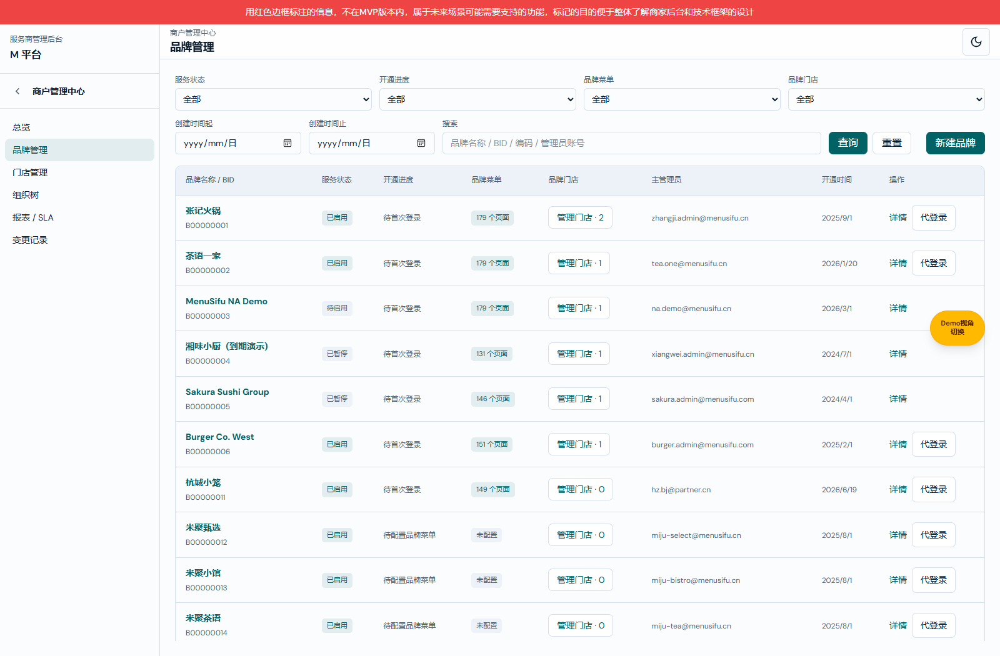

图注：codex/merchant-no-group-20261029，起始main@1716dfc4，5256隔离演示实采，2026-10-29。

入口：M平台 → 商户管理中心。M平台运营直接管理品牌及其门店，不设置集团业务层级。

| 字段／操作 | 逻辑说明 |
| --- | --- |
| 导航 | 总览、品牌管理、门店管理、组织树、报表／SLA、变更记录；按M权限过滤。 |
| 品牌与门店 | 通过品牌内部merchantId与门店storeId关联；BID与MID仍为展示和查找标识，不变更已有归属。 |
| 集团维度 | 不提供集团管理、新建／编辑／删除入口；筛选、列表、概览、创建及核对均无集团字段。 |
| 顶部版本提示 | 保留与商家后台一致的全宽未来版本提示；不因此新增集团字段或导航红框。 |
| 旧集团地址 | /m-platform/merchants/groups及其子地址规范到品牌管理；按品牌管理访问权限判断，不展示旧集团表单。 |
| 旧筛选缓存 | 忽略sessionStorage中的groupId；其余有效条件继续保留，查询和重置不恢复集团字段。 |
| 品牌创建 | 不要求集团；品牌名称、联系人、业态和产品线校验继续生效。管理员开通和品牌服务启用分别执行原规则。 |
| 品牌服务就绪 | 不校验集团；仍校验品牌名称、联系人、可用Admin、已开通页面及合同日期条件。 |
| 变更记录 | 当前商户中心不列集团管理事件；品牌、门店、菜单和管理员事件继续展示可读摘要及明细。 |

### 关联门店的租户边界

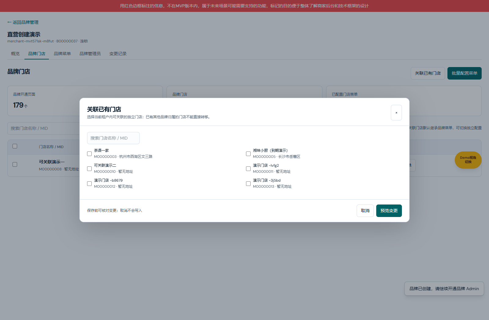

图注：同一功能分支5256实采。入口：品牌详情 → 品牌门店 → 关联已有门店。

| 字段／操作 | 逻辑说明 |
| --- | --- |
| 候选门店 | 仅目标品牌所在Enterprise内尚可关联的独立单店；历史集团相同与否不影响候选。已有其他品牌归属的门店不可直接转移。 |
| 关联确认 | 至少选一店；保存时重新校验操作者、品牌版本及候选归属。成功保留MID并关联目标品牌，菜单模式按既定规则设为继承。 |
| 失败与取消 | 越租户、已有其他品牌归属或过期版本均拒绝；失败不写归属。取消不保存选择。 |
| 创建时选店 | 使用当前Enterprise内相同候选规则；可暂不选店。查询、步骤往返及隐藏行勾选沿用创建规则。 |
| 兼容数据 | 保留历史内部集团记录及键，避免破坏既有数据；不形成M产品字段、不自动迁移品牌或门店，也不修改B后台其他视角。 |

### 对象与校验算例

| 字段／操作 | 逻辑说明 |
| --- | --- |
| CreateMerchantInput.groupId | string可选，仅兼容旧调用；缺省时由当前Enterprise默认内部兼容记录承接，不影响用户输入校验。 |
| listBrandAssociationCandidates | 使用enterpriseId筛选，缺省为当前Enterprise；历史groupId参数不参与过滤。关联已存在品牌时显式使用目标品牌的enterpriseId。 |
| 权限资源 | 当前目录不包含m:page:groups及集团动作；历史已保存的未知集团grant不产生访问权。 |
| 正常算例 | 品牌A与独立门店S同Enterprise、历史groupId不同：S进入候选，成功关联后MID不变。 |
| 越界算例 | S与A不同Enterprise：候选不显示，直接提交也拒绝。 |
| 归属与并发算例 | S已属于品牌B或expectedVersion过期：拒绝，快照不变化。 |
| 缓存算例 | 会话groupId为不存在的历史值：品牌和门店查询结果与不传groupId一致。 |

## 创建品牌

### 品牌管理 创建入口

图注：codex/merchant-no-group-20261029，起始main@1716dfc4，5256功能分支隔离演示实采；2026-10-29。

| 字段／操作 | 逻辑说明 |
| --- | --- |
| 新建品牌 | 位于重置后方，与查询操作保持独立间距；进入/m-platform/merchants/new全屏创建向导。需品牌页面编辑权限，不经过开通申请或审批。 |
| 创建对象 | 在当前Enterprise租户内直接创建品牌。默认演示数据继续保留；品牌创建与管理员账号开通、品牌服务启用是不同操作。 |

### 品牌信息

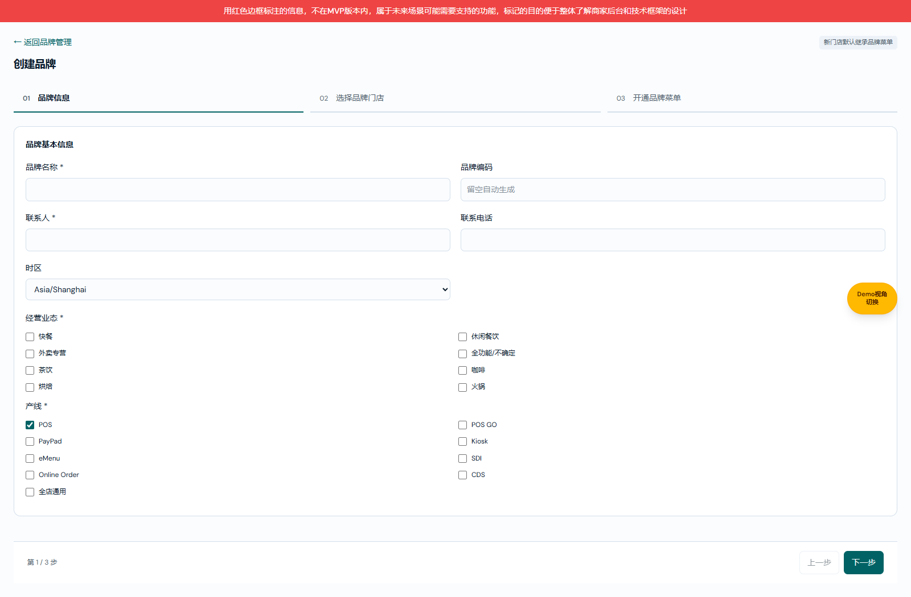

图注：codex/merchant-no-group-20261029，起始main@1716dfc4，5256功能分支隔离演示实采；2026-10-29。

| 字段／操作 | 逻辑说明 |
| --- | --- |
| 品牌名称 | name，必填，去首尾空格，最多60字；不作为唯一身份。 |
| 品牌编码 | code，可空；空值由创建方法自动生成。 |
| 联系人 | contactName，必填，最多30字。 |
| 联系电话 | contactPhone，可空；不等同登录账号。 |
| 时区 | timezone，默认Asia/Shanghai，可选America/New_York、America/Los_Angeles。 |
| 经营业态 | businessTypeIds，至少一项，来源当前业态配置。 |
| 产线 | productLineIds，至少一项，POS默认选中；切换后菜单树按适用范围刷新。 |
| 下一步 | 校验品牌名称、联系人、业态和产线，成功进入选择门店；失败留在当前步骤并提示，不写品牌记录。 |

### 选择品牌门店

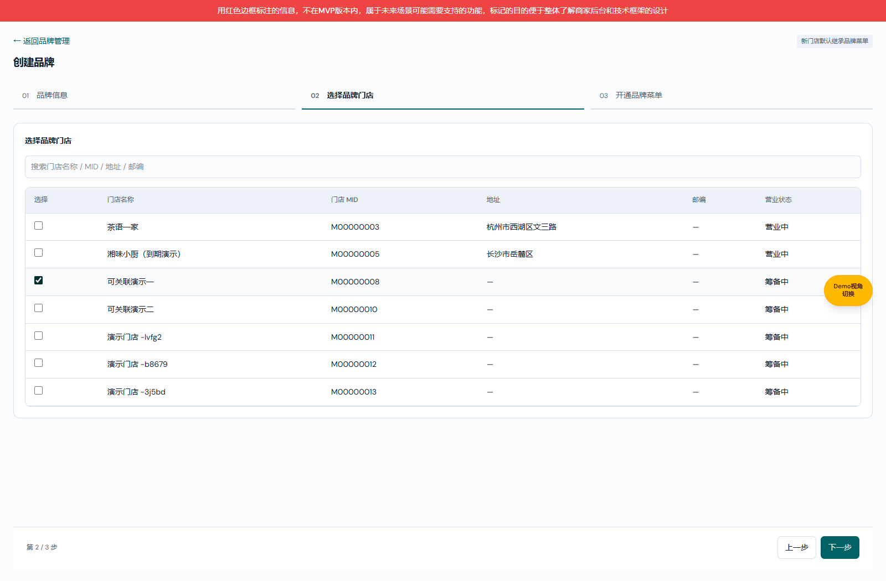

图注：codex/merchant-no-group-20261029，起始main@1716dfc4，5256功能分支隔离演示实采；2026-10-29。

| 字段／操作 | 逻辑说明 |
| --- | --- |
| 搜索门店 | 按门店名称、MID、地址和邮编过滤当前租户内可关联的独立门店；过滤不写品牌、不改变勾选。 |
| 勾选门店 | 可不选；已选门店创建后关联品牌且保留MID，新菜单配置按inherit继承品牌门店视角范围。 |
| 上一步 | 返回品牌信息并保留草稿。 |
| 下一步 | 进入开通品牌菜单，暂不创建品牌；实际提交仍校验门店归属，拒绝不合法关联。 |

### 开通品牌菜单

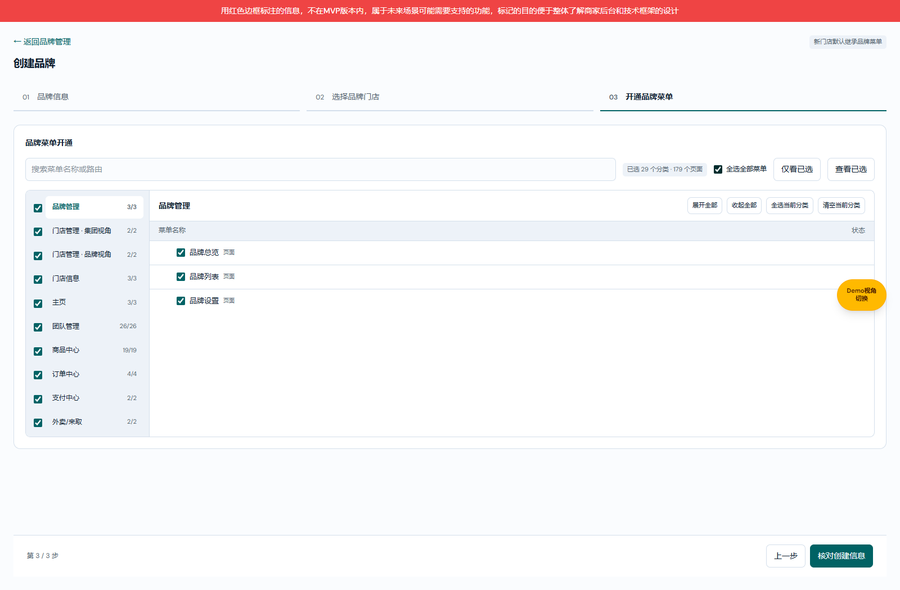

图注：codex/merchant-no-group-20261029，起始main@1716dfc4，5256功能分支隔离演示实采；2026-10-29。

| 字段／操作 | 逻辑说明 |
| --- | --- |
| 菜单树与全选 | 沿用公共菜单选择器，父子级联、分类全选及全部全选；只保存实际选择，不自动扩大授权。 |
| 核对创建信息 | 校验路由版本和基本资料后打开独立弹框；未确认前不写品牌。无菜单可创建，但品牌服务启用仍受菜单就绪条件约束。 |

### 核对创建信息弹框

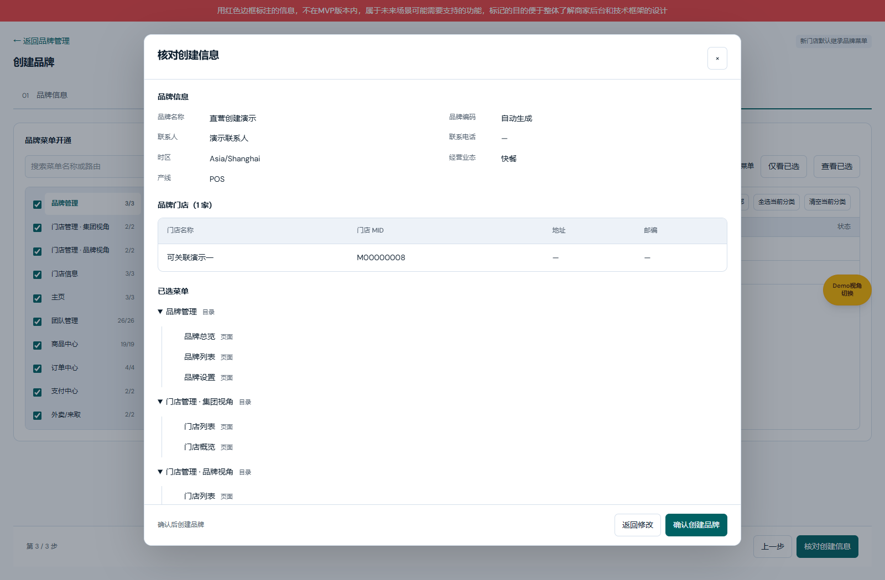

图注：codex/merchant-no-group-20261029，起始main@1716dfc4，5256功能分支隔离演示实采；2026-10-29。

| 字段／操作 | 逻辑说明 |
| --- | --- |
| 品牌资料 | 逐项展示名称、编码或自动生成、联系人、电话、时区、业态和产线。 |
| 门店清单 | 展示已选门店名称、MID、地址和邮编；零门店显示未选择门店。 |
| 菜单清单 | 按树状层级展示已选项，保留分组及页面归属。 |
| 返回修改／关闭 | 关闭核对弹框，保留向导输入与勾选，不写入。 |
| 确认创建品牌 | 防重复提交，重新校验路由版本、资料及归属；调用createMerchant直接创建。orgType=chain、accountProvisioningRequired=true、activateImmediately=false、primaryAdminEmail为空，不自动生成Admin或发送邀请邮件。 |
| 失败 | 留在弹框，显示错误并保留草稿，不宣称创建成功；路由版本变化要求刷新重选。 |

### 创建成功与取消结果

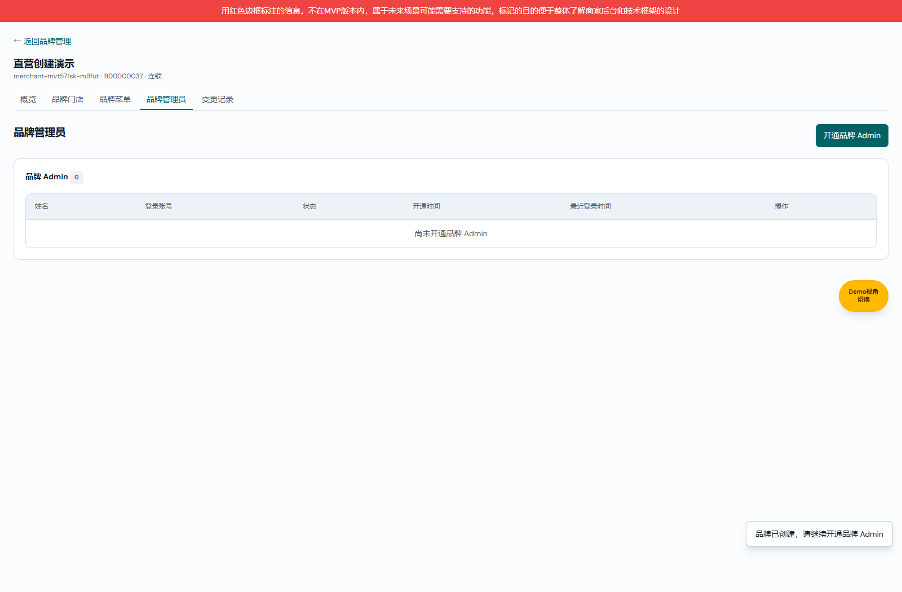

图注：codex/merchant-no-group-20261029，起始main@1716dfc4，5256功能分支隔离演示实采；2026-10-29。

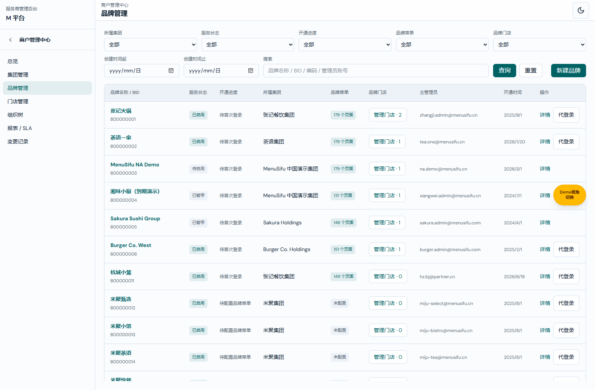

图注：有输入时返回品牌管理，原生确认选择放弃后的实际列表；原生confirm不在页面截图内，不用结果图冒充原生弹框截图。

| 字段／操作 | 逻辑说明 |
| --- | --- |
| 成功目标 | /m-platform/merchants/{merchantId}/accounts，提示品牌已创建并继续开通品牌Admin；生成品牌ID、BID、创建记录和选择的菜单／关联。 |
| 离开未保存表单 | 提示“有未保存的品牌配置，是否放弃并离开？”；确认离开不创建品牌，取消离开保留路由及草稿。 |
| 申请边界 | requests页面及普通／POS申请提交、批准、驳回继续关闭。直接创建品牌不增加requests或posStoreRequests记录。 |

## 商户管理中心导航

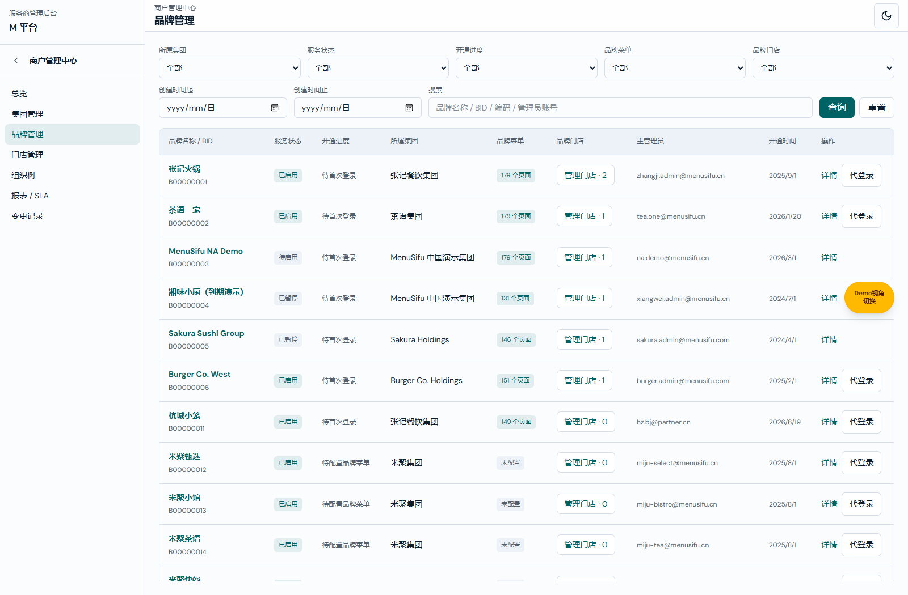

图注：M平台导航，codex/merchant-center-labels-20261028，main@e24e492f，5252隔离演示；页面及名称来自实际运行截图。

| 元素 | 逻辑说明 |
| --- | --- |
| 商户管理中心 | M平台模块入口及子导航标题；包含品牌、门店、组织树、报表和变更记录。权限目录使用同一名称。 |
| 品牌管理 | 点击进入品牌管理页面，地址/m-platform/merchants。资源ID仍为brands，不迁移已保存角色授权。 |
| 门店管理 | 点击进入门店管理页面，地址/m-platform/merchants/stores。资源ID仍为stores，保留筛选、详情及代登录。 |
| 返回上一级 | 仅退出当前子导航层，保留原有公共菜单交互与权限过滤，不写业务数据。 |

### 品牌管理入口与页面

图注：同一分支与5252隔离演示。入口为商户管理中心→品牌管理，页面所属模块显示商户管理中心，页标题为品牌管理。

| 元素 | 逻辑说明 |
| --- | --- |
| 页面标题 | 品牌管理；筛选、列表和详情操作沿用本文品牌管理定义。 |
| 权限访问 | 使用既有merchants模块及brands页面资源；改名不授予或撤销权限。失败及受限表现按公共权限规则。 |

### 门店管理入口与页面

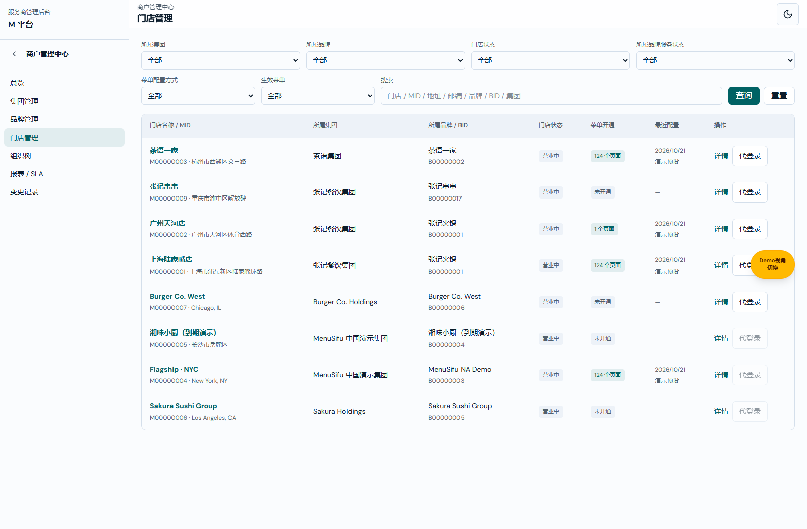

图注：同一分支与5252隔离演示。入口为商户管理中心→门店管理，页标题为门店管理。

| 元素 | 逻辑说明 |
| --- | --- |
| 页面标题 | 门店管理；筛选、门店详情和代登录沿用本文门店管理定义。 |
| 权限访问 | 使用既有stores页面资源；已保存授权、路由、默认演示数据和服务状态不因名称而变化。导航无保存或取消步骤。 |

## 外部开通与 M 平台管理边界 MERCHANT-EXTERNAL-20261027-55

用户确认：商户开通由其他平台完成，M平台不设置开通申请、申请审批或待办流程；品牌管理支持直接创建品牌，当前原型同时保留默认演示品牌和门店。外部平台对接协议、同步任务和真实开户接口未在本次实现，不得将演示预设描述为已接入外部平台。

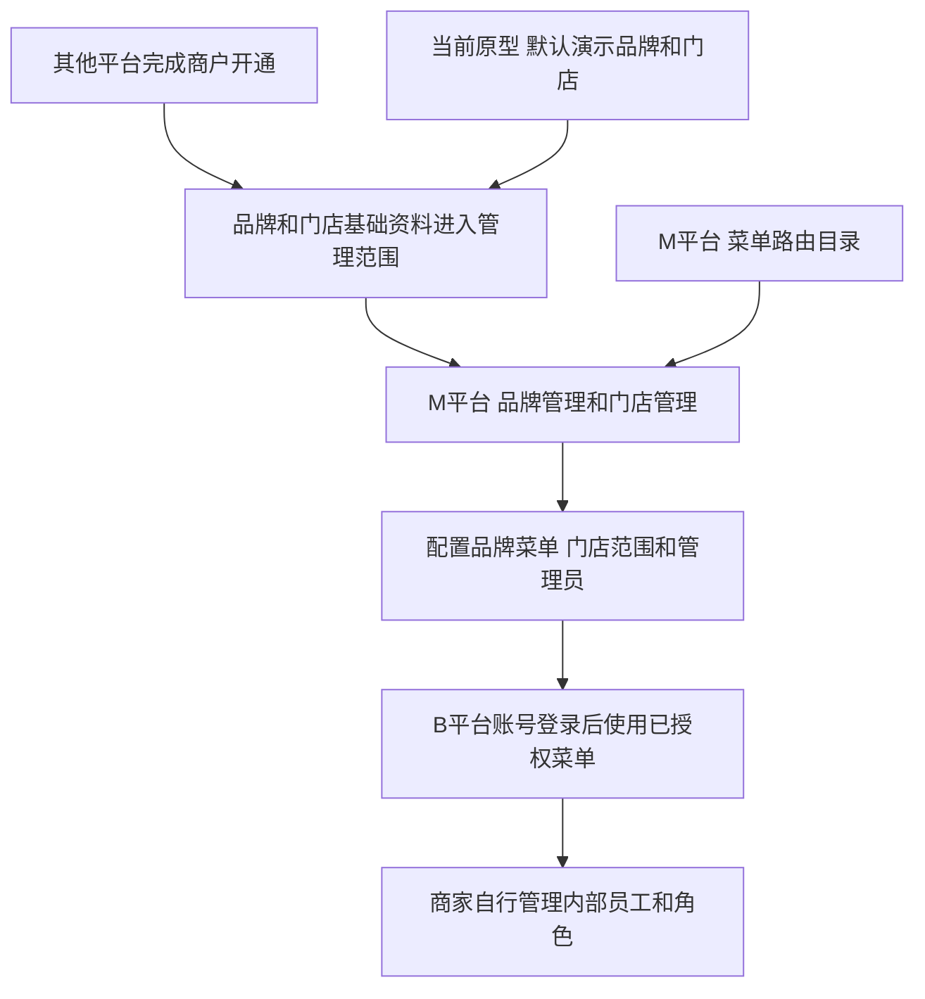

图注：业务责任关系。A到B是外部边界说明，不表示当前原型已完成数据同步；原型来源为D。其余既有M/B授权分层的未实现项仍按原待确认项管理。

### 品牌管理页面 当前入口与操作

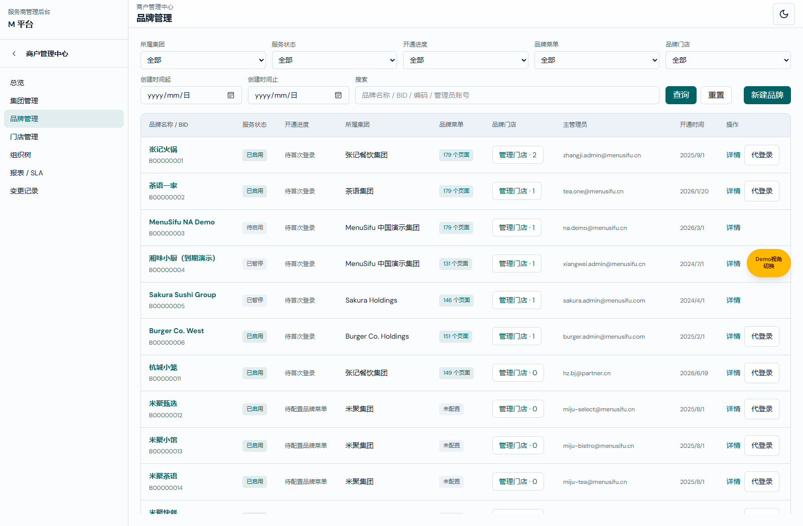

图注：功能分支codex/merchant-remove-requests-20261027，基线main@64ddec8f，5251隔离浏览器实采；默认演示数据，不是生产商户资料。

用途：检索和管理已经存在的品牌。入口为M平台→商户管理中心→品牌管理。

| 字段／操作 | 逻辑说明 |
| --- | --- |
| 品牌数据来源 | 当前为原有默认演示预设。继续展示品牌名称、BID、服务状态、菜单、门店和管理员；读取已有本地保存数据，不因撤下申请流程而重建或清空品牌。 |
| 筛选与查询 | 服务状态、进度、品牌菜单、门店、日期和关键词筛选继续使用；查询、重置仍按现有权限。未修改只读筛选限制G05。 |
| 新建品牌 | 品牌管理中直接进入创建向导，完成核对后创建品牌；不生成申请或待办。 |
| 详情 | 打开当前品牌概览，保留品牌门店、品牌菜单、品牌管理员和变更记录页签。 |
| 品牌菜单 | 继续在菜单路由配置的资源范围内授予或关闭菜单；这是权限配置，不是商户开通申请。保留新增／关闭预览。 |
| 品牌管理员 | 保留已有账号管理及开通管理员账号；账号启停、密码重设与品牌商户开通是不同对象。本次不移除此功能。 |
| 服务状态 | 继续管理已有品牌服务启用、暂停、恢复和关闭。待启用等状态代表服务可用性，不生成开通申请。 |
| 代登录 | 沿用权限、品牌服务状态及Loading提示，进入该品牌商家后台；不触发申请审批。 |

### 门店管理页面 默认演示资料

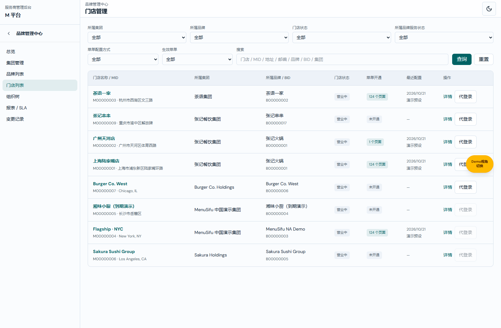

图注：同一功能分支与5251隔离实采。进入页面不创建POS申请；门店MID、归属和既有菜单配置继续保留。

| 字段／操作 | 逻辑说明 |
| --- | --- |
| 默认门店 | 使用现有演示预设及已保存门店。首次补齐沿用既有预设规则；已有独立配置、显式空菜单、管理员和状态不由本次删除流程覆盖。 |
| 门店归属 | 品牌/BID、门店/MID各自保留；品牌下关联已有门店继续使用，不创建新的外部开通申请。 |
| 详情 | 进入门店概览，保留门店菜单和清晰变更记录。 |
| 菜单配置 | 继承模式取品牌菜单与门店视角交集；独立模式沿用保存范围与版本校验。本次不改变M/B共用菜单对象的既有差距。 |
| 代登录 | 保留门店维度代登录及既有状态限制。 |

### 总览与导航 移除申请及待办

图注：总览保留统计、报表、品牌和门店管理入口；申请快捷入口、待办队列和查看全部待办不显示；创建入口位于品牌管理页面。

| 字段／操作 | 逻辑说明 |
| --- | --- |
| 商户管理中心侧栏 | 删除开通申请／待办菜单项；保留总览、品牌管理、门店管理、组织树、报表和变更记录。权限目录不再配置requests页面及approve/reject操作。 |
| 申请页面 | 不再展示普通品牌申请、模拟POS申请、提交、通过、驳回、待审核或最近处理记录。不是仅隐藏导航后保留审批页。 |
| 旧地址 | requests及其子路径使用replaceState规范到品牌总览，不新增浏览历史循环，不显示旧表单；总览仍执行M权限检查，不能借重定向提升权限。 |
| 既有审计 | 历史记录原样保留；历史request.submit、request.reject、pos-store等事件不代表当前仍开放这些流程。 |

### 旧地址访问后的实际结果

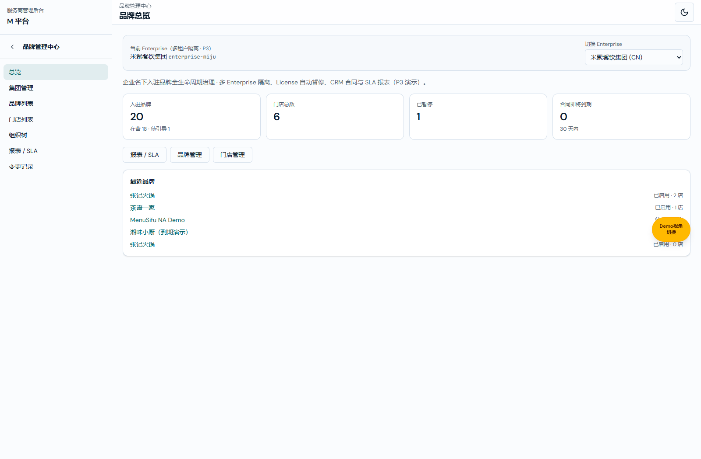

图注：直接访问旧requests地址后，地址栏规范为overview；不渲染申请表单、审批按钮。/new地址进入创建向导。

图注：B总部账号访问旧申请地址的实际M权限受限结果，5251隔离演示；未使用原品牌Admin冒充服务商账号。

| 字段／操作 | 逻辑说明 |
| --- | --- |
| 正常结果 | 有总览访问权限的M用户看到总览，无申请写入；不创建品牌、门店或管理员。 |
| 无权限 | 使用现有mCanVisit判断目标总览；无权限显示访问受限，不放宽权限或自动分配角色。 |
| 取消与失败 | 此导航没有确认弹框或写入步骤，无保存／取消分支。浏览器加载失败沿用页面基础错误表现，不伪造成功同步提示。 |

### 数据与兼容字段 研发同步定义

| 字段／方法 | 逻辑说明 |
| --- | --- |
| requests | 历史本地快照中的申请数组，可存在旧记录；新预设为空数组。撤下功能不批量删除已有记录，不再用它生成申请待办。 |
| posStoreRequests | 同上，保留兼容字段；新预设为空，不自动产生待审POS门店。 |
| 提交／批准／驳回方法 | 六个旧写入方法统一抛出“商户开通由外部平台完成，M 平台不再支持开通申请或审批。”；不更新快照、申请状态、处理时间或创建商户。仅为旧调用失败保护，业务UI已移除。 |
| createMerchant | 保留底层演示／兼容构造能力供已有内部代码使用，供M品牌管理创建向导直接保存；不据此声称已建立外部创建接口。 |
| 默认演示补齐 | ensureBrandStoreDemoPresets及原有brandStoreDemoVersion、brandStoreDemoFresh规则继续使用；不新增清缓存、重置或生产迁移要求。 |
| 外部对接 | 外部平台、业务单号、同步状态、来源时间、幂等键和错误重试均未新增字段或接口，暂不在原型虚构。后续对接另行定义。 |

### 验收与未闭合项

1. 三个主页面正常显示默认演示数据；侧栏、总览及品牌管理无申请入口，品牌管理保留新建品牌。
2. requests及申请子路径回总览，new进入创建品牌，无申请表单和审批按钮；目标页继续按M权限控制。
3. 六个历史申请写入调用均失败，调用前后快照一致；首次默认申请数组为空。
4. 默认前三品牌继续具备管理员、菜单和关联门店；已有保存状态与菜单不因本次移除流程覆盖。
5. 菜单、管理员、服务启停、门店关联和代登录仍按原规则，不把品牌创建与管理员账号创建混为同一功能。
6. 真实外部同步、生产认证及M/B权限数据统一仍未实现。此前Q06“三条创建入口是否统一”因申请流程已取消且直接创建品牌保留而关闭，不再作为待确认项；其他未确认规则仍保留。

本轮逐操作证据与测试：[本轮核验记录](../verification/merchant-remove-requests-20261027/result.json)。旧143项清单是上一轮证据，其中申请操作作废，创建流程以本节实采与定义为准；不将旧截图计为当前申请流程验收。创建核对弹框见创建品牌章节；申请确认／取消页面不提供。

## 逐操作正文与就近截图

### 操作 m-no-access M平台入口 · 无M权限访问品牌管理

入口截图限制：采集实际受限结果页，未采集该账号完整登录过程；该项仅结果态覆盖。

图注：同一操作的实际界面／结果；非真实商户历史；状态：仅结果态G07。

| 字段／操作 | 逻辑说明 |
| --- | --- |
| 入口与前提 | 使用未绑定M角色的商家总部演示账号访问品牌管理路由 |
| 无M权限访问品牌管理 | 显示暂无M平台访问权限；不得仅凭商家总部身份进入M |
| 可见结果／提示 | 暂无 M 平台访问权限；请联系服务商管理员，为当前员工分配具有相应菜单权限的角色。 |
| 取消、关闭与异常 | 对本条实际触发的分支按截图及上述结果执行；其他分支必须查对应独立操作ID。未逐一复现的组合见G06，不据本图推定成功、失败、取消均已覆盖。 |

### 操作 filter-status 品牌管理 · 服务状态筛选

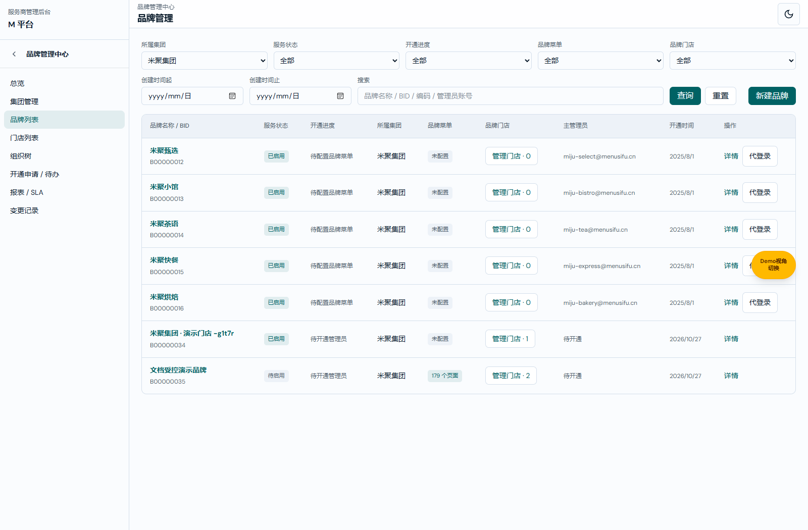

图注：品牌管理／服务状态筛选／触发前；main@64ddec8f，5250功能分支；隔离本地演示。

图注：同一操作的实际界面／结果；非真实商户历史；状态：入口及结果已采集。

| 字段／操作 | 逻辑说明 |
| --- | --- |
| 入口与前提 | 按页面当前可见操作进入 |
| 服务状态筛选 | 下拉即时应用，列表条件不写授权 |
| 可见结果／提示 | 已关闭 |
| 取消、关闭与异常 | 对本条实际触发的分支按截图及上述结果执行；其他分支必须查对应独立操作ID。未逐一复现的组合见G06，不据本图推定成功、失败、取消均已覆盖。 |

### 操作 filter-progress 品牌管理 · 开通进度筛选

图注：品牌管理／开通进度筛选／触发前；main@64ddec8f，5250功能分支；隔离本地演示。

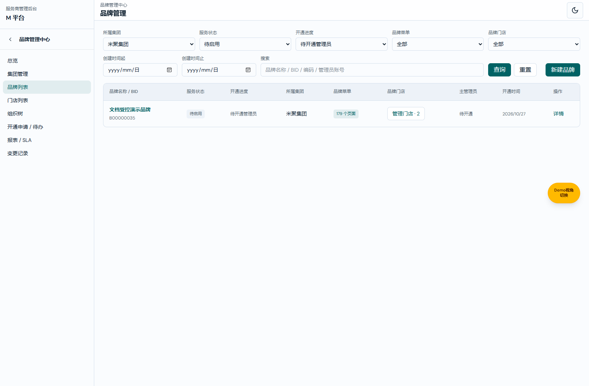

图注：同一操作的实际界面／结果；非真实商户历史；状态：入口及结果已采集。

| 字段／操作 | 逻辑说明 |
| --- | --- |
| 入口与前提 | 按页面当前可见操作进入 |
| 开通进度筛选 | 下拉即时应用，列表条件不写授权 |
| 可见结果／提示 | 已关闭 |
| 取消、关闭与异常 | 对本条实际触发的分支按截图及上述结果执行；其他分支必须查对应独立操作ID。未逐一复现的组合见G06，不据本图推定成功、失败、取消均已覆盖。 |

### 操作 filter-menu 品牌管理 · 品牌菜单筛选

图注：品牌管理／品牌菜单筛选／触发前；main@64ddec8f，5250功能分支；隔离本地演示。

图注：同一操作的实际界面／结果；非真实商户历史；状态：入口及结果已采集。

| 字段／操作 | 逻辑说明 |
| --- | --- |
| 入口与前提 | 按页面当前可见操作进入 |
| 品牌菜单筛选 | 下拉即时应用，列表条件不写授权 |
| 可见结果／提示 | 已关闭 |
| 取消、关闭与异常 | 对本条实际触发的分支按截图及上述结果执行；其他分支必须查对应独立操作ID。未逐一复现的组合见G06，不据本图推定成功、失败、取消均已覆盖。 |

### 操作 filter-stores 品牌管理 · 品牌门店筛选

图注：品牌管理／品牌门店筛选／触发前；main@64ddec8f，5250功能分支；隔离本地演示。

图注：同一操作的实际界面／结果；非真实商户历史；状态：入口及结果已采集。

| 字段／操作 | 逻辑说明 |
| --- | --- |
| 入口与前提 | 按页面当前可见操作进入 |
| 品牌门店筛选 | 下拉即时应用，列表条件不写授权 |
| 可见结果／提示 | 已关闭 |
| 取消、关闭与异常 | 对本条实际触发的分支按截图及上述结果执行；其他分支必须查对应独立操作ID。未逐一复现的组合见G06，不据本图推定成功、失败、取消均已覆盖。 |

### 操作 filter-search 品牌管理 · 搜索查询

图注：品牌管理／搜索查询／触发前；main@64ddec8f，5250功能分支；隔离本地演示。

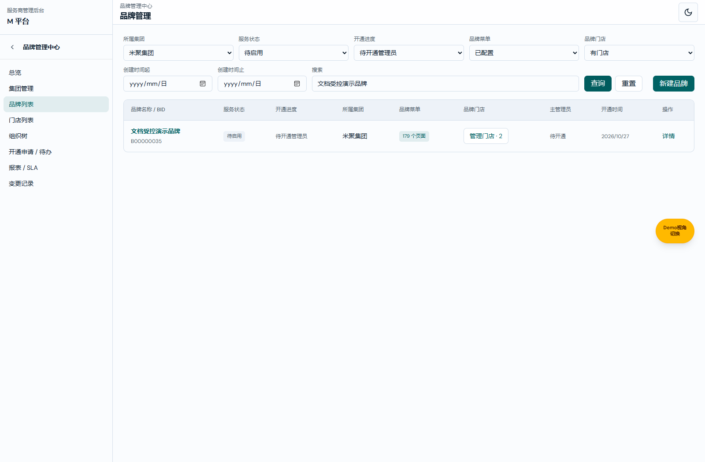

图注：同一操作的实际界面／结果；非真实商户历史；状态：入口及结果已采集。

| 字段／操作 | 逻辑说明 |
| --- | --- |
| 入口与前提 | 按页面当前可见操作进入 |
| 搜索查询 | 仅显示匹配品牌 |
| 可见结果／提示 | 已关闭 |
| 取消、关闭与异常 | 对本条实际触发的分支按截图及上述结果执行；其他分支必须查对应独立操作ID。未逐一复现的组合见G06，不据本图推定成功、失败、取消均已覆盖。 |

### 操作 filter-empty 品牌管理 · 搜索无匹配

图注：品牌管理／搜索无匹配／触发前；main@64ddec8f，5250功能分支；隔离本地演示。

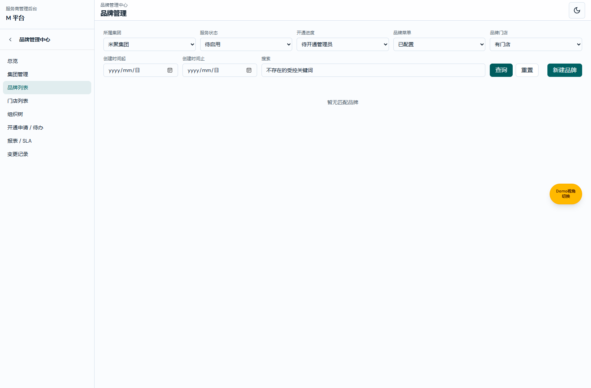

图注：同一操作的实际界面／结果；非真实商户历史；状态：入口及结果已采集。

| 字段／操作 | 逻辑说明 |
| --- | --- |
| 入口与前提 | 按页面当前可见操作进入 |
| 搜索无匹配 | 显示暂无匹配品牌 |
| 可见结果／提示 | 已关闭；暂无匹配品牌 |
| 取消、关闭与异常 | 对本条实际触发的分支按截图及上述结果执行；其他分支必须查对应独立操作ID。未逐一复现的组合见G06，不据本图推定成功、失败、取消均已覆盖。 |

### 操作 filter-reset 品牌管理 · 重置

图注：品牌管理／重置／触发前；main@64ddec8f，5250功能分支；隔离本地演示。

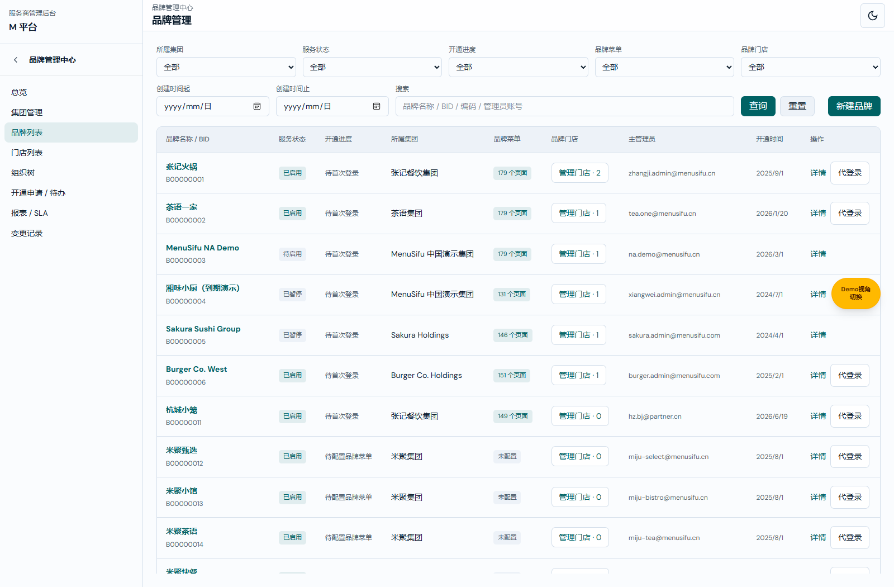

图注：同一操作的实际界面／结果；非真实商户历史；状态：入口及结果已采集。

| 字段／操作 | 逻辑说明 |
| --- | --- |
| 入口与前提 | 按页面当前可见操作进入 |
| 重置 | 清空条件，恢复列表 |
| 可见结果／提示 | 已关闭 |
| 取消、关闭与异常 | 对本条实际触发的分支按截图及上述结果执行；其他分支必须查对应独立操作ID。未逐一复现的组合见G06，不据本图推定成功、失败、取消均已覆盖。 |

### 操作 filter-from 品牌管理 · 创建时间起查询

图注：品牌管理／创建时间起查询／触发前；main@64ddec8f，5250功能分支；隔离本地演示。

图注：同一操作的实际界面／结果；非真实商户历史；状态：入口及结果已采集。

| 字段／操作 | 逻辑说明 |
| --- | --- |
| 入口与前提 | 按页面当前可见操作进入 |
| 创建时间起查询 | 闭区间日期查询 |
| 可见结果／提示 | 已关闭 |
| 取消、关闭与异常 | 对本条实际触发的分支按截图及上述结果执行；其他分支必须查对应独立操作ID。未逐一复现的组合见G06，不据本图推定成功、失败、取消均已覆盖。 |

### 操作 filter-to 品牌管理 · 创建时间止查询

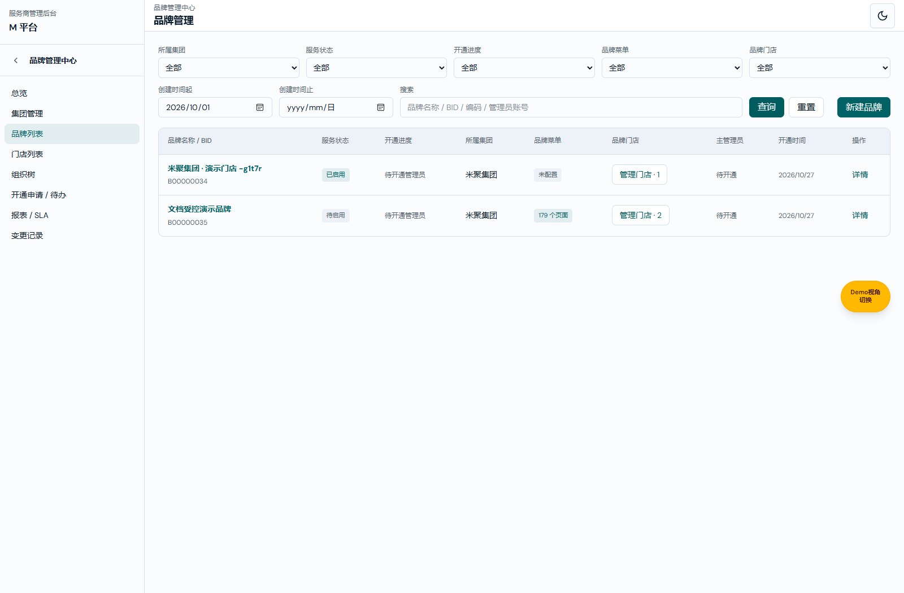

图注：品牌管理／创建时间止查询／触发前；main@64ddec8f，5250功能分支；隔离本地演示。

图注：同一操作的实际界面／结果；非真实商户历史；状态：入口及结果已采集。

| 字段／操作 | 逻辑说明 |
| --- | --- |
| 入口与前提 | 按页面当前可见操作进入 |
| 创建时间止查询 | 闭区间日期查询 |
| 可见结果／提示 | 已关闭 |
| 取消、关闭与异常 | 对本条实际触发的分支按截图及上述结果执行；其他分支必须查对应独立操作ID。未逐一复现的组合见G06，不据本图推定成功、失败、取消均已覆盖。 |

### 操作 filter-date-invalid 品牌管理 · 日期范围错误

图注：品牌管理／日期范围错误／触发前；main@64ddec8f，5250功能分支；隔离本地演示。

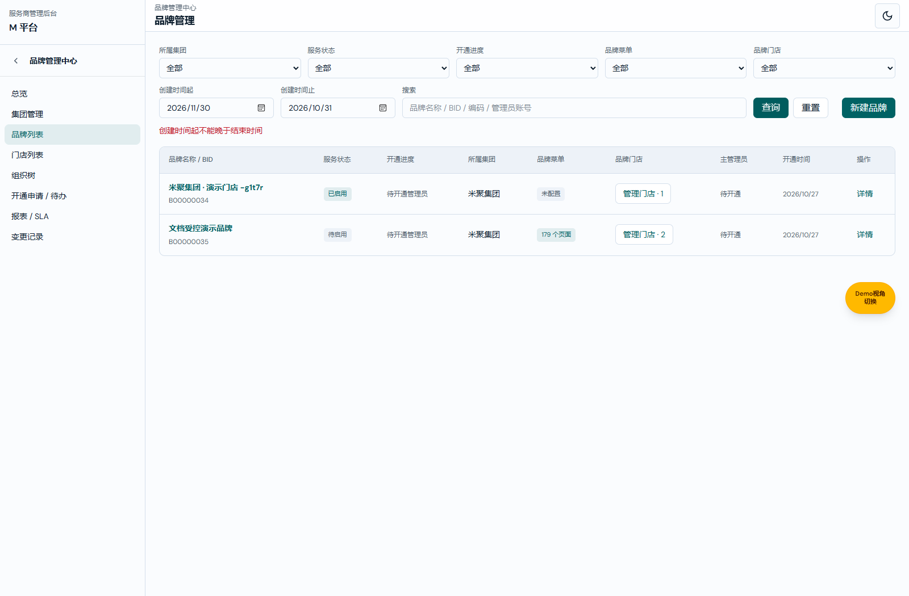

图注：同一操作的实际界面／结果；非真实商户历史；状态：入口及结果已采集。

| 字段／操作 | 逻辑说明 |
| --- | --- |
| 入口与前提 | 按页面当前可见操作进入 |
| 日期范围错误 | 起日大于止日报错，不应用 |
| 可见结果／提示 | 已关闭 |
| 取消、关闭与异常 | 对本条实际触发的分支按截图及上述结果执行；其他分支必须查对应独立操作ID。未逐一复现的组合见G06，不据本图推定成功、失败、取消均已覆盖。 |

### 操作 list-detail 品牌管理 · 详情

图注：品牌管理／详情／触发前；main@64ddec8f，5250功能分支；隔离本地演示。

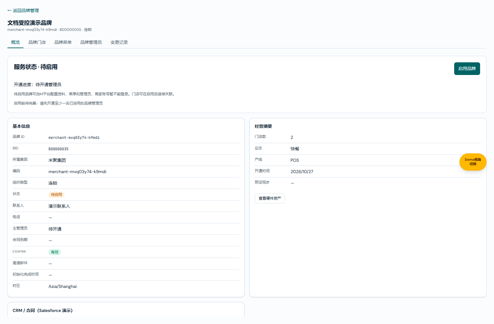

图注：同一操作的实际界面／结果；非真实商户历史；状态：入口及结果已采集。

| 字段／操作 | 逻辑说明 |
| --- | --- |
| 入口与前提 | 按页面当前可见操作进入 |
| 详情 | 独立详情默认概览 |
| 取消、关闭与异常 | 对本条实际触发的分支按截图及上述结果执行；其他分支必须查对应独立操作ID。未逐一复现的组合见G06，不据本图推定成功、失败、取消均已覆盖。 |

### 操作 service-blocked 品牌概览 · 启用品牌受限

图注：品牌概览／启用品牌受限／触发前；main@64ddec8f，5250功能分支；隔离本地演示。

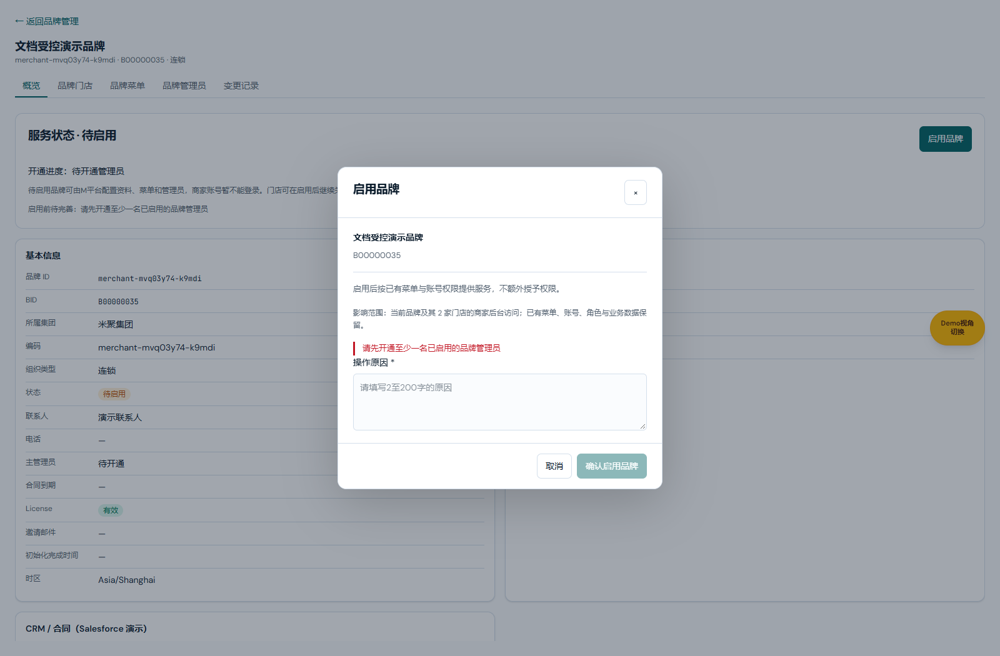

图注：同一操作的实际界面／结果；非真实商户历史；状态：入口及结果已采集。

| 字段／操作 | 逻辑说明 |
| --- | --- |
| 入口与前提 | 按页面当前可见操作进入 |
| 启用品牌受限 | 无Admin时阻止确认 |
| 操作原因 | 必填；控件最少2字；控件最多200字。实际保存约束另见当前字段字典，不把HTML控件属性当唯一业务校验。 |
| 取消、关闭与异常 | 对本条实际触发的分支按截图及上述结果执行；其他分支必须查对应独立操作ID。未逐一复现的组合见G06，不据本图推定成功、失败、取消均已覆盖。 |

### 操作 tab-org 品牌详情 · 品牌门店页签

图注：品牌详情／品牌门店页签／触发前；main@64ddec8f，5250功能分支；隔离本地演示。

图注：同一操作的实际界面／结果；非真实商户历史；状态：入口及结果已采集。

| 字段／操作 | 逻辑说明 |
| --- | --- |
| 入口与前提 | 按页面当前可见操作进入 |
| 品牌门店页签 | 保持品牌上下文，切到对应页 |
| 可见结果／提示 | M00000008 · 暂无地址	筹备中	继承品牌 · 172 个页面	2026/10/27 09:22:47；M00000010 · 暂无地址	筹备中	继承品牌 · 172 个页面	2026/10/27 09:22:47 |
| 取消、关闭与异常 | 对本条实际触发的分支按截图及上述结果执行；其他分支必须查对应独立操作ID。未逐一复现的组合见G06，不据本图推定成功、失败、取消均已覆盖。 |

### 操作 tab-capabilities 品牌详情 · 品牌菜单页签

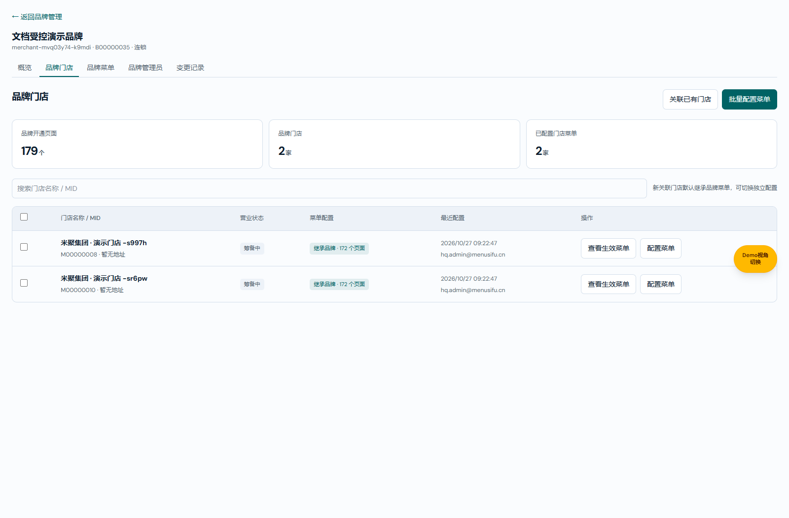

图注：品牌详情／品牌菜单页签／触发前；main@64ddec8f，5250功能分支；隔离本地演示。

图注：同一操作的实际界面／结果；非真实商户历史；状态：入口及结果已采集。

| 字段／操作 | 逻辑说明 |
| --- | --- |
| 入口与前提 | 按页面当前可见操作进入 |
| 品牌菜单页签 | 保持品牌上下文，切到对应页 |
| 取消、关闭与异常 | 对本条实际触发的分支按截图及上述结果执行；其他分支必须查对应独立操作ID。未逐一复现的组合见G06，不据本图推定成功、失败、取消均已覆盖。 |

### 操作 tab-accounts 品牌详情 · 品牌管理员页签

图注：品牌详情／品牌管理员页签／触发前；main@64ddec8f，5250功能分支；隔离本地演示。

图注：同一操作的实际界面／结果；非真实商户历史；状态：入口及结果已采集。

| 字段／操作 | 逻辑说明 |
| --- | --- |
| 入口与前提 | 按页面当前可见操作进入 |
| 品牌管理员页签 | 保持品牌上下文，切到对应页 |
| 取消、关闭与异常 | 对本条实际触发的分支按截图及上述结果执行；其他分支必须查对应独立操作ID。未逐一复现的组合见G06，不据本图推定成功、失败、取消均已覆盖。 |

### 操作 tab-changelog 品牌详情 · 变更记录页签

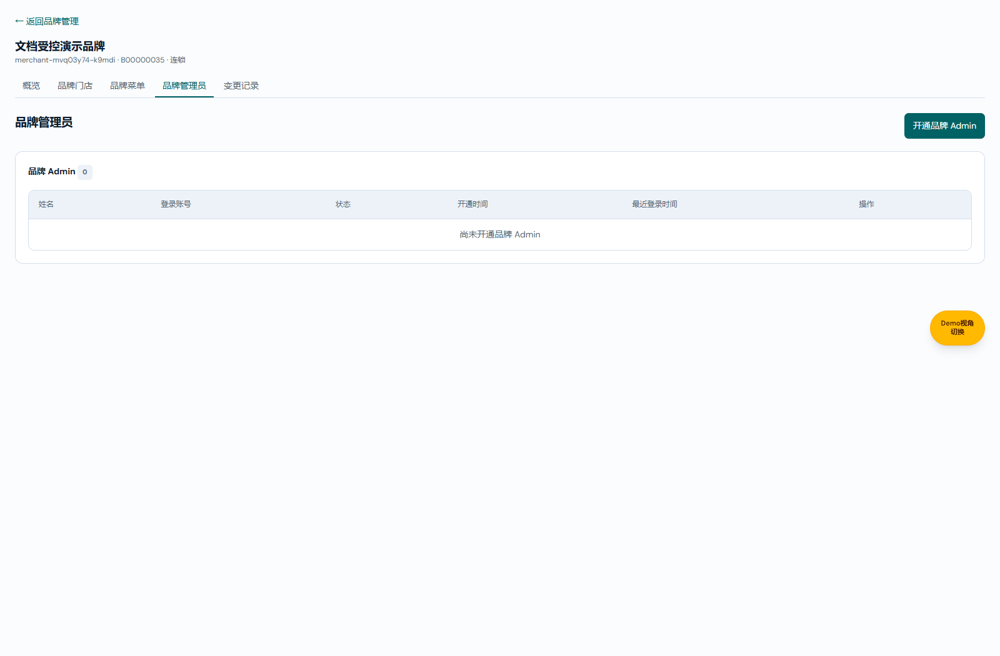

图注：品牌详情／变更记录页签／触发前；main@64ddec8f，5250功能分支；隔离本地演示。

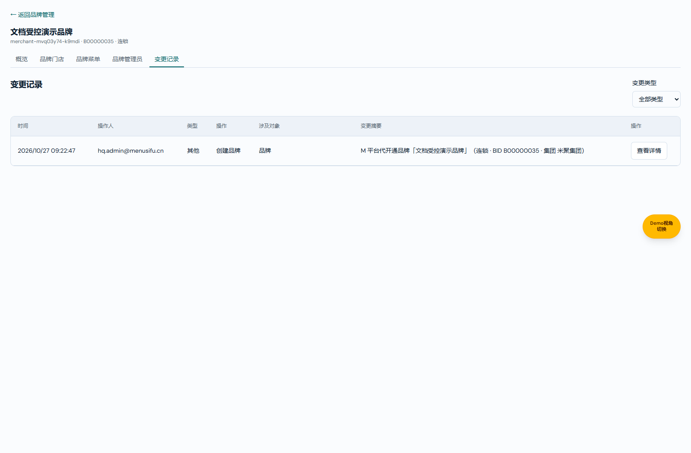

图注：同一操作的实际界面／结果；非真实商户历史；状态：入口及结果已采集。

| 字段／操作 | 逻辑说明 |
| --- | --- |
| 入口与前提 | 按页面当前可见操作进入 |
| 变更记录页签 | 保持品牌上下文，切到对应页 |
| 取消、关闭与异常 | 对本条实际触发的分支按截图及上述结果执行；其他分支必须查对应独立操作ID。未逐一复现的组合见G06，不据本图推定成功、失败、取消均已覆盖。 |

### 操作 admin-open 品牌管理员 · 开通Admin

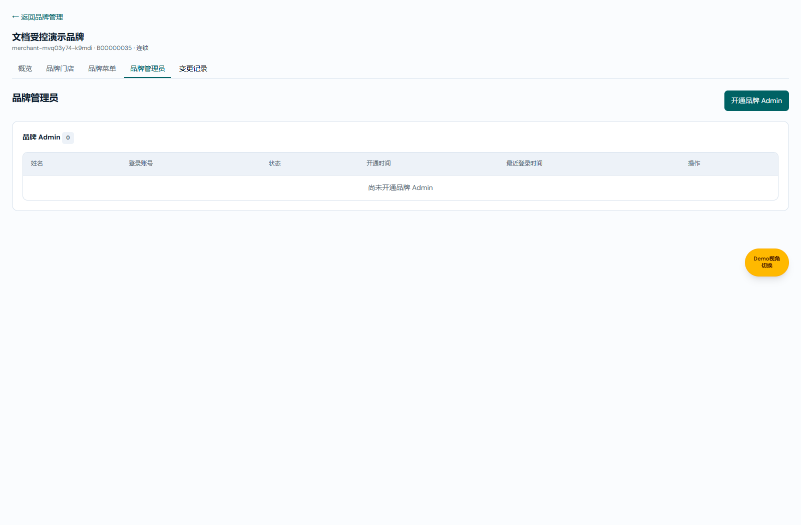

图注：品牌管理员／开通Admin／触发前；main@64ddec8f，5250功能分支；隔离本地演示。

图注：同一操作的实际界面／结果；非真实商户历史；状态：入口及结果已采集。

| 字段／操作 | 逻辑说明 |
| --- | --- |
| 入口与前提 | 按页面当前可见操作进入 |
| 开通Admin | 显示姓名账号密码及开通并启用 |
| 姓名 | 必填；控件最多30字。实际保存约束另见当前字段字典，不把HTML控件属性当唯一业务校验。 |
| 登录账号 | 必填。实际保存约束另见当前字段字典，不把HTML控件属性当唯一业务校验。 |
| 登录密码 | 必填；控件最少6字；密码框遮蔽显示；不在文档或审计展示密码值。实际保存约束另见当前字段字典，不把HTML控件属性当唯一业务校验。 |
| 取消、关闭与异常 | 对本条实际触发的分支按截图及上述结果执行；其他分支必须查对应独立操作ID。未逐一复现的组合见G06，不据本图推定成功、失败、取消均已覆盖。 |

### 操作 admin-cancel-empty Admin开通 · 未修改右上角关闭

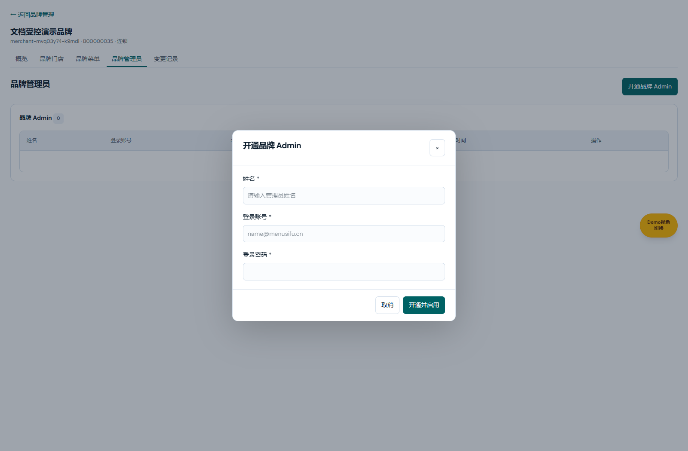

图注：Admin开通／未修改右上角关闭／触发前；main@64ddec8f，5250功能分支；隔离本地演示。

图注：同一操作的实际界面／结果；非真实商户历史；状态：入口及结果已采集。

| 字段／操作 | 逻辑说明 |
| --- | --- |
| 入口与前提 | 点击该弹框右上角×；底部取消另有独立采集记录 |
| 未修改右上角关闭 | 关闭且无账号写入 |
| 取消、关闭与异常 | 对本条实际触发的分支按截图及上述结果执行；其他分支必须查对应独立操作ID。未逐一复现的组合见G06，不据本图推定成功、失败、取消均已覆盖。 |

### 操作 admin-invalid-email Admin开通 · 账号域名错误

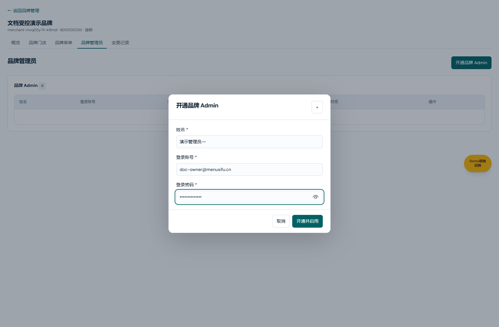

图注：Admin开通／账号域名错误／触发前；main@64ddec8f，5250功能分支；隔离本地演示。

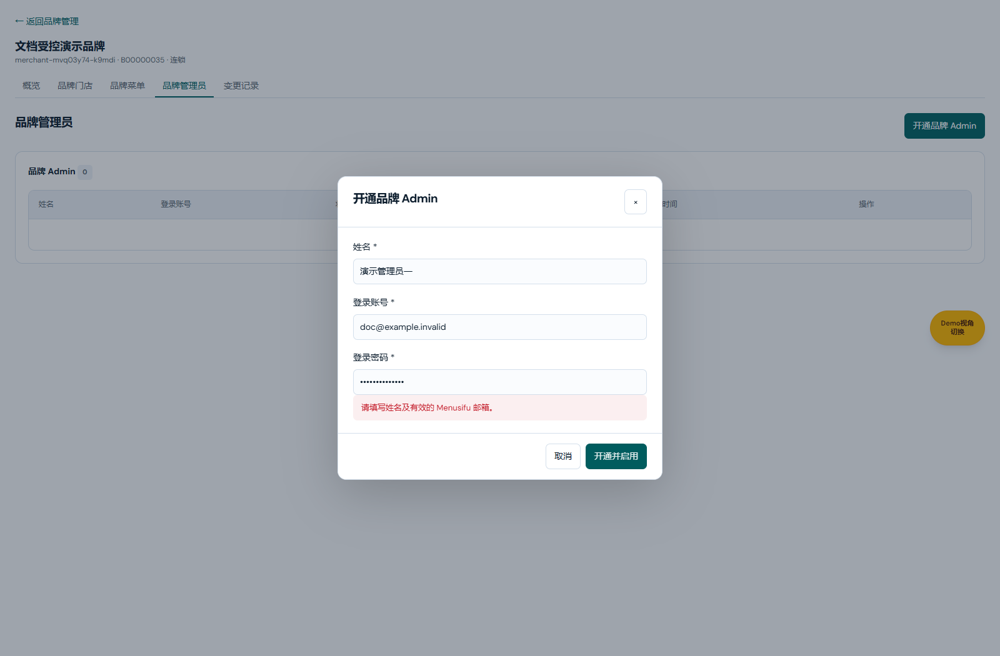

图注：同一操作的实际界面／结果；非真实商户历史；状态：入口及结果已采集。

| 字段／操作 | 逻辑说明 |
| --- | --- |
| 入口与前提 | 按页面当前可见操作进入 |
| 账号域名错误 | 拒绝保存且保留输入 |
| 姓名 | 必填；控件最多30字。实际保存约束另见当前字段字典，不把HTML控件属性当唯一业务校验。 |
| 登录账号 | 必填。实际保存约束另见当前字段字典，不把HTML控件属性当唯一业务校验。 |
| 登录密码 | 必填；控件最少6字；密码框遮蔽显示；不在文档或审计展示密码值。实际保存约束另见当前字段字典，不把HTML控件属性当唯一业务校验。 |
| 可见结果／提示 | 请填写姓名及有效的 Menusifu 邮箱。 |
| 取消、关闭与异常 | 对本条实际触发的分支按截图及上述结果执行；其他分支必须查对应独立操作ID。未逐一复现的组合见G06，不据本图推定成功、失败、取消均已覆盖。 |

### 操作 admin-create-success Admin开通 · 开通并启用

图注：Admin开通／开通并启用／触发前；main@64ddec8f，5250功能分支；隔离本地演示。

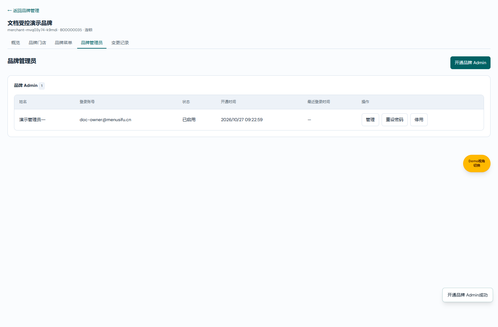

图注：同一操作的实际界面／结果；非真实商户历史；状态：入口及结果已采集。

| 字段／操作 | 逻辑说明 |
| --- | --- |
| 入口与前提 | 按页面当前可见操作进入 |
| 开通并启用 | 一次提交新增已启用Admin，品牌仍待启用 |
| 取消、关闭与异常 | 对本条实际触发的分支按截图及上述结果执行；其他分支必须查对应独立操作ID。未逐一复现的组合见G06，不据本图推定成功、失败、取消均已覆盖。 |

### 操作 admin-last-block 品牌管理员 · 停用最后Admin

图注：品牌管理员／停用最后Admin／触发前；main@64ddec8f，5250功能分支；隔离本地演示。

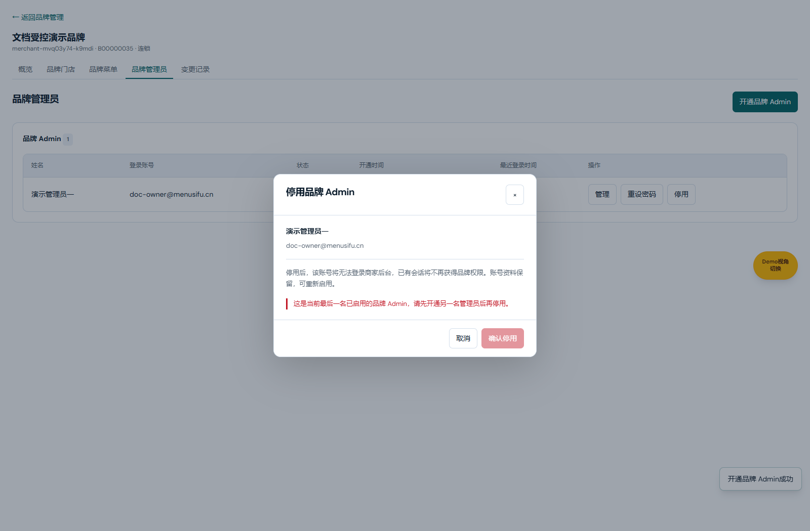

图注：同一操作的实际界面／结果；非真实商户历史；状态：入口及结果已采集。

| 字段／操作 | 逻辑说明 |
| --- | --- |
| 入口与前提 | 按页面当前可见操作进入 |
| 停用最后Admin | 显示保护提示且确认禁用 |
| 取消、关闭与异常 | 对本条实际触发的分支按截图及上述结果执行；其他分支必须查对应独立操作ID。未逐一复现的组合见G06，不据本图推定成功、失败、取消均已覆盖。 |

### 操作 admin-manage 品牌管理员 · 管理

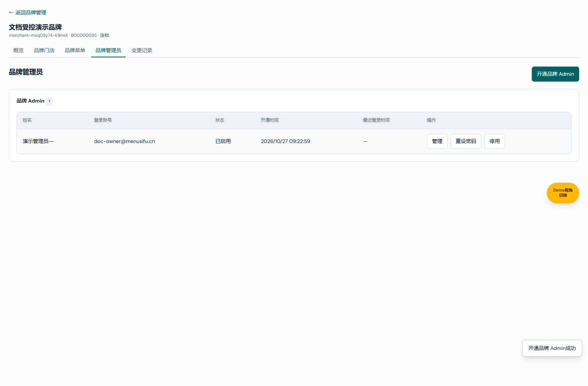

图注：品牌管理员／管理／触发前；main@64ddec8f，5250功能分支；隔离本地演示。

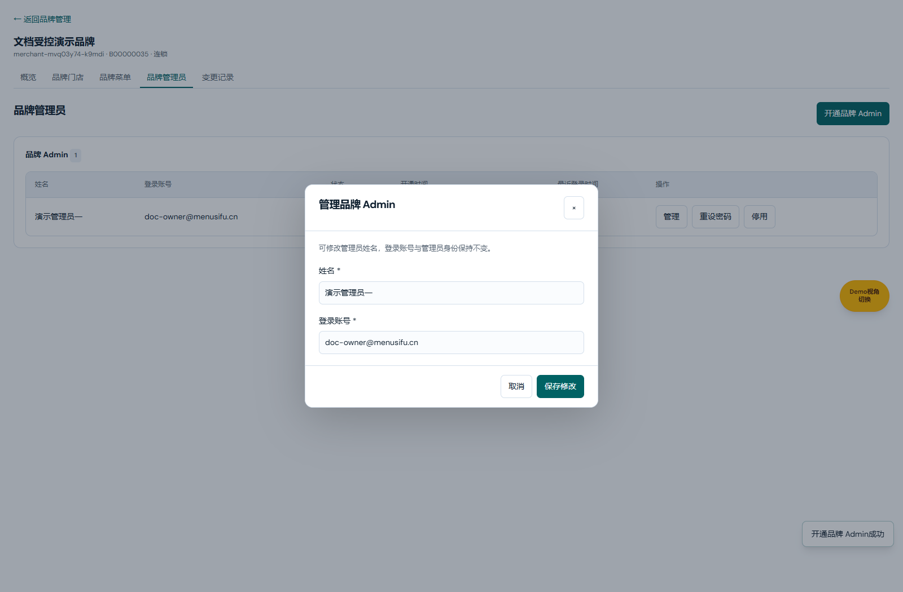

图注：同一操作的实际界面／结果；非真实商户历史；状态：入口及结果已采集。

| 字段／操作 | 逻辑说明 |
| --- | --- |
| 入口与前提 | 按页面当前可见操作进入 |
| 管理 | 姓名可改，账号只读，无密码角色混入 |
| 姓名 | 必填；控件最多30字。实际保存约束另见当前字段字典，不把HTML控件属性当唯一业务校验。 |
| 登录账号 | 必填；只读，不能修改身份。实际保存约束另见当前字段字典，不把HTML控件属性当唯一业务校验。 |
| 取消、关闭与异常 | 对本条实际触发的分支按截图及上述结果执行；其他分支必须查对应独立操作ID。未逐一复现的组合见G06，不据本图推定成功、失败、取消均已覆盖。 |

### 操作 discard-confirm 管理员资料 · 关闭有修改

图注：管理员资料／关闭有修改／触发前；main@64ddec8f，5250功能分支；隔离本地演示。

图注：同一操作的实际界面／结果；非真实商户历史；状态：入口及结果已采集。

| 字段／操作 | 逻辑说明 |
| --- | --- |
| 入口与前提 | 按页面当前可见操作进入 |
| 关闭有修改 | 显示有未保存的修改，是否放弃 |
| 姓名 | 必填；控件最多30字。实际保存约束另见当前字段字典，不把HTML控件属性当唯一业务校验。 |
| 登录账号 | 必填；只读，不能修改身份。实际保存约束另见当前字段字典，不把HTML控件属性当唯一业务校验。 |
| 可见结果／提示 | 有未保存的修改，是否放弃？ |
| 取消、关闭与异常 | 对本条实际触发的分支按截图及上述结果执行；其他分支必须查对应独立操作ID。未逐一复现的组合见G06，不据本图推定成功、失败、取消均已覆盖。 |

### 操作 discard-keep 放弃确认 · 继续编辑

图注：放弃确认／继续编辑／触发前；main@64ddec8f，5250功能分支；隔离本地演示。

图注：同一操作的实际界面／结果；非真实商户历史；状态：入口及结果已采集。

| 字段／操作 | 逻辑说明 |
| --- | --- |
| 入口与前提 | 按页面当前可见操作进入 |
| 继续编辑 | 返回编辑且保留姓名 |
| 姓名 | 必填；控件最多30字。实际保存约束另见当前字段字典，不把HTML控件属性当唯一业务校验。 |
| 登录账号 | 必填；只读，不能修改身份。实际保存约束另见当前字段字典，不把HTML控件属性当唯一业务校验。 |
| 取消、关闭与异常 | 对本条实际触发的分支按截图及上述结果执行；其他分支必须查对应独立操作ID。未逐一复现的组合见G06，不据本图推定成功、失败、取消均已覆盖。 |

### 操作 admin-save 管理员资料 · 保存修改

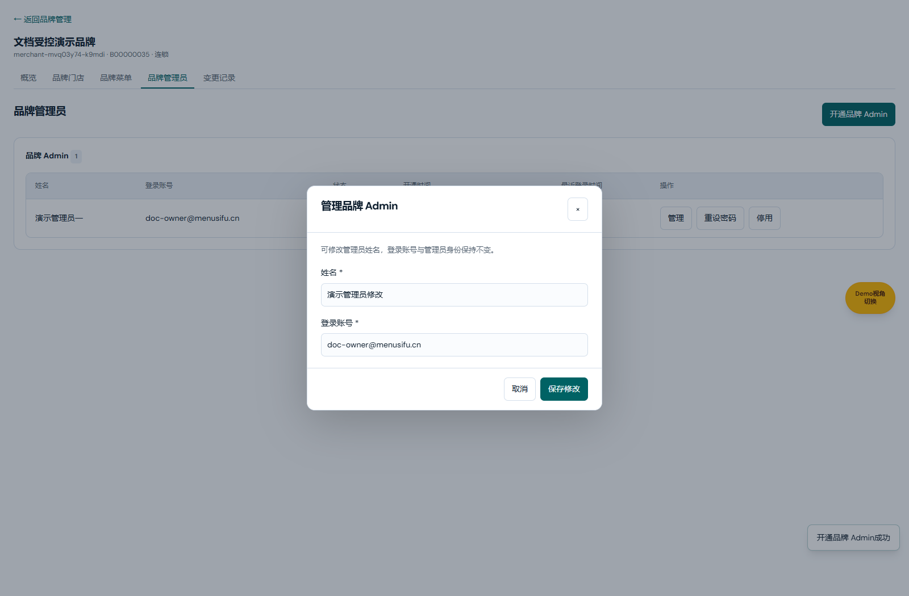

图注：管理员资料／保存修改／触发前；main@64ddec8f，5250功能分支；隔离本地演示。

图注：同一操作的实际界面／结果；非真实商户历史；状态：入口及结果已采集。

| 字段／操作 | 逻辑说明 |
| --- | --- |
| 入口与前提 | 按页面当前可见操作进入 |
| 保存修改 | 返回列表且姓名变更 |
| 取消、关闭与异常 | 对本条实际触发的分支按截图及上述结果执行；其他分支必须查对应独立操作ID。未逐一复现的组合见G06，不据本图推定成功、失败、取消均已覆盖。 |

### 操作 discard-abandon 放弃确认 · 放弃修改

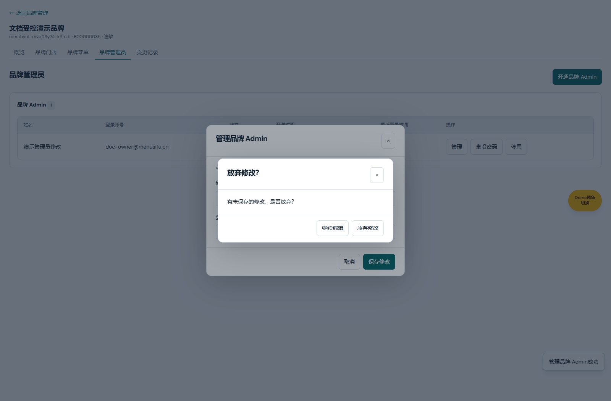

图注：放弃确认／放弃修改／触发前；main@64ddec8f，5250功能分支；隔离本地演示。

图注：同一操作的实际界面／结果；非真实商户历史；状态：入口及结果已采集。

| 字段／操作 | 逻辑说明 |
| --- | --- |
| 入口与前提 | 按页面当前可见操作进入 |
| 放弃修改 | 关闭两层弹框，不保存姓名 |
| 取消、关闭与异常 | 对本条实际触发的分支按截图及上述结果执行；其他分支必须查对应独立操作ID。未逐一复现的组合见G06，不据本图推定成功、失败、取消均已覆盖。 |

### 操作 admin-password 品牌管理员 · 重设密码

图注：品牌管理员／重设密码／触发前；main@64ddec8f，5250功能分支；隔离本地演示。

图注：同一操作的实际界面／结果；非真实商户历史；状态：入口及结果已采集。

| 字段／操作 | 逻辑说明 |
| --- | --- |
| 入口与前提 | 按页面当前可见操作进入 |
| 重设密码 | 独立重设密码弹框 |
| 新密码 | 必填；控件最少6字；密码框遮蔽显示；不在文档或审计展示密码值。实际保存约束另见当前字段字典，不把HTML控件属性当唯一业务校验。 |
| 取消、关闭与异常 | 对本条实际触发的分支按截图及上述结果执行；其他分支必须查对应独立操作ID。未逐一复现的组合见G06，不据本图推定成功、失败、取消均已覆盖。 |

### 操作 admin-password-save 重设密码 · 确认重设密码

图注：重设密码／确认重设密码／触发前；main@64ddec8f，5250功能分支；隔离本地演示。

图注：同一操作的实际界面／结果；非真实商户历史；状态：入口及结果已采集。

| 字段／操作 | 逻辑说明 |
| --- | --- |
| 入口与前提 | 按页面当前可见操作进入 |
| 确认重设密码 | 保存后旧密码失效，审计不含密码 |
| 取消、关闭与异常 | 对本条实际触发的分支按截图及上述结果执行；其他分支必须查对应独立操作ID。未逐一复现的组合见G06，不据本图推定成功、失败、取消均已覆盖。 |

### 操作 admin-disable-open 品牌管理员 · 停用账号

图注：品牌管理员／停用账号／触发前；main@64ddec8f，5250功能分支；隔离本地演示。

图注：同一操作的实际界面／结果；非真实商户历史；状态：入口及结果已采集。

| 字段／操作 | 逻辑说明 |
| --- | --- |
| 入口与前提 | 按页面当前可见操作进入 |
| 停用账号 | 非最后Admin可确认停用 |
| 取消、关闭与异常 | 对本条实际触发的分支按截图及上述结果执行；其他分支必须查对应独立操作ID。未逐一复现的组合见G06，不据本图推定成功、失败、取消均已覆盖。 |

### 操作 admin-disable-save 停用Admin · 确认停用

图注：停用Admin／确认停用／触发前；main@64ddec8f，5250功能分支；隔离本地演示。

图注：同一操作的实际界面／结果；非真实商户历史；状态：入口及结果已采集。

| 字段／操作 | 逻辑说明 |
| --- | --- |
| 入口与前提 | 按页面当前可见操作进入 |
| 确认停用 | 账号显示已停用 |
| 取消、关闭与异常 | 对本条实际触发的分支按截图及上述结果执行；其他分支必须查对应独立操作ID。未逐一复现的组合见G06，不据本图推定成功、失败、取消均已覆盖。 |

### 操作 admin-enable-open 品牌管理员 · 启用账号

图注：品牌管理员／启用账号／触发前；main@64ddec8f，5250功能分支；隔离本地演示。

图注：同一操作的实际界面／结果；非真实商户历史；状态：入口及结果已采集。

| 字段／操作 | 逻辑说明 |
| --- | --- |
| 入口与前提 | 按页面当前可见操作进入 |
| 启用账号 | 显示启用确认 |
| 取消、关闭与异常 | 对本条实际触发的分支按截图及上述结果执行；其他分支必须查对应独立操作ID。未逐一复现的组合见G06，不据本图推定成功、失败、取消均已覆盖。 |

### 操作 admin-enable-save 启用Admin · 确认启用

图注：启用Admin／确认启用／触发前；main@64ddec8f，5250功能分支；隔离本地演示。

图注：同一操作的实际界面／结果；非真实商户历史；状态：入口及结果已采集。

| 字段／操作 | 逻辑说明 |
| --- | --- |
| 入口与前提 | 按页面当前可见操作进入 |
| 确认启用 | 账号恢复启用 |
| 取消、关闭与异常 | 对本条实际触发的分支按截图及上述结果执行；其他分支必须查对应独立操作ID。未逐一复现的组合见G06，不据本图推定成功、失败、取消均已覆盖。 |

### 操作 service-activate-open 品牌概览 · 启用品牌

图注：品牌概览／启用品牌／触发前；main@64ddec8f，5250功能分支；隔离本地演示。

图注：同一操作的实际界面／结果；非真实商户历史；状态：入口及结果已采集。

| 字段／操作 | 逻辑说明 |
| --- | --- |
| 入口与前提 | 按页面当前可见操作进入 |
| 启用品牌 | 具备Admin与菜单时允许填写原因确认 |
| 操作原因 | 必填；控件最少2字；控件最多200字。实际保存约束另见当前字段字典，不把HTML控件属性当唯一业务校验。 |
| 取消、关闭与异常 | 对本条实际触发的分支按截图及上述结果执行；其他分支必须查对应独立操作ID。未逐一复现的组合见G06，不据本图推定成功、失败、取消均已覆盖。 |

### 操作 service-activate-save 启用品牌 · 确认启用

图注：启用品牌／确认启用／触发前；main@64ddec8f，5250功能分支；隔离本地演示。

图注：同一操作的实际界面／结果；非真实商户历史；状态：入口及结果已采集。

| 字段／操作 | 逻辑说明 |
| --- | --- |
| 入口与前提 | 按页面当前可见操作进入 |
| 确认启用 | 服务状态变已启用 |
| 取消、关闭与异常 | 对本条实际触发的分支按截图及上述结果执行；其他分支必须查对应独立操作ID。未逐一复现的组合见G06，不据本图推定成功、失败、取消均已覆盖。 |

### 操作 service-suspend-open 品牌概览 · 暂停服务

图注：品牌概览／暂停服务／触发前；main@64ddec8f，5250功能分支；隔离本地演示。

图注：同一操作的实际界面／结果；非真实商户历史；状态：入口及结果已采集。

| 字段／操作 | 逻辑说明 |
| --- | --- |
| 入口与前提 | 按页面当前可见操作进入 |
| 暂停服务 | 显示影响范围与操作原因 |
| 操作原因 | 必填；控件最少2字；控件最多200字。实际保存约束另见当前字段字典，不把HTML控件属性当唯一业务校验。 |
| 取消、关闭与异常 | 对本条实际触发的分支按截图及上述结果执行；其他分支必须查对应独立操作ID。未逐一复现的组合见G06，不据本图推定成功、失败、取消均已覆盖。 |

### 操作 service-suspend-cancel 暂停服务 · 右上角关闭

图注：暂停服务／右上角关闭／触发前；main@64ddec8f，5250功能分支；隔离本地演示。

图注：同一操作的实际界面／结果；非真实商户历史；状态：入口及结果已采集。

| 字段／操作 | 逻辑说明 |
| --- | --- |
| 入口与前提 | 点击该弹框右上角×；底部取消另有独立采集记录 |
| 右上角关闭 | 无更改关闭 |
| 取消、关闭与异常 | 对本条实际触发的分支按截图及上述结果执行；其他分支必须查对应独立操作ID。未逐一复现的组合见G06，不据本图推定成功、失败、取消均已覆盖。 |

### 操作 service-suspend-save 暂停服务 · 确认暂停服务

图注：暂停服务／确认暂停服务／触发前；main@64ddec8f，5250功能分支；隔离本地演示。

图注：同一操作的实际界面／结果；非真实商户历史；状态：入口及结果已采集。

| 字段／操作 | 逻辑说明 |
| --- | --- |
| 入口与前提 | 按页面当前可见操作进入 |
| 确认暂停服务 | 服务状态更新并记录原因 |
| 取消、关闭与异常 | 对本条实际触发的分支按截图及上述结果执行；其他分支必须查对应独立操作ID。未逐一复现的组合见G06，不据本图推定成功、失败、取消均已覆盖。 |

### 操作 service-resume-open 品牌概览 · 恢复服务

图注：品牌概览／恢复服务／触发前；main@64ddec8f，5250功能分支；隔离本地演示。

图注：同一操作的实际界面／结果；非真实商户历史；状态：入口及结果已采集。

| 字段／操作 | 逻辑说明 |
| --- | --- |
| 入口与前提 | 按页面当前可见操作进入 |
| 恢复服务 | 显示影响范围与操作原因 |
| 操作原因 | 必填；控件最少2字；控件最多200字。实际保存约束另见当前字段字典，不把HTML控件属性当唯一业务校验。 |
| 取消、关闭与异常 | 对本条实际触发的分支按截图及上述结果执行；其他分支必须查对应独立操作ID。未逐一复现的组合见G06，不据本图推定成功、失败、取消均已覆盖。 |

### 操作 service-resume-cancel 恢复服务 · 右上角关闭

图注：恢复服务／右上角关闭／触发前；main@64ddec8f，5250功能分支；隔离本地演示。

图注：同一操作的实际界面／结果；非真实商户历史；状态：入口及结果已采集。

| 字段／操作 | 逻辑说明 |
| --- | --- |
| 入口与前提 | 点击该弹框右上角×；底部取消另有独立采集记录 |
| 右上角关闭 | 无更改关闭 |
| 取消、关闭与异常 | 对本条实际触发的分支按截图及上述结果执行；其他分支必须查对应独立操作ID。未逐一复现的组合见G06，不据本图推定成功、失败、取消均已覆盖。 |

### 操作 service-resume-save 恢复服务 · 确认恢复服务

图注：恢复服务／确认恢复服务／触发前；main@64ddec8f，5250功能分支；隔离本地演示。

图注：同一操作的实际界面／结果；非真实商户历史；状态：入口及结果已采集。

| 字段／操作 | 逻辑说明 |
| --- | --- |
| 入口与前提 | 按页面当前可见操作进入 |
| 确认恢复服务 | 服务状态更新并记录原因 |
| 取消、关闭与异常 | 对本条实际触发的分支按截图及上述结果执行；其他分支必须查对应独立操作ID。未逐一复现的组合见G06，不据本图推定成功、失败、取消均已覆盖。 |

### 操作 menu-edit-open 品牌菜单 · 编辑品牌菜单

图注：品牌菜单／编辑品牌菜单／触发前；main@64ddec8f，5250功能分支；隔离本地演示。

图注：同一操作的实际界面／结果；非真实商户历史；状态：入口及结果已采集。

| 字段／操作 | 逻辑说明 |
| --- | --- |
| 入口与前提 | 按页面当前可见操作进入 |
| 编辑品牌菜单 | 显示当前选择及品牌影响说明 |
| 取消、关闭与异常 | 对本条实际触发的分支按截图及上述结果执行；其他分支必须查对应独立操作ID。未逐一复现的组合见G06，不据本图推定成功、失败、取消均已覆盖。 |

### 操作 menu-search 品牌菜单编辑 · 菜单搜索

图注：品牌菜单编辑／菜单搜索／触发前；main@64ddec8f，5250功能分支；隔离本地演示。

图注：同一操作的实际界面／结果；非真实商户历史；状态：入口及结果已采集。

| 字段／操作 | 逻辑说明 |
| --- | --- |
| 入口与前提 | 按页面当前可见操作进入 |
| 菜单搜索 | 仅过滤展示，不改授权 |
| 取消、关闭与异常 | 对本条实际触发的分支按截图及上述结果执行；其他分支必须查对应独立操作ID。未逐一复现的组合见G06，不据本图推定成功、失败、取消均已覆盖。 |

### 操作 menu-preview-open 品牌菜单编辑 · 预览配置

图注：品牌菜单编辑／预览配置／触发前；main@64ddec8f，5250功能分支；隔离本地演示。

图注：同一操作的实际界面／结果；非真实商户历史；状态：入口及结果已采集。

| 字段／操作 | 逻辑说明 |
| --- | --- |
| 入口与前提 | 按页面当前可见操作进入 |
| 预览配置 | 独立预览弹框，只新增关闭两页签 |
| 取消、关闭与异常 | 对本条实际触发的分支按截图及上述结果执行；其他分支必须查对应独立操作ID。未逐一复现的组合见G06，不据本图推定成功、失败、取消均已覆盖。 |

### 操作 menu-preview-removed 品牌菜单预览 · 本次关闭

图注：品牌菜单预览／本次关闭／触发前；main@64ddec8f，5250功能分支；隔离本地演示。

图注：同一操作的实际界面／结果；非真实商户历史；状态：入口及结果已采集。

| 字段／操作 | 逻辑说明 |
| --- | --- |
| 入口与前提 | 按页面当前可见操作进入 |
| 本次关闭 | 展示关闭树与空/有变化结果 |
| 取消、关闭与异常 | 对本条实际触发的分支按截图及上述结果执行；其他分支必须查对应独立操作ID。未逐一复现的组合见G06，不据本图推定成功、失败、取消均已覆盖。 |

### 操作 menu-preview-added 品牌菜单预览 · 本次新增

图注：品牌菜单预览／本次新增／触发前；main@64ddec8f，5250功能分支；隔离本地演示。

图注：同一操作的实际界面／结果；非真实商户历史；状态：入口及结果已采集。

| 字段／操作 | 逻辑说明 |
| --- | --- |
| 入口与前提 | 按页面当前可见操作进入 |
| 本次新增 | 展示新增树 |
| 取消、关闭与异常 | 对本条实际触发的分支按截图及上述结果执行；其他分支必须查对应独立操作ID。未逐一复现的组合见G06，不据本图推定成功、失败、取消均已覆盖。 |

### 操作 menu-preview-back 品牌菜单预览 · 返回修改

图注：品牌菜单预览／返回修改／触发前；main@64ddec8f，5250功能分支；隔离本地演示。

图注：同一操作的实际界面／结果；非真实商户历史；状态：入口及结果已采集。

| 字段／操作 | 逻辑说明 |
| --- | --- |
| 入口与前提 | 按页面当前可见操作进入 |
| 返回修改 | 关闭预览保留选择 |
| 取消、关闭与异常 | 对本条实际触发的分支按截图及上述结果执行；其他分支必须查对应独立操作ID。未逐一复现的组合见G06，不据本图推定成功、失败、取消均已覆盖。 |

### 操作 menu-save-success 品牌菜单预览 · 确认保存

图注：品牌菜单预览／确认保存／触发前；main@64ddec8f，5250功能分支；隔离本地演示。

图注：同一操作的实际界面／结果；非真实商户历史；状态：入口及结果已采集。

| 字段／操作 | 逻辑说明 |
| --- | --- |
| 入口与前提 | 按页面当前可见操作进入 |
| 确认保存 | 菜单生效并刷新树 |
| 取消、关闭与异常 | 对本条实际触发的分支按截图及上述结果执行；其他分支必须查对应独立操作ID。未逐一复现的组合见G06，不据本图推定成功、失败、取消均已覆盖。 |

### 操作 store-search 品牌门店 · 搜索门店

图注：品牌门店／搜索门店／触发前；main@64ddec8f，5250功能分支；隔离本地演示。

图注：同一操作的实际界面／结果；非真实商户历史；状态：入口及结果已采集。

| 字段／操作 | 逻辑说明 |
| --- | --- |
| 入口与前提 | 按页面当前可见操作进入 |
| 搜索门店 | 显示匹配门店 |
| 取消、关闭与异常 | 对本条实际触发的分支按截图及上述结果执行；其他分支必须查对应独立操作ID。未逐一复现的组合见G06，不据本图推定成功、失败、取消均已覆盖。 |

### 操作 store-effective 品牌门店 · 查看生效菜单

图注：品牌门店／查看生效菜单／触发前；main@64ddec8f，5250功能分支；隔离本地演示。

图注：同一操作的实际界面／结果；非真实商户历史；状态：入口及结果已采集。

| 字段／操作 | 逻辑说明 |
| --- | --- |
| 入口与前提 | 按页面当前可见操作进入 |
| 查看生效菜单 | 独立弹框展示该店已保存完整树 |
| 取消、关闭与异常 | 对本条实际触发的分支按截图及上述结果执行；其他分支必须查对应独立操作ID。未逐一复现的组合见G06，不据本图推定成功、失败、取消均已覆盖。 |

### 操作 store-effective-close 生效菜单 · 关闭

图注：生效菜单／关闭／触发前；main@64ddec8f，5250功能分支；隔离本地演示。

图注：同一操作的实际界面／结果；非真实商户历史；状态：入口及结果已采集。

| 字段／操作 | 逻辑说明 |
| --- | --- |
| 入口与前提 | 按页面当前可见操作进入 |
| 关闭 | 回到门店管理，无写入 |
| 可见结果／提示 | M00000008 · 暂无地址	筹备中	继承品牌 · 172 个页面	2026/10/27 09:22:47；M00000010 · 暂无地址	筹备中	继承品牌 · 172 个页面	2026/10/27 09:22:47 |
| 取消、关闭与异常 | 对本条实际触发的分支按截图及上述结果执行；其他分支必须查对应独立操作ID。未逐一复现的组合见G06，不据本图推定成功、失败、取消均已覆盖。 |

### 操作 store-edit-open 品牌门店 · 配置菜单

图注：品牌门店／配置菜单／触发前；main@64ddec8f，5250功能分支；隔离本地演示。

图注：同一操作的实际界面／结果；非真实商户历史；状态：入口及结果已采集。

| 字段／操作 | 逻辑说明 |
| --- | --- |
| 入口与前提 | 按页面当前可见操作进入 |
| 配置菜单 | 继承/独立配置方式 |
| 菜单配置方式 | 该控件未标required，不据此推断所有保存分支可为空；选项：继承品牌菜单、独立配置。实际保存约束另见当前字段字典，不把HTML控件属性当唯一业务校验。 |
| 取消、关闭与异常 | 对本条实际触发的分支按截图及上述结果执行；其他分支必须查对应独立操作ID。未逐一复现的组合见G06，不据本图推定成功、失败、取消均已覆盖。 |

### 操作 store-independent 门店菜单编辑 · 切换独立配置

图注：门店菜单编辑／切换独立配置／触发前；main@64ddec8f，5250功能分支；隔离本地演示。

图注：同一操作的实际界面／结果；非真实商户历史；状态：入口及结果已采集。

| 字段／操作 | 逻辑说明 |
| --- | --- |
| 入口与前提 | 按页面当前可见操作进入 |
| 切换独立配置 | 出现可编辑菜单树 |
| 菜单配置方式 | 该控件未标required，不据此推断所有保存分支可为空；选项：继承品牌菜单、独立配置。实际保存约束另见当前字段字典，不把HTML控件属性当唯一业务校验。 |
| 取消、关闭与异常 | 对本条实际触发的分支按截图及上述结果执行；其他分支必须查对应独立操作ID。未逐一复现的组合见G06，不据本图推定成功、失败、取消均已覆盖。 |

### 操作 store-preview 门店菜单编辑 · 预览配置

图注：门店菜单编辑／预览配置／触发前；main@64ddec8f，5250功能分支；隔离本地演示。

图注：同一操作的实际界面／结果；非真实商户历史；状态：入口及结果已采集。

| 字段／操作 | 逻辑说明 |
| --- | --- |
| 入口与前提 | 按页面当前可见操作进入 |
| 预览配置 | 显示本次新增/关闭 |
| 菜单配置方式 | 该控件未标required，不据此推断所有保存分支可为空；选项：继承品牌菜单、独立配置。实际保存约束另见当前字段字典，不把HTML控件属性当唯一业务校验。 |
| 取消、关闭与异常 | 对本条实际触发的分支按截图及上述结果执行；其他分支必须查对应独立操作ID。未逐一复现的组合见G06，不据本图推定成功、失败、取消均已覆盖。 |

### 操作 store-preview-removed 门店菜单预览 · 本次关闭

图注：门店菜单预览／本次关闭／触发前；main@64ddec8f，5250功能分支；隔离本地演示。

图注：同一操作的实际界面／结果；非真实商户历史；状态：入口及结果已采集。

| 字段／操作 | 逻辑说明 |
| --- | --- |
| 入口与前提 | 按页面当前可见操作进入 |
| 本次关闭 | 查看该门店关闭节点 |
| 菜单配置方式 | 该控件未标required，不据此推断所有保存分支可为空；选项：继承品牌菜单、独立配置。实际保存约束另见当前字段字典，不把HTML控件属性当唯一业务校验。 |
| 取消、关闭与异常 | 对本条实际触发的分支按截图及上述结果执行；其他分支必须查对应独立操作ID。未逐一复现的组合见G06，不据本图推定成功、失败、取消均已覆盖。 |

### 操作 store-preview-back 门店菜单预览 · 返回修改

图注：门店菜单预览／返回修改／触发前；main@64ddec8f，5250功能分支；隔离本地演示。

图注：同一操作的实际界面／结果；非真实商户历史；状态：入口及结果已采集。

| 字段／操作 | 逻辑说明 |
| --- | --- |
| 入口与前提 | 按页面当前可见操作进入 |
| 返回修改 | 保留原编辑 |
| 菜单配置方式 | 该控件未标required，不据此推断所有保存分支可为空；选项：继承品牌菜单、独立配置。实际保存约束另见当前字段字典，不把HTML控件属性当唯一业务校验。 |
| 取消、关闭与异常 | 对本条实际触发的分支按截图及上述结果执行；其他分支必须查对应独立操作ID。未逐一复现的组合见G06，不据本图推定成功、失败、取消均已覆盖。 |

### 操作 store-save 门店菜单预览 · 确认保存

图注：门店菜单预览／确认保存／触发前；main@64ddec8f，5250功能分支；隔离本地演示。

图注：同一操作的实际界面／结果；非真实商户历史；状态：入口及结果已采集。

| 字段／操作 | 逻辑说明 |
| --- | --- |
| 入口与前提 | 按页面当前可见操作进入 |
| 确认保存 | 独立模式保存 |
| 可见结果／提示 | M00000008 · 暂无地址	筹备中	独立配置 · 172 个页面	2026/10/27 09:23:21；M00000010 · 暂无地址	筹备中	继承品牌 · 172 个页面	2026/10/27 09:22:47 |
| 取消、关闭与异常 | 对本条实际触发的分支按截图及上述结果执行；其他分支必须查对应独立操作ID。未逐一复现的组合见G06，不据本图推定成功、失败、取消均已覆盖。 |

### 操作 store-inherit 门店编辑 · 切换继承

图注：门店编辑／切换继承／触发前；main@64ddec8f，5250功能分支；隔离本地演示。

图注：同一操作的实际界面／结果；非真实商户历史；状态：入口及结果已采集。

| 字段／操作 | 逻辑说明 |
| --- | --- |
| 入口与前提 | 按页面当前可见操作进入 |
| 切换继承 | 只读品牌门店视角树 |
| 菜单配置方式 | 该控件未标required，不据此推断所有保存分支可为空；选项：继承品牌菜单、独立配置。实际保存约束另见当前字段字典，不把HTML控件属性当唯一业务校验。 |
| 取消、关闭与异常 | 对本条实际触发的分支按截图及上述结果执行；其他分支必须查对应独立操作ID。未逐一复现的组合见G06，不据本图推定成功、失败、取消均已覆盖。 |

### 操作 store-inherit-save 继承预览 · 确认保存

图注：继承预览／确认保存／触发前；main@64ddec8f，5250功能分支；隔离本地演示。

图注：同一操作的实际界面／结果；非真实商户历史；状态：入口及结果已采集。

| 字段／操作 | 逻辑说明 |
| --- | --- |
| 入口与前提 | 按页面当前可见操作进入 |
| 确认保存 | 保存继承模式 |
| 可见结果／提示 | M00000008 · 暂无地址	筹备中	继承品牌 · 172 个页面	2026/10/27 09:23:22；M00000010 · 暂无地址	筹备中	继承品牌 · 172 个页面	2026/10/27 09:22:47 |
| 取消、关闭与异常 | 对本条实际触发的分支按截图及上述结果执行；其他分支必须查对应独立操作ID。未逐一复现的组合见G06，不据本图推定成功、失败、取消均已覆盖。 |

### 操作 batch-no-selection 品牌门店 · 未选门店批量配置

图注：品牌门店／未选门店批量配置／触发前；main@64ddec8f，5250功能分支；隔离本地演示。

图注：同一操作的实际界面／结果；非真实商户历史；状态：入口及结果已采集。

| 字段／操作 | 逻辑说明 |
| --- | --- |
| 入口与前提 | 按页面当前可见操作进入 |
| 未选门店批量配置 | 错误提示先选择门店 |
| 可见结果／提示 | M00000008 · 暂无地址	筹备中	继承品牌 · 172 个页面	2026/10/27 09:23:22；M00000010 · 暂无地址	筹备中	继承品牌 · 172 个页面	2026/10/27 09:22:47 |
| 取消、关闭与异常 | 对本条实际触发的分支按截图及上述结果执行；其他分支必须查对应独立操作ID。未逐一复现的组合见G06，不据本图推定成功、失败、取消均已覆盖。 |

### 操作 store-select-all 品牌门店 · 全选门店

图注：品牌门店／全选门店／触发前；main@64ddec8f，5250功能分支；隔离本地演示。

图注：同一操作的实际界面／结果；非真实商户历史；状态：入口及结果已采集。

| 字段／操作 | 逻辑说明 |
| --- | --- |
| 入口与前提 | 按页面当前可见操作进入 |
| 全选门店 | 选中当前可见门店 |
| 可见结果／提示 | M00000008 · 暂无地址	筹备中	继承品牌 · 172 个页面	2026/10/27 09:23:22；M00000010 · 暂无地址	筹备中	继承品牌 · 172 个页面	2026/10/27 09:22:47 |
| 取消、关闭与异常 | 对本条实际触发的分支按截图及上述结果执行；其他分支必须查对应独立操作ID。未逐一复现的组合见G06，不据本图推定成功、失败、取消均已覆盖。 |

### 操作 batch-open 品牌门店 · 批量配置菜单

图注：品牌门店／批量配置菜单／触发前；main@64ddec8f，5250功能分支；隔离本地演示。

图注：同一操作的实际界面／结果；非真实商户历史；状态：入口及结果已采集。

| 字段／操作 | 逻辑说明 |
| --- | --- |
| 入口与前提 | 按页面当前可见操作进入 |
| 批量配置菜单 | 显示批量模式 |
| 菜单配置方式 | 该控件未标required，不据此推断所有保存分支可为空；选项：继承品牌菜单、独立配置：替换所选门店菜单、独立配置：增量开通。实际保存约束另见当前字段字典，不把HTML控件属性当唯一业务校验。 |
| 取消、关闭与异常 | 对本条实际触发的分支按截图及上述结果执行；其他分支必须查对应独立操作ID。未逐一复现的组合见G06，不据本图推定成功、失败、取消均已覆盖。 |

### 操作 batch-preview 批量编辑 · 预览配置

图注：批量编辑／预览配置／触发前；main@64ddec8f，5250功能分支；隔离本地演示。

图注：同一操作的实际界面／结果；非真实商户历史；状态：入口及结果已采集。

| 字段／操作 | 逻辑说明 |
| --- | --- |
| 入口与前提 | 按页面当前可见操作进入 |
| 预览配置 | 同集合可统一展示，不重复求和 |
| 菜单配置方式 | 该控件未标required，不据此推断所有保存分支可为空；选项：继承品牌菜单、独立配置：替换所选门店菜单、独立配置：增量开通。实际保存约束另见当前字段字典，不把HTML控件属性当唯一业务校验。 |
| 取消、关闭与异常 | 对本条实际触发的分支按截图及上述结果执行；其他分支必须查对应独立操作ID。未逐一复现的组合见G06，不据本图推定成功、失败、取消均已覆盖。 |

### 操作 batch-preview-added 批量预览 · 本次新增

图注：批量预览／本次新增／触发前；main@64ddec8f，5250功能分支；隔离本地演示。

图注：同一操作的实际界面／结果；非真实商户历史；状态：入口及结果已采集。

| 字段／操作 | 逻辑说明 |
| --- | --- |
| 入口与前提 | 按页面当前可见操作进入 |
| 本次新增 | 同集合不显示门店切换 |
| 菜单配置方式 | 该控件未标required，不据此推断所有保存分支可为空；选项：继承品牌菜单、独立配置：替换所选门店菜单、独立配置：增量开通。实际保存约束另见当前字段字典，不把HTML控件属性当唯一业务校验。 |
| 取消、关闭与异常 | 对本条实际触发的分支按截图及上述结果执行；其他分支必须查对应独立操作ID。未逐一复现的组合见G06，不据本图推定成功、失败、取消均已覆盖。 |

### 操作 batch-preview-close 批量预览 · 关闭预览

图注：批量预览／关闭预览／触发前；main@64ddec8f，5250功能分支；隔离本地演示。

图注：同一操作的实际界面／结果；非真实商户历史；状态：入口及结果已采集。

| 字段／操作 | 逻辑说明 |
| --- | --- |
| 入口与前提 | 按页面当前可见操作进入 |
| 关闭预览 | 回到编辑保留草稿 |
| 菜单配置方式 | 该控件未标required，不据此推断所有保存分支可为空；选项：继承品牌菜单、独立配置：替换所选门店菜单、独立配置：增量开通。实际保存约束另见当前字段字典，不把HTML控件属性当唯一业务校验。 |
| 取消、关闭与异常 | 对本条实际触发的分支按截图及上述结果执行；其他分支必须查对应独立操作ID。未逐一复现的组合见G06，不据本图推定成功、失败、取消均已覆盖。 |

### 操作 association-open 品牌门店 · 关联已有门店

图注：品牌门店／关联已有门店／触发前；main@64ddec8f，5250功能分支；隔离本地演示。

图注：同一操作的实际界面／结果；非真实商户历史；状态：入口及结果已采集。

| 字段／操作 | 逻辑说明 |
| --- | --- |
| 入口与前提 | 按页面当前可见操作进入 |
| 关联已有门店 | 目标品牌所在Enterprise内的可关联独立门店，只关联不重建MID |
| storeIds | 该控件未标required，不据此推断所有保存分支可为空。实际保存约束另见当前字段字典，不把HTML控件属性当唯一业务校验。 |
| 可见结果／提示 | M00000011 · 暂无地址 |
| 取消、关闭与异常 | 对本条实际触发的分支按截图及上述结果执行；其他分支必须查对应独立操作ID。未逐一复现的组合见G06，不据本图推定成功、失败、取消均已覆盖。 |

### 操作 association-cancel 关联已有门店 · 右上角关闭

图注：关联已有门店／右上角关闭／触发前；main@64ddec8f，5250功能分支；隔离本地演示。

图注：同一操作的实际界面／结果；非真实商户历史；状态：入口及结果已采集。

| 字段／操作 | 逻辑说明 |
| --- | --- |
| 入口与前提 | 点击该弹框右上角×；底部取消另有独立采集记录 |
| 右上角关闭 | 保持原归属 |
| 可见结果／提示 | M00000008 · 暂无地址	筹备中	继承品牌 · 172 个页面	2026/10/27 09:23:22；M00000010 · 暂无地址	筹备中	继承品牌 · 172 个页面	2026/10/27 09:22:47 |
| 取消、关闭与异常 | 对本条实际触发的分支按截图及上述结果执行；其他分支必须查对应独立操作ID。未逐一复现的组合见G06，不据本图推定成功、失败、取消均已覆盖。 |

### 操作 log-filter 变更记录 · 类型筛选

图注：变更记录／类型筛选／触发前；main@64ddec8f，5250功能分支；隔离本地演示。

图注：同一操作的实际界面／结果；非真实商户历史；状态：入口及结果已采集。

| 字段／操作 | 逻辑说明 |
| --- | --- |
| 入口与前提 | 按页面当前可见操作进入 |
| 类型筛选 | 按品牌菜单类型筛选 |
| 可见结果／提示 | 2026/10/27 09:23:22	demo.menusifu.cn	品牌门店	配置门店菜单	米聚集团 · 演示门店 -s997h · M00000008	独立配置 → 继承品牌菜单；菜单范围不变	查看详情；2026/10/27 09:23:21	demo.menusifu.cn	品牌门店	配置门店菜单	米聚集团 · 演示门店 -s997h · M00000008	继承品牌菜单 → 独立配置 · 替换；菜单范围不变	查看详情 |
| 取消、关闭与异常 | 对本条实际触发的分支按截图及上述结果执行；其他分支必须查对应独立操作ID。未逐一复现的组合见G06，不据本图推定成功、失败、取消均已覆盖。 |

### 操作 log-detail 变更记录 · 查看详情

图注：变更记录／查看详情／触发前；main@64ddec8f，5250功能分支；隔离本地演示。

图注：同一操作的实际界面／结果；非真实商户历史；状态：入口及结果已采集。

| 字段／操作 | 逻辑说明 |
| --- | --- |
| 入口与前提 | 按页面当前可见操作进入 |
| 查看详情 | 来源对象字段前后与菜单变化 |
| 可见结果／提示 | 独立配置 → 继承品牌菜单；菜单范围不变 |
| 取消、关闭与异常 | 对本条实际触发的分支按截图及上述结果执行；其他分支必须查对应独立操作ID。未逐一复现的组合见G06，不据本图推定成功、失败、取消均已覆盖。 |

### 操作 log-close 变更详情 · 关闭

图注：变更详情／关闭／触发前；main@64ddec8f，5250功能分支；隔离本地演示。

图注：同一操作的实际界面／结果；非真实商户历史；状态：入口及结果已采集。

| 字段／操作 | 逻辑说明 |
| --- | --- |
| 入口与前提 | 按页面当前可见操作进入 |
| 关闭 | 返回日志列表 |
| 可见结果／提示 | 2026/10/27 09:23:22	demo.menusifu.cn	品牌门店	配置门店菜单	米聚集团 · 演示门店 -s997h · M00000008	独立配置 → 继承品牌菜单；菜单范围不变	查看详情；2026/10/27 09:23:21	demo.menusifu.cn	品牌门店	配置门店菜单	米聚集团 · 演示门店 -s997h · M00000008	继承品牌菜单 → 独立配置 · 替换；菜单范围不变	查看详情 |
| 取消、关闭与异常 | 对本条实际触发的分支按截图及上述结果执行；其他分支必须查对应独立操作ID。未逐一复现的组合见G06，不据本图推定成功、失败、取消均已覆盖。 |

### 操作 service-close-open 品牌概览 · 关闭品牌

图注：品牌概览／关闭品牌／触发前；main@64ddec8f，5250功能分支；隔离本地演示。

图注：同一操作的实际界面／结果；非真实商户历史；状态：入口及结果已采集。

| 字段／操作 | 逻辑说明 |
| --- | --- |
| 入口与前提 | 按页面当前可见操作进入 |
| 关闭品牌 | 提示无法从本页恢复 |
| 操作原因 | 必填；控件最少2字；控件最多200字。实际保存约束另见当前字段字典，不把HTML控件属性当唯一业务校验。 |
| 取消、关闭与异常 | 对本条实际触发的分支按截图及上述结果执行；其他分支必须查对应独立操作ID。未逐一复现的组合见G06，不据本图推定成功、失败、取消均已覆盖。 |

### 操作 service-close-save 关闭品牌 · 确认关闭

图注：关闭品牌／确认关闭／触发前；main@64ddec8f，5250功能分支；隔离本地演示。

图注：同一操作的实际界面／结果；非真实商户历史；状态：入口及结果已采集。

| 字段／操作 | 逻辑说明 |
| --- | --- |
| 入口与前提 | 按页面当前可见操作进入 |
| 确认关闭 | 已关闭，不能代登录 |
| 可见结果／提示 | 服务状态 · 已关闭；品牌已关闭，当前不提供恢复入口。数据、账号、门店和菜单配置保留。；已关闭 |
| 取消、关闭与异常 | 对本条实际触发的分支按截图及上述结果执行；其他分支必须查对应独立操作ID。未逐一复现的组合见G06，不据本图推定成功、失败、取消均已覆盖。 |

### 操作 menu-only 品牌菜单编辑 · 仅看已选

图注：品牌菜单编辑／仅看已选／触发前；main@64ddec8f，5250功能分支；隔离本地演示。

图注：同一操作的实际界面／结果；非真实商户历史；状态：入口及结果已采集。

| 字段／操作 | 逻辑说明 |
| --- | --- |
| 入口与前提 | 按页面当前可见操作进入 |
| 仅看已选 | 只改变查看方式，不写授权 |
| 取消、关闭与异常 | 对本条实际触发的分支按截图及上述结果执行；其他分支必须查对应独立操作ID。未逐一复现的组合见G06，不据本图推定成功、失败、取消均已覆盖。 |

### 操作 menu-review 品牌菜单编辑 · 查看已选

图注：品牌菜单编辑／查看已选／触发前；main@64ddec8f，5250功能分支；隔离本地演示。

图注：同一操作的实际界面／结果；非真实商户历史；状态：入口及结果已采集。

| 字段／操作 | 逻辑说明 |
| --- | --- |
| 入口与前提 | 按页面当前可见操作进入 |
| 查看已选 | 只改变查看方式，不写授权 |
| 取消、关闭与异常 | 对本条实际触发的分支按截图及上述结果执行；其他分支必须查对应独立操作ID。未逐一复现的组合见G06，不据本图推定成功、失败、取消均已覆盖。 |

### 操作 menu-review-back 品牌菜单编辑 · 返回当前分类

图注：品牌菜单编辑／返回当前分类／触发前；main@64ddec8f，5250功能分支；隔离本地演示。

图注：同一操作的实际界面／结果；非真实商户历史；状态：入口及结果已采集。

| 字段／操作 | 逻辑说明 |
| --- | --- |
| 入口与前提 | 按页面当前可见操作进入 |
| 返回当前分类 | 只改变查看方式，不写授权 |
| 取消、关闭与异常 | 对本条实际触发的分支按截图及上述结果执行；其他分支必须查对应独立操作ID。未逐一复现的组合见G06，不据本图推定成功、失败、取消均已覆盖。 |

### 操作 menu-only-back 品牌菜单编辑 · 关闭仅看已选

图注：品牌菜单编辑／关闭仅看已选／触发前；main@64ddec8f，5250功能分支；隔离本地演示。

图注：同一操作的实际界面／结果；非真实商户历史；状态：入口及结果已采集。

| 字段／操作 | 逻辑说明 |
| --- | --- |
| 入口与前提 | 按页面当前可见操作进入 |
| 关闭仅看已选 | 只改变查看方式，不写授权 |
| 取消、关闭与异常 | 对本条实际触发的分支按截图及上述结果执行；其他分支必须查对应独立操作ID。未逐一复现的组合见G06，不据本图推定成功、失败、取消均已覆盖。 |

### 操作 menu-collapse 品牌菜单编辑 · 收起全部

图注：品牌菜单编辑／收起全部／触发前；main@64ddec8f，5250功能分支；隔离本地演示。

图注：同一操作的实际界面／结果；非真实商户历史；状态：入口及结果已采集。

| 字段／操作 | 逻辑说明 |
| --- | --- |
| 入口与前提 | 按页面当前可见操作进入 |
| 收起全部 | 只改变查看方式，不写授权 |
| 取消、关闭与异常 | 对本条实际触发的分支按截图及上述结果执行；其他分支必须查对应独立操作ID。未逐一复现的组合见G06，不据本图推定成功、失败、取消均已覆盖。 |

### 操作 menu-expand 品牌菜单编辑 · 展开全部

图注：品牌菜单编辑／展开全部／触发前；main@64ddec8f，5250功能分支；隔离本地演示。

图注：同一操作的实际界面／结果；非真实商户历史；状态：入口及结果已采集。

| 字段／操作 | 逻辑说明 |
| --- | --- |
| 入口与前提 | 按页面当前可见操作进入 |
| 展开全部 | 只改变查看方式，不写授权 |
| 取消、关闭与异常 | 对本条实际触发的分支按截图及上述结果执行；其他分支必须查对应独立操作ID。未逐一复现的组合见G06，不据本图推定成功、失败、取消均已覆盖。 |

### 操作 menu-all-clear 菜单选择 · 取消全选全部菜单

图注：菜单选择／取消全选全部菜单／触发前；main@64ddec8f，5250功能分支；隔离本地演示。

图注：同一操作的实际界面／结果；非真实商户历史；状态：入口及结果已采集。

| 字段／操作 | 逻辑说明 |
| --- | --- |
| 入口与前提 | 按页面当前可见操作进入 |
| 取消全选全部菜单 | 清除当前可选集合，显示0选中 |
| 取消、关闭与异常 | 对本条实际触发的分支按截图及上述结果执行；其他分支必须查对应独立操作ID。未逐一复现的组合见G06，不据本图推定成功、失败、取消均已覆盖。 |

### 操作 menu-all-select 菜单选择 · 全选全部菜单

图注：菜单选择／全选全部菜单／触发前；main@64ddec8f，5250功能分支；隔离本地演示。

图注：同一操作的实际界面／结果；非真实商户历史；状态：入口及结果已采集。

| 字段／操作 | 逻辑说明 |
| --- | --- |
| 入口与前提 | 按页面当前可见操作进入 |
| 全选全部菜单 | 勾选当前可选集合，不授权未来节点 |
| 取消、关闭与异常 | 对本条实际触发的分支按截图及上述结果执行；其他分支必须查对应独立操作ID。未逐一复现的组合见G06，不据本图推定成功、失败、取消均已覆盖。 |

### 操作 association-preview 关联已有门店 · 预览变更

图注：关联已有门店／预览变更／触发前；main@64ddec8f，5250功能分支；隔离本地演示。

图注：同一操作的实际界面／结果；非真实商户历史；状态：入口及结果已采集。

| 字段／操作 | 逻辑说明 |
| --- | --- |
| 入口与前提 | 按页面当前可见操作进入 |
| 预览变更 | 核对待关联门店 |
| storeIds | 该控件未标required，不据此推断所有保存分支可为空。实际保存约束另见当前字段字典，不把HTML控件属性当唯一业务校验。 |
| 可见结果／提示 | M00000011 · 暂无地址 |
| 取消、关闭与异常 | 对本条实际触发的分支按截图及上述结果执行；其他分支必须查对应独立操作ID。未逐一复现的组合见G06，不据本图推定成功、失败、取消均已覆盖。 |

### 操作 association-save 关联已有门店 · 确认保存

图注：关联已有门店／确认保存／触发前；main@64ddec8f，5250功能分支；隔离本地演示。

图注：同一操作的实际界面／结果；非真实商户历史；状态：入口及结果已采集。

| 字段／操作 | 逻辑说明 |
| --- | --- |
| 入口与前提 | 按页面当前可见操作进入 |
| 确认保存 | 归属与继承配置保存 |
| 可见结果／提示 | M00000010 · 暂无地址	筹备中	继承品牌 · 172 个页面	2026/10/27 09:24:20；M00000011 · 暂无地址	筹备中	继承品牌 · 172 个页面	2026/10/27 09:24:27；M00000008 · 暂无地址	筹备中	继承品牌 · 172 个页面	2026/10/27 09:24:20 |
| 取消、关闭与异常 | 对本条实际触发的分支按截图及上述结果执行；其他分支必须查对应独立操作ID。未逐一复现的组合见G06，不据本图推定成功、失败、取消均已覆盖。 |

### 操作 store-list-name 门店管理 · 点击门店名称

图注：门店管理／点击门店名称／触发前；main@64ddec8f，5250功能分支；隔离本地演示。

图注：同一操作的实际界面／结果；非真实商户历史；状态：入口及结果已采集。

| 字段／操作 | 逻辑说明 |
| --- | --- |
| 入口与前提 | 按页面当前可见操作进入 |
| 点击门店名称 | 进入独立概览 |
| 取消、关闭与异常 | 对本条实际触发的分支按截图及上述结果执行；其他分支必须查对应独立操作ID。未逐一复现的组合见G06，不据本图推定成功、失败、取消均已覆盖。 |

### 操作 store-tab-menu 门店详情 · 门店菜单页签

图注：门店详情／门店菜单页签／触发前；main@64ddec8f，5250功能分支；隔离本地演示。

图注：同一操作的实际界面／结果；非真实商户历史；状态：入口及结果已采集。

| 字段／操作 | 逻辑说明 |
| --- | --- |
| 入口与前提 | 按页面当前可见操作进入 |
| 门店菜单页签 | 显示保存的有效树 |
| 取消、关闭与异常 | 对本条实际触发的分支按截图及上述结果执行；其他分支必须查对应独立操作ID。未逐一复现的组合见G06，不据本图推定成功、失败、取消均已覆盖。 |

### 操作 store-tab-log 门店详情 · 变更记录页签

图注：门店详情／变更记录页签／触发前；main@64ddec8f，5250功能分支；隔离本地演示。

图注：同一操作的实际界面／结果；非真实商户历史；状态：入口及结果已采集。

| 字段／操作 | 逻辑说明 |
| --- | --- |
| 入口与前提 | 按页面当前可见操作进入 |
| 变更记录页签 | 只显示该店记录 |
| 可见结果／提示 | 暂无变更记录 |
| 取消、关闭与异常 | 对本条实际触发的分支按截图及上述结果执行；其他分支必须查对应独立操作ID。未逐一复现的组合见G06，不据本图推定成功、失败、取消均已覆盖。 |

### 操作 batch-different-preview 批量继承预览 · 预览不同门店差异

图注：批量继承预览／预览不同门店差异／触发前；main@64ddec8f，5250功能分支；隔离本地演示。

图注：同一操作的实际界面／结果；非真实商户历史；状态：入口及结果已采集。

| 字段／操作 | 逻辑说明 |
| --- | --- |
| 入口与前提 | 按页面当前可见操作进入 |
| 预览不同门店差异 | 差异不同时出现预览门店切换 |
| 菜单配置方式 | 该控件未标required，不据此推断所有保存分支可为空；选项：继承品牌菜单、独立配置：替换所选门店菜单、独立配置：增量开通。实际保存约束另见当前字段字典，不把HTML控件属性当唯一业务校验。 |
| 取消、关闭与异常 | 对本条实际触发的分支按截图及上述结果执行；其他分支必须查对应独立操作ID。未逐一复现的组合见G06，不据本图推定成功、失败、取消均已覆盖。 |

### 操作 menu-save-conflict 品牌菜单预览 · 并发保存失败

图注：品牌菜单预览／并发保存失败／触发前；main@64ddec8f，5250功能分支；隔离本地演示。

图注：同一操作的实际界面／结果；非真实商户历史；状态：入口及结果已采集。

| 字段／操作 | 逻辑说明 |
| --- | --- |
| 入口与前提 | 按页面当前可见操作进入 |
| 并发保存失败 | 版本变化提示且保留预览草稿 |
| 可见结果／提示 | 品牌或门店配置已更新，请保留选择，刷新后重新编辑。 |
| 取消、关闭与异常 | 对本条实际触发的分支按截图及上述结果执行；其他分支必须查对应独立操作ID。未逐一复现的组合见G06，不据本图推定成功、失败、取消均已覆盖。 |

### 操作 brand-name-link 品牌管理 · 点击品牌名称

图注：品牌管理／点击品牌名称／触发前；main@64ddec8f，5250功能分支；隔离本地演示。

图注：同一操作的实际界面／结果；非真实商户历史；状态：入口及结果已采集。

| 字段／操作 | 逻辑说明 |
| --- | --- |
| 入口与前提 | 按页面当前可见操作进入 |
| 点击品牌名称 | 进入概览，与详情入口一致 |
| 取消、关闭与异常 | 对本条实际触发的分支按截图及上述结果执行；其他分支必须查对应独立操作ID。未逐一复现的组合见G06，不据本图推定成功、失败、取消均已覆盖。 |

### 操作 list-menu-link 品牌管理 · 点击品牌菜单数

图注：品牌管理／点击品牌菜单数／触发前；main@64ddec8f，5250功能分支；隔离本地演示。

图注：同一操作的实际界面／结果；非真实商户历史；状态：入口及结果已采集。

| 字段／操作 | 逻辑说明 |
| --- | --- |
| 入口与前提 | 按页面当前可见操作进入 |
| 点击品牌菜单数 | 进入品牌菜单 |
| 取消、关闭与异常 | 对本条实际触发的分支按截图及上述结果执行；其他分支必须查对应独立操作ID。未逐一复现的组合见G06，不据本图推定成功、失败、取消均已覆盖。 |

### 操作 list-store-link 品牌管理 · 点击管理门店

图注：品牌管理／点击管理门店／触发前；main@64ddec8f，5250功能分支；隔离本地演示。

图注：同一操作的实际界面／结果；非真实商户历史；状态：入口及结果已采集。

| 字段／操作 | 逻辑说明 |
| --- | --- |
| 入口与前提 | 按页面当前可见操作进入 |
| 点击管理门店 | 进入品牌门店 |
| 可见结果／提示 | M00000010 · 暂无地址	筹备中	独立配置 · 172 个页面	2026/10/27 09:24:33；M00000011 · 暂无地址	筹备中	继承品牌 · 172 个页面	2026/10/27 09:24:27；M00000008 · 暂无地址	筹备中	继承品牌 · 172 个页面	2026/10/27 09:24:20 |
| 取消、关闭与异常 | 对本条实际触发的分支按截图及上述结果执行；其他分支必须查对应独立操作ID。未逐一复现的组合见G06，不据本图推定成功、失败、取消均已覆盖。 |

### 操作 impersonate-enter 品牌管理 · 代登录

图注：品牌管理／代登录／触发前；main@64ddec8f，5250功能分支；隔离本地演示。

图注：同一操作的实际界面／结果；非真实商户历史；状态：入口及结果已采集。

| 字段／操作 | 逻辑说明 |
| --- | --- |
| 入口与前提 | 按页面当前可见操作进入 |
| 代登录 | 进入后台显示全宽代管提示 |
| 取消、关闭与异常 | 对本条实际触发的分支按截图及上述结果执行；其他分支必须查对应独立操作ID。未逐一复现的组合见G06，不据本图推定成功、失败、取消均已覆盖。 |

### 操作 impersonate-exit 商家代管模式 · 退出代管

图注：商家代管模式／退出代管／触发前；main@64ddec8f，5250功能分支；隔离本地演示。

图注：同一操作的实际界面／结果；非真实商户历史；状态：入口及结果已采集。

| 字段／操作 | 逻辑说明 |
| --- | --- |
| 入口与前提 | 按页面当前可见操作进入 |
| 退出代管 | 结束并返回M品牌管理 |
| 可见结果／提示 | 已关闭 |
| 取消、关闭与异常 | 对本条实际触发的分支按截图及上述结果执行；其他分支必须查对应独立操作ID。未逐一复现的组合见G06，不据本图推定成功、失败、取消均已覆盖。 |

### 操作 batch-diff-added 批量继承预览 · 不同差异预览

图注：批量继承预览／不同差异预览／触发前；main@64ddec8f，5250功能分支；隔离本地演示。

图注：同一操作的实际界面／结果；非真实商户历史；状态：入口及结果已采集。

| 字段／操作 | 逻辑说明 |
| --- | --- |
| 入口与前提 | 按页面当前可见操作进入 |
| 不同差异预览 | 第一店从空集继承，第二店已继承，新增集合不同 |
| 菜单配置方式 | 该控件未标required，不据此推断所有保存分支可为空；选项：继承品牌菜单、独立配置：替换所选门店菜单、独立配置：增量开通。实际保存约束另见当前字段字典，不把HTML控件属性当唯一业务校验。 |
| 取消、关闭与异常 | 对本条实际触发的分支按截图及上述结果执行；其他分支必须查对应独立操作ID。未逐一复现的组合见G06，不据本图推定成功、失败、取消均已覆盖。 |

### 操作 batch-switch-resolved 批量预览 · 切换预览门店

图注：批量预览／切换预览门店／触发前；main@64ddec8f，5250功能分支；隔离本地演示。

图注：同一操作的实际界面／结果；非真实商户历史；状态：入口及结果已采集。

| 字段／操作 | 逻辑说明 |
| --- | --- |
| 入口与前提 | 按页面当前可见操作进入 |
| 切换预览门店 | 查看第二店不同新增集合，不改变保存目标 |
| 菜单配置方式 | 该控件未标required，不据此推断所有保存分支可为空；选项：继承品牌菜单、独立配置：替换所选门店菜单、独立配置：增量开通。实际保存约束另见当前字段字典，不把HTML控件属性当唯一业务校验。 |
| 取消、关闭与异常 | 对本条实际触发的分支按截图及上述结果执行；其他分支必须查对应独立操作ID。未逐一复现的组合见G06，不据本图推定成功、失败、取消均已覆盖。 |

### 操作 batch-removed-tab 批量预览 · 本次关闭

图注：批量预览／本次关闭／触发前；main@64ddec8f，5250功能分支；隔离本地演示。

图注：同一操作的实际界面／结果；非真实商户历史；状态：入口及结果已采集。

| 字段／操作 | 逻辑说明 |
| --- | --- |
| 入口与前提 | 按页面当前可见操作进入 |
| 本次关闭 | 关闭集合相同时隐藏切换 |
| 菜单配置方式 | 该控件未标required，不据此推断所有保存分支可为空；选项：继承品牌菜单、独立配置：替换所选门店菜单、独立配置：增量开通。实际保存约束另见当前字段字典，不把HTML控件属性当唯一业务校验。 |
| 取消、关闭与异常 | 对本条实际触发的分支按截图及上述结果执行；其他分支必须查对应独立操作ID。未逐一复现的组合见G06，不据本图推定成功、失败、取消均已覆盖。 |

### 操作 batch-save-success 批量预览 · 确认保存

图注：批量预览／确认保存／触发前；main@64ddec8f，5250功能分支；隔离本地演示。

图注：同一操作的实际界面／结果；非真实商户历史；状态：入口及结果已采集。

| 字段／操作 | 逻辑说明 |
| --- | --- |
| 入口与前提 | 按页面当前可见操作进入 |
| 确认保存 | 统一改为继承且逐店记录审计 |
| 可见结果／提示 | M00000010 · 暂无地址	筹备中	继承品牌 · 172 个页面	2026/10/27 09:25:59；M00000008 · 暂无地址	筹备中	继承品牌 · 172 个页面	2026/10/27 09:26:02 |
| 取消、关闭与异常 | 对本条实际触发的分支按截图及上述结果执行；其他分支必须查对应独立操作ID。未逐一复现的组合见G06，不据本图推定成功、失败、取消均已覆盖。 |

### 操作 menu-category 菜单选择 · 切换一级分类

图注：菜单选择／切换一级分类／触发前；main@64ddec8f，5250功能分支；隔离本地演示。

图注：同一操作的实际界面／结果；非真实商户历史；状态：入口及结果已采集。

| 字段／操作 | 逻辑说明 |
| --- | --- |
| 入口与前提 | 按页面当前可见操作进入 |
| 切换一级分类 | 右侧更新对应分类，保留选择 |
| 取消、关闭与异常 | 对本条实际触发的分支按截图及上述结果执行；其他分支必须查对应独立操作ID。未逐一复现的组合见G06，不据本图推定成功、失败、取消均已覆盖。 |

### 操作 menu-row-collapse 菜单选择 · 折叠父菜单

图注：菜单选择／折叠父菜单／触发前；main@64ddec8f，5250功能分支；隔离本地演示。

图注：同一操作的实际界面／结果；非真实商户历史；状态：入口及结果已采集。

| 字段／操作 | 逻辑说明 |
| --- | --- |
| 入口与前提 | 按页面当前可见操作进入 |
| 折叠父菜单 | 收起下级但不取消选择 |
| 取消、关闭与异常 | 对本条实际触发的分支按截图及上述结果执行；其他分支必须查对应独立操作ID。未逐一复现的组合见G06，不据本图推定成功、失败、取消均已覆盖。 |

### 操作 menu-row-expand 菜单选择 · 展开父菜单

图注：菜单选择／展开父菜单／触发前；main@64ddec8f，5250功能分支；隔离本地演示。

图注：同一操作的实际界面／结果；非真实商户历史；状态：入口及结果已采集。

| 字段／操作 | 逻辑说明 |
| --- | --- |
| 入口与前提 | 按页面当前可见操作进入 |
| 展开父菜单 | 下级恢复显示 |
| 取消、关闭与异常 | 对本条实际触发的分支按截图及上述结果执行；其他分支必须查对应独立操作ID。未逐一复现的组合见G06，不据本图推定成功、失败、取消均已覆盖。 |

### 操作 menu-category-clear 菜单选择 · 清空当前分类

图注：菜单选择／清空当前分类／触发前；main@64ddec8f，5250功能分支；隔离本地演示。

图注：同一操作的实际界面／结果；非真实商户历史；状态：入口及结果已采集。

| 字段／操作 | 逻辑说明 |
| --- | --- |
| 入口与前提 | 按页面当前可见操作进入 |
| 清空当前分类 | 仅移除当前分类选择 |
| 取消、关闭与异常 | 对本条实际触发的分支按截图及上述结果执行；其他分支必须查对应独立操作ID。未逐一复现的组合见G06，不据本图推定成功、失败、取消均已覆盖。 |

### 操作 menu-category-all 菜单选择 · 全选当前分类

图注：菜单选择／全选当前分类／触发前；main@64ddec8f，5250功能分支；隔离本地演示。

图注：同一操作的实际界面／结果；非真实商户历史；状态：入口及结果已采集。

| 字段／操作 | 逻辑说明 |
| --- | --- |
| 入口与前提 | 按页面当前可见操作进入 |
| 全选当前分类 | 只勾选当前已有下级 |
| 取消、关闭与异常 | 对本条实际触发的分支按截图及上述结果执行；其他分支必须查对应独立操作ID。未逐一复现的组合见G06，不据本图推定成功、失败、取消均已覆盖。 |

### 操作 admin-duplicate 开通Admin · 重复账号错误

图注：开通Admin／重复账号错误／触发前；main@64ddec8f，5250功能分支；隔离本地演示。

图注：同一操作的实际界面／结果；非真实商户历史；状态：入口及结果已采集。

| 字段／操作 | 逻辑说明 |
| --- | --- |
| 入口与前提 | 按页面当前可见操作进入 |
| 重复账号错误 | 拒绝重复邮箱，原账号保留 |
| 姓名 | 必填；控件最多30字。实际保存约束另见当前字段字典，不把HTML控件属性当唯一业务校验。 |
| 登录账号 | 必填。实际保存约束另见当前字段字典，不把HTML控件属性当唯一业务校验。 |
| 登录密码 | 必填；控件最少6字；密码框遮蔽显示；不在文档或审计展示密码值。实际保存约束另见当前字段字典，不把HTML控件属性当唯一业务校验。 |
| 取消、关闭与异常 | 对本条实际触发的分支按截图及上述结果执行；其他分支必须查对应独立操作ID。未逐一复现的组合见G06，不据本图推定成功、失败、取消均已覆盖。 |

### 操作 admin-storage-failed 开通Admin · 保存失败

图注：开通Admin／保存失败／触发前；main@64ddec8f，5250功能分支；隔离本地演示。

图注：同一操作的实际界面／结果；非真实商户历史；状态：入口及结果已采集。

| 字段／操作 | 逻辑说明 |
| --- | --- |
| 入口与前提 | 按页面当前可见操作进入 |
| 保存失败 | 受控存储异常显示错误且保留输入，不发布账号 |
| 姓名 | 必填；控件最多30字。实际保存约束另见当前字段字典，不把HTML控件属性当唯一业务校验。 |
| 登录账号 | 必填。实际保存约束另见当前字段字典，不把HTML控件属性当唯一业务校验。 |
| 登录密码 | 必填；控件最少6字；密码框遮蔽显示；不在文档或审计展示密码值。实际保存约束另见当前字段字典，不把HTML控件属性当唯一业务校验。 |
| 可见结果／提示 | 受控演示：存储写入失败 |
| 取消、关闭与异常 | 对本条实际触发的分支按截图及上述结果执行；其他分支必须查对应独立操作ID。未逐一复现的组合见G06，不据本图推定成功、失败、取消均已覆盖。 |

### 操作 admin-close-x 开通Admin · 右上角关闭

图注：开通Admin／右上角关闭／触发前；main@64ddec8f，5250功能分支；隔离本地演示。

图注：同一操作的实际界面／结果；非真实商户历史；状态：入口及结果已采集。

| 字段／操作 | 逻辑说明 |
| --- | --- |
| 入口与前提 | 按页面当前可见操作进入 |
| 右上角关闭 | 未编辑直接关闭 |
| 取消、关闭与异常 | 对本条实际触发的分支按截图及上述结果执行；其他分支必须查对应独立操作ID。未逐一复现的组合见G06，不据本图推定成功、失败、取消均已覆盖。 |

### 操作 admin-close-esc 开通Admin · Esc关闭

图注：开通Admin／Esc关闭／触发前；main@64ddec8f，5250功能分支；隔离本地演示。

图注：同一操作的实际界面／结果；非真实商户历史；状态：入口及结果已采集。

| 字段／操作 | 逻辑说明 |
| --- | --- |
| 入口与前提 | 按页面当前可见操作进入 |
| Esc关闭 | 未编辑直接关闭 |
| 取消、关闭与异常 | 对本条实际触发的分支按截图及上述结果执行；其他分支必须查对应独立操作ID。未逐一复现的组合见G06，不据本图推定成功、失败、取消均已覆盖。 |

### 操作 m-readonly 品牌管理 · 只读运营访问

图注：品牌管理／只读运营访问／触发前；main@64ddec8f，5250功能分支；隔离本地演示。

图注：同一操作的实际界面／结果；非真实商户历史；状态：入口及结果已采集。

| 字段／操作 | 逻辑说明 |
| --- | --- |
| 入口与前提 | 按页面当前可见操作进入 |
| 只读运营访问 | 只读提示与写操作受限；实际查询/重置也被禁用，记录为实现偏差，不宣称只读筛选可用。 |
| 可见结果／提示 | 当前页面为只读，暂无修改权限。来源readonly-state.json验证currentMAccess=read，查询和重置disabled=true。 |
| 取消、关闭与异常 | 对本条实际触发的分支按截图及上述结果执行；其他分支必须查对应独立操作ID。未逐一复现的组合见G06，不据本图推定成功、失败、取消均已覆盖。 |

### 操作 login-loading 品牌管理 · 代登录等待提示

图注：品牌管理／代登录等待提示／触发前；main@64ddec8f，5250功能分支；隔离本地演示。

图注：同一操作的实际界面／结果；非真实商户历史；状态：入口及结果已采集。

| 字段／操作 | 逻辑说明 |
| --- | --- |
| 入口与前提 | 按页面当前可见操作进入 |
| 代登录等待提示 | 受控延长绘制等待以采集正在登录，请稍后；不修改业务实现 |
| 可见结果／提示 | 已关闭 |
| 取消、关闭与异常 | 对本条实际触发的分支按截图及上述结果执行；其他分支必须查对应独立操作ID。未逐一复现的组合见G06，不据本图推定成功、失败、取消均已覆盖。 |

### 操作 crm-sync 品牌概览CRM · 从CRM同步

图注：品牌概览CRM／从CRM同步／触发前；main@64ddec8f，5250功能分支；隔离本地演示。

图注：同一操作的实际界面／结果；非真实商户历史；状态：结果已采集；原生层截图受限G01。

| 字段／操作 | 逻辑说明 |
| --- | --- |
| 入口与前提 | 按页面当前可见操作进入 |
| 从CRM同步 | 本地演示同步与提示，不代表Salesforce实连 |
| 原生提示限制 | 原生提示的准确文案及测试确认／取消选择见operation事件记录；不得把上方结果图冒充原生弹框截图。 |
| 取消、关闭与异常 | 对本条实际触发的分支按截图及上述结果执行；其他分支必须查对应独立操作ID。未逐一复现的组合见G06，不据本图推定成功、失败、取消均已覆盖。 |

### 操作 contract-renew 品牌概览合同 · 合同续期

图注：品牌概览合同／合同续期／触发前；main@64ddec8f，5250功能分支；隔离本地演示。

图注：同一操作的实际界面／结果；非真实商户历史；状态：入口及结果已采集。

| 字段／操作 | 逻辑说明 |
| --- | --- |
| 入口与前提 | 按页面当前可见操作进入 |
| 合同续期 | 当前实现更新到期日并尝试恢复有效服务状态；不是付款或真实合同签约 |
| 取消、关闭与异常 | 对本条实际触发的分支按截图及上述结果执行；其他分支必须查对应独立操作ID。未逐一复现的组合见G06，不据本图推定成功、失败、取消均已覆盖。 |

### 操作 overview-login 品牌概览 · 进入商家后台

图注：品牌概览／进入商家后台／触发前；main@64ddec8f，5250功能分支；隔离本地演示。

图注：同一操作的实际界面／结果；非真实商户历史；状态：入口及结果已采集。

| 字段／操作 | 逻辑说明 |
| --- | --- |
| 入口与前提 | 按页面当前可见操作进入 |
| 进入商家后台 | 复用品牌代登录入口 |
| 取消、关闭与异常 | 对本条实际触发的分支按截图及上述结果执行；其他分支必须查对应独立操作ID。未逐一复现的组合见G06，不据本图推定成功、失败、取消均已覆盖。 |

### 操作 hardware-link 品牌概览 · 查看硬件资产

图注：品牌概览／查看硬件资产／触发前；main@64ddec8f，5250功能分支；隔离本地演示。

图注：同一操作的实际界面／结果；非真实商户历史；状态：入口及结果已采集。

| 字段／操作 | 逻辑说明 |
| --- | --- |
| 入口与前提 | 按页面当前可见操作进入 |
| 查看硬件资产 | 携带品牌筛选上下文进入硬件资产页 |
| 可见结果／提示 | 暂无匹配设备 |
| 取消、关闭与异常 | 对本条实际触发的分支按截图及上述结果执行；其他分支必须查对应独立操作ID。未逐一复现的组合见G06，不据本图推定成功、失败、取消均已覆盖。 |

### 操作 detail-return-list 品牌详情 · 返回品牌管理

图注：品牌详情／返回品牌管理／触发前；main@64ddec8f，5250功能分支；隔离本地演示。

图注：同一操作的实际界面／结果；非真实商户历史；状态：入口及结果已采集。

| 字段／操作 | 逻辑说明 |
| --- | --- |
| 入口与前提 | 按页面当前可见操作进入 |
| 返回品牌管理 | 返回品牌管理并恢复平台导航 |
| 可见结果／提示 | 已关闭 |
| 取消、关闭与异常 | 对本条实际触发的分支按截图及上述结果执行；其他分支必须查对应独立操作ID。未逐一复现的组合见G06，不据本图推定成功、失败、取消均已覆盖。 |

### 操作 cancel-admin-new-admin 品牌管理员弹框 · 开通取消

图注：品牌管理员弹框／开通取消／触发前；main@64ddec8f，5250功能分支；隔离本地演示。

图注：同一操作的实际界面／结果；非真实商户历史；状态：入口及结果已采集。

| 字段／操作 | 逻辑说明 |
| --- | --- |
| 入口与前提 | 按页面当前可见操作进入 |
| 开通取消 | 点击底部取消，不保存任何更改 |
| 取消、关闭与异常 | 对本条实际触发的分支按截图及上述结果执行；其他分支必须查对应独立操作ID。未逐一复现的组合见G06，不据本图推定成功、失败、取消均已覆盖。 |

### 操作 cancel-admin-admin 品牌管理员弹框 · 管理取消

图注：品牌管理员弹框／管理取消／触发前；main@64ddec8f，5250功能分支；隔离本地演示。

图注：同一操作的实际界面／结果；非真实商户历史；状态：入口及结果已采集。

| 字段／操作 | 逻辑说明 |
| --- | --- |
| 入口与前提 | 按页面当前可见操作进入 |
| 管理取消 | 点击底部取消，不保存任何更改 |
| 取消、关闭与异常 | 对本条实际触发的分支按截图及上述结果执行；其他分支必须查对应独立操作ID。未逐一复现的组合见G06，不据本图推定成功、失败、取消均已覆盖。 |

### 操作 cancel-admin-admin-password 品牌管理员弹框 · 重设密码取消

图注：品牌管理员弹框／重设密码取消／触发前；main@64ddec8f，5250功能分支；隔离本地演示。

图注：同一操作的实际界面／结果；非真实商户历史；状态：入口及结果已采集。

| 字段／操作 | 逻辑说明 |
| --- | --- |
| 入口与前提 | 按页面当前可见操作进入 |
| 重设密码取消 | 点击底部取消，不保存任何更改 |
| 取消、关闭与异常 | 对本条实际触发的分支按截图及上述结果执行；其他分支必须查对应独立操作ID。未逐一复现的组合见G06，不据本图推定成功、失败、取消均已覆盖。 |

### 操作 cancel-admin-admin-status 品牌管理员弹框 · 最后Admin停用取消

图注：品牌管理员弹框／最后Admin停用取消／触发前；main@64ddec8f，5250功能分支；隔离本地演示。

图注：同一操作的实际界面／结果；非真实商户历史；状态：入口及结果已采集。

| 字段／操作 | 逻辑说明 |
| --- | --- |
| 入口与前提 | 按页面当前可见操作进入 |
| 最后Admin停用取消 | 点击底部取消，不保存任何更改 |
| 取消、关闭与异常 | 对本条实际触发的分支按截图及上述结果执行；其他分支必须查对应独立操作ID。未逐一复现的组合见G06，不据本图推定成功、失败、取消均已覆盖。 |

### 操作 cancel-menu-editor 品牌菜单编辑 · 取消

图注：品牌菜单编辑／取消／触发前；main@64ddec8f，5250功能分支；隔离本地演示。

图注：同一操作的实际界面／结果；非真实商户历史；状态：入口及结果已采集。

| 字段／操作 | 逻辑说明 |
| --- | --- |
| 入口与前提 | 按页面当前可见操作进入 |
| 取消 | 底部取消关闭，无修改不提示 |
| 取消、关闭与异常 | 对本条实际触发的分支按截图及上述结果执行；其他分支必须查对应独立操作ID。未逐一复现的组合见G06，不据本图推定成功、失败、取消均已覆盖。 |

### 操作 close-menu-preview-x 品牌菜单预览 · 右上角关闭

图注：品牌菜单预览／右上角关闭／触发前；main@64ddec8f，5250功能分支；隔离本地演示。

图注：同一操作的实际界面／结果；非真实商户历史；状态：入口及结果已采集。

| 字段／操作 | 逻辑说明 |
| --- | --- |
| 入口与前提 | 按页面当前可见操作进入 |
| 右上角关闭 | 仅关闭预览，保留编辑草稿 |
| 取消、关闭与异常 | 对本条实际触发的分支按截图及上述结果执行；其他分支必须查对应独立操作ID。未逐一复现的组合见G06，不据本图推定成功、失败、取消均已覆盖。 |

### 操作 cancel-menu-discard 品牌菜单放弃确认 · 继续编辑

图注：品牌菜单放弃确认／继续编辑／触发前；main@64ddec8f，5250功能分支；隔离本地演示。

图注：同一操作的实际界面／结果；非真实商户历史；状态：入口及结果已采集。

| 字段／操作 | 逻辑说明 |
| --- | --- |
| 入口与前提 | 按页面当前可见操作进入 |
| 继续编辑 | 从取消触发的确认返回，保留草稿 |
| 取消、关闭与异常 | 对本条实际触发的分支按截图及上述结果执行；其他分支必须查对应独立操作ID。未逐一复现的组合见G06，不据本图推定成功、失败、取消均已覆盖。 |

### 操作 cancel-associate 品牌门店 · 关联门店取消

图注：品牌门店／关联门店取消／触发前；main@64ddec8f，5250功能分支；隔离本地演示。

图注：同一操作的实际界面／结果；非真实商户历史；状态：入口及结果已采集。

| 字段／操作 | 逻辑说明 |
| --- | --- |
| 入口与前提 | 按页面当前可见操作进入 |
| 关联门店取消 | 底部取消退出，不保存 |
| 可见结果／提示 | M00000008 · 暂无地址	筹备中	独立配置 · 0 个页面	2026/10/27 09:29:28；M00000010 · 暂无地址	筹备中	继承品牌 · 172 个页面	2026/10/27 09:29:28 |
| 取消、关闭与异常 | 对本条实际触发的分支按截图及上述结果执行；其他分支必须查对应独立操作ID。未逐一复现的组合见G06，不据本图推定成功、失败、取消均已覆盖。 |

### 操作 cancel-store 品牌门店 · 门店配置取消

图注：品牌门店／门店配置取消／触发前；main@64ddec8f，5250功能分支；隔离本地演示。

图注：同一操作的实际界面／结果；非真实商户历史；状态：入口及结果已采集。

| 字段／操作 | 逻辑说明 |
| --- | --- |
| 入口与前提 | 按页面当前可见操作进入 |
| 门店配置取消 | 底部取消退出，不保存 |
| 可见结果／提示 | M00000008 · 暂无地址	筹备中	独立配置 · 0 个页面	2026/10/27 09:29:28；M00000010 · 暂无地址	筹备中	继承品牌 · 172 个页面	2026/10/27 09:29:28 |
| 取消、关闭与异常 | 对本条实际触发的分支按截图及上述结果执行；其他分支必须查对应独立操作ID。未逐一复现的组合见G06，不据本图推定成功、失败、取消均已覆盖。 |

### 操作 cancel-batch 批量配置 · 取消

图注：批量配置／取消／触发前；main@64ddec8f，5250功能分支；隔离本地演示。

图注：同一操作的实际界面／结果；非真实商户历史；状态：入口及结果已采集。

| 字段／操作 | 逻辑说明 |
| --- | --- |
| 入口与前提 | 按页面当前可见操作进入 |
| 取消 | 取消整批编辑，门店模式不变 |
| 可见结果／提示 | M00000008 · 暂无地址	筹备中	独立配置 · 0 个页面	2026/10/27 09:29:28；M00000010 · 暂无地址	筹备中	继承品牌 · 172 个页面	2026/10/27 09:29:28 |
| 取消、关闭与异常 | 对本条实际触发的分支按截图及上述结果执行；其他分支必须查对应独立操作ID。未逐一复现的组合见G06，不据本图推定成功、失败、取消均已覆盖。 |

### 操作 cancel-service-close 关闭品牌 · 取消

图注：关闭品牌／取消／触发前；main@64ddec8f，5250功能分支；隔离本地演示。

图注：同一操作的实际界面／结果；非真实商户历史；状态：入口及结果已采集。

| 字段／操作 | 逻辑说明 |
| --- | --- |
| 入口与前提 | 按页面当前可见操作进入 |
| 取消 | 底部取消，不关闭品牌 |
| 取消、关闭与异常 | 对本条实际触发的分支按截图及上述结果执行；其他分支必须查对应独立操作ID。未逐一复现的组合见G06，不据本图推定成功、失败、取消均已覆盖。 |

## 阅读范围、证据与复核结论

上一轮MB-REVIEW-20261022-53以main@3f0cb3d5进行静态复核；本轮MERCHANT-OPS-20261027-54以main@64ddec8f重新核对并采集逐操作证据。仅修改三份文档；未调整代码、授权数据、迁移逻辑或生产服务。

有效正文按“当前实现 → 已确认目标设计 → 待确认与验收”阅读；历史增量记录已折叠归档，不能作为当前操作指引。目标设计不能被代码反向覆盖，现状偏差不能写成已完成。下文截图复用仓库既有验收资产，标明历史来源；旧页面截图仍仅作历史参考；本轮逐操作章节采用5250预览实采图，原生层及未实现分支按G01—G08登记，不能宣称全部操作截图完整。

| 复核面 | 当前事实与结论 |
| --- | --- |
| 页面与流程 | 品牌／门店管理、独立详情、菜单编辑及变更预览、Admin管理、变更记录、代登录均有本地实现。 |
| 字段与状态 | 按类型、筛选器和保存方法核对；服务状态不等于门店营业状态，开通进度是派生信息而非服务状态。 |
| 菜单同源 | 品牌开通树消费已发布蓝图；无发布快照使用当前系统树；权限目录仍通过registry与Catalog映射，不宣称全链路已统一。 |
| 权限闭环 | brand-access与通用permission-center-local:v4仍有两套状态；M/B门店菜单仍共用保存对象。已确认目标为统一与拆分，尚未实现。 |
| 验证等级 | 本轮有隔离浏览器逐操作实采及静态校验；旧测试记录不视为本轮重跑，截图采集不等于所有断言测试或生产验收通过。 |
| 范围边界 | 重点为品牌、门店、菜单、管理员及B内部授权关联。SLA、合同旧流程仅核对关联字段，不声称逐页完成这些外围模块的业务验收。 |

### 重要问题与处理

| 编号／严重度 | 原问题 | 本轮修订与剩余状态 |
| --- | --- | --- |
| R01／重要 | 默认关闭与默认继承并存 | 明确新关联为inherit；历史无mode按independent，缺少能力配置保持无菜单。 |
| R02／重要 | 列表、页签、按钮沿用旧文案 | 以品牌管理、门店管理、品牌管理员、门店菜单、详情／代登录及当前筛选布局重写有效说明。 |
| R03／重要 | 预览仍混有生效菜单页签和逐店切换 | 变更预览仅新增／关闭；完整生效菜单单独查看；批量差异相同时不显示切换。 |
| R04／重要 | M/B共写门店菜单与新上限分层冲突 | 当前实现与目标分别陈述，不虚构已拆分。 |
| R05／阻断目标整体交付 | 两套员工权限存储尚未统一 | 记录为待实现和完整员工登录验收前置；本轮不以文档更改代替代码修复。 |
| R06／重要 | 旧版本、旧提交授权与旧截图混为当前结论 | 顶部配对版本统一；旧记录归档，既有图片只作现状布局参考。 |
| R07／重要 | 恢复授权和B新增资源同步缺少决策 | 共用待确认编号Q01/Q02，不擅自指定恢复或扩权行为。 |

## 当前实现的业务口径

### 组织、外部开通与登录

- Enterprise为租户隔离边界，品牌、区域、门店使用现有对象；历史集团对象仅作内部兼容；merchantId为品牌内部主键，bid为对外BID，storeId为MID，不互换使用。旧brandId和linkedMerchantId不等同新建一个商家租户。
- 品牌Admin由M单独“开通并启用”，随后概览执行品牌“启用服务”。账号启用和品牌服务启用是两件事。
- 当前账号校验、菜单、角色、组织等为浏览器本地原型。新账号邮箱仅menusifu.cn／menusifu.com且密码至少6位；不能描述为面向真实商家已接入生产认证。

### 状态与开通进度

| 项目 | 当前实现 |
| --- | --- |
| 服务状态 | onboarding待启用、active已启用、suspended已暂停、closed已关闭；旧draft显示待启用，closing显示已暂停。旧底层枚举未删除。 |
| 允许的服务操作 | 待启用→启用；已启用→暂停／关闭；已暂停→恢复／关闭；当前服务操作无已关闭→重新开启入口。 |
| 启用／恢复条件 | 名称、联系人完整；至少一名可用Admin或满足历史Admin兼容；至少一个品牌页面；填写的合同到期日有效且未到期。无需至少一店，不以完成首次登录为启用前置。 |
| 操作原因 | 启用、暂停、恢复、关闭均必填2至200字；版本冲突拒绝，保留输入。品牌服务仅M运营调整。 |
| 门店状态 | preparing筹备中、open营业中、closed停业、archived已归档；门店管理本轮没有独立启用／暂停品牌服务的替代按钮。 |
| 开通进度 | 优先依次判定待开通管理员、待配置品牌菜单、初始化已完成、已首次登录、待首次登录；按Admin、菜单、完成时间与登录时间派生，不写入status。 |

### 菜单、统计与变化传播

- 显式品牌菜单保存services及menuResourceKeys身份快照，新增资源不自动扩权。目录结构用于承载已选下级，不把兄弟页面自动授权。
- 新关联门店inherit动态取品牌开通范围与门店视角交集；独立门店保存自身enabledKeys。历史缺少mode按独立；缺少能力记录不自动继承。
- 品牌缩减菜单：独立门店裁剪超出部分，继承门店动态减少；品牌增加：继承门店随父范围变化，独立门店不自动新增。旧角色授权记录保留，运行时受品牌上限限制。
- 当前M运营与B品牌Admin调用同一门店配置保存链路，只有品牌上限，没有单独持久化M门店上限与B内部范围；这是目标偏差。
- 页面统计使用MenuChoice.isPage；节点数量还可能含目录、分组、设置项。不得把“新增53项”直接解释为新增53个页面；变更记录区分页面／目录分组／设置项／历史菜单。
- 品牌／门店配置版本包含发布路由版本、品牌、能力、门店归属与门店能力；firstLoginAt不参与该版本。账号角色另用整数version。

### 权限与访问边界

Admin品牌视角取品牌上限；门店视角受本店开通约束。普通账号使用命中门店的角色绑定，不拼接不同门店授权。品牌汇总普通账号页面可见性取至少一家可用店，聚合操作另按全部目标店校验。预设、订阅、发布及账号状态仍是附加限制，不能把仅有菜单开通视为所有条件满足。

宿主页面对已注册的设置与操作有前端约束；未注册控件、嵌入应用内部操作和后端接口不能据此宣称已全部鉴权。无brand principal时部分入口仍走旧会话兼容，不能将其解释为生产统一拒绝模型。

### 预览、关闭与代登录

- 品牌编辑→预览配置：独立弹框只含本次新增／本次关闭，树状查看，返回修改保留草稿；确认保存才写入。
- 门店编辑同样两阶段；inherit只读预览继承范围，独立配置可增量／替换（单店替换）；批量计划逐店算差异。当前页签差异相同时显示统一菜单、隐藏门店切换，不同才显示门店切换；新增／关闭数量不得跨店重复求和冒充菜单数。
- 已保存完整菜单通过每家门店“查看生效菜单”查看；门店详情“门店菜单”也展示当前有效树，不属于本次变更预览。
- 通用编辑弹框仅真实编辑标记dirty；关闭、取消、Esc触发独立放弃确认；继续编辑保留、放弃关闭无写入。品牌创建向导离开时使用原生未保存确认，详见创建品牌。
- 代登录立即显示“正在登录，请稍后”并防重复；中间范围准备不重绘列表；进入后台后移除Loading。目标视图15秒未挂载走超时恢复，定时器不能抢占同步任务。
- 商家代管提示位于红色说明条下，全宽横跨侧栏和内容；退出清理会话、记录结束并返回来源。代登录不等于员工正常登录验收。

## 当前数据字段、存储与计算契约

下表为已实现原型字段，不能与后文目标逻辑对象混作已存在数据库表。未列为页面可编辑的兼容字段不代表当前有输入控件。源类型文件为额外可选字段的完整技术入口；本轮不发明必填、长度、默认或金额规则。

### 品牌 EnterpriseMerchant

| 字段 | 类型／默认／来源／约束 |
| --- | --- |
| merchantId | string，系统内部主键，创建生成；不由页面改写。 |
| enterpriseId | string，租户隔离键；创建取当前Enterprise，关联候选与目标品牌同Enterprise。 |
| groupId | string兼容存储键；创建输入可选，缺省由存储层补齐；M不展示，不作为筛选、就绪和门店关联条件。 |
| bid | 可选string，对外BID；缺省展示—，不等同merchantId。 |
| name／code | string；名称和编码沿用既有演示或保存值；创建表单名称必填且最多60字，编码可空自动生成；不把名称作为主键。 |
| orgType | single-store或chain；演示资料兼容单店与连锁；创建向导固定chain。 |
| status | draft／onboarding／active／suspended／closing／closed；页面兼容映射见公共状态表。 |
| timezone／locale | string；来源演示资料或已有保存值；创建表单可选时区，locale不单独提供输入。 |
| contactName／contactPhone | 可选string类型；保留演示资料及旧存储值，创建表单联系人必填最多30字，电话可空。 |
| primaryAdminEmail | 可选string；保留历史主邮箱兼容；管理员账号单独管理，不能凭空值自动创建Admin。旧品牌兼容主邮箱。 |
| accountProvisioningRequired | 可选boolean；沿用已有快照值，缺省保留旧登录兼容；创建向导写true。 |
| createdAt／updatedAt | ISO时间string，系统生成；创建时间筛选用createdAt日期部分，开通时间显示activatedAt优先。 |
| activatedAt／firstLoginAt／onboardingCompletedAt | 可选ISO时间；分别为激活、首次登录、完成初始化记录；首次登录不等于完成初始化。 |
| contractExpiresAt／licenseStatus／licenseAutoSuspend | 可选；合同到期日及License状态active/expiring/expired/suspended、自动暂停标识；当前服务启用检查填写的到期日，不能据类型推断所有CRM能力已上线。 |
| serviceReason／suspendedReason | 可选string，服务操作理由与旧暂停理由；新服务动作理由2至200字。 |
| crmContractId／crmAccountId／contractStatus／crmLastSyncedAt | 可选兼容CRM字段，contractStatus=draft/signed/active/renewal/expired；本轮未核验生产CRM连接。 |
| address／notes／onboardingInviteSentAt／closingStartedAt／closingEndsAt／closedAt | 可选历史资料及生命周期字段；不代表存在开户输入控件或自动触发邮件/关停任务。 |

### 门店 MerchantOrgStore 与 StoreCapabilitySnapshot

| 字段 | 类型／默认／来源／约束 |
| --- | --- |
| storeId | MID string，既有门店身份，关联保留。 |
| merchantId | 所属品牌内部ID；与本店能力记录一致，跨品牌保存拒绝。 |
| linkedMerchantId／brandId／regionId | string，旧挂载身份及兼容品牌区域组织；按关联逻辑维护，不据此绕过权限。 |
| name／code／status | string名称编码；status=preparing/open/closed/archived；列表分别显示筹备中/营业中/停业/已归档。 |
| address／postalCode | 可选string，列表和候选搜索可用；缺失按各页面显示暂无地址或—。 |
| openedAt／mountedAt | 可选ISO时间；既有业务记录，非每次查看产生。 |
| menuMode | 可选inherit/independent；新关联显式inherit；历史缺省independent；无能力记录不自动继承。 |
| enabledKeys | string[]；独立为存储选中键，inherit存储为空但读取计算有效键；读取结果不能反推磁盘存有全部继承键。 |
| updatedAt／updatedBy | 可选string；保存时写时间及操作者；品牌变化引起继承动态变化不一定更新本店时间。 |

### 品牌能力 MerchantCapabilitySnapshot

| 字段 | 类型／默认／来源／约束 |
| --- | --- |
| merchantId | 所属品牌ID，品牌能力唯一关联。 |
| businessTypeIds／productLineIds | string[]；来源既有演示及能力快照，按既有产品线解析器处理；创建向导需至少一项业态和一项产线。 |
| presetCombos／syncedPresetAt | 预设组合及可选同步时间；兼容preset同步，不代表替代显式菜单授权。 |
| menuGrantMode | 可选explicit；显式空选择保持空；缺省走旧预设兼容解析，不能一律视为显式全部允许。 |
| services[].serviceId／nodeKey／enabled | 服务记录节点身份，nodeKey优先，enabled表示开通；显式保存每个选中键一条。 |
| services[].billingType／storeScope／scopeIds | included/paid；all/regions/stores及可选范围数组，当前显式品牌菜单保存billingType沿用模块分类、storeScope=all。 |
| services[].effectiveFrom／effectiveTo | 可选历史时间字段；不要仅因类型存在就声称当前显式开通已经逐项执行计费时段。 |
| menuResourceKeys | 可选string[]，显式保存冻结权限资源映射，运行时与当前映射交集，不对新增资源自动授权。 |

### 品牌账号、角色、员工与审计

存储为menusifu:brand-access:v1:<merchantId>；schema=1，version新对象0，成功变更+1。无已存对象时可能使用演示品牌预置，不应写成所有品牌都必然空态。通用权限中心使用另一个menusifu:permission-center-local:v4，尚未统一。

| 字段 | 类型／默认／来源／约束 |
| --- | --- |
| accounts[].id／name | id UUID；name必填≤30字，普通账号对应employees.id，Admin管理不要求每次生成员工角色绑定。 |
| accounts[].email | trim并小写；menusifu.cn/com；品牌内及跨品牌不重复；现有邮箱在普通账号编辑只读。 |
| accounts[].admin／enabled | boolean；Admin不由角色为空推导；新Admin enabled=true；普通账号按表单身份设置。至少保留可用Admin，兼容历史Admin判定。 |
| accounts[].password | string，本地原型凭据；新建≥6位，普通账号编辑留空保留；禁止写入日志前后快照。不是生产密码哈希实现。 |
| accounts[].createdAt／lastLoginAt | 可选ISO时间；lastLoginAt随成功登录记录，不把代登录自动当真实登录。 |
| roles[].id／name／description | UUID；角色名必填≤30字，说明≤160字；按现有角色验证唯一性。 |
| roles[].grants | 资源键到hidden/read/edit；action只hidden/edit，page仅hidden/read，setting可hidden/read/edit。新增超品牌上限授权拒绝，已存在旧超限记录保留供追溯。 |
| employees[].id／name／email／status | 与账号及当前角色模型关联；status沿用unopened/pending/revoked/enabled/disabled；账号enabled与角色数据仍需运行时联合判断。 |
| employees[].bindings | 每条id、roleId、scope；当前品牌账号保存限定scope.mode=stores且ids为本品牌门店非空集合，必须有对应角色。 |
| employeeAuthorization／overrides | roles-only；个人overrides固定空；不能保存个人例外授权。 |
| logs[].before／after | 脱敏JSON快照；账号去除password，保存角色／账号／员工前后值；事实字段优先用于可读展示。 |
| facts | 可选category/title/source/target/fields及operationId；管理员、服务、归属等操作使用结构化事实。 |

### 菜单变更与代登录记录

| 字段 | 类型／默认／来源／约束 |
| --- | --- |
| MerchantChangeLogEntry.id／at／action／operatorEmail | string，唯一记录、时间、内部动作及实际操作者；列表不直接把动作码当唯一说明。 |
| merchantId／storeId | 品牌必有，storeId可选；门店详情按MID筛选，不靠文本包含门店名。 |
| menuChange.operationId／source／mode／beforeMode | 一次批量操作共享operationId；模式inherit/add/replace/brand等按记录展示，旧缺失明示历史未保存。 |
| menuChange.added／removed／choices | 节点键差集及当时菜单名称结构快照；优先快照解释历史；无法识别key独立列出，不假造名称。 |
| detail | 兼容旧摘要；解析旧新增/关闭格式只为展示，不能重写原审计事实。 |
| 代管sessionId／merchantId／storeId | sessionStorage菜单会话，storeId可选；门店模式必须锁店且属于该品牌。 |
| operatorEmail／impersonatedAsEmail／returnPath | 保留运营与模拟身份，记录返回入口；不得以模拟邮箱覆盖真实运营审计身份。 |
| startedAt／endedAt／endedReason | 开始／结束时间，类型允许manual/timeout；当前Loading恢复调用现有结束方法，不以timeout类型存在宣称已有统一后台超时审计。 |

### 筛选、保存与错误边界

- 品牌条件：status/progress/menu/stores/from/to/query；门店条件：merchantId/status/brandStatus/mode/menu/query。全部string；空字符串为全部／不限制。查询草稿与授权数据分开，sessionStorage分别保存品牌、门店条件。
- 品牌日期为字符串ISO日期部分闭区间；from>to报错且不应用新条件。不宣称跨时区日期转换已实现。下拉change立即应用，输入文本／日期通过提交查询生效；重置清空再应用。
- brandConfigurationVersion是包含routeVersion、merchant（去firstLoginAt）、cap、stores、storeCaps的JSON字符串，不是单一整数或全局数据库版本。品牌账号保存使用整数version，服务操作组合两种版本。
- 增量next=(prev∪selected)∩ceiling；替换next=selected∩ceiling；继承next=品牌门店视角范围；差集added=next-prev、removed=prev-next。批量保存不得用某一店的prev替代所有店。
- 菜单批量在克隆快照中计算，一次localStorage写成功再发布事件；账号另行保存，跨对象／跨键不具备后端事务。不能据此承诺掉电回滚或多设备一致性。
- 同集合无变化保存可直接返回，不增加审计；仅模式变化仍是变更，即使菜单差集为空。
- 失败覆盖无品牌／无能力、菜单已退役、归属越界、版本冲突、无角色／无门店绑定、重复邮箱、密码不足、最后Admin保护、存储失败；UI显示错误并保留输入。失败后不自动降级为全部允许。

## M／B 平台业务关系与授权框架（MB-AUTH-20261022-52）

> 状态：用户要求将已讨论方案纳入目标设计；本节不是实现完成声明。本次仅更新文档，不修改代码或已有授权数据。目标来源为MB-AUTH-20261022-52；本轮配对产品V1.52／研发V1.51／个人V1.51，目标来源不变，现状复核基线main@64ddec8f。下述规则替代旧文中“M与B共用同一门店菜单配置”的业务定义；旧流程截图仅作为现状证据。

### 业务边界与统一术语（目标态）

M平台是服务商管理端，B平台是商家后台。“菜单路由”统一指功能入口配置，不称“菜品路由”。统一功能资源目录定义模块、页面、设置项和操作能力；菜单是入口，API、导出等无独立菜单的能力仍须注册权限资源。资源注册不等于功能已实现或已授权。

| 对象／职责 | 有效规则 |
| --- | --- |
| M菜单路由配置 | 维护资源标识、层级、路由和适用视角，发布可供开通的目录版本；品牌、门店与角色候选引用同一资源标识，不各造菜单。未发布草稿不参与开通。 |
| M品牌管理 | 在已发布且可用的目录中配置品牌功能上限，开通和管理品牌Admin；不替商家维护日常员工角色。 |
| M门店管理 | 在品牌上限和门店适用范围内维护门店开通上限；可继承品牌或独立配置。 |
| B品牌Admin | 登录后查看已开通范围，管理内部角色、员工账号和生效门店；只能缩减或分配M已开通的能力，不能突破平台上限。 |
| B员工 | 按角色、账号状态、门店范围及平台上限获得最终权限；能看到菜单不等于能编辑或执行敏感操作。 |
| 总部／门店视角 | 总部页面按品牌范围计算；门店业务还须满足该店上限、内部启用范围与员工门店绑定，不机械地将所有总部页面套入某家门店。 |

### 业务框架图

### 配置到员工使用流程图

### 门店上下限及权限判断

门店员工最终权限为：已发布且可用资源 ∩ M品牌上限 ∩ M门店上限 ∩ B内部启用范围 ∩ 员工角色权限，并受账号、品牌服务状态和门店数据范围限制。查看、编辑、操作类型分别计算，不用集合相交代替权限等级判断。Admin在平台上限及适用视角内管理，不自动获得未开通能力。

### 技术框架与实现差距（目标设计对照现状）

| 事项 | 现状／目标／未闭合项 |
| --- | --- |
| 菜单同源 | 开通树已消费发布蓝图；系统导航、旧registry、权限Catalog仍有映射。目标为同一稳定资源标识，不能把展示树一致视为所有运行时已同源。 |
| 账号角色 | brand-access按品牌存储；通用permission-center-local:v4另行存储。目标合并商家内部授权数据链路；尚未证明所有角色入口与员工登录已统一。 |
| 门店配置 | 当前M/B调用同一门店菜单保存链路；目标拆分M上限与B内部配置，禁止B恢复M关闭的能力。此项待实现，不将既有代码写成目标行为。 |
| 其他限制 | 订阅、预设及发布范围应有明确职责，最终统一解释有效权限及拒绝原因；不能出现只显示“已开通”却无法说明实际不可用原因。 |
| 生产化 | 当前浏览器本地存储和前端登录属于原型；目标接入正式认证、租户隔离、后端授权与接口鉴权。本次未接入生产服务。 |
| 新增资源 | 发布只增加可供开通的候选，不自动给品牌、门店、旧角色或员工扩权。继承仅在已确认的父范围授权内计算。 |
| 撤销及恢复 | 撤销后最终权限应失效；保留审计。重新开通是否恢复原角色授权尚待确认，不能擅自清空或恢复历史授权。 |
| 验收 | 必须验证真实Admin创建员工、分配角色、员工正常登录；代登录验证不能替代员工登录验收。 |

### 研发对象与状态契约

以下为逻辑对象，不是已批准的新接口或数据库表；实际API字段、迁移方案和兼容策略另行设计。

| 逻辑字段／对象 | 类型、来源、默认与约束 |
| --- | --- |
| resourceId | 非空稳定字符串，平台资源目录生成；全局唯一，改名或调整父级不应更换标识；废弃资源不可借旧标识授予另一能力。 |
| resourceType／parentId／route／perspectives | 模块、页面、设置项或操作；parentId允许根为空且禁止成环；route仅有页面入口时适用，无菜单操作可为空；视角限制由目录定义。具体枚举编码待研发设计。 |
| 发布版本 | 非空版本标识及资源快照；消费已发布版本，草稿隔离；保存时版本不匹配应拒绝并保留用户输入。 |
| 品牌授权上限 | 按brandId关联resourceId集合；显式空集合表示未开通，不能解释为全部允许。 |
| 门店平台上限 | storeId归属一个品牌；继承模式按品牌中门店适用资源计算，独立模式保存子集；缺失旧数据须保留原语义，不自动扩权迁移。 |
| B内部启用范围 | 与M上限分别持久化；新建默认沿用当前可用门店上限。品牌／门店后续新增资源是否自动纳入B已有配置待确认，不能按默认值规则隐式扩权。 |
| 角色与员工绑定 | 租户内角色及资源权限；每次绑定必须同时包含角色与生效门店，不跨绑定拼接角色和门店。 |
| 状态与审计 | 账号停用、品牌暂停拒绝访问；成功保存记录操作者、M/B来源、版本、对象、前后值及结果，密码不记明文；失败不得发布部分状态。 |

测试算例：①品牌有报表、门店无报表、角色有报表→拒绝；②门店有订单、员工不在该店范围→拒绝；③员工可查看不可编辑→页面可见但编辑拒绝；④资源仅草稿新增→开通候选不变；⑤B保存包含M未开通资源→失败且原配置保留；⑥门店篡改为其他品牌ID→拒绝；⑦同版本并发保存→后提交冲突；⑧品牌Admin仍不得突破M上限。服务端测试在正式接口接入后执行，当前不标记通过。

## 实现证据与验证清单

| 范围 | 源码入口 |
| --- | --- |
| 类型、枚举、字段 | [enterprise-merchant-types.ts](../../src/config/enterprise-merchant-types.ts) |
| 品牌／门店演示数据与保存 | [enterprise-merchant-store.ts](../../src/config/enterprise-merchant-store.ts) |
| 页面与路由 | [enterprise-merchant-ui.ts](../../src/config/enterprise-merchant-ui.ts)、[enterprise-merchant-scope.ts](../../src/config/enterprise-merchant-scope.ts) |
| 筛选 | [management-list-filters.ts](../../src/config/management-list-filters.ts) |
| 菜单编辑、Admin与B入口 | [brand-access-ui.ts](../../src/config/brand-access-ui.ts) |
| 生命周期 | [brand-service-lifecycle.ts](../../src/config/brand-service-lifecycle.ts)、[brand-service-policy.ts](../../src/config/brand-service-policy.ts) |
| 发布菜单及身份映射 | [enterprise-merchant-services.ts](../../src/config/enterprise-merchant-services.ts)、[brand-menu-catalog.ts](../../src/config/brand-menu-catalog.ts) |
| 登录及授权 | [brand-access-store.ts](../../src/config/brand-access-store.ts)、[brand-access-domain.ts](../../src/config/brand-access-domain.ts)、[login.ts](../../src/auth/login.ts) |
| 另一权限中心 | [center-store.ts](../../src/permissions/center-store.ts)、[center-ui.ts](../../src/permissions/center-ui.ts) |
| 审计与代登录 | [brand-change-log.ts](../../src/config/brand-change-log.ts)、[enterprise-merchant-impersonate.ts](../../src/config/enterprise-merchant-impersonate.ts)、[impersonation-loading.ts](../../src/config/impersonation-loading.ts) |

### 待确认与交付准备度

| 编号 | 未闭合项 | 影响 |
| --- | --- | --- |
| Q01 | 撤销后重新开通，是否恢复旧角色授权；当前保留记录，但目标恢复策略未定 | 目标态迁移与恢复验收不能定稿。 |
| Q02 | M给门店新增能力后，B已有内部启用配置是否自动纳入 | 当前无B独立对象；拆分后不能默认为自动扩权。 |
| Q03 | 统一商家角色入口、身份／租户服务及两套权限状态的迁移策略 | 方案需研发设计，不在文档更新中发明API。 |
| Q04 | 系统目录无发布快照时是否继续允许默认树开通 | 当前有回退，目标发布治理需明确；维持现状且不隐式改变。 |
| Q05 | 订阅、预设、发布范围与开通上限的最终职责和拒绝解释 | 当前多门限制仍在，需统一可用原因与有效权限展示。 |

当前实现文档可用于理解与回归设计；整个目标架构的Implementation-Plan Readiness为 **Not ready**，Q01—Q05及权限数据统一、M/B门店分层尚未闭合。本次不承诺全部目标已可直接开发或已验收。

建议回归：创建无Admin待启用→Admin开通→服务启用→真实Admin登录；分别验证继承／独立、品牌撤销、门店越界、角色越界、跨店绑定、版本冲突、存储失败、批量无变化、未知历史菜单、正常员工登录、代登录退出返回。上述为待执行清单，旧记录仅作历史证据。

## 验证与交付边界

当前业务依据为三份文档顶部共同基线；[独立验证及缺口](../verification/merchant-no-group-20261029/README.md)记录实采范围、历史图片限制和未闭合项。历史正文与版本记录独立保留在[历史核对资料](../verification/merchant-no-group-20261029/history/M平台-入驻商户管理中心业务规格说明书（研发交付版）.md)，不作为当前页面规则。

使用情况的独立权限定义见[分析模块产品权威](./商户使用活跃分析/商户使用活跃分析产品权威需求文档.md)，共同变更编号USAGE-DEMO-20261029-63；验证及未闭合项见[本轮记录](../verification/usage-analysis-entry-20261029/README.md)。

当前演示身份与回归证据见[USAGE-DEMO-20261029-63](../verification/usage-demo-identities-20261029/README.md)；历史缺口只按该记录明确关闭，不代表生产数据接入。
