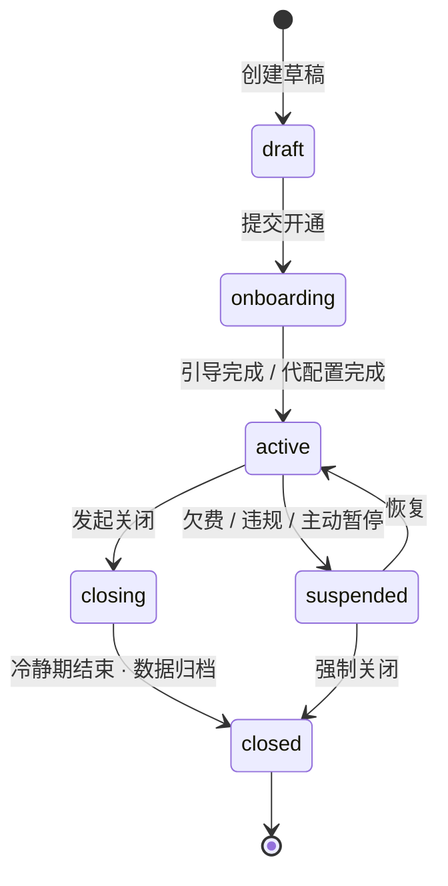
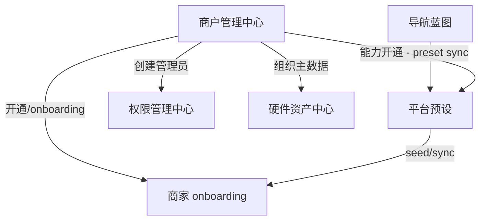

# M 平台 · 入驻商户管理中心 — 设计方案

> 版本：V1.1 · 2026-10-21；职责：产品范围与业务决策权威。
> 状态：本次品牌权限方案已确认，功能分支本地演示验收通过；生产服务未接入。
> 配对：[研发交付版 V1.0](./M平台-入驻商户管理中心业务规格说明书（研发交付版）.md) · [个人规范版 V1.0](./M平台-入驻商户管理中心需求文档（个人规范版）.md)。
> 共同业务基线：用户确认的品牌、门店、角色、账号四层模型；变更编号 BRAND-ACCESS-20261021-01。
> 本次实现基线：main@f848526b，codex/brand-menu-access-20261021；本次获授权提交并合入本地 main。

## 版本记录

| 版本 | 日期 | 变更 | 配对版本 |
| --- | --- | --- | --- |
| V1.1 | 2026-10-21 | 明确品牌菜单上限、门店双入口配置、品牌 Admin、逐角色门店绑定；优化品牌创建和配置交互 | 研发 V1.0 / 个人 V1.0 |
| 草案 v1 | 历史 | 入驻商户全生命周期和组织治理初稿；未在本次确认的后续能力仍属于历史建议 | 原无配对文件 |

---

## 1. 背景与定位

### 1.1 现状与本次问题

当前原型已具备 M 平台品牌列表、门店列表、组织主数据、品牌/门店能力配置及商家权限工作台。本次把分散入口整理为品牌创建、品牌菜单、所属门店、账号与角色的连续流程，明确菜单开通与人员授权的边界。

旧方案里“Merchant 内再建 Brand”的概念与当前入驻品牌页面不一致，本次以第 2 节已确认模型统一。旧生命周期、硬件、申请流程不因本次重设计自动重构。生产接口和凭据服务仍属于未接入能力。

### 1.2 企业视角的核心诉求

M 平台面向 **软件服务商 / 餐饮集团总部**，需要管理其名下的 **入驻商户（Tenant / Merchant）**：

| 场景 | 典型问题 |
|------|----------|
| **商户开通** | 新签约客户如何开户、选业态产线、分配初始管理员？ |
| **商户治理** | 哪些商户在营、暂停、已关闭？合同与 License 是否有效？ |
| **连锁扩张** | 某连锁品牌下如何批量开新店、挂区域、启用统一菜单/支付？ |
| **能力开通** | 该品牌能用 Kiosk / 会员 / 报表吗？开通了哪些增值服务？ |
| **合规与审计** | 谁开通/修改/关闭了哪家店？变更是否可追溯？ |

### 1.3 模块定位

沿用 M 平台现有 **「品牌管理中心」**，与现有模块关系：

```
M 平台
├── 菜单路由配置      → 定义「系统能有什么」
├── 平台预设          → 定义「默认开放什么」（业态×产线×四级树）
├── 商户管理中心      → 定义「谁可以用、开哪些店、启用什么」  ← 本方案
├── 权限管理中心      → 定义「企业运营人员谁能管什么」
└── 硬件资产中心      → 定义「设备资产跨商户怎么看」
```

**边界**：

- **M 平台**：商户主数据、生命周期、能力/服务开通、连锁组织树、代入驻与批量治理
- **商家后台**：单商户内日常经营配置（菜单、员工、单店参数）；继承 M 平台下发的范围，可局部覆盖预设可见性

---

## 2. 概念模型

### 2.1 本次有效组织模型

M 平台菜单路由定义平台已有的后台功能。集团包含品牌，品牌包含门店；品牌账号属于一个品牌，角色在该品牌内复用。现有代码中的 EnterpriseMerchant 对应本次页面上的入驻品牌；不是再新增一层同名 Brand 租户。原 MerchantOrgBrand/Region 保留兼容与区域组织信息，不在本流程重复要求运营选择第二个品牌。

| 关系 | 定义 |
| --- | --- |
| 品牌—门店 | 门店归属，与哪个账号能够管理门店分离；门店 MID 保持稳定 |
| 品牌—菜单 | 品牌获准使用的功能上限，从菜单路由中选择；不是菜品菜单 |
| 门店—菜单 | 本店实际开通范围，不得超出品牌上限；未配置默认关闭 |
| 品牌—角色 | 品牌内复用的岗位定义，包含菜单、内容、设置与操作权限 |
| 账号—角色—门店 | 每一次角色分配都有自己的生效门店；禁止将所有角色与所有门店交叉组合 |

### 2.2 生效规则

普通账号在某店的权限 = 品牌开通范围 ∩ 门店开通范围 ∩ 该账号在该店生效的角色权限。仍保留既有发布、产线、订阅等限制。普通账号品牌视角可查看其至少一家授权门店可用的页面，业务数据范围按当前页面再次裁剪；跨店操作只能在全部目标店均授权时执行。

品牌 Admin 是明确的账号身份：品牌视角看到全部所属门店及品牌菜单，自动覆盖后续加入的门店；切换门店业务视角后遵守该店菜单开通范围。普通账号不能编辑门店开通、品牌账号或品牌角色。

### 2.3 开通分工

| 配置 | M 平台运营 | 品牌 Admin |
| --- | --- | --- |
| 品牌资料及门店归属 | 在既有运营权限范围维护 | 查看 |
| 品牌菜单上限 | 维护 | 查看，不能扩大 |
| 各店菜单 | 维护 | 维护，同一份配置 |
| 品牌账号、角色及生效门店 | 代配置并留痕 | 维护 |

运营普通关闭与 Admin 普通关闭具有相同配置语义。未新增隐藏的平台锁定规则。

---

## 3. 商户生命周期

### 3.1 状态机



| 状态 | 说明 | 商家后台 |
|------|------|----------|
| `draft` | 销售/运营录入基本信息，未激活 | 不可登录 |
| `onboarding` | 待完成业态产线选择或 M 平台代配置 | 仅初始管理员可进 `/onboarding` |
| `active` | 正常营业 | 全功能（在能力开通范围内） |
| `suspended` | 暂停服务 | 只读或禁止登录（策略可配置） |
| `closing` | 关闭中，数据导出窗口 | 只读 |
| `closed` | 已关闭，数据归档 | 不可登录 |

### 3.2 开通方式

新建品牌采用三步：品牌信息 → 选择所属门店 → 开通品牌菜单。确认前展示集团、门店数、菜单节点数；全部校验后创建。账号开通独立进行，创建成功进入账号与角色页，先开通品牌 Admin，再建立角色、开通普通账号并逐次分配角色及门店。

可关联同集团可挂接的独立门店；无候选时允许创建零店品牌，后续继续关联。关联保持 MID，新的品牌归属下门店菜单默认关闭。已有其他品牌归属的门店不通过普通勾选直接转移。本轮不新增跨品牌迁移流程。

旧自助入驻、POS 申请及生命周期入口保留，不自动批量修改既有账号与角色数据。

---

### 3.3 关闭与合规

- **关闭前检查**：未结账单、活跃 License、硬件在线、子账号
- **冷静期**：默认 30 天只读，允许数据导出
- **审计**：开通/暂停/关闭/能力变更写入 `MerchantChangeLog`（对齐权限中心 change-log 模式）

---

## 4. 所属门店与双入口菜单管理

M 平台：品牌列表 → 所属门店 → 配置菜单。商家后台：品牌 Admin → 门店管理 → 所属门店 → 配置菜单。两个入口读取与更新同一份门店配置。

支持按名称/MID 搜索、勾选门店、逐店配置、批量增量开通及批量替换。批量默认增量，保留各店原有菜单；替换要求在预览中逐店列出关闭项。取消不写入，保存失败保留选择。候选店归属、品牌上限或门店配置已变化时，旧版本保存失败，运营保留草稿后刷新重试。

品牌页可查看门店状态、已开通页面数、最近修改时间与操作人。零菜单展示未开通，不等同于门店停业。

集团、区域与历史组织树保持既有入口，本轮不新增拖拽换归属。

---

## 5. 品牌菜单上限与人员授权

品牌菜单来自当前菜单路由，按已选择产线合并可选节点。目录勾选级联选择现有下级，单选下级补齐必要父目录；取消目录移除其下级。目录不与页面混合计入已开通页面数。

新授权保存为显式节点与资源身份快照。品牌新增菜单后 Admin 品牌视角可见，门店不自动开通；新增路由不自动授予既有品牌。清空品牌菜单后保持关闭，不回填默认服务。历史未显式配置的品牌保留既有默认与兼容行为，首次编辑时展示实际解析结果供确认。

收回品牌菜单前展示增减项及受影响门店；保存后裁剪各店超出上限的菜单，原角色授权保留审计记录但不越过上限。再次给品牌开通不自动恢复各店已裁剪项。

角色在品牌内维护，同名重复校验；可分别配置页面、内容、设置只读/可编辑和已注册的操作。账号分配角色时必须选择至少一家本品牌门店。示例：张三的店长角色仅在 A/B 店有效，财务角色仅在 C 店有效，张三不能在 C 店凭店长角色使用订单。

新品牌先显式开通账号，首次登录使用品牌配置，不重新执行商家自选功能引导。普通账号停用后不能登录且已有会话不继续获得授权。必须保留至少一名启用的品牌 Admin；密码与登录约束沿用当前演示登录契约。

---

## 6. 信息架构与页面设计

### 6.1 M 平台侧栏结构

```
商户管理中心                    ← 一级（可折叠）
├── 总览                      /m-platform/merchants/overview
├── 商户列表                  /m-platform/merchants
├── 组织树                    /m-platform/merchants/org-tree
├── 能力与服務                /m-platform/merchants/capabilities
├── 开通申请 / 待办           /m-platform/merchants/requests
└── 变更记录                  /m-platform/merchants/change-log
```

### 6.2 总览 Dashboard

- KPI：入驻商户总数、在营 / 暂停 / 关闭、本月新开 / 关闭、即将到期 License
- 地图或区域分布：按区域统计门店数
- 待办：待审核开通申请、onboarding 未完成、合同即将到期
- 快捷入口：新建商户、批量开新店

**路由**：`/m-platform/merchants/overview`

### 6.3 品牌列表

品牌名称/BID、品牌状态、所属集团、品牌已开通页面数、所属门店数、主管理员、开通时间、账号与角色及代登录入口。品牌状态与菜单配置状态独立展示。

### 6.4 品牌详情

基本信息 / 所属门店 / 品牌菜单 / 账号与角色 / 变更记录。商家 Admin 的门店管理页提供所属门店、品牌菜单、账号与角色、变更记录，品牌菜单只读，门店归属只读。

### 6.5 品牌创建与配置弹框

三步创建保留输入；只在真实编辑后提示放弃修改。菜单弹框为分类侧栏、搜索、层级勾选、已选数量、变更预览和固定底部操作。角色弹框区分菜单与页面操作；账号弹框按每次角色分配展示独立门店选择。每次保存先预览，再确认提交。

---

### 6.6 组织树视图（跨商户）

- 左：Enterprise 下 Merchant 列表
- 中：选中 Merchant 的品牌 → 区域 → 门店树
- 右：节点详情 + 快捷操作（开新店、复制模板、变更状态）

**路由**：`/m-platform/merchants/org-tree`

---

## 7. 数据模型（草案）

### 7.1 本次新增与复用对象

具体字段、默认值、持久化与测试算例见配对研发版。复用 EnterpriseMerchant、MerchantOrgStore 和 MerchantCapabilitySnapshot；新增品牌隔离的 BrandAccessState，包含品牌内角色、账号、逐角色门店绑定和审计。菜单上限、门店配置与账号授权不存入同一个混合角色对象。

本地演示使用 localStorage；账号密码沿用当前原型的本地演示机制，不代表已上线凭据服务。生产接口、服务端鉴权、密码哈希和跨设备同步仍未接入。

---

### 7.2 与现有模型的映射

| 现有（演示） | 升级后 |
|--------------|--------|
| `DEMO_SCOPE_BRANDS` | `MerchantOrgBrand` 聚合 |
| `DEMO_SCOPE_REGIONS` | `MerchantOrgRegion` 聚合 |
| `DEMO_SCOPE_STORES` | `MerchantOrgStore` 聚合 |
| `PlatformPresetContext` session | 增加 `merchantId`；按商户隔离 sessionStorage |
| `enterprise-hardware-store` 门店 | 设备增加 `merchantId`，scope 从组织主数据读取 |
| `StaffStoreAccess` | 企业运营人员：`mode: merchants` + merchantIds |

### 7.3 存储与 API（分期）

| 阶段 | 存储 | 说明 |
|------|------|------|
| **P0 演示** | `menusifu:enterprise-merchants-demo-v1` | localStorage + 种子数据 3～5 个商户 |
| **P1** | REST `/api/enterprises/{eid}/merchants` | 主数据 CRUD |
| **P2** | 与 License / 计费系统对接 | 到期自动 suspended |

---

## 8. 权限与安全

### 8.1 M 平台 RBAC 扩展

在企业 RBAC 四级树中新增 **商户管理中心** 节点，权限粒度建议：

| 权限 | 说明 |
|------|------|
| `merchants:read` | 查看商户列表与详情 |
| `merchants:create` | 新建商户 |
| `merchants:update` | 编辑基本信息、组织 |
| `merchants:capability` | 能力与服務开通 |
| `merchants:lifecycle` | 暂停 / 恢复 / 关闭 |
| `merchants:impersonate` | 代登录商家后台（强审计） |

**数据范围**：Enterprise Staff 的 `storeAccess` 扩展为可限定 **可管理的 merchantIds**（类似现有 brand/region/store）。

### 8.2 代登录（Impersonate）

- M 平台运营点击代登录，沿用当前本地演示会话；新品牌需先有已启用 Admin。生产短期 token 服务未接入。
- 商家后台顶栏显示「代管模式 · 操作人 xxx · 退出」
- 所有写操作写入审计日志

---

## 9. 与现有模块集成



| 集成点 | 行为 |
|--------|------|
| **平台预设** | 保留既有发布/订阅/预设过滤；品牌菜单开通另外写入显式上限，不以默认预设替代品牌授权 |
| **导航蓝图** | 能力池上限不超过蓝图已发布节点 |
| **权限管理** | 新品牌显式开通品牌 Admin；既有管理员保留原登录方式，不向普通账号自动绑定超管 |
| **硬件资产** | scope 筛选改为 Enterprise → Merchant → Brand/Region/Store |
| **onboarding** | 本次显式开通账号直接采用品牌配置；旧自助入驻仍沿用原流程 |

---

## 10. 历史分阶段实施建议（保留，不作为本次新增承诺）

### P0 · 可演示闭环（建议 2～3 周）

- M 平台侧栏「商户管理中心」+ 总览 + 商户列表 + 商户详情（基本信息 / 组织 / 能力只读）
- localStorage 种子：3 商户（单店×1、连锁×2）、组织树、能力快照
- 新建商户向导（代开通，写 localStorage）
- 状态：draft → active → suspended（手动切换）
- 与现有 `DEMO_SCOPE_*` 对齐或逐步替换

### P1 · 组织与能力联动

- 组织树 CRUD + 批量开新店
- 能力与服務 Tab：combo + 增值服务勾选 → 触发 `syncEnterprisePresetsToMerchant(merchantId)`
- 变更记录 Tab
- 硬件资产中心按 merchantId 筛选

### P2 · 生命周期与审计

- onboarding 联动（邀请邮件演示）
- 关闭流程 + 冷静期
- 代登录商家后台 + 审计
- 开通申请 / 待办队列

### P3 · 生产化

- REST API + 多 Enterprise 隔离
- License / 计费到期自动 suspended
- 与 CRM / 合同系统对接
- 商户级报表与 SLA 看板

---

## 11. 路由与存储键（建议）

| 路由 | 页面 |
|------|------|
| `/m-platform/merchants/overview` | 总览 |
| `/m-platform/merchants` | 商户列表 |
| `/m-platform/merchants/new` | 新建向导 |
| `/m-platform/merchants/:merchantId` | 商户详情 |
| `/m-platform/merchants/org-tree` | 组织树 |
| `/m-platform/merchants/capabilities` | 能力模板 / 增值包管理 |
| `/m-platform/merchants/change-log` | 变更记录 |

| 存储键（演示） | 内容 |
|----------------|------|
| `menusifu:enterprise-merchants-v1` | Merchant + 组织树 |
| `menusifu:brand-access:v1:<merchantId>` | 品牌账号、角色、门店绑定与审计 |
| `menusifu:enterprise-merchants-v1` 内 capabilities / storeCapabilities / changelog | 品牌菜单、门店菜单与变更日志 |

---

## 12. 非目标（本阶段不做）

- 商户自助注册门户（C 端签约）
- 完整计费 / 发票 / 合同 PDF（仅预留字段）
- 替代商家后台内的日常经营配置
- 单浏览器多 Merchant 真实数据隔离（演示期可模拟切换 context）

---

## 13. 相关文档

| 文档 | 关系 |
|------|------|
| [M平台-企业级平台预设设计方案.md](./M平台-企业级平台预设设计方案.md) | L0 能力池、sync 机制 |
| [平台预设-产品需求与设计说明.md](./平台预设-产品需求与设计说明.md) | 商家运行时过滤 |
| [导航维度-连锁与单店.md](./导航维度-连锁与单店.md) | orgTier、scope、侧栏维度 |
| [M平台-企业级硬件资产中心设计方案.md](./M平台-企业级硬件资产中心设计方案.md) | 跨门店设备与组织 scope |
| [门店管理-设置二级导航重设计方案.md](./门店管理-设置二级导航重设计方案.md) | 商家侧门店档案 |

---

## 14. 小结

**商户管理中心** 补齐 M 平台从「配置中心」到「租户运营中心」的关键一环：

1. **管谁**：Enterprise 下所有入驻 Merchant 与组织树（品牌 / 区域 / 门店）
2. **怎么开**：账号开通 + 组织开通 + 能力开通，支持代开通与连锁批量
3. **怎么管**：生命周期状态机、能力与服務、平台预设联动、审计与代管
4. **怎么衔接**：复用现有平台预设 sync、RBAC 双轨、scope 模型与 onboarding，仅新增 Merchant 主数据层与 M 平台 UI

建议 **P0 优先落地商户列表 + 详情 + 组织树演示数据**，与硬件资产中心、企业 RBAC 共用同一套组织主数据，避免 demo scope 多处硬编码。

## 本次交付验证

- TypeScript、品牌授权领域断言、岗位门店范围回归、订阅默认导航、订阅服务、递归导航及宿主 Vite 构建通过。
- 浏览器覆盖创建品牌、三店关联、开通 Admin、分店角色分配、批量增量/单店菜单、Admin 实际登录、双入口保存、并发冲突、刷新保持、普通账号与窄屏布局；实际结果见 `assets/brand-menu-access/verification.json`。
- 既有 `verify-permission-center.ts` 在 `/team/shift-scheduling` 断言失败；在干净 main@f848526b 重现相同结果，未作为本次回归修复。
- 本次获授权提交并合入本地 main，未授权推送；CI、生产鉴权和嵌入子应用内部权限未在本轮验收。
