# M 平台入驻商户管理中心需求文档（个人规范版）

> V1.53 · 2026-10-28 · MERCHANT-CREATE-20261028-57
> 配对：[产品 V1.54](./M平台-入驻商户管理中心设计方案.md) · [研发 V1.53](./M平台-入驻商户管理中心业务规格说明书（研发交付版）.md) · [个人规范 V1.53](./M平台-入驻商户管理中心需求文档（个人规范版）.md)
> 职责：当前业务定义与字段规则；验证、变更及交付缺口独立记录。

## 创建品牌

### 品牌管理 创建入口

图注：商户管理中心→品牌管理，codex/merchant-center-labels-20261028，main@e24e492f，5252隔离演示。

| 字段／操作 | 逻辑说明 |
| --- | --- |
| 新建品牌 | 位于重置后方，与查询操作保持独立间距；进入/m-platform/merchants/new全屏创建向导。需品牌页面编辑权限，不经过开通申请或审批。 |
| 创建对象 | 在当前Enterprise和所选集团下直接创建品牌。默认演示数据继续保留；品牌创建与管理员账号开通、品牌服务启用是不同操作。 |

### 品牌信息

图注：同一分支5252实采；第一步默认表单。用途：录入品牌资料和适用业态／产线。

| 字段／操作 | 逻辑说明 |
| --- | --- |
| 品牌名称 | name，必填，去首尾空格，最多60字；不作为唯一身份。 |
| 所属集团 | groupId，必选；来源当前Enterprise集团，决定候选门店范围。 |
| 品牌编码 | code，可空；空值由创建方法自动生成。 |
| 联系人 | contactName，必填，最多30字。 |
| 联系电话 | contactPhone，可空；不等同登录账号。 |
| 时区 | timezone，默认Asia/Shanghai，可选America/New_York、America/Los_Angeles。 |
| 经营业态 | businessTypeIds，至少一项，来源当前业态配置。 |
| 产线 | productLineIds，至少一项，POS默认选中；切换后菜单树按适用范围刷新。 |
| 下一步 | 校验品牌名称、集团、联系人、业态和产线，成功进入选择门店；失败留在当前步骤并提示，不写品牌记录。 |

### 选择品牌门店

图注：第二步，同一分支5252实采；当前原型可提供集团下演示候选门店，不代表已连接外部开通服务。

| 字段／操作 | 逻辑说明 |
| --- | --- |
| 搜索门店 | 按门店名称、MID、地址和邮编过滤当前集团候选项；过滤不写品牌、不改变勾选。 |
| 勾选门店 | 可不选；已选门店创建后关联品牌且保留MID，新菜单配置按inherit继承品牌门店视角范围。 |
| 上一步 | 返回品牌信息并保留草稿。 |
| 下一步 | 进入开通品牌菜单，暂不创建品牌；实际提交仍校验门店归属，拒绝不合法关联。 |

### 开通品牌菜单

图注：第三步，同一分支5252实采。菜单来源为M平台菜单路由配置的适用目录。

| 字段／操作 | 逻辑说明 |
| --- | --- |
| 菜单树与全选 | 沿用公共菜单选择器，父子级联、分类全选及全部全选；只保存实际选择，不自动扩大授权。 |
| 核对创建信息 | 校验路由版本和基本资料后打开独立弹框；未确认前不写品牌。无菜单可创建，但品牌服务启用仍受菜单就绪条件约束。 |

### 核对创建信息弹框

图注：同一分支5252实采；展示待创建品牌及已选菜单树，不属于审批或申请审核。

| 字段／操作 | 逻辑说明 |
| --- | --- |
| 品牌资料 | 逐项展示名称、集团、编码或自动生成、联系人、电话、时区、业态和产线。 |
| 门店清单 | 展示已选门店名称、MID、地址和邮编；零门店显示未选择门店。 |
| 菜单清单 | 按树状层级展示已选项，保留分组及页面归属。 |
| 返回修改／关闭 | 关闭核对弹框，保留向导输入与勾选，不写入。 |
| 确认创建品牌 | 防重复提交，重新校验路由版本、资料及归属；调用createMerchant直接创建。orgType=chain、accountProvisioningRequired=true、activateImmediately=false、primaryAdminEmail为空，不自动生成Admin或发送邀请邮件。 |
| 失败 | 留在弹框，显示错误并保留草稿，不宣称创建成功；路由版本变化要求刷新重选。 |

### 创建成功与取消结果

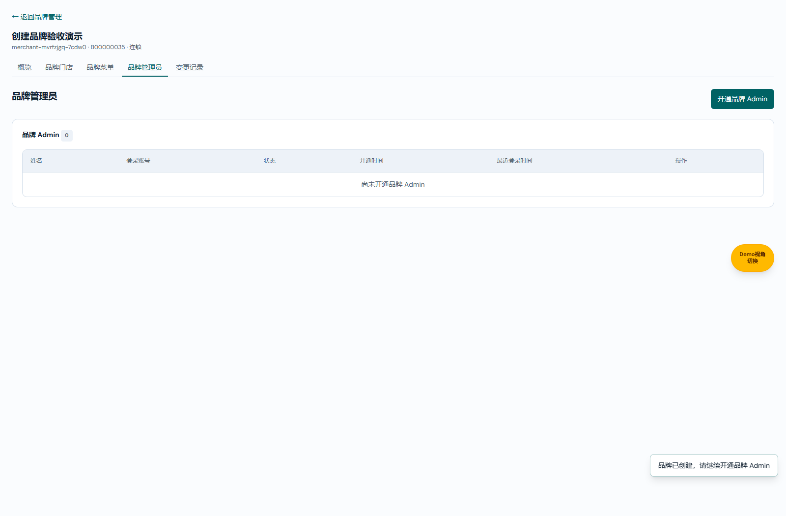

图注：确认成功后进入新品牌的品牌管理员页；仅创建隔离演示资料。品牌状态为待启用，需另行开通Admin及启用服务。

图注：有输入时返回品牌管理，原生确认选择放弃后的实际列表；原生confirm不在页面截图内，不用结果图冒充原生弹框截图。

| 字段／操作 | 逻辑说明 |
| --- | --- |
| 成功目标 | /m-platform/merchants/{merchantId}/accounts，提示品牌已创建并继续开通品牌Admin；生成品牌ID、BID、创建记录和选择的菜单／关联。 |
| 离开未保存表单 | 提示“有未保存的品牌配置，是否放弃并离开？”；确认离开不创建品牌，取消离开保留路由及草稿。 |
| 申请边界 | requests页面及普通／POS申请提交、批准、驳回继续关闭。直接创建品牌不增加requests或posStoreRequests记录。 |

## 商户管理中心导航

图注：M平台导航，codex/merchant-center-labels-20261028，main@e24e492f，5252隔离演示；页面及名称来自实际运行截图。

| 元素 | 逻辑说明 |
| --- | --- |
| 商户管理中心 | M平台模块入口及子导航标题；包含集团、品牌、门店、组织树、报表和变更记录。权限目录使用同一名称。 |
| 品牌管理 | 点击进入品牌管理页面，地址/m-platform/merchants。资源ID仍为brands，不迁移已保存角色授权。 |
| 门店管理 | 点击进入门店管理页面，地址/m-platform/merchants/stores。资源ID仍为stores，保留筛选、详情及代登录。 |
| 返回上一级 | 仅退出当前子导航层，保留原有公共菜单交互与权限过滤，不写业务数据。 |

### 品牌管理入口与页面

图注：同一分支与5252隔离演示。入口为商户管理中心→品牌管理，页面所属模块显示商户管理中心，页标题为品牌管理。

| 元素 | 逻辑说明 |
| --- | --- |
| 页面标题 | 品牌管理；筛选、列表和详情操作沿用本文品牌管理定义。 |
| 权限访问 | 使用既有merchants模块及brands页面资源；改名不授予或撤销权限。失败及受限表现按公共权限规则。 |

### 门店管理入口与页面

图注：同一分支与5252隔离演示。入口为商户管理中心→门店管理，页标题为门店管理。

| 元素 | 逻辑说明 |
| --- | --- |
| 页面标题 | 门店管理；筛选、门店详情和代登录沿用本文门店管理定义。 |
| 权限访问 | 使用既有stores页面资源；已保存授权、路由、默认演示数据和服务状态不因名称而变化。导航无保存或取消步骤。 |

## 外部开通与 M 平台管理边界 MERCHANT-EXTERNAL-20261027-55

用户确认：商户开通由其他平台完成，M平台不设置开通申请、申请审批或待办流程；品牌管理支持直接创建品牌，当前原型同时保留默认演示品牌和门店。外部平台对接协议、同步任务和真实开户接口未在本次实现，不得将演示预设描述为已接入外部平台。

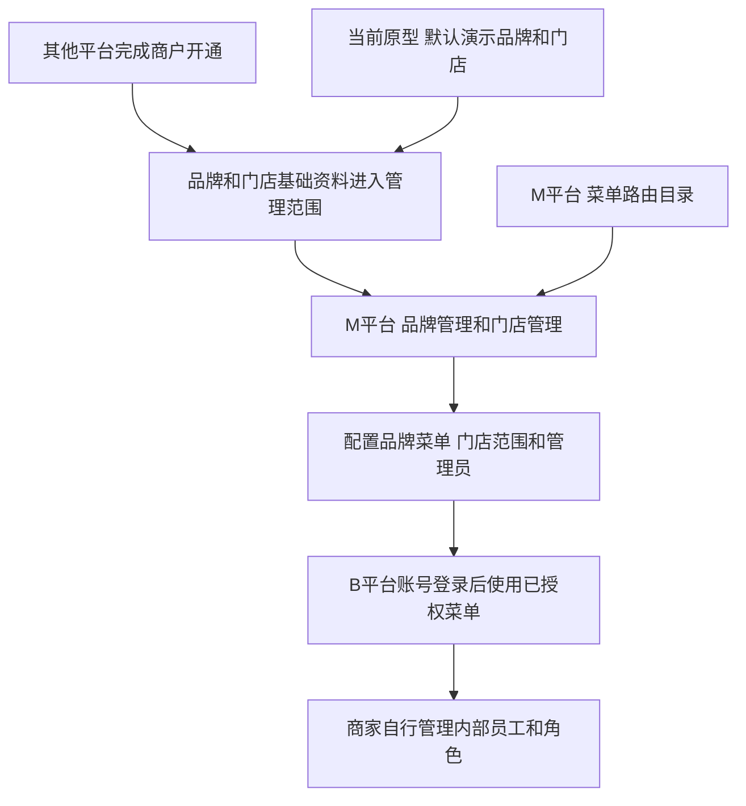

图注：业务责任关系。A到B是外部边界说明，不表示当前原型已完成数据同步；原型来源为D。其余既有M/B授权分层的未实现项仍按原待确认项管理。

### 品牌管理页面 当前入口与操作

图注：功能分支codex/merchant-remove-requests-20261027，基线main@64ddec8f，5251隔离浏览器实采；默认演示数据，不是生产商户资料。

用途：检索和管理已经存在的品牌。入口为M平台→商户管理中心→品牌管理。

| 字段／操作 | 逻辑说明 |
| --- | --- |
| 品牌数据来源 | 当前为原有默认演示预设。继续展示品牌名称、BID、集团、服务状态、菜单、门店和管理员；读取已有本地保存数据，不因撤下申请流程而重建或清空品牌。 |
| 筛选与查询 | 原有集团、服务状态、进度、品牌菜单、门店、日期和关键词筛选继续使用；查询、重置仍按现有权限。未修改只读筛选限制G05。 |
| 新建品牌 | 品牌管理中直接进入创建向导，完成核对后创建品牌；不生成申请或待办。 |
| 详情 | 打开当前品牌概览，保留品牌门店、品牌菜单、品牌管理员和变更记录页签。 |
| 品牌菜单 | 继续在菜单路由配置的资源范围内授予或关闭菜单；这是权限配置，不是商户开通申请。保留新增／关闭预览。 |
| 品牌管理员 | 保留已有账号管理及开通管理员账号；账号启停、密码重设与品牌商户开通是不同对象。本次不移除此功能。 |
| 服务状态 | 继续管理已有品牌服务启用、暂停、恢复和关闭。待启用等状态代表服务可用性，不生成开通申请。 |
| 代登录 | 沿用权限、品牌服务状态及Loading提示，进入该品牌商家后台；不触发申请审批。 |

### 门店管理页面 默认演示资料

图注：同一功能分支与5251隔离实采。进入页面不创建POS申请；门店MID、归属和既有菜单配置继续保留。

| 字段／操作 | 逻辑说明 |
| --- | --- |
| 默认门店 | 使用现有演示预设及已保存门店。首次补齐沿用既有预设规则；已有独立配置、显式空菜单、管理员和状态不由本次删除流程覆盖。 |
| 门店归属 | 集团、品牌/BID、门店/MID各自保留；品牌下关联已有门店继续使用，不创建新的外部开通申请。 |
| 详情 | 进入门店概览，保留门店菜单和清晰变更记录。 |
| 菜单配置 | 继承模式取品牌菜单与门店视角交集；独立模式沿用保存范围与版本校验。本次不改变M/B共用菜单对象的既有差距。 |
| 代登录 | 保留门店维度代登录及既有状态限制。 |

### 总览与导航 移除申请及待办

图注：总览保留统计、报表、品牌和门店管理入口；申请快捷入口、待办队列和查看全部待办不显示；创建入口位于品牌管理页面。

| 字段／操作 | 逻辑说明 |
| --- | --- |
| 商户管理中心侧栏 | 删除开通申请／待办菜单项；保留总览、集团管理、品牌管理、门店管理、组织树、报表和变更记录。权限目录不再配置requests页面及approve/reject操作。 |
| 申请页面 | 不再展示普通品牌申请、模拟POS申请、提交、通过、驳回、待审核或最近处理记录。不是仅隐藏导航后保留审批页。 |
| 旧地址 | requests及其子路径使用replaceState规范到品牌总览，不新增浏览历史循环，不显示旧表单；总览仍执行M权限检查，不能借重定向提升权限。 |
| 既有审计 | 历史记录原样保留；历史request.submit、request.reject、pos-store等事件不代表当前仍开放这些流程。 |

### 旧地址访问后的实际结果

图注：直接访问旧requests地址后，地址栏规范为overview；不渲染申请表单、审批按钮。/new地址进入创建向导。

图注：B总部账号访问旧申请地址的实际M权限受限结果，5251隔离演示；未使用原品牌Admin冒充服务商账号。

| 字段／操作 | 逻辑说明 |
| --- | --- |
| 正常结果 | 有总览访问权限的M用户看到总览，无申请写入；不创建品牌、门店或管理员。 |
| 无权限 | 使用现有mCanVisit判断目标总览；无权限显示访问受限，不放宽权限或自动分配角色。 |
| 取消与失败 | 此导航没有确认弹框或写入步骤，无保存／取消分支。浏览器加载失败沿用页面基础错误表现，不伪造成功同步提示。 |

### 数据与兼容字段 研发同步定义

| 字段／方法 | 逻辑说明 |
| --- | --- |
| requests | 历史本地快照中的申请数组，可存在旧记录；新预设为空数组。撤下功能不批量删除已有记录，不再用它生成申请待办。 |
| posStoreRequests | 同上，保留兼容字段；新预设为空，不自动产生待审POS门店。 |
| 提交／批准／驳回方法 | 六个旧写入方法统一抛出“商户开通由外部平台完成，M 平台不再支持开通申请或审批。”；不更新快照、申请状态、处理时间或创建商户。仅为旧调用失败保护，业务UI已移除。 |
| createMerchant | 保留底层演示／兼容构造能力供已有内部代码使用，供M品牌管理创建向导直接保存；不据此声称已建立外部创建接口。 |
| 默认演示补齐 | ensureBrandStoreDemoPresets及原有brandStoreDemoVersion、brandStoreDemoFresh规则继续使用；不新增清缓存、重置或生产迁移要求。 |
| 外部对接 | 外部平台、业务单号、同步状态、来源时间、幂等键和错误重试均未新增字段或接口，暂不在原型虚构。后续对接另行定义。 |

### 验收与未闭合项

1. 三个主页面正常显示默认演示数据；侧栏、总览及品牌管理无申请入口，品牌管理保留新建品牌。
2. requests及申请子路径回总览，new进入创建品牌，无申请表单和审批按钮；目标页继续按M权限控制。
3. 六个历史申请写入调用均失败，调用前后快照一致；首次默认申请数组为空。
4. 默认前三品牌继续具备管理员、菜单和关联门店；已有保存状态与菜单不因本次移除流程覆盖。
5. 菜单、管理员、服务启停、门店关联和代登录仍按原规则，不把品牌创建与管理员账号创建混为同一功能。
6. 真实外部同步、生产认证及M/B权限数据统一仍未实现。此前Q06“三条创建入口是否统一”因申请流程已取消且直接创建品牌保留而关闭，不再作为待确认项；其他未确认规则仍保留。

本轮逐操作证据与测试：[本轮核验记录](../verification/merchant-remove-requests-20261027/result.json)。旧143项清单是上一轮证据，其中申请操作作废，创建流程以本节实采与定义为准；不将旧截图计为当前申请流程验收。创建核对弹框见创建品牌章节；申请确认／取消页面不提供。

## 上一轮逐操作规范更新 MERCHANT-OPS-20261027-54

本轮按DOC-OP-SCREENSHOT-20261022-01执行。源码基线main@64ddec8f，隔离功能分支codex/merchant-doc-operations-20261027，预览http://127.0.0.1:5250。使用prd-review核对业务、字段、页面与结果；仅修改文档及采集证据，不修改业务实现，也未操作生产数据。

上一轮逐操作采集覆盖品牌管理、三步创建、详情、申请和POS申请；申请流程不提供，创建流程按创建品牌章节执行。当前范围为既有品牌、门店及菜单／管理员／审计管理。门店管理和硬件资产仅覆盖从品牌业务到达的相关入口，其他外围模块不冒充已完成全量更新；B内部授权仍按目标及差距说明，不伪造尚未实现的界面。

### 复核新增事实

| 项目 | 当前main事实与文档口径 |
| --- | --- |
| M访问权限 | M平台有独立m:资源目录、服务商员工与角色。商家总部身份或B品牌Admin不自动拥有M权限；未绑定者实际显示暂无M平台访问权限。演示管理员走既有显式系统角色，不将演示兼容扩展为生产授权。 |
| 导航与页面名 | M导航、权限目录和页面所属模块统一为商户管理中心；品牌与门店入口分别为品牌管理、门店管理。 |
| 页面与独立操作 | 品牌页面访问、进入商家后台、CRM同步等还有独立M操作授权；页面可编辑不等于独立操作已授权。当前新旧控件选择器覆盖仍须实测，不宣称所有控件均被同粒度权限约束。 |
| 只读限制 | 专门验证currentMAccess(m:page:brands)=read后，页面显示只读提示，查询及重置被禁用。记录为实现偏差G05；不在需求中许诺当前只读账号筛选正常。 |
| 演示边界 | 提示“已发送邀请”实际写时间、日志及邮件预览；CRM同步为本地演示；不等于外部邮件、Salesforce或正式认证成功。 |
| 批量预览 | 同集合与差异集合均已实际采集；差异集合测试用第一店空配置、第二店继承构造，未修改产品代码；切换预览不改变保存门店集合。 |
| 异常证据 | 重复邮箱、非法域名、最后Admin保护、并发保存冲突、受控存储写入失败均有实际结果图。存储故障只证明本地失败保留输入，不证明生产事务。 |

### 截图覆盖清单与缺口

逐项清单：[覆盖清单](./品牌管理与商户入驻逐操作截图覆盖清单.md)，机器证据：[采集记录](../verification/merchant-doc-operations-20261027/coverage.json)。旧版按页面配图继续作为布局参考，本节逐操作图片是本轮新增证据。入口与结果图就近内嵌，不能用图册或图片文件存在代替操作覆盖。图片均保留整页上下文，不将隐藏原生提示仿制成网页截图。

本轮清单共143项：134项有入口及结果图，其余按原生层／校验气泡／入口过程限制标注。该统计仅指本清单，不代表所有业务组合全部覆盖。

| 编号 | 未完成项／限制 | 原因及交付处理 |
| --- | --- | --- |
| G01 | 浏览器原生prompt/alert/confirm | 已记录实际文案与确认/取消后果；页面截图不能呈现原生层，相关操作仅结果图覆盖，不声称原生对话框截图完整。 |
| G02 | 原生必填、长度及日期控件校验 | 截图保留提交后的页面；原生校验气泡不保证被页面截图捕获，不能以页面截图替代原生浮层。 |
| G03 | M/B分层目标尚未实现 | 两套商家角色状态统一、M门店上限与B内部启用范围拆分未实现，无目标态真实页面可截图。 |
| G04 | 生产或后端失败分支 | 本地原型不具备生产认证、真实邮件、Salesforce或后端鉴权证据；受控存储失败只证明本地异常处理。 |
| G05 | 只读筛选现状偏差 | 已验证currentMAccess=read，查询及重置disabled=true；与只读仍可浏览筛选的设计意图有差异，本次仅记录，不改代码。 |
| G06 | 共享组件与未逐一复现分支 | 本轮逐项清单覆盖本次列明操作；合同到期阻塞、Loading超时、每个弹框Esc/遮罩及所有业务组合未逐一复现，不凭共用代码推定全部覆盖。 |
| G07 | 无M权限访问的入口过程 | 采集实际受限结果页，未采集该账号完整登录过程；该项仅结果态覆盖。 |
| G08 | 敏感操作独立资源映射风险 | 新服务状态按钮与旧独立权限选择器对应需逐角色验证；本次未证明所有敏感操作均独立鉴权。 |

### 原生提示的文案与后果

| 场景 | 已知文案与后果 |
| --- | --- |
| CRM同步 | alert“CRM 合同已同步。”；仅表示本地演示调用完成。 |

### M入口、独立操作与只读实现边界

图注：未绑定M角色的商家总部演示账号直接访问品牌管理；仅结果态采集，完整登录过程未采集。

图注：受控M角色只读授权；readonly-state.json确认currentMAccess=read，查询／重置禁用。该图不是普通运营可编辑状态。

M权限来自menusifu:m-platform-permissions:v1，M资源以m:开头，与商家资源分开。currentMAccount依服务商员工账号及当前邮箱解析；默认演示登录仅复用既有ent001显式绑定，未知账号不自动获得权限。品牌详情落在brands页面范围，子页签不据此绕开页面权限。

独立操作映射是“资源目录声明＋控件选择器＋业务方法”共同链路：已核对M进入后台、CRM、申请通过／驳回等映射。新data-brand-service按钮与旧lifecycle独立资源选择器的对应并未完成逐角色拒绝测试，记为G08映射风险；不能把页面可编辑当作全部敏感操作已按独立权限校验。此任务不修改实现。

## 逐操作正文与就近截图

### 操作 m-no-access M平台入口 · 无M权限访问品牌管理

入口截图限制：采集实际受限结果页，未采集该账号完整登录过程；该项仅结果态覆盖。

图注：同一操作的实际界面／结果；非真实商户历史；状态：仅结果态G07。

| 字段／操作 | 逻辑说明 |
| --- | --- |
| 入口与前提 | 使用未绑定M角色的商家总部演示账号访问品牌管理路由 |
| 无M权限访问品牌管理 | 显示暂无M平台访问权限；不得仅凭商家总部身份进入M |
| 可见结果／提示 | 暂无 M 平台访问权限；请联系服务商管理员，为当前员工分配具有相应菜单权限的角色。 |
| 取消、关闭与异常 | 对本条实际触发的分支按截图及上述结果执行；其他分支必须查对应独立操作ID。未逐一复现的组合见G06，不据本图推定成功、失败、取消均已覆盖。 |

### 操作 filter-groupId 品牌管理 · 所属集团筛选

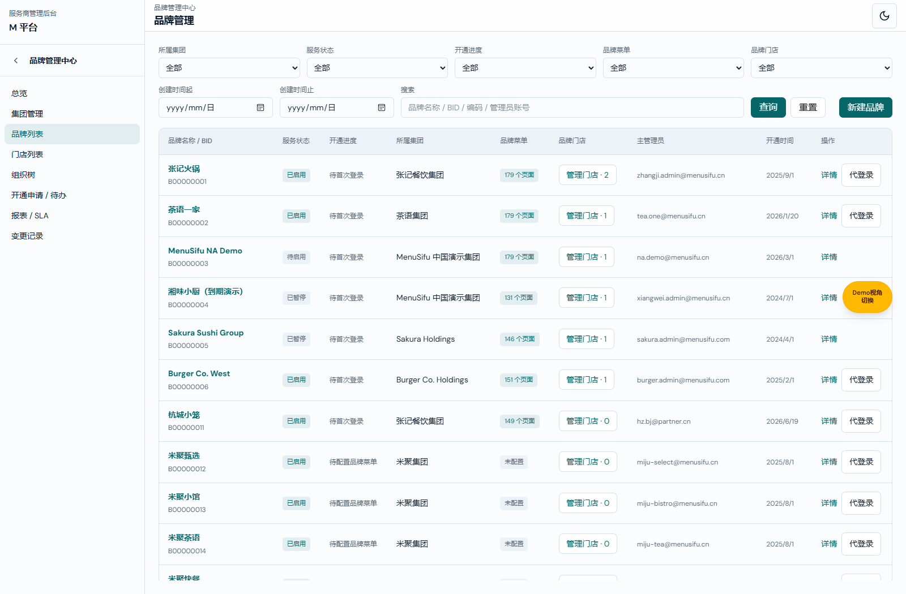

图注：品牌管理／所属集团筛选／触发前；main@64ddec8f，5250功能分支；隔离本地演示。

图注：同一操作的实际界面／结果；非真实商户历史；状态：入口及结果已采集。

| 字段／操作 | 逻辑说明 |
| --- | --- |
| 入口与前提 | 按页面当前可见操作进入 |
| 所属集团筛选 | 下拉即时应用，列表条件不写授权 |
| 可见结果／提示 | 已关闭 |
| 取消、关闭与异常 | 对本条实际触发的分支按截图及上述结果执行；其他分支必须查对应独立操作ID。未逐一复现的组合见G06，不据本图推定成功、失败、取消均已覆盖。 |

### 操作 filter-status 品牌管理 · 服务状态筛选

图注：品牌管理／服务状态筛选／触发前；main@64ddec8f，5250功能分支；隔离本地演示。

图注：同一操作的实际界面／结果；非真实商户历史；状态：入口及结果已采集。

| 字段／操作 | 逻辑说明 |
| --- | --- |
| 入口与前提 | 按页面当前可见操作进入 |
| 服务状态筛选 | 下拉即时应用，列表条件不写授权 |
| 可见结果／提示 | 已关闭 |
| 取消、关闭与异常 | 对本条实际触发的分支按截图及上述结果执行；其他分支必须查对应独立操作ID。未逐一复现的组合见G06，不据本图推定成功、失败、取消均已覆盖。 |

### 操作 filter-progress 品牌管理 · 开通进度筛选

图注：品牌管理／开通进度筛选／触发前；main@64ddec8f，5250功能分支；隔离本地演示。

图注：同一操作的实际界面／结果；非真实商户历史；状态：入口及结果已采集。

| 字段／操作 | 逻辑说明 |
| --- | --- |
| 入口与前提 | 按页面当前可见操作进入 |
| 开通进度筛选 | 下拉即时应用，列表条件不写授权 |
| 可见结果／提示 | 已关闭 |
| 取消、关闭与异常 | 对本条实际触发的分支按截图及上述结果执行；其他分支必须查对应独立操作ID。未逐一复现的组合见G06，不据本图推定成功、失败、取消均已覆盖。 |

### 操作 filter-menu 品牌管理 · 品牌菜单筛选

图注：品牌管理／品牌菜单筛选／触发前；main@64ddec8f，5250功能分支；隔离本地演示。

图注：同一操作的实际界面／结果；非真实商户历史；状态：入口及结果已采集。

| 字段／操作 | 逻辑说明 |
| --- | --- |
| 入口与前提 | 按页面当前可见操作进入 |
| 品牌菜单筛选 | 下拉即时应用，列表条件不写授权 |
| 可见结果／提示 | 已关闭 |
| 取消、关闭与异常 | 对本条实际触发的分支按截图及上述结果执行；其他分支必须查对应独立操作ID。未逐一复现的组合见G06，不据本图推定成功、失败、取消均已覆盖。 |

### 操作 filter-stores 品牌管理 · 品牌门店筛选

图注：品牌管理／品牌门店筛选／触发前；main@64ddec8f，5250功能分支；隔离本地演示。

图注：同一操作的实际界面／结果；非真实商户历史；状态：入口及结果已采集。

| 字段／操作 | 逻辑说明 |
| --- | --- |
| 入口与前提 | 按页面当前可见操作进入 |
| 品牌门店筛选 | 下拉即时应用，列表条件不写授权 |
| 可见结果／提示 | 已关闭 |
| 取消、关闭与异常 | 对本条实际触发的分支按截图及上述结果执行；其他分支必须查对应独立操作ID。未逐一复现的组合见G06，不据本图推定成功、失败、取消均已覆盖。 |

### 操作 filter-search 品牌管理 · 搜索查询

图注：品牌管理／搜索查询／触发前；main@64ddec8f，5250功能分支；隔离本地演示。

图注：同一操作的实际界面／结果；非真实商户历史；状态：入口及结果已采集。

| 字段／操作 | 逻辑说明 |
| --- | --- |
| 入口与前提 | 按页面当前可见操作进入 |
| 搜索查询 | 仅显示匹配品牌 |
| 可见结果／提示 | 已关闭 |
| 取消、关闭与异常 | 对本条实际触发的分支按截图及上述结果执行；其他分支必须查对应独立操作ID。未逐一复现的组合见G06，不据本图推定成功、失败、取消均已覆盖。 |

### 操作 filter-empty 品牌管理 · 搜索无匹配

图注：品牌管理／搜索无匹配／触发前；main@64ddec8f，5250功能分支；隔离本地演示。

图注：同一操作的实际界面／结果；非真实商户历史；状态：入口及结果已采集。

| 字段／操作 | 逻辑说明 |
| --- | --- |
| 入口与前提 | 按页面当前可见操作进入 |
| 搜索无匹配 | 显示暂无匹配品牌 |
| 可见结果／提示 | 已关闭；暂无匹配品牌 |
| 取消、关闭与异常 | 对本条实际触发的分支按截图及上述结果执行；其他分支必须查对应独立操作ID。未逐一复现的组合见G06，不据本图推定成功、失败、取消均已覆盖。 |

### 操作 filter-reset 品牌管理 · 重置

图注：品牌管理／重置／触发前；main@64ddec8f，5250功能分支；隔离本地演示。

图注：同一操作的实际界面／结果；非真实商户历史；状态：入口及结果已采集。

| 字段／操作 | 逻辑说明 |
| --- | --- |
| 入口与前提 | 按页面当前可见操作进入 |
| 重置 | 清空条件，恢复列表 |
| 可见结果／提示 | 已关闭 |
| 取消、关闭与异常 | 对本条实际触发的分支按截图及上述结果执行；其他分支必须查对应独立操作ID。未逐一复现的组合见G06，不据本图推定成功、失败、取消均已覆盖。 |

### 操作 filter-from 品牌管理 · 创建时间起查询

图注：品牌管理／创建时间起查询／触发前；main@64ddec8f，5250功能分支；隔离本地演示。

图注：同一操作的实际界面／结果；非真实商户历史；状态：入口及结果已采集。

| 字段／操作 | 逻辑说明 |
| --- | --- |
| 入口与前提 | 按页面当前可见操作进入 |
| 创建时间起查询 | 闭区间日期查询 |
| 可见结果／提示 | 已关闭 |
| 取消、关闭与异常 | 对本条实际触发的分支按截图及上述结果执行；其他分支必须查对应独立操作ID。未逐一复现的组合见G06，不据本图推定成功、失败、取消均已覆盖。 |

### 操作 filter-to 品牌管理 · 创建时间止查询

图注：品牌管理／创建时间止查询／触发前；main@64ddec8f，5250功能分支；隔离本地演示。

图注：同一操作的实际界面／结果；非真实商户历史；状态：入口及结果已采集。

| 字段／操作 | 逻辑说明 |
| --- | --- |
| 入口与前提 | 按页面当前可见操作进入 |
| 创建时间止查询 | 闭区间日期查询 |
| 可见结果／提示 | 已关闭 |
| 取消、关闭与异常 | 对本条实际触发的分支按截图及上述结果执行；其他分支必须查对应独立操作ID。未逐一复现的组合见G06，不据本图推定成功、失败、取消均已覆盖。 |

### 操作 filter-date-invalid 品牌管理 · 日期范围错误

图注：品牌管理／日期范围错误／触发前；main@64ddec8f，5250功能分支；隔离本地演示。

图注：同一操作的实际界面／结果；非真实商户历史；状态：入口及结果已采集。

| 字段／操作 | 逻辑说明 |
| --- | --- |
| 入口与前提 | 按页面当前可见操作进入 |
| 日期范围错误 | 起日大于止日报错，不应用 |
| 可见结果／提示 | 已关闭 |
| 取消、关闭与异常 | 对本条实际触发的分支按截图及上述结果执行；其他分支必须查对应独立操作ID。未逐一复现的组合见G06，不据本图推定成功、失败、取消均已覆盖。 |

### 操作 list-detail 品牌管理 · 详情

图注：品牌管理／详情／触发前；main@64ddec8f，5250功能分支；隔离本地演示。

图注：同一操作的实际界面／结果；非真实商户历史；状态：入口及结果已采集。

| 字段／操作 | 逻辑说明 |
| --- | --- |
| 入口与前提 | 按页面当前可见操作进入 |
| 详情 | 独立详情默认概览 |
| 取消、关闭与异常 | 对本条实际触发的分支按截图及上述结果执行；其他分支必须查对应独立操作ID。未逐一复现的组合见G06，不据本图推定成功、失败、取消均已覆盖。 |

### 操作 service-blocked 品牌概览 · 启用品牌受限

图注：品牌概览／启用品牌受限／触发前；main@64ddec8f，5250功能分支；隔离本地演示。

图注：同一操作的实际界面／结果；非真实商户历史；状态：入口及结果已采集。

| 字段／操作 | 逻辑说明 |
| --- | --- |
| 入口与前提 | 按页面当前可见操作进入 |
| 启用品牌受限 | 无Admin时阻止确认 |
| 操作原因 | 必填；控件最少2字；控件最多200字。实际保存约束另见当前字段字典，不把HTML控件属性当唯一业务校验。 |
| 取消、关闭与异常 | 对本条实际触发的分支按截图及上述结果执行；其他分支必须查对应独立操作ID。未逐一复现的组合见G06，不据本图推定成功、失败、取消均已覆盖。 |

### 操作 tab-org 品牌详情 · 品牌门店页签

图注：品牌详情／品牌门店页签／触发前；main@64ddec8f，5250功能分支；隔离本地演示。

图注：同一操作的实际界面／结果；非真实商户历史；状态：入口及结果已采集。

| 字段／操作 | 逻辑说明 |
| --- | --- |
| 入口与前提 | 按页面当前可见操作进入 |
| 品牌门店页签 | 保持品牌上下文，切到对应页 |
| 可见结果／提示 | M00000008 · 暂无地址	筹备中	继承品牌 · 172 个页面	2026/10/27 09:22:47；M00000010 · 暂无地址	筹备中	继承品牌 · 172 个页面	2026/10/27 09:22:47 |
| 取消、关闭与异常 | 对本条实际触发的分支按截图及上述结果执行；其他分支必须查对应独立操作ID。未逐一复现的组合见G06，不据本图推定成功、失败、取消均已覆盖。 |

### 操作 tab-capabilities 品牌详情 · 品牌菜单页签

图注：品牌详情／品牌菜单页签／触发前；main@64ddec8f，5250功能分支；隔离本地演示。

图注：同一操作的实际界面／结果；非真实商户历史；状态：入口及结果已采集。

| 字段／操作 | 逻辑说明 |
| --- | --- |
| 入口与前提 | 按页面当前可见操作进入 |
| 品牌菜单页签 | 保持品牌上下文，切到对应页 |
| 取消、关闭与异常 | 对本条实际触发的分支按截图及上述结果执行；其他分支必须查对应独立操作ID。未逐一复现的组合见G06，不据本图推定成功、失败、取消均已覆盖。 |

### 操作 tab-accounts 品牌详情 · 品牌管理员页签

图注：品牌详情／品牌管理员页签／触发前；main@64ddec8f，5250功能分支；隔离本地演示。

图注：同一操作的实际界面／结果；非真实商户历史；状态：入口及结果已采集。

| 字段／操作 | 逻辑说明 |
| --- | --- |
| 入口与前提 | 按页面当前可见操作进入 |
| 品牌管理员页签 | 保持品牌上下文，切到对应页 |
| 取消、关闭与异常 | 对本条实际触发的分支按截图及上述结果执行；其他分支必须查对应独立操作ID。未逐一复现的组合见G06，不据本图推定成功、失败、取消均已覆盖。 |

### 操作 tab-changelog 品牌详情 · 变更记录页签

图注：品牌详情／变更记录页签／触发前；main@64ddec8f，5250功能分支；隔离本地演示。

图注：同一操作的实际界面／结果；非真实商户历史；状态：入口及结果已采集。

| 字段／操作 | 逻辑说明 |
| --- | --- |
| 入口与前提 | 按页面当前可见操作进入 |
| 变更记录页签 | 保持品牌上下文，切到对应页 |
| 取消、关闭与异常 | 对本条实际触发的分支按截图及上述结果执行；其他分支必须查对应独立操作ID。未逐一复现的组合见G06，不据本图推定成功、失败、取消均已覆盖。 |

### 操作 admin-open 品牌管理员 · 开通Admin

图注：品牌管理员／开通Admin／触发前；main@64ddec8f，5250功能分支；隔离本地演示。

图注：同一操作的实际界面／结果；非真实商户历史；状态：入口及结果已采集。

| 字段／操作 | 逻辑说明 |
| --- | --- |
| 入口与前提 | 按页面当前可见操作进入 |
| 开通Admin | 显示姓名账号密码及开通并启用 |
| 姓名 | 必填；控件最多30字。实际保存约束另见当前字段字典，不把HTML控件属性当唯一业务校验。 |
| 登录账号 | 必填。实际保存约束另见当前字段字典，不把HTML控件属性当唯一业务校验。 |
| 登录密码 | 必填；控件最少6字；密码框遮蔽显示；不在文档或审计展示密码值。实际保存约束另见当前字段字典，不把HTML控件属性当唯一业务校验。 |
| 取消、关闭与异常 | 对本条实际触发的分支按截图及上述结果执行；其他分支必须查对应独立操作ID。未逐一复现的组合见G06，不据本图推定成功、失败、取消均已覆盖。 |

### 操作 admin-cancel-empty Admin开通 · 未修改右上角关闭

图注：Admin开通／未修改右上角关闭／触发前；main@64ddec8f，5250功能分支；隔离本地演示。

图注：同一操作的实际界面／结果；非真实商户历史；状态：入口及结果已采集。

| 字段／操作 | 逻辑说明 |
| --- | --- |
| 入口与前提 | 点击该弹框右上角×；底部取消另有独立采集记录 |
| 未修改右上角关闭 | 关闭且无账号写入 |
| 取消、关闭与异常 | 对本条实际触发的分支按截图及上述结果执行；其他分支必须查对应独立操作ID。未逐一复现的组合见G06，不据本图推定成功、失败、取消均已覆盖。 |

### 操作 admin-invalid-email Admin开通 · 账号域名错误

图注：Admin开通／账号域名错误／触发前；main@64ddec8f，5250功能分支；隔离本地演示。

图注：同一操作的实际界面／结果；非真实商户历史；状态：入口及结果已采集。

| 字段／操作 | 逻辑说明 |
| --- | --- |
| 入口与前提 | 按页面当前可见操作进入 |
| 账号域名错误 | 拒绝保存且保留输入 |
| 姓名 | 必填；控件最多30字。实际保存约束另见当前字段字典，不把HTML控件属性当唯一业务校验。 |
| 登录账号 | 必填。实际保存约束另见当前字段字典，不把HTML控件属性当唯一业务校验。 |
| 登录密码 | 必填；控件最少6字；密码框遮蔽显示；不在文档或审计展示密码值。实际保存约束另见当前字段字典，不把HTML控件属性当唯一业务校验。 |
| 可见结果／提示 | 请填写姓名及有效的 Menusifu 邮箱。 |
| 取消、关闭与异常 | 对本条实际触发的分支按截图及上述结果执行；其他分支必须查对应独立操作ID。未逐一复现的组合见G06，不据本图推定成功、失败、取消均已覆盖。 |

### 操作 admin-create-success Admin开通 · 开通并启用

图注：Admin开通／开通并启用／触发前；main@64ddec8f，5250功能分支；隔离本地演示。

图注：同一操作的实际界面／结果；非真实商户历史；状态：入口及结果已采集。

| 字段／操作 | 逻辑说明 |
| --- | --- |
| 入口与前提 | 按页面当前可见操作进入 |
| 开通并启用 | 一次提交新增已启用Admin，品牌仍待启用 |
| 取消、关闭与异常 | 对本条实际触发的分支按截图及上述结果执行；其他分支必须查对应独立操作ID。未逐一复现的组合见G06，不据本图推定成功、失败、取消均已覆盖。 |

### 操作 admin-last-block 品牌管理员 · 停用最后Admin

图注：品牌管理员／停用最后Admin／触发前；main@64ddec8f，5250功能分支；隔离本地演示。

图注：同一操作的实际界面／结果；非真实商户历史；状态：入口及结果已采集。

| 字段／操作 | 逻辑说明 |
| --- | --- |
| 入口与前提 | 按页面当前可见操作进入 |
| 停用最后Admin | 显示保护提示且确认禁用 |
| 取消、关闭与异常 | 对本条实际触发的分支按截图及上述结果执行；其他分支必须查对应独立操作ID。未逐一复现的组合见G06，不据本图推定成功、失败、取消均已覆盖。 |

### 操作 admin-manage 品牌管理员 · 管理

图注：品牌管理员／管理／触发前；main@64ddec8f，5250功能分支；隔离本地演示。

图注：同一操作的实际界面／结果；非真实商户历史；状态：入口及结果已采集。

| 字段／操作 | 逻辑说明 |
| --- | --- |
| 入口与前提 | 按页面当前可见操作进入 |
| 管理 | 姓名可改，账号只读，无密码角色混入 |
| 姓名 | 必填；控件最多30字。实际保存约束另见当前字段字典，不把HTML控件属性当唯一业务校验。 |
| 登录账号 | 必填；只读，不能修改身份。实际保存约束另见当前字段字典，不把HTML控件属性当唯一业务校验。 |
| 取消、关闭与异常 | 对本条实际触发的分支按截图及上述结果执行；其他分支必须查对应独立操作ID。未逐一复现的组合见G06，不据本图推定成功、失败、取消均已覆盖。 |

### 操作 discard-confirm 管理员资料 · 关闭有修改

图注：管理员资料／关闭有修改／触发前；main@64ddec8f，5250功能分支；隔离本地演示。

图注：同一操作的实际界面／结果；非真实商户历史；状态：入口及结果已采集。

| 字段／操作 | 逻辑说明 |
| --- | --- |
| 入口与前提 | 按页面当前可见操作进入 |
| 关闭有修改 | 显示有未保存的修改，是否放弃 |
| 姓名 | 必填；控件最多30字。实际保存约束另见当前字段字典，不把HTML控件属性当唯一业务校验。 |
| 登录账号 | 必填；只读，不能修改身份。实际保存约束另见当前字段字典，不把HTML控件属性当唯一业务校验。 |
| 可见结果／提示 | 有未保存的修改，是否放弃？ |
| 取消、关闭与异常 | 对本条实际触发的分支按截图及上述结果执行；其他分支必须查对应独立操作ID。未逐一复现的组合见G06，不据本图推定成功、失败、取消均已覆盖。 |

### 操作 discard-keep 放弃确认 · 继续编辑

图注：放弃确认／继续编辑／触发前；main@64ddec8f，5250功能分支；隔离本地演示。

图注：同一操作的实际界面／结果；非真实商户历史；状态：入口及结果已采集。

| 字段／操作 | 逻辑说明 |
| --- | --- |
| 入口与前提 | 按页面当前可见操作进入 |
| 继续编辑 | 返回编辑且保留姓名 |
| 姓名 | 必填；控件最多30字。实际保存约束另见当前字段字典，不把HTML控件属性当唯一业务校验。 |
| 登录账号 | 必填；只读，不能修改身份。实际保存约束另见当前字段字典，不把HTML控件属性当唯一业务校验。 |
| 取消、关闭与异常 | 对本条实际触发的分支按截图及上述结果执行；其他分支必须查对应独立操作ID。未逐一复现的组合见G06，不据本图推定成功、失败、取消均已覆盖。 |

### 操作 admin-save 管理员资料 · 保存修改

图注：管理员资料／保存修改／触发前；main@64ddec8f，5250功能分支；隔离本地演示。

图注：同一操作的实际界面／结果；非真实商户历史；状态：入口及结果已采集。

| 字段／操作 | 逻辑说明 |
| --- | --- |
| 入口与前提 | 按页面当前可见操作进入 |
| 保存修改 | 返回列表且姓名变更 |
| 取消、关闭与异常 | 对本条实际触发的分支按截图及上述结果执行；其他分支必须查对应独立操作ID。未逐一复现的组合见G06，不据本图推定成功、失败、取消均已覆盖。 |

### 操作 discard-abandon 放弃确认 · 放弃修改

图注：放弃确认／放弃修改／触发前；main@64ddec8f，5250功能分支；隔离本地演示。

图注：同一操作的实际界面／结果；非真实商户历史；状态：入口及结果已采集。

| 字段／操作 | 逻辑说明 |
| --- | --- |
| 入口与前提 | 按页面当前可见操作进入 |
| 放弃修改 | 关闭两层弹框，不保存姓名 |
| 取消、关闭与异常 | 对本条实际触发的分支按截图及上述结果执行；其他分支必须查对应独立操作ID。未逐一复现的组合见G06，不据本图推定成功、失败、取消均已覆盖。 |

### 操作 admin-password 品牌管理员 · 重设密码

图注：品牌管理员／重设密码／触发前；main@64ddec8f，5250功能分支；隔离本地演示。

图注：同一操作的实际界面／结果；非真实商户历史；状态：入口及结果已采集。

| 字段／操作 | 逻辑说明 |
| --- | --- |
| 入口与前提 | 按页面当前可见操作进入 |
| 重设密码 | 独立重设密码弹框 |
| 新密码 | 必填；控件最少6字；密码框遮蔽显示；不在文档或审计展示密码值。实际保存约束另见当前字段字典，不把HTML控件属性当唯一业务校验。 |
| 取消、关闭与异常 | 对本条实际触发的分支按截图及上述结果执行；其他分支必须查对应独立操作ID。未逐一复现的组合见G06，不据本图推定成功、失败、取消均已覆盖。 |

### 操作 admin-password-save 重设密码 · 确认重设密码

图注：重设密码／确认重设密码／触发前；main@64ddec8f，5250功能分支；隔离本地演示。

图注：同一操作的实际界面／结果；非真实商户历史；状态：入口及结果已采集。

| 字段／操作 | 逻辑说明 |
| --- | --- |
| 入口与前提 | 按页面当前可见操作进入 |
| 确认重设密码 | 保存后旧密码失效，审计不含密码 |
| 取消、关闭与异常 | 对本条实际触发的分支按截图及上述结果执行；其他分支必须查对应独立操作ID。未逐一复现的组合见G06，不据本图推定成功、失败、取消均已覆盖。 |

### 操作 admin-disable-open 品牌管理员 · 停用账号

图注：品牌管理员／停用账号／触发前；main@64ddec8f，5250功能分支；隔离本地演示。

图注：同一操作的实际界面／结果；非真实商户历史；状态：入口及结果已采集。

| 字段／操作 | 逻辑说明 |
| --- | --- |
| 入口与前提 | 按页面当前可见操作进入 |
| 停用账号 | 非最后Admin可确认停用 |
| 取消、关闭与异常 | 对本条实际触发的分支按截图及上述结果执行；其他分支必须查对应独立操作ID。未逐一复现的组合见G06，不据本图推定成功、失败、取消均已覆盖。 |

### 操作 admin-disable-save 停用Admin · 确认停用

图注：停用Admin／确认停用／触发前；main@64ddec8f，5250功能分支；隔离本地演示。

图注：同一操作的实际界面／结果；非真实商户历史；状态：入口及结果已采集。

| 字段／操作 | 逻辑说明 |
| --- | --- |
| 入口与前提 | 按页面当前可见操作进入 |
| 确认停用 | 账号显示已停用 |
| 取消、关闭与异常 | 对本条实际触发的分支按截图及上述结果执行；其他分支必须查对应独立操作ID。未逐一复现的组合见G06，不据本图推定成功、失败、取消均已覆盖。 |

### 操作 admin-enable-open 品牌管理员 · 启用账号

图注：品牌管理员／启用账号／触发前；main@64ddec8f，5250功能分支；隔离本地演示。

图注：同一操作的实际界面／结果；非真实商户历史；状态：入口及结果已采集。

| 字段／操作 | 逻辑说明 |
| --- | --- |
| 入口与前提 | 按页面当前可见操作进入 |
| 启用账号 | 显示启用确认 |
| 取消、关闭与异常 | 对本条实际触发的分支按截图及上述结果执行；其他分支必须查对应独立操作ID。未逐一复现的组合见G06，不据本图推定成功、失败、取消均已覆盖。 |

### 操作 admin-enable-save 启用Admin · 确认启用

图注：启用Admin／确认启用／触发前；main@64ddec8f，5250功能分支；隔离本地演示。

图注：同一操作的实际界面／结果；非真实商户历史；状态：入口及结果已采集。

| 字段／操作 | 逻辑说明 |
| --- | --- |
| 入口与前提 | 按页面当前可见操作进入 |
| 确认启用 | 账号恢复启用 |
| 取消、关闭与异常 | 对本条实际触发的分支按截图及上述结果执行；其他分支必须查对应独立操作ID。未逐一复现的组合见G06，不据本图推定成功、失败、取消均已覆盖。 |

### 操作 service-activate-open 品牌概览 · 启用品牌

图注：品牌概览／启用品牌／触发前；main@64ddec8f，5250功能分支；隔离本地演示。

图注：同一操作的实际界面／结果；非真实商户历史；状态：入口及结果已采集。

| 字段／操作 | 逻辑说明 |
| --- | --- |
| 入口与前提 | 按页面当前可见操作进入 |
| 启用品牌 | 具备Admin与菜单时允许填写原因确认 |
| 操作原因 | 必填；控件最少2字；控件最多200字。实际保存约束另见当前字段字典，不把HTML控件属性当唯一业务校验。 |
| 取消、关闭与异常 | 对本条实际触发的分支按截图及上述结果执行；其他分支必须查对应独立操作ID。未逐一复现的组合见G06，不据本图推定成功、失败、取消均已覆盖。 |

### 操作 service-activate-save 启用品牌 · 确认启用

图注：启用品牌／确认启用／触发前；main@64ddec8f，5250功能分支；隔离本地演示。

图注：同一操作的实际界面／结果；非真实商户历史；状态：入口及结果已采集。

| 字段／操作 | 逻辑说明 |
| --- | --- |
| 入口与前提 | 按页面当前可见操作进入 |
| 确认启用 | 服务状态变已启用 |
| 取消、关闭与异常 | 对本条实际触发的分支按截图及上述结果执行；其他分支必须查对应独立操作ID。未逐一复现的组合见G06，不据本图推定成功、失败、取消均已覆盖。 |

### 操作 service-suspend-open 品牌概览 · 暂停服务

图注：品牌概览／暂停服务／触发前；main@64ddec8f，5250功能分支；隔离本地演示。

图注：同一操作的实际界面／结果；非真实商户历史；状态：入口及结果已采集。

| 字段／操作 | 逻辑说明 |
| --- | --- |
| 入口与前提 | 按页面当前可见操作进入 |
| 暂停服务 | 显示影响范围与操作原因 |
| 操作原因 | 必填；控件最少2字；控件最多200字。实际保存约束另见当前字段字典，不把HTML控件属性当唯一业务校验。 |
| 取消、关闭与异常 | 对本条实际触发的分支按截图及上述结果执行；其他分支必须查对应独立操作ID。未逐一复现的组合见G06，不据本图推定成功、失败、取消均已覆盖。 |

### 操作 service-suspend-cancel 暂停服务 · 右上角关闭

图注：暂停服务／右上角关闭／触发前；main@64ddec8f，5250功能分支；隔离本地演示。

图注：同一操作的实际界面／结果；非真实商户历史；状态：入口及结果已采集。

| 字段／操作 | 逻辑说明 |
| --- | --- |
| 入口与前提 | 点击该弹框右上角×；底部取消另有独立采集记录 |
| 右上角关闭 | 无更改关闭 |
| 取消、关闭与异常 | 对本条实际触发的分支按截图及上述结果执行；其他分支必须查对应独立操作ID。未逐一复现的组合见G06，不据本图推定成功、失败、取消均已覆盖。 |

### 操作 service-suspend-save 暂停服务 · 确认暂停服务

图注：暂停服务／确认暂停服务／触发前；main@64ddec8f，5250功能分支；隔离本地演示。

图注：同一操作的实际界面／结果；非真实商户历史；状态：入口及结果已采集。

| 字段／操作 | 逻辑说明 |
| --- | --- |
| 入口与前提 | 按页面当前可见操作进入 |
| 确认暂停服务 | 服务状态更新并记录原因 |
| 取消、关闭与异常 | 对本条实际触发的分支按截图及上述结果执行；其他分支必须查对应独立操作ID。未逐一复现的组合见G06，不据本图推定成功、失败、取消均已覆盖。 |

### 操作 service-resume-open 品牌概览 · 恢复服务

图注：品牌概览／恢复服务／触发前；main@64ddec8f，5250功能分支；隔离本地演示。

图注：同一操作的实际界面／结果；非真实商户历史；状态：入口及结果已采集。

| 字段／操作 | 逻辑说明 |
| --- | --- |
| 入口与前提 | 按页面当前可见操作进入 |
| 恢复服务 | 显示影响范围与操作原因 |
| 操作原因 | 必填；控件最少2字；控件最多200字。实际保存约束另见当前字段字典，不把HTML控件属性当唯一业务校验。 |
| 取消、关闭与异常 | 对本条实际触发的分支按截图及上述结果执行；其他分支必须查对应独立操作ID。未逐一复现的组合见G06，不据本图推定成功、失败、取消均已覆盖。 |

### 操作 service-resume-cancel 恢复服务 · 右上角关闭

图注：恢复服务／右上角关闭／触发前；main@64ddec8f，5250功能分支；隔离本地演示。

图注：同一操作的实际界面／结果；非真实商户历史；状态：入口及结果已采集。

| 字段／操作 | 逻辑说明 |
| --- | --- |
| 入口与前提 | 点击该弹框右上角×；底部取消另有独立采集记录 |
| 右上角关闭 | 无更改关闭 |
| 取消、关闭与异常 | 对本条实际触发的分支按截图及上述结果执行；其他分支必须查对应独立操作ID。未逐一复现的组合见G06，不据本图推定成功、失败、取消均已覆盖。 |

### 操作 service-resume-save 恢复服务 · 确认恢复服务

图注：恢复服务／确认恢复服务／触发前；main@64ddec8f，5250功能分支；隔离本地演示。

图注：同一操作的实际界面／结果；非真实商户历史；状态：入口及结果已采集。

| 字段／操作 | 逻辑说明 |
| --- | --- |
| 入口与前提 | 按页面当前可见操作进入 |
| 确认恢复服务 | 服务状态更新并记录原因 |
| 取消、关闭与异常 | 对本条实际触发的分支按截图及上述结果执行；其他分支必须查对应独立操作ID。未逐一复现的组合见G06，不据本图推定成功、失败、取消均已覆盖。 |

### 操作 menu-edit-open 品牌菜单 · 编辑品牌菜单

图注：品牌菜单／编辑品牌菜单／触发前；main@64ddec8f，5250功能分支；隔离本地演示。

图注：同一操作的实际界面／结果；非真实商户历史；状态：入口及结果已采集。

| 字段／操作 | 逻辑说明 |
| --- | --- |
| 入口与前提 | 按页面当前可见操作进入 |
| 编辑品牌菜单 | 显示当前选择及品牌影响说明 |
| 取消、关闭与异常 | 对本条实际触发的分支按截图及上述结果执行；其他分支必须查对应独立操作ID。未逐一复现的组合见G06，不据本图推定成功、失败、取消均已覆盖。 |

### 操作 menu-search 品牌菜单编辑 · 菜单搜索

图注：品牌菜单编辑／菜单搜索／触发前；main@64ddec8f，5250功能分支；隔离本地演示。

图注：同一操作的实际界面／结果；非真实商户历史；状态：入口及结果已采集。

| 字段／操作 | 逻辑说明 |
| --- | --- |
| 入口与前提 | 按页面当前可见操作进入 |
| 菜单搜索 | 仅过滤展示，不改授权 |
| 取消、关闭与异常 | 对本条实际触发的分支按截图及上述结果执行；其他分支必须查对应独立操作ID。未逐一复现的组合见G06，不据本图推定成功、失败、取消均已覆盖。 |

### 操作 menu-preview-open 品牌菜单编辑 · 预览配置

图注：品牌菜单编辑／预览配置／触发前；main@64ddec8f，5250功能分支；隔离本地演示。

图注：同一操作的实际界面／结果；非真实商户历史；状态：入口及结果已采集。

| 字段／操作 | 逻辑说明 |
| --- | --- |
| 入口与前提 | 按页面当前可见操作进入 |
| 预览配置 | 独立预览弹框，只新增关闭两页签 |
| 取消、关闭与异常 | 对本条实际触发的分支按截图及上述结果执行；其他分支必须查对应独立操作ID。未逐一复现的组合见G06，不据本图推定成功、失败、取消均已覆盖。 |

### 操作 menu-preview-removed 品牌菜单预览 · 本次关闭

图注：品牌菜单预览／本次关闭／触发前；main@64ddec8f，5250功能分支；隔离本地演示。

图注：同一操作的实际界面／结果；非真实商户历史；状态：入口及结果已采集。

| 字段／操作 | 逻辑说明 |
| --- | --- |
| 入口与前提 | 按页面当前可见操作进入 |
| 本次关闭 | 展示关闭树与空/有变化结果 |
| 取消、关闭与异常 | 对本条实际触发的分支按截图及上述结果执行；其他分支必须查对应独立操作ID。未逐一复现的组合见G06，不据本图推定成功、失败、取消均已覆盖。 |

### 操作 menu-preview-added 品牌菜单预览 · 本次新增

图注：品牌菜单预览／本次新增／触发前；main@64ddec8f，5250功能分支；隔离本地演示。

图注：同一操作的实际界面／结果；非真实商户历史；状态：入口及结果已采集。

| 字段／操作 | 逻辑说明 |
| --- | --- |
| 入口与前提 | 按页面当前可见操作进入 |
| 本次新增 | 展示新增树 |
| 取消、关闭与异常 | 对本条实际触发的分支按截图及上述结果执行；其他分支必须查对应独立操作ID。未逐一复现的组合见G06，不据本图推定成功、失败、取消均已覆盖。 |

### 操作 menu-preview-back 品牌菜单预览 · 返回修改

图注：品牌菜单预览／返回修改／触发前；main@64ddec8f，5250功能分支；隔离本地演示。

图注：同一操作的实际界面／结果；非真实商户历史；状态：入口及结果已采集。

| 字段／操作 | 逻辑说明 |
| --- | --- |
| 入口与前提 | 按页面当前可见操作进入 |
| 返回修改 | 关闭预览保留选择 |
| 取消、关闭与异常 | 对本条实际触发的分支按截图及上述结果执行；其他分支必须查对应独立操作ID。未逐一复现的组合见G06，不据本图推定成功、失败、取消均已覆盖。 |

### 操作 menu-save-success 品牌菜单预览 · 确认保存

图注：品牌菜单预览／确认保存／触发前；main@64ddec8f，5250功能分支；隔离本地演示。

图注：同一操作的实际界面／结果；非真实商户历史；状态：入口及结果已采集。

| 字段／操作 | 逻辑说明 |
| --- | --- |
| 入口与前提 | 按页面当前可见操作进入 |
| 确认保存 | 菜单生效并刷新树 |
| 取消、关闭与异常 | 对本条实际触发的分支按截图及上述结果执行；其他分支必须查对应独立操作ID。未逐一复现的组合见G06，不据本图推定成功、失败、取消均已覆盖。 |

### 操作 store-search 品牌门店 · 搜索门店

图注：品牌门店／搜索门店／触发前；main@64ddec8f，5250功能分支；隔离本地演示。

图注：同一操作的实际界面／结果；非真实商户历史；状态：入口及结果已采集。

| 字段／操作 | 逻辑说明 |
| --- | --- |
| 入口与前提 | 按页面当前可见操作进入 |
| 搜索门店 | 显示匹配门店 |
| 取消、关闭与异常 | 对本条实际触发的分支按截图及上述结果执行；其他分支必须查对应独立操作ID。未逐一复现的组合见G06，不据本图推定成功、失败、取消均已覆盖。 |

### 操作 store-effective 品牌门店 · 查看生效菜单

图注：品牌门店／查看生效菜单／触发前；main@64ddec8f，5250功能分支；隔离本地演示。

图注：同一操作的实际界面／结果；非真实商户历史；状态：入口及结果已采集。

| 字段／操作 | 逻辑说明 |
| --- | --- |
| 入口与前提 | 按页面当前可见操作进入 |
| 查看生效菜单 | 独立弹框展示该店已保存完整树 |
| 取消、关闭与异常 | 对本条实际触发的分支按截图及上述结果执行；其他分支必须查对应独立操作ID。未逐一复现的组合见G06，不据本图推定成功、失败、取消均已覆盖。 |

### 操作 store-effective-close 生效菜单 · 关闭

图注：生效菜单／关闭／触发前；main@64ddec8f，5250功能分支；隔离本地演示。

图注：同一操作的实际界面／结果；非真实商户历史；状态：入口及结果已采集。

| 字段／操作 | 逻辑说明 |
| --- | --- |
| 入口与前提 | 按页面当前可见操作进入 |
| 关闭 | 回到门店管理，无写入 |
| 可见结果／提示 | M00000008 · 暂无地址	筹备中	继承品牌 · 172 个页面	2026/10/27 09:22:47；M00000010 · 暂无地址	筹备中	继承品牌 · 172 个页面	2026/10/27 09:22:47 |
| 取消、关闭与异常 | 对本条实际触发的分支按截图及上述结果执行；其他分支必须查对应独立操作ID。未逐一复现的组合见G06，不据本图推定成功、失败、取消均已覆盖。 |

### 操作 store-edit-open 品牌门店 · 配置菜单

图注：品牌门店／配置菜单／触发前；main@64ddec8f，5250功能分支；隔离本地演示。

图注：同一操作的实际界面／结果；非真实商户历史；状态：入口及结果已采集。

| 字段／操作 | 逻辑说明 |
| --- | --- |
| 入口与前提 | 按页面当前可见操作进入 |
| 配置菜单 | 继承/独立配置方式 |
| 菜单配置方式 | 该控件未标required，不据此推断所有保存分支可为空；选项：继承品牌菜单、独立配置。实际保存约束另见当前字段字典，不把HTML控件属性当唯一业务校验。 |
| 取消、关闭与异常 | 对本条实际触发的分支按截图及上述结果执行；其他分支必须查对应独立操作ID。未逐一复现的组合见G06，不据本图推定成功、失败、取消均已覆盖。 |

### 操作 store-independent 门店菜单编辑 · 切换独立配置

图注：门店菜单编辑／切换独立配置／触发前；main@64ddec8f，5250功能分支；隔离本地演示。

图注：同一操作的实际界面／结果；非真实商户历史；状态：入口及结果已采集。

| 字段／操作 | 逻辑说明 |
| --- | --- |
| 入口与前提 | 按页面当前可见操作进入 |
| 切换独立配置 | 出现可编辑菜单树 |
| 菜单配置方式 | 该控件未标required，不据此推断所有保存分支可为空；选项：继承品牌菜单、独立配置。实际保存约束另见当前字段字典，不把HTML控件属性当唯一业务校验。 |
| 取消、关闭与异常 | 对本条实际触发的分支按截图及上述结果执行；其他分支必须查对应独立操作ID。未逐一复现的组合见G06，不据本图推定成功、失败、取消均已覆盖。 |

### 操作 store-preview 门店菜单编辑 · 预览配置

图注：门店菜单编辑／预览配置／触发前；main@64ddec8f，5250功能分支；隔离本地演示。

图注：同一操作的实际界面／结果；非真实商户历史；状态：入口及结果已采集。

| 字段／操作 | 逻辑说明 |
| --- | --- |
| 入口与前提 | 按页面当前可见操作进入 |
| 预览配置 | 显示本次新增/关闭 |
| 菜单配置方式 | 该控件未标required，不据此推断所有保存分支可为空；选项：继承品牌菜单、独立配置。实际保存约束另见当前字段字典，不把HTML控件属性当唯一业务校验。 |
| 取消、关闭与异常 | 对本条实际触发的分支按截图及上述结果执行；其他分支必须查对应独立操作ID。未逐一复现的组合见G06，不据本图推定成功、失败、取消均已覆盖。 |

### 操作 store-preview-removed 门店菜单预览 · 本次关闭

图注：门店菜单预览／本次关闭／触发前；main@64ddec8f，5250功能分支；隔离本地演示。

图注：同一操作的实际界面／结果；非真实商户历史；状态：入口及结果已采集。

| 字段／操作 | 逻辑说明 |
| --- | --- |
| 入口与前提 | 按页面当前可见操作进入 |
| 本次关闭 | 查看该门店关闭节点 |
| 菜单配置方式 | 该控件未标required，不据此推断所有保存分支可为空；选项：继承品牌菜单、独立配置。实际保存约束另见当前字段字典，不把HTML控件属性当唯一业务校验。 |
| 取消、关闭与异常 | 对本条实际触发的分支按截图及上述结果执行；其他分支必须查对应独立操作ID。未逐一复现的组合见G06，不据本图推定成功、失败、取消均已覆盖。 |

### 操作 store-preview-back 门店菜单预览 · 返回修改

图注：门店菜单预览／返回修改／触发前；main@64ddec8f，5250功能分支；隔离本地演示。

图注：同一操作的实际界面／结果；非真实商户历史；状态：入口及结果已采集。

| 字段／操作 | 逻辑说明 |
| --- | --- |
| 入口与前提 | 按页面当前可见操作进入 |
| 返回修改 | 保留原编辑 |
| 菜单配置方式 | 该控件未标required，不据此推断所有保存分支可为空；选项：继承品牌菜单、独立配置。实际保存约束另见当前字段字典，不把HTML控件属性当唯一业务校验。 |
| 取消、关闭与异常 | 对本条实际触发的分支按截图及上述结果执行；其他分支必须查对应独立操作ID。未逐一复现的组合见G06，不据本图推定成功、失败、取消均已覆盖。 |

### 操作 store-save 门店菜单预览 · 确认保存

图注：门店菜单预览／确认保存／触发前；main@64ddec8f，5250功能分支；隔离本地演示。

图注：同一操作的实际界面／结果；非真实商户历史；状态：入口及结果已采集。

| 字段／操作 | 逻辑说明 |
| --- | --- |
| 入口与前提 | 按页面当前可见操作进入 |
| 确认保存 | 独立模式保存 |
| 可见结果／提示 | M00000008 · 暂无地址	筹备中	独立配置 · 172 个页面	2026/10/27 09:23:21；M00000010 · 暂无地址	筹备中	继承品牌 · 172 个页面	2026/10/27 09:22:47 |
| 取消、关闭与异常 | 对本条实际触发的分支按截图及上述结果执行；其他分支必须查对应独立操作ID。未逐一复现的组合见G06，不据本图推定成功、失败、取消均已覆盖。 |

### 操作 store-inherit 门店编辑 · 切换继承

图注：门店编辑／切换继承／触发前；main@64ddec8f，5250功能分支；隔离本地演示。

图注：同一操作的实际界面／结果；非真实商户历史；状态：入口及结果已采集。

| 字段／操作 | 逻辑说明 |
| --- | --- |
| 入口与前提 | 按页面当前可见操作进入 |
| 切换继承 | 只读品牌门店视角树 |
| 菜单配置方式 | 该控件未标required，不据此推断所有保存分支可为空；选项：继承品牌菜单、独立配置。实际保存约束另见当前字段字典，不把HTML控件属性当唯一业务校验。 |
| 取消、关闭与异常 | 对本条实际触发的分支按截图及上述结果执行；其他分支必须查对应独立操作ID。未逐一复现的组合见G06，不据本图推定成功、失败、取消均已覆盖。 |

### 操作 store-inherit-save 继承预览 · 确认保存

图注：继承预览／确认保存／触发前；main@64ddec8f，5250功能分支；隔离本地演示。

图注：同一操作的实际界面／结果；非真实商户历史；状态：入口及结果已采集。

| 字段／操作 | 逻辑说明 |
| --- | --- |
| 入口与前提 | 按页面当前可见操作进入 |
| 确认保存 | 保存继承模式 |
| 可见结果／提示 | M00000008 · 暂无地址	筹备中	继承品牌 · 172 个页面	2026/10/27 09:23:22；M00000010 · 暂无地址	筹备中	继承品牌 · 172 个页面	2026/10/27 09:22:47 |
| 取消、关闭与异常 | 对本条实际触发的分支按截图及上述结果执行；其他分支必须查对应独立操作ID。未逐一复现的组合见G06，不据本图推定成功、失败、取消均已覆盖。 |

### 操作 batch-no-selection 品牌门店 · 未选门店批量配置

图注：品牌门店／未选门店批量配置／触发前；main@64ddec8f，5250功能分支；隔离本地演示。

图注：同一操作的实际界面／结果；非真实商户历史；状态：入口及结果已采集。

| 字段／操作 | 逻辑说明 |
| --- | --- |
| 入口与前提 | 按页面当前可见操作进入 |
| 未选门店批量配置 | 错误提示先选择门店 |
| 可见结果／提示 | M00000008 · 暂无地址	筹备中	继承品牌 · 172 个页面	2026/10/27 09:23:22；M00000010 · 暂无地址	筹备中	继承品牌 · 172 个页面	2026/10/27 09:22:47 |
| 取消、关闭与异常 | 对本条实际触发的分支按截图及上述结果执行；其他分支必须查对应独立操作ID。未逐一复现的组合见G06，不据本图推定成功、失败、取消均已覆盖。 |

### 操作 store-select-all 品牌门店 · 全选门店

图注：品牌门店／全选门店／触发前；main@64ddec8f，5250功能分支；隔离本地演示。

图注：同一操作的实际界面／结果；非真实商户历史；状态：入口及结果已采集。

| 字段／操作 | 逻辑说明 |
| --- | --- |
| 入口与前提 | 按页面当前可见操作进入 |
| 全选门店 | 选中当前可见门店 |
| 可见结果／提示 | M00000008 · 暂无地址	筹备中	继承品牌 · 172 个页面	2026/10/27 09:23:22；M00000010 · 暂无地址	筹备中	继承品牌 · 172 个页面	2026/10/27 09:22:47 |
| 取消、关闭与异常 | 对本条实际触发的分支按截图及上述结果执行；其他分支必须查对应独立操作ID。未逐一复现的组合见G06，不据本图推定成功、失败、取消均已覆盖。 |

### 操作 batch-open 品牌门店 · 批量配置菜单

图注：品牌门店／批量配置菜单／触发前；main@64ddec8f，5250功能分支；隔离本地演示。

图注：同一操作的实际界面／结果；非真实商户历史；状态：入口及结果已采集。

| 字段／操作 | 逻辑说明 |
| --- | --- |
| 入口与前提 | 按页面当前可见操作进入 |
| 批量配置菜单 | 显示批量模式 |
| 菜单配置方式 | 该控件未标required，不据此推断所有保存分支可为空；选项：继承品牌菜单、独立配置：替换所选门店菜单、独立配置：增量开通。实际保存约束另见当前字段字典，不把HTML控件属性当唯一业务校验。 |
| 取消、关闭与异常 | 对本条实际触发的分支按截图及上述结果执行；其他分支必须查对应独立操作ID。未逐一复现的组合见G06，不据本图推定成功、失败、取消均已覆盖。 |

### 操作 batch-preview 批量编辑 · 预览配置

图注：批量编辑／预览配置／触发前；main@64ddec8f，5250功能分支；隔离本地演示。

图注：同一操作的实际界面／结果；非真实商户历史；状态：入口及结果已采集。

| 字段／操作 | 逻辑说明 |
| --- | --- |
| 入口与前提 | 按页面当前可见操作进入 |
| 预览配置 | 同集合可统一展示，不重复求和 |
| 菜单配置方式 | 该控件未标required，不据此推断所有保存分支可为空；选项：继承品牌菜单、独立配置：替换所选门店菜单、独立配置：增量开通。实际保存约束另见当前字段字典，不把HTML控件属性当唯一业务校验。 |
| 取消、关闭与异常 | 对本条实际触发的分支按截图及上述结果执行；其他分支必须查对应独立操作ID。未逐一复现的组合见G06，不据本图推定成功、失败、取消均已覆盖。 |

### 操作 batch-preview-added 批量预览 · 本次新增

图注：批量预览／本次新增／触发前；main@64ddec8f，5250功能分支；隔离本地演示。

图注：同一操作的实际界面／结果；非真实商户历史；状态：入口及结果已采集。

| 字段／操作 | 逻辑说明 |
| --- | --- |
| 入口与前提 | 按页面当前可见操作进入 |
| 本次新增 | 同集合不显示门店切换 |
| 菜单配置方式 | 该控件未标required，不据此推断所有保存分支可为空；选项：继承品牌菜单、独立配置：替换所选门店菜单、独立配置：增量开通。实际保存约束另见当前字段字典，不把HTML控件属性当唯一业务校验。 |
| 取消、关闭与异常 | 对本条实际触发的分支按截图及上述结果执行；其他分支必须查对应独立操作ID。未逐一复现的组合见G06，不据本图推定成功、失败、取消均已覆盖。 |

### 操作 batch-preview-close 批量预览 · 关闭预览

图注：批量预览／关闭预览／触发前；main@64ddec8f，5250功能分支；隔离本地演示。

图注：同一操作的实际界面／结果；非真实商户历史；状态：入口及结果已采集。

| 字段／操作 | 逻辑说明 |
| --- | --- |
| 入口与前提 | 按页面当前可见操作进入 |
| 关闭预览 | 回到编辑保留草稿 |
| 菜单配置方式 | 该控件未标required，不据此推断所有保存分支可为空；选项：继承品牌菜单、独立配置：替换所选门店菜单、独立配置：增量开通。实际保存约束另见当前字段字典，不把HTML控件属性当唯一业务校验。 |
| 取消、关闭与异常 | 对本条实际触发的分支按截图及上述结果执行；其他分支必须查对应独立操作ID。未逐一复现的组合见G06，不据本图推定成功、失败、取消均已覆盖。 |

### 操作 association-open 品牌门店 · 关联已有门店

图注：品牌门店／关联已有门店／触发前；main@64ddec8f，5250功能分支；隔离本地演示。

图注：同一操作的实际界面／结果；非真实商户历史；状态：入口及结果已采集。

| 字段／操作 | 逻辑说明 |
| --- | --- |
| 入口与前提 | 按页面当前可见操作进入 |
| 关联已有门店 | 同集团候选，只关联不重建MID |
| storeIds | 该控件未标required，不据此推断所有保存分支可为空。实际保存约束另见当前字段字典，不把HTML控件属性当唯一业务校验。 |
| 可见结果／提示 | M00000011 · 暂无地址 |
| 取消、关闭与异常 | 对本条实际触发的分支按截图及上述结果执行；其他分支必须查对应独立操作ID。未逐一复现的组合见G06，不据本图推定成功、失败、取消均已覆盖。 |

### 操作 association-cancel 关联已有门店 · 右上角关闭

图注：关联已有门店／右上角关闭／触发前；main@64ddec8f，5250功能分支；隔离本地演示。

图注：同一操作的实际界面／结果；非真实商户历史；状态：入口及结果已采集。

| 字段／操作 | 逻辑说明 |
| --- | --- |
| 入口与前提 | 点击该弹框右上角×；底部取消另有独立采集记录 |
| 右上角关闭 | 保持原归属 |
| 可见结果／提示 | M00000008 · 暂无地址	筹备中	继承品牌 · 172 个页面	2026/10/27 09:23:22；M00000010 · 暂无地址	筹备中	继承品牌 · 172 个页面	2026/10/27 09:22:47 |
| 取消、关闭与异常 | 对本条实际触发的分支按截图及上述结果执行；其他分支必须查对应独立操作ID。未逐一复现的组合见G06，不据本图推定成功、失败、取消均已覆盖。 |

### 操作 log-filter 变更记录 · 类型筛选

图注：变更记录／类型筛选／触发前；main@64ddec8f，5250功能分支；隔离本地演示。

图注：同一操作的实际界面／结果；非真实商户历史；状态：入口及结果已采集。

| 字段／操作 | 逻辑说明 |
| --- | --- |
| 入口与前提 | 按页面当前可见操作进入 |
| 类型筛选 | 按品牌菜单类型筛选 |
| 可见结果／提示 | 2026/10/27 09:23:22	demo.menusifu.cn	品牌门店	配置门店菜单	米聚集团 · 演示门店 -s997h · M00000008	独立配置 → 继承品牌菜单；菜单范围不变	查看详情；2026/10/27 09:23:21	demo.menusifu.cn	品牌门店	配置门店菜单	米聚集团 · 演示门店 -s997h · M00000008	继承品牌菜单 → 独立配置 · 替换；菜单范围不变	查看详情 |
| 取消、关闭与异常 | 对本条实际触发的分支按截图及上述结果执行；其他分支必须查对应独立操作ID。未逐一复现的组合见G06，不据本图推定成功、失败、取消均已覆盖。 |

### 操作 log-detail 变更记录 · 查看详情

图注：变更记录／查看详情／触发前；main@64ddec8f，5250功能分支；隔离本地演示。

图注：同一操作的实际界面／结果；非真实商户历史；状态：入口及结果已采集。

| 字段／操作 | 逻辑说明 |
| --- | --- |
| 入口与前提 | 按页面当前可见操作进入 |
| 查看详情 | 来源对象字段前后与菜单变化 |
| 可见结果／提示 | 独立配置 → 继承品牌菜单；菜单范围不变 |
| 取消、关闭与异常 | 对本条实际触发的分支按截图及上述结果执行；其他分支必须查对应独立操作ID。未逐一复现的组合见G06，不据本图推定成功、失败、取消均已覆盖。 |

### 操作 log-close 变更详情 · 关闭

图注：变更详情／关闭／触发前；main@64ddec8f，5250功能分支；隔离本地演示。

图注：同一操作的实际界面／结果；非真实商户历史；状态：入口及结果已采集。

| 字段／操作 | 逻辑说明 |
| --- | --- |
| 入口与前提 | 按页面当前可见操作进入 |
| 关闭 | 返回日志列表 |
| 可见结果／提示 | 2026/10/27 09:23:22	demo.menusifu.cn	品牌门店	配置门店菜单	米聚集团 · 演示门店 -s997h · M00000008	独立配置 → 继承品牌菜单；菜单范围不变	查看详情；2026/10/27 09:23:21	demo.menusifu.cn	品牌门店	配置门店菜单	米聚集团 · 演示门店 -s997h · M00000008	继承品牌菜单 → 独立配置 · 替换；菜单范围不变	查看详情 |
| 取消、关闭与异常 | 对本条实际触发的分支按截图及上述结果执行；其他分支必须查对应独立操作ID。未逐一复现的组合见G06，不据本图推定成功、失败、取消均已覆盖。 |

### 操作 service-close-open 品牌概览 · 关闭品牌

图注：品牌概览／关闭品牌／触发前；main@64ddec8f，5250功能分支；隔离本地演示。

图注：同一操作的实际界面／结果；非真实商户历史；状态：入口及结果已采集。

| 字段／操作 | 逻辑说明 |
| --- | --- |
| 入口与前提 | 按页面当前可见操作进入 |
| 关闭品牌 | 提示无法从本页恢复 |
| 操作原因 | 必填；控件最少2字；控件最多200字。实际保存约束另见当前字段字典，不把HTML控件属性当唯一业务校验。 |
| 取消、关闭与异常 | 对本条实际触发的分支按截图及上述结果执行；其他分支必须查对应独立操作ID。未逐一复现的组合见G06，不据本图推定成功、失败、取消均已覆盖。 |

### 操作 service-close-save 关闭品牌 · 确认关闭

图注：关闭品牌／确认关闭／触发前；main@64ddec8f，5250功能分支；隔离本地演示。

图注：同一操作的实际界面／结果；非真实商户历史；状态：入口及结果已采集。

| 字段／操作 | 逻辑说明 |
| --- | --- |
| 入口与前提 | 按页面当前可见操作进入 |
| 确认关闭 | 已关闭，不能代登录 |
| 可见结果／提示 | 服务状态 · 已关闭；品牌已关闭，当前不提供恢复入口。数据、账号、门店和菜单配置保留。；已关闭 |
| 取消、关闭与异常 | 对本条实际触发的分支按截图及上述结果执行；其他分支必须查对应独立操作ID。未逐一复现的组合见G06，不据本图推定成功、失败、取消均已覆盖。 |

### 操作 menu-only 品牌菜单编辑 · 仅看已选

图注：品牌菜单编辑／仅看已选／触发前；main@64ddec8f，5250功能分支；隔离本地演示。

图注：同一操作的实际界面／结果；非真实商户历史；状态：入口及结果已采集。

| 字段／操作 | 逻辑说明 |
| --- | --- |
| 入口与前提 | 按页面当前可见操作进入 |
| 仅看已选 | 只改变查看方式，不写授权 |
| 取消、关闭与异常 | 对本条实际触发的分支按截图及上述结果执行；其他分支必须查对应独立操作ID。未逐一复现的组合见G06，不据本图推定成功、失败、取消均已覆盖。 |

### 操作 menu-review 品牌菜单编辑 · 查看已选

图注：品牌菜单编辑／查看已选／触发前；main@64ddec8f，5250功能分支；隔离本地演示。

图注：同一操作的实际界面／结果；非真实商户历史；状态：入口及结果已采集。

| 字段／操作 | 逻辑说明 |
| --- | --- |
| 入口与前提 | 按页面当前可见操作进入 |
| 查看已选 | 只改变查看方式，不写授权 |
| 取消、关闭与异常 | 对本条实际触发的分支按截图及上述结果执行；其他分支必须查对应独立操作ID。未逐一复现的组合见G06，不据本图推定成功、失败、取消均已覆盖。 |

### 操作 menu-review-back 品牌菜单编辑 · 返回当前分类

图注：品牌菜单编辑／返回当前分类／触发前；main@64ddec8f，5250功能分支；隔离本地演示。

图注：同一操作的实际界面／结果；非真实商户历史；状态：入口及结果已采集。

| 字段／操作 | 逻辑说明 |
| --- | --- |
| 入口与前提 | 按页面当前可见操作进入 |
| 返回当前分类 | 只改变查看方式，不写授权 |
| 取消、关闭与异常 | 对本条实际触发的分支按截图及上述结果执行；其他分支必须查对应独立操作ID。未逐一复现的组合见G06，不据本图推定成功、失败、取消均已覆盖。 |

### 操作 menu-only-back 品牌菜单编辑 · 关闭仅看已选

图注：品牌菜单编辑／关闭仅看已选／触发前；main@64ddec8f，5250功能分支；隔离本地演示。

图注：同一操作的实际界面／结果；非真实商户历史；状态：入口及结果已采集。

| 字段／操作 | 逻辑说明 |
| --- | --- |
| 入口与前提 | 按页面当前可见操作进入 |
| 关闭仅看已选 | 只改变查看方式，不写授权 |
| 取消、关闭与异常 | 对本条实际触发的分支按截图及上述结果执行；其他分支必须查对应独立操作ID。未逐一复现的组合见G06，不据本图推定成功、失败、取消均已覆盖。 |

### 操作 menu-collapse 品牌菜单编辑 · 收起全部

图注：品牌菜单编辑／收起全部／触发前；main@64ddec8f，5250功能分支；隔离本地演示。

图注：同一操作的实际界面／结果；非真实商户历史；状态：入口及结果已采集。

| 字段／操作 | 逻辑说明 |
| --- | --- |
| 入口与前提 | 按页面当前可见操作进入 |
| 收起全部 | 只改变查看方式，不写授权 |
| 取消、关闭与异常 | 对本条实际触发的分支按截图及上述结果执行；其他分支必须查对应独立操作ID。未逐一复现的组合见G06，不据本图推定成功、失败、取消均已覆盖。 |

### 操作 menu-expand 品牌菜单编辑 · 展开全部

图注：品牌菜单编辑／展开全部／触发前；main@64ddec8f，5250功能分支；隔离本地演示。

图注：同一操作的实际界面／结果；非真实商户历史；状态：入口及结果已采集。

| 字段／操作 | 逻辑说明 |
| --- | --- |
| 入口与前提 | 按页面当前可见操作进入 |
| 展开全部 | 只改变查看方式，不写授权 |
| 取消、关闭与异常 | 对本条实际触发的分支按截图及上述结果执行；其他分支必须查对应独立操作ID。未逐一复现的组合见G06，不据本图推定成功、失败、取消均已覆盖。 |

### 操作 menu-all-clear 菜单选择 · 取消全选全部菜单

图注：菜单选择／取消全选全部菜单／触发前；main@64ddec8f，5250功能分支；隔离本地演示。

图注：同一操作的实际界面／结果；非真实商户历史；状态：入口及结果已采集。

| 字段／操作 | 逻辑说明 |
| --- | --- |
| 入口与前提 | 按页面当前可见操作进入 |
| 取消全选全部菜单 | 清除当前可选集合，显示0选中 |
| 取消、关闭与异常 | 对本条实际触发的分支按截图及上述结果执行；其他分支必须查对应独立操作ID。未逐一复现的组合见G06，不据本图推定成功、失败、取消均已覆盖。 |

### 操作 menu-all-select 菜单选择 · 全选全部菜单

图注：菜单选择／全选全部菜单／触发前；main@64ddec8f，5250功能分支；隔离本地演示。

图注：同一操作的实际界面／结果；非真实商户历史；状态：入口及结果已采集。

| 字段／操作 | 逻辑说明 |
| --- | --- |
| 入口与前提 | 按页面当前可见操作进入 |
| 全选全部菜单 | 勾选当前可选集合，不授权未来节点 |
| 取消、关闭与异常 | 对本条实际触发的分支按截图及上述结果执行；其他分支必须查对应独立操作ID。未逐一复现的组合见G06，不据本图推定成功、失败、取消均已覆盖。 |

### 操作 association-preview 关联已有门店 · 预览变更

图注：关联已有门店／预览变更／触发前；main@64ddec8f，5250功能分支；隔离本地演示。

图注：同一操作的实际界面／结果；非真实商户历史；状态：入口及结果已采集。

| 字段／操作 | 逻辑说明 |
| --- | --- |
| 入口与前提 | 按页面当前可见操作进入 |
| 预览变更 | 核对待关联门店 |
| storeIds | 该控件未标required，不据此推断所有保存分支可为空。实际保存约束另见当前字段字典，不把HTML控件属性当唯一业务校验。 |
| 可见结果／提示 | M00000011 · 暂无地址 |
| 取消、关闭与异常 | 对本条实际触发的分支按截图及上述结果执行；其他分支必须查对应独立操作ID。未逐一复现的组合见G06，不据本图推定成功、失败、取消均已覆盖。 |

### 操作 association-save 关联已有门店 · 确认保存

图注：关联已有门店／确认保存／触发前；main@64ddec8f，5250功能分支；隔离本地演示。

图注：同一操作的实际界面／结果；非真实商户历史；状态：入口及结果已采集。

| 字段／操作 | 逻辑说明 |
| --- | --- |
| 入口与前提 | 按页面当前可见操作进入 |
| 确认保存 | 归属与继承配置保存 |
| 可见结果／提示 | M00000010 · 暂无地址	筹备中	继承品牌 · 172 个页面	2026/10/27 09:24:20；M00000011 · 暂无地址	筹备中	继承品牌 · 172 个页面	2026/10/27 09:24:27；M00000008 · 暂无地址	筹备中	继承品牌 · 172 个页面	2026/10/27 09:24:20 |
| 取消、关闭与异常 | 对本条实际触发的分支按截图及上述结果执行；其他分支必须查对应独立操作ID。未逐一复现的组合见G06，不据本图推定成功、失败、取消均已覆盖。 |

### 操作 store-list-name 门店管理 · 点击门店名称

图注：门店管理／点击门店名称／触发前；main@64ddec8f，5250功能分支；隔离本地演示。

图注：同一操作的实际界面／结果；非真实商户历史；状态：入口及结果已采集。

| 字段／操作 | 逻辑说明 |
| --- | --- |
| 入口与前提 | 按页面当前可见操作进入 |
| 点击门店名称 | 进入独立概览 |
| 取消、关闭与异常 | 对本条实际触发的分支按截图及上述结果执行；其他分支必须查对应独立操作ID。未逐一复现的组合见G06，不据本图推定成功、失败、取消均已覆盖。 |

### 操作 store-tab-menu 门店详情 · 门店菜单页签

图注：门店详情／门店菜单页签／触发前；main@64ddec8f，5250功能分支；隔离本地演示。

图注：同一操作的实际界面／结果；非真实商户历史；状态：入口及结果已采集。

| 字段／操作 | 逻辑说明 |
| --- | --- |
| 入口与前提 | 按页面当前可见操作进入 |
| 门店菜单页签 | 显示保存的有效树 |
| 取消、关闭与异常 | 对本条实际触发的分支按截图及上述结果执行；其他分支必须查对应独立操作ID。未逐一复现的组合见G06，不据本图推定成功、失败、取消均已覆盖。 |

### 操作 store-tab-log 门店详情 · 变更记录页签

图注：门店详情／变更记录页签／触发前；main@64ddec8f，5250功能分支；隔离本地演示。

图注：同一操作的实际界面／结果；非真实商户历史；状态：入口及结果已采集。

| 字段／操作 | 逻辑说明 |
| --- | --- |
| 入口与前提 | 按页面当前可见操作进入 |
| 变更记录页签 | 只显示该店记录 |
| 可见结果／提示 | 暂无变更记录 |
| 取消、关闭与异常 | 对本条实际触发的分支按截图及上述结果执行；其他分支必须查对应独立操作ID。未逐一复现的组合见G06，不据本图推定成功、失败、取消均已覆盖。 |

### 操作 batch-different-preview 批量继承预览 · 预览不同门店差异

图注：批量继承预览／预览不同门店差异／触发前；main@64ddec8f，5250功能分支；隔离本地演示。

图注：同一操作的实际界面／结果；非真实商户历史；状态：入口及结果已采集。

| 字段／操作 | 逻辑说明 |
| --- | --- |
| 入口与前提 | 按页面当前可见操作进入 |
| 预览不同门店差异 | 差异不同时出现预览门店切换 |
| 菜单配置方式 | 该控件未标required，不据此推断所有保存分支可为空；选项：继承品牌菜单、独立配置：替换所选门店菜单、独立配置：增量开通。实际保存约束另见当前字段字典，不把HTML控件属性当唯一业务校验。 |
| 取消、关闭与异常 | 对本条实际触发的分支按截图及上述结果执行；其他分支必须查对应独立操作ID。未逐一复现的组合见G06，不据本图推定成功、失败、取消均已覆盖。 |

### 操作 menu-save-conflict 品牌菜单预览 · 并发保存失败

图注：品牌菜单预览／并发保存失败／触发前；main@64ddec8f，5250功能分支；隔离本地演示。

图注：同一操作的实际界面／结果；非真实商户历史；状态：入口及结果已采集。

| 字段／操作 | 逻辑说明 |
| --- | --- |
| 入口与前提 | 按页面当前可见操作进入 |
| 并发保存失败 | 版本变化提示且保留预览草稿 |
| 可见结果／提示 | 品牌或门店配置已更新，请保留选择，刷新后重新编辑。 |
| 取消、关闭与异常 | 对本条实际触发的分支按截图及上述结果执行；其他分支必须查对应独立操作ID。未逐一复现的组合见G06，不据本图推定成功、失败、取消均已覆盖。 |

### 操作 brand-name-link 品牌管理 · 点击品牌名称

图注：品牌管理／点击品牌名称／触发前；main@64ddec8f，5250功能分支；隔离本地演示。

图注：同一操作的实际界面／结果；非真实商户历史；状态：入口及结果已采集。

| 字段／操作 | 逻辑说明 |
| --- | --- |
| 入口与前提 | 按页面当前可见操作进入 |
| 点击品牌名称 | 进入概览，与详情入口一致 |
| 取消、关闭与异常 | 对本条实际触发的分支按截图及上述结果执行；其他分支必须查对应独立操作ID。未逐一复现的组合见G06，不据本图推定成功、失败、取消均已覆盖。 |

### 操作 list-menu-link 品牌管理 · 点击品牌菜单数

图注：品牌管理／点击品牌菜单数／触发前；main@64ddec8f，5250功能分支；隔离本地演示。

图注：同一操作的实际界面／结果；非真实商户历史；状态：入口及结果已采集。

| 字段／操作 | 逻辑说明 |
| --- | --- |
| 入口与前提 | 按页面当前可见操作进入 |
| 点击品牌菜单数 | 进入品牌菜单 |
| 取消、关闭与异常 | 对本条实际触发的分支按截图及上述结果执行；其他分支必须查对应独立操作ID。未逐一复现的组合见G06，不据本图推定成功、失败、取消均已覆盖。 |

### 操作 list-store-link 品牌管理 · 点击管理门店

图注：品牌管理／点击管理门店／触发前；main@64ddec8f，5250功能分支；隔离本地演示。

图注：同一操作的实际界面／结果；非真实商户历史；状态：入口及结果已采集。

| 字段／操作 | 逻辑说明 |
| --- | --- |
| 入口与前提 | 按页面当前可见操作进入 |
| 点击管理门店 | 进入品牌门店 |
| 可见结果／提示 | M00000010 · 暂无地址	筹备中	独立配置 · 172 个页面	2026/10/27 09:24:33；M00000011 · 暂无地址	筹备中	继承品牌 · 172 个页面	2026/10/27 09:24:27；M00000008 · 暂无地址	筹备中	继承品牌 · 172 个页面	2026/10/27 09:24:20 |
| 取消、关闭与异常 | 对本条实际触发的分支按截图及上述结果执行；其他分支必须查对应独立操作ID。未逐一复现的组合见G06，不据本图推定成功、失败、取消均已覆盖。 |

### 操作 impersonate-enter 品牌管理 · 代登录

图注：品牌管理／代登录／触发前；main@64ddec8f，5250功能分支；隔离本地演示。

图注：同一操作的实际界面／结果；非真实商户历史；状态：入口及结果已采集。

| 字段／操作 | 逻辑说明 |
| --- | --- |
| 入口与前提 | 按页面当前可见操作进入 |
| 代登录 | 进入后台显示全宽代管提示 |
| 取消、关闭与异常 | 对本条实际触发的分支按截图及上述结果执行；其他分支必须查对应独立操作ID。未逐一复现的组合见G06，不据本图推定成功、失败、取消均已覆盖。 |

### 操作 impersonate-exit 商家代管模式 · 退出代管

图注：商家代管模式／退出代管／触发前；main@64ddec8f，5250功能分支；隔离本地演示。

图注：同一操作的实际界面／结果；非真实商户历史；状态：入口及结果已采集。

| 字段／操作 | 逻辑说明 |
| --- | --- |
| 入口与前提 | 按页面当前可见操作进入 |
| 退出代管 | 结束并返回M品牌管理 |
| 可见结果／提示 | 已关闭 |
| 取消、关闭与异常 | 对本条实际触发的分支按截图及上述结果执行；其他分支必须查对应独立操作ID。未逐一复现的组合见G06，不据本图推定成功、失败、取消均已覆盖。 |

### 操作 batch-diff-added 批量继承预览 · 不同差异预览

图注：批量继承预览／不同差异预览／触发前；main@64ddec8f，5250功能分支；隔离本地演示。

图注：同一操作的实际界面／结果；非真实商户历史；状态：入口及结果已采集。

| 字段／操作 | 逻辑说明 |
| --- | --- |
| 入口与前提 | 按页面当前可见操作进入 |
| 不同差异预览 | 第一店从空集继承，第二店已继承，新增集合不同 |
| 菜单配置方式 | 该控件未标required，不据此推断所有保存分支可为空；选项：继承品牌菜单、独立配置：替换所选门店菜单、独立配置：增量开通。实际保存约束另见当前字段字典，不把HTML控件属性当唯一业务校验。 |
| 取消、关闭与异常 | 对本条实际触发的分支按截图及上述结果执行；其他分支必须查对应独立操作ID。未逐一复现的组合见G06，不据本图推定成功、失败、取消均已覆盖。 |

### 操作 batch-switch-resolved 批量预览 · 切换预览门店

图注：批量预览／切换预览门店／触发前；main@64ddec8f，5250功能分支；隔离本地演示。

图注：同一操作的实际界面／结果；非真实商户历史；状态：入口及结果已采集。

| 字段／操作 | 逻辑说明 |
| --- | --- |
| 入口与前提 | 按页面当前可见操作进入 |
| 切换预览门店 | 查看第二店不同新增集合，不改变保存目标 |
| 菜单配置方式 | 该控件未标required，不据此推断所有保存分支可为空；选项：继承品牌菜单、独立配置：替换所选门店菜单、独立配置：增量开通。实际保存约束另见当前字段字典，不把HTML控件属性当唯一业务校验。 |
| 取消、关闭与异常 | 对本条实际触发的分支按截图及上述结果执行；其他分支必须查对应独立操作ID。未逐一复现的组合见G06，不据本图推定成功、失败、取消均已覆盖。 |

### 操作 batch-removed-tab 批量预览 · 本次关闭

图注：批量预览／本次关闭／触发前；main@64ddec8f，5250功能分支；隔离本地演示。

图注：同一操作的实际界面／结果；非真实商户历史；状态：入口及结果已采集。

| 字段／操作 | 逻辑说明 |
| --- | --- |
| 入口与前提 | 按页面当前可见操作进入 |
| 本次关闭 | 关闭集合相同时隐藏切换 |
| 菜单配置方式 | 该控件未标required，不据此推断所有保存分支可为空；选项：继承品牌菜单、独立配置：替换所选门店菜单、独立配置：增量开通。实际保存约束另见当前字段字典，不把HTML控件属性当唯一业务校验。 |
| 取消、关闭与异常 | 对本条实际触发的分支按截图及上述结果执行；其他分支必须查对应独立操作ID。未逐一复现的组合见G06，不据本图推定成功、失败、取消均已覆盖。 |

### 操作 batch-save-success 批量预览 · 确认保存

图注：批量预览／确认保存／触发前；main@64ddec8f，5250功能分支；隔离本地演示。

图注：同一操作的实际界面／结果；非真实商户历史；状态：入口及结果已采集。

| 字段／操作 | 逻辑说明 |
| --- | --- |
| 入口与前提 | 按页面当前可见操作进入 |
| 确认保存 | 统一改为继承且逐店记录审计 |
| 可见结果／提示 | M00000010 · 暂无地址	筹备中	继承品牌 · 172 个页面	2026/10/27 09:25:59；M00000008 · 暂无地址	筹备中	继承品牌 · 172 个页面	2026/10/27 09:26:02 |
| 取消、关闭与异常 | 对本条实际触发的分支按截图及上述结果执行；其他分支必须查对应独立操作ID。未逐一复现的组合见G06，不据本图推定成功、失败、取消均已覆盖。 |

### 操作 menu-category 菜单选择 · 切换一级分类

图注：菜单选择／切换一级分类／触发前；main@64ddec8f，5250功能分支；隔离本地演示。

图注：同一操作的实际界面／结果；非真实商户历史；状态：入口及结果已采集。

| 字段／操作 | 逻辑说明 |
| --- | --- |
| 入口与前提 | 按页面当前可见操作进入 |
| 切换一级分类 | 右侧更新对应分类，保留选择 |
| 取消、关闭与异常 | 对本条实际触发的分支按截图及上述结果执行；其他分支必须查对应独立操作ID。未逐一复现的组合见G06，不据本图推定成功、失败、取消均已覆盖。 |

### 操作 menu-row-collapse 菜单选择 · 折叠父菜单

图注：菜单选择／折叠父菜单／触发前；main@64ddec8f，5250功能分支；隔离本地演示。

图注：同一操作的实际界面／结果；非真实商户历史；状态：入口及结果已采集。

| 字段／操作 | 逻辑说明 |
| --- | --- |
| 入口与前提 | 按页面当前可见操作进入 |
| 折叠父菜单 | 收起下级但不取消选择 |
| 取消、关闭与异常 | 对本条实际触发的分支按截图及上述结果执行；其他分支必须查对应独立操作ID。未逐一复现的组合见G06，不据本图推定成功、失败、取消均已覆盖。 |

### 操作 menu-row-expand 菜单选择 · 展开父菜单

图注：菜单选择／展开父菜单／触发前；main@64ddec8f，5250功能分支；隔离本地演示。

图注：同一操作的实际界面／结果；非真实商户历史；状态：入口及结果已采集。

| 字段／操作 | 逻辑说明 |
| --- | --- |
| 入口与前提 | 按页面当前可见操作进入 |
| 展开父菜单 | 下级恢复显示 |
| 取消、关闭与异常 | 对本条实际触发的分支按截图及上述结果执行；其他分支必须查对应独立操作ID。未逐一复现的组合见G06，不据本图推定成功、失败、取消均已覆盖。 |

### 操作 menu-category-clear 菜单选择 · 清空当前分类

图注：菜单选择／清空当前分类／触发前；main@64ddec8f，5250功能分支；隔离本地演示。

图注：同一操作的实际界面／结果；非真实商户历史；状态：入口及结果已采集。

| 字段／操作 | 逻辑说明 |
| --- | --- |
| 入口与前提 | 按页面当前可见操作进入 |
| 清空当前分类 | 仅移除当前分类选择 |
| 取消、关闭与异常 | 对本条实际触发的分支按截图及上述结果执行；其他分支必须查对应独立操作ID。未逐一复现的组合见G06，不据本图推定成功、失败、取消均已覆盖。 |

### 操作 menu-category-all 菜单选择 · 全选当前分类

图注：菜单选择／全选当前分类／触发前；main@64ddec8f，5250功能分支；隔离本地演示。

图注：同一操作的实际界面／结果；非真实商户历史；状态：入口及结果已采集。

| 字段／操作 | 逻辑说明 |
| --- | --- |
| 入口与前提 | 按页面当前可见操作进入 |
| 全选当前分类 | 只勾选当前已有下级 |
| 取消、关闭与异常 | 对本条实际触发的分支按截图及上述结果执行；其他分支必须查对应独立操作ID。未逐一复现的组合见G06，不据本图推定成功、失败、取消均已覆盖。 |

### 操作 admin-duplicate 开通Admin · 重复账号错误

图注：开通Admin／重复账号错误／触发前；main@64ddec8f，5250功能分支；隔离本地演示。

图注：同一操作的实际界面／结果；非真实商户历史；状态：入口及结果已采集。

| 字段／操作 | 逻辑说明 |
| --- | --- |
| 入口与前提 | 按页面当前可见操作进入 |
| 重复账号错误 | 拒绝重复邮箱，原账号保留 |
| 姓名 | 必填；控件最多30字。实际保存约束另见当前字段字典，不把HTML控件属性当唯一业务校验。 |
| 登录账号 | 必填。实际保存约束另见当前字段字典，不把HTML控件属性当唯一业务校验。 |
| 登录密码 | 必填；控件最少6字；密码框遮蔽显示；不在文档或审计展示密码值。实际保存约束另见当前字段字典，不把HTML控件属性当唯一业务校验。 |
| 取消、关闭与异常 | 对本条实际触发的分支按截图及上述结果执行；其他分支必须查对应独立操作ID。未逐一复现的组合见G06，不据本图推定成功、失败、取消均已覆盖。 |

### 操作 admin-storage-failed 开通Admin · 保存失败

图注：开通Admin／保存失败／触发前；main@64ddec8f，5250功能分支；隔离本地演示。

图注：同一操作的实际界面／结果；非真实商户历史；状态：入口及结果已采集。

| 字段／操作 | 逻辑说明 |
| --- | --- |
| 入口与前提 | 按页面当前可见操作进入 |
| 保存失败 | 受控存储异常显示错误且保留输入，不发布账号 |
| 姓名 | 必填；控件最多30字。实际保存约束另见当前字段字典，不把HTML控件属性当唯一业务校验。 |
| 登录账号 | 必填。实际保存约束另见当前字段字典，不把HTML控件属性当唯一业务校验。 |
| 登录密码 | 必填；控件最少6字；密码框遮蔽显示；不在文档或审计展示密码值。实际保存约束另见当前字段字典，不把HTML控件属性当唯一业务校验。 |
| 可见结果／提示 | 受控演示：存储写入失败 |
| 取消、关闭与异常 | 对本条实际触发的分支按截图及上述结果执行；其他分支必须查对应独立操作ID。未逐一复现的组合见G06，不据本图推定成功、失败、取消均已覆盖。 |

### 操作 admin-close-x 开通Admin · 右上角关闭

图注：开通Admin／右上角关闭／触发前；main@64ddec8f，5250功能分支；隔离本地演示。

图注：同一操作的实际界面／结果；非真实商户历史；状态：入口及结果已采集。

| 字段／操作 | 逻辑说明 |
| --- | --- |
| 入口与前提 | 按页面当前可见操作进入 |
| 右上角关闭 | 未编辑直接关闭 |
| 取消、关闭与异常 | 对本条实际触发的分支按截图及上述结果执行；其他分支必须查对应独立操作ID。未逐一复现的组合见G06，不据本图推定成功、失败、取消均已覆盖。 |

### 操作 admin-close-esc 开通Admin · Esc关闭

图注：开通Admin／Esc关闭／触发前；main@64ddec8f，5250功能分支；隔离本地演示。

图注：同一操作的实际界面／结果；非真实商户历史；状态：入口及结果已采集。

| 字段／操作 | 逻辑说明 |
| --- | --- |
| 入口与前提 | 按页面当前可见操作进入 |
| Esc关闭 | 未编辑直接关闭 |
| 取消、关闭与异常 | 对本条实际触发的分支按截图及上述结果执行；其他分支必须查对应独立操作ID。未逐一复现的组合见G06，不据本图推定成功、失败、取消均已覆盖。 |

### 操作 m-readonly 品牌管理 · 只读运营访问

图注：品牌管理／只读运营访问／触发前；main@64ddec8f，5250功能分支；隔离本地演示。

图注：同一操作的实际界面／结果；非真实商户历史；状态：入口及结果已采集。

| 字段／操作 | 逻辑说明 |
| --- | --- |
| 入口与前提 | 按页面当前可见操作进入 |
| 只读运营访问 | 只读提示与写操作受限；实际查询/重置也被禁用，记录为实现偏差，不宣称只读筛选可用。 |
| 可见结果／提示 | 当前页面为只读，暂无修改权限。来源readonly-state.json验证currentMAccess=read，查询和重置disabled=true。 |
| 取消、关闭与异常 | 对本条实际触发的分支按截图及上述结果执行；其他分支必须查对应独立操作ID。未逐一复现的组合见G06，不据本图推定成功、失败、取消均已覆盖。 |

### 操作 login-loading 品牌管理 · 代登录等待提示

图注：品牌管理／代登录等待提示／触发前；main@64ddec8f，5250功能分支；隔离本地演示。

图注：同一操作的实际界面／结果；非真实商户历史；状态：入口及结果已采集。

| 字段／操作 | 逻辑说明 |
| --- | --- |
| 入口与前提 | 按页面当前可见操作进入 |
| 代登录等待提示 | 受控延长绘制等待以采集正在登录，请稍后；不修改业务实现 |
| 可见结果／提示 | 已关闭 |
| 取消、关闭与异常 | 对本条实际触发的分支按截图及上述结果执行；其他分支必须查对应独立操作ID。未逐一复现的组合见G06，不据本图推定成功、失败、取消均已覆盖。 |

### 操作 crm-sync 品牌概览CRM · 从CRM同步

图注：品牌概览CRM／从CRM同步／触发前；main@64ddec8f，5250功能分支；隔离本地演示。

图注：同一操作的实际界面／结果；非真实商户历史；状态：结果已采集；原生层截图受限G01。

| 字段／操作 | 逻辑说明 |
| --- | --- |
| 入口与前提 | 按页面当前可见操作进入 |
| 从CRM同步 | 本地演示同步与提示，不代表Salesforce实连 |
| 原生提示限制 | 原生提示的准确文案及测试确认／取消选择见operation事件记录；不得把上方结果图冒充原生弹框截图。 |
| 取消、关闭与异常 | 对本条实际触发的分支按截图及上述结果执行；其他分支必须查对应独立操作ID。未逐一复现的组合见G06，不据本图推定成功、失败、取消均已覆盖。 |

### 操作 contract-renew 品牌概览合同 · 合同续期

图注：品牌概览合同／合同续期／触发前；main@64ddec8f，5250功能分支；隔离本地演示。

图注：同一操作的实际界面／结果；非真实商户历史；状态：入口及结果已采集。

| 字段／操作 | 逻辑说明 |
| --- | --- |
| 入口与前提 | 按页面当前可见操作进入 |
| 合同续期 | 当前实现更新到期日并尝试恢复有效服务状态；不是付款或真实合同签约 |
| 取消、关闭与异常 | 对本条实际触发的分支按截图及上述结果执行；其他分支必须查对应独立操作ID。未逐一复现的组合见G06，不据本图推定成功、失败、取消均已覆盖。 |

### 操作 overview-login 品牌概览 · 进入商家后台

图注：品牌概览／进入商家后台／触发前；main@64ddec8f，5250功能分支；隔离本地演示。

图注：同一操作的实际界面／结果；非真实商户历史；状态：入口及结果已采集。

| 字段／操作 | 逻辑说明 |
| --- | --- |
| 入口与前提 | 按页面当前可见操作进入 |
| 进入商家后台 | 复用品牌代登录入口 |
| 取消、关闭与异常 | 对本条实际触发的分支按截图及上述结果执行；其他分支必须查对应独立操作ID。未逐一复现的组合见G06，不据本图推定成功、失败、取消均已覆盖。 |

### 操作 hardware-link 品牌概览 · 查看硬件资产

图注：品牌概览／查看硬件资产／触发前；main@64ddec8f，5250功能分支；隔离本地演示。

图注：同一操作的实际界面／结果；非真实商户历史；状态：入口及结果已采集。

| 字段／操作 | 逻辑说明 |
| --- | --- |
| 入口与前提 | 按页面当前可见操作进入 |
| 查看硬件资产 | 携带品牌筛选上下文进入硬件资产页 |
| 可见结果／提示 | 暂无匹配设备 |
| 取消、关闭与异常 | 对本条实际触发的分支按截图及上述结果执行；其他分支必须查对应独立操作ID。未逐一复现的组合见G06，不据本图推定成功、失败、取消均已覆盖。 |

### 操作 detail-return-list 品牌详情 · 返回品牌管理

图注：品牌详情／返回品牌管理／触发前；main@64ddec8f，5250功能分支；隔离本地演示。

图注：同一操作的实际界面／结果；非真实商户历史；状态：入口及结果已采集。

| 字段／操作 | 逻辑说明 |
| --- | --- |
| 入口与前提 | 按页面当前可见操作进入 |
| 返回品牌管理 | 返回品牌管理并恢复平台导航 |
| 可见结果／提示 | 已关闭 |
| 取消、关闭与异常 | 对本条实际触发的分支按截图及上述结果执行；其他分支必须查对应独立操作ID。未逐一复现的组合见G06，不据本图推定成功、失败、取消均已覆盖。 |

### 操作 cancel-admin-new-admin 品牌管理员弹框 · 开通取消

图注：品牌管理员弹框／开通取消／触发前；main@64ddec8f，5250功能分支；隔离本地演示。

图注：同一操作的实际界面／结果；非真实商户历史；状态：入口及结果已采集。

| 字段／操作 | 逻辑说明 |
| --- | --- |
| 入口与前提 | 按页面当前可见操作进入 |
| 开通取消 | 点击底部取消，不保存任何更改 |
| 取消、关闭与异常 | 对本条实际触发的分支按截图及上述结果执行；其他分支必须查对应独立操作ID。未逐一复现的组合见G06，不据本图推定成功、失败、取消均已覆盖。 |

### 操作 cancel-admin-admin 品牌管理员弹框 · 管理取消

图注：品牌管理员弹框／管理取消／触发前；main@64ddec8f，5250功能分支；隔离本地演示。

图注：同一操作的实际界面／结果；非真实商户历史；状态：入口及结果已采集。

| 字段／操作 | 逻辑说明 |
| --- | --- |
| 入口与前提 | 按页面当前可见操作进入 |
| 管理取消 | 点击底部取消，不保存任何更改 |
| 取消、关闭与异常 | 对本条实际触发的分支按截图及上述结果执行；其他分支必须查对应独立操作ID。未逐一复现的组合见G06，不据本图推定成功、失败、取消均已覆盖。 |

### 操作 cancel-admin-admin-password 品牌管理员弹框 · 重设密码取消

图注：品牌管理员弹框／重设密码取消／触发前；main@64ddec8f，5250功能分支；隔离本地演示。

图注：同一操作的实际界面／结果；非真实商户历史；状态：入口及结果已采集。

| 字段／操作 | 逻辑说明 |
| --- | --- |
| 入口与前提 | 按页面当前可见操作进入 |
| 重设密码取消 | 点击底部取消，不保存任何更改 |
| 取消、关闭与异常 | 对本条实际触发的分支按截图及上述结果执行；其他分支必须查对应独立操作ID。未逐一复现的组合见G06，不据本图推定成功、失败、取消均已覆盖。 |

### 操作 cancel-admin-admin-status 品牌管理员弹框 · 最后Admin停用取消

图注：品牌管理员弹框／最后Admin停用取消／触发前；main@64ddec8f，5250功能分支；隔离本地演示。

图注：同一操作的实际界面／结果；非真实商户历史；状态：入口及结果已采集。

| 字段／操作 | 逻辑说明 |
| --- | --- |
| 入口与前提 | 按页面当前可见操作进入 |
| 最后Admin停用取消 | 点击底部取消，不保存任何更改 |
| 取消、关闭与异常 | 对本条实际触发的分支按截图及上述结果执行；其他分支必须查对应独立操作ID。未逐一复现的组合见G06，不据本图推定成功、失败、取消均已覆盖。 |

### 操作 cancel-menu-editor 品牌菜单编辑 · 取消

图注：品牌菜单编辑／取消／触发前；main@64ddec8f，5250功能分支；隔离本地演示。

图注：同一操作的实际界面／结果；非真实商户历史；状态：入口及结果已采集。

| 字段／操作 | 逻辑说明 |
| --- | --- |
| 入口与前提 | 按页面当前可见操作进入 |
| 取消 | 底部取消关闭，无修改不提示 |
| 取消、关闭与异常 | 对本条实际触发的分支按截图及上述结果执行；其他分支必须查对应独立操作ID。未逐一复现的组合见G06，不据本图推定成功、失败、取消均已覆盖。 |

### 操作 close-menu-preview-x 品牌菜单预览 · 右上角关闭

图注：品牌菜单预览／右上角关闭／触发前；main@64ddec8f，5250功能分支；隔离本地演示。

图注：同一操作的实际界面／结果；非真实商户历史；状态：入口及结果已采集。

| 字段／操作 | 逻辑说明 |
| --- | --- |
| 入口与前提 | 按页面当前可见操作进入 |
| 右上角关闭 | 仅关闭预览，保留编辑草稿 |
| 取消、关闭与异常 | 对本条实际触发的分支按截图及上述结果执行；其他分支必须查对应独立操作ID。未逐一复现的组合见G06，不据本图推定成功、失败、取消均已覆盖。 |

### 操作 cancel-menu-discard 品牌菜单放弃确认 · 继续编辑

图注：品牌菜单放弃确认／继续编辑／触发前；main@64ddec8f，5250功能分支；隔离本地演示。

图注：同一操作的实际界面／结果；非真实商户历史；状态：入口及结果已采集。

| 字段／操作 | 逻辑说明 |
| --- | --- |
| 入口与前提 | 按页面当前可见操作进入 |
| 继续编辑 | 从取消触发的确认返回，保留草稿 |
| 取消、关闭与异常 | 对本条实际触发的分支按截图及上述结果执行；其他分支必须查对应独立操作ID。未逐一复现的组合见G06，不据本图推定成功、失败、取消均已覆盖。 |

### 操作 cancel-associate 品牌门店 · 关联门店取消

图注：品牌门店／关联门店取消／触发前；main@64ddec8f，5250功能分支；隔离本地演示。

图注：同一操作的实际界面／结果；非真实商户历史；状态：入口及结果已采集。

| 字段／操作 | 逻辑说明 |
| --- | --- |
| 入口与前提 | 按页面当前可见操作进入 |
| 关联门店取消 | 底部取消退出，不保存 |
| 可见结果／提示 | M00000008 · 暂无地址	筹备中	独立配置 · 0 个页面	2026/10/27 09:29:28；M00000010 · 暂无地址	筹备中	继承品牌 · 172 个页面	2026/10/27 09:29:28 |
| 取消、关闭与异常 | 对本条实际触发的分支按截图及上述结果执行；其他分支必须查对应独立操作ID。未逐一复现的组合见G06，不据本图推定成功、失败、取消均已覆盖。 |

### 操作 cancel-store 品牌门店 · 门店配置取消

图注：品牌门店／门店配置取消／触发前；main@64ddec8f，5250功能分支；隔离本地演示。

图注：同一操作的实际界面／结果；非真实商户历史；状态：入口及结果已采集。

| 字段／操作 | 逻辑说明 |
| --- | --- |
| 入口与前提 | 按页面当前可见操作进入 |
| 门店配置取消 | 底部取消退出，不保存 |
| 可见结果／提示 | M00000008 · 暂无地址	筹备中	独立配置 · 0 个页面	2026/10/27 09:29:28；M00000010 · 暂无地址	筹备中	继承品牌 · 172 个页面	2026/10/27 09:29:28 |
| 取消、关闭与异常 | 对本条实际触发的分支按截图及上述结果执行；其他分支必须查对应独立操作ID。未逐一复现的组合见G06，不据本图推定成功、失败、取消均已覆盖。 |

### 操作 cancel-batch 批量配置 · 取消

图注：批量配置／取消／触发前；main@64ddec8f，5250功能分支；隔离本地演示。

图注：同一操作的实际界面／结果；非真实商户历史；状态：入口及结果已采集。

| 字段／操作 | 逻辑说明 |
| --- | --- |
| 入口与前提 | 按页面当前可见操作进入 |
| 取消 | 取消整批编辑，门店模式不变 |
| 可见结果／提示 | M00000008 · 暂无地址	筹备中	独立配置 · 0 个页面	2026/10/27 09:29:28；M00000010 · 暂无地址	筹备中	继承品牌 · 172 个页面	2026/10/27 09:29:28 |
| 取消、关闭与异常 | 对本条实际触发的分支按截图及上述结果执行；其他分支必须查对应独立操作ID。未逐一复现的组合见G06，不据本图推定成功、失败、取消均已覆盖。 |

### 操作 cancel-service-close 关闭品牌 · 取消

图注：关闭品牌／取消／触发前；main@64ddec8f，5250功能分支；隔离本地演示。

图注：同一操作的实际界面／结果；非真实商户历史；状态：入口及结果已采集。

| 字段／操作 | 逻辑说明 |
| --- | --- |
| 入口与前提 | 按页面当前可见操作进入 |
| 取消 | 底部取消，不关闭品牌 |
| 取消、关闭与异常 | 对本条实际触发的分支按截图及上述结果执行；其他分支必须查对应独立操作ID。未逐一复现的组合见G06，不据本图推定成功、失败、取消均已覆盖。 |

## 阅读范围、证据与复核结论

上一轮MB-REVIEW-20261022-53以main@3f0cb3d5进行静态复核；本轮MERCHANT-OPS-20261027-54以main@64ddec8f重新核对并采集逐操作证据。仅修改三份文档；未调整代码、授权数据、迁移逻辑或生产服务。

有效正文按“当前实现 → 已确认目标设计 → 待确认与验收”阅读；历史增量记录已折叠归档，不能作为当前操作指引。目标设计不能被代码反向覆盖，现状偏差不能写成已完成。下文截图复用仓库既有验收资产，标明历史来源；旧页面截图仍仅作历史参考；本轮逐操作章节采用5250预览实采图，原生层及未实现分支按G01—G08登记，不能宣称全部操作截图完整。

| 复核面 | 当前事实与结论 |
| --- | --- |
| 页面与流程 | 品牌／门店管理、独立详情、菜单编辑及变更预览、Admin管理、变更记录、代登录均有本地实现。 |
| 字段与状态 | 按类型、筛选器和保存方法核对；服务状态不等于门店营业状态，开通进度是派生信息而非服务状态。 |
| 菜单同源 | 品牌开通树消费已发布蓝图；无发布快照使用当前系统树；权限目录仍通过registry与Catalog映射，不宣称全链路已统一。 |
| 权限闭环 | brand-access与通用permission-center-local:v4仍有两套状态；M/B门店菜单仍共用保存对象。已确认目标为统一与拆分，尚未实现。 |
| 验证等级 | 本轮有隔离浏览器逐操作实采及静态校验；旧测试记录不视为本轮重跑，截图采集不等于所有断言测试或生产验收通过。 |
| 范围边界 | 重点为品牌、门店、菜单、管理员及B内部授权关联。集团、SLA、合同旧流程仅核对关联字段，不声称逐页完成这些外围模块的业务验收。 |

### 重要问题与处理

| 编号／严重度 | 原问题 | 本轮修订与剩余状态 |
| --- | --- | --- |
| R01／重要 | 默认关闭与默认继承并存 | 明确新关联为inherit；历史无mode按independent，缺少能力配置保持无菜单。 |
| R02／重要 | 列表、页签、按钮沿用旧文案 | 以品牌管理、门店管理、品牌管理员、门店菜单、详情／代登录及当前筛选布局重写有效说明。 |
| R03／重要 | 预览仍混有生效菜单页签和逐店切换 | 变更预览仅新增／关闭；完整生效菜单单独查看；批量差异相同时不显示切换。 |
| R04／重要 | M/B共写门店菜单与新上限分层冲突 | 当前实现与目标分别陈述，不虚构已拆分。 |
| R05／阻断目标整体交付 | 两套员工权限存储尚未统一 | 记录为待实现和完整员工登录验收前置；本轮不以文档更改代替代码修复。 |
| R06／重要 | 旧版本、旧提交授权与旧截图混为当前结论 | 顶部配对版本统一；旧记录归档，既有图片只作现状布局参考。 |
| R07／重要 | 恢复授权和B新增资源同步缺少决策 | 共用待确认编号Q01/Q02，不擅自指定恢复或扩权行为。 |

## 当前实现的业务口径

### 组织、外部开通与登录

- Enterprise、集团、品牌、区域、门店有现有兼容对象；merchantId为品牌内部主键，bid为对外BID，storeId为MID，不互换使用。旧brandId和linkedMerchantId不等同新建一个商家租户。
- 品牌Admin由M单独“开通并启用”，随后概览执行品牌“启用服务”。账号启用和品牌服务启用是两件事。
- 当前账号校验、菜单、角色、组织等为浏览器本地原型。新账号邮箱仅menusifu.cn／menusifu.com且密码至少6位；不能描述为面向真实商家已接入生产认证。

### 状态与开通进度

| 项目 | 当前实现 |
| --- | --- |
| 服务状态 | onboarding待启用、active已启用、suspended已暂停、closed已关闭；旧draft显示待启用，closing显示已暂停。旧底层枚举未删除。 |
| 允许的服务操作 | 待启用→启用；已启用→暂停／关闭；已暂停→恢复／关闭；当前服务操作无已关闭→重新开启入口。 |
| 启用／恢复条件 | 名称、联系人、所属集团完整；至少一名可用Admin或满足历史Admin兼容；至少一个品牌页面；填写的合同到期日有效且未到期。无需至少一店，不以完成首次登录为启用前置。 |
| 操作原因 | 启用、暂停、恢复、关闭均必填2至200字；版本冲突拒绝，保留输入。品牌服务仅M运营调整。 |
| 门店状态 | preparing筹备中、open营业中、closed停业、archived已归档；门店管理本轮没有独立启用／暂停品牌服务的替代按钮。 |
| 开通进度 | 优先依次判定待开通管理员、待配置品牌菜单、初始化已完成、已首次登录、待首次登录；按Admin、菜单、完成时间与登录时间派生，不写入status。 |

### 菜单、统计与变化传播

- 显式品牌菜单保存services及menuResourceKeys身份快照，新增资源不自动扩权。目录结构用于承载已选下级，不把兄弟页面自动授权。
- 新关联门店inherit动态取品牌开通范围与门店视角交集；独立门店保存自身enabledKeys。历史缺少mode按独立；缺少能力记录不自动继承。
- 品牌缩减菜单：独立门店裁剪超出部分，继承门店动态减少；品牌增加：继承门店随父范围变化，独立门店不自动新增。旧角色授权记录保留，运行时受品牌上限限制。
- 当前M运营与B品牌Admin调用同一门店配置保存链路，只有品牌上限，没有单独持久化M门店上限与B内部范围；这是目标偏差。
- 页面统计使用MenuChoice.isPage；节点数量还可能含目录、分组、设置项。不得把“新增53项”直接解释为新增53个页面；变更记录区分页面／目录分组／设置项／历史菜单。
- 品牌／门店配置版本包含发布路由版本、品牌、能力、门店归属与门店能力；firstLoginAt不参与该版本。账号角色另用整数version。

### 权限与访问边界

Admin品牌视角取品牌上限；门店视角受本店开通约束。普通账号使用命中门店的角色绑定，不拼接不同门店授权。品牌汇总普通账号页面可见性取至少一家可用店，聚合操作另按全部目标店校验。预设、订阅、发布及账号状态仍是附加限制，不能把仅有菜单开通视为所有条件满足。

宿主页面对已注册的设置与操作有前端约束；未注册控件、嵌入应用内部操作和后端接口不能据此宣称已全部鉴权。无brand principal时部分入口仍走旧会话兼容，不能将其解释为生产统一拒绝模型。

### 预览、关闭与代登录

- 品牌编辑→预览配置：独立弹框只含本次新增／本次关闭，树状查看，返回修改保留草稿；确认保存才写入。
- 门店编辑同样两阶段；inherit只读预览继承范围，独立配置可增量／替换（单店替换）；批量计划逐店算差异。当前页签差异相同时显示统一菜单、隐藏门店切换，不同才显示门店切换；新增／关闭数量不得跨店重复求和冒充菜单数。
- 已保存完整菜单通过每家门店“查看生效菜单”查看；门店详情“门店菜单”也展示当前有效树，不属于本次变更预览。
- 通用编辑弹框仅真实编辑标记dirty；关闭、取消、Esc触发独立放弃确认；继续编辑保留、放弃关闭无写入。品牌创建向导离开时使用原生未保存确认，详见创建品牌。
- 代登录立即显示“正在登录，请稍后”并防重复；中间范围准备不重绘列表；进入后台后移除Loading。目标视图15秒未挂载走超时恢复，定时器不能抢占同步任务。
- 商家代管提示位于红色说明条下，全宽横跨侧栏和内容；退出清理会话、记录结束并返回来源。代登录不等于员工正常登录验收。

## 当前页面与逐元素说明

图片均为仓库历史验收资产，本轮仅检查文件存在；实际画面与目标态差异按文字标注。未提供目标态新页面截图，见待确认清单，不虚构新原型。

### 品牌管理／筛选

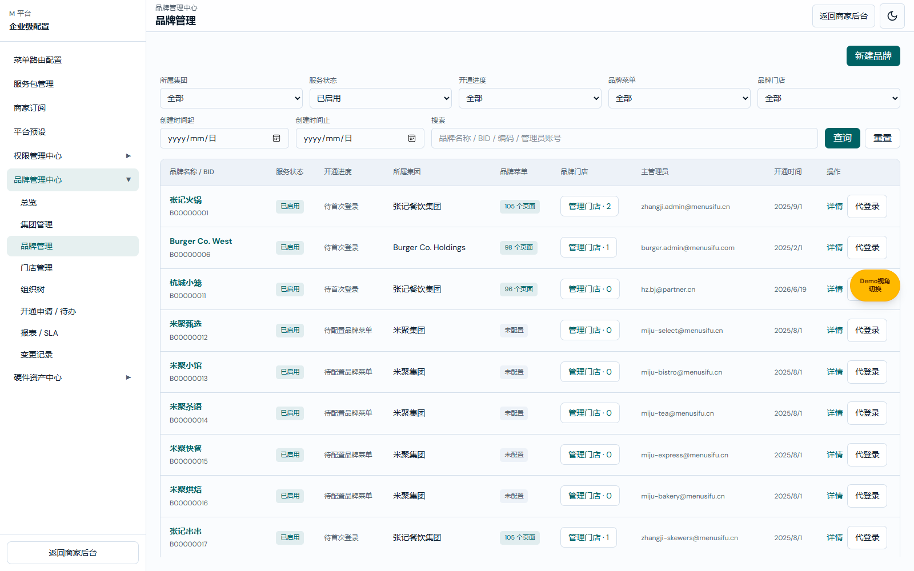

图：现有原型历史验收截图，具体旧来源见历史附录；原页面说明基线main@3f0cb3d5，本轮操作证据main@64ddec8f，未重新截图。用途／入口按本节标题及公共业务流程；只读查看不写授权。

| 字段／操作 | 逻辑说明 |
| --- | --- |
| 所属集团 | 默认全部，来源为跨Enterprise可选集团。 |
| 服务状态 | 默认全部；待启用／已启用／已暂停／已关闭，使用服务状态兼容映射。 |
| 开通进度 | 默认全部，按Admin、页面、完成与登录记录派生。 |
| 品牌菜单 | 未配置／已配置，按是否有isPage页面判断，不按节点总数。 |
| 品牌门店 | 无门店／有门店，按品牌门店数量判断。 |
| 创建时间起 | 可空，按createdAt日期部分包含起日。 |
| 创建时间止 | 可空，包含止日；早于起日则报错，不应用新条件。 |
| 搜索 | 去首尾空格、忽略大小写；匹配品牌名、BID、编码、历史主管理员及显式账号邮箱。 |
| 查询 | 应用文本和日期输入；下拉选择变化立即应用。条件仅保存本会话，不写授权。 |
| 重置 | 清空全部条件并立即查询。 |
| 新建品牌 | 品牌管理中直接进入创建向导，完成核对后创建品牌；不生成申请或待办。 |
| 筛选布局 | 全部展开，两行布局，无更多筛选。品牌与门店分别保留sessionStorage条件。 |

### 品牌管理／列表

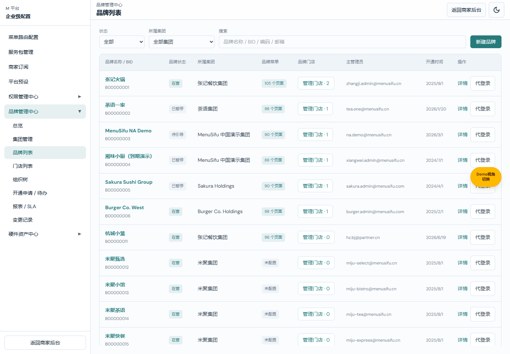

图：现有原型历史验收截图，具体旧来源见历史附录；原页面说明基线main@3f0cb3d5，本轮操作证据main@64ddec8f，未重新截图。用途／入口按本节标题及公共业务流程；只读查看不写授权。

| 字段／操作 | 逻辑说明 |
| --- | --- |
| 品牌名称／BID | 名称链接至独立详情概览；BID空显示—。 |
| 服务状态 | 显示平台服务状态，与门店营业状态分开。 |
| 开通进度 | 显示当前派生进度；不作为服务启停按钮。 |
| 所属集团 | 展示归属集团名称。 |
| 品牌菜单 | 按已选isPage页面数展示，无页面显示未配置；链接品牌菜单页。 |
| 品牌门店 | 管理门店·数量，进入品牌门店页。 |
| 主管理员 | 优先可用显式Admin，兼容旧主邮箱；无显示待开通，并非仅展示旧primaryAdminEmail。 |
| 开通时间 | activatedAt优先，否则createdAt；沿用日期格式化。 |
| 详情 | 进入概览，不直接跳品牌管理员。 |
| 代登录 | 满足品牌可代登录条件才显示；准备时Loading及重复保护，失败恢复。 |
| 空列表 | 显示暂无匹配品牌，不伪造空行。 |

### 门店管理／筛选

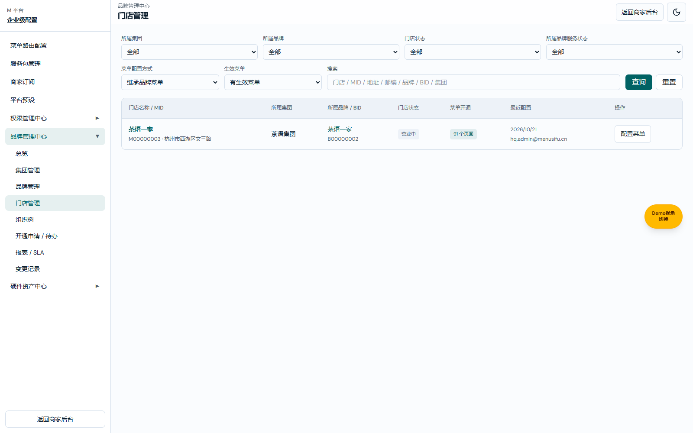

图：现有原型历史验收截图，具体旧来源见历史附录；原页面说明基线main@3f0cb3d5，本轮操作证据main@64ddec8f，未重新截图。用途／入口按本节标题及公共业务流程；只读查看不写授权。

| 字段／操作 | 逻辑说明 |
| --- | --- |
| 所属集团 | 默认全部；变化后更新所属品牌候选，保留仍有效选项，否则清空。 |
| 所属品牌 | 仅列当前集团匹配品牌；不再另有查找品牌输入框。 |
| 门店状态 | 全部／营业中／筹备中／停业／已归档。 |
| 所属品牌服务状态 | 四种服务状态，不能与门店营业状态混用。 |
| 菜单配置方式 | 继承／独立；历史缺mode或缺配置在此归入独立。 |
| 生效菜单 | 有／无生效菜单，实际按是否命中isPage判断。 |
| 搜索 | 门店名／MID／地址／邮编／品牌／BID／集团；原列表查询方法处理。 |
| 查询／重置 | 文本查询与清空行为同品牌；下拉立即应用；无更多筛选。 |

### 门店管理／列表

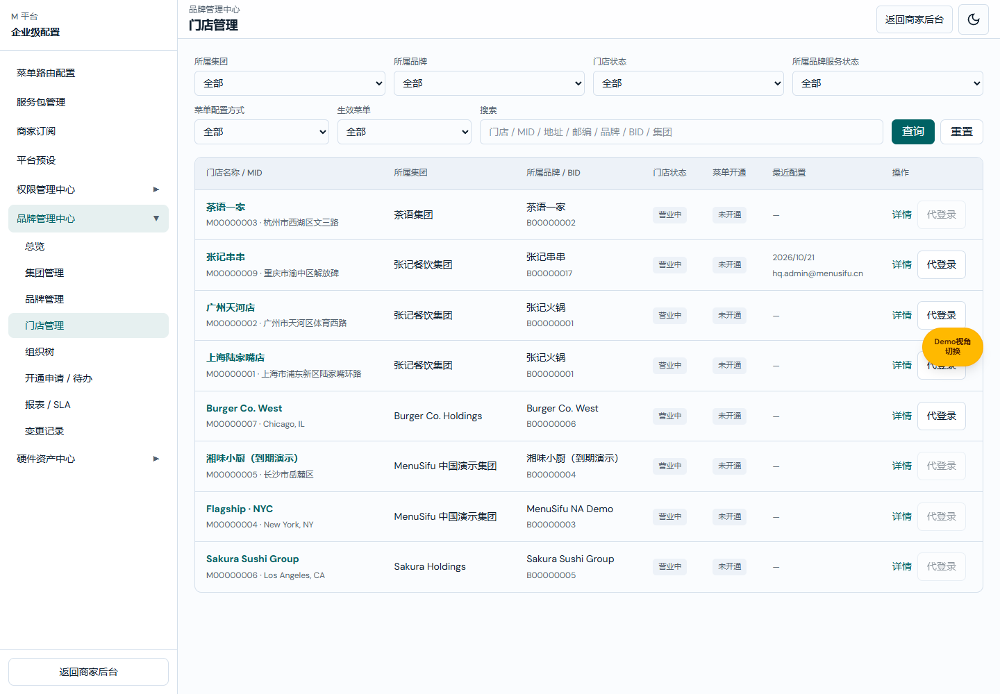

图：现有原型历史验收截图，具体旧来源见历史附录；原页面说明基线main@3f0cb3d5，本轮操作证据main@64ddec8f，未重新截图。用途／入口按本节标题及公共业务流程；只读查看不写授权。

| 字段／操作 | 逻辑说明 |
| --- | --- |
| 门店名称／MID | 名称进入该店独立概览，次行MID及地址，无地址显示暂无地址。 |
| 所属集团 | 仅展示。 |
| 所属品牌／BID | 列表仅展示，不可点击跳品牌；详情概览内的所属品牌链接仍存在，范围不同。 |
| 门店状态 | 门店营业状态标签。 |
| 菜单开通 | 按有效键判断有无，再展示isPage数量；仅目录键可能出现0个页面，属于现状统计边界，不能当成已开通页面。 |
| 最近配置 | 更新时间和操作人，缺省—；继承内容变化不保证重写门店updatedAt。 |
| 详情 | 进入门店概览。 |
| 代登录 | 品牌服务active且有可用品牌Admin时可用，否则禁用并提示；当前不以门店营业状态作为独立拒绝条件。 |
| 外层配置入口 | 无配置菜单按钮，无顶部组织树视图按钮。 |

### 品牌详情／概览

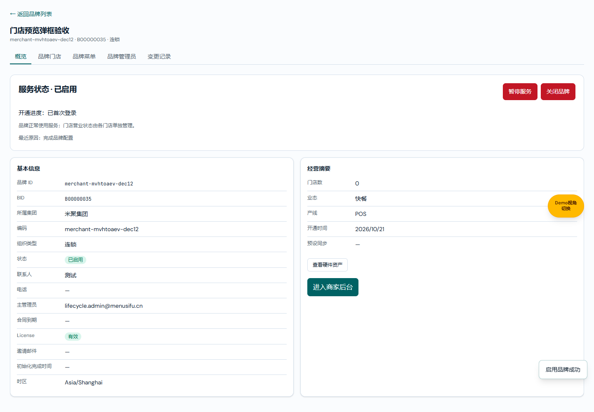

图：现有原型历史验收截图，具体旧来源见历史附录；原页面说明基线main@3f0cb3d5，本轮操作证据main@64ddec8f，未重新截图。用途／入口按本节标题及公共业务流程；只读查看不写授权。

| 字段／操作 | 逻辑说明 |
| --- | --- |
| 详情布局 | 独立全窗口，隐藏M侧栏和通用顶栏；返回品牌管理恢复列表。 |
| 页签 | 概览、品牌门店、品牌菜单、品牌管理员、变更记录。 |
| 品牌上下文 | 展示品牌名、编码／BID等，不能跨品牌保存当前草稿。 |
| 服务状态与操作 | 按公共状态表提供启用、暂停、恢复、关闭；关闭后无重开入口。 |
| 开通检查 | Admin、菜单页面、联系人集团及合同条件；不要求有门店。 |

### 品牌服务状态确认

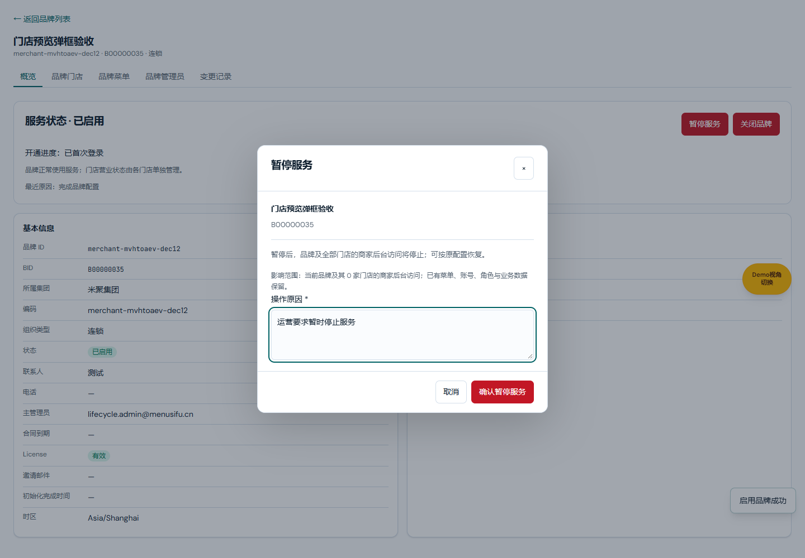

图：现有原型历史验收截图，具体旧来源见历史附录；原页面说明基线main@3f0cb3d5，本轮操作证据main@64ddec8f，未重新截图。用途／入口按本节标题及公共业务流程；只读查看不写授权。

| 字段／操作 | 逻辑说明 |
| --- | --- |
| 操作原因 | 2至200字，必填，所有服务动作均校验。 |
| 影响说明 | 影响品牌及其门店后台访问，保留账号、菜单、角色与业务数据。 |
| 阻塞提示 | 启用／恢复不满足条件时列出原因，不能直接绕过。 |
| 取消／确认 | 取消不写入；确认重新校验权限、状态、版本，成功记录变更，失败保留输入。 |

### 品牌菜单／已开通树

图：现有原型历史验收截图，具体旧来源见历史附录；原页面说明基线main@3f0cb3d5，本轮操作证据main@64ddec8f，未重新截图。用途／入口按本节标题及公共业务流程；只读查看不写授权。

| 字段／操作 | 逻辑说明 |
| --- | --- |
| 统计卡 | 品牌开通页面数、品牌门店数、已配置门店数按现有选择和能力对象计算，节点数不等同页面数。 |
| 菜单搜索与分类 | 按层级查看已保存菜单，支持展开／收起。 |
| 编辑品牌菜单 | 仅M入口提供；B入口显示品牌菜单由M平台开通。 |

### 编辑品牌菜单

图：现有原型历史验收截图，具体旧来源见历史附录；原页面说明基线main@3f0cb3d5，本轮操作证据main@64ddec8f，未重新截图。用途／入口按本节标题及公共业务流程；只读查看不写授权。

| 字段／操作 | 逻辑说明 |
| --- | --- |
| 菜单选择 | 初始化已保存集合，父子勾选及查看规则同公共选择器。 |
| 影响提示 | 关闭品牌菜单后门店对应部分失效；旧角色记录保留但超上限不生效。 |
| 预览配置 | 读取草稿差异并打开独立预览，原编辑框保留。 |
| 取消／关闭 | 真实编辑触发独立放弃确认；仅浏览不提示。 |

### 品牌菜单配置预览

图：现有原型历史验收截图，具体旧来源见历史附录；原页面说明基线main@3f0cb3d5，本轮操作证据main@64ddec8f，未重新截图。用途／入口按本节标题及公共业务流程；只读查看不写授权。

| 字段／操作 | 逻辑说明 |
| --- | --- |
| 新增／关闭统计 | 按节点差集计算，不能称全部都是页面。 |
| 本次新增 | 默认页签，树状展示next减old。 |
| 本次关闭 | 树状展示old减next；无变化明确显示无新增／关闭。 |
| 返回修改／关闭 | 仅关闭预览，不丢编辑草稿。 |
| 确认保存 | 重校验版本、菜单有效性和操作者；写品牌上限、裁剪独立门店，继承动态同步；成功关闭两层并提示。 |

### 品牌门店／关联与配置

图：现有原型历史验收截图，具体旧来源见历史附录；原页面说明基线main@3f0cb3d5，本轮操作证据main@64ddec8f，未重新截图。用途／入口按本节标题及公共业务流程；只读查看不写授权。

| 字段／操作 | 逻辑说明 |
| --- | --- |
| 搜索 | 按门店名称／MID过滤；只改变展示。 |
| 复选框／全选 | 选中需要批量处理的门店，不能越过品牌归属。 |
| 营业状态 | 展示当前门店状态。 |
| 菜单配置 | 继承品牌／独立配置及有效页面数。 |
| 最近配置 | 缺失显示—；继承计算不等于每次都写时间。 |
| 查看生效菜单 | 按该门店已保存当前结果打开完整树。 |
| 配置菜单 | 打开单店编辑。 |
| 批量配置菜单 | 选择本品牌门店后打开批量编辑。 |
| 关联已有门店 | 仅M管理归属；B不可关联其他品牌门店。 |

### 关联已有门店弹框

图：现有原型历史验收截图，具体旧来源见历史附录；原页面说明基线main@3f0cb3d5，本轮操作证据main@64ddec8f，未重新截图。用途／入口按本节标题及公共业务流程；只读查看不写授权。

| 字段／操作 | 逻辑说明 |
| --- | --- |
| 候选与选择 | 仅同集团符合单店关联条件的记录，至少选择待关联对象。 |
| 确认关联 | 重校验归属及版本，保留MID并改目标组织归属，重置为显式inherit；记录同一operationId便于合并审计。 |
| 取消／失败 | 不发布草稿；失败保持输入并说明。 |

### 门店菜单编辑

图：现有原型历史验收截图，具体旧来源见历史附录；原页面说明基线main@3f0cb3d5，本轮操作证据main@64ddec8f，未重新截图。用途／入口按本节标题及公共业务流程；只读查看不写授权。

| 字段／操作 | 逻辑说明 |
| --- | --- |
| 菜单配置方式 | 单店继承／独立；批量含继承、独立增量、独立替换。 |
| 继承说明与树 | 继承只读当前品牌门店视角范围，切换独立才显示可编辑选择器。 |
| 独立候选 | 当前保存检查品牌上限；目标M/B两层上限尚未落地。 |
| 预览配置 | 逐店计算差异，进入独立预览；不写入。 |
| 取消／关闭 | 真实修改弹出独立放弃确认；继续编辑保留，放弃不保存。 |

### 门店菜单配置预览

图：现有原型历史验收截图，具体旧来源见历史附录；原页面说明基线main@3f0cb3d5，本轮操作证据main@64ddec8f，未重新截图。用途／入口按本节标题及公共业务流程；只读查看不写授权。

| 字段／操作 | 逻辑说明 |
| --- | --- |
| 涉及门店 | 单店展示名称MID；批量可展开涉及列表。 |
| 本次新增／本次关闭 | 只保留两个页签，无生效菜单页签。 |
| 预览门店 | 当前差异集合相同时隐藏，显示适用于全部门店；不同才切换逐店查看，切换不改变保存范围。 |
| 统计 | 两页签分别核对是否同集合；不同显示各店不同或当前店数量，不汇总重复节点。 |
| 返回修改／关闭 | 回编辑框保留草稿。 |
| 确认保存 | 整批校验品牌、门店和版本，克隆快照中计算后一次写入；不把增量模式等同所有门店替换。 |

### 门店生效菜单弹框

图：现有原型历史验收截图，具体旧来源见历史附录；原页面说明基线main@3f0cb3d5，本轮操作证据main@64ddec8f，未重新截图。用途／入口按本节标题及公共业务流程；只读查看不写授权。

| 字段／操作 | 逻辑说明 |
| --- | --- |
| 门店上下文 | 只查看指定MID当前已保存结果，不是未保存的预览结果。 |
| 菜单树／搜索 | 按层级查看有效菜单，缺失能力显示无菜单。 |
| 关闭 | 不写数据、不触发未保存提示。 |

### 门店详情／概览

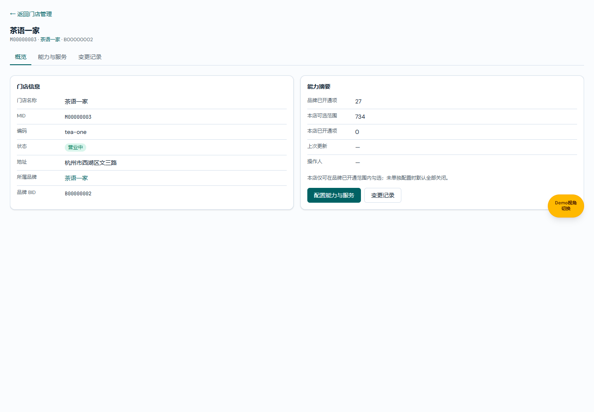

图：现有原型历史验收截图，具体旧来源见历史附录；原页面说明基线main@3f0cb3d5，本轮操作证据main@64ddec8f，未重新截图。用途／入口按本节标题及公共业务流程；只读查看不写授权。

| 字段／操作 | 逻辑说明 |
| --- | --- |
| 布局与页签 | 独立全窗口；概览、门店菜单、变更记录；返回门店管理。底层capabilities路由兼容，不要求改URL文案。 |
| 门店名称／MID／编码 | 主数据展示。 |
| 状态／地址 | 营业状态；地址缺省—。 |
| 所属品牌／BID | 概览内所属品牌仍可链接品牌详情，与列表仅展示规则不同。 |
| 品牌开通页面 | 品牌原始有效键中命中isPage数量。 |
| 门店可选页面 | 品牌门店视角候选isPage数量。 |
| 门店生效页面 | 当前能力有效键命中页面数量。 |
| 菜单配置方式 | 显式inherit显示继承，其余显示独立；不据此推断已有菜单。 |
| 上次更新／操作人 | 来自能力记录，缺省—。 |
| 编辑门店菜单 | 进入门店菜单页，再打开编辑，不在外层列表直接配置。 |

### 门店详情／门店菜单

图：现有原型历史验收截图，具体旧来源见历史附录；原页面说明基线main@3f0cb3d5，本轮操作证据main@64ddec8f，未重新截图。用途／入口按本节标题及公共业务流程；只读查看不写授权。

| 字段／操作 | 逻辑说明 |
| --- | --- |
| 已生效树 | 展示指定门店当前有效菜单。 |
| 配置方式 | 继承或独立。 |
| 编辑门店菜单 | 打开公共单店编辑器；品牌及门店上下文锁定。 |

### 品牌管理员／列表

图：现有原型历史验收截图，具体旧来源见历史附录；原页面说明基线main@3f0cb3d5，本轮操作证据main@64ddec8f，未重新截图。用途／入口按本节标题及公共业务流程；只读查看不写授权。

| 字段／操作 | 逻辑说明 |
| --- | --- |
| 品牌Admin | M只维护Admin列表，不提供员工角色新建入口。 |
| 姓名／登录账号 | 显式账号或兼容历史主管理员；无账号展示空态。 |
| 状态／开通时间／最近登录 | 分别来自enabled、createdAt、lastLoginAt；缺失时间—，不伪造登录。 |
| 开通品牌Admin | 进入开通弹框。 |
| 管理／重设密码／启停 | 按当前账号状态提供；最后一名可用Admin保护，历史账号可能展示原登录方式而不等同新显式账号。 |

### 开通品牌Admin弹框

图：现有原型历史验收截图，具体旧来源见历史附录；原页面说明基线main@3f0cb3d5，本轮操作证据main@64ddec8f，未重新截图。用途／入口按本节标题及公共业务流程；只读查看不写授权。

| 字段／操作 | 逻辑说明 |
| --- | --- |
| 姓名 | 必填最长30字。 |
| 登录账号 | 品牌独立邮箱，当前仅menusifu.cn／com；跨品牌不能复用。 |
| 登录密码 | 必填至少6位，本地原型保存；不写审计明文。 |
| 开通并启用 | 一次提交完成，不再预览后二次确认；仅账号启用，不自动启用品牌服务。 |
| 取消／失败 | 取消不写入，真实编辑走放弃保护；错误保留字段。 |

### 管理Admin／重设密码／启停

图：现有原型历史验收截图，具体旧来源见历史附录；原页面说明基线main@3f0cb3d5，本轮操作证据main@64ddec8f，未重新截图。用途／入口按本节标题及公共业务流程；只读查看不写授权。

| 字段／操作 | 逻辑说明 |
| --- | --- |
| 管理资料 | 姓名与允许字段按当前弹框维护，邮箱身份沿用已有账号。 |
| 重设密码 | 新密码至少6位；成功提示旧密码失效，日志仅记已重设，不含密码。 |
| 停用／启用 | 明确账号及后果，动作按钮使用对应文案；不得停用最后一名可用Admin，需先有另一名。 |
| 取消／关闭 | 无写入；有真实编辑按公共放弃规则。 |

### 放弃修改确认弹框

图：现有原型历史验收截图，具体旧来源见历史附录；原页面说明基线main@3f0cb3d5，本轮操作证据main@64ddec8f，未重新截图。用途／入口按本节标题及公共业务流程；只读查看不写授权。

| 字段／操作 | 逻辑说明 |
| --- | --- |
| 提示 | 有未保存的修改，是否放弃？独立弹框，不是编辑框底部提示块。 |
| 继续编辑 | 关闭确认，原编辑与选择保留。 |
| 放弃修改 | 关闭编辑及其关联预览，不写保存。 |

### 品牌／门店变更记录

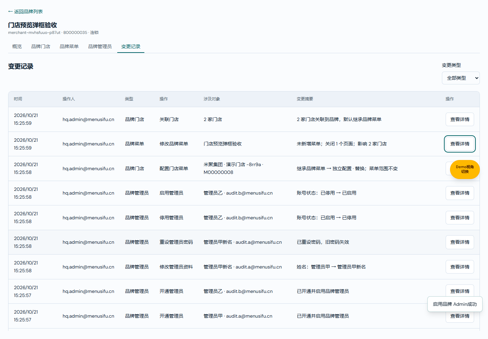

图：现有原型历史验收截图，具体旧来源见历史附录；原页面说明基线main@3f0cb3d5，本轮操作证据main@64ddec8f，未重新截图。用途／入口按本节标题及公共业务流程；只读查看不写授权。

| 字段／操作 | 逻辑说明 |
| --- | --- |
| 类型筛选 | 按实际日志类别过滤，默认全部；无匹配明确空态。 |
| 时间／操作人 | 显示记录值并倒序排列，不伪造人员。 |
| 操作与对象 | 优先结构化facts标题、来源及目标；批量按operationId合并为一行，显示涉及门店数。 |
| 变更摘要 | 名称化展示新增／关闭、配置方式和字段前后值，不把原始key数组作为唯一阅读形式。 |
| 查看详情 | 打开差异弹框。门店详情按storeId过滤该店相关记录，不展示其他店日志冒充当前店。 |

### 变更详情弹框

图：现有原型历史验收截图，具体旧来源见历史附录；原页面说明基线main@3f0cb3d5，本轮操作证据main@64ddec8f，未重新截图。用途／入口按本节标题及公共业务流程；只读查看不写授权。

| 字段／操作 | 逻辑说明 |
| --- | --- |
| 基础信息 | 时间、操作人、来源、类型、对象及门店配置方式逐项展示。 |
| 字段变更 | 字段、变更前、变更后三列，非结构化历史数据说明缺失，不补造。 |
| 菜单变化 | 新增／关闭树；优先历史choices快照，无法识别的旧key单独展示历史菜单。 |
| 查看门店 | 批量记录允许逐店切换，这与配置预览同集合隐藏切换不是同一规则。 |
| 原始记录 | 保留历史摘要供追溯；不能把新目录名称冒充旧历史事实。 |
| 关闭 | 返回列表，不产生新的变更记录。 |

### B品牌Admin／内部账号角色

图：现有原型历史验收截图，具体旧来源见历史附录；原页面说明基线main@3f0cb3d5，本轮操作证据main@64ddec8f，未重新截图。用途／入口按本节标题及公共业务流程；只读查看不写授权。

| 字段／操作 | 逻辑说明 |
| --- | --- |
| 入口边界 | 品牌工作区内部账号角色入口使用brand-access；通用权限中心仍为另一套状态，尚未统一。 |
| 角色名称／说明 | 必填角色名最长30字，说明最长160字，名称唯一校验沿用角色模型。 |
| 角色权限树 | 页面查看、设置只读／编辑、操作禁止／允许；候选受品牌资源上限约束，旧超限授权记录保留但不生效。 |
| 账号身份／启用 | 普通账号或Admin；普通账号至少一次角色门店绑定。 |
| 角色与生效门店 | 每条绑定同时包含roleId及门店集合；跨品牌禁止，无个人例外授权。 |
| B门店配置 | 当前可改与M相同对象；目标只改内部启用范围，待实现，图片不能证明目标分层已落地。 |

### 代登录等待与代管提示

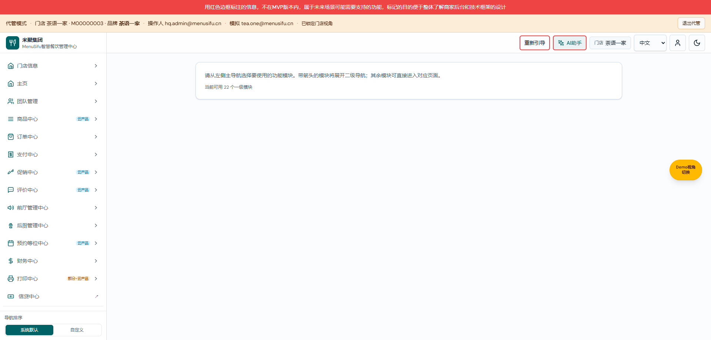

图：现有原型历史验收截图，具体旧来源见历史附录；原页面说明基线main@3f0cb3d5，本轮操作证据main@64ddec8f，未重新截图。用途／入口按本节标题及公共业务流程；只读查看不写授权。

| 字段／操作 | 逻辑说明 |
| --- | --- |
| 等待Loading | 正在登录，请稍后；同步显示、防重复；成功后清理，失败／超时恢复。 |
| 品牌／门店上下文 | 品牌模式锁品牌，门店模式锁指定店；沿用开始结束审计。 |
| 全宽提示条 | 红色说明条下，横跨侧栏与内容，显示模式、品牌、可选门店、操作人、模拟账号与锁定视角。 |
| 退出代管 | 结束会话返回来源列表或详情；不把代管身份当真实员工身份。 |

## M／B 平台业务关系与授权框架（MB-AUTH-20261022-52）

> 状态：用户要求将已讨论方案纳入目标设计；本节不是实现完成声明。本次仅更新文档，不修改代码或已有授权数据。目标来源为MB-AUTH-20261022-52；本轮配对产品V1.52／研发V1.51／个人V1.51，目标来源不变，现状复核基线main@64ddec8f。下述规则替代旧文中“M与B共用同一门店菜单配置”的业务定义；旧流程截图仅作为现状证据。

### 业务边界与统一术语（目标态）

M平台是服务商管理端，B平台是商家后台。“菜单路由”统一指功能入口配置，不称“菜品路由”。统一功能资源目录定义模块、页面、设置项和操作能力；菜单是入口，API、导出等无独立菜单的能力仍须注册权限资源。资源注册不等于功能已实现或已授权。

| 对象／职责 | 有效规则 |
| --- | --- |
| M菜单路由配置 | 维护资源标识、层级、路由和适用视角，发布可供开通的目录版本；品牌、门店与角色候选引用同一资源标识，不各造菜单。未发布草稿不参与开通。 |
| M品牌管理 | 在已发布且可用的目录中配置品牌功能上限，开通和管理品牌Admin；不替商家维护日常员工角色。 |
| M门店管理 | 在品牌上限和门店适用范围内维护门店开通上限；可继承品牌或独立配置。 |
| B品牌Admin | 登录后查看已开通范围，管理内部角色、员工账号和生效门店；只能缩减或分配M已开通的能力，不能突破平台上限。 |
| B员工 | 按角色、账号状态、门店范围及平台上限获得最终权限；能看到菜单不等于能编辑或执行敏感操作。 |
| 总部／门店视角 | 总部页面按品牌范围计算；门店业务还须满足该店上限、内部启用范围与员工门店绑定，不机械地将所有总部页面套入某家门店。 |

### 业务框架图

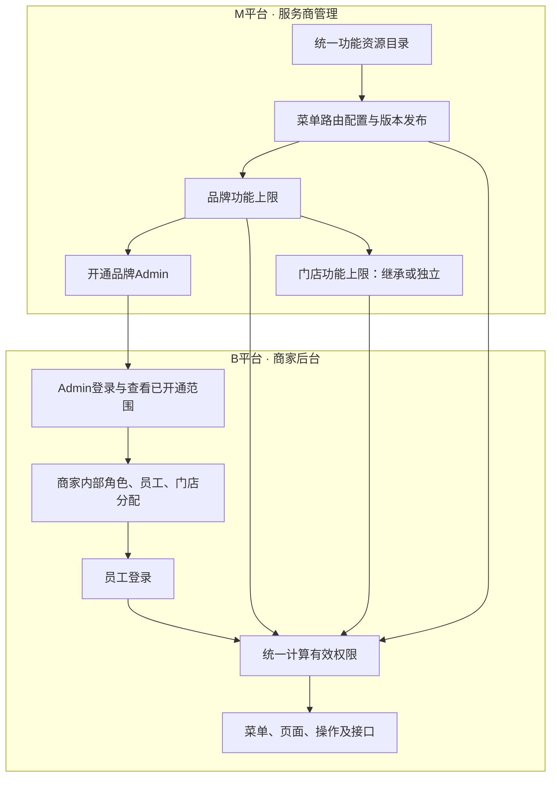

### 配置到员工使用流程图

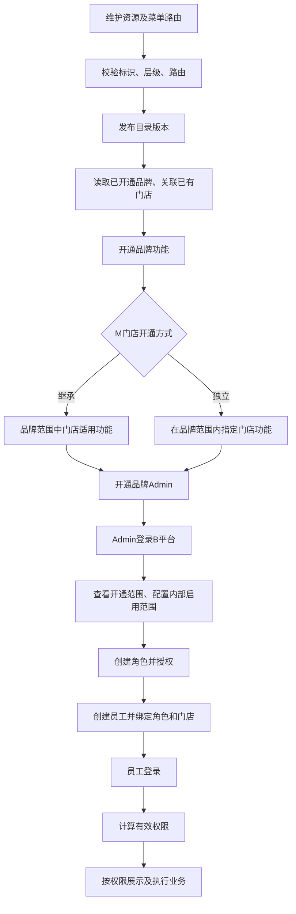

### 门店上下限及权限判断

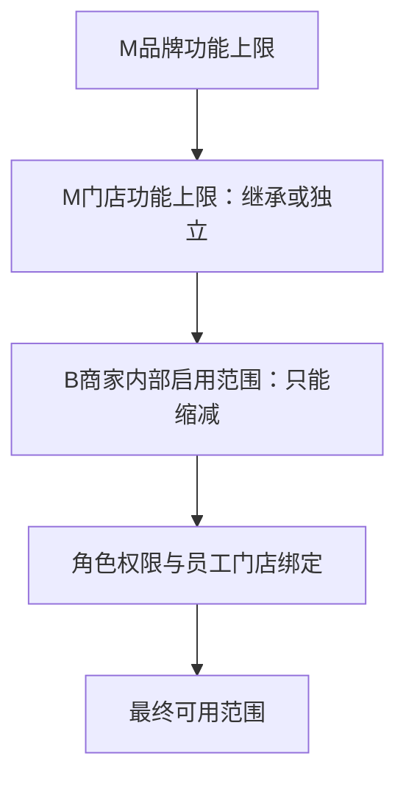

门店员工最终权限为：已发布且可用资源 ∩ M品牌上限 ∩ M门店上限 ∩ B内部启用范围 ∩ 员工角色权限，并受账号、品牌服务状态和门店数据范围限制。查看、编辑、操作类型分别计算，不用集合相交代替权限等级判断。Admin在平台上限及适用视角内管理，不自动获得未开通能力。

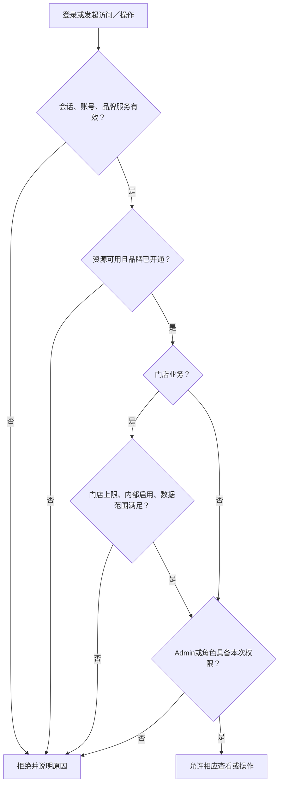

### 技术框架与实现差距（目标设计对照现状）

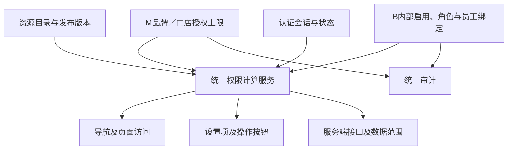

| 事项 | 现状／目标／未闭合项 |
| --- | --- |
| 菜单同源 | 开通树已消费发布蓝图；系统导航、旧registry、权限Catalog仍有映射。目标为同一稳定资源标识，不能把展示树一致视为所有运行时已同源。 |
| 账号角色 | brand-access按品牌存储；通用permission-center-local:v4另行存储。目标合并商家内部授权数据链路；尚未证明所有角色入口与员工登录已统一。 |
| 门店配置 | 当前M/B调用同一门店菜单保存链路；目标拆分M上限与B内部配置，禁止B恢复M关闭的能力。此项待实现，不将既有代码写成目标行为。 |
| 其他限制 | 订阅、预设及发布范围应有明确职责，最终统一解释有效权限及拒绝原因；不能出现只显示“已开通”却无法说明实际不可用原因。 |
| 生产化 | 当前浏览器本地存储和前端登录属于原型；目标接入正式认证、租户隔离、后端授权与接口鉴权。本次未接入生产服务。 |
| 新增资源 | 发布只增加可供开通的候选，不自动给品牌、门店、旧角色或员工扩权。继承仅在已确认的父范围授权内计算。 |
| 撤销及恢复 | 撤销后最终权限应失效；保留审计。重新开通是否恢复原角色授权尚待确认，不能擅自清空或恢复历史授权。 |
| 验收 | 必须验证真实Admin创建员工、分配角色、员工正常登录；代登录验证不能替代员工登录验收。 |

### 页面／视角与元素说明

本次不新增原型。以下目标态页面缺少与新分层一致的验收截图，逐页登记“待补页面图片”；已有共用配置截图不能证明上下限已拆分。

#### M平台／菜单路由配置

待补页面图片：统一资源与发布目录目标态；现有路由配置不是完整目标态验收证据。

| 字段／操作 | 逻辑说明 |
| --- | --- |
| 资源标识 | 引用统一目录，品牌、门店、角色均使用同一身份；不因改名生成新授权。 |
| 菜单层级与路由 | 定义入口组织及适用视角；操作能力可无菜单入口。 |
| 发布 | 校验后形成可供开通版本；草稿不生效，发布不自动给商家授权。 |

#### M平台／品牌管理／品牌菜单与品牌管理员

待补页面图片：目标态品牌资源开通与Admin管理。

| 字段／操作 | 逻辑说明 |
| --- | --- |
| 品牌菜单 | 显示平台发布候选与本品牌开通范围；未开通不能由B自行取得。 |
| 开通品牌Admin | 创建商家登录管理员；Admin只管理本品牌开通范围，原账号状态流程沿用。 |

#### M平台／门店管理／菜单配置

待补页面图片：M门店开通上限与B内部范围拆分后的配置页。

| 字段／操作 | 逻辑说明 |
| --- | --- |
| 继承品牌 | 计算品牌上限中的门店适用资源，品牌变化按继承规则同步。 |
| 独立配置 | 在品牌上限内配置该店平台上限；不能包含其他品牌或不适用视角的资源。 |
| 保存 | 校验资源与版本，成功记录平台来源审计；失败保留输入且不发布部分配置。 |

#### B平台／门店内部配置、角色与员工

待补页面图片：内部启用范围、统一角色及员工登录目标态。

| 字段／操作 | 逻辑说明 |
| --- | --- |
| 内部启用范围 | 默认沿用已开通范围，仅进一步缩减，不回写M上限；新增资源的后续自动同步策略待确认。 |
| 角色权限 | 区分页面查看、设置编辑和操作允许，候选受平台上限限制。 |
| 员工账号与门店 | 绑定角色与生效门店；无有效授权不获得业务功能，不通过缺失数据放行。 |
| 权限来源说明 | 展示平台发布、品牌、门店、内部启用及角色限制，说明最终允许／拒绝原因；目标待实现。 |
| 登录与操作 | 登录后统一算权限，地址直达和操作请求仍需校验；退出与失败不赋予额外权限。 |

## 实现证据与验证清单

| 范围 | 源码入口 |
| --- | --- |
| 类型、枚举、字段 | [enterprise-merchant-types.ts](../../src/config/enterprise-merchant-types.ts) |
| 品牌／门店演示数据与保存 | [enterprise-merchant-store.ts](../../src/config/enterprise-merchant-store.ts) |
| 页面与路由 | [enterprise-merchant-ui.ts](../../src/config/enterprise-merchant-ui.ts)、[enterprise-merchant-scope.ts](../../src/config/enterprise-merchant-scope.ts) |
| 筛选 | [management-list-filters.ts](../../src/config/management-list-filters.ts) |
| 菜单编辑、Admin与B入口 | [brand-access-ui.ts](../../src/config/brand-access-ui.ts) |
| 生命周期 | [brand-service-lifecycle.ts](../../src/config/brand-service-lifecycle.ts)、[brand-service-policy.ts](../../src/config/brand-service-policy.ts) |
| 发布菜单及身份映射 | [enterprise-merchant-services.ts](../../src/config/enterprise-merchant-services.ts)、[brand-menu-catalog.ts](../../src/config/brand-menu-catalog.ts) |
| 登录及授权 | [brand-access-store.ts](../../src/config/brand-access-store.ts)、[brand-access-domain.ts](../../src/config/brand-access-domain.ts)、[login.ts](../../src/auth/login.ts) |
| 另一权限中心 | [center-store.ts](../../src/permissions/center-store.ts)、[center-ui.ts](../../src/permissions/center-ui.ts) |
| 审计与代登录 | [brand-change-log.ts](../../src/config/brand-change-log.ts)、[enterprise-merchant-impersonate.ts](../../src/config/enterprise-merchant-impersonate.ts)、[impersonation-loading.ts](../../src/config/impersonation-loading.ts) |

### 待确认与交付准备度

| 编号 | 未闭合项 | 影响 |
| --- | --- | --- |
| Q01 | 撤销后重新开通，是否恢复旧角色授权；当前保留记录，但目标恢复策略未定 | 目标态迁移与恢复验收不能定稿。 |
| Q02 | M给门店新增能力后，B已有内部启用配置是否自动纳入 | 当前无B独立对象；拆分后不能默认为自动扩权。 |
| Q03 | 统一商家角色入口、身份／租户服务及两套权限状态的迁移策略 | 方案需研发设计，不在文档更新中发明API。 |
| Q04 | 系统目录无发布快照时是否继续允许默认树开通 | 当前有回退，目标发布治理需明确；维持现状且不隐式改变。 |
| Q05 | 订阅、预设、发布范围与开通上限的最终职责和拒绝解释 | 当前多门限制仍在，需统一可用原因与有效权限展示。 |

当前实现文档可用于理解与回归设计；整个目标架构的Implementation-Plan Readiness为 **Not ready**，Q01—Q05及权限数据统一、M/B门店分层尚未闭合。本次不承诺全部目标已可直接开发或已验收。

建议回归：创建无Admin待启用→Admin开通→服务启用→真实Admin登录；分别验证继承／独立、品牌撤销、门店越界、角色越界、跨店绑定、版本冲突、存储失败、批量无变化、未知历史菜单、正常员工登录、代登录退出返回。上述为待执行清单，旧记录仅作历史证据。

## 历史版本与增量记录（非当前操作规范）

展开旧版章节、图片与交付记录；其中授权状态和验收结果仅适用于当时任务

## 代管提示条全宽展示（IMPERSONATION-BANNER-20261022-51）

图：功能分支codex/impersonation-banner-fullwidth-20261022，起始main@b5d6b0e5，5240预览；门店代管模式，1920px窗口。

产品V1.48／研发V1.47／个人V1.47。已确认：品牌、门店代登录进入商家后台后，代管提示条横跨侧边导航和内容区。

| 元素／操作 | 逻辑说明 |
| --- | --- |
| 全局提示位置 | 放在红色未来版本说明条下方、侧栏与业务内容共同容器上方，左右贴齐窗口；不是只占右侧内容宽度。 |
| 布局占位 | 使用应用壳纵向布局的自然高度，提示条不收缩，侧栏及内容整体位于下方；长文案在窄屏自动换行，不采用固定高度或覆盖菜单内容。 |
| 展示条件与内容 | 沿用有效代管会话判断；无会话为空，不留空白占位。代管模式、品牌、可选门店、操作人、模拟账号及锁定视角沿用会话数据，仍只显示一条。 |
| 退出代管 | 保持提示条右侧按钮与原结束审计、清理会话、返回入口逻辑；不修改权限或授权范围。 |
| 研发实现 | src/main.ts从renderMain右侧容器移除提示，在商家后台全局壳renderFutureVersionDiffBanner后统一渲染renderImpersonationBanner；事件绑定继续复用bindImpersonationBanner。 |
| 验收 | 品牌与门店代管分别检查1920、768、390px宽度，提示左右边界与视口一致，侧栏起点不高于提示底部，退出后提示消失且返回原列表。 |

本次仅布局调整，登录等待、数据范围与业务页不改。TypeScript及空白检查通过；浏览器验证结果见交付说明。本次已获授权提交、合并并推送；实际Git提交与远端核验结果见交付记录。

## 代登录 Loading 与列表稳定性修复（IMPERSONATION-LOADING-20261021-50）

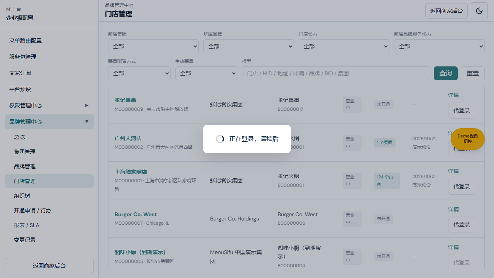

图：功能分支 codex/impersonation-loading-20261021，main@1685fa22 基线，5239 预览的门店列表点击状态；测试延长首帧等待以截图，不改变业务登录时序。

产品V1.47／研发V1.46／个人V1.46；本次修复品牌列表、品牌详情及门店列表代登录的等待反馈，不改变服务状态、授权、菜单范围与审计规则。

| 字段／操作 | 逻辑说明 |
| --- | --- |
| 代登录 | 点击有效入口后同步禁用入口并显示全屏等待遮罩，再让浏览器绘制两帧后准备代登录上下文；不增加确认步骤。 |
| 等待提示 | 文案固定“正在登录，请稍后”，含旋转进度图标，以status和polite播报；等待期间拦截页面点击，同一时刻只允许一次入口请求。 |
| 列表稳定 | 品牌／门店范围准备期间仍发布原范围事件，但跳过该批次的主壳中间重绘；最终路由进入商家后台后读取完整上下文。列表在跳转前保持原DOM及滚动位置。 |
| 成功 | 目标路由离开M平台且商家后台代管提示实际挂载后，再等待两帧移除遮罩；只写入一次开始审计，沿用退出返回流程。 |
| 失败／超时 | 入口返回false或异常时清除遮罩、恢复按钮并显示具体错误；若已有代管会话，结束会话返回原入口。后台未挂载超过15秒按登录超时处理并可重试，不永久等待。同步准备任务期间浏览器计时器无法抢占执行。 |
| 实现对象 | pending为页面运行期boolean，默认false，finally复原；contextChangeDepth为同步批次计数，try/finally归零，仅阻止范围监听引起的中间主壳渲染；不缓存最终权限结果。 |
| 验收 | 品牌与门店分别验证即时提示、重复点击仅一条会话、列表身份及滚动保留、无中间重挂载、后台完成后清除Loading、退出返回；false及异常分支验证按钮和遮罩恢复。 |

验证：新增浏览器回归先失败于“loading appears immediately”，修复后通过；门店范围锁定／审计／退出、权限撤销与暂停生效、性能预算及TypeScript检查通过。本次获授权提交、合并并推送；实际提交与远端核验结果见交付记录。

## 代登录性能修复（IMPERSONATION-PERF-20261021-49）

产品V1.46／研发V1.45／个人V1.45；基线main@f39b220b（含此前已合并未推送成果），功能分支codex/impersonation-performance-20261021，预览5238。本次修复品牌/门店点击代登录后进入后台偏慢；页面布局、按钮、权限、合同和服务状态规则均不变，不新增UI字段。

| 项目 | 说明 |
| --- | --- |
| 已确认根因 | 同一入口/渲染链重复构建只读权限目录和系统菜单结构。CDP CPU profile指向buildCenterCatalog、pagePolicy/registerPageModes、nav-blueprint-current-tree；商户快照读取也是成本项，但最终没有缓存或改变其数据读取逻辑。 |
| 权限目录复用 | 仅品牌运行时复用按UI语言构建的Catalog；品牌权限编辑器默认仍取得独立目录，避免编辑共享缓存。 |
| 菜单键映射复用 | 按Catalog、已发布菜单路由版本、完整raw key集合建立映射缓存；上限128组。菜单键或路由版本变化使用新结果，不缓存最终可见/可编辑结论。 |
| 系统菜单结构 | 只读系统树按语言复用；每次返回structuredClone，路由编辑器等消费者可修改副本，不污染其他页面。自定义发布结构仍由原版本机制处理，不新增菜单或授权。 |
| 实时限制 | 原账号enabled、角色、门店范围、品牌服务状态、brand上限及store菜单每轮仍读取并计算；暂停服务或撤销菜单不会沿用旧授权。 |
| 保持流程 | 原代登录检查、preset同步、品牌/门店上下文锁定、起止审计及退出返回均保留；不跳过同步或放宽权限换速度。 |
| 测量口径 | Windows Edge headless、localhost Vite、每类独立浏览器上下文，同一脚本先验证同步入口再测实际按钮到后台banner及两帧显示。不是生产SLA，实际用户数据/机器时间可能不同。 |
| 品牌结果 | 同机记录点击到显示1262.4ms → 674ms，约减少47%；同步入口76.8ms → 73ms。 |
| 门店结果 | 同机记录点击到显示826.5ms → 372.4ms，约减少55%；同步入口367.4ms → 187.1ms。 |
| 回归预算 | 测试同步入口<300ms、点击到显示<800ms，仅用于本地对比；基线1262.4ms已产生失败证据。不同机器如未满足预算需重新剖析，不把预算视为业务承诺。 |

验证：性能脚本、缓存副本隔离、语言重建、撤销/恢复菜单、服务暂停即时生效、门店锁定/退出/审计、品牌生命周期均通过；系统路由对比214项，缺失/父级/顺序错误均为0；tsc和diff检查通过。未执行嵌入包或生产构建：本次无vendor/emenu和构建边界修改。

详细证据：[调查与计划](../verification/impersonation-performance-20261021/analysis-scope.json)、[修复结果](../verification/impersonation-performance-20261021/bug-result.json)。用户原浏览器数据规模及生产网络/后端耗时未实测。尚未提交/合并/推送。

## 前三品牌与原有四家门店演示预设（BRAND-DEMO-20261021-48）

产品V1.45／研发V1.44／个人V1.44；基线main@d38b4e6c，分支codex/brand-store-demo-presets-20261021，预览5237。用户确认保留品牌/门店，并补齐菜单、管理员及配置以演示完整流程。仅定位原有三个品牌与四个MID，不批量修改其他演示或用户创建数据。

### 品牌预设

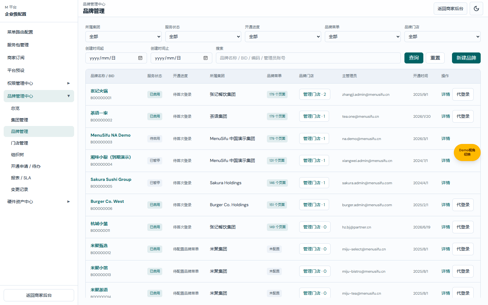

来源：5237独立浏览器新初始化数据。

| 品牌／字段 | 逻辑说明 |
| --- | --- |
| 张记火锅 | merchant-zhangji，B00000001；保持已启用；默认管理员使用既有主账号和联系人名称；新初始化数据按当前产线菜单路由建立明确开通范围。 |
| 茶语一家 | merchant-tea-one，B00000002；新初始化保持已启用，默认合同到期更新为2028-12-31、合同状态active，避免刚打开演示即因旧默认到期暂停；已存在浏览器合同及服务状态不改。 |
| MenuSifu NA Demo | merchant-menusifu-na，B00000003；保留待启用，补齐管理员和菜单以演示启用流程；仍需填写原因并执行原启用操作，不自动启用或登录。 |
| 管理员 | 原主账号未另行保存BrandAccessState、且primaryAdminEmail仍等于该品牌默认邮箱时，提供一个enabled/admin演示管理员，姓名使用联系人，口令沿用项目DEMO_LOGIN_PASSWORD；不新建普通角色，不赋予跨品牌账号。已有原主账号在旧方案本就是隐式Admin，不扩大其原范围。 |
| 用户账号优先 | 只要已有保存的品牌账号状态（包括空账号、已禁用、已改密码），均优先原值，不追加或恢复默认账号；新建用户品牌以及accountProvisioningRequired品牌不套用预设。 |
| 品牌菜单 | 仅新初始化且仍使用旧默认菜单模式、无菜单编辑记录时，按brandMenuChoices和原产线选择可配置菜单节点，写explicit范围。已有explicit配置包括有意清空均保留；已有浏览器旧品牌菜单也不覆盖。 |
| 开通进度 | 新默认管理员未伪造lastLoginAt；前两品牌默认待首次登录，第三品牌资料已具备启用条件但服务仍待启用。 |

### 门店预设

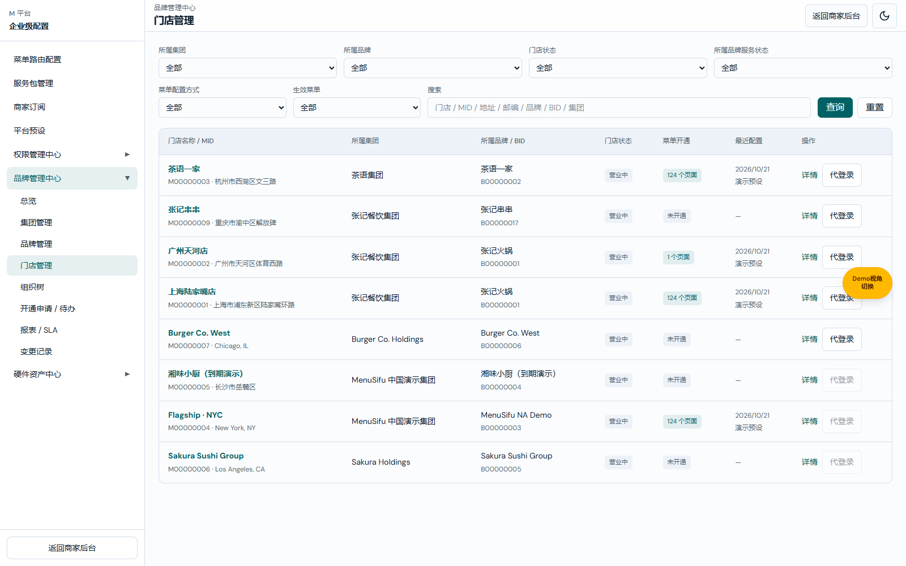

来源：5237新初始化数据，名单和现有排序保持。

| 门店／字段 | 逻辑说明 |
| --- | --- |
| 上海陆家嘴店 | M00000001，归属张记；缺失配置时预设继承品牌菜单，实际有效范围仍取品牌门店视角。 |
| 广州天河店 | M00000002，归属张记；缺失配置时预设独立配置，选择订单下一个现有页面及必要祖先，若该产线无订单页则使用首个可选页面及祖先。不增加不存在的菜单，所有键受品牌门店可选上限约束。 |
| 茶语一家门店 | M00000003；缺失配置时预设继承，便于单店详情、菜单查看、代登录和变更操作演示。 |
| Flagship · NYC | M00000004；缺失配置时预设继承，品牌待启用期间代登录仍禁用；启用后沿原授权访问。 |
| 资料及ID | 门店名称、MID、地址、集团/品牌归属保留原值；不新增门店，不改原排序，不替换名称。 |
| 已有配置 | 任意storeCapabilities快照包括空菜单、独立模式均保留；若本店已有带MID的操作日志但快照缺失，也不补造默认配置。仅原四个MID在未配置时补齐。 |
| 数量展示 | 品牌/门店列表菜单数量统一按isPage统计深层页面，排除目录、分组和设置项，修正旧仅level=2统计导致预设完整但页面数量偏小的问题。 |

### 初始化、保留与验收

| 规则 | 逻辑说明 |
| --- | --- |
| 时机 | M平台品牌管理模块渲染前ensureBrandStoreDemoPresets执行一次性补齐；避免在模块初始化/基础快照读取阶段构建路由树。 |
| 标记 | 快照增加可选brandStoreDemoVersion=1，brandStoreDemoFresh仅标识新默认快照，完成后移除；旧快照无标记可补缺，但不覆盖已有业务组件。初始化后的再次访问幂等；以后用户清空菜单不会因刷新重新补上。 |
| 元数据 | 自动补齐配置updatedBy为演示预设、时间为固定预设版本时间；不伪造用户操作和首次登录，不生成模拟编辑审计。 |
| 本地边界 | 原型localStorage/sessionStorage，跨端生产初始化不在范围。预设不绕过品牌服务状态、管理员禁用、门店菜单上限、版本校验及变更记录。 |
| 验收 | 新数据三品牌有管理员、菜单及原门店；张记覆盖继承/独立，NA保留待启用且资料就绪。旧数据保留explicit空菜单、独立空配置、已保存空账号/版本和暂停状态；重复访问存储不变化。 |

验证脚本verify-brand-store-demo-presets.mjs；已通过预设/保留/幂等测试、门店代登录及品牌服务状态回归、类型与差异检查。已有浏览器中的主动停用/到期或用户配置保持，若因此不适合演示需通过原有界面自行调整；不以预设覆盖。尚未提交/合并/推送。

## 门店列表详情与门店代登录（STORE-ACTIONS-20261021-47）

产品V1.44／研发V1.43／个人V1.43；基线main@e186b35e（含此前已合并未推送成果），分支codex/store-list-actions-20261021，预览5236。用户确认门店操作增加详情、门店维度代登录，移除列表外层配置菜单。

### 门店管理列表

来源：5236本地功能预览。

| 字段／操作 | 逻辑说明 |
| --- | --- |
| 详情 | 每行新增文字链接；进入该MID独立全屏详情的概览，保留原门店名称链接，默认不进入门店菜单页。返回门店管理沿用筛选状态。 |
| 配置菜单 | 移除列表行按钮及委托处理；门店详情的门店菜单中仍可编辑，菜单权限及保存规则不变。 |
| 代登录 | 根据该行MID解析归属品牌；品牌服务active且有可用品牌管理员时可用，其余情况禁用并提示原因。门店营业状态不新增启停规则，不自动开通菜单或账号。 |
| 点击校验 | 进入前重新检查门店存在、品牌归属及品牌服务与管理员；仅已登录M平台且无进行中代管会话时发起门店代登录。校验失败不进入，不写入开始日志。 |

### 门店代管视角

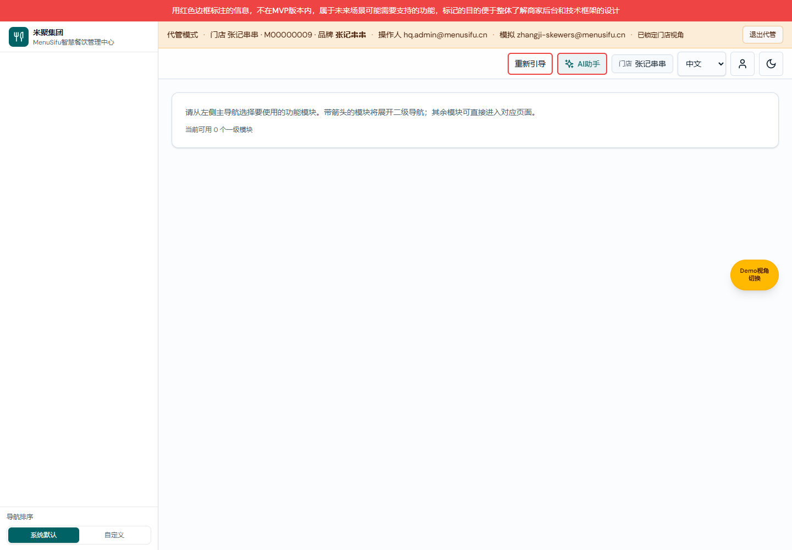

来源：5236验证门店，测试刻意配置为无生效菜单，侧栏空状态符合该范围，并非自动授予品牌全部菜单。

| 字段／操作 | 逻辑说明 |
| --- | --- |
| 会话 | 原MerchantImpersonationSession增加可选storeId/storeName；旧品牌会话无此字段，保持品牌代登录行为。品牌管理员身份沿用现有代登录来源，M操作员身份保留用于审计。 |
| 进入页面 | 门店版布局，store视角，锚定归属品牌及目标MID，进入原菜单导航首页；不跳入品牌多店视角。 |
| 门店范围 | 会话storeId作为优先锁定值；session storeAccess仅包含目标MID，顶栏门店选项仅该店。刷新保持，修改旧scope/anchor/perspective偏好不能扩展到其他门店。 |
| 菜单范围 | 复用品牌权限解析的门店模式：品牌上限与目标门店有效菜单共同约束；继承按当前品牌门店视角范围，独立按本店设置；无菜单不自动授予。品牌门店管理入口在门店代登录时隐藏且路径拒绝。 |
| 代管提示 | 显示门店名称/MID、归属品牌、M平台操作人、模拟管理员账号及已锁定门店视角；禁止通过视角切换升级为品牌/集团。 |
| 退出代管 | 原退出代管操作结束当前会话，写退出日志，返回门店管理列表并保留筛选；不修改品牌/门店账号、菜单或角色。 |
| 品牌代登录 | 原品牌列表和详情入口保留品牌视角，未设置storeId时不缩小品牌账号原范围。 |

### 日志与兼容

| 字段／操作 | 逻辑说明 |
| --- | --- |
| 日志字段 | MerchantImpersonationLog可选storeId/storeName与session同步；保存开始/结束时间、M操作员和归属品牌；旧品牌日志不迁移。 |
| 门店变更记录 | 开始/退出均附目标MID及结构化facts，中文为门店代登录/退出门店代登录，范围M平台与当前门店前后值；门店视角类型新增门店代登录，复用已有详情弹框。 |
| 失败行为 | 不存在MID、品牌未启用、无可用管理员或不匹配品牌均拒绝；不更改服务、配置及授权，不产生成功代登录记录。 |
| 范围边界 | 本地原型商家后台会话；不代表生产后端、POS终端及离线应用会话同步。 |

验证：verify-store-list-actions.mjs覆盖详情默认概览、外层菜单按钮不存在、单门店代登录、菜单空范围拒绝、品牌管理路径拒绝、偏好篡改及刷新锁定、退出返回、起止日志和无效/未启用拒绝；原筛选、门店详情和品牌服务回归同步验证。类型与差异检查通过。尚未提交/合并/推送。

## 门店详情命名与清晰变更记录（STORE-DETAIL-AUDIT-20261021-46）

产品V1.43／研发V1.42／个人V1.42；基线main@d7f7d0d3，分支codex/store-detail-naming-audit-20261021，预览5235。复用品牌详情的菜单和变更记录展示，保留门店对象边界。

### 门店菜单

来源：5235功能预览，当前门店继承品牌菜单。

| 字段／操作 | 逻辑说明 |
| --- | --- |
| 页签 | 概览、门店菜单、变更记录；原能力与服务改称门店菜单，路由capabilities保留以兼容书签。 |
| 门店菜单标题 | 与品牌菜单页命名方式一致，原门店菜单开通改为门店菜单。 |
| 编辑门店菜单 | 原配置本店菜单/配置能力与服务入口统一命名；沿用原编辑、预览、取消、版本冲突和保存规则。 |
| 菜单配置方式 | 显示继承品牌菜单或独立配置，来自getStoreCapability.menuMode，缺失按既有独立兼容规则。 |
| 生效菜单树 | 复用品牌菜单只读树，读取本店有效enabledKeys及品牌产线菜单目录，保留层级、展开收起和搜索；无生效菜单展示空状态。展示不产生授权或保存。 |
| 概览菜单摘要 | 原能力摘要改为菜单摘要；品牌开通页面、门店可选页面、门店生效页面按isPage统计，排除目录/分组/设置节点；门店可选取品牌门店视角范围，生效取本店有效配置。新增展示菜单配置方式，保留最近更新时间和操作人。 |
| 说明 | 移除未单独配置默认全关闭的旧表述，明确继承随品牌同步、独立按本店设置生效。 |

### 门店变更记录

来源：5235本地门店菜单切换操作。

| 字段／操作 | 逻辑说明 |
| --- | --- |
| 数据范围 | getStoreChangelog按本店MID读取已留存操作，兼容旧记录MID关联规则；不展示品牌管理员等无关日志，不推造未留存历史。读取不写入日志。 |
| 列表 | 复用品牌变更记录组件：时间、操作人、类型、操作、涉及对象、变更摘要、查看详情。按时间倒序，批次分组规则不变。 |
| 类型 | 门店视角显示门店菜单、门店归属、其他；仅映射展示文案，不改原事实类别，品牌详情仍用原类别。 |
| 操作名称 | 配置门店菜单等中文标题；不单独展示store.capability.update技术动作徽标。 |
| 变更摘要 | 优先使用已保存事实字段与菜单快照；说明独立/继承切换、页面/目录/设置项新增关闭数量，范围不变时明确不变；技术菜单键不再堆放为主内容。 |
| 空状态 | 暂无变更记录；仍可切换门店菜单配置，不显示旧能力与服务名称。 |

### 变更详情弹框

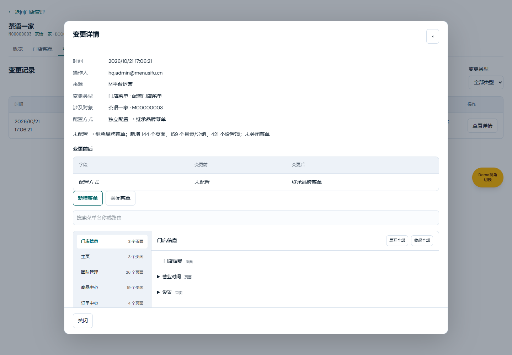

来源：5235门店变更详情弹框。

| 字段／操作 | 逻辑说明 |
| --- | --- |
| 基本信息 | 展示时间、操作人、来源、变更类型、对象及保存的配置方式前后值。 |
| 变更前后 | facts.fields逐项对比；历史未保存则明确说明缺失，不反推当前配置作为历史。 |
| 新增/关闭菜单 | 复用只读菜单树；优先使用日志内choices快照，无快照时按当前目录识别并说明历史识别口径，无法识别菜单独立列出。 |
| 原始记录 | 折叠留存供追溯，不替代中文摘要。 |
| 关闭 | 关闭详情不改菜单、不写审计，焦点返回查看详情按钮。 |

验证：新脚本verify-store-detail-audit.mjs覆盖门店菜单命名、有效树、编辑取消、已保存切换记录、中文摘要、配置方式前后值、菜单增减、弹框关闭及刷新；品牌审计回归保证公共组件默认行为不变，类型和差异检查通过。历史缺失快照不补造。本轮尚未提交/合并/推送。

## 门店所属品牌仅展示（STORE-BRAND-DISPLAY-20261021-45）

产品V1.42／研发V1.41／个人V1.41；基线main@4fff167a，分支codex/store-brand-display-only-20261021。门店管理列表的所属品牌/BID列仅展示，不提供跳转。

| 字段／操作 | 逻辑说明 |
| --- | --- |
| 所属品牌名称 | 仍来自门店归属品牌merchantName，改为普通文本，无链接、按钮、点击事件及Tab焦点，不再跳转品牌门店页。 |
| BID | 保留原merchantBid文本，空值展示破折号，不可点击。 |
| 门店名称与操作 | 门店名称仍跳转原门店详情，配置菜单保持原行为；筛选及品牌管理入口不变。 |
| 写入 | 仅展示调整，无数据、权限、保存或审计变更。 |

验证：所属品牌/BID单元格不含链接，点击不改变路由；门店名称链接仍存在，配置菜单现位于详情页；类型及差异检查通过。历史截图中的品牌链接颜色不再作为当前交互依据，本次纯文本样式截图待更新。尚未提交/合并/推送。

## 新建品牌移至重置后（BRAND-CREATE-LAYOUT-20261021-44）

产品V1.41／研发V1.40／个人V1.40；基线main@81169972（此前已合并未推送），功能分支codex/brand-create-after-reset-20261021，预览5233。用户确认将新建品牌移到重置后，并以更宽间距区分操作区域。

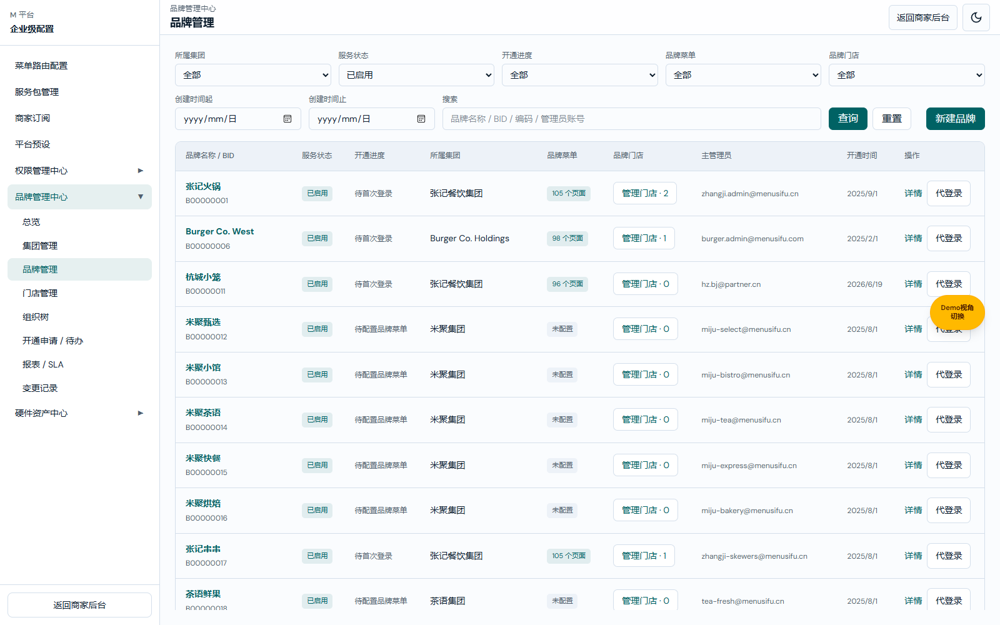

来源：本轮5233品牌管理页面。

| 元素 | 逻辑说明 |
| --- | --- |
| 按钮顺序 | 搜索后依次展示查询、重置、新建品牌。新建品牌仍为跳转原创建页面的链接，不作为表单提交。 |
| 区域间距 | 查询与重置间距8px；重置与新建品牌间距24px（容器8px间距加新建按钮左边距16px），形成筛选操作与创建操作的视觉分组。 |
| 顶部操作行 | 移除原筛选上方新建品牌区域及空白占位，筛选向上排列。 |
| 视觉与适配 | 按钮保持36px高；搜索继续自适应剩余宽度，窄窗口沿用现有换行布局并保留分组间距。 |
| 行为 | 查询、重置、筛选保留及字段顺序不变；门店管理不增加新建品牌；不改创建权限或业务数据写入。 |

验收：品牌操作区顺序查询/重置/新建品牌；宽屏实测间距8px/24px；多窗口无筛选区横向溢出；原查询、重置、日期、返回和门店联动回归通过。配套截图已更新，尚未提交/合并/推送。

## 筛选顺序与搜索操作区（MANAGEMENT-ORDER-20261021-43）

产品V1.40／研发V1.39／个人V1.39；基线main@a57333aa（包含已合并未推送成果），功能分支codex/management-filter-order-20261021，预览5232。用户确认按组织归属、状态、配置、时间、搜索与操作排序。本节替代上一轮具体字段排列及新建按钮位置，筛选数据口径和查询行为不变。

### 品牌管理

来源：本轮5232品牌管理预览。

| 区域／操作 | 逻辑说明 |
| --- | --- |
| 新建品牌操作区 | 当前按BRAND-CREATE-LAYOUT-20261021-44位于重置后方、间距24px；沿用原创建页和权限，不提交查询。 |
| 第一行 | 依次为所属集团、服务状态、开通进度、品牌菜单、品牌门店，均分可用宽度。 |
| 第二行 | 创建时间起、创建时间止、搜索、查询、重置。搜索占较宽空间并紧邻查询/重置，起止日期仍分别标注。 |

### 门店管理

来源：本轮5232门店管理预览。

| 区域／操作 | 逻辑说明 |
| --- | --- |
| 第一行 | 依次为所属集团、所属品牌、门店状态、所属品牌服务状态，均分可用宽度；集团品牌联动不变。 |
| 第二行 | 菜单配置方式、生效菜单、搜索、查询、重置，搜索占较宽空间并紧邻操作。 |

### 公共布局与验收

| 元素 | 逻辑说明 |
| --- | --- |
| 大小 | 保留36px控件高、标签12px、值14px、12px字段间距；操作按钮8px间距，两页无折叠。 |
| 响应式 | 宽窗口两行；<=1200px首行3列、第二行2列换行；<=640px两列，搜索与按钮各占整行。DOM阅读顺序保持一致，不通过CSS改变键盘顺序。 |
| 搜索与操作 | 单一搜索框，回车或查询生效，下拉联动、重置、日期校验及返回保留沿原定义。 |
| 数据及写入 | 仅重排布局；不新增字段、枚举、授权、业务数据或审计。旧会话筛选值继续按字段名恢复。 |

验证：脚本核对品牌字段顺序groupId/status/progress/menu/stores/from/to/query，门店groupId/merchantId/status/brandStatus/mode/menu/query；1600/1280/1024/768下布局无横向溢出，控件高度36px，原筛选回归通过。类型检查及差异检查通过；尚未提交、合并、推送。

## 两页筛选统一平铺与尺寸优化（MANAGEMENT-LAYOUT-20261021-42）

产品V1.39／研发V1.38／个人V1.38；基线main@013e67b8（含此前已合并未推送成果），功能分支codex/management-filter-layout-20261021，预览5231。两页不再使用更多筛选折叠，筛选业务口径、字段、查询/重置、联动、结果和偏好保留不变。

### 品牌管理

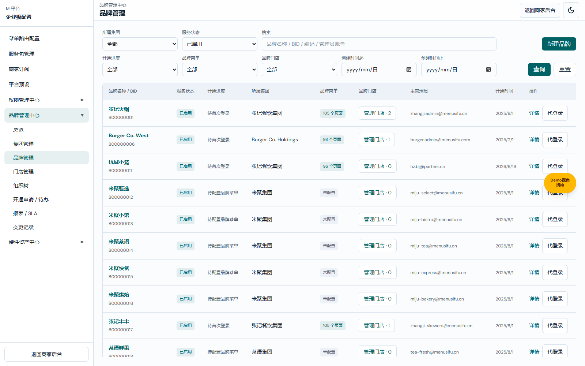

来源：5231功能分支，服务状态为已启用。

| 区域／元素 | 逻辑说明 |
| --- | --- |
| 第一行 | 当前依MANAGEMENT-ORDER-20261021-43为集团、服务状态、开通进度、品牌菜单、品牌门店；新建品牌现移至重置后方。 |
| 第二行 | 当前为创建时间起止、搜索、查询/重置，旧more不再控制显示。 |
| 创建时间范围 | 起止仍独立日期框并清晰标注，默认空，范围校验及UTC日期判定沿用既有规则。 |
| 更多筛选 | 移除按钮和details折叠，重置后全部条件仍可见。 |

### 门店管理

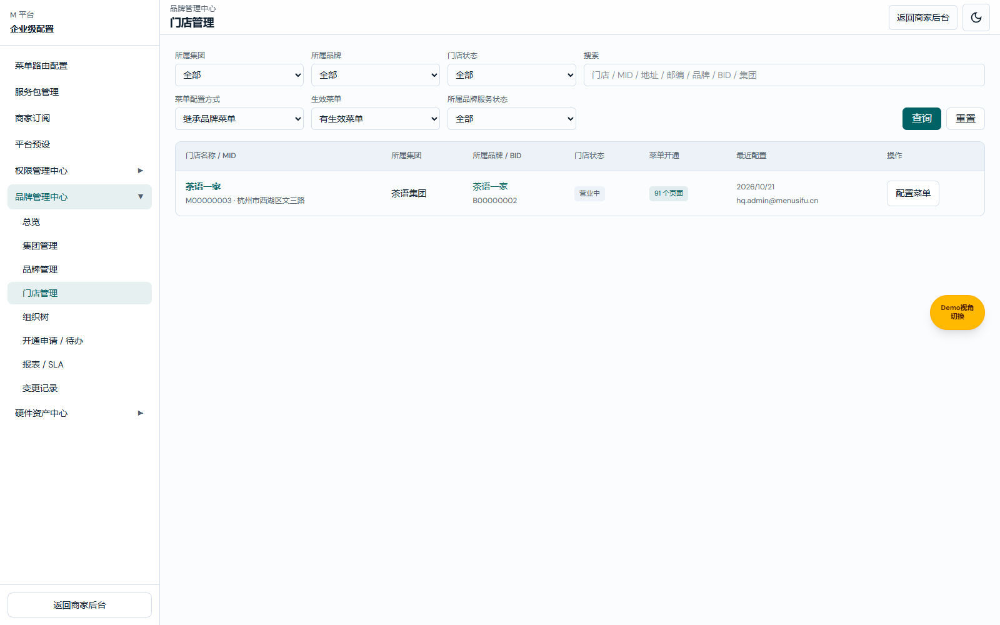

来源：5231功能分支，菜单配置方式为继承且有生效菜单。

| 区域／元素 | 逻辑说明 |
| --- | --- |
| 第一行 | 当前为集团、品牌、门店状态、所属品牌服务状态；不恢复查找品牌输入。 |
| 第二行 | 当前为菜单配置方式、生效菜单、统一搜索、查询/重置。 |
| 菜单及品牌筛选 | 保留原枚举与交集，不因布局修改授权、服务状态或门店配置。 |

### 公共布局与验收

| 元素 | 逻辑说明 |
| --- | --- |
| 控件大小 | 输入框、下拉及按钮统一36px高；标签12px、值14px；字段间距12px、标签与控件4px，无白色外层筛选卡片。 |
| 对齐 | 使用12列网格，两行列边界对齐；常规条件占2列、搜索占6列。按钮按内容宽度，查询/重置8px间距并右对齐。 |
| 窄窗口 | <=1200px切换6列自动换行；<=640px切换2列，搜索单独占行，按钮保留可点击尺寸。筛选区域可纵向滚动，为列表保留空间，控件不造成横向溢出。 |
| 重置与返回 | 仅清空筛选值，不折叠或隐藏字段；两页偏好独立，旧more忽略；返回列表保留已应用条件，业务数据不写入。 |
| 回归 | 验证1600/1280/1024/768宽度控件高度一致、筛选区无横向溢出；查询、重置、日期错误、集团联动、返回保留及筛选后配置菜单继续通过。 |

实现：management-list-filters.ts与独立布局样式management-list-filters.css；未修改存储业务字段和权限接口。本轮已完成类型检查、差异检查和浏览器交互及尺寸验证，尚未提交/合并/推送。

## 门店筛选精简与平铺（STORE-FILTER-20261021-41）

产品V1.38／研发V1.37／个人V1.37；基线main@d1ab308d（此前已合并未推送），功能分支codex/store-filter-simplify-20261021，预览5230。

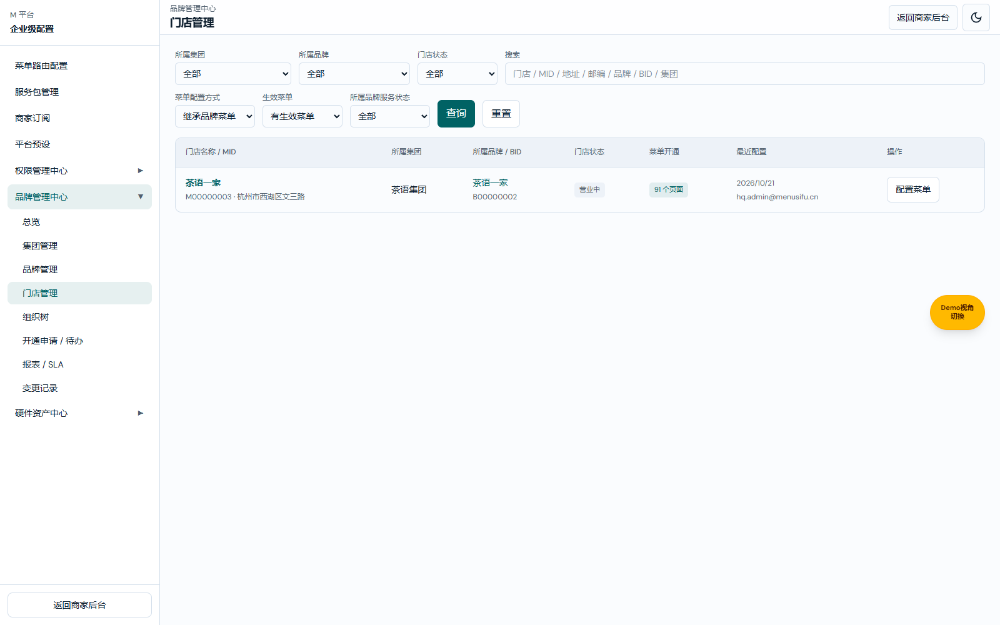

来源：本次5230功能分支，继承且有生效菜单的筛选状态。

| 字段／操作 | 逻辑说明 |
| --- | --- |
| 查找品牌 | 移除独立候选搜索框；不再存在brandQuery条件，旧会话中的该值忽略。保留所属品牌下拉与集团联动，不按已移除的搜索词缩小候选。 |
| 统一搜索 | 门店管理仅保留一个搜索框，覆盖门店名称/MID/地址/邮编并兼容品牌名称/BID/集团等原范围，文案明确展示该范围；回车或查询生效。 |
| 默认展示条件 | 第一行集团、品牌、门店状态、搜索；第二行菜单配置方式、生效菜单、所属品牌服务状态、查询及重置。窄屏换行。所有条件默认可见。 |
| 更多筛选 | 门店管理不再提供折叠入口及展开状态；旧more字段不控制门店可见性。品牌管理现也按MANAGEMENT-LAYOUT-20261021-42直接平铺。 |
| 查询与重置 | 全部可见条件仍取交集；重置全部清空，恢复完整门店范围。条件保留、集团切换清空不匹配品牌及菜单配置按钮保持原逻辑，不新增字段写入或审计。 |

验证：门店不存在brandQuery输入及summary折叠；三项菜单/品牌状态条件默认可操作；集团联动、查询、重置、返回保留、继承生效菜单及筛选后配置菜单正常；品牌更多筛选和日期校验正常。类型检查与verify-management-filters.mjs通过。

## 品牌与门店管理筛选（MANAGEMENT-FILTER-20261021-40）

产品V1.37／研发V1.36／个人V1.36；基线main@964d06b2，功能分支codex/management-filters-20261021，预览5229。以下为当前筛选定义，替代旧列表仅状态、集团和即时搜索的规则；菜单配置弹框内搜索不受影响。筛选只影响列表展示，不写入品牌、门店或权限。

### 品牌管理

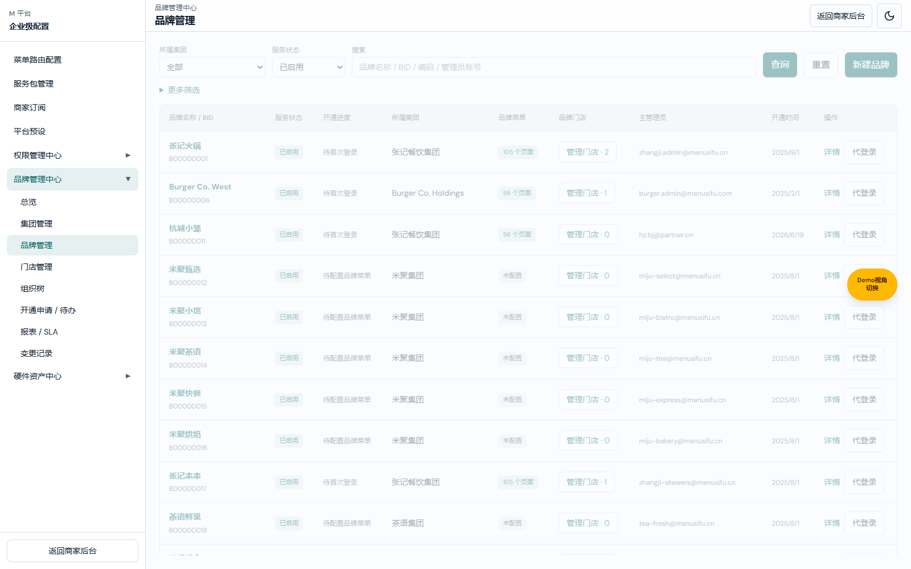

来源：5229功能预览；服务状态筛选为已启用。

| 字段／操作 | 逻辑说明 |
| --- | --- |
| 所属集团 | 下拉，默认全部，来源全部Enterprise集团；按groupId精确匹配。 |
| 服务状态 | 默认全部；待启用、已启用、已暂停、已关闭，沿用已有服务状态归并规则；与开通进度独立取交集。 |
| 搜索 | 输入框默认空；品牌名称、BID、编码及所有已开通管理员/账号邮箱含历史primaryAdminEmail，忽略大小写、去首尾空格的包含匹配；输入不立即改变结果，回车或查询生效。 |
| 其余筛选条件 | 当前按MANAGEMENT-LAYOUT-20261021-42默认平铺，不再提供折叠。 |
| 开通进度 | 默认全部；待开通管理员、待配置品牌菜单、待首次登录、已首次登录、初始化已完成；直接复用brandOnboardingProgress的优先级，不根据服务状态推导。 |
| 品牌菜单 | 全部／未配置／已配置；以当前品牌开通范围存在至少一个isPage节点判定，只有目录不算已配置。 |
| 品牌门店 | 全部／无门店／有门店；按getMerchantStores当前归属门店数量是否大于0判定，独立于营业状态。 |
| 创建时间起 | 可空，日期；createdAt的ISO日期部分UTC大于等于起日。不替代列表原开通时间字段。 |
| 创建时间止 | 可空，日期；createdAt的ISO日期部分UTC小于等于止日，两端包含。起止任一可单独填写；起日大于止日时显示错误，不执行查询、不覆盖已应用条件。 |
| 新建品牌 | 沿用原独立创建页及当前权限，不触发查询。 |

### 门店管理

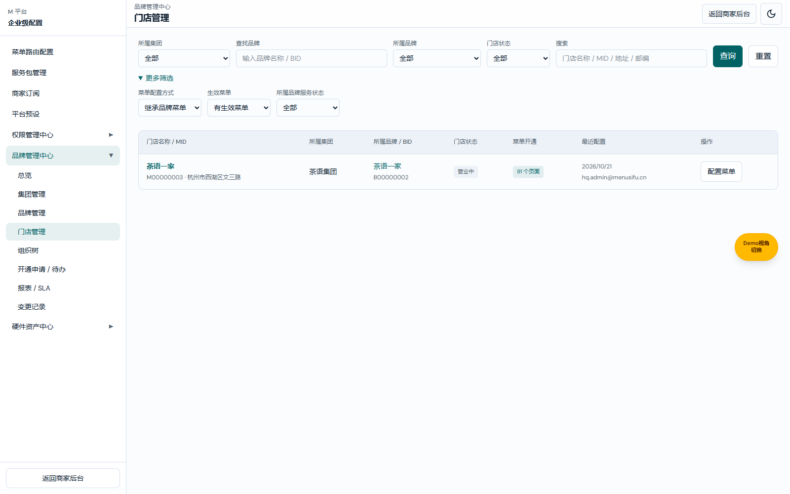

来源：5229功能预览，展示更多筛选。

| 字段／操作 | 逻辑说明 |
| --- | --- |
| 所属集团 | 默认全部集团；选择后所属品牌仅列出同集团可见独立品牌；不匹配的已选品牌清空，匹配项保留。 |
| 品牌查找 | 独立输入框已移除，当前使用所属品牌下拉或统一搜索；见STORE-FILTER-20261021-41。 |
| 所属品牌 | 默认全部；按merchantId精确过滤门店；候选沿用品牌管理排除门店挂载租户的范围。 |
| 门店状态 | 全部／营业中／筹备中／停业／已归档；沿用store.status，区别于品牌服务状态。 |
| 搜索 | 门店名称、MID、地址、邮编优先，兼容品牌名称/BID、集团名、门店编码、区域名与挂载品牌名；不区分大小写的包含匹配，回车或查询生效。缺失地址/邮编不补造内容。 |
| 菜单配置方式 | 默认直接展示；全部／继承品牌菜单／独立配置。menuMode=inherit为继承；旧记录未设menuMode或未有配置快照按独立配置处理，沿用已有兼容规则，不迁移数据。 |
| 生效菜单 | 默认直接展示；全部／无生效菜单／有生效菜单；读取getStoreCapability当前有效enabledKeys并统计isPage节点，继承门店按品牌门店视角动态范围计算。此条件不代表品牌服务已启用。 |
| 所属品牌服务状态 | 默认直接展示；全部／待启用／已启用／已暂停／已关闭，读取门店归属品牌状态并按既有serviceStatus归并；不修改门店营业状态。 |

### 两页公共行为与研发口径

| 字段／操作 | 逻辑说明 |
| --- | --- |
| 查询 | 提交当前全部条件；不同条件取交集，空值表示不限。下拉条件变化立即应用当前表单；搜索框输入本身不触发过滤。 |
| 重置 | 清空全部条件；品牌与门店管理都保持条件平铺，刷新全部可见列表；不是恢复默认业务配置，不写审计。 |
| 返回保留 | 应用条件以字符串对象写入sessionStorage：menusifu:management-filters:v1:brand或store。两页独立，详情返回、刷新和当前标签页内跳转保留；不承诺跨浏览器持久化。关闭页面不触发未保存提示。 |
| 无结果 | 使用现有暂无匹配品牌／门店状态；不改变筛选输入，可继续查询或重置。 |
| 权限与数据范围 | 品牌仍跨Enterprise且排除连锁挂载门店租户；门店仍汇总跨Enterprise/集团/品牌；所有页面沿用现有入口权限，无额外授权。 |
| 行操作 | 当前按STORE-ACTIONS-20261021-47展示详情与代登录，配置菜单移至门店详情；对象按MID查找，不按行号。 |
| 异常 | 日期倒置仅展示错误并保留上次结果；本地筛选偏好读取失败按空条件恢复，存储不可用不阻断列表查询。 |

验收算例：已启用+待首次登录只保留同时满足条件品牌；2030-01-01起、2020-01-01止阻止查询；MID精确字符串只命中对应门店；集团A切换B清除A品牌；继承+有生效菜单只保留继承且有效页面非空门店；详情返回保留条件；重置恢复完整可见范围。已通过类型检查、浏览器搜索/查询/重置/倒置日期/状态/返回/集团品牌联动/品牌候选搜索与生效菜单组合验证；测试脚本scripts/verify-management-filters.mjs。无生产后端筛选接口变更。

## 移除门店管理顶部组织树入口（STORE-LAYOUT-20261021-39）

产品V1.36／研发V1.35／个人V1.35，基线main@1ed6436f（含此前已合并未推送提交）。门店管理移除顶部「组织树视图」快捷按钮及空容器，筛选区直接位于内容顶部；侧栏组织树入口、原路由、筛选条件、数据范围及权限保持不变。无新增字段、状态或写入。验收：页面顶部无该按钮及占位，筛选与门店列表正常展示。

## 门店详情独立全屏（STORE-DETAIL-20261021-38）

产品V1.35／研发V1.34／个人V1.34。基线main@c078a864，承接本轮未提交的管理入口名称调整。门店管理中点击门店名称，默认进入概览独立全屏页；不显示M平台侧栏及外层标题栏。详情页保留门店名称、MID、所属品牌、概览／门店菜单／变更记录及返回门店管理入口。子页签、刷新和直接访问沿用相同全屏布局；返回后恢复管理列表框架。既有路由、权限、数据、编辑和保存规则不变，未知门店继续展示未找到提示。不新增数据字段、状态或写入。验收覆盖名称点击、三页签、刷新及返回。

图片来源：本轮5227功能分支门店概览。

## 导航名称调整（BRAND-LABEL-20261021-37）

品牌管理中心侧栏及对应页面标题统一使用「品牌管理」「门店管理」，分别替代「品牌列表」「门店列表」；对应总览入口和返回链接同步更新。路由地址、筛选、权限及数据范围保持原定义。产品V1.34／研发V1.33／个人V1.33，基线main@c08e69cc。验收：两个入口显示新名称，点击仍进入原路由。历史截图保留原名称，本次文案截图待更新。

## 品牌服务状态与开通进度（BRAND-SERVICE-20261021-36）

产品V1.33／研发V1.32／个人V1.32，共同变更编号BRAND-SERVICE-20261021-36。基线main@e41eb94f，分支codex/brand-service-lifecycle-20261021；功能预览5225；本轮已获授权提交、合并main并推送GitHub。本节替代旧品牌六态生命周期、待引导可登录和30天自动关闭的有效定义；不改变门店营业状态、菜单授权模型和业务数据。存储与鉴权仍是当前本地原型，生产服务端、POS终端和嵌入子应用离线会话不在本次联动范围。

### 品牌列表 → 服务状态与开通进度

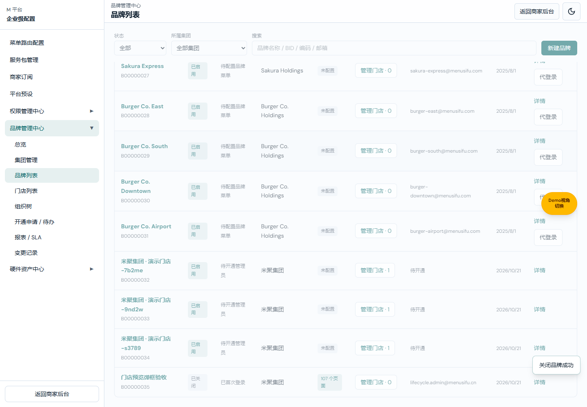

来源：本次5225功能分支，包含旧品牌及测试品牌的列表。

| 字段／操作 | 逻辑说明 |
| --- | --- |
| 服务状态 | 四种业务含义：待启用、已启用、已暂停、已关闭。表示是否提供商家后台访问，不代表门店营业、不代表管理员账号自身启停，也不以菜单数量自动推断状态。 |
| 状态筛选 | 默认全部；支持上述四态。旧draft/onboarding都归待启用；旧closing归暂停，不增加新的关闭中选项；状态筛选与集团、搜索保持原联动。 |
| 开通进度 | 单独一列，不决定是否授予访问。依序判定：无有效管理员为待开通管理员；无品牌页面为待配置品牌菜单；已有初始化完成时间为初始化已完成；否则有首次登录记录为已首次登录；其余待首次登录。 |
| 已启用但进度未完成 | 允许存在，例如已启用但尚未首次登录。旧已启用品牌不因资料/菜单历史缺失被本次读取自动停用，进度如实提示；以后恢复服务需满足新校验。 |
| 详情 | 沿用列表详情进入概览；服务状态操作统一在概览，列表不增加密集操作按钮。 |
| 代登录 | 仅已启用且具备可用管理员时展示/允许；待启用、已暂停、已关闭、旧closing均不能代登录。 |
| 新建品牌 | M平台三步创建完成后默认待启用，进入品牌管理员页继续开账号，随后在概览明确启用。不提供旧“立即激活/跳过onboarding”复选框。门店仍允许零家、创建后补关联。 |

### 品牌概览 → 服务状态区域

来源：5225，零门店品牌已启用，真实首次登录后。

| 字段／操作 | 逻辑说明 |
| --- | --- |
| 服务状态标题 | 显示当前业务状态。已启用提供暂停服务/关闭品牌；待启用提供启用品牌；已暂停提供恢复服务/关闭品牌；已关闭无恢复按钮。 |
| 开通进度 | 读取列表同一规则；首次登录不自动启用品牌，初始化完成也不自动启用。 |
| 最近原因 | 显示最近服务操作原因；合同到期自动暂停时显示系统暂停原因，而不是旧恢复原因。 |
| 影响提示 | 暂停/关闭停止当前品牌及全部门店的商家后台访问，保留菜单、门店、角色、账号与业务数据；恢复后沿用原权限，不额外授权。门店营业状态不随之变化。 |
| 待完善提示 | 待启用时列缺少的品牌资料、有效管理员、菜单或到期条件。读取和提示不保存、不产生未保存修改。 |
| 合同续期 | 沿用原续期入口和合同字段；续期仅解除到期条件，不自动恢复服务，运营需明确点击恢复。旧restoreActive参数不再作为自动恢复依据。 |
| 历史关闭待处理 | 旧closing记录保留原码和日期，展示“已暂停（历史关闭待处理）”及明确提示；读取不再执行冷静期自动关闭。可按恢复/关闭处理，未知原状态不自动恢复成已启用。 |

### 启用品牌 → 校验未完成

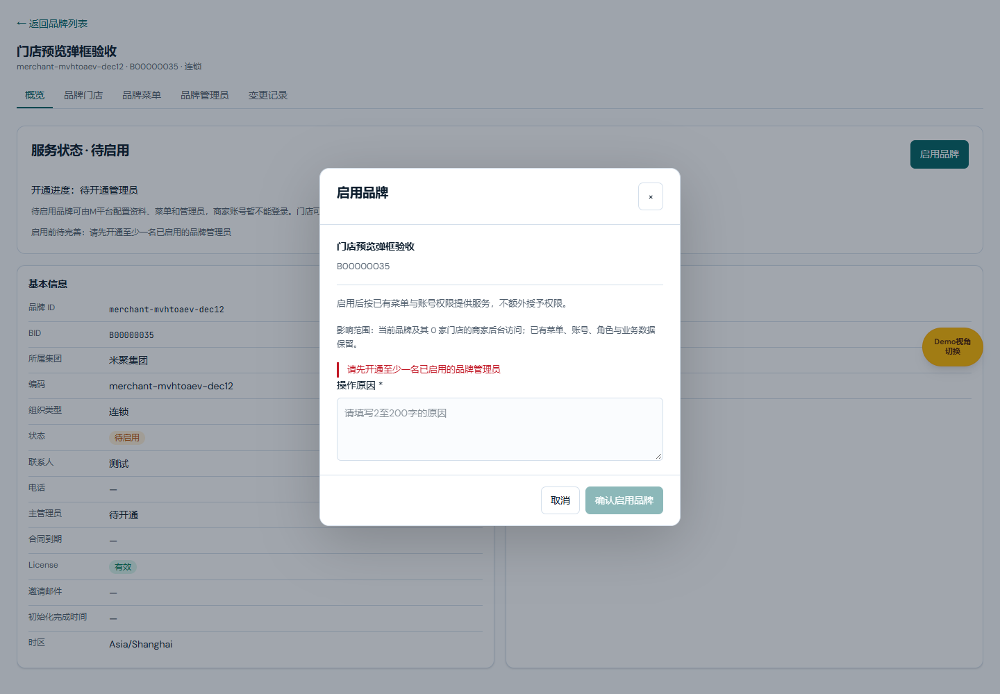

来源：5225，品牌已创建、尚未开管理员。

| 字段／操作 | 逻辑说明 |
| --- | --- |
| 校验项 | 品牌名称、所属集团、联系人齐全；至少一个已启用品牌Admin；至少一个已开通isPage菜单；已设置合同到期日时必须为有效日期且不能过期。不要求已有关联门店。 |
| 既有管理员 | 无显式账号覆盖、且旧品牌原主管理员邮箱存在时保留既有Admin兼容；同邮箱已创建显式账号时按显式启停，不用旧邮箱回退绕过停用。 |
| 错误清单 | 所有未满足项同时列出；确认按钮禁用。关闭后去相应页补齐，再重新打开校验，不在弹框中自动创建或授权。 |

### 启用品牌 → 确认启用

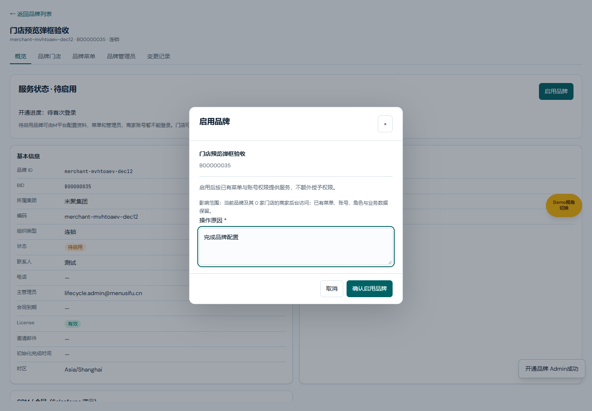

来源：5225，已开管理员及菜单的零门店品牌。

| 字段／操作 | 逻辑说明 |
| --- | --- |
| 操作对象 | 展示品牌名称、BID；不能在弹框内切换品牌。 |
| 影响范围 | 品牌及门店数量，只描述商家后台范围，不承诺禁用POS离线终端或外部应用会话。 |
| 操作原因 | 必填，trim后2至200字，默认空；空白、过短/过长不写入。四种操作均适用。 |
| 确认启用 | 仅待启用可操作；点击重新校验权限、版本和全部启用条件。成功转已启用并记录首次启用时间；不自动授予未开菜单，也不自动新建账号/角色。 |
| 失败/取消 | 校验失败保留输入并在弹框提示，不转状态、不生成成功日志。未输入取消直接关闭，有输入沿用继续编辑/放弃修改确认。 |

### 暂停服务 → 确认暂停

来源：5225，已启用品牌暂停确认。

| 字段／操作 | 逻辑说明 |
| --- | --- |
| 前置状态 | 仅已启用可暂停。按钮及确认使用危险操作样式。 |
| 原因/确认 | 沿用启用确认公共字段、2至200字、失败和取消规则；确认后转已暂停，记录暂停原因、操作者与前后状态。 |
| 访问与数据 | 新登录拒绝；已有品牌身份的后续页面和权限访问拒绝；代登录拒绝。保留原门店、菜单和管理员启用值，不能用批量停用账号代替暂停品牌。 |
| 系统暂停 | 既有到期自动暂停规则保留，实际暂停时记录品牌服务类型、系统操作者、前后状态和到期原因。自动暂停标志关闭的旧已启用品牌不因此额外自动停用。 |

### 恢复服务 → 确认恢复

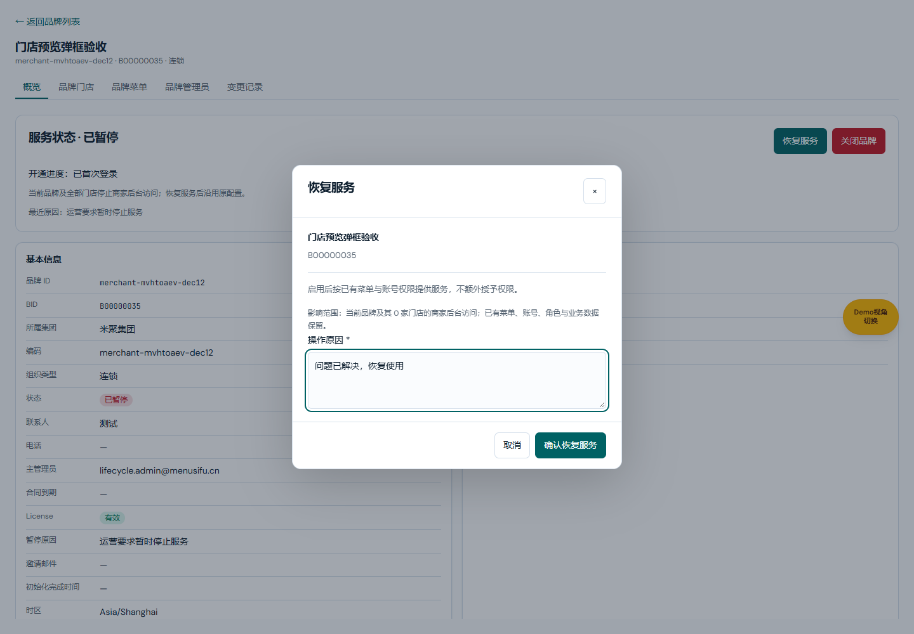

来源：5225，问题解决后恢复服务。

| 字段／操作 | 逻辑说明 |
| --- | --- |
| 前置状态 | 已暂停，含旧closing的暂停投影；已关闭不允许恢复。 |
| 恢复条件 | 重新检查资料、可用Admin、品牌页面、合同有效期；即使暂停时配置完整，也不使用旧快照绕过检查。合同未续期仍拒绝。 |
| 结果 | 原因必填，成功转已启用；清除当前暂停标志、保留最近恢复原因，按原独立/继承菜单及账号/角色配置恢复。后续正常登录按原账号密码，暂停期间不重设密码。 |

### 关闭品牌 → 确认关闭

来源：5225，已启用品牌明确终止服务。

| 字段／操作 | 逻辑说明 |
| --- | --- |
| 前置状态 | 仅已启用或已暂停；待启用不提供关闭按钮，已关闭不重复执行。 |
| 确认内容 | 明确关闭后本页无恢复入口，停止商家后台访问，数据和配置保留；填写原因后确认，不再新建30天冷静期。 |
| 结果 | 转已关闭并记录关闭时间与原因；不删除门店、账号、角色、菜单或业务数据，不声称已完成财务结算或外部资源回收。 |
| 旧强制关闭入口 | 当前UI移除，旧发起冷静期/立即归档函数拒绝调用，避免绕过原因和新服务检查。旧取消关闭只能保留暂停，不自动激活。 |

### 登录页 → 待启用品牌

来源：5225，真实登录表单提交已开通但品牌未启用的管理员。

| 字段／操作 | 逻辑说明 |
| --- | --- |
| 登录限制 | 待启用提示联系平台启用；暂停提示服务已暂停；关闭提示品牌已关闭。显式账号和原主管理员邮箱均受品牌状态约束，不能由演示邮箱回退放行。 |
| 已启用账号 | 仍校验账号启用与密码，再按原菜单/角色/门店权限登录；品牌状态不替代账号权限。 |
| 首次登录进度 | 真实登录成功后记录账号lastLoginAt与品牌firstLoginAt；已有初始化完成标记沿用。仅更新登录元数据，不作为服务启用动作或状态变更审计。登录元数据不会造成无编辑提示，也不参与菜单/服务配置冲突版本。 |

### 变更记录 → 品牌服务

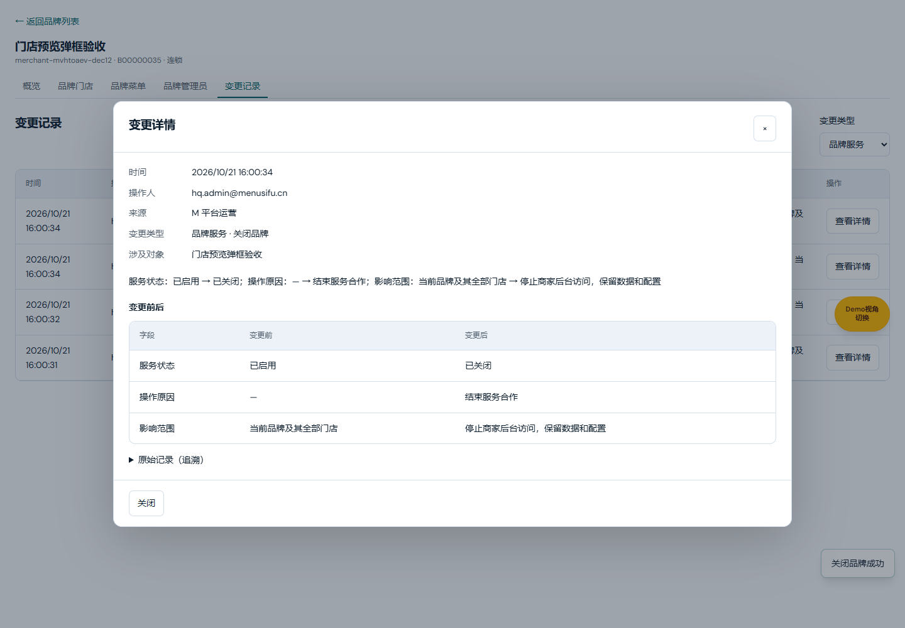

来源：5225，关闭品牌审计记录。

| 字段／操作 | 逻辑说明 |
| --- | --- |
| 类型筛选 | 在品牌门店、品牌菜单、品牌管理员之外新增品牌服务类型，不把状态操作归入管理员启停。 |
| 详情 | 显示具体品牌、操作者、M平台入口/系统、操作名称、服务状态前后值、原因与影响范围。四个手动动作分别为启用品牌/暂停服务/恢复服务/关闭品牌。 |
| 成功/失败 | 一次有效操作写一次日志，重复或非法状态、取消、条件不满足、并发冲突不写成功记录；不创建审批通过或数据删除等虚构结果。 |

### 研发对象、兼容与验收

MerchantStatus保留draft/onboarding/active/suspended/closing/closed以读取旧数据；serviceStatus投影为onboarding/active/suspended/closed，中文待启用/已启用/已暂停/已关闭。新增可选serviceReason:string、firstLoginAt:ISO时间；既有updatedAt、activatedAt、closedAt及suspendedReason沿用。新M平台创建传activateImmediately:false；旧已启用数据和程序化种子不批量改为待启用。账号enabled与品牌status各自存储，不迁移授权或自动新增菜单。

手动操作统一调用transitionBrandService(id, action, reason, expected)，action为activate/suspend/resume/close；服务版本组合品牌/路由/门店配置与品牌访问配置版本，品牌配置版本现包含服务相关品牌数据，但排除firstLoginAt。API状态修改也要求reason及expected并走同一入口，不再任意PATCH枚举。入口要求已登录M平台、当前身份不是商家品牌账号；本地前端校验不冒充生产服务端授权。状态转换与审计在同次配置持久化，失败保留草稿；恢复条件在提交时再次校验，防止过期Admin/菜单配置或合同变化。

配置、账号、门店、菜单及业务数据在暂停/关闭中保留；品牌已关闭后M平台仍可查看既有配置和历史，当前无重新开通业务；本次不调整各配置页原有M平台维护权限。无需门店也可启用，至少一页菜单和有效Admin为必需。旧待引导/draft不再允许商家登录；旧closing不自动到期关闭或获得只读访问。旧初始化完成函数只记录已启用品牌的完成进度，不再激活待启用品牌。未来如需关停审批、撤销关闭、POS全终端强制断开或账务结清检查需独立确认，不属于已实现范围。

验证：浏览器真实创建待启用测试品牌；缺Admin阻止启用；开通Admin后仍不能登录；零门店完成启用；真实登录写首次登录进度；编辑原因后取消不写入；暂停、恢复、关闭及重复关闭限制；暂停的后续访问/新登录/代登录拒绝；商家身份不能发起服务状态操作；菜单并发导致恢复失败；恢复保留原菜单与账号；菜单缺失与到期条件阻止启用；旧关闭倒计时过期读取不自动关闭；品牌服务审计四条且准确；自动到期暂停有系统审计，续期不自动恢复，明确恢复成功。另回归管理员审计、品牌菜单预览、门店批量/只读查看和TypeScript。未修改eMenu源码或嵌入构建产物，未执行生产发布。

## 品牌列表详情入口（BRAND-SERVICE-20261021-36）

本次基线main@52529664，分支codex/brand-list-detail-entry-20261021，功能预览5224；本轮已获授权提交、合并main并推送GitHub。产品V1.32／研发V1.31／个人V1.31，共同变更编号BRAND-LIST-DETAIL-20261021-35。

### 品牌列表 → 操作

来源：本次功能分支5224，品牌列表。

| 字段／操作 | 逻辑说明 |
| --- | --- |
| 详情 | 替换操作列“品牌管理员”直达入口，文案为详情；href由merchantDetailHref(merchantId)生成，使用本行品牌ID和默认overview，不附加accounts子路径。 |
| 其他入口 | 品牌名称链接仍进入概览；管理门店、品牌菜单、代登录及其权限、状态、目标上下文均沿用原规则。 |
| 点击结果 | 进入当前品牌独立详情，概览为默认激活页签，不打开管理员页。品牌名称、BID与返回列表入口沿用原布局。 |

### 品牌详情 → 默认概览

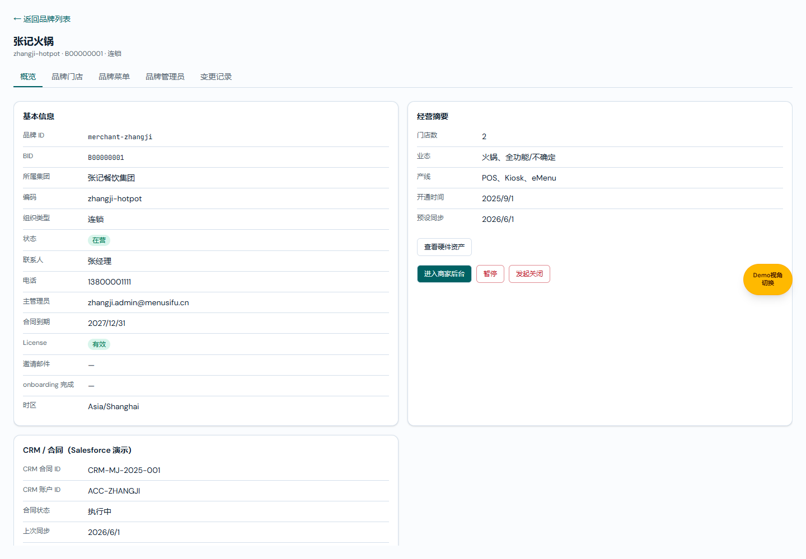

来源：功能分支5224，从列表“详情”点击进入。

| 字段／操作 | 逻辑说明 |
| --- | --- |
| 概览 | 默认选中，展示对应品牌基本信息和经营摘要。 |
| 品牌管理员页签 | 详情内保留原品牌管理员页签、accounts路由和权限，用户可从此进入管理员管理。只移除列表中的直达入口。 |
| 数据副作用 | 纯导航，无配置、授权、保存或日志写入。既有路由和业务模型未新增。 |
| 验收 | 品牌列表每行操作区不含品牌管理员，含详情；详情href等于本行品牌名href；点击进入正确概览、页签高亮；详情品牌管理员页签仍存在。浏览器与类型检查通过。 |

## 品牌菜单独立变更预览（BRAND-MENU-PREVIEW-20261021-34）

版本记录：产品V1.31／研发V1.30／个人V1.30。基线main@4ab620f4（已获取远端CI产物更新）；分支codex/brand-menu-change-preview-20261021，功能预览5223，本轮已获授权与三类变更审计修复共同提交、合并main并推送GitHub。范围仅品牌菜单编辑后的预览展示与确认交互，沿用权限、保存、继承和版本规则。

### 品牌菜单 → 编辑品牌菜单 → 预览配置

来源：功能分支5223，演示品牌新增员工打卡页面。

| 字段／操作 | 逻辑说明 |
| --- | --- |
| 预览配置 | 替换原“预览变更”按钮。点击读取当前草稿，在版本仍一致时打开独立原生弹框；编辑器不再追加底部扁平清单，不将按钮变成第二阶段确认保存。 |
| 标题与品牌 | 标题“品牌菜单配置预览”，显示当前品牌名；布局、菜单树和底部固定按钮沿用门店菜单预览形式。 |
| 新增／关闭数量 | added=next减before，removed=before减next，单位项为菜单节点，包含目录、页面及设置项；只反映这次草稿和打开编辑器时配置的差异。预览不改写草稿与配置。 |
| 本次新增 | 默认选中；仅展示added及只读树所需的祖先路径。空态“本次没有新增菜单。”。 |
| 搜索与层级 | 复用品牌菜单只读树：中文分类、页面数量、父子层级、菜单名称/路由搜索、展开全部/收起全部；无复选框，不允许在预览中授权。 |
| 返回修改 | 仅关闭预览，保留编辑器分类、菜单勾选与草稿，焦点回到“预览配置”。再次预览重新读取当前草稿。 |
| 关闭预览／Esc | 同返回修改，不触发保存、不增加日志、不清空选择。 |

### 本次关闭与确认保存

来源：功能分支5223，演示品牌关闭考勤记录页面。

| 字段／操作 | 逻辑说明 |
| --- | --- |
| 本次关闭 | 切换展示removed的只读树，新增节点不混入；空态“本次没有关闭菜单。”。页签不含完整生效菜单。 |
| 受本次关闭影响的门店 | 默认折叠，统计当前有效菜单含removed任一键的门店，展开显示门店名称/MID；无影响显示0家及无。本指标仅表示关闭影响，不表示品牌新增菜单的同步影响。 |
| 确认保存 | 保存预览打开时next快照；按钮处理期间禁用并设防重标记，关闭后的按钮不可再次保存。保存沿用M平台权限及品牌/门店/路由版本校验；成功关闭预览和编辑器，刷新品牌菜单并提示成功。 |
| 保存失败 | 错误显示在预览弹框内，保留预览和原草稿，支持返回修改；版本冲突不得覆盖其他操作者配置。 |
| 预览前版本变化 | 在编辑器提示品牌或门店配置已更新，不打开过期预览，保留原勾选。 |
| 无变化预览 | 新增/关闭均显示0项及对应空态；不虚构变化，保存行为沿用当前业务服务。 |
| 编辑器关闭 | 无编辑直接关闭，有编辑仍使用既有独立放弃确认；编辑器关闭同步清理其预览，不遗留遮罩。 |
| 窄屏 | 验证768×700下确认保存按钮可见，预览正文独立滚动。 |

研发与验收：next/added/removed/choices/version在单次预览中固定；只切换filter不修改数据。预览实例是编辑器的临时状态，关闭清理并恢复焦点；save调用原saveExplicitBrandMenus，未修改服务接口和权限数据模型。浏览器已覆盖新增/关闭树准确分离、预览无写入、Esc和返回保留选择、确认保存、继承门店同步、空变化、窄屏和并发冲突，另回归门店预览和关闭确认、类型检查、diff检查。未修改嵌入包或构建边界，无生产构建/部署声明。

## 三类品牌变更审计修复（BRAND-AUDIT-20261021-33）

版本记录：产品V1.31／研发V1.30／个人V1.30，三份共同变更编号BRAND-AUDIT-20261021-33。基线main@97518e86；分支codex/brand-audit-complete-20261021；功能预览5222；本轮已获授权与品牌菜单独立预览共同提交、合并main并推送GitHub。范围为品牌门店、品牌菜单、品牌管理员操作的记录与展示，不改变管理权限和菜单上限；成功且有实际改变才新增业务记录，取消与失败不伪造成功。

### 品牌详情 → 变更记录列表

来源：功能分支5222，演示品牌完成管理员及菜单操作后的记录列表。

| 字段／操作 | 逻辑说明 |
| --- | --- |
| 变更类型 | 默认全部类型，支持品牌门店、品牌菜单、品牌管理员、其他；仅筛选当前品牌日志，不改变数据。筛选无结果显示暂无变更记录。 |
| 时间 | 按记录ISO时间倒序、本地格式显示；批次以最新逐店时间排序，不以相近时间猜测合并。 |
| 操作人 | 实际执行账号邮箱，与被修改管理员的账号分开。 |
| 类型 | 按操作事实分类；无法确定的旧记录归其他，不虚构分类或对象。 |
| 操作 | 显示关联门店、配置门店菜单、修改品牌菜单、开通管理员、修改管理员资料、重设管理员密码、启用管理员、停用管理员。 |
| 涉及对象 | 门店名称与MID；品牌菜单为保存时品牌名称；管理员为保存时姓名与登录邮箱。新批次显示N家门店，详情展开全部名单。 |
| 变更摘要 | 菜单显示新增／关闭的页面、目录/分组、设置项分类数，不以节点总数冒充页面；品牌菜单补充影响门店数。模式变化但菜单不变时明确显示模式前后值及“菜单范围不变”。管理员开通、重设和资料变更采用各自动作结果。摘要过长截断，详情保留全文。 |
| 查看详情 | 打开与操作类型匹配的只读弹框，不将所有动作都解释成“未保存菜单明细”。关闭和Esc回到列表，无版本、配置或日志写入。 |

### 品牌管理员 → 变更详情

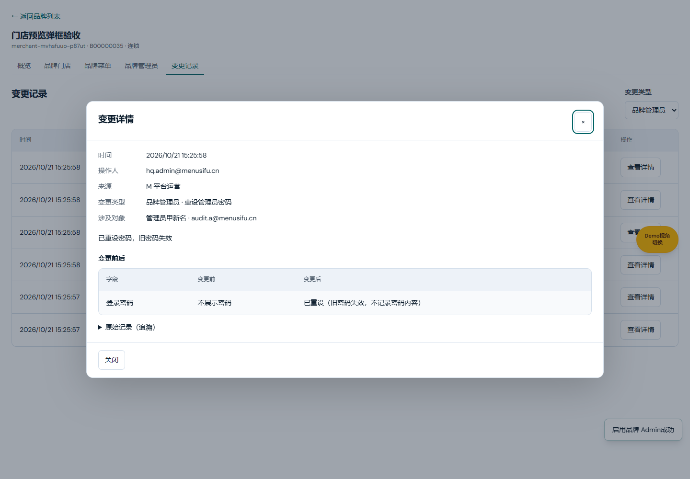

来源：功能分支5222，真实开通、改名后重设密码的记录。

| 字段／操作 | 逻辑说明 |
| --- | --- |
| 操作信息 | 显示时间、操作人、来源M平台运营、具体动作及目标姓名/登录邮箱，防止把操作者当作被修改者。 |
| 开通管理员 | 显示姓名、登录账号、账号状态从未开通到已开通值；摘要写已开通并启用。密码内容不进入审计。 |
| 修改资料 | 仅列实际变化字段及前后值，例如姓名“管理员甲→管理员甲新名”。资料原样保存不写日志、不递增版本。 |
| 重设密码 | 只记录已执行重设、旧密码失效，不记录旧值、新值、长度、摘要或密码散列；即使输入与原密码相同，执行重设动作仍记一次。 |
| 停用／启用 | 账号状态“已启用→已停用”或反向；停用最后一名有效管理员被阻止时不写记录。 |
| 取消 | 编辑姓名后取消并放弃，保持账号、版本与日志不变。 |
| 旧记录 | 优先使用原有脱敏before/after账号快照恢复明确的姓名/邮箱/状态差异。仅一个明确变化账号才识别对象；解析失败或历史密码操作无法判断账号时标“历史记录未保存具体账号”，不从当前管理员列表猜测。 |

### 品牌门店 → 关联与配置详情

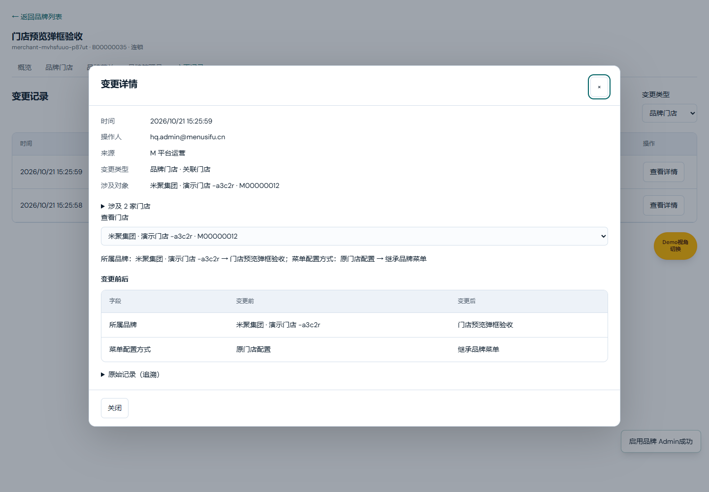

来源：功能分支5222，同次关联两家门店的记录。

| 字段／操作 | 逻辑说明 |
| --- | --- |
| 关联门店 | 同一请求的逐店原始日志共用operationId，列表聚合一行；详情按名称/MID列全对象，下拉逐店核对归属前值、目标品牌及默认继承方式。 |
| 门店配置 | 显示继承／独立方式前后值与菜单增减。继承切独立、相同菜单时仍是实际配置变化，写“菜单范围不变”，不是0项增减难以理解。 |
| 批量配置 | 按同一操作ID合并。摘要显示新增菜单有几家、关闭菜单有几家，详情逐店核对；不相加重复菜单冒充统一菜单数量。 |
| 原样保存 | 已配置门店方式相同且有效菜单集合相同则不更新该店、不生成审计。全部目标均无变化不持久化配置；部分目标变化仅记录实际变化门店。旧未配置门店首次保存仍记录。 |
| 菜单树 | 菜单增减沿用保存时目录快照和中文层级，支持分类/搜索/展开收起；未知历史编码单列历史菜单保留追溯。非菜单关联不显示菜单增减按钮。 |

### 品牌菜单 → 变更详情与门店影响

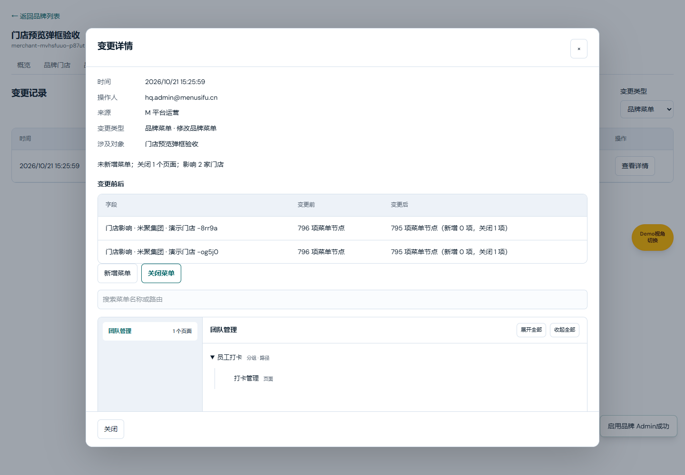

来源：功能分支5222，关闭员工打卡页面，继承与独立门店均受品牌上限影响。

| 字段／操作 | 逻辑说明 |
| --- | --- |
| 品牌范围变更 | 显示品牌菜单新增/关闭明细及保存时品牌名称，按页面、目录/分组、设置项区分，树保留路径祖先但统计只计算实际变更键。 |
| 来源 | 界面操作明确为M平台运营；直接未标注入口的调用显示未标注入口，不根据操作者邮箱猜测来源。 |
| 门店影响 | 保存前后分别计算每家已配置门店的有效菜单；仅变化者列入影响表，显示名称、前后节点数、各自新增和关闭数量。继承自动同步；独立配置仍受上限收缩约束，不自动获得新增菜单。 |
| 原样保存 | 品牌已处于显式授权且菜单键集合一致，直接返回，不递增版本、不生成审计。旧授权模式转显式属于配置变化，沿用原规则。 |
| 通用空与追溯 | 没有新增／关闭则显示对应空态。原始记录默认折叠；历史缺失前后值明确标注，不以当前对象状态代替过去。 |

### 研发数据与验证

MerchantChangeLogEntry及品牌访问Audit新增可选facts：category（品牌门店/品牌菜单/品牌管理员/其他），title、target、source（字符串），operationId（可选），fields（name/before/after字符串数组）。facts与原日志在同一次配置持久化中写入，沿用版本与权限前置校验；新管理员日志仍保留原脱敏快照，原始密码不得进入facts或before/after。AdminAuditContext只用于品牌管理员保存，含入口、accountId与明确操作create/profile/password/enable/disable；不替代鉴权。菜单日志保留既有menuChange目录快照和键集合。

菜单保存的无变化判断按集合和配置方式比较，先完成版本与授权范围校验，不能用无变化分支绕过错误。管理员无变化判断在邮箱唯一、角色/门店约束等校验后进行。关联门店不伪造旧菜单清单，归属和默认继承事实单独展示。字段快照、批次信息增加本地演示存储，生产服务未接入。

复现证据：主线97518e86上同一浏览器脚本在开通管理员后无法读取审计对象/类别；修复后真实页面覆盖开通两账号、原样保存、取消、改名、密码重设、停用/启用、最后有效管理员拦截、模式变化但菜单不变、品牌收缩影响、关联批次、类型筛选、历史脱敏快照恢复及密码不泄露。另回归旧菜单日志、门店预览/只读查看、权限领域与类型检查。本地生产构建不涉及构建边界，未执行；没有声称CI或部署完成。

## 历史变更记录（BRAND-CHANGELOG-20261021-31）

旧版于V1.29/V1.28建立菜单日志中文树和批次投影，未完整利用管理员快照，非菜单动作统一缺失提示。本次由BRAND-AUDIT-20261021-33替代其有效规则；既有原始日志与Git历史保留，不回写伪造旧字段。

## 门店生效菜单入口与变更预览（STORE-EFFECTIVE-MENU-20261021-32）

本次为批量预览功能的续作，基线main@29a9348f，分支codex/store-menu-batch-preview-20261021，功能预览5220；本轮已获授权与变更记录可读化共同提交、合并main并推送GitHub。

### 品牌门店 → 查看生效菜单

来源：本次功能分支5220，继承模式门店，团队管理分类。

| 字段／操作 | 逻辑说明 |
| --- | --- |
| 查看生效菜单 | 位于品牌门店列表每行操作区、配置菜单前；M平台运营与有品牌管理权限的品牌Admin可用，沿用管理鉴权和当前品牌归属检查，不新增普通账号权限。 |
| 门店名称／MID | 弹框显示所点门店真实名称与MID，不允许切到未授权品牌或其他门店。 |
| 配置方式 | 当前记录为inherit显示继承品牌菜单，其余已有配置显示独立配置；无配置显示未配置菜单。 |
| 当前已保存配置 | 查看的是打开弹框时getStoreCapability返回的有效菜单，不展示未保存草稿，也不借查看初始化配置。继承模式按品牌当前门店视角范围计算，独立模式按现有有效规则计算。 |
| 页面数量 | 仅统计isPage且属于enabledKeys的节点，目录和设置项不计为页面。 |
| 菜单树 | 复用品牌菜单只读树，支持中文分类、完整父子层级、搜索和展开／收起；无选择框、保存按钮。 |
| 空状态 | 无配置或有效菜单为空均显示“该门店当前没有生效菜单。”，不自动授权。 |
| 关闭／Esc | 直接关闭并恢复原按钮焦点，不触发未保存提示，不更新菜单、版本或日志。 |

### 配置菜单 → 预览配置

来源：本次功能分支5220，独立配置新增菜单的预览。

| 字段／操作 | 逻辑说明 |
| --- | --- |
| 预览范围 | 移除“生效菜单”页签，默认“本次新增”，仅保留“本次新增／本次关闭”。不在预览中提供完整菜单切换。 |
| 数量指标 | 仅展示新增／关闭节点数量，移除生效页面指标；计数与当前店或统一集合一致，其他有差异指标显示“各店不同”。 |
| 查看涉及门店 | 批量时默认收起，展开显示所有保存目标名称与MID。 |
| 预览门店 | 仅在当前新增或关闭集合各店有差异时显示；集合一致统一展示，无需逐店切换。不再以after集合判断选择器。 |
| 空变化 | 分别显示“本次没有新增菜单。”或“本次没有关闭菜单。”；无变化不隐式增加菜单。 |
| 返回／确认保存 | 沿用草稿保留、版本冲突和一次提交全部目标门店规则；本次没有修改权限上限、继承或保存算法。 |
| 验收 | 预览页签只有两个；单店和批量均不含生效菜单页签；新增/关闭差异按店核对；继承、独立、空菜单、保存后重新查看均验证；只读浏览不改变配置版本，关闭不出现未保存提示。 |

## 放弃修改确认弹框（STORE-MENU-BATCH-PREVIEW-20261021-30）

基线 main@f5eb869e；功能分支 codex/store-menu-discard-modal-20261021；功能预览 5219；本轮已获授权提交、合并 main 并推送 GitHub。本节替代此前底部内嵌放弃提示的有效定义；历史变更 STORE-MENU-CLOSE-20261021-28 保留在 Git 记录。

图片来源：本次功能分支 5219，修改门店菜单后点击关闭，1440×1000。

| 字段／操作 | 逻辑说明 |
| --- | --- |
| 关闭／取消／Esc | 配置无修改时直接关闭；有修改时在配置弹框上方显示独立原生确认弹框，不在底部追加提示，不写入配置。重复关闭不会创建多个确认弹框。 |
| 提示 | 标题“放弃修改？”，正文“有未保存的修改，是否放弃？”。背景配置暂不可操作，焦点默认位于“继续编辑”。 |
| 继续编辑 | 关闭确认弹框，返回原配置并保留菜单选择与配置方式，焦点回到原触发位置。 |
| 关闭确认／Esc | 与继续编辑相同；仅关闭最上层确认，不关闭配置，不保存。 |
| 放弃修改 | 关闭确认和配置弹框，丢弃本次草稿；配置版本及已保存菜单不变。 |
| 生命周期 | 原配置关闭后同步清理确认弹框，不留下遮罩或焦点阻塞。 |
| 共用范围 | 品牌菜单、关联门店、角色和账号沿用同一弹框关闭逻辑；不调整各自保存、授权与继承规则。 |
| 验收 | 关闭／取消／Esc 均出现独立确认；继续编辑、关闭确认与 Esc 保留修改；放弃不写入；无修改取消直接退出。覆盖桌面和768×700窄屏，保留预览保存与冲突回归。 |

## 菜单去重修复核验（BRAND-MENU-DEDUP-20261021-19）

本次为既定“与商家实际导航一致”规则的实现修复，不变更业务定义，维持配对版本 产品 V1.18 / 研发 V1.17 / 个人 V1.17。基线 main@b01df0db，功能分支 codex/brand-menu-dedup-20261021；本轮已获授权提交并合入本地 main；未获推送授权。

### 创建品牌 → 开通品牌菜单 → 团队管理

图片来源：本次功能分支 5209，创建品牌第 3 步，演示数据。

| 元素 | 逻辑说明 |
| --- | --- |
| 员工打卡 | 只显示打卡管理、考勤记录、规则设置各一项，分别对应 /team/clock-in/live、/records、/rules；保留 clock-view-* 稳定资源 key。相同名称出现在不同业务父目录（如员工报表的考勤记录）属于独立菜单，不跨目录删除。 |
| 子菜单开通 | 选中父级联动全部子项；仅选择打卡管理，不授予考勤记录或规则设置。单独子项精确映射其原有 view 权限，父级仅提供结构。 |

### 创建品牌 → 开通品牌菜单 → 门店信息

图片来源：同上，门店信息分类。

| 元素 | 逻辑说明 |
| --- | --- |
| 门店档案 | 同名页面、内容分组及设置项只展示一个菜单行；底层 key、原授权及保存校验保留，不因展示初始化写入或授权。 |
| 营业时间 | 不重复显示同名分组；营业时段等具有不同含义的设置继续展示，缩进按可见层级计算。 |
| 展开、搜索、全选与核对 | 同一套紧凑展示规则用于普通列表、搜索和已选核对；隐藏的结构节点仍参与父子联动与范围校验。角色编辑保持原有完整内容权限，不使用品牌菜单展示压缩改变编辑项。 |

核验：修复前失败用例复现打卡 6 个子项；修复后 3 个。全树同父同名同路由节点唯一性、紧凑展示不修改原始 key 集合、实际创建页 DOM、收起展开、全选清空、打卡精确授权及 17 项领域回归通过。未触及 eMenu 与构建边界；生产服务与 CI 本轮未验证。

## 全选复选框间距核验（BRAND-MENU-SPACING-20261021-20）

页面：创建品牌 → 开通品牌菜单；来源：codex/brand-select-all-spacing-20261021，基线 main@5efb6ce4，5210 功能预览；本轮已获授权提交并合入本地 main，未获推送授权。

| 元素 | 展示与验收 |
| --- | --- |
| 全选全部菜单 | 复选框固定 15px，与文案间距 7px；普通输入框的伸展和最小宽度规则不应用于复选框。点击文案继续触发全选或清空，不变更授权与保存规则。 |

1920px、1440px、768px 下测量及文案点击全选／清空通过。纯样式修复，维持产品 V1.18、研发 V1.17、个人 V1.17 的共同业务定义；无后端及构建变更。

## 创建品牌 → 核对创建信息弹框（BRAND-CREATE-REVIEW-20261021-21）

图注：codex/brand-create-review-dialog-20261021，起始 main@ec79f568，5211 功能预览；本轮已获授权提交并合入本地 main，未获推送授权；已填写品牌、关联 1 家演示门店并选择员工打卡菜单。此图替代旧页面内核对区截图作为当前核对交互依据。

用途／入口：创建品牌第 3 步点击“核对创建信息”；先执行既有必填与路由版本校验，通过后居中打开原生模态弹框，背景不可操作，打开本身不写入品牌。

| 区域／字段或操作 | 逻辑说明 |
| --- | --- |
| 品牌名称 | 来自当前品牌名称输入，展示去除首尾空格后的值。 |
| 所属集团 | 展示当前 groupId 对应集团名称。 |
| 品牌编码 | 来自当前输入；空值显示“自动生成”，不在核对阶段生成或持久化。 |
| 联系人 | 来自当前联系人输入。 |
| 联系电话 | 来自当前输入，空值显示“—”。 |
| 时区 | 展示当前选中时区。 |
| 经营业态 | 按选中 businessTypeIds 对应名称展示，多项用顿号连接。 |
| 产线 | 按选中 productLineIds 对应名称展示。 |
| 品牌门店数量 | 等于当前已选且仍属于可关联候选范围的门店数量。 |
| 门店名称 | 当前已选门店名称，每店一行。 |
| 门店 MID | 保留门店原 MID，不新建标识。 |
| 地址 | 展示门店地址；无数据用“—”。 |
| 邮编 | 展示门店邮编；无数据用“—”。 |
| 已选菜单树 | 保留当前选中菜单的原顺序、父子关系；必要时补齐仅用于展示的祖先路径，路径不进入授权集合。按已有同名冗余压缩规则显示，展示类型标记。无菜单时显示“未选择功能菜单”。 |
| 父菜单展开／收起 | 原生 details/summary 默认展开，点击或键盘切换；仅影响展示，不改变选择和开通。 |
| 返回修改 | 关闭弹框，保留全部输入、门店和菜单选择；再次打开重新计算最新核对内容。 |
| 关闭按钮／Esc | 等同返回修改；焦点返回“核对创建信息”，不写入品牌。 |
| 确认创建品牌 | 仅在弹框内提供；再次执行既有校验，保存弹框核对的品牌字段、门店及原始菜单 key 集合；提交过程中禁用按钮并防重入。成功后关闭弹框，清除本页未保存保护并进入新品牌管理员页；沿用 Admin 开通提示。 |
| 校验／保存失败 | 在弹框内展示错误，保留草稿、弹框与核对内容，恢复按钮；不自动跳转。 |
| 弹框滚动与固定操作 | 内容多时正文滚动，标题及底部按钮保持可操作；原页面底部按钮始终为“核对创建信息”，不切换成确认创建。 |

验证：打开不写入、返回与 Esc 不写入且保留草稿、修改后重新核对、菜单树嵌套及折叠、空菜单、全选菜单在 768×700 下按钮可见、最终确认只增加 1 个品牌；17 项权限领域回归及 TypeScript 检查通过。创建流程沿用原基线；新关联门店默认继承按 STORE-MENU-INHERIT-20261021-26 生效；未验证生产后端与 CI。

## 品牌详情 → 品牌菜单 → 已开通菜单树（BRAND-OPENED-TREE-20261021-22）

图注：codex/brand-menu-detail-tree-20261021，起始 main@4c24e816，5212 功能预览；本轮已获授权提交并合入本地 main，未获推送授权；演示品牌选择全部菜单，当前查看团队管理。此布局替代旧分类卡片加页面标签。

用途／入口：品牌详情“品牌菜单”页签；用于查看品牌已开通范围，沿用现有统计和编辑入口，不改变品牌、门店或角色权限。

| 区域／字段或操作 | 逻辑说明 |
| --- | --- |
| 品牌开通页面 | 沿用现有 isPage 判定，统计当前已开通的页面 key，单位个；不按固定层级过滤，目录、分组、设置项不计入。 |
| 品牌门店 | 沿用当前视角可见品牌门店数量，单位家。 |
| 已配置门店菜单 | 沿用当前品牌门店中 enabledKeys 非空的门店数量，单位家。 |
| 编辑品牌菜单 | 保留右上角入口及原权限控制，进入既有编辑器；只读树不提供复选框或保存按钮。 |
| 左侧菜单分类 | 按现有菜单顺序列出已开通范围所属一级目录；默认选中首个分类。只有后代开通时补齐父路径用于展示，父路径不进入授权。 |
| 分类页面数 | 分类内已开通 isPage 页面数量，包含深层页面；0 页面但已开通目录或设置时仍可展示分类。 |
| 切换分类 | 展示该分类完整已开通层级明细；清空搜索并恢复该分类的展开状态。不改变数据和权限。 |
| 右侧树状明细 | 按真实父子关系和原顺序展示目录、页面、分组、设置项；沿用同名冗余压缩逻辑。通过缩进、连接线和箭头区分层级，不用不同背景色区分层级，不重复显示“已开通”徽标。 |
| 类型标记 | 菜单名称后显示目录／页面／分组／设置项；仅为补齐路径的未开通祖先加“路径”标记。 |
| 默认展开 | 默认展开目录和分组以看见页面；页面下更深的设置明细默认收起。 |
| 单节点展开／收起 | 原生 details/summary，鼠标与键盘均可切换；切换分类保留各节点展开状态。 |
| 搜索菜单名称或路由 | 全部已开通分类中按名称或路由进行不区分大小写的包含匹配，去除搜索词首尾空格；展示匹配项、其完整父路径，父项匹配时展示其已开通后代。搜索结果自动展开，不改变已保存的折叠状态。 |
| 搜索结果路径 | 匹配树中节点附带完整父路径，区分不同目录中的同名页面。清空搜索恢复当前分类。无结果显示“没有匹配菜单”。 |
| 展开全部 | 展开当前分类的全部已展示层级；搜索时禁用，搜索结果自动展开。 |
| 收起全部 | 收起当前分类所有可折叠节点；搜索时禁用。 |
| 空菜单 | 全部未开通时显示“尚未开通菜单。由 M 平台选择品牌可用范围。”，不显示虚假分类。仅目录开通而没有页面或明细时提示“仅目录开通，尚未选择页面”。 |
| 数据与副作用 | 使用现有 brandMenuChoices 与 brandRawMenuKeys；展示用祖先补齐、同名层级压缩、搜索和折叠均不写入 capability、门店菜单、角色或变更日志。 |

验证：实际品牌菜单页深层员工打卡仅一套；展开收起、跨分类路由搜索与路径、无结果、门店同名去重、编辑入口、只开通单个深层页面、空菜单通过；浏览前后品牌 capability 一致。未改变菜单数据源、开通选择和持久化合同，未接入生产服务或执行 CI。

## 品牌管理员与商家权限管理分工（BRAND-ADMIN-20261021-23）

### M 平台 → 品牌详情 → 品牌管理员

来源：codex/brand-admin-provisioning-20261021，main@a6ec733b 起始，5213 功能预览；本轮已获授权提交并合入本地 main，未获推送授权，本地演示数据。

M 平台负责品牌菜单上限、门店归属、Admin 开通及凭据和状态维护；商家后台负责普通账号、角色、菜单权限与每条分配的生效门店。M 平台与品牌 Admin 仍都支持门店菜单开通。Admin 是固定系统身份，不需要创建或绑定角色；权限只在品牌已开通范围内，品牌视角覆盖全部品牌门店含新增门店，门店业务视角继续受具体门店菜单开通范围限制。

| 字段／操作 | 逻辑说明 |
| --- | --- |
| 品牌管理员入口 | 详情页签和页面标题使用品牌管理员，沿用accounts路由，创建成功跳转同一地址；列表操作列现为详情并进入概览，见BRAND-LIST-DETAIL-20261021-35。商家入口仍叫账号与角色。 |
| Admin 列表及数量 | 仅列出本品牌 admin=true 的显式账号；旧品牌仍使用 primaryAdminEmail 原登录方式且未被显式账号接管时，额外展示既有管理员行。普通账号及角色不出现在 M 管理页，但原始数据保留。 |
| 姓名 | 展示账号 name，不能从账号字符串猜测。 |
| 登录账号 | 展示 email；不显示密码。沿用 Menusifu 企业邮箱契约和品牌间账号唯一性。 |
| 状态 | 显式账号按 enabled 展示已启用／已停用。既有原登录方式按品牌状态展示，不伪造账号配置。 |
| 开通时间 | 新开通显式 Admin 写入 createdAt ISO 字符串，展示本地日期时间；历史账号缺失显示“—”，不以本次打开页面时间补齐。 |
| 最近登录时间 | 可选 lastLoginAt ISO 数据展示本地日期时间；本地原型未接入该账号时间源，缺失显示“—”，不将开通或密码重设视为登录。 |
| 管理 | 修改显式 Admin 姓名；邮箱只读，身份固定 Admin；不提供角色和门店范围选择。 |
| 开通品牌 Admin | 可开通首名或后续独立管理员账号；始终 admin=true、enabled=true，无角色前置。 |
| 原登录方式 | 历史兼容管理员只读显示；不在查看时迁移密码或生成显式账号。仍可通过开通品牌 Admin 提供新的独立凭据；旧普通账号不自动升级。 |

### 开通／管理品牌 Admin 弹框

来源：同上，新开通状态，密码遮蔽展示。管理已有账号复用同一表单，邮箱只读且不提供登录密码字段；密码单独重设。

图注：管理已有 Admin 状态，姓名可修改，邮箱只读，身份固定。

| 字段／操作 | 逻辑说明 |
| --- | --- |
| 姓名 | 必填，最长 30 字，去除首尾空格。 |
| 登录邮箱 | 必填，统一小写，沿用 @menusifu.cn／@menusifu.com 契约、品牌内及跨品牌唯一性；已有账号只读。 |
| 登录密码 | 新开通必填且至少 6 位；遮蔽输入，不在核对和审计显示；当前为本地演示凭据，生产认证服务未接入。 |
| 身份及范围 | 固定 Admin，无身份切换、角色绑定、门店勾选；新增只创建 Admin 账号及空绑定的人员记录，不新建角色或菜单授权。 |
| 预览变更 | M 管理员开通与管理均不再预览；开通并启用或保存修改直接提交，其他业务预览不变。 |
| 保存 | 新开通按开通并启用提交；已有管理员按保存修改／确认重设密码／确认启停直接提交。均按当前版本保存，保留 roles、普通账号和绑定；冲突或失败不关闭弹框，审计不包含密码。 |
| 取消／关闭 | 无编辑时直接关闭；真实未保存修改沿用继续编辑／放弃保护，取消不写入。 |

### 重设管理员密码弹框

| 字段／操作 | 逻辑说明 |
| --- | --- |
| 姓名与账号 | 只读标明本次目标 Admin，不能通过此弹框切换其他账号或身份。 |
| 新密码 | 必填，至少 6 位；点击确认重设密码直接提交。确认后旧密码不再通过登录校验，新密码生效；不修改角色、门店开通或其他账号。 |

### 启用／停用品牌 Admin 弹框

| 字段／操作 | 逻辑说明 |
| --- | --- |
| 目标账号与动作 | 只读展示目标姓名、邮箱以及启用或停用，使用确认停用／确认启用一次提交；最后管理员在打开弹框时提示并禁用提交。 |
| 最后一名管理员保护 | 停用后必须仍有另一名显式已启用 Admin，否则阻止并提示先开通另一名管理员。新开通不会覆盖旧账号。 |
| 状态写入 | 按固定目标状态保存，预览和确认不能反复取反；同步该 Admin 对应人员状态，其他普通账号、角色及绑定保持。停用后登录和业务权限按既有实时解析拒绝，恢复启用沿用原有范围。 |

### 商家后台 → 账号与角色

商家 Admin 继续使用既有新建角色、开通账号、角色权限编辑及每条角色分配的门店范围；同一套品牌数据，没有复制第二套角色。普通账号仍无管理入口。M 平台不提供普通账号／角色操作，历史操作引用在本文中仅适用于商家后台；旧 M 截图中的新建角色、身份切换和普通账号范围不再作为当前 M 页面依据。

验证：M 页面无普通账号和角色入口；Admin 无需角色绑定即可开通并实际登录；旧普通账号、角色、绑定保留；最后一名管理员保护、多 Admin 停用、密码重设、取消不写入、商家角色和账号入口通过。17 项权限领域回归及 TypeScript 检查通过；生产认证、邮件找回及最近登录时间源未接入，本次不模拟这些服务。

## 品牌管理员操作弹框（BRAND-ADMIN-DIALOG-20261021-24）

当前实现：codex/brand-admin-dialogs-20261021，起始 main@784ca273；5214 功能预览；本轮已获授权提交并合入本地 main，未获推送授权。本节取代旧 Admin 编辑、密码和状态弹框的两步预览交互；新开通 Admin 现已按 BRAND-ADMIN-ONESTEP-20261021-25 改为一次开通并启用；菜单和商家角色仍沿用原预览流程。

### 停用管理员

图注：已有两名启用管理员，准备停用其中一名；本地验收数据。

| 字段／操作 | 逻辑说明 |
| --- | --- |
| 弹框尺寸 | 居中，宽 min(520px,94vw)，避免简单确认占满宽屏；内容和按钮适应窄屏。 |
| 目标账号 | 独立展示姓名与邮箱，明确本次作用对象。 |
| 停用影响 | 说明无法登录、已有会话不再获得品牌权限、账号资料保留且可重新启用；不宣称立即强制退出。 |
| 取消／关闭 | 未编辑直接关闭，不写入。 |
| 确认停用 | 红色危险操作按钮，一次点击执行原版本及最后管理员校验并保存固定停用状态；成功关闭并刷新列表，失败留在弹框展示错误。 |

### 最后一名管理员保护

| 字段／操作 | 逻辑说明 |
| --- | --- |
| 保护提示 | 弹框打开即说明这是最后一名已启用 Admin，需先开通另一名管理员。 |
| 确认停用 | 禁用，不能提交；保存层及原校验继续保留，不能只依赖按钮。 |

### 启用管理员

| 字段／操作 | 逻辑说明 |
| --- | --- |
| 说明 | 展示姓名邮箱，说明恢复原账号密码登录及 Admin 管理范围。 |
| 确认启用 | 主题色按钮，一次提交；不重设密码或新增角色授权。 |

### 重设管理员密码

| 字段／操作 | 逻辑说明 |
| --- | --- |
| 目标账号与影响 | 展示姓名邮箱，说明重设后旧密码失效，需使用新密码登录。 |
| 新密码 | 必填，至少 6 位，遮蔽输入并提供长度占位提示；不显示旧密码。 |
| 确认重设密码 | 一次提交；失败保留输入，按钮仍为确认重设密码；成功提示并关闭，审计不包含密码。 |

### 管理管理员资料

| 字段／操作 | 逻辑说明 |
| --- | --- |
| 操作提示 | 说明可修改姓名，登录账号与 Admin 身份保持不变。 |
| 姓名 | 必填，最多 30 字，带明确输入提示。 |
| 登录账号 | 只读，不提供角色或身份切换。 |
| 保存修改 | 一次提交，不额外预览姓名变更；失败保留草稿，成功刷新列表。 |
| 编辑后关闭 | 保留既有未保存修改提示，提供继续编辑／放弃修改；没有编辑时不拦截。 |

验证：上述四种按钮、正常停用／启用、最后管理员打开即禁用、密码不足 6 位不保存且保留按钮文案、管理一次保存、真实登录及旧员工角色保留通过。通用弹框的具体操作按钮为可选能力，未传入时保留原预览／确认语义。TypeScript、17 项领域回归通过；原型凭据与生产认证边界不变。

## 开通品牌 Admin → 开通并启用（BRAND-ADMIN-ONESTEP-20261021-25）

图注：codex/brand-admin-one-step-20261021，起始 main@006b6f5a，5215 功能预览；本轮已获授权提交、合并 main 并推送 GitHub；新管理员表单，密码遮蔽。

| 字段／操作 | 逻辑说明 |
| --- | --- |
| 开通并启用 | 取代开通 Admin 弹框的预览变更与确认保存，一次点击执行必填、邮箱、密码、唯一性、版本校验并保存；新账号固定 admin=true、enabled=true，无角色前置，不再展示二次核对区或底部通用预览说明。 |
| 校验或保存失败 | 错误在弹框内显示，保留字段和按钮文案“开通并启用”；不关闭、不跳转、不持久化失败草稿。修正后可直接重试，同一草稿 ID 不重复加入 accounts。 |
| 成功结果 | 只新增一个启用的 Admin，刷新管理员列表，并沿用成功提示、密码审计脱敏与人员记录逻辑。 |
| 取消／关闭 | 沿用真实未保存修改保护；放弃后不创建账号。 |

验证：首名及后续 Admin 均一次开通；不合规邮箱失败未写入、修正后重试只新增一项；实际登录、启停保护、密码重设、普通账号及角色保留回归通过。商家普通账号、菜单配置等其他预览流程不受影响。

## 品牌门店菜单继承（STORE-MENU-INHERIT-20261021-26）

共同业务决策：用户确认新关联门店默认继承品牌菜单中的门店视角范围；品牌增减自动同步；可切换独立配置；既有门店保持原设置，手动开启继承才生效。实现基线 main@44073231，codex/store-menu-inheritance-20261021，5216 功能预览；本轮已获授权提交并合入本地 main，未获推送授权。

### 品牌门店列表

图注：一店继承，一店为历史独立配置样例；来源同本节基线，演示数据。

| 字段／操作 | 逻辑说明 |
| --- | --- |
| 菜单配置 | 显示“继承品牌 · N 个页面”或“独立配置 · N 个页面”；缺少模式的历史非空配置仍显示原页面数量，完全无配置显示未开通。继承范围为空时仍显示继承品牌 · 0 个页面。 |
| 页面数量 | 按既有 isPage 统计有效 enabledKeys，包含深层页面，不包含目录、分组、设置。继承数量从品牌当前可继承范围实时计算。 |
| 已配置门店菜单 | 显式继承或独立模式均计为已配置，即使当前 0 页面；旧模式缺失的记录仅非空时按原口径计入。 |
| 最近配置 | 展示最近一次门店配置方式或独立菜单保存的时间及操作者；品牌变更引起继承实时变化，不伪造为本店人员重新保存。 |
| 配置菜单 | 打开单店配置方式及菜单弹框，M 运营与品牌 Admin 均使用同一套配置与版本校验。 |
| 批量配置菜单 | 必须先选择当前品牌门店，支持统一开启继承或独立增量／替换；未选店提示先选择。 |
| 关联已有门店／创建品牌选店 | 关联成功保持 MID，清除原归属菜单配置，并显式记录继承模式；创建品牌时选入门店及新建品牌自带新门店同样默认继承。旧门店不因打开页面或兼容读取自动改为继承。 |

### 单店配置 → 继承品牌菜单

| 字段／操作 | 逻辑说明 |
| --- | --- |
| 菜单配置方式 | 选项为继承品牌菜单、独立配置；按已保存模式初始化。旧记录无模式时按独立配置，不自动启用继承。 |
| 继承说明 | 说明仅继承品牌已开通且属于门店视角的范围，后续品牌菜单增减自动同步。 |
| 继承范围树 | 复用只读分类与树形明细，支持搜索和展开收起，不提供逐项复选框。品牌管理、品牌门店列表和集团门店列表等专属视角入口不继承；复用与实际商家导航相同的视角分类常量及专属路径判断。 |
| 空品牌菜单 | 继承模式保持，但有效集合为空；品牌后续开通门店菜单后自动获得，不回退旧默认菜单。 |
| 预览配置／弹框确认保存 | 独立预览弹框按分类树展示目标模式和各店生效及增减范围，返回保留配置；仅确认保存后按当前版本原子写入。冲突在预览内提示并保留选择，不覆盖他人变化。 |
| 取消／关闭 | 未修改不提示；修改模式或菜单后沿用继续编辑／放弃保护。取消不改变已保存模式。 |

### 单店配置 → 独立配置

| 字段／操作 | 逻辑说明 |
| --- | --- |
| 独立勾选 | 保留现有品牌上限、搜索、层级、全选、已选核对及级联规则。继承模式切到独立时以当前生效的继承菜单为初始选择，可调整后保存；不恢复一份不明的旧配置。 |
| 保存结果 | 固定 menuMode=independent，enabledKeys 为当前独立集合；之后品牌新增菜单不自动开通，品牌收回仍裁剪本店超上限项。 |

### 批量配置

| 字段／操作 | 逻辑说明 |
| --- | --- |
| 默认方式 | 保留独立增量开通为默认，不因为选中旧店就自动改为继承。可主动选择继承或独立替换。 |
| 继承保存 | 所选店统一记录继承模式，实时取各自品牌的门店视角范围；当前入口只允许同一品牌门店，异品牌或过期门店集合整体拒绝。 |
| 独立增量 | 以各店当前有效菜单为基础增加选中项，保存为独立模式；原继承店转独立后停止后续自动同步。 |
| 独立替换 | 各店统一使用本次选择，停止继承并受品牌上限约束。 |

### 商家后台入口

品牌 Admin 登录后在品牌门店管理使用相同模式、继承范围、确认及保存规则。普通员工无修改入口，角色与每条绑定的门店范围继续限制实际权限。

### 数据、计算与验收

| 对象／字段 | 研发定义 |
| --- | --- |
| StoreCapabilitySnapshot.menuMode | 可选枚举 inherit／independent。仅 inherit 启用动态继承；undefined 是历史独立语义，不能自动视为 inherit。 |
| inherit.enabledKeys 存储 | 保存空数组作为模式记录，不复制品牌菜单；getStoreCapability 返回投影后的有效 enabledKeys。读取不写 localStorage、不生成日志、不增加版本。 |
| independent.enabledKeys 存储 | 保留本店独立勾选键集合。旧有独立配置继续有效，品牌收回后按原规则裁剪。 |
| 继承有效集合 | 品牌各产线实际开通范围与门店视角交集，沿父子结构剔除专属视角及其后代。不扩展品牌未开通的新路由；发布、预设、订阅等运行时可见性门槛继续生效，继承不覆盖它们。 |
| 权限运行时 | 使用有效 getStoreCapability 解析，随后与品牌资源上限、账号角色、绑定门店共同取约束；Admin 品牌视角管理范围不等于全部门店自动越过本店配置。 |
| 保存与日志 | menuMode、独立键、更新时间、操作者在同一快照写入；日志区分继承、独立增量、独立替换，记录有效菜单增减。品牌变更日志说明继承自动同步，独立不自动新增。 |
| 旧配置编辑入口 | 原 saveStoreCapability 仍支持，手动保存视为独立配置，避免编辑后仍残留 inherit 导致勾选无效。 |

算例：品牌开通订单，A 店继承，B 店独立仅订单；品牌再开通报表，A 自动增加报表，B 不增加。品牌收回订单，A 立即不含订单，B 独立项被裁剪；再次开通订单，A 自动恢复，B 需手动开通。品牌管理及品牌／集团门店列表始终不进入继承集合。

验证：新建及关联默认继承；动态增减、空品牌、独立隔离、旧数据无迁移和读取无写入、冲突拒绝、单店切换与取消、批量继承、刷新、真实 Admin 登录及门店视角授权／拒绝均通过。生产认证与服务接入仍沿原型边界，本次未部署线上。

## 门店菜单配置 → 独立预览弹框（STORE-MENU-PREVIEW-20261021-27）

基线：main@88e40652，codex/store-menu-preview-dialog-20261021，5217 功能预览；本轮已获授权提交并合入本地 main，未获推送授权。继承、独立替换与独立增量共用本节预览，替代配置弹框内原扁平增减清单；品牌菜单编辑预览现按BRAND-MENU-PREVIEW-20261021-34展示；角色的预览流程不变。

### 继承配置预览

来源：本次功能分支，本地演示品牌与门店；预览不代表已保存。

| 字段／操作 | 逻辑说明 |
| --- | --- |
| 预览配置 | 配置弹框主按钮；先校验品牌、路由和门店配置版本，再打开独立原生模态预览；不写入菜单或模式，不再在原配置弹框内插入增减列表或将按钮切换为确认保存。 |
| 配置方式 | 显示继承品牌菜单／独立配置·替换菜单／独立配置·增量开通，来自本次草稿 mode。 |
| 门店上下文 | 单店显示门店名称及 MID，多店显示所选门店数量与门店切换器，不能预览未选中的其他门店。 |
| 预览指标 | 仅新增／关闭节点数量；当前已保存的生效页面数量在门店生效菜单只读弹框显示。 |
| 新增／关闭数量 | 以该店保存前有效键与保存后有效键做集合差，单位项，包含目录、页面、分组、设置节点；不与页面数量混同。 |
| 生效菜单入口 | 已移至品牌门店列表“查看生效菜单”；预览仅保留新增／关闭，最新定义见STORE-EFFECTIVE-MENU-20261021-32。 |
| 本次新增 | 切换为 after − before，补齐父路径但不新增授权；无差异提示本次没有新增菜单。 |
| 本次关闭 | 切换为 before − after，以相同树状结构核对收回范围；无差异提示本次没有关闭菜单。 |
| 分类、页面数、层级明细 | 左侧分类与页面数，右侧递归明细，沿用同名层级压缩；不提供复选框。 |
| 搜索与展开收起 | 沿用品牌菜单只读树，支持名称／路由全局搜索及完整父路径、展开全部和收起全部；仅改变预览，不更改原勾选或产生未保存提示。 |

### 独立配置预览

| 字段／操作 | 逻辑说明 |
| --- | --- |
| 替换结果 | after 为本次草稿选择，按品牌上限校验；不将其他店原有项混入。 |
| 空菜单 | after 为空时展示本次配置未开通任何菜单，不误提示需要 M 平台开通品牌菜单；仍允许按既有规则保存关闭范围。 |
| 返回修改／关闭／Esc | 关闭当前预览，保留原配置弹框、配置方式、菜单勾选；焦点回到预览配置按钮，不保存。再打开时按当前草稿重新计算。 |
| 确认保存 | 唯一实际保存入口，使用已预览的 mode、keys 和原版本，重新校验操作者及版本，调用原保存服务；提交中禁用并防重入。成功关闭预览与配置弹框并刷新列表，提示门店菜单已保存。 |
| 保存失败 | 错误显示在预览弹框内；不关闭弹框或更改草稿，恢复按钮，可返回修改。版本冲突不覆盖他人更新；需按提示刷新后重新编辑。 |
| 页面离开与父弹框关闭 | 原配置弹框继续沿用真实编辑草稿保护；父弹框关闭时清理预览和相关事件，不遗留遮罩。 |

### 批量配置预览

| 字段／操作 | 逻辑说明 |
| --- | --- |
| 预览门店选择器 | 仅当当前标签的门店菜单集合有差异时显示；列出本次所选门店名称和 MID，切换更新该店数量与树形明细。结果一致时展示统一菜单，隐藏选择器；规则见批量菜单统一预览。 |
| 增量开通 | 每店 after = 该店当前有效集合 ∪ 本次选择，再受品牌上限约束；不同门店预览可能不同，不能用并集代替每店结果。 |
| 继承／替换 | 各店仍独立计算与自身 before 的增减；即使 after 相同，差异数量也可能不同。 |
| 批量确认 | 预览门店切换不改变保存目标集合；确认一次提交全部所选门店，异品牌、归属或版本变化整体拒绝。 |

验证：继承和独立树结构、增减范围切换、预览及返回无写入、Esc 保留选择、最终确认、逐店增量差异和并发冲突保留均通过；继承动态同步与权限回归继续通过，TypeScript 与 diff 检查通过。M 平台和品牌 Admin 继续共用本实现。

## 版本记录

| 版本 | 日期 | 变更编号 | 内容 |
| --- | --- | --- | --- |
| V1.24 | 2026-10-21 | STORE-MENU-PREVIEW-20261021-27：门店菜单独立树形预览弹框 | 产品 V1.25 / 研发 V1.24 / 个人 V1.24 |
| V1.23 | 2026-10-21 | STORE-MENU-INHERIT-20261021-26：门店默认继承及独立配置 | 产品 V1.24 / 研发 V1.23 / 个人 V1.23 |
| V1.22 | 2026-10-21 | BRAND-ADMIN-ONESTEP-20261021-25：开通 Admin 一次开通并启用 | 产品 V1.23 / 研发 V1.22 / 个人 V1.22 |
| V1.21 | 2026-10-21 | BRAND-ADMIN-DIALOG-20261021-24：管理员弹框操作提示及一次确认按钮 | 产品 V1.22 / 研发 V1.21 / 个人 V1.21 |
| V1.20 | 2026-10-21 | BRAND-ADMIN-20261021-23：M 平台专注 Admin，商家自行管理账号角色 | 产品 V1.21 / 研发 V1.20 / 个人 V1.20 |
| V1.19 | 2026-10-21 | BRAND-OPENED-TREE-20261021-22：已开通菜单改为分类加只读层级明细 | 产品 V1.20 / 研发 V1.19 / 个人 V1.19 |
| V1.18 | 2026-10-21 | BRAND-CREATE-REVIEW-20261021-21：创建核对改为弹框，菜单以树状结构展示 | 产品 V1.19 / 研发 V1.18 / 个人 V1.18 |
| V1.17 | 2026-10-21 | BRAND-CURRENT-NAV-20261021-17 | 最新商家导航与系统蓝图一致性，配对产品 V1.18 / 研发 V1.17 / 个人 V1.17 |
| V1.16 | 2026-10-21 | BRAND-ROUTE-TREE-20261021-16 | 蓝图结构一致性，配对产品 V1.17 / 研发 V1.16 / 个人 V1.16 |
| V1.15 | 2026-10-21 | BRAND-MENU-SELECTALL-20261021-15 | 父子级联全选，配对产品 V1.16 / 研发 V1.15 / 个人 V1.15 |
| V1.14 | 2026-10-21 | BRAND-MENU-CHECKBOX-20261021-14 | 选择框前置，配对产品 V1.15 / 研发 V1.14 / 个人 V1.14 |
| V1.13 | 2026-10-21 | BRAND-MENU-TREETABLE-20261021-13 | 树形表格及已选核对，配对产品 V1.14 / 研发 V1.13 / 个人 V1.13 |
| V1.12 | 2026-10-21 | BRAND-MENU-COLLAPSE-20261021-12 | 父项折叠，配对产品 V1.13 / 研发 V1.12 / 个人 V1.12 |
| V1.11 | 2026-10-21 | BRAND-MENU-CLARITY-20261021-11 | 菜单选择视觉层级，配对产品 V1.12 / 研发 V1.11 / 个人 V1.11 |
| V1.10 | 2026-10-21 | BRAND-STORE-PICKER-20261021-10 | 门店搜索列表，配对产品 V1.11 / 研发 V1.10 / 个人 V1.10 |
| V1.9 | 2026-10-21 | BRAND-CREATE-DEMO-20261021-09 | 演示候选门店池，配对产品 V1.10 / 研发 V1.9 / 个人 V1.9 |
| V1.8 | 2026-10-21 | BRAND-CREATE-FOOTER-20261021-08 | 固定创建操作栏，配对产品 V1.9 / 研发 V1.8 / 个人 V1.8 |
| V1.7 | 2026-10-21 | BRAND-CREATE-FULLPAGE-20261021-07 | 创建独立页，配对产品 V1.8 / 研发 V1.7 / 个人 V1.7 |
| V1.6 | 2026-10-21 | BRAND-FILTER-LAYOUT-20261021-06 | 品牌列表筛选栏布局，配对产品 V1.7 / 研发 V1.6 / 个人 V1.6 |
| V1.5 | 2026-10-21 | BRAND-LIST-COPY-20261021-05 | 移除三处说明，配对产品 V1.6 / 研发 V1.5 / 个人 V1.5 |
| V1.4 | 2026-10-21 | BRAND-DETAIL-COPY-20261021-04 | 品牌门店命名及六处说明移除，配对产品 V1.5 / 研发 V1.4 / 个人 V1.4 |
| V1.3 | 2026-10-21 | BRAND-DETAIL-HIDEGROUP-20261021-03 | 品牌详情五页签移除顶部集团区；配对产品 V1.4 / 研发 V1.3 / 个人 V1.3 |
| V1.2 | 2026-10-21 | BRAND-DETAIL-FULLPAGE-20261021-02 | 完整品牌详情独立展示，五页签共用布局；配对产品 V1.3 / 研发 V1.2 |
| V1.1 | 2026-10-21 | BRAND-ACCOUNTS-FULLPAGE-20261021-01 | 初次账号与角色全窗口页，已由 V1.2 整体详情方案替代；配对产品 V1.2 / 研发 V1.1 |
| V1.0 | 2026-10-21 | BRAND-ACCESS-20261021-01 | 品牌创建、品牌菜单、门店双入口、品牌账号角色的逐元素定义，配对产品 V1.1 / 研发 V1.0 |

## 公共规则

品牌菜单是后台功能菜单，不是菜品。品牌上限、门店实际开通、角色功能权限、账号角色生效门店分别维护。普通账号在某店只能使用四层交集；品牌 Admin 品牌视角可管理所有品牌门店和品牌菜单，在门店业务视角不能绕过本店开通。普通账号无门店开通与账号角色管理入口。

M 平台品牌详情整体独立占满窗口，隐藏平台侧栏和通用顶栏；移除顶部 Enterprise 集团信息和切换区；保留品牌上下文、概览/品牌门店/品牌菜单/品牌管理员/变更记录页签及返回品牌列表。各页签切换和刷新保持独立布局，返回列表恢复平台导航。

新增路由不自动授权已有品牌；品牌新增菜单不自动开通给各店；收回品牌菜单同步裁剪各店。查看与搜索不是未保存编辑；真正修改后的关闭需要确认放弃。预览不写入，确认保存重新校验版本与范围；失败保留输入，取消不写入。

## 1. M 平台品牌列表

图注：品牌列表，有数据状态；来源与版本同文首。

入口：M 平台 → 品牌管理中心 → 品牌列表；用于识别品牌、开通情况和进入配置。

| 字段或操作 | 逻辑说明 |
| --- | --- |
| 品牌名称 | 来自品牌主数据；点击进入品牌基本信息；不在列表直接改名。 |
| BID | 品牌身份编号，显示在名称下；空值显示 —，不与门店 MID 混用。 |
| 服务状态 | 待启用、已启用、已暂停、已关闭，另列开通进度；状态与门店营业及管理员账号启停分开，详见BRAND-SERVICE-20261021-36。 |
| 所属集团 | 显示该品牌集团名称，集团范围用于后续关联门店。 |
| 品牌菜单 | 显示已开通二级页面数，目录和设置项不混入；无页面显示未配置，点击进入品牌菜单。 |
| 品牌门店 | 显示当前品牌门店数，点击管理门店进入品牌门店页；零店仍允许管理。 |
| 主管理员 | 显示历史主管理员邮箱，新品牌未开通时显示待开通；详细账号以账号与角色页为准。 |
| 开通时间 | 沿用激活时间，无激活时显示创建时间。 |
| 详情 | 进入该品牌独立详情的概览页签，保留所有详情页签及返回品牌列表；原列表品牌管理员入口已移除。 |
| 代登录 | 沿用现有支持状态；进入品牌 Admin 视角并保留原代登录审计。 |
| 新建品牌 | 进入三步创建向导。 |
| 状态筛选 | 沿用现有品牌状态选项，默认全部；只筛选，不写入配置。 |
| 所属集团筛选 | 默认全部集团，按集团缩小列表。 |
| 搜索 | 沿用品牌列表搜索规则；不改变任何权限。 |

## 1.1 M 平台全局门店列表

图注：跨品牌门店列表，有数据状态；来源与版本同文首。

入口：M 平台 → 品牌管理中心 → 门店列表；用于从全局检索门店并直接配置菜单。

| 字段或操作 | 逻辑说明 |
| --- | --- |
| 门店名称 / MID | 显示名称、稳定门店身份和地址；点击名称进入门店详情。 |
| 所属集团 | 显示组织集团；不是人员授权范围。 |
| 所属品牌 / BID | 显示当前归属品牌和 BID；点击进入该品牌品牌门店。 |
| 门店状态 | 沿用营业状态，与菜单开通独立。 |
| 菜单开通 | 已开通二级页面数，目录及设置不计入；无项显示未开通。 |
| 最近配置 | 显示保存时间和实际操作人；未配置显示 —。 |
| 配置菜单 | 直接打开该店共用菜单编辑器；仍限制在其品牌上限内。 |
| 集团筛选 | 默认全部集团，按当前选项缩小门店列表。 |
| 所属品牌筛选 | 默认全部品牌，沿用既有列表联动，不改变门店归属。 |
| 门店状态筛选 | 默认全部，匹配当前营业状态。 |
| 搜索 | 按原列表搜索规则查询门店，检索不写入权限。 |

## 2. 创建品牌：品牌信息

图注：创建步骤 1，已填写样例；来源与版本同文首。

入口：品牌列表 → 新建品牌；完成后仍未创建品牌。

| 字段或操作 | 逻辑说明 |
| --- | --- |
| 品牌名称 | 必填，去首尾空格，最长 60 字。 |
| 所属集团 | 必选，候选来自当前 Enterprise；切换后重新列出候选店，原勾选不沿用。 |
| 品牌编码 | 可空，空值沿用系统自动生成，不用名称代替持久化主键。 |
| 联系人 | 必填，最长 30 字。 |
| 联系电话 | 可空，沿用现有联系信息，不作为登录凭据。 |
| 时区 | 默认 Asia/Shanghai，可选现有美国时区；用于品牌资料。 |
| 经营业态 | 多选，至少一项；空时阻止进入下一步。 |
| 产线 | 多选，默认 POS，至少一条；菜单候选按所选产线合并。 |
| 下一步 | 验证品牌信息和业态产线，成功进入选择门店；失败保留字段并显示错误。 |
| 步骤标题 | 允许返回已填写步骤；跳到后续步骤前仍校验基本信息。 |
| 返回品牌列表 | 真实编辑后需要确认放弃；仅打开向导不提示。 |

## 3. 创建品牌：选择品牌门店

图注：创建步骤 2，多店勾选状态；来源与版本同文首。

入口：品牌创建步骤 2；选择哪些已有门店归属该品牌。

| 字段或操作 | 逻辑说明 |
| --- | --- |
| 候选门店 | 只列同集团可挂接的独立门店，显示名称及 MID。其他品牌下的门店不通过此处转移。 |
| 门店复选框 | 默认未选，可多选；保存后保留原 MID，并将本店菜单初始化为关闭。 |
| 无候选提示 | 显示当前集团暂无可关联门店，允许零店创建，后续继续关联。 |
| 上一步 | 返回信息步骤，保留当前输入。 |
| 下一步 | 进入品牌菜单步骤；此时不修改任何门店归属。 |

## 4. 创建品牌：开通品牌菜单

图注：创建步骤 3，目录和下级已勾选；来源与版本同文首。

入口：品牌创建步骤 3；确定品牌后台菜单上限。

| 字段或操作 | 逻辑说明 |
| --- | --- |
| 菜单分类 | 来自菜单路由的一级目录，点击切换右侧候选；不是展开主侧栏的专用例外。 |
| 搜索菜单 | 按菜单名称或路由搜索，不改变选择。 |
| 目录复选框 | 勾选级联选择当前已存在下级；取消同时移除下级；必要祖先由下级选择补齐。 |
| 页面复选框 | 控制对应后台页面；仅勾选父目录不自动授予后续新增页面。 |
| 设置项复选框 | 控制对应设置范围，不计入页面数。 |
| 已选数量 | 显示本次所选节点数，包含目录、页面和设置，与页面统计不同。 |
| 全选当前分类 | 只处理当前分类现有节点，不是自动订阅未来节点。 |
| 清空当前分类 | 移除当前分类及下级选择。 |
| 核对创建信息 | 打开核对弹框，展示当前品牌、已选门店和菜单树，尚不写入。 |
| 确认创建品牌 | 重新校验候选范围；成功创建后进入品牌管理员页，提示继续开通 Admin；失败保留草稿。 |

## 4.1 创建品牌核对状态

图注：创建步骤 3 的保存前核对状态；来源与版本同文首。

| 字段或操作 | 逻辑说明 |
| --- | --- |
| 品牌名称与集团 | 展示将创建的对象和归属，用于确认上下文。 |
| 门店数量 | 展示本次关联数量；不把零店视为保存失败。 |
| 菜单节点数量 | 包含目录、页面与设置，不与列表页面数混用。 |
| 确认创建品牌 | 全部校验成功后一次创建，随后开通登录账号；候选变化或保存失败保留草稿。 |

## 5. 品牌菜单页

历史图注：旧品牌菜单分类卡片；当前以本文“已开通菜单树”章节及新图为准。

入口：品牌详情 → 品牌菜单；显示品牌功能上限。

| 字段或操作 | 逻辑说明 |
| --- | --- |
| 品牌开通页面 | 统计已开通页面（含深层页面），单位个；目录、分组、设置项不计入。 |
| 品牌门店 | 当前品牌门店数，单位家。 |
| 已配置门店菜单 | enabledKeys 非空的门店数，单位家；不等同于营业门店数。 |
| 一级分类与只读菜单树 | 左侧分类及页面数，右侧按完整层级展示已开通明细，支持搜索及展开收起；空时提示尚未开通。 |
| 编辑品牌菜单 | 仅 M 平台提供，打开对应编辑弹框。商家后台只读，不允许扩大品牌范围。 |

## 6. 编辑品牌菜单弹框

图注：品牌菜单编辑，保存前状态；来源与版本同文首。

入口：M 品牌菜单 → 编辑品牌菜单。

| 字段或操作 | 逻辑说明 |
| --- | --- |
| 菜单分类、搜索、层级勾选 | 选择语义同创建步骤 3；初始化采用品牌实际已开通结果，包含旧配置解析结果。 |
| 预览配置 | 打开独立“品牌菜单配置预览”，通过“本次新增／本次关闭”切换只读树形明细；最新定义与截图见BRAND-MENU-PREVIEW-20261021-34。 |
| 受影响门店 | 列出因品牌收回菜单而需要裁剪配置的门店；无影响显示无。 |
| 确认保存 | 校验品牌与门店配置版本；成功保存显式上限、裁剪门店并记录审计；失败保留选择。 |
| 关闭或取消 | 无修改直接关闭；有真实修改先提示继续编辑或放弃修改，取消不写入。 |

## 7. M 平台品牌门店页

图注：三家品牌门店，部分已开通；来源与版本同文首。

入口：品牌列表 → 管理门店，或品牌详情 → 品牌门店。

| 字段或操作 | 逻辑说明 |
| --- | --- |
| 搜索门店 | 按名称或 MID 匹配，默认空显示全部；不清除已选项。 |
| 选择全部可见门店 | 只选择当前搜索结果中可见行；批量操作以实际勾选项为准。 |
| 门店行复选框 | 选择该 MID 作为批量目标；默认不选。 |
| 门店名称 | 来自当前品牌门店主数据；名称下显示 MID 与地址，空地址显示暂无地址。 |
| 营业状态 | 筹备中等状态沿用现有门店定义，与菜单开通独立。 |
| 菜单开通 | 本店已开通页面数；无节点显示未开通，不自动继承品牌菜单。 |
| 最近配置时间 | 取门店菜单 updatedAt，未配置显示 —。 |
| 操作人 | 取门店菜单 updatedBy，区分运营与品牌 Admin。 |
| 配置菜单 | 打开该门店的菜单编辑器，初始化本店已开通项。 |
| 批量开通菜单 | 至少选择一家门店；未选时提示选择目标，不打开空编辑器。 |
| 关联已有门店 | 仅 M 平台提供，进入关联弹框。 |

## 8. 关联已有门店弹框

图注：门店关联候选状态；来源与版本同文首。

入口：M 平台品牌门店 → 关联已有门店。

| 字段或操作 | 逻辑说明 |
| --- | --- |
| 搜索门店 | 按名称/MID 匹配候选；不改变归属。 |
| 候选门店 | 同集团可挂接的独立门店，排除当前品牌与其他品牌已关联门店。 |
| 复选框 | 多选，至少一项；不允许用普通关联替代跨品牌转移。 |
| 预览变更 | 说明关联数量、保留 MID 和新归属门店默认继承品牌菜单的结果。 |
| 确认保存 | 重新检查归属及版本；一项失效则整批失败；成功更新品牌门店列表。 |
| 取消 | 不建立归属，不清理原数据。 |

## 9. 单店菜单开通弹框

图注：单店已选菜单状态；来源与版本同文首。

入口：任一管理入口的品牌门店 → 配置菜单。

| 字段或操作 | 逻辑说明 |
| --- | --- |
| 门店名称 | 标题及说明定位当前门店，不可在弹框中改变归属。 |
| 可选菜单 | 仅品牌已开通范围，超上限项不提供勾选。 |
| 初始化选择 | 本店已开通项，无配置时全不选。 |
| 目录与下级选择 | 同创建菜单选择规则；勾选不是保存。 |
| 预览变更 | 列出该店新增和关闭项；预览不写入。 |
| 确认保存 | 保存本次选择为该店完整菜单配置；冲突或失败保留选择，成功刷新列表。 |

## 10. 批量菜单开通与预览

图注：两店增量配置，逐店差异预览；来源与版本同文首。

入口：勾选门店 → 批量开通菜单。

| 字段或操作 | 逻辑说明 |
| --- | --- |
| 目标门店 | 列明本次所有门店名称；不因列表筛选变化自动换目标。 |
| 配置方式 | 默认增量开通，保留原有项；替换配置将每店统一为本次选择，必须预览各店关闭项。 |
| 选择菜单 | 批量初始空选择，不把第一家店配置当作所有店默认值。 |
| 逐店预览 | 每店分别列新增与关闭名称及数量；结果可按研发版集合公式复算。 |
| 确认保存 | 全部目标店及菜单重新校验；一次写入整批结果；保存来源与实际操作人留痕。 |
| 失败与取消 | 失败保留草稿；取消无部分保存。 |

## 10.1 完整品牌详情独立工作页

图注：BRAND-DETAIL-HIDEGROUP-20261021-03，1920×1000，来源同最新图片说明。

入口：品牌列表点击品牌名或详情均进入概览；管理门店、品牌菜单分别进入对应页签；详情内保留品牌管理员页签。各入口进入同一个独立品牌工作页。

| 区域或操作 | 逻辑说明 |
| --- | --- |
| 窗口容器 | 占满浏览器可视宽高，隐藏平台导航和通用顶栏，不受原主内容最大宽度限制；不是弹框或浏览器原生全屏模式。 |
| 顶部 Enterprise 区 | 五个页签均不渲染此区，不留占位；不会写入或切换当前 Enterprise。其他平台页面沿用原逻辑。 |
| 返回品牌列表 | 点击固定返回品牌列表；平台导航恢复。查看页面不产生未保存提示；弹框编辑仍使用现有草稿保护。 |
| 品牌上下文 | 保留名称、编码、BID、类型；跨页签使用同一个品牌。 |
| 五个页签 | 点击原路由切换，当前页签高亮，切换后保持独立展示；直接访问和刷新一致。 |
| 业务内容区 | 沿用原页字段、操作、权限和保存规则，内容过高时在窗口内部滚动；窄屏不产生整页横向溢出。 |

图注：品牌门店页签，当前独立布局；关联和菜单操作字段沿用对应页面定义。

图注：品牌菜单页签，当前独立布局；上限配置规则沿用对应页面定义。

图注：变更记录页签，当前独立布局；日志内容和排序沿用对应页面定义。账号与角色当前布局见第 11 节。既有页面截图仅作为其业务字段参考，不代表最新整体布局。

## 11. M 平台品牌管理员页

入口：品牌列表“品牌管理员”或品牌详情同名页签。字段、操作和写入规则见本文“品牌管理员与商家权限管理分工”章节；原账号角色卡片已移出 M 平台，既有数据保留。

## 12. M 平台 Admin 开通与管理弹框

入口：品牌管理员 → 开通品牌 Admin／管理。固定 Admin 身份，无需选择角色及门店；详细字段、校验、取消和保存规则见本文同名分工章节。

## 13. 普通账号角色与门店绑定弹框

图注：同一账号有两次独立岗位分配；来源与版本同文首。

入口：商家后台账号与角色 → 开通/管理账号 → 普通账号。

| 字段或操作 | 逻辑说明 |
| --- | --- |
| 添加角色分配 | 新增一条空绑定，不自动使用全部门店。 |
| 角色选择 | 仅本品牌已建角色；必选。 |
| 该角色生效门店 | 每条绑定独立勾选本品牌门店，至少一家；不与其他绑定组合。 |
| 移除绑定 | 移除本条草稿，确认保存后生效；普通账号至少保留一条有效绑定。 |
| 示例结果 | 店长绑定 A/B、财务绑定 C，则 C 不获得店长权限。 |
| 确认保存 | 校验账号、角色存在与门店归属；失败保留整个草稿。 |

## 14. 角色权限编辑弹框

图注：岗位角色的菜单与操作授权；来源与版本同文首。

入口：新建角色或编辑权限。

| 字段或操作 | 逻辑说明 |
| --- | --- |
| 角色名称 | 必填，最长 30 字，品牌内唯一。 |
| 描述 | 可空，最长 160 字。 |
| 菜单选择 | 仅在品牌范围内配置；父目录及对应内容约束仍生效。 |
| 设置编辑权限 | 已选设置项可指定仅查看或可编辑；未选不可用。 |
| 页面操作权限 | 单独选择实际注册操作；仅在对应页面授权且门店开通时生效。 |
| 保存预览 | 显示岗位名、菜单/内容节点及操作数量，说明将影响所有绑定账号。 |
| 确认保存 | 按当前版本写入品牌角色，当前账号角色门店范围不变。 |

## 15. 商家 Admin 品牌门店页

图注：实际品牌 Admin 登录后的门店管理；来源与版本同文首。

入口：品牌 Admin 登录商家后台 → 门店管理。

| 字段或操作 | 逻辑说明 |
| --- | --- |
| 品牌门店 | 看到本品牌所有门店含后续加入门店，字段语义同 M 平台品牌门店页。 |
| 品牌菜单 | 只读查看品牌上限；不提供编辑品牌菜单入口。 |
| 账号与角色 | Admin 可管理本品牌账号、角色及每条角色分配的门店。 |
| 配置菜单 | 打开同一个菜单编辑器，修改后 M 平台读取相同结果。 |
| 批量开通菜单 | 增量/替换与 M 平台完全同义。 |
| 门店归属说明 | 归属仍由 M 平台维护，不提供关联或普通转移入口。 |

## 16. 商家 Admin 菜单编辑弹框

图注：商家入口编辑本店菜单；来源与版本同文首。

入口：商家 Admin 品牌门店 → 配置菜单。

| 字段或操作 | 逻辑说明 |
| --- | --- |
| 当前门店与品牌上限 | 与 M 平台同一数据；允许选择上限内菜单。 |
| 保存前预览 | 显示本店增减；来源记录为品牌 Admin，操作人取实际账号。 |
| 确认保存 | 写入同一门店配置，刷新或重新登录后结果保持；原 M 平台配置不会因入口不同保留另一份。 |

## 17. 并发冲突提示

图注：旧版本保存被拒绝，草稿保留；来源与版本同文首。

入口：编辑期间其他窗口已保存，再确认保存。

| 字段或操作 | 逻辑说明 |
| --- | --- |
| 错误提示 | 说明品牌或门店配置已更新，请保留选择刷新后重试。 |
| 当前勾选 | 保持用户草稿，不用外部新值静默覆盖。 |
| 确认保存 | 旧版本继续提交仍失败，不能以最后写入覆盖他人配置。 |
| 取消与放弃修改 | 可明确放弃本次草稿，然后刷新读取新结果。 |

## 17.1 放弃修改确认状态

图注：菜单弹框真实编辑后点击关闭；来源与版本同文首。

| 字段或操作 | 逻辑说明 |
| --- | --- |
| 未保存提示 | 仅真实编辑触发；查看、搜索、初始化不触发。 |
| 继续编辑 | 保持弹框、输入及选择，不写入。 |
| 放弃修改 | 关闭弹框并放弃本次草稿；已保存配置、版本与日志不变。 |

## 18. 商家账号与角色页

图注：品牌 Admin 账号管理视角；来源与版本同文首。

入口：商家门店管理 → 账号与角色。

| 字段或操作 | 逻辑说明 |
| --- | --- |
| 账号与角色列表 | 商家保留完整账号、角色与门店分配，M 仅管理 Admin；共享同一品牌数据，不另建账号体系。 |
| 开通/管理账号 | 规则同第 12、13 节，对品牌内账号生效。 |
| 新建/编辑角色 | 规则同第 14 节，不得扩大品牌菜单上限。 |

## 19. 普通账号品牌门店页

图注：普通账号实际登录，管理入口隐藏；来源与版本同文首。

入口：普通品牌账号 → 门店管理。

| 字段或操作 | 逻辑说明 |
| --- | --- |
| 门店范围 | 仅其角色分配覆盖的门店，不因列表展示而获得菜单修改权。 |
| 配置与批量操作 | 不提供配置按钮；直接访问账号管理或调用商家管理动作仍校验 Admin 身份。 |
| 业务菜单与数据 | 各菜单只展示该页可用的门店数据；不能把其他角色门店合并成全部岗位授权。 |

## 20. 变更记录

本页与独立详情弹框的最新有效定义、截图、字段和测试见本文“三类品牌变更审计修复（BRAND-AUDIT-20261021-33）”，替代原三列表格。

## 验收与边界

以领域测试、真实浏览器脚本和配对研发版验收算例为依据。截图反映功能分支本地演示状态；生产服务、服务端鉴权、独立嵌入应用内部操作权限和跨设备同步未在本轮接入。本次获授权提交并合入本地 main；未授权远端推送，CI 与部署未在本轮验收。

### 验收记录

浏览器实际登录与编辑检查通过；`assets/brand-menu-access/verification.json` 记录 Admin 范围、A/B 订单范围、C 报表范围、双入口操作人和运行时错误列表。既有权限总校验的排班根路径断言在干净 main 同样失败，详情见配对研发版。

## 品牌详情文案调整（BRAND-DETAIL-COPY-20261021-04）

界面原“所属门店”统一显示“品牌门店”，包括页签、标题、统计、列表及创建与提示中的同义文案；org 路由与数据字段保持原值。移除品牌门店页品牌名后的管理说明、品牌菜单页品牌名后的功能上限说明及 Admin 说明条、账号与角色页的角色复用说明及 Admin/普通账号说明条、变更记录页的范围说明。移除元素本身，不保留空白占位。只精简界面文案，品牌/门店/角色/账号权限、绑定、保存及审计规则不变。

## 列表与菜单弹框文案精简（BRAND-LIST-COPY-20261021-05）

移除品牌列表顶部“检索与管理企业名下所有入驻品牌……”整段说明；移除门店列表顶部“汇总全部 Enterprise……”整段动态数量说明；移除单店和批量门店菜单配置弹框标题下“可选菜单来自品牌开通范围；历史实现为M平台与品牌Admin共用配置；目标态按MB-AUTH-20261022-52拆分平台上限与内部范围。”说明，不渲染空副标题。筛选、列表、组织树入口、新建品牌、菜单候选上限及保存行为不变，M 平台与商家 Admin 共用弹框均生效。最新页面截图见 assets/brand-menu-access/copy-clean-brand-list.png、copy-clean-store-list.png、copy-clean-store-dialog.png。本轮本轮已获授权提交并合入本地 main，未获推送授权。

图注：codex/brand-detail-hide-group-20261021，main@f6712e85 基线，5199 本地功能预览；仅精简指定说明，字段行为沿用原定义。

## 品牌列表筛选栏布局（BRAND-FILTER-LAYOUT-20261021-06）

图注：codex/brand-filter-layout-20261021，main@4fe20faa 起始，本地功能预览。

| 元素 | 逻辑说明 |
| --- | --- |
| 筛选栏 | 状态、所属集团、搜索依次排列；去掉外层白色卡片背景、边框与内边距，输入控件样式和筛选行为保持原值。 |
| 新建品牌 | 位于搜索条件之后，与筛选控件底部对齐；点击沿用原创建品牌地址。宽度不足时自然换行，始终在筛选条件之后；不提交筛选表单。 |

本次已获授权提交、合并 main 并推送 GitHub；不变更授权或数据。

## 新建品牌独立全窗口（BRAND-CREATE-FULLPAGE-20261021-07）

图注：codex/brand-create-fullpage-20261021，main@4aebd008 基线，5201 本地功能预览；旧创建截图仅作字段参考，整体布局以本节为准。

| 元素或行为 | 逻辑说明 |
| --- | --- |
| 页面容器 | 原 /m-platform/merchants/new 地址独立占满视口（100% 宽、100dvh 高）；隐藏平台侧栏、通用顶栏、顶部 Enterprise 信息及切换器，不受 90rem 限宽。直接访问、刷新和列表入口一致。 |
| 返回品牌列表 | 保留现有返回地址和真实编辑后的草稿保护；无编辑查看后返回不提示。 |
| 创建品牌标题 | 保留标题，删除其下“先确认品牌、品牌门店与菜单范围，创建后再开通登录账号”说明，不留空段落。 |
| 所属集团字段 | 保留表单内必填所属集团及候选逻辑；本次仅移除页面顶部集团上下文区域。 |
| 三步创建与保存 | 品牌信息、选择品牌门店、开通品牌菜单继续复用原表单、校验、候选、预览、创建及跳转；步骤往返保留输入，权限和数据模型不变。 |
| 页面滚动 | 内容超过视口时表单内容区独立滚动，窄屏单列显示；底部操作栏固定可见，无需滚动到达。 |

图注：第二步，当前独立布局；字段与选择行为沿用原规则。

图注：第三步，当前独立布局；字段和菜单规则沿用原定义。

验证：1440×1000 独立窗口、无侧栏及顶部集团区、指定文案消失，三步切换及返回上步保留输入、刷新、390×844 内部滚动、返回列表通过。本轮已获授权提交并合入本地 main，未获推送授权。

## 创建品牌固定底部操作栏（BRAND-CREATE-FOOTER-20261021-08）

图注：codex/brand-create-fixed-footer-20261021，main@2fc38c6b 基线，5202 本地功能预览；本节布局替代旧截图中底栏随表单滚动的展示。

| 区域或操作 | 逻辑说明 |
| --- | --- |
| 底部操作栏 | 第几步、上一步、下一步/核对创建信息在独立页底部固定可见；最终确认创建品牌位于核对弹框底部，不随弹框正文滚动。 |
| 表单滚动区 | 基本信息、品牌门店、品牌菜单及错误提示位于中部独立滚动区；操作栏占用自己的布局空间，不覆盖字段。页头及步骤条保持现有位置。 |
| 按钮行为 | 沿用原校验、步进、预览、保存和禁用条件；布局变化不提交或改变用户草稿。 |

验证：1440×900、390×844 下滚动至表单底部，底栏坐标不变且不遮挡内容；三个步骤切换位置不变，返回上步保留输入。本轮已获授权提交并合入本地 main，未获推送授权。

## 原型演示候选门店（BRAND-CREATE-DEMO-20261021-09）

图注：codex/brand-create-fixed-footer-20261021，main@2fc38c6b 起始，5202 本地原型验证。

| 字段或行为 | 逻辑说明 |
| --- | --- |
| 候选预置 | 用户已选择“为原型预置可选演示门店，关联后继续补充”。创建页选择有效当前企业集团时，在本地持久化数据中补足 3 家未关联演示门店；未选集团时不预置。 |
| 演示身份 | 名称包含集团名、“演示门店”及短标识；owner code 以前缀 brand-create-demo-集团ID- 标识，仅此类候选计入补充池。真实候选仍显示，不会迁移或覆盖既有品牌门店。 |
| 初始状态 | 独立门店租户、筹备状态、显式空菜单、无登录账号及邮箱；MID 沿用现有生成器，不自动开通权限。预置和补充操作留原型日志。 |
| 补充时机 | 再次进入创建并选择集团，或切换集团刷新候选时补足；已有 3 家不新增。选中的门店按原流程确认后关联，MID 保持不变；不自动勾选。仅当前浏览器原型生效，不代表生产后端自动建店。 |
| 异常 | 沿用本地存储失败处理；无有效集团不创建候选。各集团独立补充，不跨集团选择。 |

验证：各集团均有候选；关联 3 家后补回 3 家、重复补充不新增、关联保留 MID、旧基线菜单默认关闭及创建页可选通过（历史验证；现已改为新关联默认继承）。固定底栏调整仍保留。本轮已获授权提交并合入本地 main，未获推送授权。

## 选择品牌门店搜索列表（BRAND-STORE-PICKER-20261021-10）

图注：codex/brand-store-picker-20261021，main@f185dc2e 基线，5203 本地功能预览；地址邮编为本次浏览器验证样例，非线上数据。旧第二步勾选网格截图仅作历史参考，当前布局以本节为准。

| 字段或操作 | 逻辑说明 |
| --- | --- |
| 搜索门店 | 输入门店名称、MID、地址或邮编，去首尾空格、不区分大小写的包含匹配；四字段任一匹配即显示，不提交表单或触发未保存提示。默认空查询展示当前集团全部候选。 |
| 选择 | 每行复选框，默认不选；搜索隐藏行仍保留勾选，下一步及确认统计包含隐藏的已选项；返回上一步再进入保留。切换集团沿用原清空选择规则，并清空查询。 |
| 门店名称 | MerchantOrgStore.name，只读，HTML 转义展示。 |
| 门店 MID | storeId，只读，关联后身份不变。 |
| 地址 | address，可选字符串；空或空白显示 —，长地址换行。 |
| 邮编 | 新增可选 postalCode:string，不作数值转换，保留前导零；旧数据缺省显示 —，不推断或填入假值。当前没有真实邮编录入及服务端接入，本次仅增加展示能力。 |
| 营业状态 | 使用原 status 标签；不改变门店状态。 |
| 无匹配提示 | 无匹配显示“没有匹配门店，请调整搜索条件。”，清空查询恢复；不清除选中项。不足宽度时列表内部横向滚动，页面不溢出。 |

候选仍限定同集团可关联独立门店，演示门店补充、创建校验、菜单范围和固定底栏保持。验证通过：MID/地址/邮编查询、无匹配、清空、隐藏选中保留、步骤往返、窄屏及底栏。本轮已获授权提交并合入本地 main，未获推送授权。

## 菜单选择层级与状态（BRAND-MENU-CLARITY-20261021-11）

图注：codex/brand-menu-picker-clarity-20261021，main@6c1d31d4 起始，5204 本地验证。

| 元素 | 逻辑说明 |
| --- | --- |
| 创建页说明 | 删除第二步“仅列出同集团下可关联的独立门店；保留 MID。可暂不选择，创建后继续关联。”及第三步“从菜单路由中选择品牌可用范围。目录与页面分别统计；门店需另行开通。”段落，不留空元素。规则本身不变。 |
| 菜单层级 | 共用菜单选择器按现有父子关系缩进；目录、页面、分组、设置项以独立标签展示；有下级的项使用展开箭头和缩进区分，不使用背景色分层，展示下级节点数与级联勾选提示，不增加授权项。 |
| 开通状态 | 当前节点选中且所有可选后代选中为已开通；节点或任一后代选中但未全选为部分开通；否则为未开通。父复选框半选沿用原逻辑，状态标注不改变保存集合。 |
| 分类状态 | 左侧分类显示已选页面数/当前可选页面总数，切换分类不清空选择。 |
| 已选统计 | 展示选中的 level=2 页面数及全部选中节点数，区分页面与目录数量；不是门店实际开通统计。 |
| 搜索结果 | 保留原名称/路由搜索，命中行显示祖先标题路径，便于识别所属目录；清空搜索恢复当前分类，保留选择。 |
| 勾选操作 | 保留原级联、父项补齐、当前分类全选与清空规则；角色设置的只读/可编辑选项继续有效，未改权限和保存接口。品牌创建、品牌菜单编辑、门店菜单及角色共用选择器同步显示新样式。 |

验证：目录级联全选、取消单页显示部分开通及半选、清空显示未开通、搜索祖先路径及选择保留、固定底栏通过；TypeScript 通过。本轮已获授权提交并合入本地 main，未获推送授权。

## 右侧菜单父项折叠（BRAND-MENU-COLLAPSE-20261021-12）

图注：codex/brand-menu-collapse-20261021，main@11365220 基线，5205 功能预览；替代旧截图中的父项背景分层。

| 元素或行为 | 逻辑说明 |
| --- | --- |
| 右侧父级行 | 透明背景，使用层级缩进、类型标签、引导线和展开箭头辨识；左侧分类选择样式不变。 |
| 展开收起 | 有可选下级的任意层级父项显示独立按钮，默认展开；点击只隐藏或显示其全部后代，不勾选或取消授权、不产生草稿编辑。按钮含展开/收起名称及 aria-expanded，支持键盘操作。叶子留同宽占位，不显示按钮。 |
| 折叠状态 | 当前选择器实例内按节点键保存，切换分类、勾选后重新绘制仍保留；关闭页面或弹框不持久化。父项重新展开时保留子项自身折叠状态。 |
| 搜索 | 搜索时忽略折叠过滤，直接展示匹配行及所属路径；展开按钮禁用。清空查询后恢复原折叠状态及当前分类。 |
| 授权 | 勾选父项继续级联所有可选后代，包括折叠隐藏项；全选/清空分类、部分开通、计数及保存仍基于完整选择集合。 |

验证：父子多层折叠、隐藏勾选保留、搜索后恢复、折叠父项取消级联、透明背景与类型检查通过。本轮已获授权提交并合入本地 main，未获推送授权。

## 分类导航与紧凑菜单树形表格（BRAND-MENU-TREETABLE-20261021-13）

图注：codex/brand-menu-tree-table-20261021，main@51f1057d 起始，5206 原型预览；本节替代旧菜单行布局，保持原菜单资源与权限语义。

| 区域或操作 | 逻辑说明 |
| --- | --- |
| 左侧分类 | 显示分类名称及已选 level=2 页面数/全部可选 level=2 页面数；同分类下设置项不重复计为页面。目录、设置选中仍保留在保存集合。点击分类不清空查询、勾选或折叠状态，但退出跨分类核对。 |
| 右侧标题 | 默认显示当前分类名，不重复渲染同名根节点行；全选/清空当前分类仍作用于完整分类及根节点，原依赖补齐和保存不变。 |
| 树形表格 | 两列：菜单名称、开通；行高紧凑，名称列保留缩进、箭头及小型类型标签；开通复选框位于菜单名称之前；右列保留部分开通状态或角色读写配置。只对部分开通显示文字提示；普通未开通不逐行重复文案。设置的角色只读/可编辑控件继续可用。 |
| 仅看已选 | 默认关闭，开启后显示当前分类选中节点与其必要祖先；不会改变勾选。存在搜索时按全局搜索与已选交集展示。为避免隐藏匹配，筛选状态自动显示祖先，展开/收起按钮禁用。 |
| 查看已选 | 进入跨分类核对，显示所有已选节点及必要祖先，保留分类根作为分组；按钮变为返回配置。退出后恢复分类与折叠状态。查询词与仅看已选状态保留，仍可继续筛选或取消勾选。 |
| 展开全部/收起全部 | 普通配置状态作用于当前分类所有非根父项，默认展开；仅改变展示，不产生未保存编辑，不改变隐藏授权。搜索、仅看已选和核对模式禁用。 |
| 搜索 | 沿用菜单名称和路由匹配，支持祖先标题匹配并保留路径上下文；显示匹配及必要祖先，清空后恢复折叠状态，不改变选择集合。 |
| 汇总 | 已选分类数按根或任一下级选中计数；已选页面数按当前可选 level=2 选中计数。结构节点与页面不混计为页面。 |

菜单业务层级沿用当前真实资源父子映射，不新增角色操作或读写状态，不将角色授权直接复制为品牌开通规则。共用选择器的品牌、门店、角色入口同步使用此布局。

### 跨分类已选核对

图注：本地勾选两个分类样例；目录作为上下文，不新增额外授权。

### 创建前分组清单

历史图注：旧页面内核对区；当前以本文“核对创建信息弹框”章节及新图为准。

| 元素 | 逻辑说明 |
| --- | --- |
| 本次开通范围 | 在核对弹框内按父子树结构展示选中页面、分组与设置项，支持展开收起；无菜单时明确未选择功能菜单。必要祖先仅用于展示，不新增开通。 |
| 确认创建 | 沿用原再次校验及原子创建流程，分组清单不替代门店授权；品牌菜单与各店实际开通继续分离。 |

验证通过：分类数量、根节点不重复、半选、仅看已选、跨分类核对、搜索保留选择、全部展开收起、按分类确认清单、600px 视口及固定底栏；类型检查与领域 17 条断言通过。本轮已获授权提交并合入本地 main，未获推送授权。

## 开通选择框前置（BRAND-MENU-CHECKBOX-20261021-14）

图注：codex/brand-menu-checkbox-leading-20261021，main@5e050192 起始，5207 本地预览；替代旧截图中右置开通框。

每行按缩进、展开箭头（叶子占位）、开通选择框、菜单名称和类型展示。复选框保留原 aria-label、全选半选、级联及选中集合；右列表头普通开通为状态，角色配置为权限，保留部分开通及只读/可编辑控件。共用选择器及已选核对均采用相同顺序。验证：选择框位于名称前、父子级联、折叠保留及已选核对通过。本轮已获授权提交并合入本地 main，未获推送授权。

## 一级菜单与全部菜单全选（BRAND-MENU-SELECTALL-20261021-15）

图注：5207 当前功能预览，codex/brand-menu-checkbox-leading-20261021；全选示例仅表示草稿，尚未保存开通。

| 操作 | 逻辑说明 |
| --- | --- |
| 一级分类复选框 | 位于左侧分类名称前；勾选选择根节点及全部可选子孙，取消清除该分类全部子孙。点击分类名称仅切换查看，不改变选择。 |
| 全选全部菜单 | 顶部复选框，选择当前品牌产线/当前入口允许范围内全部分类及下级；取消清空该范围。不越过品牌或门店上限。即使搜索、仅看已选或折叠状态，也按完整可选范围处理。 |
| 半选与祖先清理 | 部分后代选中显示半选；取消一个节点会检查祖先，无选中后代的祖先同时取消，避免最后一个子项取消后父级残留勾选。角色对应已清除节点记 hidden，其他角色授权语义不变。 |
| 草稿和保存 | 全选是实际编辑，沿用未保存提示、预览和最终确认；展开收起、查询仍不产生编辑。新增路由不会因旧全选自动授权。 |

验证：分类勾选级联、单子项取消半选、最后一项取消清理祖先、全局跨分类全选与清空通过。固定底栏及名称前选择框保留。本轮已获授权提交并合入本地 main，未获推送授权。

## 品牌菜单与菜单路由同源（BRAND-ROUTE-TREE-20261021-16）

图注：codex/brand-route-tree-20261021，main@6bcd3e7a 基线，5208 浏览器隔离验证；图中为验证使用的已发布自定义蓝图，不代表线上配置。

| 对象或规则 | 逻辑说明 |
| --- | --- |
| 数据来源 | 读取默认导航蓝图已发布快照及其 navigationSource 活动结构，直接使用菜单路由配置同一 buildNavBlueprintIndexFromSnapshot 结果；名称、key、parentKey、顺序同源，不再硬编码替换标题，不再无条件退回旧 registry。无已发布快照时使用最新商家导航派生的系统默认树（不回退旧四级 registry 展示结构）；未发布草稿不参与开通。 |
| 适用入口 | 品牌创建、品牌菜单编辑、品牌菜单只读、门店菜单及账号角色的菜单候选共用此源；不改角色内容/操作授权粒度。 |
| 保存校验 | 企业品牌服务索引、基础/收费分类索引及合法节点校验同步使用同一已发布树。新自定义节点允许保存其稳定 key；不将 UI 名称作为身份。 |
| 权限映射 | 原 registry 与当前已发布蓝图资源共同建立 key 到真实 page/setting 资源映射，按精确节点选择投影；支持已注册页面路径及 seq 设置身份。无已注册权限资源的自定义路由不凭空生成可执行业务权限。 |
| 旧配置 | 不自动重写旧存储或按名称搬移授权，旧记录保留。仍可识别的稳定 key 保持原语义；已移除或替换身份的旧节点不自动映射到新节点，需运营重新核对保存。已有 explicit 授权和资源快照继续约束，新路由不自动开通。 |
| 并发 | brandConfigurationVersion 增加已发布路由版本，编辑后发布新版本会触发现有保存冲突保护。创建向导初始化记住路由版本，版本变化后继续/保存提示“菜单路由已更新，请刷新后重新选择。”，保留输入。草稿变化不改变已发布版本。 |
| 产线 | 原产线输入与适用范围限制继续保留；蓝图本身为共用结构，不自行生成另一套产线私有树。 |

验证：以隔离已发布自定义蓝图逐项比对 key/title/parent/order 完全一致；自定义品牌开通保存及真实资源映射成功；草稿不生效、新节点不自动授权、已发布版本变化检测通过。领域 17 条断言、TypeScript 通过。本轮已获授权提交并合入本地 main，未获推送授权。

## 最新商家导航结构核对与修正（BRAND-CURRENT-NAV-20261021-17）

图注：5208 本地隔离预览，codex/brand-route-tree-20261021；门店档案、营业时间、设置为同级入口，档案不再挂在设置下。

上轮仅修改品牌菜单绑定发布版本仍不充分：菜单路由系统树本身使用旧 buildPermissionModuleGroups，主动跳过 st-profile/st-hours，且未递归处理商家侧 sidebarChildren。此轮先修正系统路由树的来源，再验证品牌候选与其一致。

| 数据层或规则 | 逻辑说明 |
| --- | --- |
| 系统菜单路由源 | buildCurrentSystemMenuGroups 以当前权限中心导航目录为共享业务导航基础，保留可复用原稳定键与设置 seq；补齐实际 NAV_MODULES/navModuleChildrenAsSheetSubnav 中可导航但被权限目录按内容处理的入口。不把旧权限树的展示层级视为当前业务导航。 |
| 门店信息 | 门店档案 /stores/profile、营业时间 /stores/hours、设置 /stores/settings 同级，保留原设置身份及兼容拒绝规则，展示层级不再留在设置中。页面中的设置项仍可独立呈现，不等同于另一个菜单入口。 |
| 小费管理 | 团队管理下的小费管理包含小费分配、分配规则；分配明细沿用当前商家导航的内容处理，不新增侧栏入口。 |
| 员工打卡 | 补齐打卡管理、考勤记录、规则设置三个实际入口。 |
| 其他菜单 | 对导航实际使用的各模块专用 SUBNAV 列表、普通 sheet 子菜单及递归 sidebarChildren 核对名称、路径、父级及同级顺序，共 214 项。营销、会员、财务等专用列表不回退 NAV_MODULES 的历史 children。审计结果见 current-route-audit.json；只证明该范围结构一致，不等同于逐页生产服务验收。 |
| 蓝图引用 | 菜单路由系统页、已发布 system 蓝图与品牌无发布默认树均使用该源；自定义蓝图仍按用户发布的自定义节点展示，不擅自替换为系统树。系统旧 seq 重归属目标若已不存在，仅在派生视图中忽略失效重归属，保留当前 seq 父级，不写回原快照。 |
| 权限身份 | 页面与设置的类型不再仅用 level=4 推断，实际设置依 seq、页面依节点类型标记；页面可位于深层，展示按真实递归深度。旧原始存储不自动改写，已有拒绝与 explicit 资源快照继续有效。 |
| 防止父级扩权 | 资源映射优先精确匹配当前节点/路径；存在当前页面独立身份时，不以上级路径前缀替代其授权。旧路径兼容只在没有明确当前节点时使用原 L2 映射；验证仅选档案不会开通营业时间。 |

图注：小费管理及当前真实子菜单，搜索结果保留祖先上下文。

验收：214 个入口缺失 0、父级错误 0、顶层同级顺序错误 0；品牌树与菜单路由系统树逐项 key/title/parent 一致；门店档案一级子入口、小费/员工打卡子菜单、档案不连带营业时间通过。领域 17 条断言和 TypeScript 通过。验证脚本 scripts/verify-current-route-structure-browser.mjs，默认 5208 隔离预览；本轮已获授权提交并合入本地 main，未获推送授权。

## 实际路由配置页面核对补充（MENU-JSON-PARITY-20261021-18）

此前 214 项审计覆盖的是蓝图系统树和商家导航数据，不能证明实际 /m-platform/nav-blueprint 的 JSON 编辑器已更新。实际页面另用 json-menu-demo-data，此轮已修正其自动概览、缺失专用子菜单和拍平层级问题；实际 JSON 树 29 根、277 节点按商家导航双向整树比较，页面逐节点验证通过。产品有效定义见 [菜单路由产品 v1.1](./M平台-菜单路由可视化配置设计方案.md)，研发 V1.0 与个人规范 V1.0 在其顶部互链。品牌原有未提交改动保留，本轮本轮已获授权提交并合入本地 main，未获推送授权。

已撤下的M创建与申请流程历史证据 MERCHANT-EXTERNAL-20261027-55

以下字段、截图、操作与流程图仅为移除前历史，不是当前需求，不提供当前入口。

### 普通开通申请 页面区域与字段

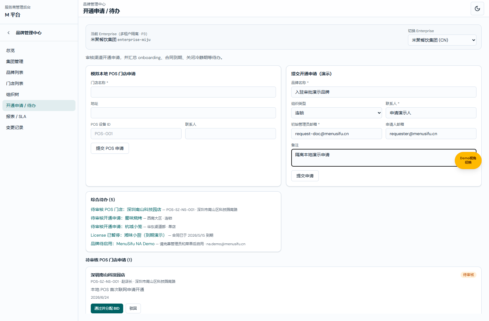

图注：开通申请／待办，普通品牌申请表单填写态；main@64ddec8f、5250、隔离本地演示。入口为M品牌管理中心→开通申请／待办；需该页面及相应M权限。

| 字段／操作 | 逻辑说明 |
| --- | --- |
| 品牌名称 | merchantName，表单required，来源申请人输入；用于审批后品牌名，不等同门店地址名称；未发现当前页面另设maxlength，不编造长度。 |
| 组织类型 | orgType，默认chain；候选连锁、single-store单店特殊场景。单店审批分支会指定首店名称，连锁不按该规则自动建首店。 |
| 联系人 | contactName，表单required，申请资料；不自动成为后台登录账号。 |
| 初始管理员邮箱 | primaryAdminEmail，required且email输入；该旧审批流程与新Admin开通表单不同，不能未经核对套用menusifu.cn/com专属域约束。 |
| 申请人邮箱 | applicantEmail，可空email；页面空值当前回落channel@partner.cn演示邮箱，不是当前登录用户邮箱。与初始管理员身份分开。 |
| 备注 | notes，可空textarea；当前未定义独立长度上限。 |
| 提交申请 | 写pending申请，不代表已创建／启用品牌；当前按钮处理无新流程的预览确认步骤。结果见request-submit。 |
| 待办状态 | pending待处理、approved已通过、rejected已驳回；列表来源本地请求记录，resolvedAt/resolvedBy表示处理时间与人。 |
| 通过并开通 | 仅pending处理；创建品牌后回写createdMerchantId、状态、处理人及时间。用默认集团、hotpot/POS、Asia/Shanghai及旧主管理员邮箱；不等于新向导显式菜单与Admin配置已完成。 |
| 驳回 | 原生prompt输入原因；取消不变更；确认空白仍可写未说明原因，不能写成当前已强制必填驳回原因。记录rejected及rejectReason。 |

### POS 门店申请 页面区域与字段

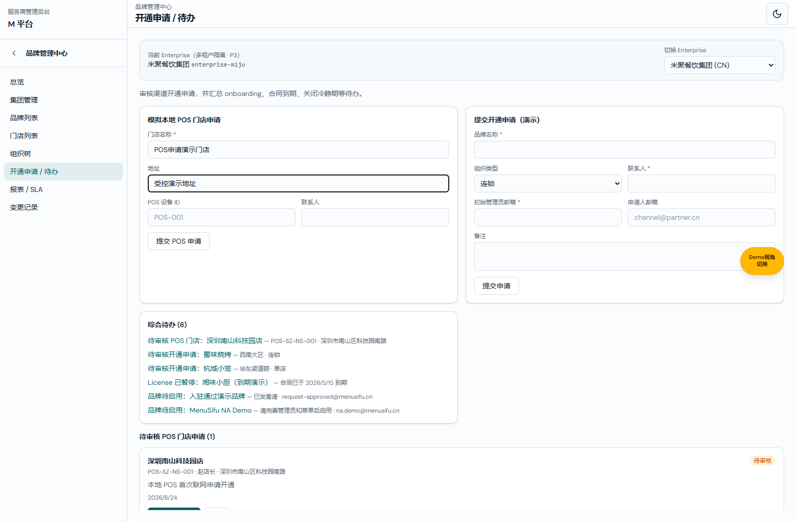

图注：POS申请演示表单填写态；同一基线与隔离环境。此表单是本地模拟入口，不代表已连接真实POS申请服务。

| 字段／操作 | 逻辑说明 |
| --- | --- |
| 门店名称 | storeName，页面必填；用于申请及默认品牌名称。类型有brandName可选字段，但当前演示表单没有该输入，不虚构页面控件。 |
| 地址 | address，可空；审批后回填到门店／品牌相关本地字段。 |
| POS设备ID | posDeviceId，可空，默认空；不据输入值推定已绑定真实硬件资产。 |
| 联系人 | contactName，页面可空；审批默认门店管理员，不是实际账号开通。 |
| 提交POS申请 | 新增pending请求；不立即分配BID。对应pos-submit前后图。 |
| 通过并分配BID | 仅pending；分配createdBid、createdMerchantId并建single-store品牌，full-service/POS，立即active，不发邀请；生成pos.menusifu.cn历史主邮箱。原生成成功提示截图受限。 |
| 驳回 | 与普通申请一样使用原生prompt；取消不写，确认写rejected与原因，空白回落未说明原因。 |

### 三条创建入口的现状分流

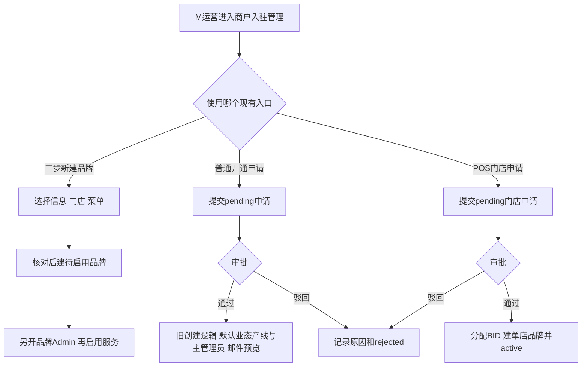

本图是当前实现差异，不是新增产品决策。三条入口未来是否收敛为统一显式开通模型列为Q06待确认；保留现状并清楚披露，不能以文档更新自动更改历史品牌授权或创建默认值。

### 操作 create-open 品牌管理 · 新建品牌

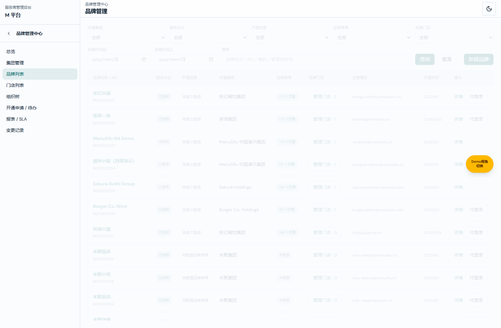

图注：品牌管理／新建品牌／触发前；main@64ddec8f，5250功能分支；隔离本地演示。

图注：同一操作的实际界面／结果；非真实商户历史；状态：入口及结果已采集。

| 字段／操作 | 逻辑说明 |
| --- | --- |
| 入口与前提 | 按页面当前可见操作进入 |
| 新建品牌 | 三步独立页面 |
| 取消、关闭与异常 | 对本条实际触发的分支按截图及上述结果执行；其他分支必须查对应独立操作ID。未逐一复现的组合见G06，不据本图推定成功、失败、取消均已覆盖。 |

### 操作 create-invalid 创建品牌 · 信息不完整下一步

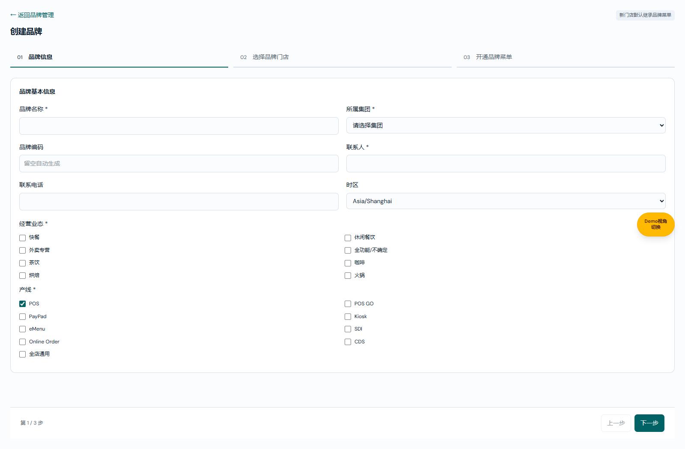

图注：创建品牌／信息不完整下一步／触发前；main@64ddec8f，5250功能分支；隔离本地演示。

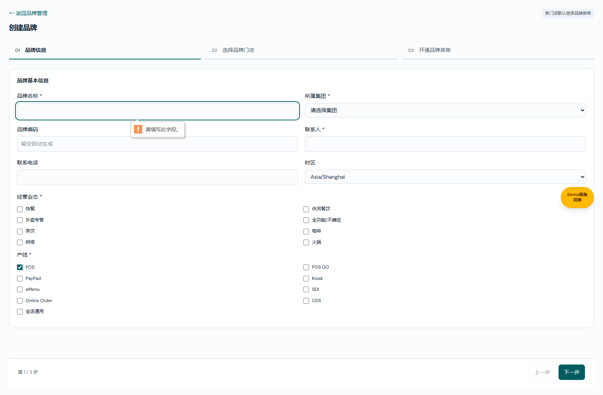

图注：同一操作的实际界面／结果；非真实商户历史；状态：页面已采集；原生校验气泡受限G02。

| 字段／操作 | 逻辑说明 |
| --- | --- |
| 入口与前提 | 按页面当前可见操作进入 |
| 信息不完整下一步 | 原生必填校验或页面错误，不创建 |
| 取消、关闭与异常 | 对本条实际触发的分支按截图及上述结果执行；其他分支必须查对应独立操作ID。未逐一复现的组合见G06，不据本图推定成功、失败、取消均已覆盖。 |

### 操作 create-next-stores 品牌信息 · 下一步

图注：品牌信息／下一步／触发前；main@64ddec8f，5250功能分支；隔离本地演示。

图注：同一操作的实际界面／结果；非真实商户历史；状态：入口及结果已采集。

| 字段／操作 | 逻辑说明 |
| --- | --- |
| 入口与前提 | 按页面当前可见操作进入 |
| 下一步 | 选择品牌门店 |
| 取消、关闭与异常 | 对本条实际触发的分支按截图及上述结果执行；其他分支必须查对应独立操作ID。未逐一复现的组合见G06，不据本图推定成功、失败、取消均已覆盖。 |

### 操作 create-store-search 选择品牌门店 · 搜索候选

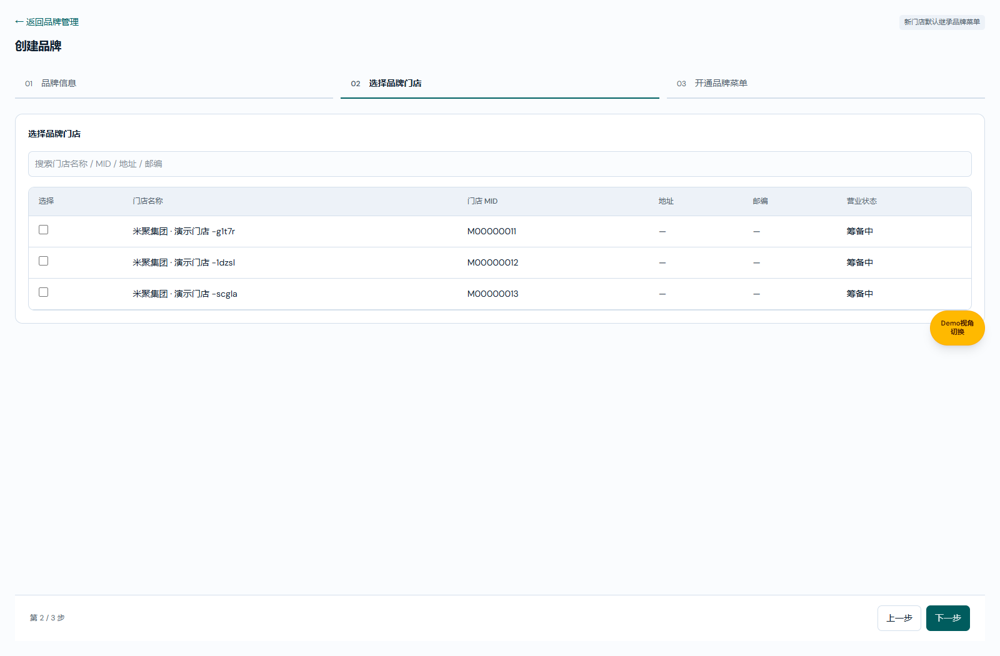

图注：选择品牌门店／搜索候选／触发前；main@64ddec8f，5250功能分支；隔离本地演示。

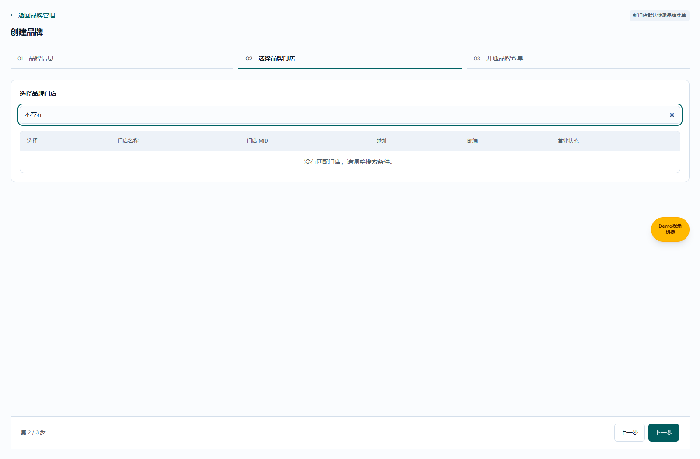

图注：同一操作的实际界面／结果；非真实商户历史；状态：入口及结果已采集。

| 字段／操作 | 逻辑说明 |
| --- | --- |
| 入口与前提 | 按页面当前可见操作进入 |
| 搜索候选 | 名称MID地址邮编过滤 |
| 取消、关闭与异常 | 对本条实际触发的分支按截图及上述结果执行；其他分支必须查对应独立操作ID。未逐一复现的组合见G06，不据本图推定成功、失败、取消均已覆盖。 |

### 操作 create-prev 选择品牌门店 · 上一步

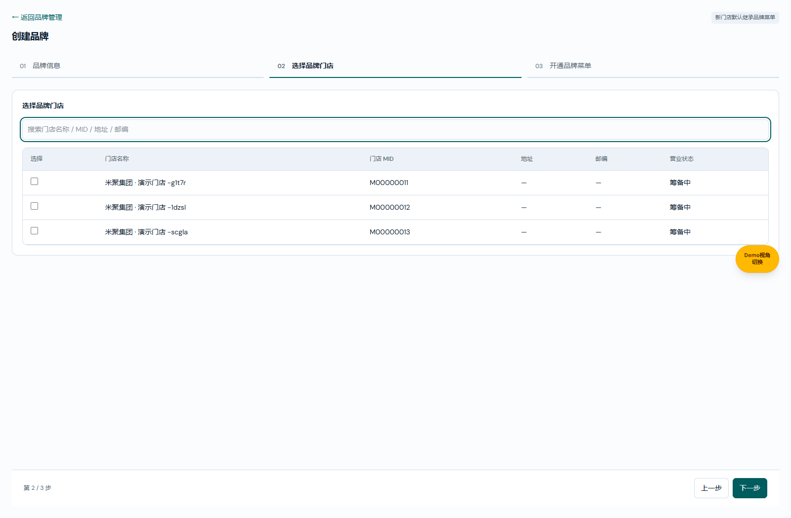

图注：选择品牌门店／上一步／触发前；main@64ddec8f，5250功能分支；隔离本地演示。

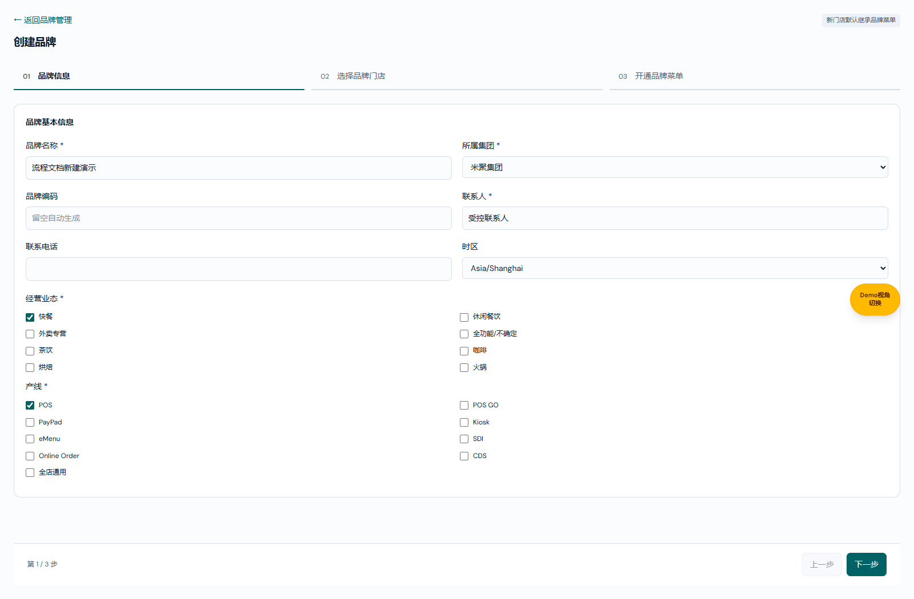

图注：同一操作的实际界面／结果；非真实商户历史；状态：入口及结果已采集。

| 字段／操作 | 逻辑说明 |
| --- | --- |
| 入口与前提 | 按页面当前可见操作进入 |
| 上一步 | 字段保留回基本信息 |
| 取消、关闭与异常 | 对本条实际触发的分支按截图及上述结果执行；其他分支必须查对应独立操作ID。未逐一复现的组合见G06，不据本图推定成功、失败、取消均已覆盖。 |

### 操作 create-next-menus 选择品牌门店 · 下一步开通菜单

图注：选择品牌门店／下一步开通菜单／触发前；main@64ddec8f，5250功能分支；隔离本地演示。

图注：同一操作的实际界面／结果；非真实商户历史；状态：入口及结果已采集。

| 字段／操作 | 逻辑说明 |
| --- | --- |
| 入口与前提 | 按页面当前可见操作进入 |
| 下一步开通菜单 | 零店允许继续 |
| 取消、关闭与异常 | 对本条实际触发的分支按截图及上述结果执行；其他分支必须查对应独立操作ID。未逐一复现的组合见G06，不据本图推定成功、失败、取消均已覆盖。 |

### 操作 create-menu-select 开通品牌菜单 · 勾选菜单

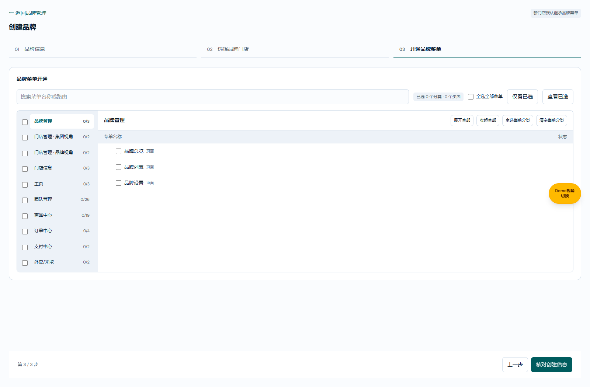

图注：开通品牌菜单／勾选菜单／触发前；main@64ddec8f，5250功能分支；隔离本地演示。

图注：同一操作的实际界面／结果；非真实商户历史；状态：入口及结果已采集。

| 字段／操作 | 逻辑说明 |
| --- | --- |
| 入口与前提 | 按页面当前可见操作进入 |
| 勾选菜单 | 当前节点级联选择 |
| 取消、关闭与异常 | 对本条实际触发的分支按截图及上述结果执行；其他分支必须查对应独立操作ID。未逐一复现的组合见G06，不据本图推定成功、失败、取消均已覆盖。 |

### 操作 create-review 开通品牌菜单 · 核对创建信息

图注：开通品牌菜单／核对创建信息／触发前；main@64ddec8f，5250功能分支；隔离本地演示。

图注：同一操作的实际界面／结果；非真实商户历史；状态：入口及结果已采集。

| 字段／操作 | 逻辑说明 |
| --- | --- |
| 入口与前提 | 按页面当前可见操作进入 |
| 核对创建信息 | 独立弹框含品牌门店菜单树 |
| 取消、关闭与异常 | 对本条实际触发的分支按截图及上述结果执行；其他分支必须查对应独立操作ID。未逐一复现的组合见G06，不据本图推定成功、失败、取消均已覆盖。 |

### 操作 create-review-back 核对创建信息 · 返回修改

图注：核对创建信息／返回修改／触发前；main@64ddec8f，5250功能分支；隔离本地演示。

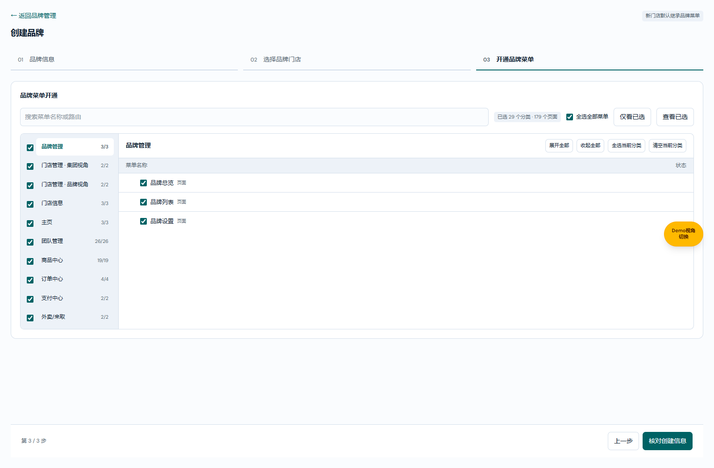

图注：同一操作的实际界面／结果；非真实商户历史；状态：入口及结果已采集。

| 字段／操作 | 逻辑说明 |
| --- | --- |
| 入口与前提 | 按页面当前可见操作进入 |
| 返回修改 | 不创建保留向导 |
| 取消、关闭与异常 | 对本条实际触发的分支按截图及上述结果执行；其他分支必须查对应独立操作ID。未逐一复现的组合见G06，不据本图推定成功、失败、取消均已覆盖。 |

### 操作 create-confirm 核对创建信息 · 确认创建品牌

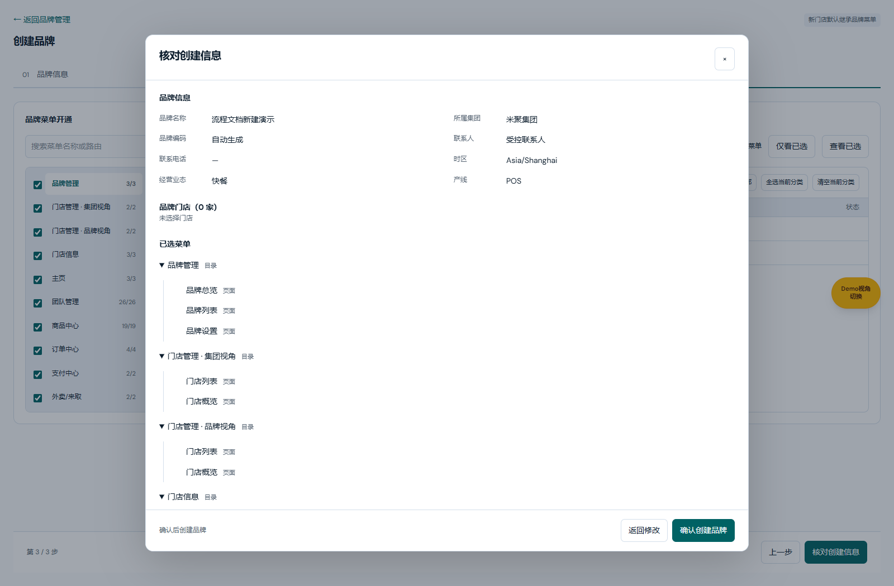

图注：核对创建信息／确认创建品牌／触发前；main@64ddec8f，5250功能分支；隔离本地演示。

图注：同一操作的实际界面／结果；非真实商户历史；状态：入口及结果已采集。

| 字段／操作 | 逻辑说明 |
| --- | --- |
| 入口与前提 | 按页面当前可见操作进入 |
| 确认创建品牌 | 创建待启用品牌进入管理员 |
| 取消、关闭与异常 | 对本条实际触发的分支按截图及上述结果执行；其他分支必须查对应独立操作ID。未逐一复现的组合见G06，不据本图推定成功、失败、取消均已覆盖。 |

### 操作 request-page 开通申请待办 · 进入开通申请

图注：开通申请待办／进入开通申请／触发前；main@64ddec8f，5250功能分支；隔离本地演示。

图注：同一操作的实际界面／结果；非真实商户历史；状态：入口及结果已采集。

| 字段／操作 | 逻辑说明 |
| --- | --- |
| 入口与前提 | 按页面当前可见操作进入 |
| 进入开通申请 | 实际演示表单和待办记录 |
| 取消、关闭与异常 | 对本条实际触发的分支按截图及上述结果执行；其他分支必须查对应独立操作ID。未逐一复现的组合见G06，不据本图推定成功、失败、取消均已覆盖。 |

### 操作 request-submit 开通申请 · 提交申请

图注：开通申请／提交申请／触发前；main@64ddec8f，5250功能分支；隔离本地演示。

图注：同一操作的实际界面／结果；非真实商户历史；状态：入口及结果已采集。

| 字段／操作 | 逻辑说明 |
| --- | --- |
| 入口与前提 | 按页面当前可见操作进入 |
| 提交申请 | 新增pending申请，尚未创建品牌 |
| 取消、关闭与异常 | 对本条实际触发的分支按截图及上述结果执行；其他分支必须查对应独立操作ID。未逐一复现的组合见G06，不据本图推定成功、失败、取消均已覆盖。 |

### 操作 request-reject-cancel 开通申请 · 驳回后取消原生提示

图注：开通申请／驳回后取消原生提示／触发前；main@64ddec8f，5250功能分支；隔离本地演示。

图注：同一操作的实际界面／结果；非真实商户历史；状态：结果已采集；原生层截图受限G01。

| 字段／操作 | 逻辑说明 |
| --- | --- |
| 入口与前提 | 按页面当前可见操作进入 |
| 驳回后取消原生提示 | prompt取消无修改，原生提示截图受限 |
| 原生提示限制 | 原生提示的准确文案及测试确认／取消选择见operation事件记录；不得把上方结果图冒充原生弹框截图。 |
| 取消、关闭与异常 | 对本条实际触发的分支按截图及上述结果执行；其他分支必须查对应独立操作ID。未逐一复现的组合见G06，不据本图推定成功、失败、取消均已覆盖。 |

### 操作 request-reject-save 开通申请 · 驳回申请

图注：开通申请／驳回申请／触发前；main@64ddec8f，5250功能分支；隔离本地演示。

图注：同一操作的实际界面／结果；非真实商户历史；状态：结果已采集；原生层截图受限G01。

| 字段／操作 | 逻辑说明 |
| --- | --- |
| 入口与前提 | 按页面当前可见操作进入 |
| 驳回申请 | 输入原因后申请rejected；原生提示单独登记限制 |
| 原生提示限制 | 原生提示的准确文案及测试确认／取消选择见operation事件记录；不得把上方结果图冒充原生弹框截图。 |
| 取消、关闭与异常 | 对本条实际触发的分支按截图及上述结果执行；其他分支必须查对应独立操作ID。未逐一复现的组合见G06，不据本图推定成功、失败、取消均已覆盖。 |

### 操作 request-approve 开通申请 · 通过并开通

图注：开通申请／通过并开通／触发前；main@64ddec8f，5250功能分支；隔离本地演示。

图注：同一操作的实际界面／结果；非真实商户历史；状态：结果已采集；原生层截图受限G01。

| 字段／操作 | 逻辑说明 |
| --- | --- |
| 入口与前提 | 按页面当前可见操作进入 |
| 通过并开通 | 审批创建品牌；原生成功提示仅为本地状态，不代表真实发信 |
| 原生提示限制 | 原生提示的准确文案及测试确认／取消选择见operation事件记录；不得把上方结果图冒充原生弹框截图。 |
| 取消、关闭与异常 | 对本条实际触发的分支按截图及上述结果执行；其他分支必须查对应独立操作ID。未逐一复现的组合见G06，不据本图推定成功、失败、取消均已覆盖。 |

### 操作 pos-submit POS开通申请 · 提交POS申请

图注：POS开通申请／提交POS申请／触发前；main@64ddec8f，5250功能分支；隔离本地演示。

图注：同一操作的实际界面／结果；非真实商户历史；状态：入口及结果已采集。

| 字段／操作 | 逻辑说明 |
| --- | --- |
| 入口与前提 | 按页面当前可见操作进入 |
| 提交POS申请 | 新增门店开通待办 |
| 取消、关闭与异常 | 对本条实际触发的分支按截图及上述结果执行；其他分支必须查对应独立操作ID。未逐一复现的组合见G06，不据本图推定成功、失败、取消均已覆盖。 |

### 操作 pos-approve POS开通申请 · 通过并分配BID

图注：POS开通申请／通过并分配BID／触发前；main@64ddec8f，5250功能分支；隔离本地演示。

图注：同一操作的实际界面／结果；非真实商户历史；状态：结果已采集；原生层截图受限G01。

| 字段／操作 | 逻辑说明 |
| --- | --- |
| 入口与前提 | 按页面当前可见操作进入 |
| 通过并分配BID | 创建单店品牌与MID，保留后续挂接流程 |
| 原生提示限制 | 原生提示的准确文案及测试确认／取消选择见operation事件记录；不得把上方结果图冒充原生弹框截图。 |
| 取消、关闭与异常 | 对本条实际触发的分支按截图及上述结果执行；其他分支必须查对应独立操作ID。未逐一复现的组合见G06，不据本图推定成功、失败、取消均已覆盖。 |

### 操作 pos-reject POS开通申请 · 驳回POS申请

图注：POS开通申请／驳回POS申请／触发前；main@64ddec8f，5250功能分支；隔离本地演示。

图注：同一操作的实际界面／结果；非真实商户历史；状态：结果已采集；原生层截图受限G01。

| 字段／操作 | 逻辑说明 |
| --- | --- |
| 入口与前提 | 按页面当前可见操作进入 |
| 驳回POS申请 | 输入驳回原因后记录结果 |
| 原生提示限制 | 原生提示的准确文案及测试确认／取消选择见operation事件记录；不得把上方结果图冒充原生弹框截图。 |
| 取消、关闭与异常 | 对本条实际触发的分支按截图及上述结果执行；其他分支必须查对应独立操作ID。未逐一复现的组合见G06，不据本图推定成功、失败、取消均已覆盖。 |

### 操作 create-leave-native 创建品牌 · 返回品牌管理且确认离开

图注：创建品牌／返回品牌管理且确认离开／触发前；main@64ddec8f，5250功能分支；隔离本地演示。

图注：同一操作的实际界面／结果；非真实商户历史；状态：结果已采集；原生层截图受限G01。

| 字段／操作 | 逻辑说明 |
| --- | --- |
| 入口与前提 | 按页面当前可见操作进入 |
| 返回品牌管理且确认离开 | 原生确认文案有未保存的品牌配置，是否放弃并离开；截图原生层受限 |
| 可见结果／提示 | 已关闭 |
| 原生提示限制 | 原生提示的准确文案及测试确认／取消选择见operation事件记录；不得把上方结果图冒充原生弹框截图。 |
| 取消、关闭与异常 | 对本条实际触发的分支按截图及上述结果执行；其他分支必须查对应独立操作ID。未逐一复现的组合见G06，不据本图推定成功、失败、取消均已覆盖。 |

### 创建品牌／品牌信息

图：现有原型历史验收截图，具体旧来源见历史附录；原页面说明基线main@3f0cb3d5，本轮操作证据main@64ddec8f，未重新截图。用途／入口按本节标题及公共业务流程；只读查看不写授权。

| 字段／操作 | 逻辑说明 |
| --- | --- |
| 品牌名称 | 必填，去首尾空格，最长60字。 |
| 所属集团 | 必选；同集团限定候选门店，切换不沿用不匹配选店。 |
| 品牌编码 | 可空，空时自动生成；未在当前向导定义额外长度规则。 |
| 联系人 | 必填，最长30字。 |
| 联系电话 | 可空，不是登录凭据。 |
| 时区 | 默认Asia/Shanghai；候选另含America/New_York、America/Los_Angeles。 |
| 经营业态 | 当前展示候选前8项，多选至少一项。 |
| 产线 | 多选至少一项，默认POS；用于候选与现有能力配置，不等于已授权。 |
| 下一步／步骤切换 | 前进校验基本字段；后退保留输入；此时尚未写品牌。 |

### 创建品牌／选择门店

图：现有原型历史验收截图，具体旧来源见历史附录；原页面说明基线main@3f0cb3d5，本轮操作证据main@64ddec8f，未重新截图。用途／入口按本节标题及公共业务流程；只读查看不写授权。

| 字段／操作 | 逻辑说明 |
| --- | --- |
| 候选门店 | 同集团、独立单店且未重复挂接，保留MID。 |
| 搜索 | 名称／MID／地址／邮编，当前候选内过滤，不更改勾选。 |
| 门店名称 | 展示实际候选名称。 |
| MID | 展示既有storeId，不重新分配。 |
| 地址／邮编 | 缺失显示—，不虚构地址。 |
| 营业状态 | 只展示当前状态。 |
| 选择 | 默认未选；允许零店创建；关联后菜单模式为inherit，不再初始化关闭。 |
| 演示预置 | ensureBrandCreationDemoStores会为当前集团补足可关联演示候选，属于会写本地组织数据的原型例外，不能说打开向导完全无任何写入。 |

### 创建品牌／开通菜单

图：现有原型历史验收截图，具体旧来源见历史附录；原页面说明基线main@3f0cb3d5，本轮操作证据main@64ddec8f，未重新截图。用途／入口按本节标题及公共业务流程；只读查看不写授权。

| 字段／操作 | 逻辑说明 |
| --- | --- |
| 候选目录 | 来自发布蓝图活动树，无发布使用系统当前树。 |
| 搜索 | 按名称／路由过滤，不修改授权选择。 |
| 父项选择框 | 在名称前，勾选当前存在的下级，取消级联移除；不授权未来资源。 |
| 全选全部菜单 | 紧靠文案，全选当前可选集合；有部分选中时显示半选。 |
| 分类全选／清空 | 只作用当前分类。 |
| 展开／收起全部 | 只影响展示，不视为配置修改。 |
| 已选统计 | 分类和页面口径与原始节点数分开。 |
| 仅看已选／查看已选 | 查看选择结果，不写入。 |
| 核对创建信息 | 校验后打开独立核对弹框，不直接创建。 |

### 核对创建信息弹框

图：现有原型历史验收截图，具体旧来源见历史附录；原页面说明基线main@3f0cb3d5，本轮操作证据main@64ddec8f，未重新截图。用途／入口按本节标题及公共业务流程；只读查看不写授权。

| 字段／操作 | 逻辑说明 |
| --- | --- |
| 品牌字段 | 名称、集团、编码、联系人、电话、时区、业态、产线逐项展示；编码空显示自动生成。 |
| 门店表 | 名称、MID、地址、邮编，零店显示未选择门店。 |
| 菜单树 | 按层级展示所选目录与页面明细。 |
| 返回修改／关闭 | 回到向导并保留输入，不创建。 |
| 确认创建品牌 | 防重复，重新校验及路由版本；创建待启用品牌、显式菜单、关联门店inherit；转品牌管理员并提示继续开通Admin。 |
| 失败 | 在核对弹框显示错误、保留输入；不宣称跨多个本地存储对象具备服务端事务。 |

