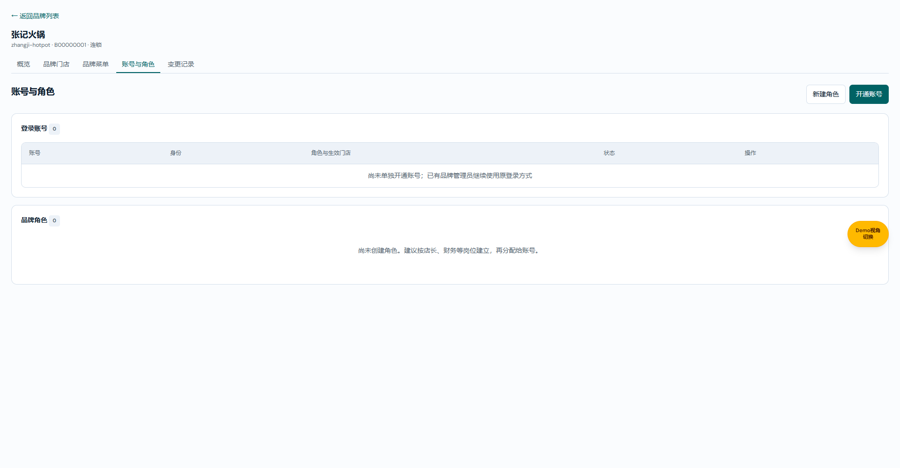
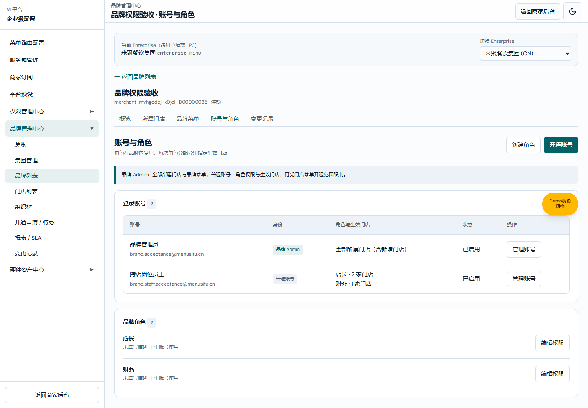
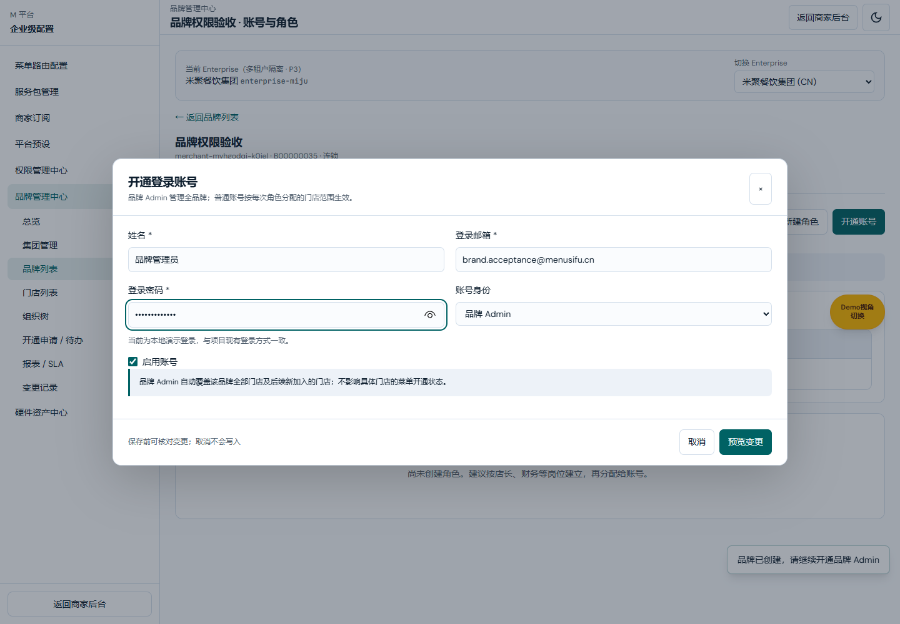
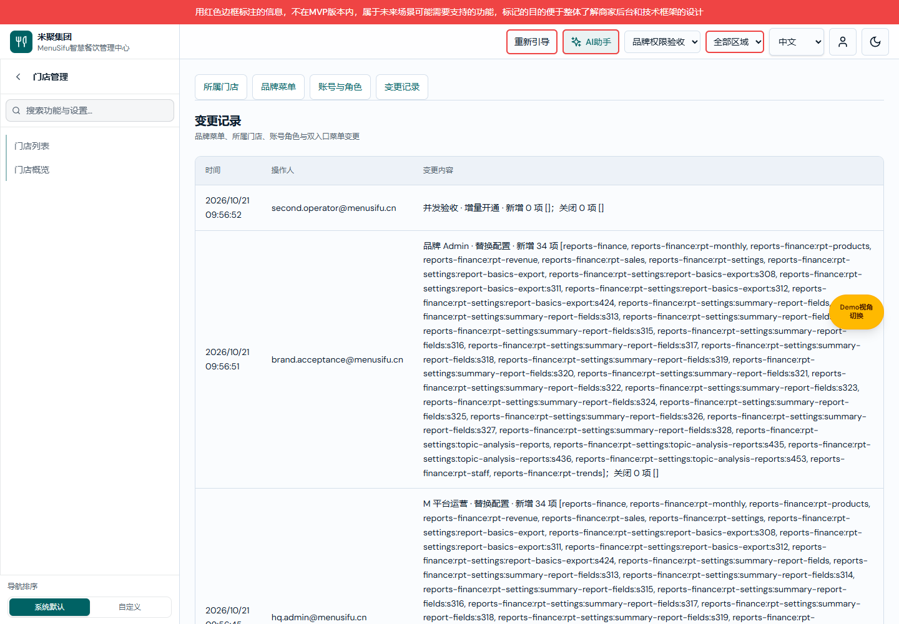

# M 平台入驻商户管理中心需求文档（个人规范版）

> V1.17 · 2026-10-21；职责：页面元素与操作后果。
> 产品权威：[V1.18](./M平台-入驻商户管理中心设计方案.md)；[研发交付版 V1.17](./M平台-入驻商户管理中心业务规格说明书（研发交付版）.md)。
> 共同基线：用户确认的四层权限方案；最新变更 BRAND-CURRENT-NAV-20261021-17，权限基线 BRAND-ACCESS-20261021-01。
> 最新整体独立页图片：detail-full-*.png，codex/brand-detail-hide-group-20261021 未提交预览，main@f6712e85 基线；其余图片来源：codex/brand-menu-access-20261021 未提交功能预览，main@f848526b 起始；图中数据为本地验收样例，不是线上品牌。

## 菜单去重修复核验（BRAND-MENU-DEDUP-20261021-19）

本次为既定“与商家实际导航一致”规则的实现修复，不变更业务定义，维持配对版本 产品 V1.18 / 研发 V1.17 / 个人 V1.17。基线 main@b01df0db，功能分支 codex/brand-menu-dedup-20261021；本轮已获授权提交并合入本地 main；未获推送授权。

### 创建品牌 → 开通品牌菜单 → 团队管理

图片来源：本次功能分支 5209，创建品牌第 3 步，演示数据。

| 元素 | 逻辑说明 |
| --- | --- |
| 员工打卡 | 只显示打卡管理、考勤记录、规则设置各一项，分别对应 /team/clock-in/live、/records、/rules；保留 clock-view-* 稳定资源 key。相同名称出现在不同业务父目录（如员工报表的考勤记录）属于独立菜单，不跨目录删除。 |
| 子菜单开通 | 选中父级联动全部子项；仅选择打卡管理，不授予考勤记录或规则设置。单独子项精确映射其原有 view 权限，父级仅提供结构。 |

### 创建品牌 → 开通品牌菜单 → 门店信息

图片来源：同上，门店信息分类。

| 元素 | 逻辑说明 |
| --- | --- |
| 门店档案 | 同名页面、内容分组及设置项只展示一个菜单行；底层 key、原授权及保存校验保留，不因展示初始化写入或授权。 |
| 营业时间 | 不重复显示同名分组；营业时段等具有不同含义的设置继续展示，缩进按可见层级计算。 |
| 展开、搜索、全选与核对 | 同一套紧凑展示规则用于普通列表、搜索和已选核对；隐藏的结构节点仍参与父子联动与范围校验。角色编辑保持原有完整内容权限，不使用品牌菜单展示压缩改变编辑项。 |

核验：修复前失败用例复现打卡 6 个子项；修复后 3 个。全树同父同名同路由节点唯一性、紧凑展示不修改原始 key 集合、实际创建页 DOM、收起展开、全选清空、打卡精确授权及 17 项领域回归通过。未触及 eMenu 与构建边界；生产服务与 CI 本轮未验证。

## 版本记录

| 版本 | 日期 | 变更编号 | 内容 |
| --- | --- | --- | --- |
| V1.17 | 2026-10-21 | BRAND-CURRENT-NAV-20261021-17 | 最新商家导航与系统蓝图一致性，配对产品 V1.18 / 研发 V1.17 / 个人 V1.17 |
| V1.16 | 2026-10-21 | BRAND-ROUTE-TREE-20261021-16 | 蓝图结构一致性，配对产品 V1.17 / 研发 V1.16 / 个人 V1.16 |
| V1.15 | 2026-10-21 | BRAND-MENU-SELECTALL-20261021-15 | 父子级联全选，配对产品 V1.16 / 研发 V1.15 / 个人 V1.15 |
| V1.14 | 2026-10-21 | BRAND-MENU-CHECKBOX-20261021-14 | 选择框前置，配对产品 V1.15 / 研发 V1.14 / 个人 V1.14 |
| V1.13 | 2026-10-21 | BRAND-MENU-TREETABLE-20261021-13 | 树形表格及已选核对，配对产品 V1.14 / 研发 V1.13 / 个人 V1.13 |
| V1.12 | 2026-10-21 | BRAND-MENU-COLLAPSE-20261021-12 | 父项折叠，配对产品 V1.13 / 研发 V1.12 / 个人 V1.12 |
| V1.11 | 2026-10-21 | BRAND-MENU-CLARITY-20261021-11 | 菜单选择视觉层级，配对产品 V1.12 / 研发 V1.11 / 个人 V1.11 |
| V1.10 | 2026-10-21 | BRAND-STORE-PICKER-20261021-10 | 门店搜索列表，配对产品 V1.11 / 研发 V1.10 / 个人 V1.10 |
| V1.9 | 2026-10-21 | BRAND-CREATE-DEMO-20261021-09 | 演示候选门店池，配对产品 V1.10 / 研发 V1.9 / 个人 V1.9 |
| V1.8 | 2026-10-21 | BRAND-CREATE-FOOTER-20261021-08 | 固定创建操作栏，配对产品 V1.9 / 研发 V1.8 / 个人 V1.8 |
| V1.7 | 2026-10-21 | BRAND-CREATE-FULLPAGE-20261021-07 | 创建独立页，配对产品 V1.8 / 研发 V1.7 / 个人 V1.7 |
| V1.6 | 2026-10-21 | BRAND-FILTER-LAYOUT-20261021-06 | 品牌列表筛选栏布局，配对产品 V1.7 / 研发 V1.6 / 个人 V1.6 |
| V1.5 | 2026-10-21 | BRAND-LIST-COPY-20261021-05 | 移除三处说明，配对产品 V1.6 / 研发 V1.5 / 个人 V1.5 |
| V1.4 | 2026-10-21 | BRAND-DETAIL-COPY-20261021-04 | 品牌门店命名及六处说明移除，配对产品 V1.5 / 研发 V1.4 / 个人 V1.4 |
| V1.3 | 2026-10-21 | BRAND-DETAIL-HIDEGROUP-20261021-03 | 品牌详情五页签移除顶部集团区；配对产品 V1.4 / 研发 V1.3 / 个人 V1.3 |
| V1.2 | 2026-10-21 | BRAND-DETAIL-FULLPAGE-20261021-02 | 完整品牌详情独立展示，五页签共用布局；配对产品 V1.3 / 研发 V1.2 |
| V1.1 | 2026-10-21 | BRAND-ACCOUNTS-FULLPAGE-20261021-01 | 初次账号与角色全窗口页，已由 V1.2 整体详情方案替代；配对产品 V1.2 / 研发 V1.1 |
| V1.0 | 2026-10-21 | BRAND-ACCESS-20261021-01 | 品牌创建、品牌菜单、门店双入口、品牌账号角色的逐元素定义，配对产品 V1.1 / 研发 V1.0 |

## 公共规则

品牌菜单是后台功能菜单，不是菜品。品牌上限、门店实际开通、角色功能权限、账号角色生效门店分别维护。普通账号在某店只能使用四层交集；品牌 Admin 品牌视角可管理所有品牌门店和品牌菜单，在门店业务视角不能绕过本店开通。普通账号无门店开通与账号角色管理入口。

M 平台品牌详情整体独立占满窗口，隐藏平台侧栏和通用顶栏；移除顶部 Enterprise 集团信息和切换区；保留品牌上下文、概览/品牌门店/品牌菜单/账号与角色/变更记录页签及返回品牌列表。各页签切换和刷新保持独立布局，返回列表恢复平台导航。

新增路由不自动授权已有品牌；品牌新增菜单不自动开通给各店；收回品牌菜单同步裁剪各店。查看与搜索不是未保存编辑；真正修改后的关闭需要确认放弃。预览不写入，确认保存重新校验版本与范围；失败保留输入，取消不写入。

## 1. M 平台品牌列表

图注：品牌列表，有数据状态；来源与版本同文首。

入口：M 平台 → 品牌管理中心 → 品牌列表；用于识别品牌、开通情况和进入配置。

| 字段或操作 | 逻辑说明 |
| --- | --- |
| 品牌名称 | 来自品牌主数据；点击进入品牌基本信息；不在列表直接改名。 |
| BID | 品牌身份编号，显示在名称下；空值显示 —，不与门店 MID 混用。 |
| 品牌状态 | 沿用品牌生命周期；在营、暂停等状态不等同于菜单是否开通。 |
| 所属集团 | 显示该品牌集团名称，集团范围用于后续关联门店。 |
| 品牌菜单 | 显示已开通二级页面数，目录和设置项不混入；无页面显示未配置，点击进入品牌菜单。 |
| 品牌门店 | 显示当前品牌门店数，点击管理门店进入品牌门店页；零店仍允许管理。 |
| 主管理员 | 显示历史主管理员邮箱，新品牌未开通时显示待开通；详细账号以账号与角色页为准。 |
| 开通时间 | 沿用激活时间，无激活时显示创建时间。 |
| 账号与角色 | 进入该品牌独立详情的账号与角色页签，保留其他详情页签及返回品牌列表，移除顶部 Enterprise 集团区。 |
| 代登录 | 沿用现有支持状态；进入品牌 Admin 视角并保留原代登录审计。 |
| 新建品牌 | 进入三步创建向导。 |
| 状态筛选 | 沿用现有品牌状态选项，默认全部；只筛选，不写入配置。 |
| 所属集团筛选 | 默认全部集团，按集团缩小列表。 |
| 搜索 | 沿用品牌列表搜索规则；不改变任何权限。 |

## 1.1 M 平台全局门店列表

图注：跨品牌门店列表，有数据状态；来源与版本同文首。

入口：M 平台 → 品牌管理中心 → 门店列表；用于从全局检索门店并直接配置菜单。

| 字段或操作 | 逻辑说明 |
| --- | --- |
| 门店名称 / MID | 显示名称、稳定门店身份和地址；点击名称进入门店详情。 |
| 所属集团 | 显示组织集团；不是人员授权范围。 |
| 所属品牌 / BID | 显示当前归属品牌和 BID；点击进入该品牌品牌门店。 |
| 门店状态 | 沿用营业状态，与菜单开通独立。 |
| 菜单开通 | 已开通二级页面数，目录及设置不计入；无项显示未开通。 |
| 最近配置 | 显示保存时间和实际操作人；未配置显示 —。 |
| 配置菜单 | 直接打开该店共用菜单编辑器；仍限制在其品牌上限内。 |
| 集团筛选 | 默认全部集团，按当前选项缩小门店列表。 |
| 所属品牌筛选 | 默认全部品牌，沿用既有列表联动，不改变门店归属。 |
| 门店状态筛选 | 默认全部，匹配当前营业状态。 |
| 搜索 | 按原列表搜索规则查询门店，检索不写入权限。 |

## 2. 创建品牌：品牌信息

图注：创建步骤 1，已填写样例；来源与版本同文首。

入口：品牌列表 → 新建品牌；完成后仍未创建品牌。

| 字段或操作 | 逻辑说明 |
| --- | --- |
| 品牌名称 | 必填，去首尾空格，最长 60 字。 |
| 所属集团 | 必选，候选来自当前 Enterprise；切换后重新列出候选店，原勾选不沿用。 |
| 品牌编码 | 可空，空值沿用系统自动生成，不用名称代替持久化主键。 |
| 联系人 | 必填，最长 30 字。 |
| 联系电话 | 可空，沿用现有联系信息，不作为登录凭据。 |
| 时区 | 默认 Asia/Shanghai，可选现有美国时区；用于品牌资料。 |
| 经营业态 | 多选，至少一项；空时阻止进入下一步。 |
| 产线 | 多选，默认 POS，至少一条；菜单候选按所选产线合并。 |
| 下一步 | 验证品牌信息和业态产线，成功进入选择门店；失败保留字段并显示错误。 |
| 步骤标题 | 允许返回已填写步骤；跳到后续步骤前仍校验基本信息。 |
| 返回品牌列表 | 真实编辑后需要确认放弃；仅打开向导不提示。 |

## 3. 创建品牌：选择品牌门店

图注：创建步骤 2，多店勾选状态；来源与版本同文首。

入口：品牌创建步骤 2；选择哪些已有门店归属该品牌。

| 字段或操作 | 逻辑说明 |
| --- | --- |
| 候选门店 | 只列同集团可挂接的独立门店，显示名称及 MID。其他品牌下的门店不通过此处转移。 |
| 门店复选框 | 默认未选，可多选；保存后保留原 MID，并将本店菜单初始化为关闭。 |
| 无候选提示 | 显示当前集团暂无可关联门店，允许零店创建，后续继续关联。 |
| 上一步 | 返回信息步骤，保留当前输入。 |
| 下一步 | 进入品牌菜单步骤；此时不修改任何门店归属。 |

## 4. 创建品牌：开通品牌菜单

图注：创建步骤 3，目录和下级已勾选；来源与版本同文首。

入口：品牌创建步骤 3；确定品牌后台菜单上限。

| 字段或操作 | 逻辑说明 |
| --- | --- |
| 菜单分类 | 来自菜单路由的一级目录，点击切换右侧候选；不是展开主侧栏的专用例外。 |
| 搜索菜单 | 按菜单名称或路由搜索，不改变选择。 |
| 目录复选框 | 勾选级联选择当前已存在下级；取消同时移除下级；必要祖先由下级选择补齐。 |
| 页面复选框 | 控制对应后台页面；仅勾选父目录不自动授予后续新增页面。 |
| 设置项复选框 | 控制对应设置范围，不计入页面数。 |
| 已选数量 | 显示本次所选节点数，包含目录、页面和设置，与页面统计不同。 |
| 全选当前分类 | 只处理当前分类现有节点，不是自动订阅未来节点。 |
| 清空当前分类 | 移除当前分类及下级选择。 |
| 核对创建信息 | 展示品牌、集团、关联门店数和节点数，尚不写入。 |
| 确认创建品牌 | 重新校验候选范围；成功创建后进入账号与角色页，提示继续开通 Admin；失败保留草稿。 |

## 4.1 创建品牌核对状态

图注：创建步骤 3 的保存前核对状态；来源与版本同文首。

| 字段或操作 | 逻辑说明 |
| --- | --- |
| 品牌名称与集团 | 展示将创建的对象和归属，用于确认上下文。 |
| 门店数量 | 展示本次关联数量；不把零店视为保存失败。 |
| 菜单节点数量 | 包含目录、页面与设置，不与列表页面数混用。 |
| 确认创建品牌 | 全部校验成功后一次创建，随后开通登录账号；候选变化或保存失败保留草稿。 |

## 5. 品牌菜单页

图注：品牌详情，已开通菜单状态；来源与版本同文首。

入口：品牌详情 → 品牌菜单；显示品牌功能上限。

| 字段或操作 | 逻辑说明 |
| --- | --- |
| 品牌开通页面 | 仅统计已开通二级页面，单位个。 |
| 品牌门店 | 当前品牌门店数，单位家。 |
| 已配置门店菜单 | enabledKeys 非空的门店数，单位家；不等同于营业门店数。 |
| 一级分类卡片 | 展示已开通模块及页面；空时提示尚未开通。 |
| 编辑品牌菜单 | 仅 M 平台提供，打开对应编辑弹框。商家后台只读，不允许扩大品牌范围。 |

## 6. 编辑品牌菜单弹框

图注：品牌菜单编辑，保存前状态；来源与版本同文首。

入口：M 品牌菜单 → 编辑品牌菜单。

| 字段或操作 | 逻辑说明 |
| --- | --- |
| 菜单分类、搜索、层级勾选 | 选择语义同创建步骤 3；初始化采用品牌实际已开通结果，包含旧配置解析结果。 |
| 新增与关闭预览 | 逐项列出本次开通和关闭的菜单名称及数量。 |
| 受影响门店 | 列出因品牌收回菜单而需要裁剪配置的门店；无影响显示无。 |
| 确认保存 | 校验品牌与门店配置版本；成功保存显式上限、裁剪门店并记录审计；失败保留选择。 |
| 关闭或取消 | 无修改直接关闭；有真实修改先提示继续编辑或放弃修改，取消不写入。 |

## 7. M 平台品牌门店页

图注：三家品牌门店，部分已开通；来源与版本同文首。

入口：品牌列表 → 管理门店，或品牌详情 → 品牌门店。

| 字段或操作 | 逻辑说明 |
| --- | --- |
| 搜索门店 | 按名称或 MID 匹配，默认空显示全部；不清除已选项。 |
| 选择全部可见门店 | 只选择当前搜索结果中可见行；批量操作以实际勾选项为准。 |
| 门店行复选框 | 选择该 MID 作为批量目标；默认不选。 |
| 门店名称 | 来自当前品牌门店主数据；名称下显示 MID 与地址，空地址显示暂无地址。 |
| 营业状态 | 筹备中等状态沿用现有门店定义，与菜单开通独立。 |
| 菜单开通 | 本店已开通页面数；无节点显示未开通，不自动继承品牌菜单。 |
| 最近配置时间 | 取门店菜单 updatedAt，未配置显示 —。 |
| 操作人 | 取门店菜单 updatedBy，区分运营与品牌 Admin。 |
| 配置菜单 | 打开该门店的菜单编辑器，初始化本店已开通项。 |
| 批量开通菜单 | 至少选择一家门店；未选时提示选择目标，不打开空编辑器。 |
| 关联已有门店 | 仅 M 平台提供，进入关联弹框。 |

## 8. 关联已有门店弹框

图注：门店关联候选状态；来源与版本同文首。

入口：M 平台品牌门店 → 关联已有门店。

| 字段或操作 | 逻辑说明 |
| --- | --- |
| 搜索门店 | 按名称/MID 匹配候选；不改变归属。 |
| 候选门店 | 同集团可挂接的独立门店，排除当前品牌与其他品牌已关联门店。 |
| 复选框 | 多选，至少一项；不允许用普通关联替代跨品牌转移。 |
| 预览变更 | 说明关联数量、保留 MID 和门店菜单默认关闭的结果。 |
| 确认保存 | 重新检查归属及版本；一项失效则整批失败；成功更新品牌门店列表。 |
| 取消 | 不建立归属，不清理原数据。 |

## 9. 单店菜单开通弹框

图注：单店已选菜单状态；来源与版本同文首。

入口：任一管理入口的品牌门店 → 配置菜单。

| 字段或操作 | 逻辑说明 |
| --- | --- |
| 门店名称 | 标题及说明定位当前门店，不可在弹框中改变归属。 |
| 可选菜单 | 仅品牌已开通范围，超上限项不提供勾选。 |
| 初始化选择 | 本店已开通项，无配置时全不选。 |
| 目录与下级选择 | 同创建菜单选择规则；勾选不是保存。 |
| 预览变更 | 列出该店新增和关闭项；预览不写入。 |
| 确认保存 | 保存本次选择为该店完整菜单配置；冲突或失败保留选择，成功刷新列表。 |

## 10. 批量菜单开通与预览

图注：两店增量配置，逐店差异预览；来源与版本同文首。

入口：勾选门店 → 批量开通菜单。

| 字段或操作 | 逻辑说明 |
| --- | --- |
| 目标门店 | 列明本次所有门店名称；不因列表筛选变化自动换目标。 |
| 配置方式 | 默认增量开通，保留原有项；替换配置将每店统一为本次选择，必须预览各店关闭项。 |
| 选择菜单 | 批量初始空选择，不把第一家店配置当作所有店默认值。 |
| 逐店预览 | 每店分别列新增与关闭名称及数量；结果可按研发版集合公式复算。 |
| 确认保存 | 全部目标店及菜单重新校验；一次写入整批结果；保存来源与实际操作人留痕。 |
| 失败与取消 | 失败保留草稿；取消无部分保存。 |

## 10.1 完整品牌详情独立工作页

图注：BRAND-DETAIL-HIDEGROUP-20261021-03，1920×1000，来源同最新图片说明。

入口：品牌列表点击品牌名或管理门店、品牌菜单、账号与角色。这些入口保留原目标页签，进入同一个独立品牌工作页。

| 区域或操作 | 逻辑说明 |
| --- | --- |
| 窗口容器 | 占满浏览器可视宽高，隐藏平台导航和通用顶栏，不受原主内容最大宽度限制；不是弹框或浏览器原生全屏模式。 |
| 顶部 Enterprise 区 | 五个页签均不渲染此区，不留占位；不会写入或切换当前 Enterprise。其他平台页面沿用原逻辑。 |
| 返回品牌列表 | 点击固定返回品牌列表；平台导航恢复。查看页面不产生未保存提示；弹框编辑仍使用现有草稿保护。 |
| 品牌上下文 | 保留名称、编码、BID、类型；跨页签使用同一个品牌。 |
| 五个页签 | 点击原路由切换，当前页签高亮，切换后保持独立展示；直接访问和刷新一致。 |
| 业务内容区 | 沿用原页字段、操作、权限和保存规则，内容过高时在窗口内部滚动；窄屏不产生整页横向溢出。 |

图注：品牌门店页签，当前独立布局；关联和菜单操作字段沿用对应页面定义。

图注：品牌菜单页签，当前独立布局；上限配置规则沿用对应页面定义。

图注：变更记录页签，当前独立布局；日志内容和排序沿用对应页面定义。账号与角色当前布局见第 11 节。既有页面截图仅作为其业务字段参考，不代表最新整体布局。

## 11. 账号与角色页

图注：M 平台完整品牌详情独立展示中的账号与角色空态；codex/brand-detail-hide-group-20261021 功能预览，main@f6712e85 起始，1920×1000；本地种子品牌。

入口：品牌列表 → 账号与角色，或品牌详情同名页签；品牌创建成功默认进入。完整品牌详情全窗口展示，隐藏平台左侧导航与通用顶栏；移除顶部 Enterprise 集团区，保留五个详情页签。桌面及窄屏占满视口，内容超高时在页内滚动。刷新保持同一品牌上下文；商家后台同名页不改变布局。

| 页面区域或操作 | 逻辑说明 |
| --- | --- |
| 顶部集团区域 | 不展示 Enterprise 信息和切换器，不保留空白占位。概览基本信息的所属集团字段仍展示。 |
| 品牌详情页签 | 概览、品牌门店、品牌菜单、账号与角色、变更记录；点击原地址切换，保留当前品牌和独立布局。 |
| 返回品牌列表 | 位于独立页顶部左侧；点击返回品牌列表并恢复平台导航。仅查看后返回不提示未保存；编辑弹框仍遵守既有草稿保护。 |
| 品牌名称 | 顶部展示当前品牌名称；来自品牌主数据。 |
| 品牌编码 / BID / 类型 | 品牌名称下方展示原有上下文，缺失 BID 时沿用原展示，不切换为其他品牌。 |

历史有账号状态位置参考（本图是旧嵌入布局，最新全窗口结构以上图为准）：

图注：旧 BRAND-ACCESS-20261021-01 账号与角色有数据状态，仅用于下列账号、角色字段参考；最新布局隐藏平台侧栏及顶部 Enterprise 区，保留详情页签。

| 字段或操作 | 逻辑说明 |
| --- | --- |
| 开通账号 | 打开账号弹框；第一名账号默认 Admin，后续默认普通账号。 |
| 新建角色 | 建立品牌内可复用角色，不自动分配给账号。 |
| 账号姓名与邮箱 | 显示具体人员与登录身份，不展示密码。 |
| 身份 | 品牌 Admin 或普通账号；不根据是否有角色自动推断。 |
| 角色与生效门店 | 普通账号逐条展示角色及门店数量；Admin 显示全部品牌门店含新增门店。 |
| 账号状态 | 启用/停用，停用后拒绝登录并收回会话有效范围。 |
| 管理账号 | 进入账号身份、凭据及绑定维护。 |
| 角色名称与描述 | 品牌内角色名称、描述及使用账号数；无角色时提示先创建。 |
| 编辑权限 | 修改本品牌角色，同步影响所有使用该角色的账号，但不扩大门店绑定。 |

## 12. 开通品牌 Admin 弹框

图注：新建品牌 Admin，密码为遮蔽输入；来源与版本同文首。

入口：账号与角色 → 开通账号，选择品牌 Admin。

| 字段或操作 | 逻辑说明 |
| --- | --- |
| 姓名 | 必填，最长 30 字。 |
| 登录邮箱 | 必填，沿用 Menusifu 邮箱登录契约；品牌间账号身份不复用，重复时报错。编辑已有账号邮箱只读。 |
| 登录密码 | 新建至少 6 位；编辑留空不变；遮蔽展示，审计不记录。 |
| 账号身份 | Admin 自动覆盖全部本品牌门店和品牌菜单，不要求分配普通角色。 |
| 启用账号 | 默认启用；不能停用或降级最后一名启用 Admin。 |
| 预览与确认保存 | 展示姓名、邮箱、身份及状态，不展示密码；保存成功可实际登录。 |
| 本地演示说明 | 明确当前为项目本地演示凭据，生产服务未接入。 |

## 13. 普通账号角色与门店绑定弹框

图注：同一账号有两次独立岗位分配；来源与版本同文首。

入口：开通/管理账号 → 普通账号。

| 字段或操作 | 逻辑说明 |
| --- | --- |
| 添加角色分配 | 新增一条空绑定，不自动使用全部门店。 |
| 角色选择 | 仅本品牌已建角色；必选。 |
| 该角色生效门店 | 每条绑定独立勾选本品牌门店，至少一家；不与其他绑定组合。 |
| 移除绑定 | 移除本条草稿，确认保存后生效；普通账号至少保留一条有效绑定。 |
| 示例结果 | 店长绑定 A/B、财务绑定 C，则 C 不获得店长权限。 |
| 确认保存 | 校验账号、角色存在与门店归属；失败保留整个草稿。 |

## 14. 角色权限编辑弹框

图注：岗位角色的菜单与操作授权；来源与版本同文首。

入口：新建角色或编辑权限。

| 字段或操作 | 逻辑说明 |
| --- | --- |
| 角色名称 | 必填，最长 30 字，品牌内唯一。 |
| 描述 | 可空，最长 160 字。 |
| 菜单选择 | 仅在品牌范围内配置；父目录及对应内容约束仍生效。 |
| 设置编辑权限 | 已选设置项可指定仅查看或可编辑；未选不可用。 |
| 页面操作权限 | 单独选择实际注册操作；仅在对应页面授权且门店开通时生效。 |
| 保存预览 | 显示岗位名、菜单/内容节点及操作数量，说明将影响所有绑定账号。 |
| 确认保存 | 按当前版本写入品牌角色，当前账号角色门店范围不变。 |

## 15. 商家 Admin 品牌门店页

图注：实际品牌 Admin 登录后的门店管理；来源与版本同文首。

入口：品牌 Admin 登录商家后台 → 门店管理。

| 字段或操作 | 逻辑说明 |
| --- | --- |
| 品牌门店 | 看到本品牌所有门店含后续加入门店，字段语义同 M 平台品牌门店页。 |
| 品牌菜单 | 只读查看品牌上限；不提供编辑品牌菜单入口。 |
| 账号与角色 | Admin 可管理本品牌账号、角色及每条角色分配的门店。 |
| 配置菜单 | 打开同一个菜单编辑器，修改后 M 平台读取相同结果。 |
| 批量开通菜单 | 增量/替换与 M 平台完全同义。 |
| 门店归属说明 | 归属仍由 M 平台维护，不提供关联或普通转移入口。 |

## 16. 商家 Admin 菜单编辑弹框

图注：商家入口编辑本店菜单；来源与版本同文首。

入口：商家 Admin 品牌门店 → 配置菜单。

| 字段或操作 | 逻辑说明 |
| --- | --- |
| 当前门店与品牌上限 | 与 M 平台同一数据；允许选择上限内菜单。 |
| 保存前预览 | 显示本店增减；来源记录为品牌 Admin，操作人取实际账号。 |
| 确认保存 | 写入同一门店配置，刷新或重新登录后结果保持；原 M 平台配置不会因入口不同保留另一份。 |

## 17. 并发冲突提示

图注：旧版本保存被拒绝，草稿保留；来源与版本同文首。

入口：编辑期间其他窗口已保存，再确认保存。

| 字段或操作 | 逻辑说明 |
| --- | --- |
| 错误提示 | 说明品牌或门店配置已更新，请保留选择刷新后重试。 |
| 当前勾选 | 保持用户草稿，不用外部新值静默覆盖。 |
| 确认保存 | 旧版本继续提交仍失败，不能以最后写入覆盖他人配置。 |
| 取消与放弃修改 | 可明确放弃本次草稿，然后刷新读取新结果。 |

## 17.1 放弃修改确认状态

图注：菜单弹框真实编辑后点击关闭；来源与版本同文首。

| 字段或操作 | 逻辑说明 |
| --- | --- |
| 未保存提示 | 仅真实编辑触发；查看、搜索、初始化不触发。 |
| 继续编辑 | 保持弹框、输入及选择，不写入。 |
| 放弃修改 | 关闭弹框并放弃本次草稿；已保存配置、版本与日志不变。 |

## 18. 商家账号与角色页

图注：品牌 Admin 账号管理视角；来源与版本同文首。

入口：商家门店管理 → 账号与角色。

| 字段或操作 | 逻辑说明 |
| --- | --- |
| 账号与角色列表 | 字段与 M 品牌详情一致，操作仅限本品牌；不是另建一套账号。 |
| 开通/管理账号 | 规则同第 12、13 节，对品牌内账号生效。 |
| 新建/编辑角色 | 规则同第 14 节，不得扩大品牌菜单上限。 |

## 19. 普通账号品牌门店页

图注：普通账号实际登录，管理入口隐藏；来源与版本同文首。

入口：普通品牌账号 → 门店管理。

| 字段或操作 | 逻辑说明 |
| --- | --- |
| 门店范围 | 仅其角色分配覆盖的门店，不因列表展示而获得菜单修改权。 |
| 配置与批量操作 | 不提供配置按钮；直接访问账号管理或调用商家管理动作仍校验 Admin 身份。 |
| 业务菜单与数据 | 各菜单只展示该页可用的门店数据；不能把其他角色门店合并成全部岗位授权。 |

## 20. 变更记录

图注：品牌权限及双入口修改记录；来源与版本同文首。

入口：品牌详情或商家门店管理 → 变更记录。

| 字段或操作 | 逻辑说明 |
| --- | --- |
| 时间 | 系统 ISO 时间按本地格式展示。 |
| 操作人 | 实际账号邮箱或运营身份，不笼统记为 Admin。 |
| 变更内容 | 品牌菜单、归属、账号角色动作，以及逐店菜单新增/关闭与来源。 |
| 无记录 | 展示暂无变更，不伪造操作。 |
| 敏感信息 | 密码不出现在列表或审计前后值。 |

## 验收与边界

以领域测试、真实浏览器脚本和配对研发版验收算例为依据。截图反映功能分支本地演示状态；生产服务、服务端鉴权、独立嵌入应用内部操作权限和跨设备同步未在本轮接入。本次获授权提交并合入本地 main；未授权远端推送，CI 与部署未在本轮验收。

### 验收记录

浏览器实际登录与编辑检查通过；`assets/brand-menu-access/verification.json` 记录 Admin 范围、A/B 订单范围、C 报表范围、双入口操作人和运行时错误列表。既有权限总校验的排班根路径断言在干净 main 同样失败，详情见配对研发版。

## 品牌详情文案调整（BRAND-DETAIL-COPY-20261021-04）

界面原“所属门店”统一显示“品牌门店”，包括页签、标题、统计、列表及创建与提示中的同义文案；org 路由与数据字段保持原值。移除品牌门店页品牌名后的管理说明、品牌菜单页品牌名后的功能上限说明及 Admin 说明条、账号与角色页的角色复用说明及 Admin/普通账号说明条、变更记录页的范围说明。移除元素本身，不保留空白占位。只精简界面文案，品牌/门店/角色/账号权限、绑定、保存及审计规则不变。

## 列表与菜单弹框文案精简（BRAND-LIST-COPY-20261021-05）

移除品牌列表顶部“检索与管理企业名下所有入驻品牌……”整段说明；移除门店列表顶部“汇总全部 Enterprise……”整段动态数量说明；移除单店和批量门店菜单配置弹框标题下“可选菜单来自品牌开通范围；M 平台与品牌 Admin 共用本配置。”说明，不渲染空副标题。筛选、列表、组织树入口、新建品牌、菜单候选上限及保存行为不变，M 平台与商家 Admin 共用弹框均生效。最新页面截图见 assets/brand-menu-access/copy-clean-brand-list.png、copy-clean-store-list.png、copy-clean-store-dialog.png。本轮本轮已获授权提交并合入本地 main，未获推送授权。

图注：codex/brand-detail-hide-group-20261021，main@f6712e85 基线，5199 本地功能预览；仅精简指定说明，字段行为沿用原定义。

## 品牌列表筛选栏布局（BRAND-FILTER-LAYOUT-20261021-06）

图注：codex/brand-filter-layout-20261021，main@4fe20faa 起始，本地功能预览。

| 元素 | 逻辑说明 |
| --- | --- |
| 筛选栏 | 状态、所属集团、搜索依次排列；去掉外层白色卡片背景、边框与内边距，输入控件样式和筛选行为保持原值。 |
| 新建品牌 | 位于搜索条件之后，与筛选控件底部对齐；点击沿用原创建品牌地址。宽度不足时自然换行，始终在筛选条件之后；不提交筛选表单。 |

本次已获授权提交、合并 main 并推送 GitHub；不变更授权或数据。

## 新建品牌独立全窗口（BRAND-CREATE-FULLPAGE-20261021-07）

图注：codex/brand-create-fullpage-20261021，main@4aebd008 基线，5201 本地功能预览；旧创建截图仅作字段参考，整体布局以本节为准。

| 元素或行为 | 逻辑说明 |
| --- | --- |
| 页面容器 | 原 /m-platform/merchants/new 地址独立占满视口（100% 宽、100dvh 高）；隐藏平台侧栏、通用顶栏、顶部 Enterprise 信息及切换器，不受 90rem 限宽。直接访问、刷新和列表入口一致。 |
| 返回品牌列表 | 保留现有返回地址和真实编辑后的草稿保护；无编辑查看后返回不提示。 |
| 创建品牌标题 | 保留标题，删除其下“先确认品牌、品牌门店与菜单范围，创建后再开通登录账号”说明，不留空段落。 |
| 所属集团字段 | 保留表单内必填所属集团及候选逻辑；本次仅移除页面顶部集团上下文区域。 |
| 三步创建与保存 | 品牌信息、选择品牌门店、开通品牌菜单继续复用原表单、校验、候选、预览、创建及跳转；步骤往返保留输入，权限和数据模型不变。 |
| 页面滚动 | 内容超过视口时表单内容区独立滚动，窄屏单列显示；底部操作栏固定可见，无需滚动到达。 |

图注：第二步，当前独立布局；字段与选择行为沿用原规则。

图注：第三步，当前独立布局；字段和菜单规则沿用原定义。

验证：1440×1000 独立窗口、无侧栏及顶部集团区、指定文案消失，三步切换及返回上步保留输入、刷新、390×844 内部滚动、返回列表通过。本轮已获授权提交并合入本地 main，未获推送授权。

## 创建品牌固定底部操作栏（BRAND-CREATE-FOOTER-20261021-08）

图注：codex/brand-create-fixed-footer-20261021，main@2fc38c6b 基线，5202 本地功能预览；本节布局替代旧截图中底栏随表单滚动的展示。

| 区域或操作 | 逻辑说明 |
| --- | --- |
| 底部操作栏 | 第几步、上一步、下一步/核对创建信息/确认创建品牌在独立页底部固定可见，三个步骤及预览状态共用同一布局，不随表单滚动。 |
| 表单滚动区 | 基本信息、品牌门店、品牌菜单及错误提示位于中部独立滚动区；操作栏占用自己的布局空间，不覆盖字段。页头及步骤条保持现有位置。 |
| 按钮行为 | 沿用原校验、步进、预览、保存和禁用条件；布局变化不提交或改变用户草稿。 |

验证：1440×900、390×844 下滚动至表单底部，底栏坐标不变且不遮挡内容；三个步骤切换位置不变，返回上步保留输入。本轮已获授权提交并合入本地 main，未获推送授权。

## 原型演示候选门店（BRAND-CREATE-DEMO-20261021-09）

图注：codex/brand-create-fixed-footer-20261021，main@2fc38c6b 起始，5202 本地原型验证。

| 字段或行为 | 逻辑说明 |
| --- | --- |
| 候选预置 | 用户已选择“为原型预置可选演示门店，关联后继续补充”。创建页选择有效当前企业集团时，在本地持久化数据中补足 3 家未关联演示门店；未选集团时不预置。 |
| 演示身份 | 名称包含集团名、“演示门店”及短标识；owner code 以前缀 brand-create-demo-集团ID- 标识，仅此类候选计入补充池。真实候选仍显示，不会迁移或覆盖既有品牌门店。 |
| 初始状态 | 独立门店租户、筹备状态、显式空菜单、无登录账号及邮箱；MID 沿用现有生成器，不自动开通权限。预置和补充操作留原型日志。 |
| 补充时机 | 再次进入创建并选择集团，或切换集团刷新候选时补足；已有 3 家不新增。选中的门店按原流程确认后关联，MID 保持不变；不自动勾选。仅当前浏览器原型生效，不代表生产后端自动建店。 |
| 异常 | 沿用本地存储失败处理；无有效集团不创建候选。各集团独立补充，不跨集团选择。 |

验证：各集团均有候选；关联 3 家后补回 3 家、重复补充不新增、关联保留 MID、菜单默认关闭及创建页可选通过。固定底栏调整仍保留。本轮已获授权提交并合入本地 main，未获推送授权。

## 选择品牌门店搜索列表（BRAND-STORE-PICKER-20261021-10）

图注：codex/brand-store-picker-20261021，main@f185dc2e 基线，5203 本地功能预览；地址邮编为本次浏览器验证样例，非线上数据。旧第二步勾选网格截图仅作历史参考，当前布局以本节为准。

| 字段或操作 | 逻辑说明 |
| --- | --- |
| 搜索门店 | 输入门店名称、MID、地址或邮编，去首尾空格、不区分大小写的包含匹配；四字段任一匹配即显示，不提交表单或触发未保存提示。默认空查询展示当前集团全部候选。 |
| 选择 | 每行复选框，默认不选；搜索隐藏行仍保留勾选，下一步及确认统计包含隐藏的已选项；返回上一步再进入保留。切换集团沿用原清空选择规则，并清空查询。 |
| 门店名称 | MerchantOrgStore.name，只读，HTML 转义展示。 |
| 门店 MID | storeId，只读，关联后身份不变。 |
| 地址 | address，可选字符串；空或空白显示 —，长地址换行。 |
| 邮编 | 新增可选 postalCode:string，不作数值转换，保留前导零；旧数据缺省显示 —，不推断或填入假值。当前没有真实邮编录入及服务端接入，本次仅增加展示能力。 |
| 营业状态 | 使用原 status 标签；不改变门店状态。 |
| 无匹配提示 | 无匹配显示“没有匹配门店，请调整搜索条件。”，清空查询恢复；不清除选中项。不足宽度时列表内部横向滚动，页面不溢出。 |

候选仍限定同集团可关联独立门店，演示门店补充、创建校验、菜单范围和固定底栏保持。验证通过：MID/地址/邮编查询、无匹配、清空、隐藏选中保留、步骤往返、窄屏及底栏。本轮已获授权提交并合入本地 main，未获推送授权。

## 菜单选择层级与状态（BRAND-MENU-CLARITY-20261021-11）

图注：codex/brand-menu-picker-clarity-20261021，main@6c1d31d4 起始，5204 本地验证。

| 元素 | 逻辑说明 |
| --- | --- |
| 创建页说明 | 删除第二步“仅列出同集团下可关联的独立门店；保留 MID。可暂不选择，创建后继续关联。”及第三步“从菜单路由中选择品牌可用范围。目录与页面分别统计；门店需另行开通。”段落，不留空元素。规则本身不变。 |
| 菜单层级 | 共用菜单选择器按现有父子关系缩进；目录、页面、分组、设置项以独立标签展示；有下级的项使用展开箭头和缩进区分，不使用背景色分层，展示下级节点数与级联勾选提示，不增加授权项。 |
| 开通状态 | 当前节点选中且所有可选后代选中为已开通；节点或任一后代选中但未全选为部分开通；否则为未开通。父复选框半选沿用原逻辑，状态标注不改变保存集合。 |
| 分类状态 | 左侧分类显示已选页面数/当前可选页面总数，切换分类不清空选择。 |
| 已选统计 | 展示选中的 level=2 页面数及全部选中节点数，区分页面与目录数量；不是门店实际开通统计。 |
| 搜索结果 | 保留原名称/路由搜索，命中行显示祖先标题路径，便于识别所属目录；清空搜索恢复当前分类，保留选择。 |
| 勾选操作 | 保留原级联、父项补齐、当前分类全选与清空规则；角色设置的只读/可编辑选项继续有效，未改权限和保存接口。品牌创建、品牌菜单编辑、门店菜单及角色共用选择器同步显示新样式。 |

验证：目录级联全选、取消单页显示部分开通及半选、清空显示未开通、搜索祖先路径及选择保留、固定底栏通过；TypeScript 通过。本轮已获授权提交并合入本地 main，未获推送授权。

## 右侧菜单父项折叠（BRAND-MENU-COLLAPSE-20261021-12）

图注：codex/brand-menu-collapse-20261021，main@11365220 基线，5205 功能预览；替代旧截图中的父项背景分层。

| 元素或行为 | 逻辑说明 |
| --- | --- |
| 右侧父级行 | 透明背景，使用层级缩进、类型标签、引导线和展开箭头辨识；左侧分类选择样式不变。 |
| 展开收起 | 有可选下级的任意层级父项显示独立按钮，默认展开；点击只隐藏或显示其全部后代，不勾选或取消授权、不产生草稿编辑。按钮含展开/收起名称及 aria-expanded，支持键盘操作。叶子留同宽占位，不显示按钮。 |
| 折叠状态 | 当前选择器实例内按节点键保存，切换分类、勾选后重新绘制仍保留；关闭页面或弹框不持久化。父项重新展开时保留子项自身折叠状态。 |
| 搜索 | 搜索时忽略折叠过滤，直接展示匹配行及所属路径；展开按钮禁用。清空查询后恢复原折叠状态及当前分类。 |
| 授权 | 勾选父项继续级联所有可选后代，包括折叠隐藏项；全选/清空分类、部分开通、计数及保存仍基于完整选择集合。 |

验证：父子多层折叠、隐藏勾选保留、搜索后恢复、折叠父项取消级联、透明背景与类型检查通过。本轮已获授权提交并合入本地 main，未获推送授权。

## 分类导航与紧凑菜单树形表格（BRAND-MENU-TREETABLE-20261021-13）

图注：codex/brand-menu-tree-table-20261021，main@51f1057d 起始，5206 原型预览；本节替代旧菜单行布局，保持原菜单资源与权限语义。

| 区域或操作 | 逻辑说明 |
| --- | --- |
| 左侧分类 | 显示分类名称及已选 level=2 页面数/全部可选 level=2 页面数；同分类下设置项不重复计为页面。目录、设置选中仍保留在保存集合。点击分类不清空查询、勾选或折叠状态，但退出跨分类核对。 |
| 右侧标题 | 默认显示当前分类名，不重复渲染同名根节点行；全选/清空当前分类仍作用于完整分类及根节点，原依赖补齐和保存不变。 |
| 树形表格 | 两列：菜单名称、开通；行高紧凑，名称列保留缩进、箭头及小型类型标签；开通复选框位于菜单名称之前；右列保留部分开通状态或角色读写配置。只对部分开通显示文字提示；普通未开通不逐行重复文案。设置的角色只读/可编辑控件继续可用。 |
| 仅看已选 | 默认关闭，开启后显示当前分类选中节点与其必要祖先；不会改变勾选。存在搜索时按全局搜索与已选交集展示。为避免隐藏匹配，筛选状态自动显示祖先，展开/收起按钮禁用。 |
| 查看已选 | 进入跨分类核对，显示所有已选节点及必要祖先，保留分类根作为分组；按钮变为返回配置。退出后恢复分类与折叠状态。查询词与仅看已选状态保留，仍可继续筛选或取消勾选。 |
| 展开全部/收起全部 | 普通配置状态作用于当前分类所有非根父项，默认展开；仅改变展示，不产生未保存编辑，不改变隐藏授权。搜索、仅看已选和核对模式禁用。 |
| 搜索 | 沿用菜单名称和路由匹配，支持祖先标题匹配并保留路径上下文；显示匹配及必要祖先，清空后恢复折叠状态，不改变选择集合。 |
| 汇总 | 已选分类数按根或任一下级选中计数；已选页面数按当前可选 level=2 选中计数。结构节点与页面不混计为页面。 |

菜单业务层级沿用当前真实资源父子映射，不新增角色操作或读写状态，不将角色授权直接复制为品牌开通规则。共用选择器的品牌、门店、角色入口同步使用此布局。

### 跨分类已选核对

图注：本地勾选两个分类样例；目录作为上下文，不新增额外授权。

### 创建前分组清单

图注：点击核对创建信息后的确认区。

| 元素 | 逻辑说明 |
| --- | --- |
| 本次开通范围 | 按分类分组列出选中页面、分组与设置项；分类显示页面数量，每个条目标记类型。无菜单时明确未选择功能菜单。仅展示原 read() 返回集合，不新增开通。 |
| 确认创建 | 沿用原再次校验及原子创建流程，分组清单不替代门店授权；品牌菜单与各店实际开通继续分离。 |

验证通过：分类数量、根节点不重复、半选、仅看已选、跨分类核对、搜索保留选择、全部展开收起、按分类确认清单、600px 视口及固定底栏；类型检查与领域 17 条断言通过。本轮已获授权提交并合入本地 main，未获推送授权。

## 开通选择框前置（BRAND-MENU-CHECKBOX-20261021-14）

图注：codex/brand-menu-checkbox-leading-20261021，main@5e050192 起始，5207 本地预览；替代旧截图中右置开通框。

每行按缩进、展开箭头（叶子占位）、开通选择框、菜单名称和类型展示。复选框保留原 aria-label、全选半选、级联及选中集合；右列表头普通开通为状态，角色配置为权限，保留部分开通及只读/可编辑控件。共用选择器及已选核对均采用相同顺序。验证：选择框位于名称前、父子级联、折叠保留及已选核对通过。本轮已获授权提交并合入本地 main，未获推送授权。

## 一级菜单与全部菜单全选（BRAND-MENU-SELECTALL-20261021-15）

图注：5207 当前功能预览，codex/brand-menu-checkbox-leading-20261021；全选示例仅表示草稿，尚未保存开通。

| 操作 | 逻辑说明 |
| --- | --- |
| 一级分类复选框 | 位于左侧分类名称前；勾选选择根节点及全部可选子孙，取消清除该分类全部子孙。点击分类名称仅切换查看，不改变选择。 |
| 全选全部菜单 | 顶部复选框，选择当前品牌产线/当前入口允许范围内全部分类及下级；取消清空该范围。不越过品牌或门店上限。即使搜索、仅看已选或折叠状态，也按完整可选范围处理。 |
| 半选与祖先清理 | 部分后代选中显示半选；取消一个节点会检查祖先，无选中后代的祖先同时取消，避免最后一个子项取消后父级残留勾选。角色对应已清除节点记 hidden，其他角色授权语义不变。 |
| 草稿和保存 | 全选是实际编辑，沿用未保存提示、预览和最终确认；展开收起、查询仍不产生编辑。新增路由不会因旧全选自动授权。 |

验证：分类勾选级联、单子项取消半选、最后一项取消清理祖先、全局跨分类全选与清空通过。固定底栏及名称前选择框保留。本轮已获授权提交并合入本地 main，未获推送授权。

## 品牌菜单与菜单路由同源（BRAND-ROUTE-TREE-20261021-16）

图注：codex/brand-route-tree-20261021，main@6bcd3e7a 基线，5208 浏览器隔离验证；图中为验证使用的已发布自定义蓝图，不代表线上配置。

| 对象或规则 | 逻辑说明 |
| --- | --- |
| 数据来源 | 读取默认导航蓝图已发布快照及其 navigationSource 活动结构，直接使用菜单路由配置同一 buildNavBlueprintIndexFromSnapshot 结果；名称、key、parentKey、顺序同源，不再硬编码替换标题，不再无条件退回旧 registry。无已发布快照时使用最新商家导航派生的系统默认树（不回退旧四级 registry 展示结构）；未发布草稿不参与开通。 |
| 适用入口 | 品牌创建、品牌菜单编辑、品牌菜单只读、门店菜单及账号角色的菜单候选共用此源；不改角色内容/操作授权粒度。 |
| 保存校验 | 企业品牌服务索引、基础/收费分类索引及合法节点校验同步使用同一已发布树。新自定义节点允许保存其稳定 key；不将 UI 名称作为身份。 |
| 权限映射 | 原 registry 与当前已发布蓝图资源共同建立 key 到真实 page/setting 资源映射，按精确节点选择投影；支持已注册页面路径及 seq 设置身份。无已注册权限资源的自定义路由不凭空生成可执行业务权限。 |
| 旧配置 | 不自动重写旧存储或按名称搬移授权，旧记录保留。仍可识别的稳定 key 保持原语义；已移除或替换身份的旧节点不自动映射到新节点，需运营重新核对保存。已有 explicit 授权和资源快照继续约束，新路由不自动开通。 |
| 并发 | brandConfigurationVersion 增加已发布路由版本，编辑后发布新版本会触发现有保存冲突保护。创建向导初始化记住路由版本，版本变化后继续/保存提示“菜单路由已更新，请刷新后重新选择。”，保留输入。草稿变化不改变已发布版本。 |
| 产线 | 原产线输入与适用范围限制继续保留；蓝图本身为共用结构，不自行生成另一套产线私有树。 |

验证：以隔离已发布自定义蓝图逐项比对 key/title/parent/order 完全一致；自定义品牌开通保存及真实资源映射成功；草稿不生效、新节点不自动授权、已发布版本变化检测通过。领域 17 条断言、TypeScript 通过。本轮已获授权提交并合入本地 main，未获推送授权。

## 最新商家导航结构核对与修正（BRAND-CURRENT-NAV-20261021-17）

图注：5208 本地隔离预览，codex/brand-route-tree-20261021；门店档案、营业时间、设置为同级入口，档案不再挂在设置下。

上轮仅修改品牌菜单绑定发布版本仍不充分：菜单路由系统树本身使用旧 buildPermissionModuleGroups，主动跳过 st-profile/st-hours，且未递归处理商家侧 sidebarChildren。此轮先修正系统路由树的来源，再验证品牌候选与其一致。

| 数据层或规则 | 逻辑说明 |
| --- | --- |
| 系统菜单路由源 | buildCurrentSystemMenuGroups 以当前权限中心导航目录为共享业务导航基础，保留可复用原稳定键与设置 seq；补齐实际 NAV_MODULES/navModuleChildrenAsSheetSubnav 中可导航但被权限目录按内容处理的入口。不把旧权限树的展示层级视为当前业务导航。 |
| 门店信息 | 门店档案 /stores/profile、营业时间 /stores/hours、设置 /stores/settings 同级，保留原设置身份及兼容拒绝规则，展示层级不再留在设置中。页面中的设置项仍可独立呈现，不等同于另一个菜单入口。 |
| 小费管理 | 团队管理下的小费管理包含小费分配、分配规则；分配明细沿用当前商家导航的内容处理，不新增侧栏入口。 |
| 员工打卡 | 补齐打卡管理、考勤记录、规则设置三个实际入口。 |
| 其他菜单 | 对导航实际使用的各模块专用 SUBNAV 列表、普通 sheet 子菜单及递归 sidebarChildren 核对名称、路径、父级及同级顺序，共 214 项。营销、会员、财务等专用列表不回退 NAV_MODULES 的历史 children。审计结果见 current-route-audit.json；只证明该范围结构一致，不等同于逐页生产服务验收。 |
| 蓝图引用 | 菜单路由系统页、已发布 system 蓝图与品牌无发布默认树均使用该源；自定义蓝图仍按用户发布的自定义节点展示，不擅自替换为系统树。系统旧 seq 重归属目标若已不存在，仅在派生视图中忽略失效重归属，保留当前 seq 父级，不写回原快照。 |
| 权限身份 | 页面与设置的类型不再仅用 level=4 推断，实际设置依 seq、页面依节点类型标记；页面可位于深层，展示按真实递归深度。旧原始存储不自动改写，已有拒绝与 explicit 资源快照继续有效。 |
| 防止父级扩权 | 资源映射优先精确匹配当前节点/路径；存在当前页面独立身份时，不以上级路径前缀替代其授权。旧路径兼容只在没有明确当前节点时使用原 L2 映射；验证仅选档案不会开通营业时间。 |

图注：小费管理及当前真实子菜单，搜索结果保留祖先上下文。

验收：214 个入口缺失 0、父级错误 0、顶层同级顺序错误 0；品牌树与菜单路由系统树逐项 key/title/parent 一致；门店档案一级子入口、小费/员工打卡子菜单、档案不连带营业时间通过。领域 17 条断言和 TypeScript 通过。验证脚本 scripts/verify-current-route-structure-browser.mjs，默认 5208 隔离预览；本轮已获授权提交并合入本地 main，未获推送授权。

## 实际路由配置页面核对补充（MENU-JSON-PARITY-20261021-18）

此前 214 项审计覆盖的是蓝图系统树和商家导航数据，不能证明实际 /m-platform/nav-blueprint 的 JSON 编辑器已更新。实际页面另用 json-menu-demo-data，此轮已修正其自动概览、缺失专用子菜单和拍平层级问题；实际 JSON 树 29 根、277 节点按商家导航双向整树比较，页面逐节点验证通过。产品有效定义见 [菜单路由产品 v1.1](./M平台-菜单路由可视化配置设计方案.md)，研发 V1.0 与个人规范 V1.0 在其顶部互链。品牌原有未提交改动保留，本轮本轮已获授权提交并合入本地 main，未获推送授权。
