# M 平台菜单路由业务规格说明书（研发交付版）

> V1.5 · 2026-11-16；OPLOG-20261116-01；功能基线 main@4deac132。
> 产品：[v1.6](./M平台-菜单路由可视化配置设计方案.md)；个人：[V1.5](./M平台-菜单路由需求文档（个人规范版）.md)。变更与验证：[交付记录](assets/local-page-registration/README.md)。

## 菜单与注册中心操作记录

### 菜单操作记录

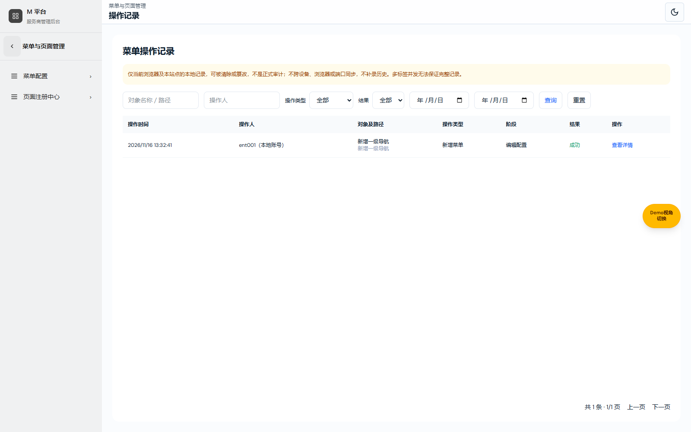

入口：菜单与页面管理 → 菜单配置 → 操作记录。菜单配置下默认进入菜单管理，不再直接作为叶子入口。

### 注册中心操作记录

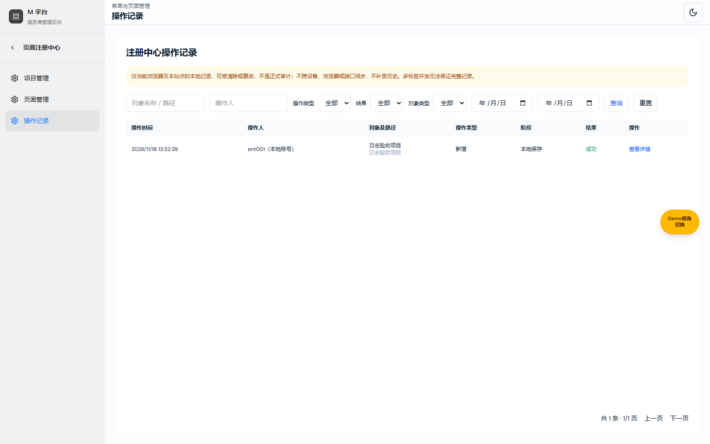

入口：页面注册中心 → 操作记录。与项目管理、页面管理同级；仅展示项目、目录和页面的本地操作。

图片来源统一为 2026-11-16、main 4deac132 基线功能预览，隔离演示身份。完整验证与边界见[交付记录](assets/operation-logs/README.md)。

| 字段／操作 | 逻辑说明 |
| --- | --- |
| 本地记录提示 | 仅当前浏览器及站点保存，可清除或篡改，不是正式审计，不补录历史。 |
| 对象名称／路径 | 关键字不区分大小写包含匹配，默认空；对象详情入口可另携带稳定 ID。 |
| 操作人 | 本地登录身份快照；关键词包含匹配，不由表单指定记录操作人。 |
| 操作类型 | 从当前模块已有记录生成候选，默认全部。 |
| 结果 | 全部、成功、失败；默认全部。 |
| 对象类型 | 注册中心提供项目、页面、目录，默认全部；菜单日志不展示此筛选。 |
| 开始日期 | 默认空，包含当天零点，按浏览器本地时区解释。 |
| 结束日期 | 默认空，包含当天结束；早于开始日期时阻止查询并提示。 |
| 查询 | 多条件取交集，执行后回第一页。 |
| 重置 | 清空筛选及对象 ID 上下文，恢复第一页。 |
| 操作时间 | 保存 UTC 时间，界面以本地时间显示到秒，默认倒序。 |
| 操作对象及路径 | 操作时名称和层级快照，删除后仍可查看；批量显示涉及数量。 |
| 阶段 | 编辑配置、保存草稿、发布、导出、本地保存分别展示，不混称发布成功。 |
| 成功／失败 | 由实际业务返回决定，日志写入失败另标未持久化，不回滚业务。 |
| 查看详情 | 打开记录快照及前后变化；查看不产生日志。 |
| 上一页／下一页 | 每页 20 条，边界禁用，仅对筛选结果分页。 |

### 操作详情

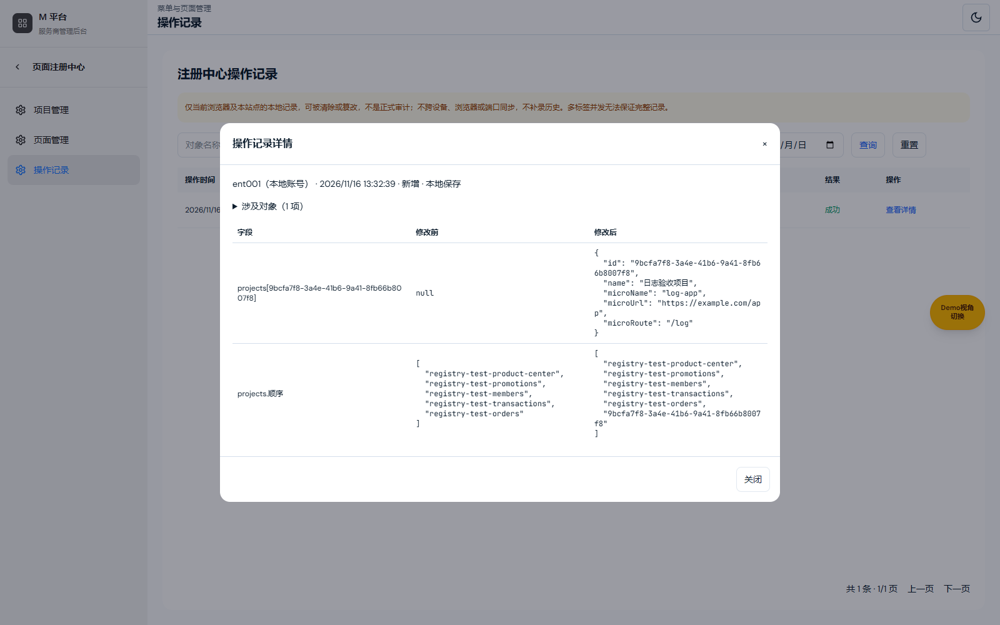

| 字段／操作 | 逻辑说明 |
| --- | --- |
| 操作人、时间、类型、阶段 | 读取本条历史快照，不用当前对象替换历史事实。 |
| 失败原因 | 失败时显示；脱敏后保存。 |
| 涉及对象 | 展开查看对象类型、历史路径和稳定 ID。 |
| 字段 | 展示变更字段路径，复杂值按 JSON 展示。 |
| 修改前 | 操作前的脱敏值；新增为空。 |
| 修改后 | 成功结果或失败尝试的脱敏值；删除为空。 |
| 未持久化提示 | 日志保存失败时会话可查看，刷新后会丢失；不宣称日志已完整保存。 |
| 关闭、×、遮罩、Esc | 不写业务数据，回到原筛选和分页；关闭按钮保留列表滚动。 |

无变化不记编辑；浏览、搜索、展开、取消不记录为失败。菜单结构同步动作合成单批次；发布仅在发布仓库成功后记成功。注册中心按钮虽为保存并发布，其写入仅为本地保存。日志禁止修改、删除、清空或回滚。完整已确认边界见[实施规格](../superpowers/specs/2026-11-16-menu-registry-operation-logs-design.md)，未验证项见交付记录。

### 项目微应用配置与页面路径

| 字段／操作 | 逻辑说明 |
| --- | --- |
| 微应用标识 | 新增项目必填，去首尾空白；项目下新注册页面复用，不在页面重复输入。 |
| 应用入口 URL | 新增项目必填，只允许 HTTP(S)；项目下新注册页面复用。 |
| 微应用路由 | 新增项目必填，以 / 开头，不含查询或 hash；写入 microAppConfig.path，不与页面路径自动拼接。 |
| 页面路径地址 | 页面级必填，沿用原绝对路径及全目录唯一校验；对应 routing.path。 |
| 页面类型与配置 | 配置微应用的项目下，新页面固定微应用类型，三项项目参数只读展示。保存时从最新项目取值，不接受页面伪造覆盖。 |
| 历史兼容 | 未配置微应用的既有项目保留原四类注册，不覆盖历史页面快照。新增项目不能省略微应用配置。 |

## 页面注册中心：项目与目录

入口：菜单路由配置 → 页面注册中心 → 项目管理／页面管理。两者为独立子导航，不采用页签；进入注册中心显示子导航滑层，返回只退一层。项目管理负责新增项目与展示微应用配置；页面管理负责选择项目、维护目录及在右侧注册页面。页面管理不再提供新增项目操作，新增需进入项目管理。两个页面继续共用 routing 权限资源，不新增授权。

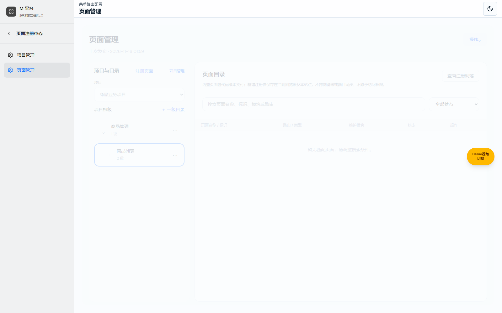

项目名称由用户填写；项目下支持新增一级目录、新增子级、重命名、指定移动、上移与下移。目录不配置路由、不自动生成商家导航。未归类入口保留内置及历史注册页面。

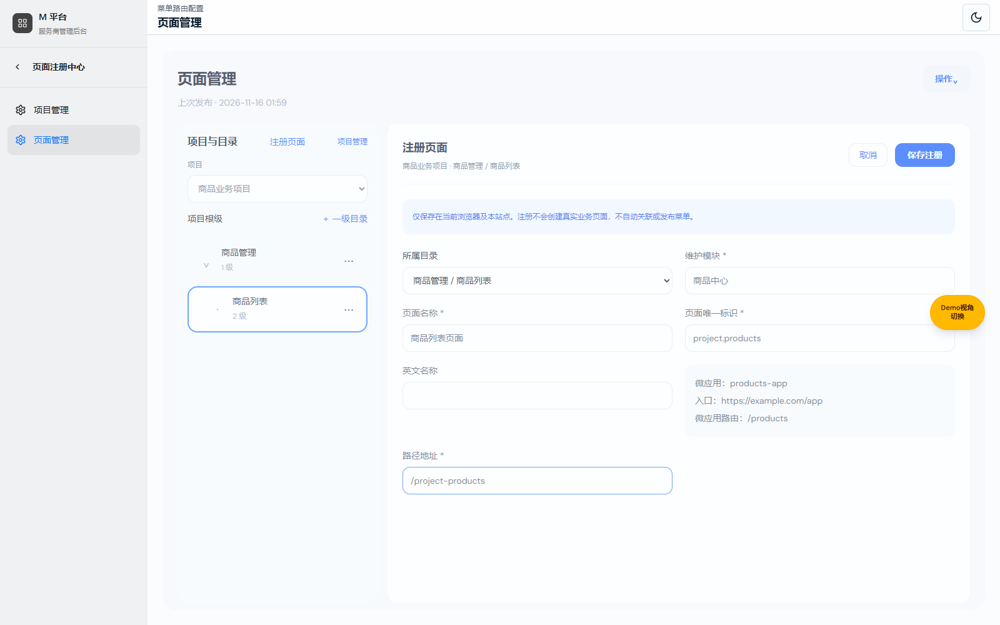

注册页面入口位于左侧项目与目录标题右侧；点击后在右侧展示注册表单，不跳转独立页面，左侧目录保持可见。默认归属入口项目及目录，可调整同项目所属目录。页面名称、标识、维护模块及四类加载参数沿用校验；保存成功返回归属目录，取消离开保留输入。目录不能移动到自身或后代。

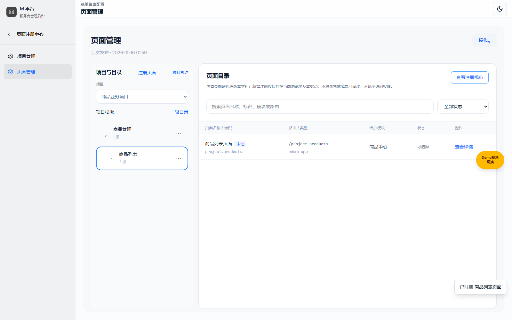

来源：2026-11-16，main c913d5d4 基线功能预览，隔离演示数据。新增项目、目录、页面归属及记录统一写入 menusifu:page-registry:v2；旧 v1 保留，首次成功写入时迁移旧页面。异常数据禁止覆盖；写入失败保留输入。编辑权限仍使用 m:page:routing，不改变菜单关联和发布业务。

详细字段、存储兼容和验收：[实施规格](../superpowers/specs/2026-11-16-page-registry-project-tree-design.md)。

## 二级导航与路由合同

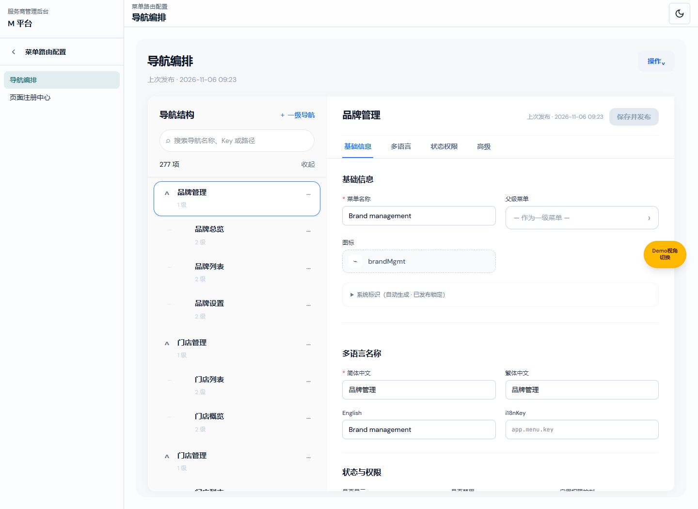

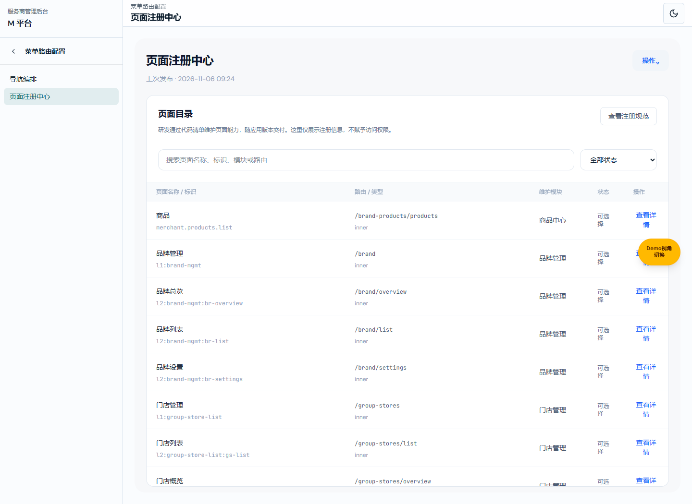

图注：2026-11-06，codex/menu-routing-subnav-20261106 基于 main@ec151927 的未提交功能预览，65263 隔离演示数据。其他注册弹框及绑定字段不因入口变更重新定义。

| 字段／操作 | 定义 |
| --- | --- |
| MENU_ROUTING_PAGES | 固定 nav→导航编排→`/m-platform/nav-blueprint/navigation`；registry→页面注册中心→`/m-platform/nav-blueprint/page-registry`；不持久化到菜单 JSON。 |
| menuRoutingPage(path) | 去查询和末尾斜杠后精确识别注册中心，其余原根／旧编辑地址默认 nav；不改历史编辑路由参数解析。 |
| 页面渲染 | renderJsonMenuEditorPage(view) 接收地址决定的视角，不再使用 registrationUi.view 或页内 Tab。 |
| 导航／高亮 | 已授权 routing 模块映射两个子链接，共用页 id=routing；只按规范化子地址判断当前项，不按共享 id 同时点亮两项。复用 bindNavigationSubmenuActions。 |
| 权限合同 | 原 m:module:routing／m:page:routing 与动作资源不变；隐藏两入口均拒绝，只读允许目录搜索／状态筛选／详情／规范／关闭，不豁免选择或确认关联的写操作。 |
| 草稿状态 | 模块内 document、selectedPath、dialogState 与目录筛选不因子路由切换重置。切换不写 JSON、不自动提交、不发布；返回层级不重建表单。原切换菜单时保存并发布／不保存分支保持。 |
| 默认与异常 | 旧根地址首次加载导航编排；目录无搜索结果显示原空态；原读取／发布失败处理不变。此变更没有金额、计算、单位或新增后端字段。 |

验收算例：从旧根地址显示编排且仅编排高亮；进入 page-registry 后只有注册中心高亮，刷新仍为目录；退回 navigation，原节点和未发布关联仍在，切换另一个菜单仍提示；只读目录可以搜索但不允许写绑定。验证记录见 `assets/menu-routing-subnav/verification.json` 和专项脚本 `verify-menu-routing-navigation.ts`。

## 页面注册与快照绑定

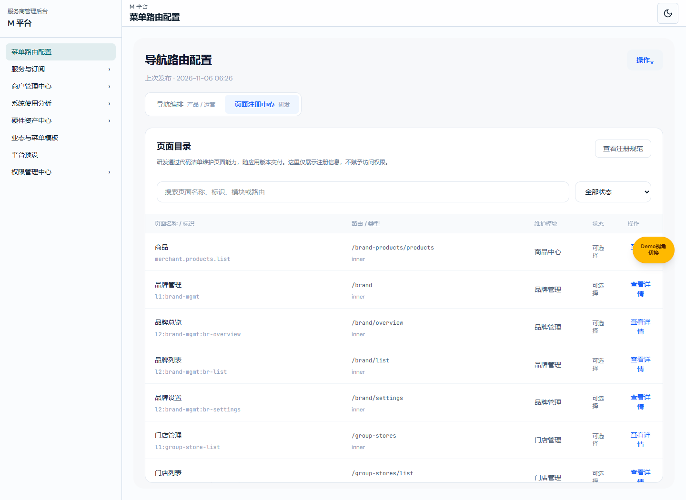

图注：2026-11-06，功能分支基于 main@cb2549c4 的未提交预览，隔离演示数据。详情与关联弹框在个人版操作章节就近展示。

| 字段／对象 | 定义 |
| --- | --- |
| PageRegistration.id | 必填稳定标识；清单重复阻断加载，只在编辑器内部使用，不导出新业务字段。 |
| title / titleEn | 默认中英文名称，title 必填；选择不会覆盖菜单自定义名称或多语言。 |
| module / source | 维护模块和代码来源，供搜索和详情查看。 |
| status | active / retired；停用拒绝新关联，保留历史菜单快照。 |
| routing.type | inner / iframe / external / micro-app；链接菜单走原兼容入口。 |
| routing.path | 必填应用内绝对路径，禁用 //、查询、hash、首尾空白及重复路径。 |
| routing.url | iframe / external 必填 HTTP(S) URL。 |
| routing.microAppConfig | 微应用必填 name、HTTP(S) url，其他字段沿用 MenuNode；入口由研发部署配置提供。 |
| permissions | 可缺省能力声明，只读，不授予权限、不改写菜单 accessControl。 |
| 快照比较 | type/path/url/microAppConfig/externalConfig 完全匹配，对象键序无关；未匹配不自动修复历史值。 |
| bindRegisteredPage | 深拷贝菜单，清理旧技术参数和 targetKey，再写注册快照。保留身份、名称、多语言、权限、extraInfo、显示与排序；有子项拒绝绑定。 |
| 持久化 | 使用原仓库与 JSON；不写 pageId、注册状态、查询、候选字段。刷新后通过快照识别。研发变更路由不会追溯修改既有发布菜单，需要显式重新关联。 |

实现入口：page-registration-domain.ts、page-registration-catalog.ts、page-registrations.ts、page-registration-ui.ts；editor-ui/node-form-ui 负责集成。显式清单同路径替换既有目录描述，显式清单内部重复仍校验失败。

算例：id=A/key=B/name=我的商品、旧 external /old、权限[p1]、extraInfo=[1]，选 inner /brand-products/products 后身份、名称、权限、扩展不变，url 和 externalConfig 清除。停用或有子项时拒绝；空叶子发布提示选择；取消不写草稿。verify-page-registration.ts 覆盖以上合同；旧参考文件测试因桌面文件缺失尚未完成。

## 当前有效定义：与商家后台导航逐项一致

本地演示环境读取：开发模式、localhost、127.0.0.1、IPv6 回环（::1／[::1]）及 *.github.io 使用演示仓库；本机静态构建预览也适用。其余主机使用 HTTP 仓库，接口异常直接提示，不自动切换演示数据；草稿与发布仍沿用对应仓库的存储规则。[环境回归记录](../verification/m-platform-static-menu-20261104/README.md)。

实际 /m-platform/nav-blueprint 使用 JSON 菜单编辑器（json-menu-editor-ui / json-menu-demo-data），不再将旧蓝图矩阵的验证当作本页验收。默认目录读取 navigation.ts 中商家后台实际使用的模块专用 SUBNAV、navModuleChildrenAsSheetSubnav 及递归 sidebarChildren/children；同级顺序、中文名称、叶子路径、父子关系一致。不自动生成概览，不拍平深层商品菜单，不给同名子项擅自添加父名，不因旧测试限制而截断为三级。

休息与加班子项仅为自定义休息、加班规则、设置。小费管理子项为小费分配、分配规则；分配明细是当前商家页面内容，不额外生成导航入口。

默认演示源当前 29 个一级、277 个总节点。以实际导航数组做双向整树比较，不能只验证“原有路径均出现”，还必须检查多余节点、层级和顺序。JSON 字段、服务权限样例和保存发布接口保持原合同。

只有与历史内置演示菜单完全相同的已发布/草稿 menu 才在读取时投影为最新默认结构；比较忽略 parentKey 派生值。原 localStorage 数据不覆盖、不删除；任一手工编辑字段或顺序不同则保留，不自动同步自定义数据。此规则仅用于当前本地演示仓库，HTTP 远端配置不被强制替换。

验证：verify-json-menu-merchant-parity.ts 对整树双向相等、无额外概览、小费子项、递归产品、旧原件保留及自定义草稿保护断言通过；verify-json-menu-current-merchant-demo.ts 已从旧三级/概览预期更新为真实导航合同并通过。浏览器在实际 JSON 配置页逐项比对全部 277 个已渲染节点的位置和标题通过。本轮已获授权提交并合入本地 main，未获推送授权。

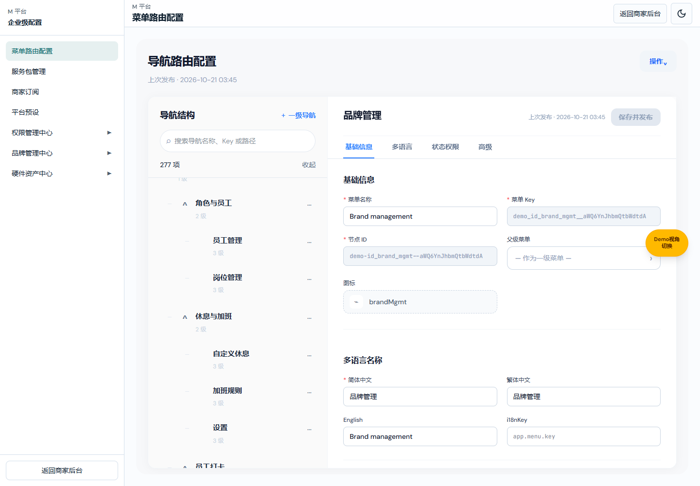

图注：5208，codex/brand-route-tree-20261021 未提交功能预览；实际 JSON 菜单配置页，当前默认演示数据。

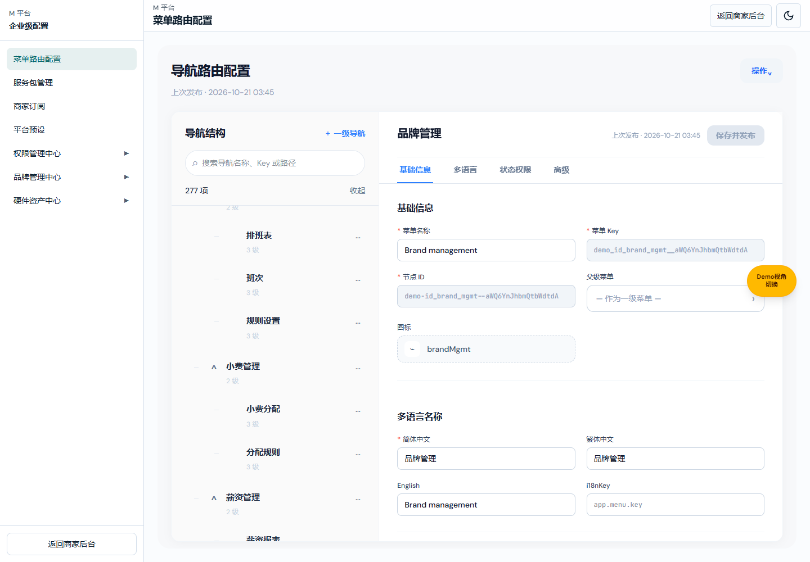

图注：同一版本，实际配置页展开状态。

| 区域或字段 | 逻辑说明 |
| --- | --- |
| 一级模块 | 顺序和名称读取商家 NAV_MODULES，不新增或丢弃模块；默认 29 个。 |
| 子菜单 | 专用子导航使用后台同一数组，其他模块使用公共转换函数；递归保留任意层 sidebarChildren/children。目录仅展示实际存在的子项，不补“概览”。 |
| 菜单名称 | 中文来自真实 title，英文沿用 titleEn；不擅自拼接“父名 · 子名”。 |
| 叶子路径 | 沿用真实业务路径；目录不伪造可点击概览页。 |
| 顺序及归属 | 逐层严格按源数组排列；无拍平、无按名称重新排序。 |
| 展开/收起 | 沿用原编辑器树交互；展开真实子菜单，不增加数据节点。 |
| 演示缓存 | 仅完全未编辑的旧内置样例在读时映射最新结构；不写回缓存、不会触发未保存提示。手工草稿、其他发布数据保留。 |
| 保存/发布 | 用户编辑后的原校验、草稿、发布行为不变；本次修正数据源不自动向 HTTP 接口发布。 |

实现入口：json-menu-demo-data.ts、json-menu-document-repository.ts。菜单结构使用现有 MenuNode 字段，不新增 API 字段。旧源保留为只读识别函数用于确认旧默认样例，不能再次作为页面默认数据。

补充：消息中心复用 groupNotificationSheetSubnav（品牌消息/门店消息），前厅复用 groupRuleRestrictionsSubnav（菜单下单限制）以保持后台真实分组。实际 JSON 路由页 verify-json-menu-route-page.mjs 对全部 277 个节点的 DOM 位置和标题逐项验证通过。结构比较基于完整目录，不套当前账号权限/订阅过滤，避免把权限不可见误当作不存在；发布范围过滤继续由原运行时处理。
