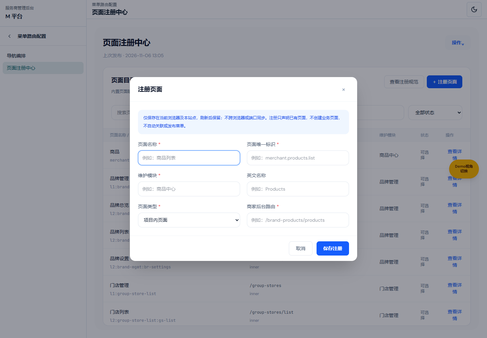
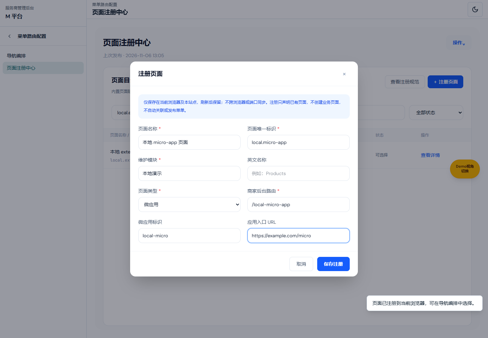
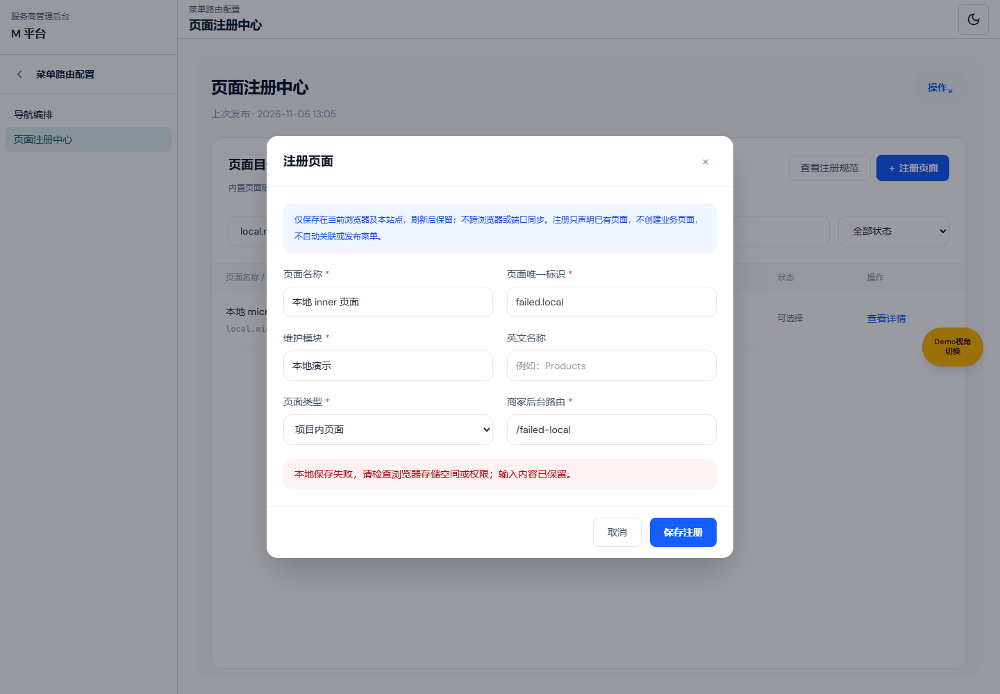
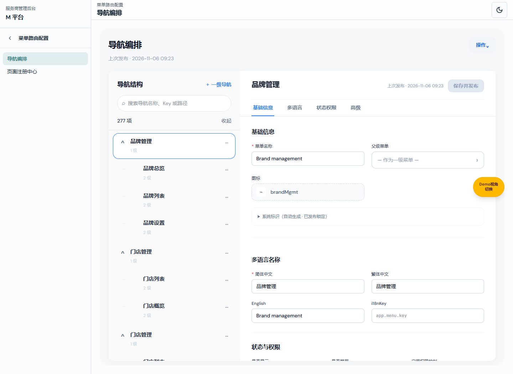
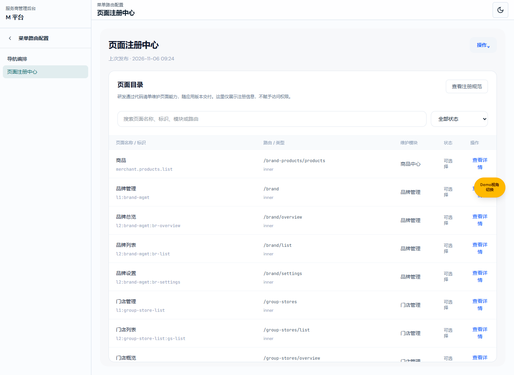
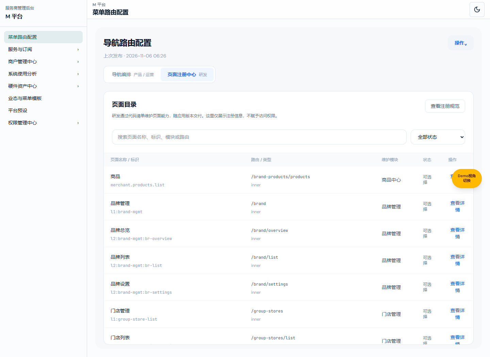
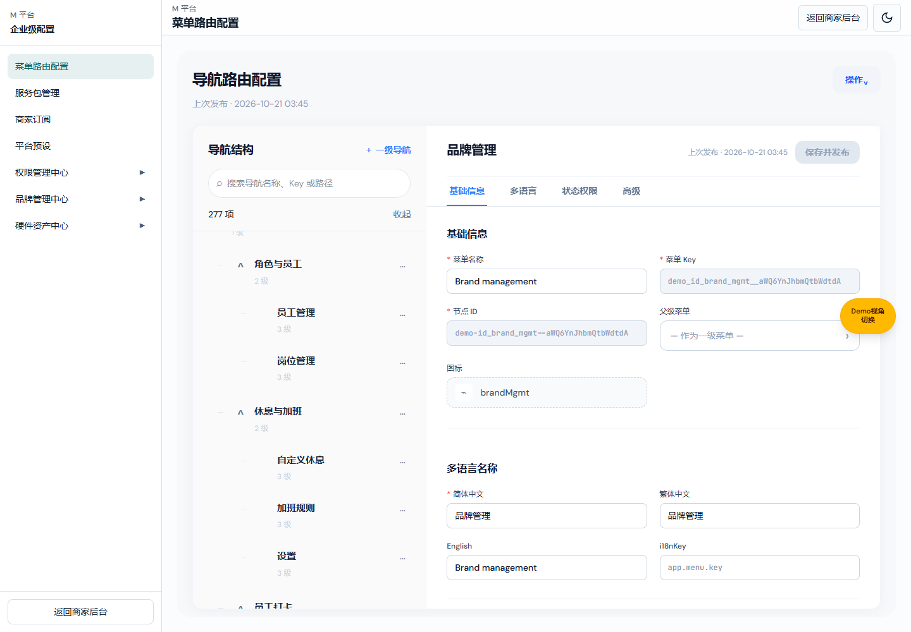
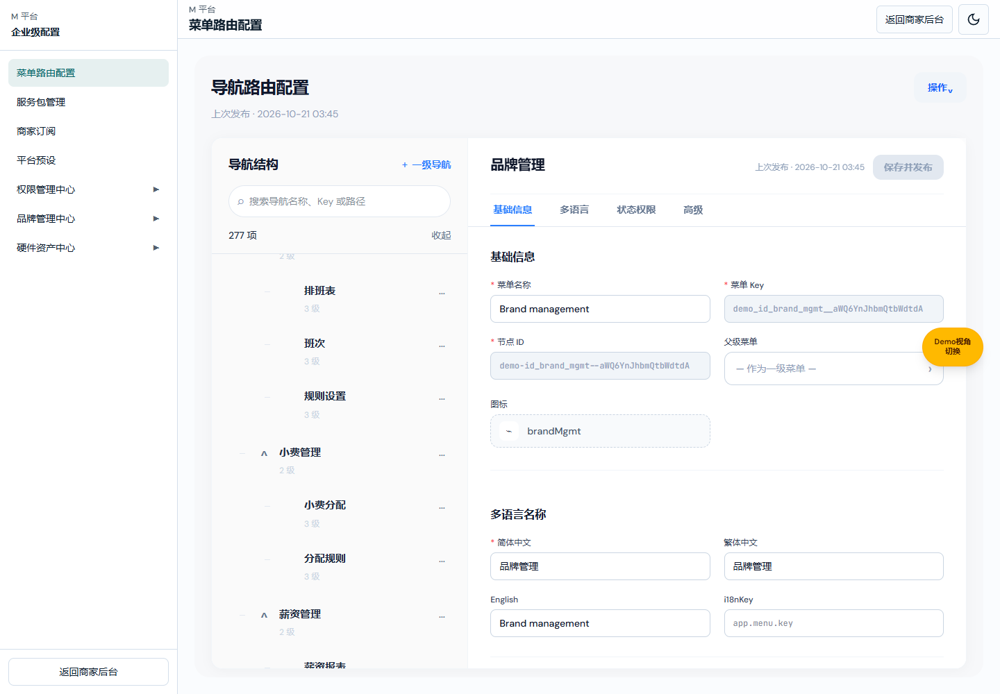

# M 平台菜单路由业务规格说明书（研发交付版）

> V1.3 · 2026-11-06；LOCAL-PAGE-REG-20261106-03；功能基线 main@ec151927。
> 产品：[v1.4](./M平台-菜单路由可视化配置设计方案.md)；个人：[V1.3](./M平台-菜单路由需求文档（个人规范版）.md)。变更与验证：[交付记录](assets/local-page-registration/README.md)。

## 本地注册对象与写入

图注：2026-11-06，65263、codex/menu-routing-subnav-20261106 未提交预览，隔离演示数据；控件联动决定实际写入的类型字段。

| 字段／对象 | 定义 |
| --- | --- |
| 存储 key | menusifu:local-page-registrations:v1，独立于菜单文档和权限存储；不写源码文件，不调用服务端接口。 |
| 存储结构 | `{version:1,pages:PageRegistration[]}`；版本固定数字 1。读入需检查对象、版本、数组、必填字符串、四类加载参数及全目录冲突。 |
| id | string，必填、去首尾空白；与全目录精确比较唯一。 |
| title | string，必填、去首尾空白。 |
| titleEn | 可选 string，去首尾空白，空时省略。 |
| module | string，必填、去首尾空白；仅目录元信息。 |
| status | 固定 active；不在新增表单提供停用配置。 |
| source | 固定“本地注册（当前浏览器）”；不接受表单伪造来源或权限声明。 |
| routing.type | inner／iframe／external／micro-app；表单默认 inner，非法类型拒绝。 |
| routing.path | 必填 string，去首尾空白；共享原绝对路由及重复校验，无查询／hash／//。 |
| routing.url | 仅 iframe／external 写入并必填 HTTP(S)。 |
| routing.microAppConfig | 仅 micro-app 写入，name 和 HTTP(S) url 必填；其他类型省略。 |
| 类型切换 | 隐藏字段取消必填并禁用；已填写值在本弹框类型往返保留，但不适用字段不落库。 |
| 读取 | 内置清单单独缓存，本地记录每次重新读取并与内置合并校验；无记录返回空数组。异常仅忽略不可读本地部分，不删原值，不阻断内置目录。 |
| 写入前置 | handler 再校验 routing 编辑权限；读取最新本地记录，校验整个目录，阻止内置／本地标识或路径冲突。 |
| 成功 | setItem 成功后返回记录；弹框关闭、目录按新 id 过滤、状态为全部，目录和选择器立即可读；不修改菜单 JSON。 |
| 失败 | 格式、重复、非法 URL、存储拒绝或配额异常均不关闭表单、不显示成功；保留输入。已损坏存储禁止覆盖。 |
| 取消 | 关闭、取消、Esc、遮罩都不调用写入，丢弃表单输入，不动菜单草稿。 |
| 权限 | 复用 m:page:routing 的 edit；read 仅浏览、搜索、详情。局部 localStorage 不是服务端安全边界，不新增或自动授予任何业务访问权。 |

图注：同版本隔离会话、受控浏览器配额异常；界面保留输入，存储原值不变。

算例：内置 `/brand-products/products` 已存在，新 id 使用同一路径必须拒绝；本地 `local.demo.report` 再次保存必须拒绝。注册 inner `/local-demo-report` 后刷新可见，选择后仅生成对应 MenuNode 技术快照，菜单名称和权限不变且仍需独立发布。微应用提供 ftp 入口拒绝；本地 JSON 损坏时显示内置目录并阻止覆盖。

浏览器范围、共享同一浏览器配置文件及清缓存后果由产品“本地范围”单点定义。没有新增金额、计算、服务端数据表、同步或发布接口。实现为 local-page-registration.ts、page-registration-create-ui.ts、catalog/UI/editor 集成；验证与缺口单独见交付记录。

## 二级导航与路由合同

图注：2026-11-06，codex/menu-routing-subnav-20261106 基于 main@ec151927 的未提交功能预览，65263 隔离演示数据。其他注册弹框及绑定字段不因入口变更重新定义。

| 字段／操作 | 定义 |
| --- | --- |
| MENU_ROUTING_PAGES | 固定 nav→导航编排→`/m-platform/nav-blueprint/navigation`；registry→页面注册中心→`/m-platform/nav-blueprint/page-registry`；不持久化到菜单 JSON。 |
| menuRoutingPage(path) | 去查询和末尾斜杠后精确识别注册中心，其余原根／旧编辑地址默认 nav；不改历史编辑路由参数解析。 |
| 页面渲染 | renderJsonMenuEditorPage(view) 接收地址决定的视角，不再使用 registrationUi.view 或页内 Tab。 |
| 导航／高亮 | 已授权 routing 模块映射两个子链接，共用页 id=routing；只按规范化子地址判断当前项，不按共享 id 同时点亮两项。复用 bindNavigationSubmenuActions。 |
| 权限合同 | 原 m:module:routing／m:page:routing 与动作资源不变；隐藏两入口均拒绝，只读允许目录搜索／状态筛选／详情／规范／关闭，不豁免选择或确认关联的写操作。 |
| 草稿状态 | 模块内 document、selectedPath、dialogState 与目录筛选不因子路由切换重置。切换不写 JSON、不自动提交、不发布；返回层级不重建表单。原切换菜单时保存并发布／不保存分支保持。 |
| 默认与异常 | 旧根地址首次加载导航编排；目录无搜索结果显示原空态；原读取／发布失败处理不变。此变更没有金额、计算、单位或新增后端字段。 |

验收算例：从旧根地址显示编排且仅编排高亮；进入 page-registry 后只有注册中心高亮，刷新仍为目录；退回 navigation，原节点和未发布关联仍在，切换另一个菜单仍提示；只读目录可以搜索但不允许写绑定。验证记录见 `assets/menu-routing-subnav/verification.json` 和专项脚本 `verify-menu-routing-navigation.ts`。

## 页面注册与快照绑定

图注：2026-11-06，功能分支基于 main@cb2549c4 的未提交预览，隔离演示数据。详情与关联弹框在个人版操作章节就近展示。

| 字段／对象 | 定义 |
| --- | --- |
| PageRegistration.id | 必填稳定标识；清单重复阻断加载，只在编辑器内部使用，不导出新业务字段。 |
| title / titleEn | 默认中英文名称，title 必填；选择不会覆盖菜单自定义名称或多语言。 |
| module / source | 维护模块和代码来源，供搜索和详情查看。 |
| status | active / retired；停用拒绝新关联，保留历史菜单快照。 |
| routing.type | inner / iframe / external / micro-app；链接菜单走原兼容入口。 |
| routing.path | 必填应用内绝对路径，禁用 //、查询、hash、首尾空白及重复路径。 |
| routing.url | iframe / external 必填 HTTP(S) URL。 |
| routing.microAppConfig | 微应用必填 name、HTTP(S) url，其他字段沿用 MenuNode；入口由研发部署配置提供。 |
| permissions | 可缺省能力声明，只读，不授予权限、不改写菜单 accessControl。 |
| 快照比较 | type/path/url/microAppConfig/externalConfig 完全匹配，对象键序无关；未匹配不自动修复历史值。 |
| bindRegisteredPage | 深拷贝菜单，清理旧技术参数和 targetKey，再写注册快照。保留身份、名称、多语言、权限、extraInfo、显示与排序；有子项拒绝绑定。 |
| 持久化 | 使用原仓库与 JSON；不写 pageId、注册状态、查询、候选字段。刷新后通过快照识别。研发变更路由不会追溯修改既有发布菜单，需要显式重新关联。 |

实现入口：page-registration-domain.ts、page-registration-catalog.ts、page-registrations.ts、page-registration-ui.ts；editor-ui/node-form-ui 负责集成。显式清单同路径替换既有目录描述，显式清单内部重复仍校验失败。

算例：id=A/key=B/name=我的商品、旧 external /old、权限[p1]、extraInfo=[1]，选 inner /brand-products/products 后身份、名称、权限、扩展不变，url 和 externalConfig 清除。停用或有子项时拒绝；空叶子发布提示选择；取消不写草稿。verify-page-registration.ts 覆盖以上合同；旧参考文件测试因桌面文件缺失尚未完成。

## 当前有效定义：与商家后台导航逐项一致

本地演示环境读取：开发模式、localhost、127.0.0.1、IPv6 回环（::1／[::1]）及 *.github.io 使用演示仓库；本机静态构建预览也适用。其余主机使用 HTTP 仓库，接口异常直接提示，不自动切换演示数据；草稿与发布仍沿用对应仓库的存储规则。[环境回归记录](../verification/m-platform-static-menu-20261104/README.md)。

实际 /m-platform/nav-blueprint 使用 JSON 菜单编辑器（json-menu-editor-ui / json-menu-demo-data），不再将旧蓝图矩阵的验证当作本页验收。默认目录读取 navigation.ts 中商家后台实际使用的模块专用 SUBNAV、navModuleChildrenAsSheetSubnav 及递归 sidebarChildren/children；同级顺序、中文名称、叶子路径、父子关系一致。不自动生成概览，不拍平深层商品菜单，不给同名子项擅自添加父名，不因旧测试限制而截断为三级。

休息与加班子项仅为自定义休息、加班规则、设置。小费管理子项为小费分配、分配规则；分配明细是当前商家页面内容，不额外生成导航入口。

默认演示源当前 29 个一级、277 个总节点。以实际导航数组做双向整树比较，不能只验证“原有路径均出现”，还必须检查多余节点、层级和顺序。JSON 字段、服务权限样例和保存发布接口保持原合同。

只有与历史内置演示菜单完全相同的已发布/草稿 menu 才在读取时投影为最新默认结构；比较忽略 parentKey 派生值。原 localStorage 数据不覆盖、不删除；任一手工编辑字段或顺序不同则保留，不自动同步自定义数据。此规则仅用于当前本地演示仓库，HTTP 远端配置不被强制替换。

验证：verify-json-menu-merchant-parity.ts 对整树双向相等、无额外概览、小费子项、递归产品、旧原件保留及自定义草稿保护断言通过；verify-json-menu-current-merchant-demo.ts 已从旧三级/概览预期更新为真实导航合同并通过。浏览器在实际 JSON 配置页逐项比对全部 277 个已渲染节点的位置和标题通过。本轮已获授权提交并合入本地 main，未获推送授权。

图注：5208，codex/brand-route-tree-20261021 未提交功能预览；实际 JSON 菜单配置页，当前默认演示数据。

图注：同一版本，实际配置页展开状态。

| 区域或字段 | 逻辑说明 |
| --- | --- |
| 一级模块 | 顺序和名称读取商家 NAV_MODULES，不新增或丢弃模块；默认 29 个。 |
| 子菜单 | 专用子导航使用后台同一数组，其他模块使用公共转换函数；递归保留任意层 sidebarChildren/children。目录仅展示实际存在的子项，不补“概览”。 |
| 菜单名称 | 中文来自真实 title，英文沿用 titleEn；不擅自拼接“父名 · 子名”。 |
| 叶子路径 | 沿用真实业务路径；目录不伪造可点击概览页。 |
| 顺序及归属 | 逐层严格按源数组排列；无拍平、无按名称重新排序。 |
| 展开/收起 | 沿用原编辑器树交互；展开真实子菜单，不增加数据节点。 |
| 演示缓存 | 仅完全未编辑的旧内置样例在读时映射最新结构；不写回缓存、不会触发未保存提示。手工草稿、其他发布数据保留。 |
| 保存/发布 | 用户编辑后的原校验、草稿、发布行为不变；本次修正数据源不自动向 HTTP 接口发布。 |

实现入口：json-menu-demo-data.ts、json-menu-document-repository.ts。菜单结构使用现有 MenuNode 字段，不新增 API 字段。旧源保留为只读识别函数用于确认旧默认样例，不能再次作为页面默认数据。

补充：消息中心复用 groupNotificationSheetSubnav（品牌消息/门店消息），前厅复用 groupRuleRestrictionsSubnav（菜单下单限制）以保持后台真实分组。实际 JSON 路由页 verify-json-menu-route-page.mjs 对全部 277 个节点的 DOM 位置和标题逐项验证通过。结构比较基于完整目录，不套当前账号权限/订阅过滤，避免把权限不可见误当作不存在；发布范围过滤继续由原运行时处理。
