# M 平台 · 菜单路由可视化配置 — 设计方案

> 版本：v2.1 · 2026-11-20
> 状态：当前 JSON 菜单编排、代码页面目录与本地页面注册。
> 关联：`M平台-企业级平台预设设计方案.md`、`平台预设-产品需求与设计说明.md`、`一级导航定义说明.md`、`navigation.ts`、`module-settings-catalog.ts`

> 配对：[研发 V2.0](./M平台-菜单路由业务规格说明书（研发交付版）.md) · [个人规范 V2.0](./M平台-菜单路由需求文档（个人规范版）.md)。共同变更 MENU-SCOPE-INHERIT-20261120-01，起始 main@b656d197。变更与验证独立记录于 [本地注册交付记录](assets/local-page-registration/README.md)。


## 版本记录

| 版本 | 日期 | 变更 |
| --- | --- | --- |
| v2.1 | 2026-11-20 | MENU-SCOPE-INHERIT-20261120-01，新增「商户开放」页签，非收费菜单支持开放范围继承和覆盖。 |
| v2.0 | 2026-11-20 | MENU-SCOPE-20261120-01，采用商户开放范围和父级分组展示规则。 |
| v1.9 | 2026-11-20 | MENU-OWNERS-20261120-01，关联页面展示所属项目负责人，并补充收费与商户可见配置。 |
| v1.8 | 2026-11-20 | MENU-LAYOUT-20261120-01，简化菜单管理工作区。 |
| v1.7 | 2026-11-18 | OPLOG-20261118-EMAIL-01，注册中心操作记录展示操作人邮箱。 |
| v1.6 | 2026-11-16 | OPLOG-20261116-01，菜单与注册中心操作记录。 |

## 关联页面的项目负责人

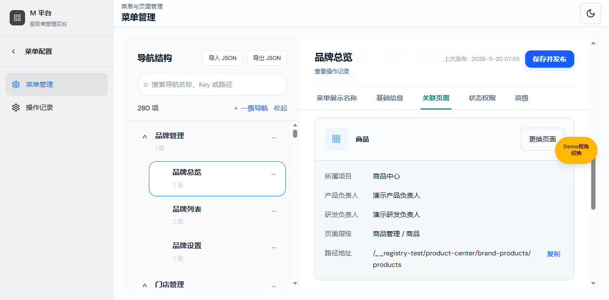

图：商品中心关联页，负责人为隔离 Demo 数据，基于 main@458018b4。

关联页面卡片在「所属项目」下方只读展示产品负责人和研发负责人，取页面注册中心所属项目的当前配置。已关联项目但负责人为空时显示「—」，无所属项目时显示「未关联项目」，注册中心读取失败时显示「暂不可读取」。

## 收费菜单与商户可见配置

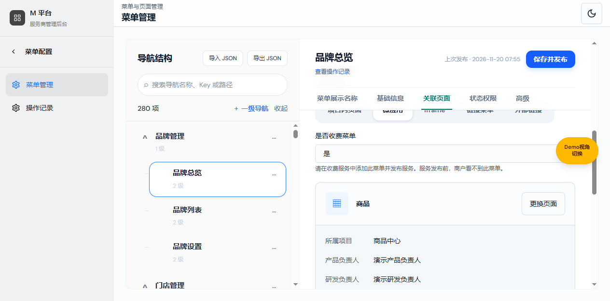

图：「是否收费菜单」选择「是」，基于 main@458018b4 的功能分支。

| 字段／操作 | 逻辑说明 |
| --- | --- |
| 是否收费菜单 | 选择「是」立即提示在收费服务中添加此菜单并发布服务。服务发布前，商户看不到此菜单。切换为「否」立即隐藏这条提示。 |

### 父级菜单的收费设置

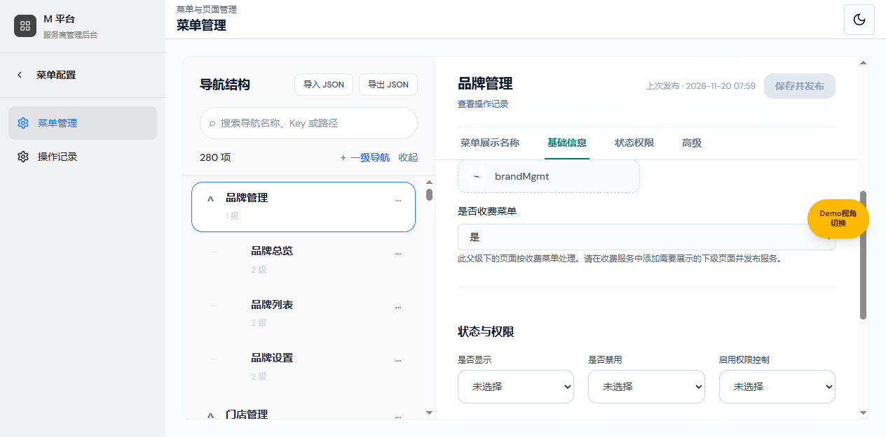

图：父级菜单「基础信息」选择收费，本地 Demo。

父级菜单各自配置「是否收费菜单」，旧配置缺省为「否」。发布后，只要任一祖先设为「是」，下级页面按收费菜单处理，且需要关联到已发布的收费服务。所有祖先均为「否」时，由页面自己的收费设置决定。该设置不会批量改写下级菜单草稿。

### 商户开放页签

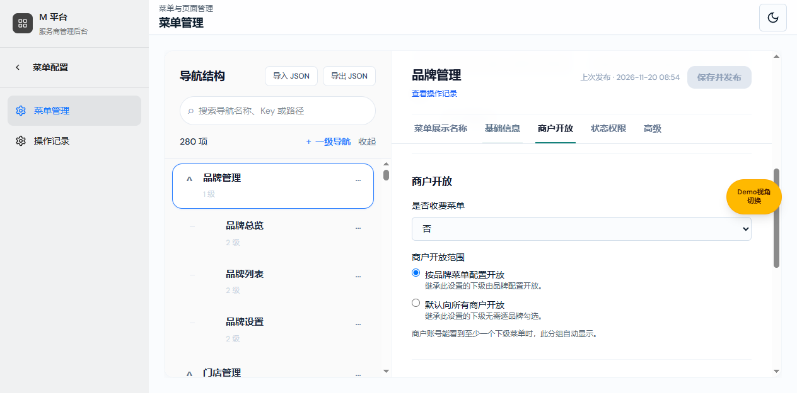

图：父级菜单 → 商户开放，非收费时可配置开放范围，功能分支基于 main@b656d197。


图：子级菜单 → 商户开放，未单独配置的子级默认继承，本地 Demo。

| 字段／操作 | 逻辑说明 |
| --- | --- |
| 继承父级设置 | 有父级时可选，未单独配置的子级默认选中。发布后沿菜单树使用最近一层的有效设置，父级调整后随之更新。 |
| 按品牌菜单配置开放 | 顶级菜单默认使用。选中后，本节点按品牌菜单配置开放，并成为下级继承的默认值。 |
| 默认向所有商户开放 | 发布后，无需逐品牌勾选本页面和继承此设置的页面。账号权限、平台预设和菜单状态仍适用。 |
| 子级覆盖 | 子级可以单独选择按品牌配置或默认开放。该选择优先于父级，并可继续向下继承。切回「继承父级设置」会移除单独配置。 |
| 切换为收费 | 隐藏商户开放范围。草稿切回非收费时保留此前选择，以收费状态保存时清除该设置。任一祖先收费时，收费规则优先。 |

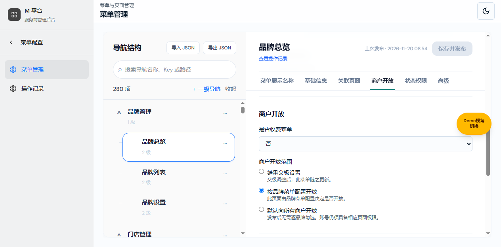

图：子级选择「按品牌菜单配置开放」作为独立设置，本地 Demo。

### 纯分组父级

纯分组父级支持相同的商户开放范围设置。它将设置传给继承它的下级。商户账号能看到至少一个下级菜单时，父级分组随之显示。没有可见下级时隐藏纯分组。


### 品牌编辑菜单权限

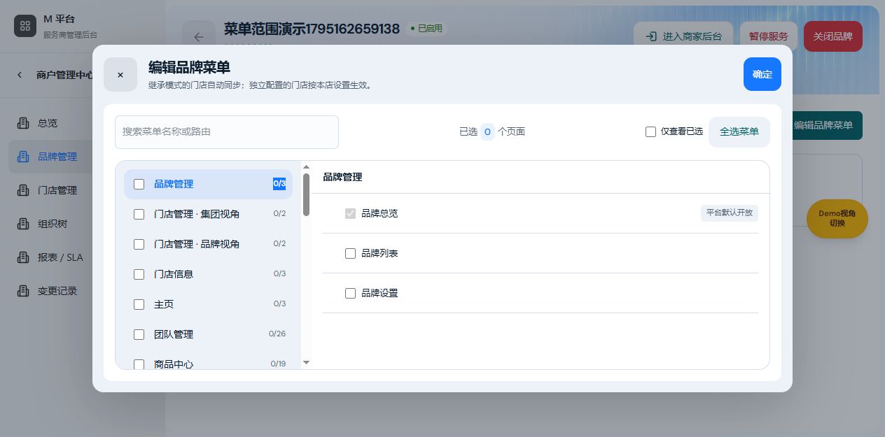

图：品牌编辑菜单权限，品牌总览为平台默认开放。隔离 Demo 数据，基于本地 main@21d79dd0。

默认开放的页面显示「平台默认开放」，勾选态由 M 平台管理。品牌批量操作不写入平台默认开放项，也不清除历史上的品牌显式选项。普通菜单仍按现有勾选流程保存。


## 菜单管理工作区

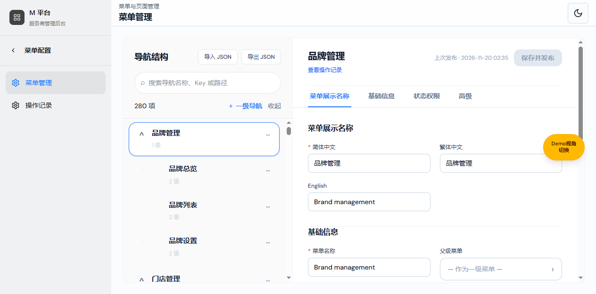

图：菜单配置 → 菜单管理默认态，基于 main@8e5eb06f 的功能分支，本地 Demo。

由平台导航呈现「菜单管理」。编辑区直接置于页面画布，「导航结构」标题右侧提供紧凑的 JSON 导入、导出按钮，「＋ 一级导航」移至搜索框下方。选中菜单后，「上次发布」在右侧编辑区显示一次。

## 页面注册中心操作人邮箱

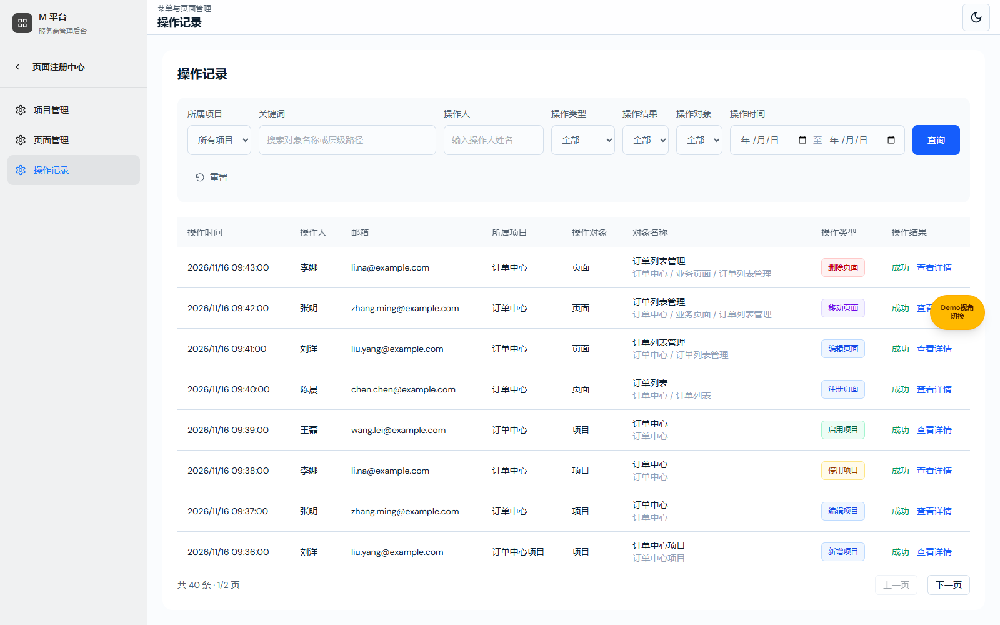

图：页面注册中心「操作记录」。功能检出基于 main@0c594657，图中为内置 Demo 数据。

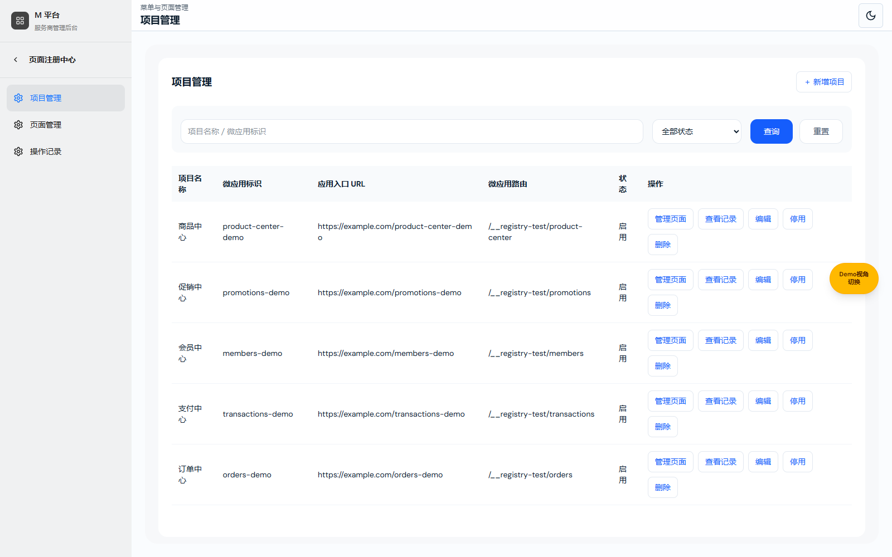

图：项目管理行内「查看记录」。

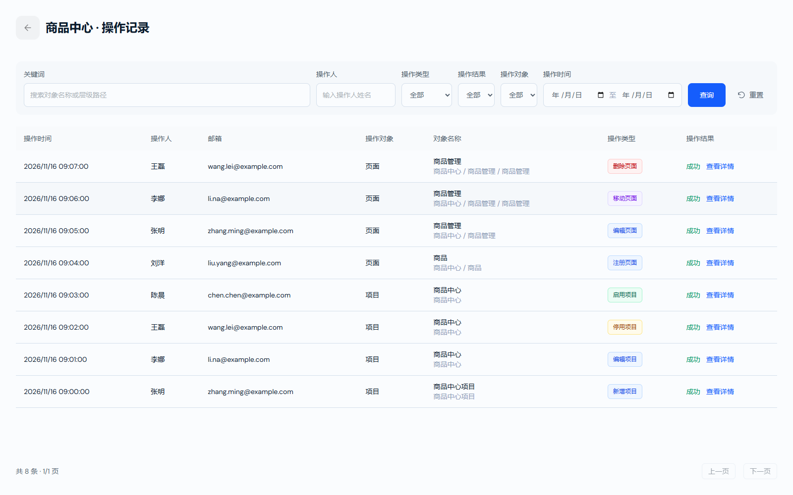

图：点击商品中心「查看记录」后的全屏列表。

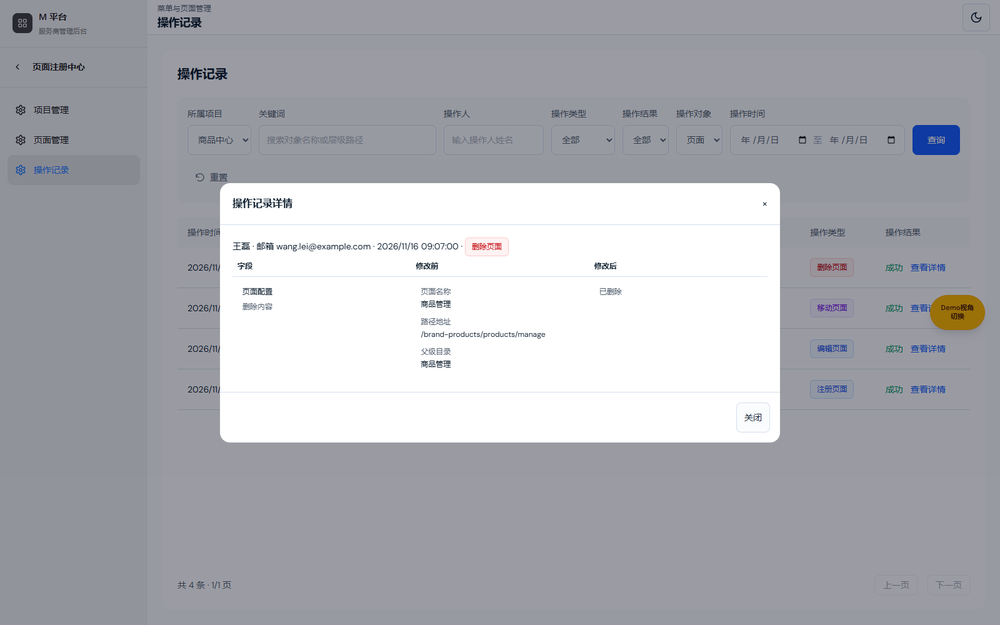

图：点击「查看详情」后，操作人旁显示同一 Demo 邮箱。

「页面注册中心 → 操作记录」全局列表和「项目管理 → 查看记录」项目列表均在「操作人」右侧显示「邮箱」，记录详情也显示「邮箱」。字段为只读，沿用记录查看权限。新记录取操作时企业账号的邮箱快照。历史记录缺少邮箱时显示「—」。同一 Demo 操作人在两个入口和详情中显示固定示例邮箱。验收覆盖两个入口、同条记录一致性、旧记录空值，以及实际新增项目后的邮箱采集。

## 菜单与注册中心操作记录

### 菜单操作记录

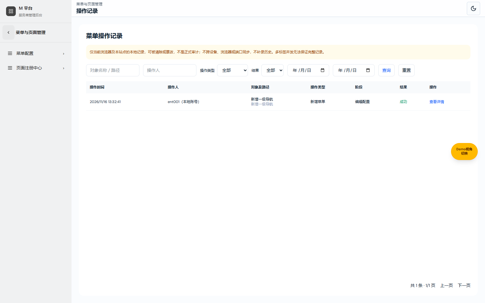

入口：菜单与页面管理 → 菜单配置 → 操作记录。菜单配置下默认进入菜单管理，不再直接作为叶子入口。

### 注册中心操作记录

以下记录本地日志的基础行为。历史截图早于邮箱变更，当前邮箱界面见上节。

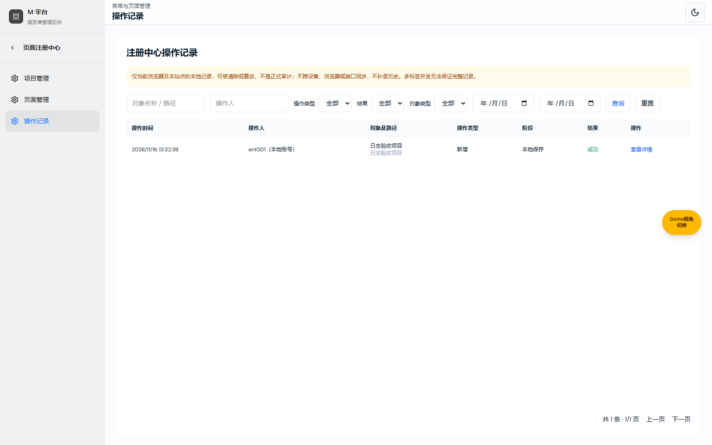

入口：页面注册中心 → 操作记录。与项目管理、页面管理同级；仅展示项目、目录和页面的本地操作。

图片来源统一为 2026-11-16、main 4deac132 基线功能预览，隔离演示身份。完整验证与边界见[交付记录](assets/operation-logs/README.md)。

| 字段／操作 | 逻辑说明 |
| --- | --- |
| 本地记录提示 | 仅当前浏览器及站点保存，可清除或篡改，不是正式审计，不补录历史。 |
| 对象名称／路径 | 关键字不区分大小写包含匹配，默认空；对象详情入口可另携带稳定 ID。 |
| 操作人 | 本地登录身份快照；关键词包含匹配，不由表单指定记录操作人。 |
| 操作类型 | 从当前模块已有记录生成候选，默认全部。 |
| 结果 | 全部、成功、失败；默认全部。 |
| 对象类型 | 注册中心提供项目、页面、目录，默认全部；菜单日志不展示此筛选。 |
| 开始日期 | 默认空，包含当天零点，按浏览器本地时区解释。 |
| 结束日期 | 默认空，包含当天结束；早于开始日期时阻止查询并提示。 |
| 查询 | 多条件取交集，执行后回第一页。 |
| 重置 | 清空筛选及对象 ID 上下文，恢复第一页。 |
| 操作时间 | 保存 UTC 时间，界面以本地时间显示到秒，默认倒序。 |
| 操作对象及路径 | 操作时名称和层级快照，删除后仍可查看；批量显示涉及数量。 |
| 阶段 | 编辑配置、保存草稿、发布、导出、本地保存分别展示，不混称发布成功。 |
| 成功／失败 | 由实际业务返回决定，日志写入失败另标未持久化，不回滚业务。 |
| 查看详情 | 打开记录快照及前后变化；查看不产生日志。 |
| 上一页／下一页 | 每页 20 条，边界禁用，仅对筛选结果分页。 |

### 操作详情

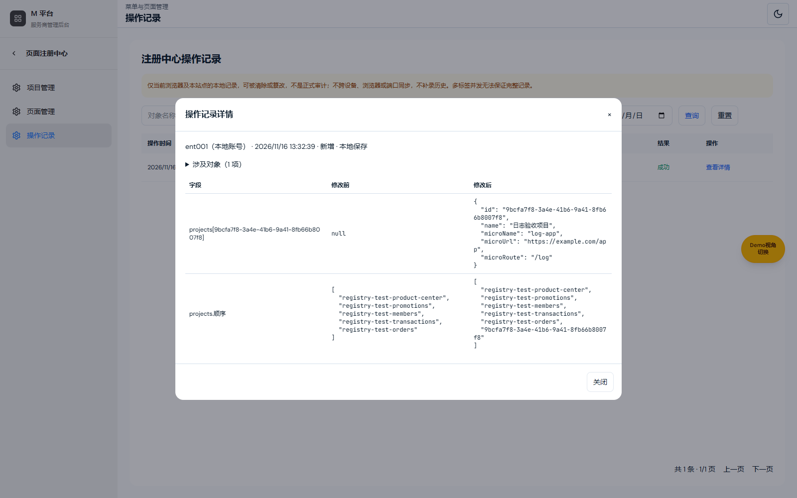

| 字段／操作 | 逻辑说明 |
| --- | --- |
| 操作人、时间、类型、阶段 | 读取本条历史快照，不用当前对象替换历史事实。 |
| 失败原因 | 失败时显示；脱敏后保存。 |
| 涉及对象 | 展开查看对象类型、历史路径和稳定 ID。 |
| 字段 | 展示变更字段路径，复杂值按 JSON 展示。 |
| 修改前 | 操作前的脱敏值；新增为空。 |
| 修改后 | 成功结果或失败尝试的脱敏值；删除为空。 |
| 未持久化提示 | 日志保存失败时会话可查看，刷新后会丢失；不宣称日志已完整保存。 |
| 关闭、×、遮罩、Esc | 不写业务数据，回到原筛选和分页；关闭按钮保留列表滚动。 |

无变化不记编辑；浏览、搜索、展开、取消不记录为失败。菜单结构同步动作合成单批次；发布仅在发布仓库成功后记成功。注册中心按钮虽为保存并发布，其写入仅为本地保存。日志禁止修改、删除、清空或回滚。完整已确认边界见[实施规格](../superpowers/specs/2026-11-16-menu-registry-operation-logs-design.md)，未验证项见交付记录。

### 项目微应用配置与页面路径

| 字段／操作 | 逻辑说明 |
| --- | --- |
| 微应用标识 | 新增项目必填，去首尾空白；项目下新注册页面复用，不在页面重复输入。 |
| 应用入口 URL | 新增项目必填，只允许 HTTP(S)；项目下新注册页面复用。 |
| 微应用路由 | 新增项目必填，以 / 开头，不含查询或 hash；写入 microAppConfig.path，不与页面路径自动拼接。 |
| 页面路径地址 | 页面级必填，沿用原绝对路径及全目录唯一校验；对应 routing.path。 |
| 页面类型与配置 | 配置微应用的项目下，新页面固定微应用类型，三项项目参数只读展示。保存时从最新项目取值，不接受页面伪造覆盖。 |
| 历史兼容 | 未配置微应用的既有项目保留原四类注册，不覆盖历史页面快照。新增项目不能省略微应用配置。 |

## 页面注册中心：项目与目录

入口：菜单路由配置 → 页面注册中心 → 项目管理／页面管理。两者为独立子导航，不采用页签；进入注册中心显示子导航滑层，返回只退一层。项目管理负责新增项目与展示微应用配置；页面管理负责选择项目、维护目录及在右侧注册页面。页面管理不再提供新增项目操作，新增需进入项目管理。两个页面继续共用 routing 权限资源，不新增授权。


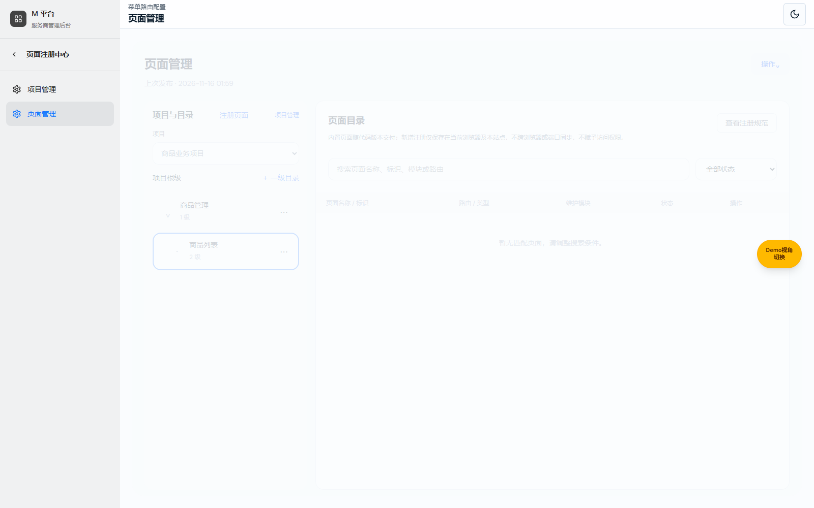

项目名称由用户填写；项目下支持新增一级目录、新增子级、重命名、指定移动、上移与下移。目录不配置路由、不自动生成商家导航。未归类入口保留内置及历史注册页面。

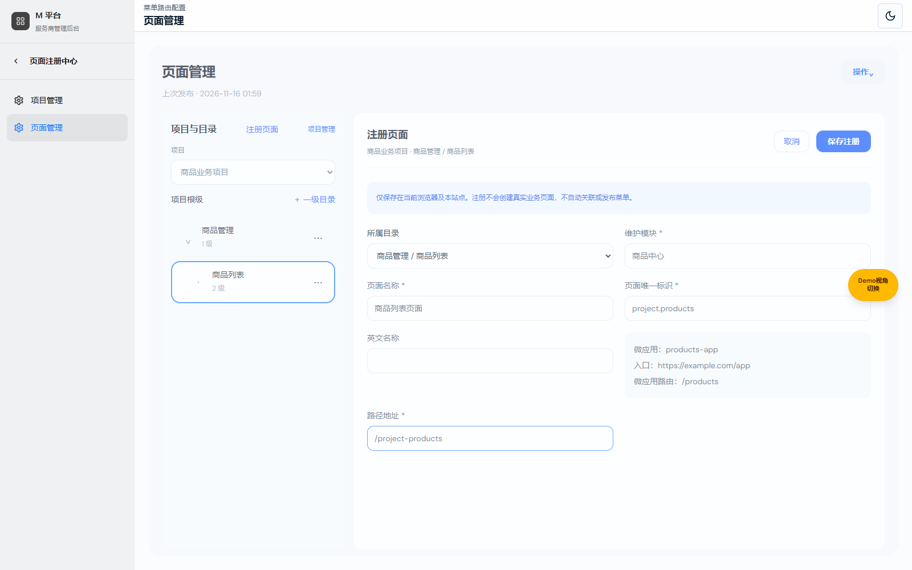

注册页面入口位于左侧项目与目录标题右侧；点击后在右侧展示注册表单，不跳转独立页面，左侧目录保持可见。默认归属入口项目及目录，可调整同项目所属目录。页面名称、标识、维护模块及四类加载参数沿用校验；保存成功返回归属目录，取消离开保留输入。目录不能移动到自身或后代。

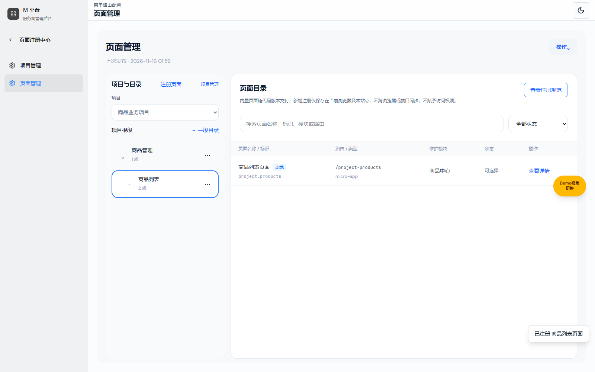

来源：2026-11-16，main c913d5d4 基线功能预览，隔离演示数据。新增项目、目录、页面归属及记录统一写入 menusifu:page-registry:v2；旧 v1 保留，首次成功写入时迁移旧页面。异常数据禁止覆盖；写入失败保留输入。编辑权限仍使用 m:page:routing，不改变菜单关联和发布业务。

详细字段、存储兼容和验收：[实施规格](../superpowers/specs/2026-11-16-page-registry-project-tree-design.md)。

## 菜单路由配置二级导航（当前入口）


图注：2026-11-06，功能分支 codex/menu-routing-subnav-20261106，基线 main@ec151927，65263 未提交功能预览，隔离演示会话。点击父菜单后覆盖父层，不是内嵌展开。

| 元素／规则 | 定义 |
| --- | --- |
| 菜单路由配置 | 父入口，整行点击打开公共子导航滑层；按导航编排、页面注册中心排列。 |
| 导航编排 | `/m-platform/nav-blueprint/navigation`；编辑当前菜单，业务表单和操作入口不变。 |
| 页面注册中心 | `/m-platform/nav-blueprint/page-registry`；浏览代码和本地目录，支持本地注册、搜索、状态筛选、详情和规范。 |
| 返回 | 公共返回按钮仅退回父导航层，不离开当前业务内容，不保存、不发布。 |
| 当前项／地址 | 当前子项唯一高亮；刷新及浏览器前进后退按地址恢复；根地址与旧编辑地址仍默认编排。 |
| 草稿与权限 | 子页面切换像原 Tab 一样保留节点和内存草稿，不自动保存发布；切换菜单时原未保存提示不变。两个子项共用原 routing 资源，不新增或迁移授权。 |

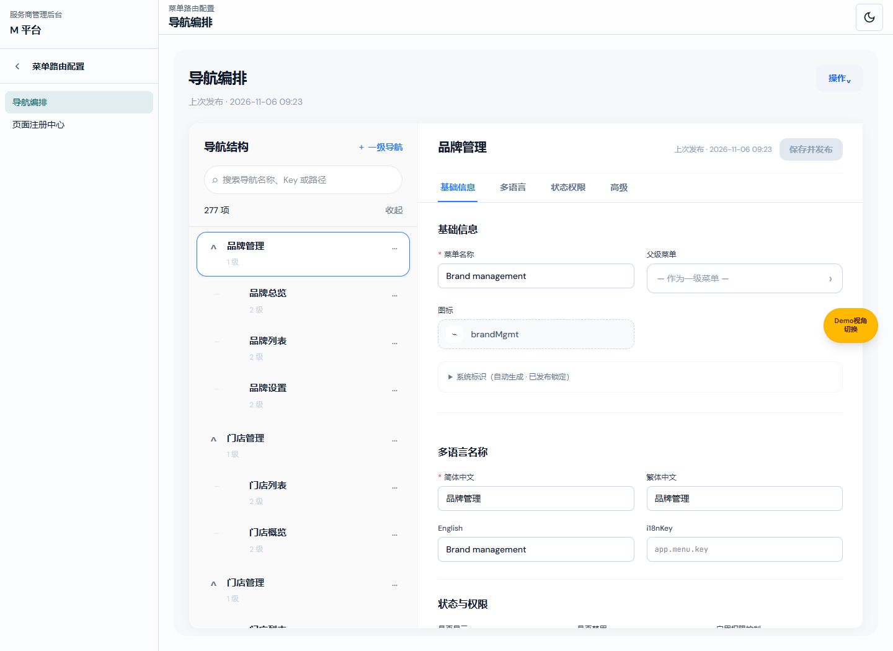

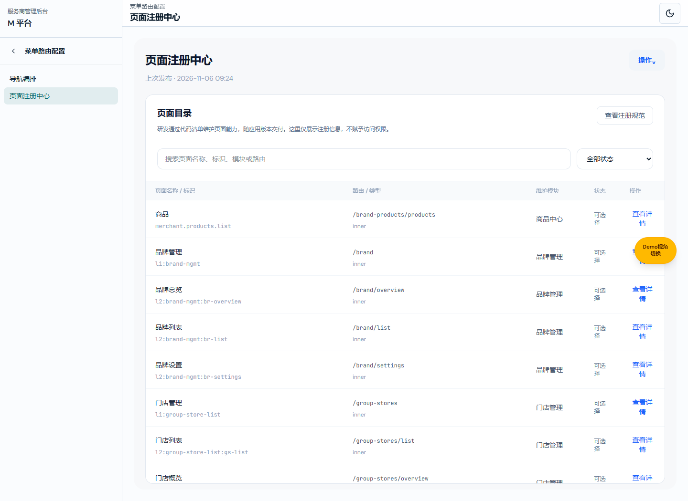

图注：同一功能版本实际页面。原 Tab 已移除，标题随子页面切换；截图采集时未提交。本轮现已获本地提交、合并授权，不推送远端。

## 页面注册与导航编排（既有业务定义）

研发在代码中维护内置清单，也可通过本地注册声明已有页面；运营在导航编排中选择页面并设置名称、父级、图标、多语言和显示状态。注册、菜单编辑和菜单发布是独立操作。

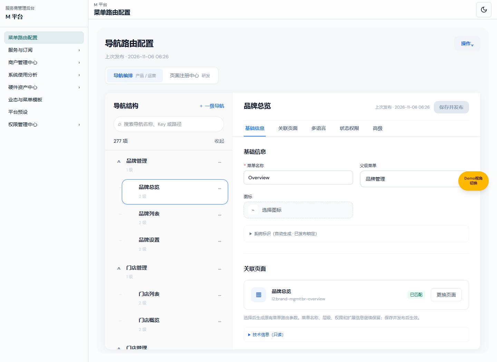

图注：2026-11-06，codex/page-registration-navigation-20261106 基于 main@cb2549c4 的未提交功能预览，隔离演示数据；叶子关联入口。

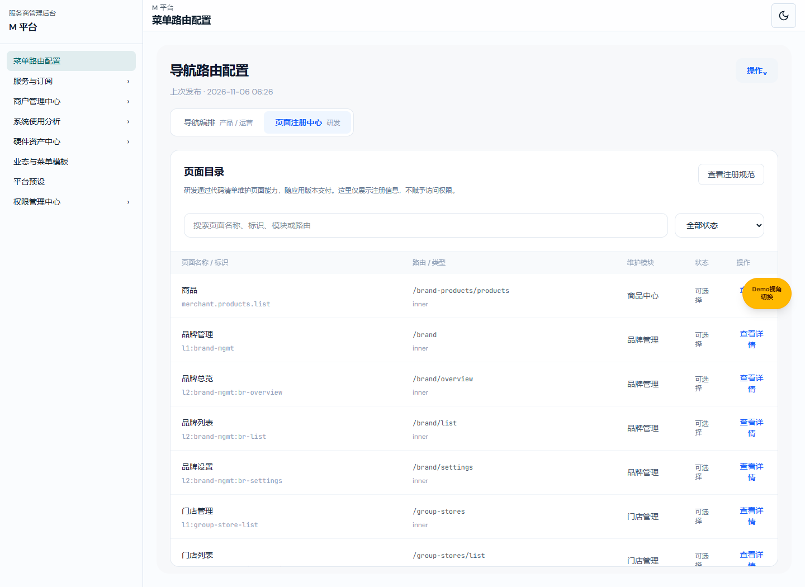

图注：同版本实际页面目录；只读展示，不代表全部业务页面已逐一运行验收。

| 元素／规则 | 定义 |
| --- | --- |
| 导航编排／页面注册中心 | 经上述二级导航进入不同地址；保留当前节点草稿，不保存、不发布。 |
| 页面目录 | 合并 nav-route-registry、研发显式清单及本地注册记录；内置目录只读，本地入口仅新增且不能覆盖已有标识／路径，不代表每个页面已完成运行验收。 |
| 关联页面 | 叶子选择可用页面，确认后更新技术参数草稿。菜单名称、身份、多语言、父级、权限、显示与 extraInfo 保留。 |
| 取消／关闭 | 放弃本次候选选择，当前绑定和草稿不变；Esc、关闭按钮与遮罩语义一致。 |
| 停用 | 不允许新增关联；已有菜单快照保留，不静默删除或替换。 |
| 新增导航 | 名称沿用已有规则，ID/Key 自动生成；不再使用 /new-menu 占位路由。叶子发布前选择页面或显式完成特殊接入。 |
| 有子导航的目录 | 隐藏关联页面区域，沿用父子导航规则。 |
| 系统标识 | 折叠只读，不要求运营填写；发布后继续锁定。 |
| 特殊接入／兼容配置 | 显式展开原有外链、iframe、微应用、链接菜单和历史路由参数；展开不改数据。 |
| 保存并发布 | 沿用原校验和仓库；选页不自动发布，离开保护沿用现有行为。 |
| 权限／订阅／预设 | 不改变授权，注册能力声明不自动写入 accessControl。 |
| 原 JSON | 不新增 pageId；绑定生成原字段技术快照，重新读取时精确匹配全部技术参数。未匹配显示历史配置，不按路径静默覆盖。 |

具体字段、异常与逐操作截图覆盖清单分别见研发版和个人规范版；历史截图不证明本轮已验收。

## 当前有效定义：与商家后台导航逐项一致

本地演示环境读取：开发模式、localhost、127.0.0.1、IPv6 回环（::1／[::1]）及 *.github.io 使用演示仓库；本机静态构建预览也适用。其余主机使用 HTTP 仓库，接口异常直接提示，不自动切换演示数据；草稿与发布仍沿用对应仓库的存储规则。[环境回归记录](../verification/m-platform-static-menu-20261104/README.md)。


实际 /m-platform/nav-blueprint 使用 JSON 菜单编辑器（json-menu-editor-ui / json-menu-demo-data），不再将旧蓝图矩阵的验证当作本页验收。默认目录读取 navigation.ts 中商家后台实际使用的模块专用 SUBNAV、navModuleChildrenAsSheetSubnav 及递归 sidebarChildren/children；同级顺序、中文名称、叶子路径、父子关系一致。不自动生成概览，不拍平深层商品菜单，不给同名子项擅自添加父名，不因旧测试限制而截断为三级。

休息与加班子项仅为自定义休息、加班规则、设置。小费管理子项为小费分配、分配规则；分配明细是当前商家页面内容，不额外生成导航入口。

默认演示源当前 29 个一级、277 个总节点。以实际导航数组做双向整树比较，不能只验证“原有路径均出现”，还必须检查多余节点、层级和顺序。JSON 字段、服务权限样例和保存发布接口保持原合同。

只有与历史内置演示菜单完全相同的已发布/草稿 menu 才在读取时投影为最新默认结构；比较忽略 parentKey 派生值。原 localStorage 数据不覆盖、不删除；任一手工编辑字段或顺序不同则保留，不自动同步自定义数据。此规则仅用于当前本地演示仓库，HTTP 远端配置不被强制替换。

验证：verify-json-menu-merchant-parity.ts 对整树双向相等、无额外概览、小费子项、递归产品、旧原件保留及自定义草稿保护断言通过；verify-json-menu-current-merchant-demo.ts 已从旧三级/概览预期更新为真实导航合同并通过。浏览器在实际 JSON 配置页逐项比对全部 277 个已渲染节点的位置和标题通过。本轮已获授权提交并合入本地 main，未获推送授权。

---

以下为旧蓝图矩阵设计的历史内容；与当前 JSON 编辑器结构来源冲突时以上述有效定义为准。

## 一、问题与现状

### 1.1 现状（代码驱动、结构固定）

当前商家后台导航与设置归属由代码单源维护：

| 层级 | 数据源 | 是否可在线改 |
|------|--------|--------------|
| L1 一级导航 | `navigation.ts` → `NAV_MODULES` | ❌ |
| L2 二级导航 | 各模块 `children` | ❌ |
| L3 三级分组 | `module-settings-catalog.ts` 的 `groupKey` | ❌ |
| L4 设置项 | catalog 的 `seq` | ❌ |

**平台预设**只做一件事：在**固定树**上勾选「展示 / 不展示」（业态 × 产线），**不能**改归属关系。

### 1.2 新需求（结构可编排）

需要支持：

1. **新增 L1**：填写名称 + 访问路由
2. **在 L1 下新增多个 L2**：每个 L2 配置菜单页路由
3. **在 L2 下新增 L3**：三级分组
4. **在 L3 下从「全部设置」池勾选归属项**（L4）
5. **M 平台编排 → 同步到企业级平台预设 → 商家后台再从 M 平台同步**

### 1.3 核心原则（与现有文档对齐）

| 原则 | 说明 |
|------|------|
| **设置注册表只读** | 472 个 `seq` 仍由 `module-settings-catalog` 生成，M 平台不能「发明」新设置项 |
| **蓝图改归属，预设改可见** | 导航蓝图管「放哪」；平台预设管「显不显」 |
| **企业 → 商家单向** | M 平台发布不回写；商家可局部改可见性，不改企业蓝图 |
| **路由可运行** | 自定义 L1/L2 必须绑定可访问路由（占位页或已有页面） |

---

## 二、概念模型：三层分离

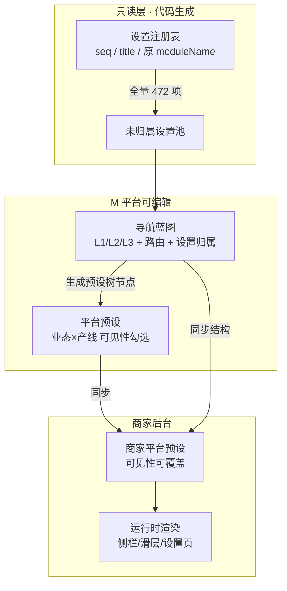

| 概念 | 英文名 | 职责 |
|------|--------|------|
| **设置注册表** | Setting Registry | 全部 L4（`seq`）主数据，只读 |
| **导航蓝图** | Navigation Blueprint | L1→L2→L3 结构、路由、设置归属 |
| **平台预设** | Platform Preset | 在蓝图树上按业态×产线控制可见性 |

与现有节点键保持兼容：

```
nav:{moduleId}                           // L1
nav:{moduleId}:{childId}               // L2
settings:{settingsPath}:{groupKey}       // L3
setting:{seq}                            // L4
```

自定义节点使用 `custom-` 前缀 id，避免与系统 id 冲突。

---

## 三、数据模型

### 3.1 导航蓝图节点

```typescript
type NavNodeLevel = 1 | 2 | 3;
type NavSubNavPlacement = "sheet" | "sidebar" | "tabs";
type NavNodeSource = "system" | "custom"; // 系统映射 or 企业自建

interface NavBlueprintNode {
  id: string;                    // 稳定 id，如 brand-mgmt / custom-ops-001
  level: NavNodeLevel;
  parentId: string | null;
  label: string;
  labelEn?: string;
  sortOrder: number;

  /** L1/L2：页面路由，如 /ops-center/analytics */
  route?: string;
  /** L1：侧栏展示方式 */
  subNavPlacement?: NavSubNavPlacement;
  /** L1：默认子路由 */
  defaultChildRoute?: string;

  /** L2 为设置 Hub 时：设置页根路径，如 /queue-call/settings */
  settingsPath?: string;

  /** L3：分组键（蓝图内唯一） */
  groupKey?: string;
  /** L3：已归属的设置 seq 列表（有序） */
  assignedSeqs: number[];

  source: NavNodeSource;
  /** source=system 时映射到代码模块 */
  systemModuleId?: string;
  systemChildId?: string;

  /** 预设节点键（发布时生成） */
  presetKey?: string;
}

interface NavBlueprintSnapshot {
  enterpriseId: string;
  blueprintId: string;           // 如 default / fast-food-kiosk
  businessTypeId?: string;       // 可选：按业态差异化蓝图
  productLineId?: string;        // 可选：按产线差异化蓝图
  version: number;
  publishedAt: string;
  nodes: NavBlueprintNode[];
  /** seq → L3 nodeId，发布时校验唯一归属 */
  seqAssignmentIndex: Record<number, string>;
}
```

### 3.2 与平台预设的关系

发布蓝图 `vN` 时：

1. 由蓝图生成**完整预设树节点清单**（L1～L4）
2. 写入企业级平台预设的「树结构版本」`treeVersion: N`
3. 平台预设的 `selection` 仍按节点键存 `enabled`
4. 新节点默认策略：继承上级勾选 / 按业态推荐 / 默认关闭（可配置）

```typescript
interface PlatformPresetSnapshot {
  businessTypeId: string;
  productLineId: ProductLineId;
  blueprintVersion: number;      // 新增：绑定的蓝图版本
  treeVersion: number;           // 新增：树结构版本
  version: number;               // 预设发布版本
  selection: Record<PresetNodeId, { enabled: boolean }>;
}
```

### 3.3 商家侧扩展

```typescript
interface MerchantPresetMeta {
  syncedBlueprintVersion: number;
  syncedPresetVersion: number;
  structureCustomized: boolean;  // 商家是否改过可见性
}
```

---

## 四、M 平台入口与信息架构

### 4.1 侧栏新增模块

在 M 平台 Shell 增加：

```
M 平台
├── 平台预设          （已有：业态×产线 可见性）
└── 菜单路由配置      （新增：导航蓝图编排）
    ├── 蓝图列表
    └── 蓝图编辑器
```

### 4.2 路由建议

```
#/m-platform/nav-blueprint                          // 蓝图列表
#/m-platform/nav-blueprint/:blueprintId/edit        // 可视化编辑器
#/m-platform/nav-blueprint/:blueprintId/preview     // 全屏预览（可选）
```

蓝图与平台预设联动入口：

- 蓝图列表页：**「同步到平台预设」** → 选择业态×产线批量应用
- 平台预设编辑页：顶栏展示 **「当前蓝图 v3」** + 跳转蓝图编辑器

---

## 五、可视化页面方案（核心）

### 5.1 整体布局：蓝图工作室（Blueprint Studio）

三栏 + 顶栏 + 底栏，参考现有四列预设编辑页，但交互重心在**结构编排**而非单纯勾选。

```
┌─────────────────────────────────────────────────────────────────────────────┐
│ 顶栏：菜单路由配置 · 默认蓝图  │  导入系统默认  变更记录  预览  保存草稿  发布 v4 │
├──────────────┬──────────────────────────────┬───────────────────────────────┤
│ 左栏         │ 中栏（属性 + 设置归属）         │ 右栏（实时预览）                 │
│ 导航树       │                              │                               │
│              │  [选中节点属性表单]             │  ┌─ 侧栏 mock ─────────────┐  │
│ ▼ 品牌管理   │  名称 / 路由 / 展示方式…        │  │ 主页                     │  │
│   ├ 品牌总览 │                              │  │ 前厅管理中心  →          │  │
│   └ 设置     │  ─────────────────────        │  └─────────────────────────┘  │
│ ▼ 运营中心*  │  [L3 选中时：设置归属面板]      │  ┌─ 滑层 mock ─────────────┐  │
│   ├ 营业分析 │                              │  │ 设置 | 平面图 | …        │  │
│   └ 设置     │  未归属(12) │ 已归属(8)       │  └─────────────────────────┘  │
│     ├ 营业*  │  [搜索] [按原模块筛选]          │  ┌─ 设置侧栏 mock ─────────┐  │
│     └ 打印*  │  □ seq 418 营业时段            │  │ 营业与运营              │  │
│ [+ 一级导航] │  ☑ seq 77  营业周期            │  │ 打印与票据              │  │
│              │  拖拽排序 / 批量移入            │  └─────────────────────────┘  │
├──────────────┴──────────────────────────────┴───────────────────────────────┤
│ 底栏：校验 3 项待处理（2 个设置未归属 · 1 个路由冲突）  │ 取消  发布并同步到平台预设 │
└─────────────────────────────────────────────────────────────────────────────┘
```

### 5.2 左栏：导航树（L1～L3）

| 交互 | 行为 |
|------|------|
| 树形展示 | L1 可折叠；L2/L3 缩进；自定义节点带「自定义」标签 |
| 拖拽排序 | 同级 `sortOrder`；跨级拖拽 = 移动归属（L3 不可挂到 L1 下） |
| 选中高亮 | 驱动中栏属性表单 + 右栏预览定位 |
| **+ 一级导航** | 打开抽屉：名称、中英文、路由、图标、展示方式、默认子路由 |
| **+ 二级导航** | 在选中 L1 下新增：名称、路由；可勾选「此为设置 Hub」→ 填 `settingsPath` |
| **+ 三级导航** | 在选中 L2（且为设置 Hub）下新增：分组名称、`groupKey`（可自动生成） |
| 右键菜单 | 编辑 / 复制 / 删除 / 在系统默认中定位 |
| 系统节点 | 来自 `NAV_MODULES` 导入，`source=system`，删除需确认（仅隐藏或还原） |

**约束：**

- L1 必须有 `route`（模块根路径）
- L2 必须有 `route`；若为设置入口，`settingsPath` 通常 = `{L2.route}` 或 `{module}/settings`
- L3 必须挂在 `settingsPath` 已定义的 L2 下
- 自定义 `groupKey` 在同一 `settingsPath` 内唯一

### 5.3 中栏：节点属性 + 设置归属

#### A. 通用属性（L1/L2/L3 按层级显隐）

| 字段 | L1 | L2 | L3 |
|------|----|----|-----|
| 名称 / 英文名 | ✅ | ✅ | ✅ |
| 路由 | ✅ 模块根 | ✅ 子页 | — |
| 侧栏展示方式 sheet/sidebar/tabs | ✅ | — | — |
| settingsPath | — | ✅（Hub 时） | 继承父级 |
| groupKey | — | — | ✅ |
| 图标 | ✅ | 可选 | — |

路由输入带**校验器**：格式、唯一性、与系统路由冲突检测；支持「选择已有页面」下拉（从 `NAV_MODULES` + 占位页注册表）。

#### B. 设置归属面板（仅 L3 选中时）

双栏穿梭框 + 拖拽列表：

| 区域 | 内容 |
|------|------|
| **未归属池** | 全部 `seq` 减去已被其他 L3 占用的项；支持按原 `moduleName`、关键词、`seq` 搜索 |
| **已归属列表** | 当前 L3 的 `assignedSeqs`；可拖拽排序（影响设置页卡片顺序） |
| 批量操作 | 从原三级分组「整组迁入」、按标签迁入、清空归属 |
| 冲突提示 | 某 `seq` 已在「营业与运营」→ 点击可跳转冲突节点 |

每个设置项卡片展示：`seq`、设置名称、原归属模块（灰色参考）、产线适用范围标签（如前厅 seq 仅部分产线）。

### 5.4 右栏：实时预览

三层联动 mock（不需真跳转）：

1. **侧栏 L1**：按蓝图 `sortOrder` 渲染；选中项高亮
2. **滑层 L2**：点击 L1 后展示其 L2 列表
3. **设置侧栏 L3 + L4 标题列表**：进入 L2 设置 Hub 后展示 L3 分组及组内设置名

预览顶栏可切换 **业态 × 产线**（叠加平台预设可见性），看到「编排 + 预设」叠加效果。

### 5.5 顶栏 / 底栏操作

| 操作 | 说明 |
|------|------|
| 导入系统默认 | 从 `permission-registry` 一键生成初始蓝图（与现网一致） |
| 保存草稿 | 本地 / 服务端草稿，不 bump 版本 |
| 发布 vN | 校验通过 → 生成 `seqAssignmentIndex` → bump `blueprintVersion` |
| **发布并同步到平台预设** | 发布蓝图 + 打开对话框选择业态×产线，合并到企业级预设树 |
| 变更记录 | 对比版本：节点增删、路由变更、seq 迁移明细 |
| 预览 | 新标签全屏模拟商家 Shell |

---

## 六、配置示例

### 示例：新建「运营中心」并重组设置

**步骤：**

1. 左栏 **+ 一级导航**
   - 名称：运营中心
   - 路由：`/ops-center`
   - 展示方式：sheet

2. 在「运营中心」下 **+ 二级导航**
   - 营业分析 → `/ops-center/analytics`（普通业务页）
   - 运营设置 → `/ops-center/settings`（勾选设置 Hub）

3. 在「运营设置」下 **+ 三级导航**
   - 营业与运营 → `groupKey: ops-hours`
   - 从设置池勾选：`seq 418 营业时段`、`seq 77 营业周期`、`seq 170 餐厅模式`

4. 再建三级「打印相关」→ 从池中加入原属前厅/打印中心的若干 `seq`

5. **发布 v1** → **同步到平台预设** → 选择「快餐 · Kiosk」

6. 进入 **平台预设编辑页**：树结构已是新蓝图；运营人员再按业态勾选要启用的 L1/L3/L4

7. **同步到商家后台**（Phase 2 能力）：商家获得相同蓝图 + 企业默认可见性

---

## 七、同步链路

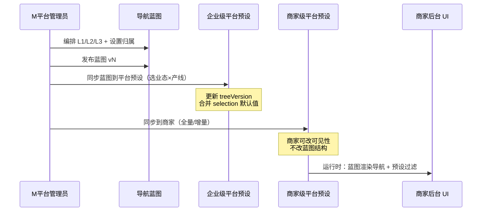

| 阶段 | 同步内容 | 商家可否改 |
|------|----------|------------|
| 蓝图发布 | L1/L2/L3 结构、路由、seq 归属 | ❌ 结构不可改 |
| 企业平台预设 | 各节点 enabled | ❌（仅 M 平台） |
| 商家平台预设 | 各节点 enabled | ✅ 仅影响本商家侧栏 |
| 首次引导 | 复制企业蓝图 + 预设 | 写入商家上下文 |

**商家未自定义时**：企业蓝图或预设更新可自动覆盖。
**商家已自定义可见性**：保留商家 `selection`，结构升级走「迁移向导」（新增节点默认关闭并提示）。

---

## 八、校验规则（发布门禁）

| 类别 | 规则 |
|------|------|
| 结构 | L3 必须有父 L2 且父级为设置 Hub |
| 归属 | 每个 `seq` 全局最多归属 1 个 L3（或明确标记「仅预览不启用」池） |
| 路由 | L1/L2 路由唯一；不与系统保留路径冲突 |
| 完整度 | 可选：要求 100% seq 已归属，或允许「未归属」但发布警告 |
| 预设 | 同步时若删除 L3，其下 enabled 节点需迁移或自动 disable |
| 产线 | 前厅 seq 在蓝图归属后，仍受 `fohSeqAppliesToLine` 运行时过滤 |

底栏常驻校验条：`✓ 472 项中 468 已归属 · ⚠ 4 未归属 · ✓ 路由无冲突`

---

## 九、运行时改造要点

发布蓝图后，运行时由「读 `NAV_MODULES`」改为「读有效蓝图 + 叠加预设」：

```
有效蓝图（企业 → 商家）
  → resolveNavModulesFromBlueprint()
  → filterVisibleNavModules()        // RBAC
  → filterNavByPlatformPreset()      // 预设
  → renderSidebar() / renderSettingsSubnav()
```

| 组件 | 改造 |
|------|------|
| `permission-registry` | 保留为**系统默认蓝图**生成器 |
| `platform-preset-tree` | 改为从蓝图快照生成，而非仅 permission-registry |
| `module-settings-catalog` | 仍为 L4 主数据；设置页按蓝图 L3 的 `assignedSeqs` 渲染 |
| 自定义 L1 路由 | 注册占位页或映射到 iframe/通用 Hub 模板 |

**兼容模式**：`blueprintId = system-default` 时行为与现网完全一致。

---

## 十、实施分期建议

| 阶段 | 范围 | 验收 |
|------|------|------|
| **P0** | M 平台「菜单路由配置」只读视图：展示系统默认 L1/L2/L3 + seq 归属 | 与 `平台预设-配置预设四级导航树.md` 一致 |
| **P1** | L3 设置归属可编辑（不改 L1/L2 结构） | 可把 seq 从 A 三级迁到 B 三级，设置页即时生效 |
| **P2** | L2/L1 可新增、改路由；蓝图发布；同步到企业级平台预设 | M 平台编排后预设树节点变化 |
| **P3** | 商家同步 + 首次引导引用企业蓝图 | 新商家看到编排后的导航 |
| **P4** | 多蓝图（按业态×产线）、版本 diff、迁移向导、拖拽预览增强 | 运营可审计、可回滚 |

---

## 十一、与现有「平台预设四列页」的分工

| 页面 | 回答的问题 | 主要用户 |
|------|------------|----------|
| **菜单路由配置（新）** | 设置项**放在哪条导航路径下**？L1/L2/L3 长什么样？ | 产品 / 实施 / 企业架构师 |
| **平台预设四列页（已有）** | 该业态×产线下**哪些节点要展示**？ | 运营 / 企业管理员 |

建议交互：

- 菜单路由配置发布后 → 自动打开对应业态的「平台预设」并提示「请确认可见性」
- 平台预设四列左侧树数据源改为**蓝图树**，而非写死的 permission-registry

---

## 十二、决策摘要

| 维度 | 决策 |
|------|------|
| 设置项来源 | 只读注册表（`seq`），M 平台只做归属不重定义 |
| 导航结构 | 企业级「导航蓝图」可增删改 L1/L2/L3 与路由 |
| 可见性 | 仍由平台预设（业态×产线）控制 |
| 配置入口 | M 平台「菜单路由配置」可视化工作室 |
| 同步方向 | 蓝图 → 企业预设 → 商家预设（单向） |
| 节点键 | 延续 `nav:` / `settings:` / `setting:` 格式，兼容 RBAC |

---

## 十三、相关文档

| 文档 | 说明 |
|------|------|
| [M平台-企业级平台预设设计方案.md](./M平台-企业级平台预设设计方案.md) | 企业级平台预设与商家同步 |
| [平台预设-产品需求与设计说明.md](./平台预设-产品需求与设计说明.md) | 平台预设原始需求 |
| [平台预设-配置预设四级导航树.md](./平台预设-配置预设四级导航树.md) | 四级树节点清单 |
| [一级导航定义说明.md](./一级导航定义说明.md) | 28 个一级导航定位与边界 |

补充：消息中心复用 groupNotificationSheetSubnav（品牌消息/门店消息），前厅复用 groupRuleRestrictionsSubnav（菜单下单限制）以保持后台真实分组。实际 JSON 路由页 verify-json-menu-route-page.mjs 对全部 277 个节点的 DOM 位置和标题逐项验证通过。结构比较基于完整目录，不套当前账号权限/订阅过滤，避免把权限不可见误当作不存在；发布范围过滤继续由原运行时处理。
