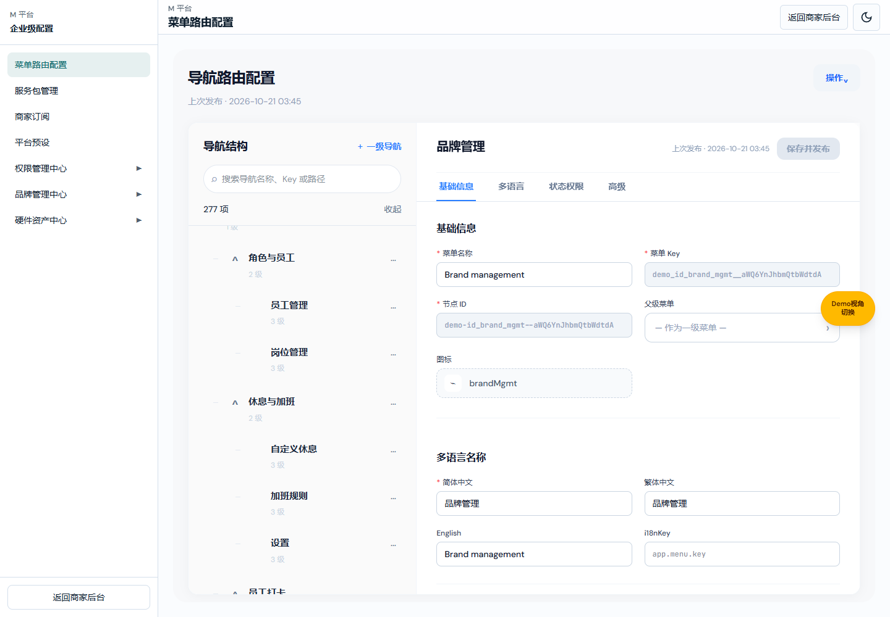
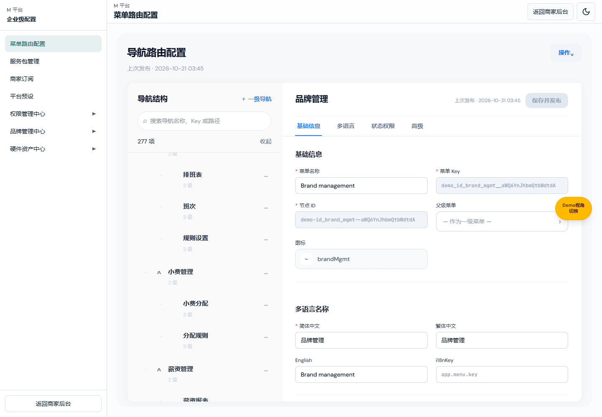

# M 平台菜单路由需求文档（个人规范版）

> V1.0 · 2026-10-21；MENU-JSON-PARITY-20261021-18。
> 产品：[v1.1](./M平台-菜单路由可视化配置设计方案.md)；研发：[V1.0](./M平台-菜单路由业务规格说明书（研发交付版）.md)。

| 版本 | 日期 | 变更 |
| --- | --- | --- |
| V1.0 | 2026-10-21 | 实际 JSON 路由配置默认树来源、节点展示及旧样例兼容 |

## 菜单路由配置：当前商家目录

图注：5208，codex/brand-route-tree-20261021 未提交功能预览；实际 JSON 菜单配置页，当前默认演示数据。

图注：同一版本，实际配置页展开状态。

| 区域或字段 | 逻辑说明 |
| --- | --- |
| 一级模块 | 顺序和名称读取商家 NAV_MODULES，不新增或丢弃模块；默认 29 个。 |
| 子菜单 | 专用子导航使用后台同一数组，其他模块使用公共转换函数；递归保留任意层 sidebarChildren/children。目录仅展示实际存在的子项，不补“概览”。 |
| 菜单名称 | 中文来自真实 title，英文沿用 titleEn；不擅自拼接“父名 · 子名”。 |
| 叶子路径 | 沿用真实业务路径；目录不伪造可点击概览页。 |
| 顺序及归属 | 逐层严格按源数组排列；无拍平、无按名称重新排序。 |
| 展开/收起 | 沿用原编辑器树交互；展开真实子菜单，不增加数据节点。 |
| 演示缓存 | 仅完全未编辑的旧内置样例在读时映射最新结构；不写回缓存、不会触发未保存提示。手工草稿、其他发布数据保留。 |
| 保存/发布 | 用户编辑后的原校验、草稿、发布行为不变；本次修正数据源不自动向 HTTP 接口发布。 |

入口：M 平台 → 菜单路由配置。只调整本页默认演示目录及未编辑旧样例的读取结果；其余编辑器字段、弹框与业务接口不是本轮新增范围。

## 当前有效定义：与商家后台导航逐项一致

实际 /m-platform/nav-blueprint 使用 JSON 菜单编辑器（json-menu-editor-ui / json-menu-demo-data），不再将旧蓝图矩阵的验证当作本页验收。默认目录读取 navigation.ts 中商家后台实际使用的模块专用 SUBNAV、navModuleChildrenAsSheetSubnav 及递归 sidebarChildren/children；同级顺序、中文名称、叶子路径、父子关系一致。不自动生成概览，不拍平深层商品菜单，不给同名子项擅自添加父名，不因旧测试限制而截断为三级。

休息与加班子项仅为自定义休息、加班规则、设置。小费管理子项为小费分配、分配规则；分配明细是当前商家页面内容，不额外生成导航入口。

默认演示源当前 29 个一级、277 个总节点。以实际导航数组做双向整树比较，不能只验证“原有路径均出现”，还必须检查多余节点、层级和顺序。JSON 字段、服务权限样例和保存发布接口保持原合同。

只有与历史内置演示菜单完全相同的已发布/草稿 menu 才在读取时投影为最新默认结构；比较忽略 parentKey 派生值。原 localStorage 数据不覆盖、不删除；任一手工编辑字段或顺序不同则保留，不自动同步自定义数据。此规则仅用于当前本地演示仓库，HTTP 远端配置不被强制替换。

验证：verify-json-menu-merchant-parity.ts 对整树双向相等、无额外概览、小费子项、递归产品、旧原件保留及自定义草稿保护断言通过；verify-json-menu-current-merchant-demo.ts 已从旧三级/概览预期更新为真实导航合同并通过。浏览器在实际 JSON 配置页逐项比对全部 277 个已渲染节点的位置和标题通过。本轮已获授权提交并合入本地 main，未获推送授权。

补充：消息中心复用 groupNotificationSheetSubnav（品牌消息/门店消息），前厅复用 groupRuleRestrictionsSubnav（菜单下单限制）以保持后台真实分组。实际 JSON 路由页 verify-json-menu-route-page.mjs 对全部 277 个节点的 DOM 位置和标题逐项验证通过。结构比较基于完整目录，不套当前账号权限/订阅过滤，避免把权限不可见误当作不存在；发布范围过滤继续由原运行时处理。
