# M 平台菜单路由需求文档（个人规范版）

> V1.1 · 2026-11-06；PAGE-REG-20261106-01；基线 main@cb2549c4。
> 产品：[v1.2](./M平台-菜单路由可视化配置设计方案.md)；研发：[V1.1](./M平台-菜单路由业务规格说明书（研发交付版）.md)。

| 版本 | 日期 | 变更 |
| --- | --- | --- |
| V1.1 | 2026-11-06 | PAGE-REG-20261106-01：页面注册中心、关联页面与兼容入口；同一业务定义，产品 v1.2／研发 V1.1 |
| V1.0 | 2026-10-21 | 实际 JSON 路由配置默认树来源、节点展示及旧样例兼容 |

## 导航编排视角

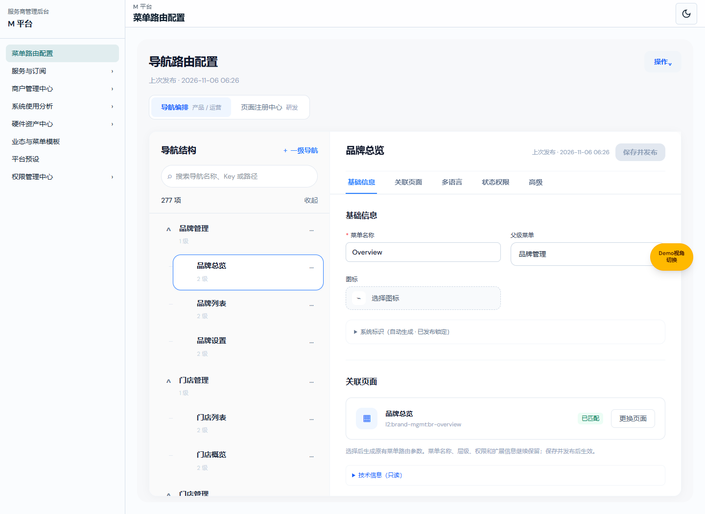

图注：2026-11-06，功能工作树 65262，codex/page-registration-navigation-20261106，基线 main@cb2549c4、未提交；隔离演示账号，当前叶子节点。

入口：M 平台 → 菜单路由配置 → 导航编排。对象为当前菜单文档和左侧选中节点。示例数据在隔离演示会话操作，非真实业务历史。

| 字段／操作 | 逻辑说明 |
| --- | --- |
| 导航编排页签 | 默认视角；切回保留当前草稿与节点，不自动提交。 |
| 页面注册中心页签 | 打开代码目录；当前草稿仍保留在编辑器内，切换本身不写 JSON。 |
| 菜单名称 | 沿用输入和失焦更新左侧名称的规则，关联页面不会覆盖自定义名称。 |
| 父级菜单 | 复用现有选择器，改变层级与排序的保护规则不变。 |
| 图标 | 复用现有图标选择页；不因关联页面自动替换。 |
| 系统标识 | 折叠显示 ID/Key，自动生成、只读；已发布仍锁定。 |
| 关联页面卡片 | 叶子显示。精确匹配注册技术快照时显示名称、标识及状态；无匹配时标明历史配置或待选择，不重写数据。 |
| 选择／更换页面 | 打开下述弹框，复制当前匹配项为候选；打开不写数据。 |
| 技术信息 | 匹配页面时可展开查看标识、路由、类型和模块；只读。 |
| 多语言名称 | 沿用现有简体、繁体、英文与 i18nKey 输入，切换页面不覆盖。 |
| 是否显示／禁用 | 沿用原三态及默认值；关联只影响技术快照，不影响可见性。 |
| 启用权限控制 | 既有权限逻辑和逗号分隔输入保持；注册声明不自动授权。 |
| 高级扩展 | 原 JSON 对象／数组输入保持，关联后原数据不丢失。 |
| 保存并发布 | 有修改时启用；新空叶子需先选页或完成特殊接入；执行原校验与存储。没有新增自动下发或授权。 |
| 离开当前菜单 | 沿用已存在未发布保护。选页后不点击发布仍属于未发布修改。 |

## 选择注册页面弹框

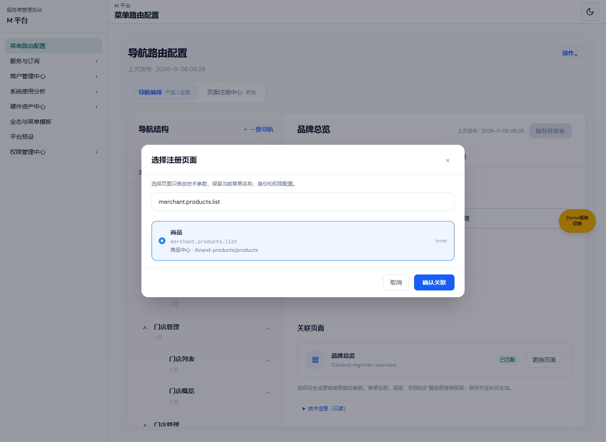

图注：同一功能版本，搜索后选择商品页面，尚未确认，不写菜单数据。

| 字段／操作 | 逻辑说明 |
| --- | --- |
| 标题 | 固定“选择注册页面”；仅更新当前节点的候选。 |
| 搜索 | 名称、英文、标识、模块、路径的大小写不敏感包含匹配，输入立即更新候选列表；空值显示全部。 |
| 页面候选 | 显示名称、标识、模块、路径、类型；单选，停用项禁用。切换候选不改菜单草稿。 |
| 空结果 | 显示“没有找到匹配页面，可联系研发补充注册”，不创建虚构页面。 |
| 确认关联 | 未选时禁用；确认检查记录存在、可用且节点无子项。成功关闭弹框、保留菜单身份及展示权限字段、更新技术参数草稿、启用发布。失败提示并保留弹框。 |
| 取消 | 关闭并丢弃候选，不写入、不改变现有绑定。 |
| ×／遮罩／Esc | 与取消相同，关闭后焦点返回选择入口；Tab 在弹框内循环。 |

### 候选搜索无结果

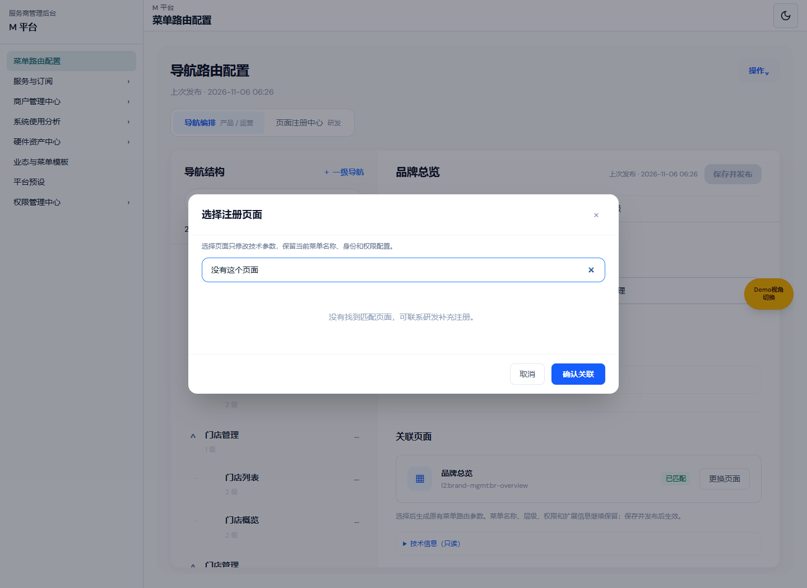

图注：同版本受控查询“没有这个页面”，证明空状态；清空查询即可恢复，当前菜单参数不变。

### 取消选择后的结果

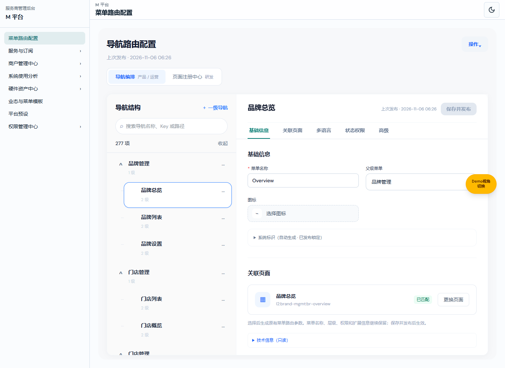

图注：同版本，取消弹框后回到原关联；脚本比较取消前后卡片全文相等。

### 确认关联后的结果

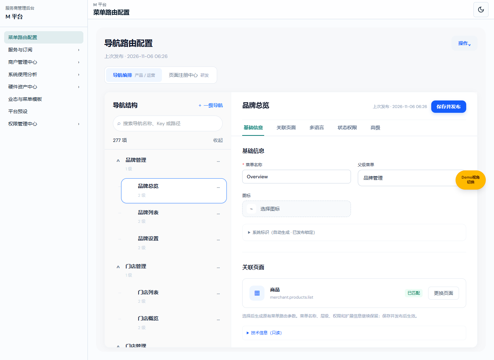

图注：同版本，商品页面快照已写当前草稿，保存并发布启用；菜单名称和 Key 与操作前相等，未自动发布。

## 页面注册中心视角

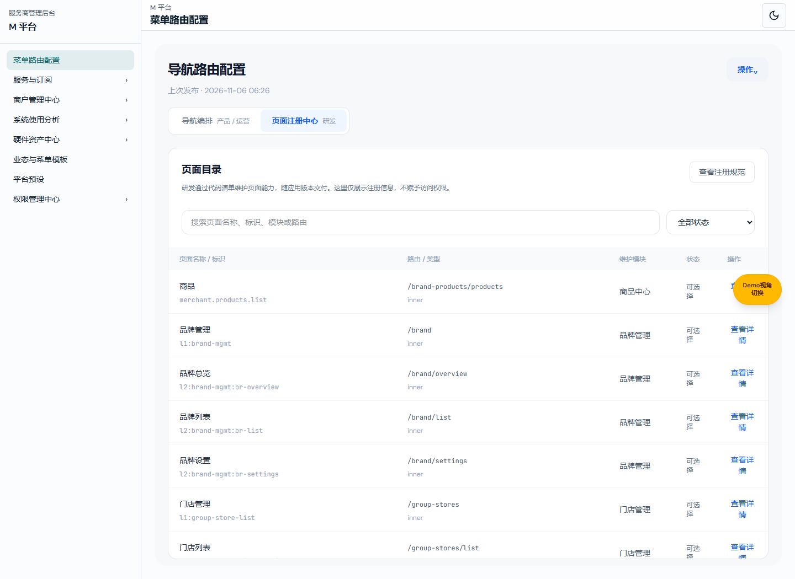

图注：同版本实际 286 项代码目录，不套商家授权过滤，也不授权访问这些页面。

入口为同一路由的页签，沿用当前 M 平台菜单路由配置的访问权限。本期没有新增运营账号维护技术参数的授权。

| 字段／操作 | 逻辑说明 |
| --- | --- |
| 页面名称／标识 | 来自研发显式清单或已有应用路由目录；标识稳定、不进入业务 JSON 新字段。 |
| 路由／类型 | 代码提供；展示不代表已验证该页面完整业务。 |
| 维护模块 | 来自清单 module，供定位责任模块。 |
| 状态 | active 显示可选择，retired 显示已停用。停用不静默删除已发布快照。 |
| 搜索 | 与状态条件取交集，按名称、英文、标识、模块、路由即时过滤。 |
| 状态筛选 | 全部／可选择／已停用，默认全部；本次会话内切换视角保留条件。 |
| 查看详情 | 打开对应记录的只读详情弹框，不编辑、不发布。 |
| 查看注册规范 | 打开研发代码清单填写说明与当前合同示例；不是在线登记表单。 |

### 搜索与状态筛选结果

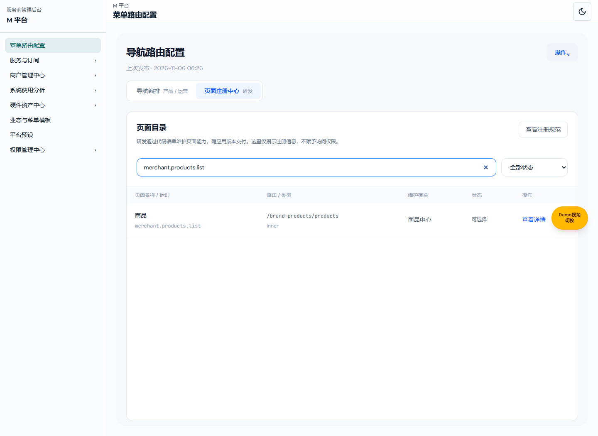

图注：同版本搜索 merchant.products.list 后一项匹配。

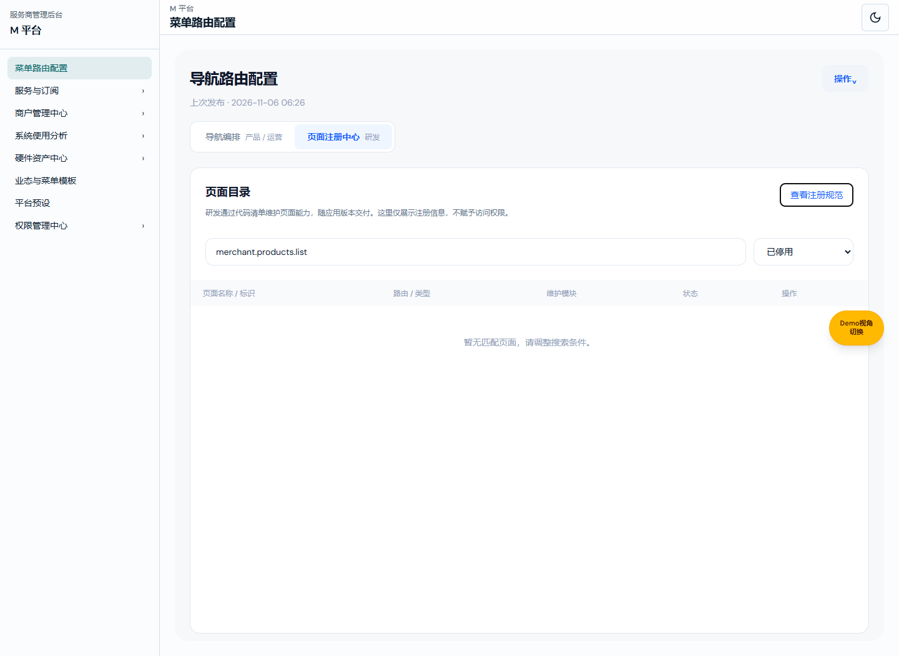

图注：同版本，上述查询与“已停用”取交集无记录，非请求失败。

## 注册详情弹框

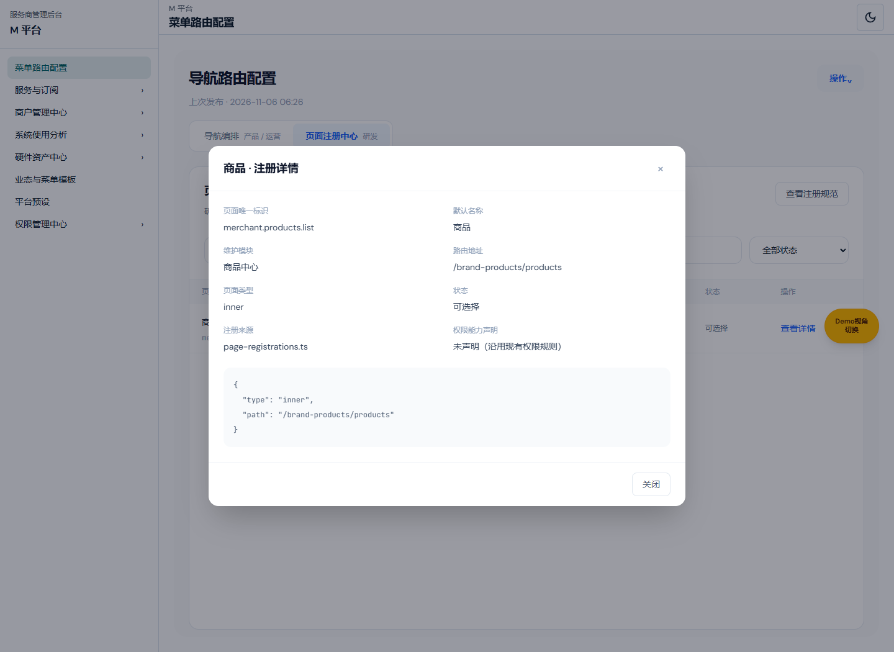

图注：同版本，商品页面独立只读详情；关闭返回原查询列表。

## 注册规范弹框

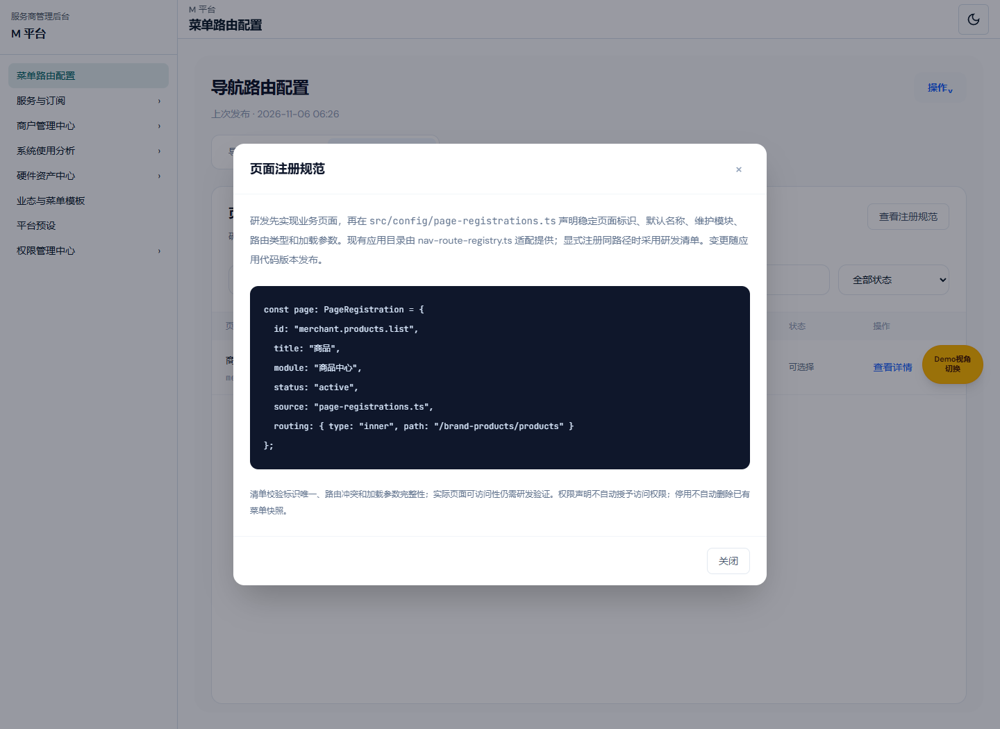

图注：同版本规范入口独立弹框，展示代码合同；不是在线注册编辑器。

| 字段／操作 | 逻辑说明 |
| --- | --- |
| 详情字段 | 逐项显示唯一标识、默认名称、维护模块、路由、类型、状态、来源、权限能力声明；未声明权限显示沿用原规则。 |
| 加载参数快照 | 原注册 routing 的只读 JSON，便于研发排查。 |
| 规范正文 | 定位 page-registrations.ts，解释先实现页面再登记、随代码版本交付，列出唯一性／路由／加载参数校验。 |
| 关闭／Esc／遮罩 | 不写入任何菜单数据，返回原详情入口／规范按钮；保留搜索条件。 |

## 特殊接入／兼容配置

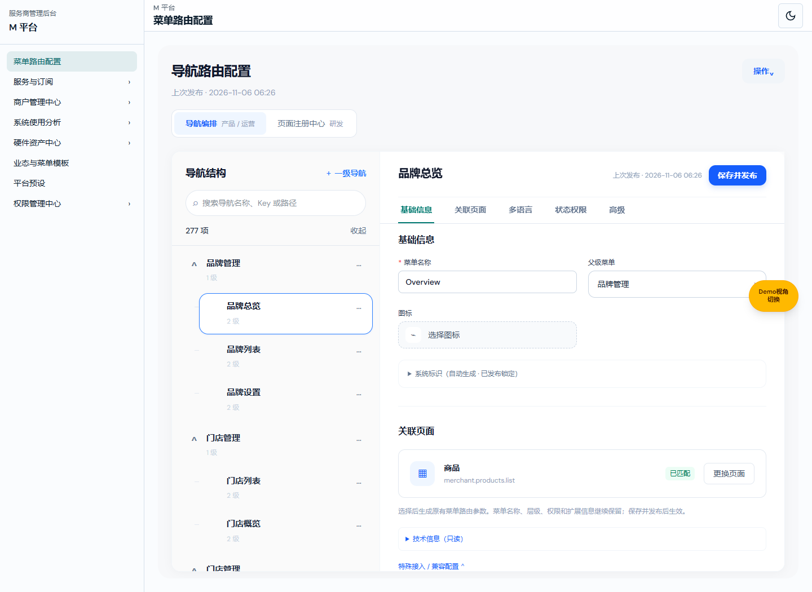

图注：同版本的实际原有技术字段；展开／收起不更改当前快照。

| 字段／操作 | 逻辑说明 |
| --- | --- |
| 展开／收起 | 仅切换区域显示，不修改技术参数、不触发发布；历史未匹配菜单可继续手动维护。 |
| 类型选项 | 项目内、iframe、链接菜单、外部链接、微应用沿用原字段与校验；普通注册页面无需展开。 |
| 原字段 | 路由、URL、微应用标识及加载配置继续使用旧合同，当前输入按原方式失焦和提交处理。 |

## 离开未发布菜单：保存并发布后切换

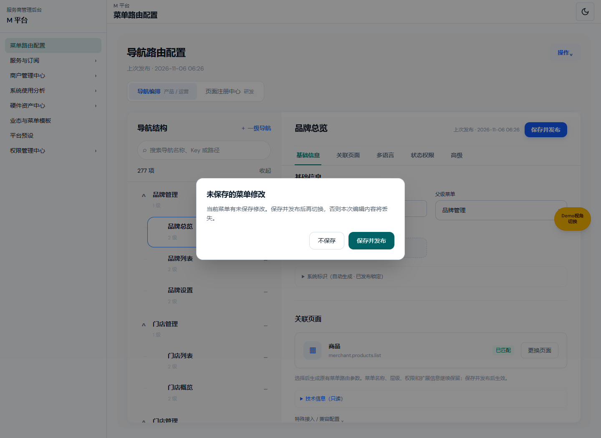

图注：同版本实际提示，沿用原业务的“保存并发布／不保存”。保存成功才继续切换；不保存沿用丢弃本轮编辑的语义，没有新增第三种保存决策。

## 发布警告与成功结果

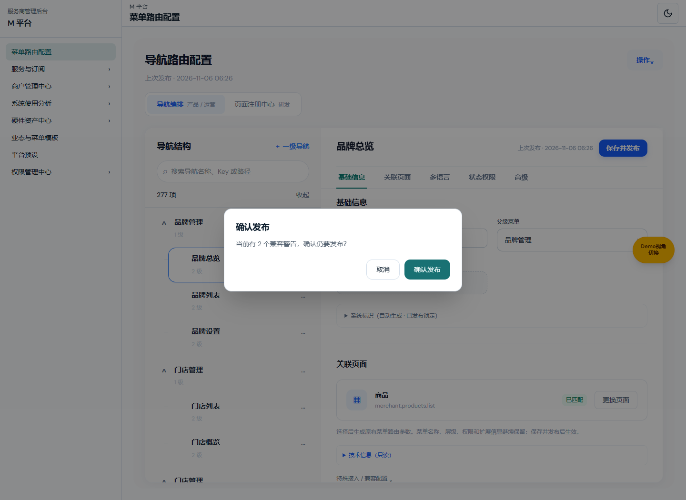

图注：隔离演示中同页面路由已有其他入口，沿用原兼容警告确认；不改变错误阻断和警告确认规则。

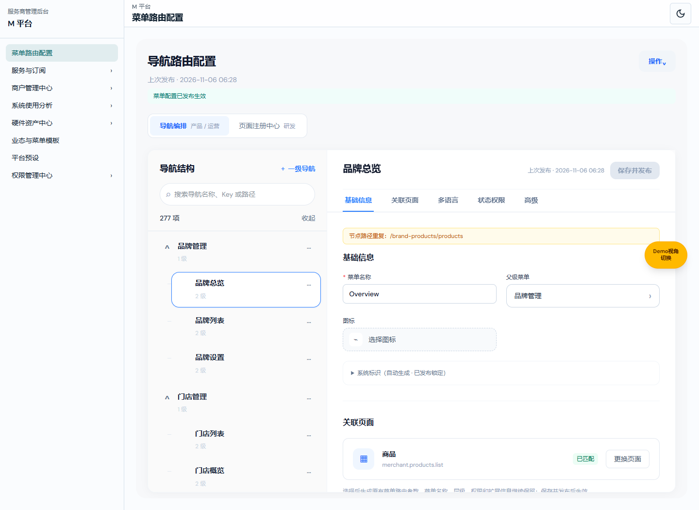

图注：同版本演示发布后按钮禁用；脚本重新加载页面并重新选择节点，仍识别相同页面标识。这里只证明隔离演示仓库的发布与刷新，不代表 HTTP 生产接口验收。

## 新建叶子未配置页面：发布阻止

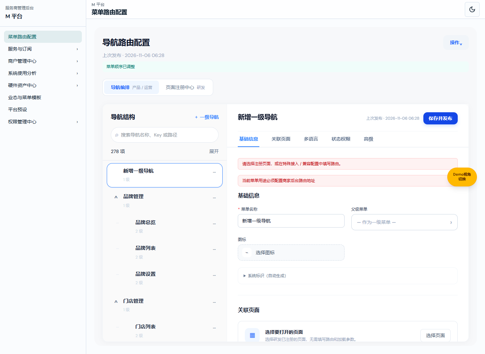

图注：同版本新增一级导航立即出现在首位；不带占位路由，点击发布显示选择页面或配置特殊接入的提示，不产生发布写入。

## 本轮逐操作覆盖清单

每项操作的确认／取消和结果按上文定义；本清单只登记本次新增／调整范围，不把旧菜单所有动作视为本轮已验收。

| 所属页面／操作 | 入口与结果 | 对应截图／正文 | 状态 |
| --- | --- | --- | --- |
| 两视角切换 | 页签 → 目录／编排，保留草稿 | navigation.png、registry.png | 已采集 |
| 选择／更换页面 | 卡片 → 独立弹框 | navigation.png → picker.png | 已采集 |
| 搜索候选／空结果 | 输入 → 筛选／空状态 | picker.png、picker-empty.png | 已采集 |
| 选择候选／确认 | 单选 → 关联卡片与启用发布 | picker.png → linked.png | 已采集，名称／Key 保留断言通过 |
| 取消／关闭／遮罩／Esc | 候选丢弃 → 原绑定不变 | picker.png → cancel-result.png；这些动作共用同一结果画面 | 取消、选择弹框 Esc、遮罩与规范 Esc 由浏览器脚本分别断言；结果图复用 |
| 注册目录搜索／状态 | 输入或选择 → 交集结果 | registry-search.png、registry-empty.png | 已采集 |
| 只读详情／关闭 | 行内入口 → 独立弹框 → 原列表 | registry-search.png → detail.png → registry-search.png | 已验证与采集 |
| 注册规范／关闭 | 顶部入口 → 独立弹框 → 原列表 | registry-search.png → spec.png → registry-search.png | 已验证与采集 |
| 特殊接入展开／收起 | 折叠入口 → 原技术字段 | linked.png → special.png → linked.png | 已采集 |
| 新建／空叶子发布阻止 | 现有新增按钮 → 无占位路由 → 提示 | new-empty-validation.png | 已验证与采集 |
| 发布警告／成功／刷新识别 | 原发布链路 → 成功按钮禁用 → 刷新仍识别 | publish-warning.png → published.png | 已验证隔离演示仓库 |
| 发布失败保留输入 | 原发布链路 → 错误后可重试 | 待补失败结果图片 | HTTP 接口失败与并发冲突未做浏览器受控故障注入，保留缺口 |
| 离开未发布菜单 | 切换节点 → 原保护提示 → 保存后切换 | leave-warning.png → published.png | 已验证与采集 |

验证入口：verify-page-registration.ts、verify-page-registration-browser.mjs、现有菜单领域与默认目录整树一致性。浏览器结果保存在 assets/page-registration/verification.json；TypeScript 类型检查通过。旧 reference-compatibility 测试缺少桌面源文件 edit jason.txt，未执行成功；保留缺口，不声称截图与全部回归完整。没有修改 eMenu 源码，无需触发其嵌入包构建。286 项目录没有逐项验证页面加载、iframe 或微应用实际服务；注册不等于业务完整性验收。

## 菜单路由配置：当前商家目录

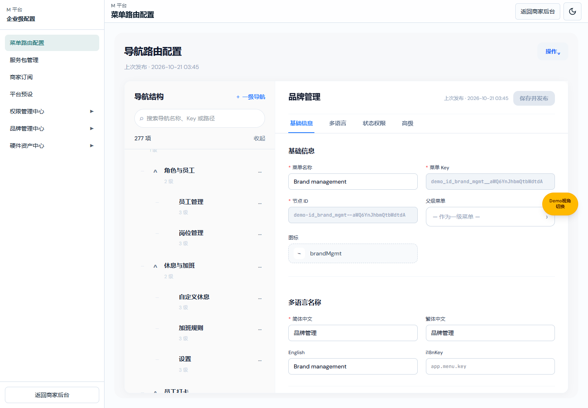

图注：5208，codex/brand-route-tree-20261021 未提交功能预览；实际 JSON 菜单配置页，当前默认演示数据。

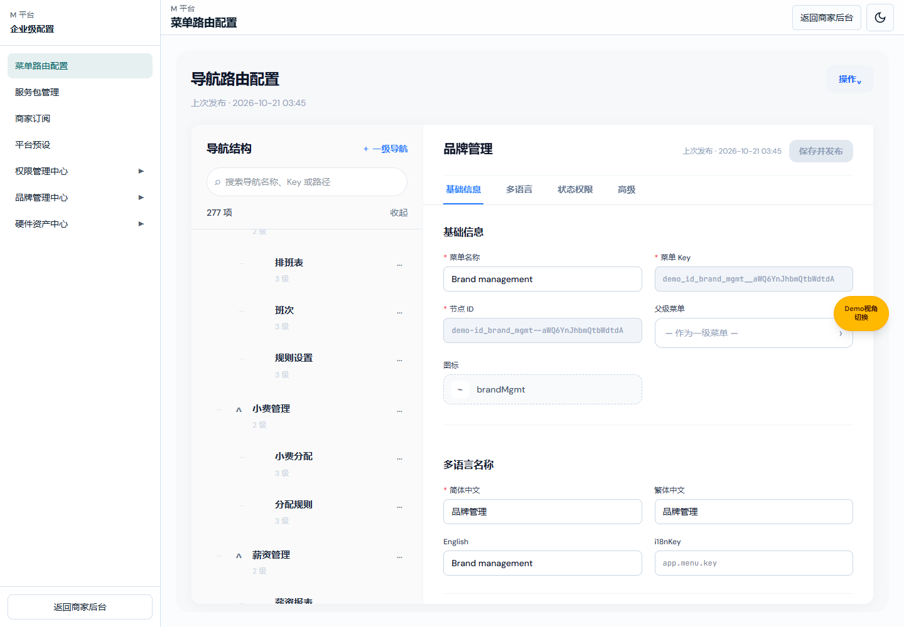

图注：同一版本，实际配置页展开状态。

| 区域或字段 | 逻辑说明 |
| --- | --- |
| 一级模块 | 顺序和名称读取商家 NAV_MODULES，不新增或丢弃模块；默认 29 个。 |
| 子菜单 | 专用子导航使用后台同一数组，其他模块使用公共转换函数；递归保留任意层 sidebarChildren/children。目录仅展示实际存在的子项，不补“概览”。 |
| 菜单名称 | 中文来自真实 title，英文沿用 titleEn；不擅自拼接“父名 · 子名”。 |
| 叶子路径 | 沿用真实业务路径；目录不伪造可点击概览页。 |
| 顺序及归属 | 逐层严格按源数组排列；无拍平、无按名称重新排序。 |
| 展开/收起 | 沿用原编辑器树交互；展开真实子菜单，不增加数据节点。 |
| 演示缓存 | 仅完全未编辑的旧内置样例在读时映射最新结构；不写回缓存、不会触发未保存提示。手工草稿、其他发布数据保留。 |
| 保存/发布 | 用户编辑后的原校验、草稿、发布行为不变；本次修正数据源不自动向 HTTP 接口发布。 |

入口：M 平台 → 菜单路由配置。只调整本页默认演示目录及未编辑旧样例的读取结果；其余编辑器字段、弹框与业务接口不是本轮新增范围。

## 当前有效定义：与商家后台导航逐项一致

本地演示环境读取：开发模式、localhost、127.0.0.1、IPv6 回环（::1／[::1]）及 *.github.io 使用演示仓库；本机静态构建预览也适用。其余主机使用 HTTP 仓库，接口异常直接提示，不自动切换演示数据；草稿与发布仍沿用对应仓库的存储规则。[环境回归记录](../verification/m-platform-static-menu-20261104/README.md)。

实际 /m-platform/nav-blueprint 使用 JSON 菜单编辑器（json-menu-editor-ui / json-menu-demo-data），不再将旧蓝图矩阵的验证当作本页验收。默认目录读取 navigation.ts 中商家后台实际使用的模块专用 SUBNAV、navModuleChildrenAsSheetSubnav 及递归 sidebarChildren/children；同级顺序、中文名称、叶子路径、父子关系一致。不自动生成概览，不拍平深层商品菜单，不给同名子项擅自添加父名，不因旧测试限制而截断为三级。

休息与加班子项仅为自定义休息、加班规则、设置。小费管理子项为小费分配、分配规则；分配明细是当前商家页面内容，不额外生成导航入口。

默认演示源当前 29 个一级、277 个总节点。以实际导航数组做双向整树比较，不能只验证“原有路径均出现”，还必须检查多余节点、层级和顺序。JSON 字段、服务权限样例和保存发布接口保持原合同。

只有与历史内置演示菜单完全相同的已发布/草稿 menu 才在读取时投影为最新默认结构；比较忽略 parentKey 派生值。原 localStorage 数据不覆盖、不删除；任一手工编辑字段或顺序不同则保留，不自动同步自定义数据。此规则仅用于当前本地演示仓库，HTTP 远端配置不被强制替换。

验证：verify-json-menu-merchant-parity.ts 对整树双向相等、无额外概览、小费子项、递归产品、旧原件保留及自定义草稿保护断言通过；verify-json-menu-current-merchant-demo.ts 已从旧三级/概览预期更新为真实导航合同并通过。浏览器在实际 JSON 配置页逐项比对全部 277 个已渲染节点的位置和标题通过。本轮已获授权提交并合入本地 main，未获推送授权。

补充：消息中心复用 groupNotificationSheetSubnav（品牌消息/门店消息），前厅复用 groupRuleRestrictionsSubnav（菜单下单限制）以保持后台真实分组。实际 JSON 路由页 verify-json-menu-route-page.mjs 对全部 277 个节点的 DOM 位置和标题逐项验证通过。结构比较基于完整目录，不套当前账号权限/订阅过滤，避免把权限不可见误当作不存在；发布范围过滤继续由原运行时处理。
