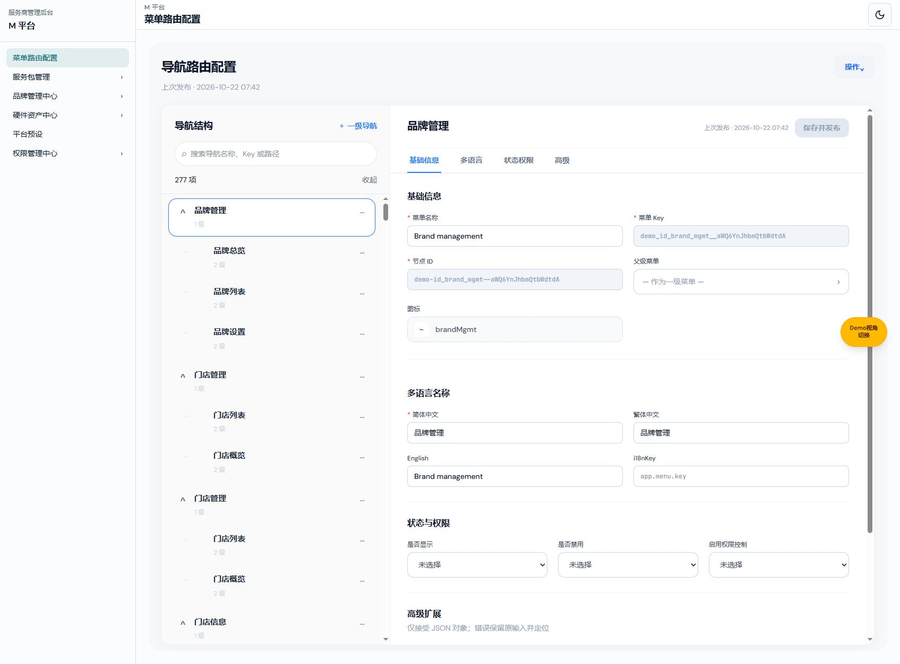
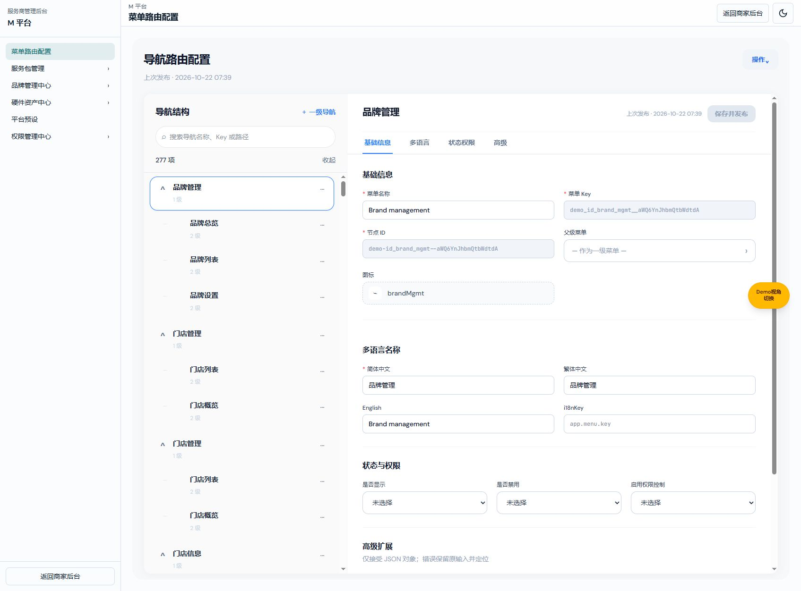
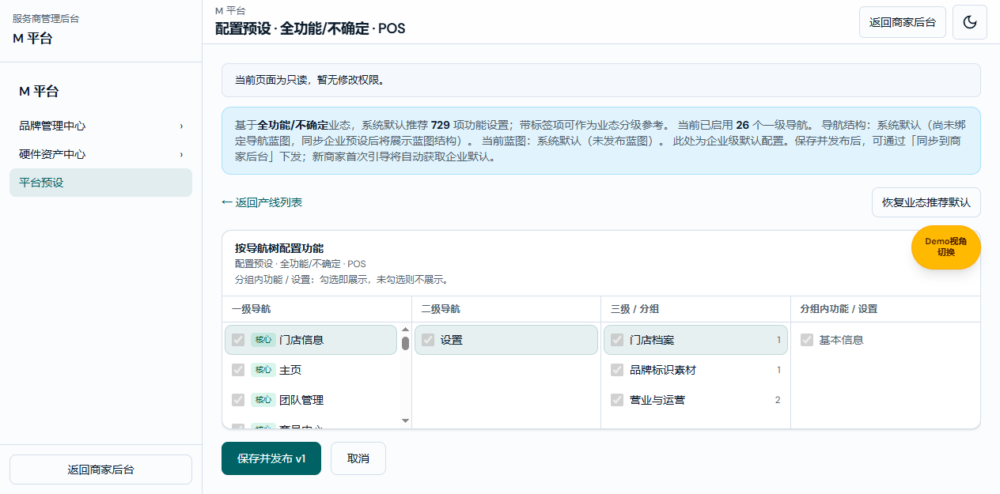

# M 平台内部权限业务规格说明书（研发交付版）

版本：V1.5；日期：2026-10-29；变更编号：USAGE-ENTRY-20261029-62。
共同基线：系统使用分析独立权限目录；起始main@f30e8451。
配套：[产品权威 V1.5](M平台内部权限产品权威需求文档.md) · [研发交付 V1.5](M平台内部权限业务规格说明书（研发交付版）.md) · [个人规范 V1.5](M平台内部权限需求文档（个人规范版）.md)。
状态：按本次确认实现的本地原型；生产服务端鉴权、真实账号服务尚未接入。三份采用同一业务定义。

本文件展开产品权威的字段、计算、状态、存储与测试，不新增业务规则。

## 系统使用分析独立权限目录

图注：2026-10-29，codex/usage-analysis-entry-20261029，main@f30e8451起始，5257实采；角色编辑中系统使用分析与商户管理中心分别设置模块门槛。

入口：权限管理中心 → 角色与功能权限 → 编辑权限。

| 字段／操作 | 逻辑说明 |
| --- | --- |
| 系统使用分析模块 | m:module:activity-analysis，可见／不可见；独立于m:module:merchants。导航、角色目录与实际资源树一致。 |
| 门店活跃分析 | m:page:merchant-activity，可见／不可见，无业务写操作；父资源为系统使用分析模块。 |
| 设备活跃分析 | m:page:device-activity，可见／不可见；与门店活跃分析分别授权，共用分析模块门槛。 |
| 详情中的使用情况 | 品牌或门店详情权限与门店活跃分析权限同时满足才可进入；单有商户管理编辑权不代表可读分析。 |
| 仅分析角色 | 可查看已授权全局分析；无商户管理权限时不显示品牌/门店管理跳转，也不能直达管理详情的使用情况页。 |
| 多角色与停用 | 保留角色允许并集及祖先门槛；停用账号、缺页权和缺模块权均拒绝。浏览期间撤权后下次交互/重渲染不继续访问。 |
| 历史角色兼容 | 缺目录版本标记的旧记录，按角色复制原商户模块门槛到缺失的新分析模块门槛，不新增或修改任何分析页grant。已显式配置的新门槛（包括不可见）不覆盖。 |
| 新角色 | 默认不可见；不因商户管理可见而自动拥有分析权限。 |
| 旧路由 | /m-platform/merchants/activity与device-activity及原明细地址继续使用；地址保留不表示权限仍归商户中心。 |

### 目录兼容字段与验收算例

| 字段／操作 | 逻辑说明 |
| --- | --- |
| MState.catalogVersion | 可选字面量2；缺失表示旧目录。readMState校验原记录后返回兼容副本，不因浏览直接写localStorage或递增revision。授权保存将该标记写为2。 |
| 旧角色模块门槛 | 新分析模块键缺失时，原m:module:merchants为read则设read，否则hidden；已有新键保留。各角色分析页grant、员工roleIds、日志与revision不变。 |
| 分离后计算 | 分析页父键仅为m:module:activity-analysis；设置catalogVersion=2后再次读取不复制原商户门槛，防止撤权后重新授予。 |
| 跨角色算例 | A仅有旧商户模块read，B仅有分析页read，员工绑定A+B：旧有效分析可见；兼容后新模块read与页面read并集，仍可见。只绑定B仍不可见。 |
| 隐藏算例 | 旧模块hidden且有分析页read：兼容后仍不可见。主动隐藏新分析模块后保存/刷新也不可见。 |
| 不扩权算例 | 只有商户模块read而无任何分析页grant：复制模块门槛后分析页仍不可见；新创建角色的商户模块read不会自动转换。 |
| 范围算例 | brand=demo-a仅返回该品牌两个预设门店；试图下钻demo-b门店拒绝。store上下文仅允许本店，缺数据的M00000001不匹配demo-all。 |

### M 平台外壳返回入口（M-PERM-EXIT-20261022-05）

图注：2026-10-22，V1.4 功能分支，实际页面验证截图；此前截图中的右上角、左下角返回商家按钮为历史展示。

| 元素 | 规则与验收 |
| --- | --- |
| 右上角返回商家后台 | 从 M 平台公共页头移除，主题切换保留 |
| 左下角返回商家后台 | 从侧栏移除整个按钮及底部容器，不留空白边框 |
| 子菜单返回箭头 | 保持返回上一级菜单，父菜单名与箭头同行 |
| 权限与数据 | 本次不改变授权、角色、数据加载或业务路由；无权页原有返回链接沿用 |

验证：实际页面两处按钮均不存在；主题切换和侧栏导航仍可操作。TypeScript 与公共递归导航回归通过。本次 V1.3/V1.4 修改按用户授权提交、合并 main 并推送；实际提交号和远端核验结果以 Git 交付记录为准。

## 1. 数据对象与来源

| 字段 | 类型与约束 |
|---|---|
| schema | 固定整数 1；不支持格式不静默覆盖 |
| revision | 非负整数；初始化为 0；每次成功保存加 1，保存前与当前持久化值比较 |
| roles[].id | 稳定字符串，唯一，不随名称改变；新角色使用 UUID |
| roles[].name | 字符串；去首尾空格；1–30 字；忽略大小写判重 |
| roles[].description | 字符串；0–160 字；空串合法 |
| roles[].system | 可选布尔；初始系统角色为 true；不可删除或移除该标记 |
| roles[].grants | 资源键到 hidden/read/edit 的稀疏映射；未配置为 hidden；未知旧键保留但永不生效 |
| employees[].id | 企业账号的 employeeId；与商家员工命名空间隔离 |
| employees[].roleIds | 去重角色 ID 数组；默认空；保存拒绝失效角色；无个人例外字段 |
| logs[] | 新记录置顶；id、at、actor、action、object、before、after；时间为 ISO 字符串，页面按浏览器本地时区显示 |
| 企业账号 | 复用 enterprise-staff-account-store；employeeId、employeeName、loginEmail、enabled 及既有凭据规则；账号审计排除 password |

主存储键为 menusifu:m-platform-permissions:v1，企业账号沿用 menusifu:enterprise-staff-login-accounts:v1。前者不读取旧 menusifu:enterprise-rbac-v1 的商家资源授权。初次读取生成初始系统管理员草稿但不写权限存储，第一次成功修改才持久化。初始系统角色绑定既有演示 ent001；其他账号无自动授予。新增员工账号不自动分配角色。

### 默认演示账号身份解析（M-PERM-DEFAULT-20261022-02）

currentMAccount：先按已认证邮箱查询企业账号；精确命中既有账号时优先使用该账号。无命中且邮箱归一化后等于 DEMO_LOGIN_ACCOUNT（demo.menusifu.cn）时，使用现有企业账号列表中 employeeId=ent001 的初始管理员；其他账号返回空。仍由 mResolve 计算其持久化角色并校验 enabled，不直接返回全允许，不创建新角色、员工绑定或业务数据。

故障根因：前版默认账号缺少企业身份，导致 currentMAccess 全部 hidden；并非业务数据被删除。浏览器先执行新增默认账号测试得到 RED，再实施该单点修改得到 GREEN。

8 项新增回归：默认身份、品牌页、角色页、未知资源、未授权真实员工、未知账号、初始管理员停用、权限存储不被改写。当前用户内置浏览器实际点击默认登录，进入 M 平台并打开品牌列表，确认既有品牌数据可见。未改变登录校验、真实员工角色、商家权限或业务数据范围。Build skipped：本次仅身份解析修复，不触及入口、依赖、构建或资源边界；TypeScript 和浏览器 E2E 通过，CI 未验证。

## 2. 资源与计算

资源目录：src/permissions/m-platform-catalog.ts。键分别为 m:module:<模块ID>、m:page:<页面ID>、m:action:<页面ID>:<动作ID>；角色编辑和侧栏共用 M_MODULES，路由由 mPageForPath 归属。服务包和商家订阅先于权限中心通配路径解析；品牌、门店详情归属各自业务页面；使用情况还受门店活跃分析权限校验，集团旧地址归品牌目的页。

1. 确认企业账号存在且 enabled=true，员工绑定存在。
2. 对每一资源，合并员工 roleIds 中仍有效角色的原始权限，取 hidden=0、read=1、edit=2 的最大值。
3. 对有效上级递归计算；上级 hidden 时当前 hidden，但不改写下级存储。
4. 修改型 action 还要求有效页面为 edit；输出型 action 要求页面可见且该 action=edit。
5. 未知资源、无账号、停用账号、无绑定或循环引用均返回 hidden。

目录仅 hidden/read；可设置页面 hidden/read/edit；纯查看页面 hidden/read；action hidden/edit。校验拒绝目录 edit、只读页面 edit、action read。页面一般编辑与独立 action 分开校验。

### 可复算测试例

| 输入 | 预期 |
|---|---|
| A：预设目录 read，页面 read；员工仅绑定 A | 预设页面只读，发布禁止 |
| B：页面 edit、发布 edit；员工绑定 A+B | 目录由 A 放行，页面编辑与发布由 B 放行，最终允许发布 |
| A+B，但所有角色的目录均 hidden | 页面及发布 hidden，下级存储保留 |
| A+B，但页面最终 read | 发布型动作 hidden，即使动作原值 edit |
| 设备目录 read、设备页 read、导出 edit | 允许导出；无任何设备编辑能力 |
| 新员工 roleIds=[] | 全部 M 平台页面 hidden |
| 账号停用，原角色不变 | 全部 hidden；重新启用后按当前角色计算 |
| 未知资源或商家 page:/team/payroll-report | hidden |

## 3. 保存、事务与异常

- saveMState：重新读取当前账号和动作权限；校验 revision、对象结构、名称唯一、失效绑定、系统角色和最后管理员。角色授权增改及新角色绑定不得超过操作者有效权限上限。成功一次 setItem 写入新 revision 和审计；失败抛错，UI 保留输入，不提前修改已保存状态。
- 最后管理员定义：账号启用，角色页和员工页均 edit，编辑角色动作及分配角色动作均允许。保护范围为最后管理员的停用和关键授权移除，不要求每个角色均为管理员。
- 企业账号存储开启 strictPersistence 和 refreshOnRead；写入成功后才更新缓存，查询从存储刷新。商家账号存储沿用原有选项默认值，不启用该行为变更。
- 账号修改先保存脱敏审计，再更新账号；账号写失败时恢复本事务权限快照及 revision。新增失败不向账号缓存追加对象。多键 localStorage 不具备跨进程事务保证，生产端需提供事务；本原型不宣称解决两个标签页同时写账号的数据库级原子性。
- 修改自身登录邮箱成功后更新当前会话邮箱；密码输入留空不写 password。账号停用不删除角色绑定。
- 配置本地数据损坏时显示不可读取或按无权处理，不重建覆盖已存权限。新目录节点未登记授权时默认拒绝。
- 搜索、选择菜单、预览和初始化不标记 dirty；权限值相对已保存值存在语义差异才 dirty。取消权限确认保留草稿；恢复全部原值清除 dirty。关闭页面 beforeunload 和 hash 离开由浏览器确认保护真实草稿。

## 4. 前端执行控制点

### 菜单主层重复文案删除（M-PERM-LABEL-20261022-04）

图注：2026-10-22，功能分支 V1.3，主层菜单。

仅删除 m-platform-runtime.ts 的 data-m-nav-root 内 h2“ M 平台”节点；不修改品牌区标题、导航容器 accessible name、数据目录或事件处理。不留空白占位，第一子元素即菜单路由配置。无需数据迁移。浏览器确认主层标题数为 0、首项为菜单路由配置、保留 6 个入口，品牌标题仍为 M 平台；进入权限子层和返回验证通过。本次不新增镜像字符串测试，执行 TypeScript 与现有公共导航回归。

### M 平台子层头部（M-PERM-NAV-20261022-03）

图注：2026-10-22，V1.2 功能分支，权限子层与员工页面。

m-platform-runtime.ts 在各 data-m-nav-layer 顶部渲染同一行 header：保留 data-m-nav-back、data-navigation-sheet-back 和 aria-label=返回上一级菜单，按钮内部仅含 aria-hidden SVG，无可见文本；紧随其后的 h2 显示经过转义的 module.title。沿用商家后台 h-14、size-10、18px SVG、text-sm/font-semibold 及对应边线、悬停和 focus 样式。

m-platform.css 仅将子层容器 padding 设为 0、overflow 设为 hidden，菜单列表在独立滚动区使用 px-2/py-3；主层样式与父子事件处理不变。浏览器实测 header 56px、button 40×40px、icon 18px、title 14px/600；箭头可见文本为空，标题与按钮中心线一致。真实点击返回及重入、当前叶子高亮已验证。本次不新增镜像样式测试；执行 TypeScript 和公共导航回归。

图注：2026-10-22 功能分支，受限员工查看 POS 预设，复选框与发布禁用。

navigation-submenu-actions.ts 为商家后台与 M 平台共用父子菜单点击、返回、叶子保持处理；商家原递归堆栈与渲染保持不变。m-platform-runtime.ts：侧栏过滤、路由 mCanVisit、捕获阶段 click/submit/change/input/keydown/dragstart/drop 拦截以及动态 DOM 控件禁用。只读白名单仅允许导航、搜索、筛选、关闭及浏览；嵌套 data-pp-enable 和 data-rbac-l4-editable 优先按修改处理，不能从父级导航按钮继承放行。配置预设的 /edit 地址可只读查看；新增/创建和业务编辑地址要求编辑权限。独立动作使用真实 data-* 选择器登记。对未授权路由不挂载原业务处理器。

src/auth/login.ts：企业账号在品牌和演示回退前校验，停用及密码错误直接拒绝。src/main.ts：企业账号成功登录转至首个可访问 M 页面；M 页面不进入商家首次业态向导，其他商家进入流程保留。src/shell/m-platform-shell.ts：接入四入口及独立全屏详情。

边界：这些是原型前端执行点，不是后端权限校验。业务 API、手动调用业务 store、多服务商租户隔离、逐商户数据范围仍需相应生产实现。

## 5. 验证证据

- scripts/verify-m-platform-permissions.ts：多角色合并、父级门禁、默认拒绝、页面只读、独立导出、授权上限、角色判重、失效绑定和路由归属。
- scripts/verify-m-platform-persistence.browser.ts：真实浏览器内执行 11 项检查：过期 revision、最后管理员移除、最后管理员停用、权限存储失败、原值保留、账号写失败、审计回滚、缓存不污染、工号判重、跨窗口停用及停用账号登录拒绝。脚本 finally 恢复任务浏览器的测试前数据。
- 公共导航浏览器检查：父项打开、递归进入、返回一层、叶子保持并阻止外层关闭、返回父层共 5 项通过。
- 人工浏览器流程：创建“客服只读”角色；设置品牌/设备/预设为只读；保存并绑定 ent004；员工预览仅 3 页；受限员工直接访问角色页被拒绝；预设控件和发布禁用，设备导出未授权时禁用。
- TypeScript：tsc --noEmit。商家仅角色授权回归和公共导航回归通过。verify-permission-center.ts 的“Operation page cannot be selected: /team/shift-scheduling”断言失败；在 main@48c9c24b 的独立干净源码快照复现同一失败（第 37 行），属于基线问题，本次未修改商家权限目录，不宣称该脚本全通过。未运行 CI/部署。

## 6. 版本记录

V1.3，M-PERM-LABEL-20261022-04：仅移除菜单主层重复平台标题；配对产品/个人 V1.3。

V1.2，M-PERM-NAV-20261022-03：导航头部同排，样式及尺寸对齐商家后台；配对产品/个人 V1.2。

V1.1，M-PERM-DEFAULT-20261022-02：默认演示账号复用现有初始管理员身份，补默认访问与隔离回归；配对产品/个人 V1.1。

V1.0，M-PERM-20261022-01：与产品/个人 V1.0 同步建立。无金额计算、舍入或业务订单状态变更；相关规则不适用。

本轮独立分析模块的验证及未闭合项见[USAGE-ENTRY-20261029-62](../verification/usage-analysis-entry-20261029/README.md)。
