# M 平台内部权限业务规格说明书（研发交付版）

版本：V1.10；日期：2026-11-03；变更编号：PROVIDER-HEADER-20261103-01。
共同基线：保留演示数据的商家角色列表标题栏；起始本地 main@1aa5da44。
配套：[产品权威 V1.10](M平台内部权限产品权威需求文档.md) · [研发交付 V1.10](M平台内部权限业务规格说明书（研发交付版）.md) · [个人规范 V1.10](M平台内部权限需求文档（个人规范版）.md)。
状态：按本次确认实现的本地原型；生产服务端鉴权、真实账号服务尚未接入。三份采用同一业务定义。

本文件展开产品权威的字段、计算、状态、存储与测试，不新增业务规则。

## 商家访问角色列表标题栏调整（PROVIDER-HEADER-20261103-01）

基线本地 main@1aa5da44（包含未推送的演示数据修正）；分支 codex/provider-role-heading-20261103。外部 Chrome 功能预览 5314；按用户授权提交并合并本地 main，不推送远端，实际提交号以 Git 交付核验为准。本次只调整列表标题栏与一条提示，不改权限、角色或日志。

### 页面标题与新建入口

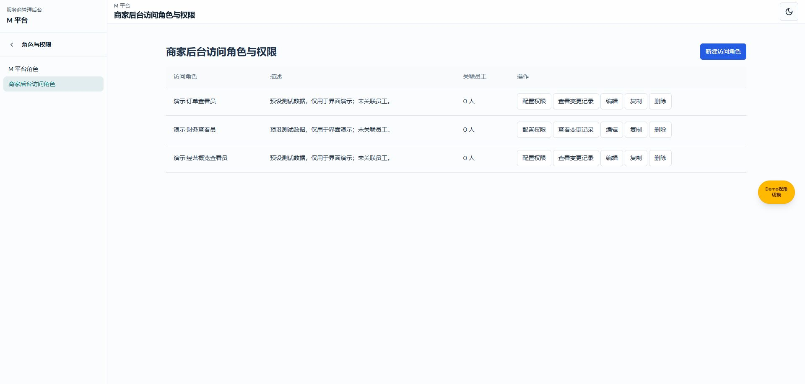

图注：2026-11-03，当前功能分支真实页面，演示角色仍保留。旧章节截图中的顶部测试提示和标题下方新建按钮为历史布局，以此图为准。

| 元素 | 逻辑说明 |
| --- | --- |
| 标题 | 商家后台访问角色与权限，保持左对齐 |
| 新建访问角色 | 放到同一标题栏右侧，复用公共 pc-heading 布局；沿用原按钮样式、data-provider-new、管理动作权限和禁用状态 |
| 列表顶部提示 | 删除“预设测试数据：演示角色未关联员工，标注‘演示’的记录不是真实操作历史。”对应的顶部提示容器，不留空占位 |
| 演示数据 | 3 个演示角色、描述、关联员工数和演示记录继续保留；集中记录页的演示提示不在本次删除范围 |

### 点击新建访问角色 / 取消

点击仍打开既有角色名称、描述和保存/取消弹框；必填、长度、重复名称、权限及保存失败行为均沿用。本次未新增保存分支，不对历史完整操作截图作新增完整性声明。

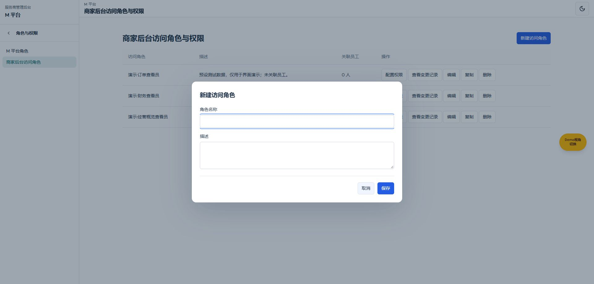

取消关闭弹框，不新增角色、不写授权或日志。

### 本次逐操作覆盖与验证

| 操作 / 状态 | 截图 | 验证 |
| --- | --- | --- |
| 查看标题栏 | list.png | 标题与按钮同行，按钮在右；指定提示不展示；3 个演示角色保留 |
| 点击移动后的新建按钮 | list.png → create-dialog.png | 原弹框正常打开 |
| 取消 | create-dialog.png → after-cancel.png | 回到原列表，数据不变 |

TypeScript 与 diff 格式检查通过。未触及构建边界，无额外业务测试；权限保存等既有异常路径未重测。

## 演示数据接回统一角色导航（PROVIDER-DEMO-FIX-20261103-01）

基线 main@39a417fb；分支 codex/provider-demo-fix-20261103；外部 Chrome 预览 5313。修正前，演示数据代码只留在未合并分支，主线缺少初始化逻辑；本次将其接回最新导航与集中记录，不回退导航、不复制旧文档覆盖新版。本次按用户授权提交并合并本地 main，不推送远端；实际提交号以 Git 交付核验为准。

### 本次操作覆盖清单

| 页面 / 操作 | 入口与结果截图 | 完成状态 |
| --- | --- | --- |
| 进入商家后台访问角色 | before-empty → roles | 已验证，3 个演示角色 |
| 从角色查看记录 | roles → role-log | 已验证，带入对应角色和商家类型 |
| 清除角色条件 | role-log → provider-logs | 已验证，恢复 3 条 |
| 类型选全部 | provider-logs → all-logs | 已验证 |
| 类型选 M 平台权限 | all-logs → m-logs-empty | 已验证，演示商家记录不混入 M 来源 |
| 类型选商家后台访问权限 | m-logs-empty → provider-logs | 已验证 |
| 刷新记录页 | provider-logs → provider-logs | 已验证，仍为 3 条，筛选保留 |

本次均为读取或筛选，无保存、确认或取消弹框；原权限编辑操作沿用，不纳入本次截图完整性结论。存储损坏仍由既有错误流程处理，自动测试覆盖不回退演示；未采集损坏数据的浏览器截图，不声称异常截图完整。

### 进入商家后台访问角色

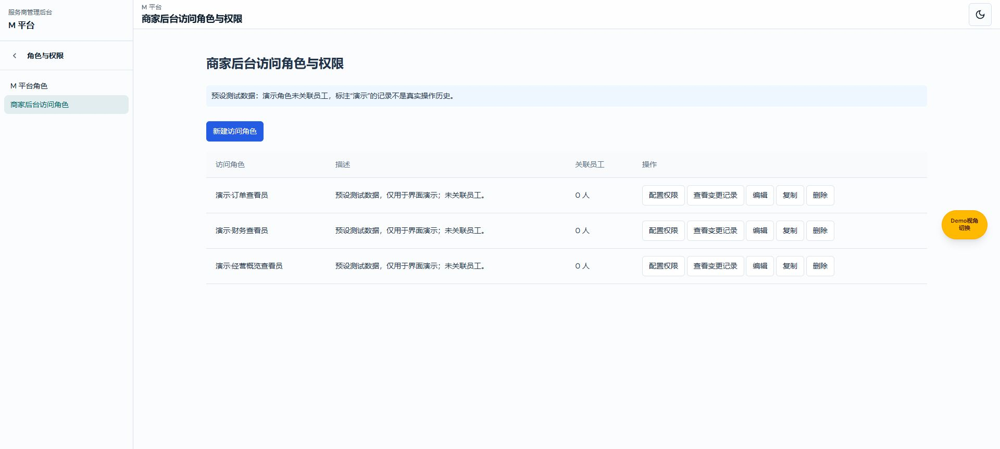

图注：2026-11-03，外部 Chrome，修正分支真实画面；演示角色不是实际员工权限。

| 元素 / 规则 | 逻辑说明 |
| --- | --- |
| 初始化条件 | 仅 localStorage 的 menusifu:provider-merchant-access:v1 不存在时生成演示状态；已有合法数据优先，包括已经保存的空列表，不增补或覆盖 |
| 角色 | 演示·订单查看员 / 演示·财务查看员 / 演示·经营概览查看员；ID 分别 provider-demo-orders / provider-demo-finance / provider-demo-dashboard，3 个普通非系统角色 |
| 权限配置 | 对应模块现有目录的非 action、非 setting、非兼容隐藏资源预设 read；不预设操作或设置编辑权限 |
| 关联员工 | 全部 0；employees 为空，不给任何员工绑定角色或目标，不改变 ent001 既有系统兼容范围 |
| 描述 / 提示 | 角色描述及记录演示标识保留；列表顶部提示已按 PROVIDER-HEADER-20261103-01 删除，集中记录页提示保留 |
| 持久化 | 查看、刷新不写存储，初始化 revision=0；用户后续正常保存仍走既有授权和并发校验 |
| 既有记录 | 已有角色、员工、日志、revision 与系统兼容范围均原样读取；已删除演示角色不会因刷新补回 |
| 损坏数据 | JSON 解析或结构校验失败仍报错，保留原值，不静默用演示覆盖 |

### 从角色查看记录

使用现有查看变更记录入口，进入集中页并带 type=provider 与角色 ID。三个角色各自对应一条预设事件，不新增独立日志页面或权限。

| 字段 | 逻辑说明 |
| --- | --- |
| 类型 | 商家后台访问权限 |
| 时间 | 固定 2026-11-03 09:00 / 08:00 / 07:00（UTC+8），按浏览器本地格式展示，不声称为当前操作时间 |
| 操作人 | 演示数据（非真实操作人） |
| 操作 | 演示：预设访问角色 |
| 对象 | 对应三个演示角色名，按时间倒序 |
| 快照 | 每条 before 为角色与员工空数组；after 为对应演示角色和空员工数组；不含密码 |

### 清除角色条件 / 类型筛选

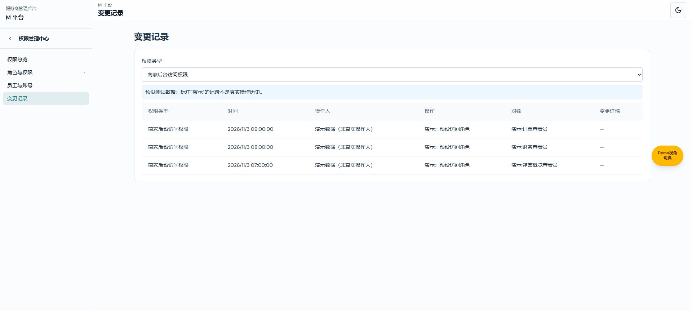

清除仅去掉角色条件，保留商家类型，显示 3 条；统一记录页就近提示演示性质。

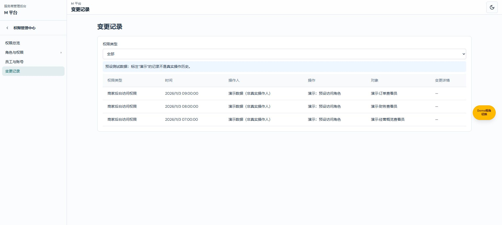
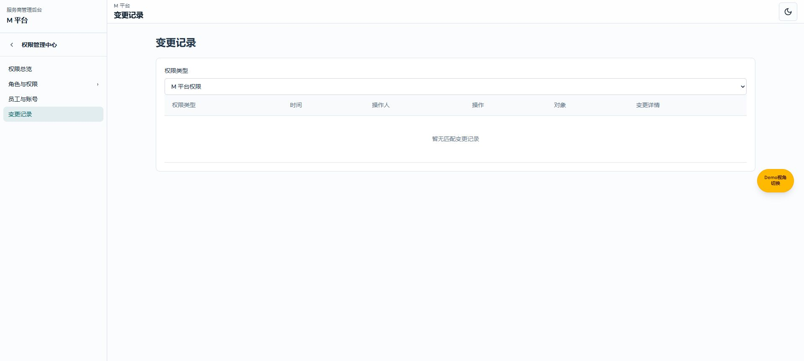

全部仍遵守原来源查看权限；本隔离上下文 M 来源无记录，商家演示记录不混入该类型。选回商家后台访问权限恢复上方三条画面。

### 刷新记录页

保留 URL 类型筛选；未保存上下文从固定演示状态重建，仍有 3 条，时间不漂移。不产生真实审计。

### 验证

RED：外部 Chrome 主线演示角色数为 0，空态可见。GREEN：修正预览 3 角色、关联员工均 0；角色条件 1 条，清除及刷新后 3 条；类型隔离正常。领域测试覆盖无员工授权、无动作/设置授权、独立副本、已有空/非空状态保留、损坏 JSON 不降级；原访问授权 16 项和集中日志隔离回归通过。生产接口、CI/部署未验证。

## 角色与权限统一入口（ROLE-HUB-20261103-01）

当前有效结构：权限管理中心 → 权限总览 / 角色与权限 / 员工与账号 / 变更记录；“角色与权限”下并列为“M 平台角色”“商家后台访问角色”。两类角色、员工绑定和权限资源独立，未迁移或合并数据。基线 main@1e84e5e9，功能分支 codex/role-permission-hub-20261103，端口 5312；按用户授权提交、合并 main 并推送，实际提交号及远端状态以 Git 交付核验为准。演示初始化已由 PROVIDER-DEMO-FIX-20261103-01 接回，原角色与记录授权规则不变。

### 本次逐操作覆盖清单

| 操作 | 入口及结果图片 | 状态 |
| --- | --- | --- |
| 点击角色与权限 | permission-parent → m-roles | 已验证，默认 M 平台角色 |
| 切换商家后台访问角色 | m-roles → provider-roles | 已验证 |
| 切换 M 平台角色 | provider-roles → m-roles | 已验证 |
| 返回上一级 | m-roles → back-parent | 已验证，只退一层 |
| 点击独立变更记录 | permission-parent → audit-all | 已验证 |
| 选择 M 平台权限 | audit-all → audit-m | 已验证 |
| 选择商家后台访问权限 | audit-all → audit-provider | 已验证 |
| 选择全部 | audit-provider → audit-all | 已验证 |
| M 角色查看变更记录 | m-roles → m-role-audit | 已验证，含无匹配记录状态 |
| 商家角色查看变更记录 | provider-roles → provider-role-audit | 已验证 |
| 清除角色筛选 | provider-role-audit → audit-provider | 已验证 |
| 展开 / 收起前后值 | audit-m ↔ audit-details | 已验证，沿用 M 日志明细 |
| 旧地址访问 | legacy-audit | 已验证，兼容商家日志类型 |
| 无权限类型 / 读取异常 | 待补页面图片 | 权限隔离领域测试通过；受限账号与损坏数据浏览器截图未采集，不声称异常截图完整 |

截图均为 2026-11-03 功能分支实际画面；“导航验收·M空白角色”“导航验收·商家空白角色”为本地隔离验收数据，无权限、无员工绑定；不代表生产操作历史。本次导航及筛选不写数据，无保存、确认或取消弹框。原角色编辑等完整操作截图不在本次调整范围内。

### 点击角色与权限 / 切换两类角色

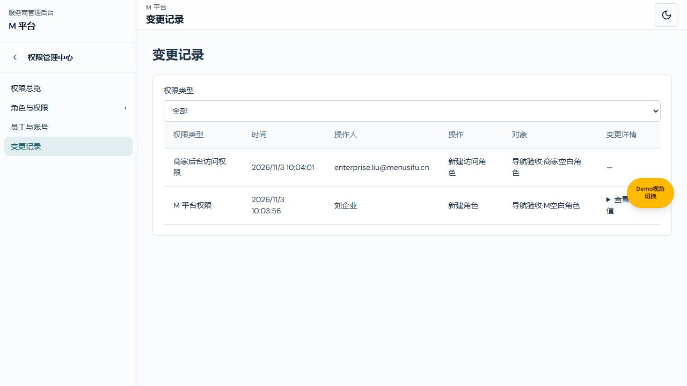
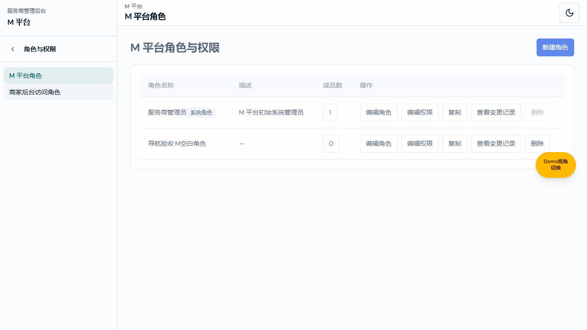

| 元素 | 逻辑说明 |
| --- | --- |
| 角色与权限 | 父菜单整行点击进入公共子导航滑层，默认进入现有 `/m-platform/permissions/roles`；仅有商家角色权限时回落到可访问的商家角色页 |
| M 平台角色 | 页内标题“M 平台角色与权限”；配置服务商员工在 M 平台内的菜单和操作，沿用 roles 页面、动作权限 |
| 商家后台访问角色 | 页内标题“商家后台访问角色与权限”；沿用 provider-roles 地址及动作权限；不将品牌、门店范围合并进 M 平台角色 |
| 当前项 | 切换、直接访问与刷新后恢复子导航并高亮；角色配置的既有草稿保护沿用 |

点击“M 平台角色”返回上方 M 角色列表；不修改任一类角色或关联员工。

### 返回上一级

只返回一层侧栏，保留当前业务内容；再次返回主层沿用公共逻辑。

### 独立变更记录 / 类型筛选

| 字段 / 操作 | 逻辑说明 |
| --- | --- |
| 地址 | `/m-platform/permissions/change-log`；支持 type=all、m、provider 及 role 参数；默认 all |
| 权限类型 | 全部 / M 平台权限 / 商家后台访问权限；仅列出原有权限允许的类型，不读取无权来源。全部是允许来源的并集 |
| M 日志查看权 | 沿用 permission-log 页面可见权限；拥有角色编辑权限不自动获得 M 日志查看权 |
| 商家日志查看权 | 沿用 provider-roles 页面可见权限；不增加新授权资源或默认赋权 |
| 切换类型 | 即时重新筛选并清除角色条件，URL 同步，不写日志或授权 |
| 权限类型列 | 标识记录原始来源，两个来源相同 id 不去重，不混淆 |
| 时间列 | 沿用 at 字段，以浏览器本地时间格式展示；合并后按时间倒序 |
| 操作人列 | 沿用 actor 字段，不改为当前浏览者 |
| 操作列 / 对象列 | 沿用 action、object，分别展示并 HTML 转义 |
| 变更详情 | M 来源保留前后值折叠；商家来源保持原展示范围，仅显示摘要，不新增原始快照入口 |
| 空值 / 失败 | 无匹配时“暂无匹配变更记录”；无权请求类型不给记录并提示；某来源解析失败单独提示，保留存储，其他有权来源继续展示 |

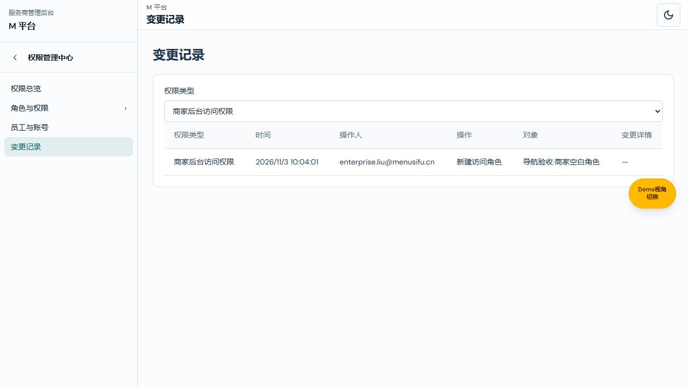

切回“全部”恢复上方全部类型画面，仅恢复当前允许来源。原权限总览的“最近变更”仍为原 M 权限摘要，本次未扩大范围。

### 从角色查看记录 / 清除角色条件

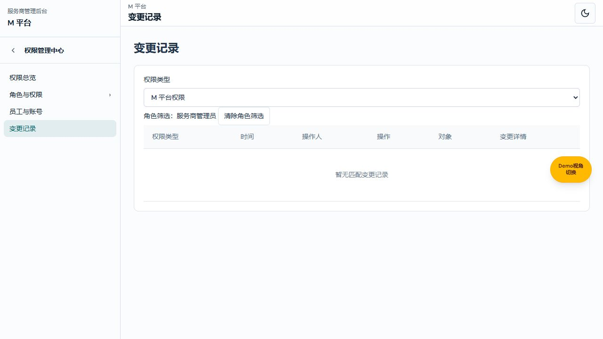

M 角色行入口仅在具备原 M 日志权限时展示，带入 type=m、role=角色 ID。

商家角色带入 type=provider。优先依据前后快照中对应角色的变化或关联员工的角色绑定变化匹配；旧摘要记录可按当前角色名称与对象精确匹配。已删除角色若无可识别快照或名称依据，不猜测关联记录。无匹配仍显示空态，不回退展示全部。

清除按钮仅移除 role 条件，保留类型；筛选不是编辑，不触发未保存提示。

### 展开 / 收起前后值

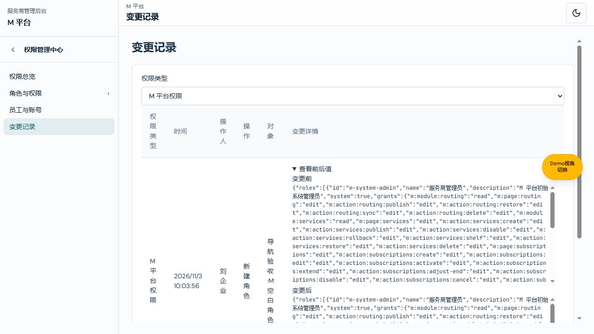

只展开当前 M 记录的原始前后值，不新增快照存储；再次点击原位置收起。

### 旧地址兼容

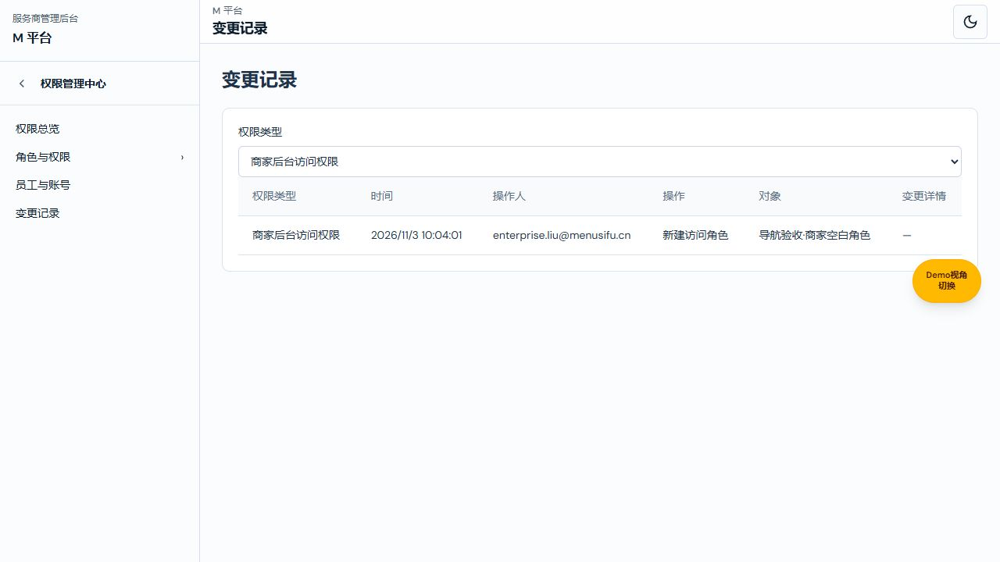

`/m-platform/permissions/provider-roles/change-log` 继续按商家来源权限进入统一记录界面，默认 type=provider；旧侧栏独立商家日志菜单移除。正常入口统一到权限中心“变更记录”。

### 验证与边界

类型检查、公共导航回归、原商户访问授权 16 项断言、M 平台权限回归、统一日志来源隔离/角色匹配/同 ID/排序测试通过。浏览器验证正常列表、切换、带参、清除、空态、旧地址与明细收起展开。生产服务端、CI/部署、受限账号和损坏数据的浏览器路径尚未验证。

## 历史：商家后台访问角色子导航（M-ACCESS-NAV-20261102-02）

本节为历史版本，导航与日志入口已由 ROLE-HUB-20261103-01 替代，不作为现行导航要求。

本次范围：权限管理中心内的商家后台访问角色拆为两个子菜单。沿用 provider-roles 可见权限和原管理动作；不新增权限资源、不迁移角色或员工绑定。当前功能分支 codex/merchant-access-nav-20261102；main 基线 8b9b3837，端口 5194；按 2026-11-03 用户授权提交、合并 main 并推送，实际提交号和远端核验见 Git 交付记录。

### 操作覆盖清单（本次变更）

| 操作 | 入口 / 后续状态 | 图片 | 状态 |
| --- | --- | --- | --- |
| 打开商家后台访问角色 | 权限中心 → 子导航，默认角色访问设置 | permission-parent / settings-rows | 已验证 |
| 点击角色访问设置 | 日志页 → 角色列表 | logs-rows / settings-rows | 已验证 |
| 点击变更记录 | 设置页 → 独立日志页 | settings-rows / logs-rows、logs-empty | 已验证，有数据及空态 |
| 子层返回 | 商家访问子层 → 权限中心层 | logs-rows / permission-parent | 已验证，只退一层 |
| 权限中心返回 | 权限中心 → 主层 | permission-parent / root | 已验证 |
| M 平台权限变更记录 | 权限中心 → M 平台内部权限记录 | permission-parent / m-platform-logs | 已验证，不混入访问角色日志 |

本清单仅覆盖本次新增或调整的导航操作；历史角色编辑、复制、删除等操作截图完整性不在本次验收结论内。导航无确认或取消弹框；无网络写入，因此不存在新增的保存成功/失败状态。

### 打开商家后台访问角色 / 默认角色访问设置

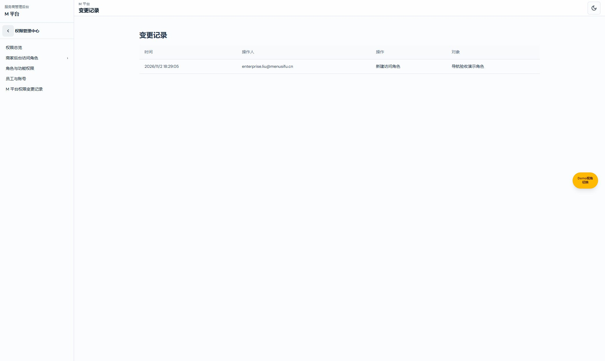

图注：2026-11-02，5194 功能分支真实截图；“导航验收演示角色”为隔离演示数据，无授权、无员工绑定，不代表真实操作历史。

点击父菜单整行，公共子导航滑层覆盖权限中心层；默认进入角色访问设置，原地址 `/m-platform/permissions/provider-roles` 沿用。新建、配置权限、编辑、复制、删除仍沿用原校验与草稿保护。列表底部不再显示折叠日志。

### 点击变更记录

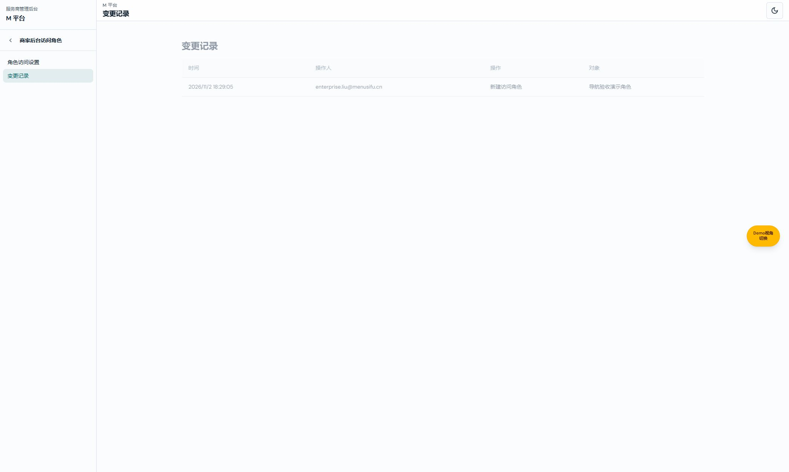

图注：同一隔离演示分支；记录来自通过现有新建入口保存空白角色的实际操作。

| 字段 / 操作 | 逻辑说明 |
| --- | --- |
| 菜单名称 | 变更记录，仅指商家后台访问角色及商户访问范围的授权变更 |
| 地址 | `/m-platform/permissions/provider-roles/change-log`；刷新和直接访问均恢复商家访问子导航，当前项高亮 |
| 权限 | 继承现有 provider-roles 页面可见性；不可见者不能因拆分菜单获得访问权 |
| 时间 | 原日志 at 字段，由浏览器本地时间格式展示，不改存储值 |
| 操作人 | 原 actor 字段，沿用真实记录，不替换为当前浏览者 |
| 操作 | 原 action 字段，不改变日志事件类型 |
| 对象 | 原 object 字段，HTML 转义，不显示密码 |
| 数量与顺序 | 展示原保存日志数组全部记录，沿用其顺序，不再截取前 30 条；不新增分页或筛选 |

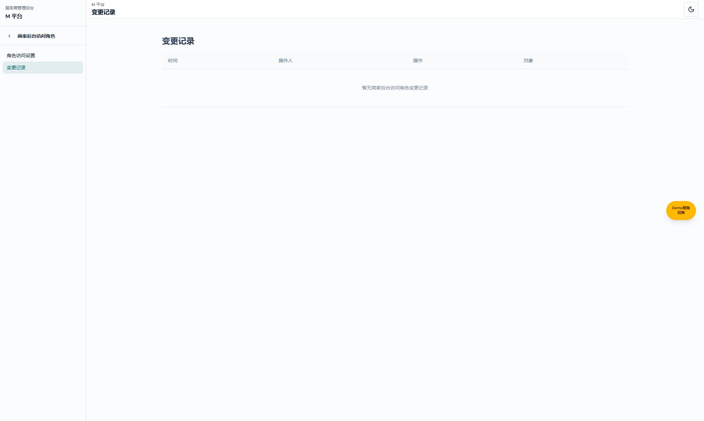

没有记录时显示“暂无商家后台访问角色变更记录”，不生成示例日志。浏览页面不写入日志或授权。

### 点击角色访问设置

切换后显示现有角色列表，保留两项子菜单并高亮设置项；不修改角色数据。

### 子层返回 / 权限中心返回

只切换侧栏层级，保留当前内容。继续点击返回到主层；原业务草稿离开保护沿用。

### 点击 M 平台权限变更记录

原 `/m-platform/permissions/change-log` 地址与 permission-log 权限资源不变，仅入口和页面标题改名。数据仍为 M 平台内部角色、员工权限日志，不混入商家后台访问角色日志。

## 商户访问授权字段与执行链

业务口径与页面操作参照[产品权威 V1.10](M平台内部权限产品权威需求文档.md#授权业务口径)，不另行决定业务。

| 字段 | 类型、来源与约束 |
| --- | --- |
| 本地存储键 | menusifu:provider-merchant-access:v1，与 M 平台角色、商家内部员工授权隔离。 |
| schema | 固定 1；损坏或不支持格式拒绝访问，保留原值，不初始化成全部允许。 |
| revision | 非负整数；默认 0；成功写入加 1；expected 和当前持久化值不同则拒绝覆盖。 |
| systemEmployeeIds | 明确的既有系统身份 ent001；独立管理界面不允许修改或复制。账号停用或 M 进入动作关闭仍拒绝。 |
| roles[].id | UUID，稳定唯一；复制新建 ID。 |
| roles[].name | 去首尾空格，1–30 字，忽略大小写判重。 |
| roles[].description | 0–160 字，可为空。 |
| roles[].grants | 统一商家资源键到 hidden/read/edit 的稀疏映射；未知键保留但不生效；动作不允许 read，普通目录不允许 edit。 |
| employees[].employeeId | 服务商账号 employeeId；不使用品牌账号 ID；普通员工默认无绑定。 |
| bindings[].id | 单员工内唯一稳定 ID；编辑保持 ID。 |
| bindings[].roleId | 必须引用存在的访问角色；删除被引用角色拒绝。 |
| bindings[].scope.mode | brands 或 stores；不引入集团、区域维度。 |
| bindings[].scope.ids | 非空、去重字符串数组；brands 为 merchantId，stores 为 MID；空绑定列表才表示撤销全部。 |
| logs | 事件 ID、ISO 时间、真实操作邮箱、对象、操作、前后授权摘要；与授权写入同一 JSON，不含账号密码。 |
| operatorEmployeeId | 代管会话新增真实员工 ID；缺失的历史会话不能回退成品牌 Admin。 |
| operatorEmail | 来自已认证员工账号，不能通过调用参数伪造其他操作者。 |
| impersonatedAsEmail | 历史字段保留兼容结构，新会话为真实操作者；不作为品牌管理员权限解析依据。 |

计算顺序：
1. 读取启用的服务商账号、M 页面与独立进入动作。
2. 校验品牌所属当前服务商、门店存在及品牌归属；品牌入口只匹配品牌绑定。
3. 只筛选 scope 匹配当前目标的 bindings，合并其角色 grants，复用商家资源的祖先、内容和操作依赖解析。
4. 叠加已发布目录、品牌菜单上限，门店视角再叠加该店上限；目标没有可见菜单则拒绝创建代管会话。
5. 构建真实员工 UserSessionContext 和当前目标范围；不写品牌内部账号或角色。
6. 已有商业权益运行时继续计算服务可用性；角色授权不代替试用、免费、付费和到期校验。
7. 导航、直接地址及操作事件读取当前有效授权；相关本窗口事件和跨窗口 storage 事件重算。
8. 撤权时先清除代管会话，再记录结束日志，防止日志通知再次触发退出；重入保护确保同一退出流程不递归执行。

目录缓存仅限同步渲染周期，微任务后失效；授权 JSON 按实际存储内容比较，外部变更不能长期沿用旧快照。角色预览使用草稿、目标菜单上限，不创建代管或订阅。

保存校验涵盖管理动作、revision、角色引用、重复标识、目标归属、授权者自身范围和 grants 上限。写入成功前不发成功事件；写入失败不提高持久化 revision，不产生假审计。浏览器本地乐观版本比较不替代生产事务锁或服务端授权。

| 测试输入 | 预期 |
| --- | --- |
| 甲订单→M01，财务→M02 | M01 无财务，M02 无订单；不计算角色与门店的笛卡尔积。 |
| 乙财务→M01 | 与甲进入同店时菜单不同。 |
| 仅 M01 范围，直接输入 M02 或品牌详情 | 拒绝；不会创建代管会话。 |
| 只读 M 页面＋进入动作 | 可以按范围进入后台；不能保存品牌／门店菜单。 |
| 没有管理商户访问授权动作 | 直接调用保存授权函数仍拒绝。 |
| 过期 revision、存储配额失败 | 保留原记录与草稿；不产生假成功。 |
| 授权 JSON 损坏 | 目标访问拒绝，原始值保留。 |
| 另一窗口撤销当前目标绑定 | 停止业务访问、清除代管会话、显示失效提示，无日志递归。 |
| 品牌／门店关闭菜单 | 相应角色菜单不生效，原角色配置保留。 |

## 系统使用分析独立权限目录

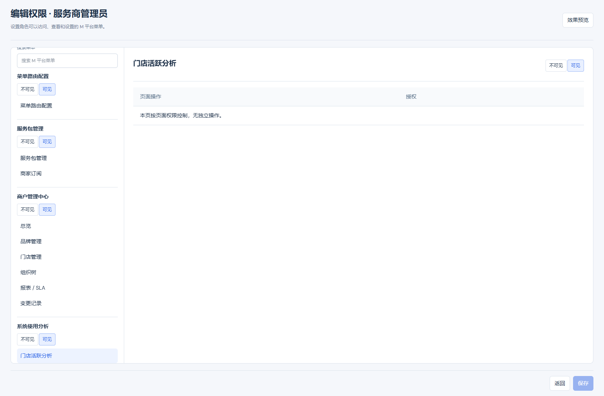

图注：2026-10-29，codex/usage-analysis-entry-20261029，main@f30e8451起始，5257实采；角色编辑中系统使用分析与商户管理中心分别设置模块门槛。

入口：权限管理中心 → 角色与功能权限 → 编辑权限。

| 字段／操作 | 逻辑说明 |
| --- | --- |
| 系统使用分析模块 | m:module:activity-analysis，可见／不可见；独立于m:module:merchants。导航、角色目录与实际资源树一致。 |
| 门店活跃分析 | m:page:merchant-activity，可见／不可见，无业务写操作；父资源为系统使用分析模块。 |
| 设备活跃分析 | m:page:device-activity，可见／不可见；与门店活跃分析分别授权，共用分析模块门槛。 |
| 详情中的使用情况 | 品牌或门店详情权限与门店活跃分析权限同时满足才可进入；单有商户管理编辑权不代表可读分析。 |
| 仅分析角色 | 可查看本人获准范围内的全局分析；无商户管理权限时不显示品牌/门店管理跳转，也不能直达管理详情的使用情况页。 |
| 多角色与停用 | 保留角色允许并集及祖先门槛；停用账号、缺页权和缺模块权均拒绝。浏览期间撤权后下次交互/重渲染不继续访问。 |
| 历史角色兼容 | 缺目录版本标记的旧记录，按角色复制原商户模块门槛到缺失的新分析模块门槛，不新增或修改任何分析页grant。已显式配置的新门槛（包括不可见）不覆盖。 |
| 新角色 | 默认不可见；不因商户管理可见而自动拥有分析权限。 |
| 旧路由 | /m-platform/merchants/activity与device-activity及原明细地址继续使用；地址保留不表示权限仍归商户中心。 |

### 目录兼容字段与验收算例

| 字段／操作 | 逻辑说明 |
| --- | --- |
| MState.catalogVersion | 可选字面量2或3；缺失表示旧目录。readMState返回目录3兼容副本，不因浏览直接写localStorage或递增revision。仅既有 m-system-admin 系统角色缺失的新访问角色页、管理动作和门店进入动作补齐；显式拒绝保留，普通角色默认不新增授权。授权保存写为3。 |
| 旧角色模块门槛 | 新分析模块键缺失时，原m:module:merchants为read则设read，否则hidden；已有新键保留。各角色分析页grant、员工roleIds、日志与revision不变。 |
| 分离后计算 | 分析页父键仅为m:module:activity-analysis；目录版本为2或3时再次读取不复制原商户门槛，防止撤权后重新授予。 |
| 跨角色算例 | A仅有旧商户模块read，B仅有分析页read，员工绑定A+B：旧有效分析可见；兼容后新模块read与页面read并集，仍可见。只绑定B仍不可见。 |
| 隐藏算例 | 旧模块hidden且有分析页read：兼容后仍不可见。主动隐藏新分析模块后保存/刷新也不可见。 |
| 不扩权算例 | 只有商户模块read而无任何分析页grant：复制模块门槛后分析页仍不可见；新创建角色的商户模块read不会自动转换。 |
| 范围算例 | brand=demo-a仅返回该品牌两个预设门店；试图下钻demo-b门店拒绝。store上下文仅允许本店，缺数据的M00000001不匹配demo-all。 |

### M 平台外壳返回入口（M-PERM-EXIT-20261022-05）

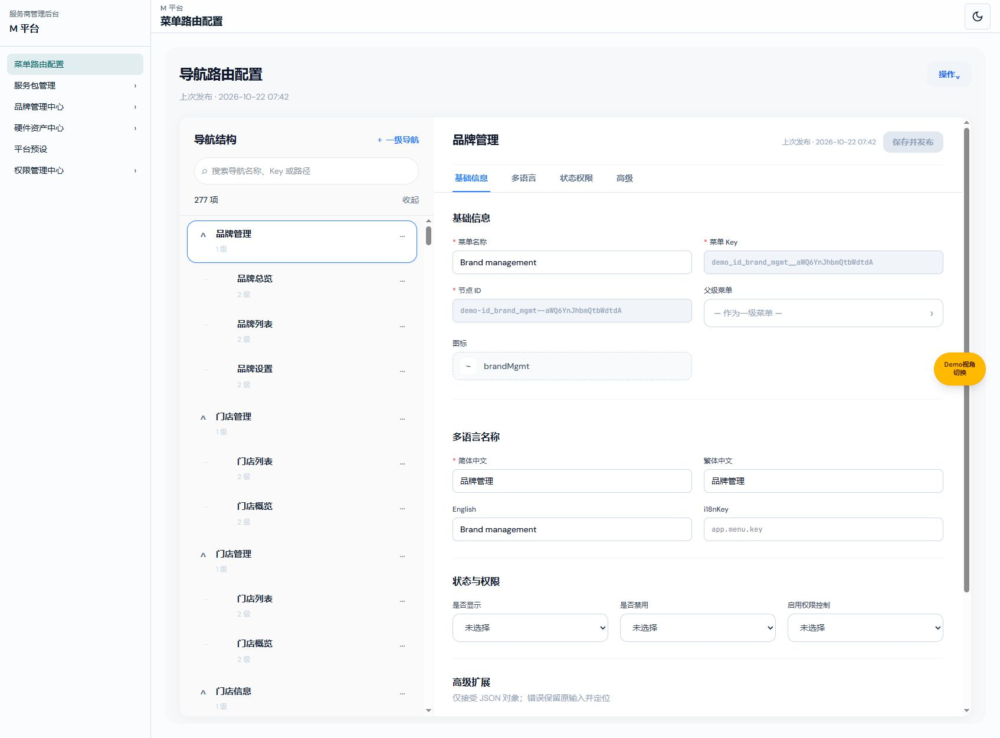

图注：2026-10-22，V1.4 功能分支，实际页面验证截图；此前截图中的右上角、左下角返回商家按钮为历史展示。

| 元素 | 规则与验收 |
| --- | --- |
| 右上角返回商家后台 | 从 M 平台公共页头移除，主题切换保留 |
| 左下角返回商家后台 | 从侧栏移除整个按钮及底部容器，不留空白边框 |
| 子菜单返回箭头 | 保持返回上一级菜单，父菜单名与箭头同行 |
| 权限与数据 | 本次不改变授权、角色、数据加载或业务路由；无权页原有返回链接沿用 |

验证：实际页面两处按钮均不存在；主题切换和侧栏导航仍可操作。TypeScript 与公共递归导航回归通过。本次 V1.3/V1.4 修改按用户授权提交、合并 main 并推送；实际提交号和远端核验结果以 Git 交付记录为准。

## 1. 数据对象与来源

| 字段 | 类型与约束 |
|---|---|
| schema | 固定整数 1；不支持格式不静默覆盖 |
| revision | 非负整数；初始化为 0；每次成功保存加 1，保存前与当前持久化值比较 |
| roles[].id | 稳定字符串，唯一，不随名称改变；新角色使用 UUID |
| roles[].name | 字符串；去首尾空格；1–30 字；忽略大小写判重 |
| roles[].description | 字符串；0–160 字；空串合法 |
| roles[].system | 可选布尔；初始系统角色为 true；不可删除或移除该标记 |
| roles[].grants | 资源键到 hidden/read/edit 的稀疏映射；未配置为 hidden；未知旧键保留但永不生效 |
| employees[].id | 企业账号的 employeeId；与商家员工命名空间隔离 |
| employees[].roleIds | 去重角色 ID 数组；默认空；保存拒绝失效角色；无个人例外字段 |
| logs[] | 新记录置顶；id、at、actor、action、object、before、after；时间为 ISO 字符串，页面按浏览器本地时区显示 |
| 企业账号 | 复用 enterprise-staff-account-store；employeeId、employeeName、loginEmail、enabled 及既有凭据规则；账号审计排除 password |

主存储键为 menusifu:m-platform-permissions:v1，企业账号沿用 menusifu:enterprise-staff-login-accounts:v1。前者不读取旧 menusifu:enterprise-rbac-v1 的商家资源授权。初次读取生成初始系统管理员草稿但不写权限存储，第一次成功修改才持久化。初始系统角色绑定既有演示 ent001；其他账号无自动授予。新增员工账号不自动分配角色。

### 默认演示账号身份解析（M-PERM-DEFAULT-20261022-02）

currentMAccount：先按已认证邮箱查询企业账号；精确命中既有账号时优先使用该账号。无命中且邮箱归一化后等于 DEMO_LOGIN_ACCOUNT（demo.menusifu.cn）时，使用现有企业账号列表中 employeeId=ent001 的初始管理员；其他账号返回空。仍由 mResolve 计算其持久化角色并校验 enabled，不直接返回全允许，不创建新角色、员工绑定或业务数据。

故障根因：前版默认账号缺少企业身份，导致 currentMAccess 全部 hidden；并非业务数据被删除。浏览器先执行新增默认账号测试得到 RED，再实施该单点修改得到 GREEN。

8 项新增回归：默认身份、品牌页、角色页、未知资源、未授权真实员工、未知账号、初始管理员停用、权限存储不被改写。当前用户内置浏览器实际点击默认登录，进入 M 平台并打开品牌列表，确认既有品牌数据可见。未改变登录校验、真实员工角色、商家权限或业务数据范围。Build skipped：本次仅身份解析修复，不触及入口、依赖、构建或资源边界；TypeScript 和浏览器 E2E 通过，CI 未验证。

## 2. 资源与计算

资源目录：src/permissions/m-platform-catalog.ts。键分别为 m:module:<模块ID>、m:page:<页面ID>、m:action:<页面ID>:<动作ID>；角色编辑和侧栏共用 M_MODULES，路由由 mPageForPath 归属。服务包和商家订阅先于权限中心通配路径解析；品牌、门店详情归属各自业务页面；使用情况还受门店活跃分析权限校验，集团旧地址归品牌目的页。

1. 确认企业账号存在且 enabled=true，员工绑定存在。
2. 对每一资源，合并员工 roleIds 中仍有效角色的原始权限，取 hidden=0、read=1、edit=2 的最大值。
3. 对有效上级递归计算；上级 hidden 时当前 hidden，但不改写下级存储。
4. 修改型 action 还要求有效页面为 edit；输出型 action 要求页面可见且该 action=edit。
5. 未知资源、无账号、停用账号、无绑定或循环引用均返回 hidden。

目录仅 hidden/read；可设置页面 hidden/read/edit；纯查看页面 hidden/read；action hidden/edit。校验拒绝目录 edit、只读页面 edit、action read。页面一般编辑与独立 action 分开校验。

### 可复算测试例

| 输入 | 预期 |
|---|---|
| A：预设目录 read，页面 read；员工仅绑定 A | 预设页面只读，发布禁止 |
| B：页面 edit、发布 edit；员工绑定 A+B | 目录由 A 放行，页面编辑与发布由 B 放行，最终允许发布 |
| A+B，但所有角色的目录均 hidden | 页面及发布 hidden，下级存储保留 |
| A+B，但页面最终 read | 发布型动作 hidden，即使动作原值 edit |
| 设备目录 read、设备页 read、导出 edit | 允许导出；无任何设备编辑能力 |
| 新员工 roleIds=[] | 全部 M 平台页面 hidden |
| 账号停用，原角色不变 | 全部 hidden；重新启用后按当前角色计算 |
| 未知资源或商家 page:/team/payroll-report | hidden |

## 3. 保存、事务与异常

- saveMState：重新读取当前账号和动作权限；校验 revision、对象结构、名称唯一、失效绑定、系统角色和最后管理员。角色授权增改及新角色绑定不得超过操作者有效权限上限。成功一次 setItem 写入新 revision 和审计；失败抛错，UI 保留输入，不提前修改已保存状态。
- 最后管理员定义：账号启用，角色页和员工页均 edit，编辑角色动作及分配角色动作均允许。保护范围为最后管理员的停用和关键授权移除，不要求每个角色均为管理员。
- 企业账号存储开启 strictPersistence 和 refreshOnRead；写入成功后才更新缓存，查询从存储刷新。商家账号存储沿用原有选项默认值，不启用该行为变更。
- 账号修改先保存脱敏审计，再更新账号；账号写失败时恢复本事务权限快照及 revision。新增失败不向账号缓存追加对象。多键 localStorage 不具备跨进程事务保证，生产端需提供事务；本原型不宣称解决两个标签页同时写账号的数据库级原子性。
- 修改自身登录邮箱成功后更新当前会话邮箱；密码输入留空不写 password。账号停用不删除角色绑定。
- 配置本地数据损坏时显示不可读取或按无权处理，不重建覆盖已存权限。新目录节点未登记授权时默认拒绝。
- 搜索、选择菜单、预览和初始化不标记 dirty；权限值相对已保存值存在语义差异才 dirty。取消权限确认保留草稿；恢复全部原值清除 dirty。关闭页面 beforeunload 和 hash 离开由浏览器确认保护真实草稿。

## 4. 前端执行控制点

### 菜单主层重复文案删除（M-PERM-LABEL-20261022-04）

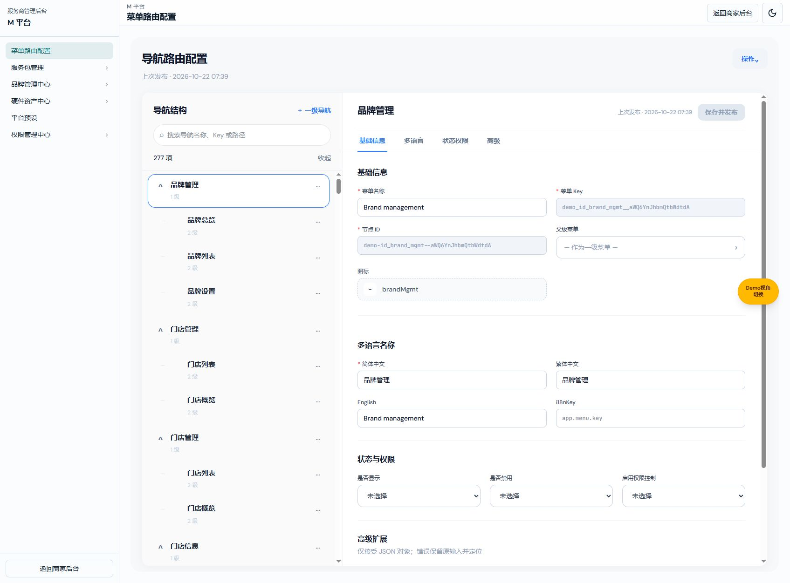
图注：2026-10-22，功能分支 V1.3，主层菜单。

仅删除 m-platform-runtime.ts 的 data-m-nav-root 内 h2“ M 平台”节点；不修改品牌区标题、导航容器 accessible name、数据目录或事件处理。不留空白占位，第一子元素即菜单路由配置。无需数据迁移。浏览器确认主层标题数为 0、首项为菜单路由配置、保留 6 个入口，品牌标题仍为 M 平台；进入权限子层和返回验证通过。本次不新增镜像字符串测试，执行 TypeScript 与现有公共导航回归。

### M 平台子层头部（M-PERM-NAV-20261022-03）

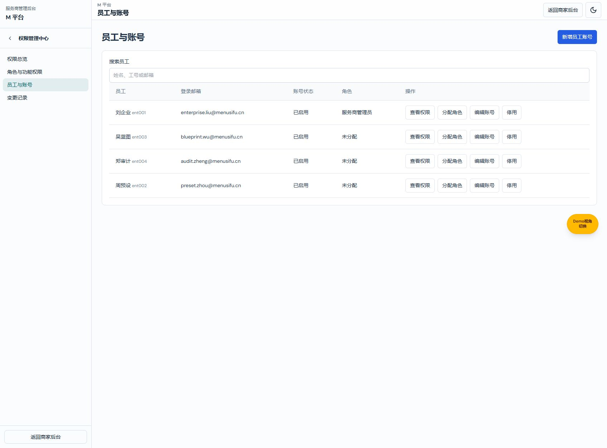
图注：2026-10-22，V1.2 功能分支，权限子层与员工页面。

m-platform-runtime.ts 在各 data-m-nav-layer 顶部渲染同一行 header：保留 data-m-nav-back、data-navigation-sheet-back 和 aria-label=返回上一级菜单，按钮内部仅含 aria-hidden SVG，无可见文本；紧随其后的 h2 显示经过转义的 module.title。沿用商家后台 h-14、size-10、18px SVG、text-sm/font-semibold 及对应边线、悬停和 focus 样式。

m-platform.css 仅将子层容器 padding 设为 0、overflow 设为 hidden，菜单列表在独立滚动区使用 px-2/py-3；主层样式与父子事件处理不变。浏览器实测 header 56px、button 40×40px、icon 18px、title 14px/600；箭头可见文本为空，标题与按钮中心线一致。真实点击返回及重入、当前叶子高亮已验证。本次不新增镜像样式测试；执行 TypeScript 和公共导航回归。

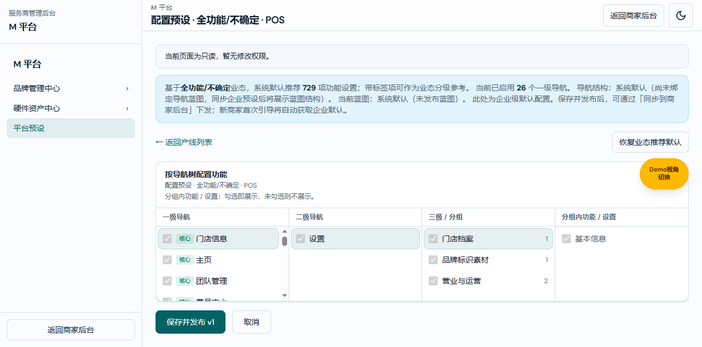
图注：2026-10-22 功能分支，受限员工查看 POS 预设，复选框与发布禁用。

navigation-submenu-actions.ts 为商家后台与 M 平台共用父子菜单点击、返回、叶子保持处理；商家原递归堆栈与渲染保持不变。m-platform-runtime.ts：侧栏过滤、路由 mCanVisit、捕获阶段 click/submit/change/input/keydown/dragstart/drop 拦截以及动态 DOM 控件禁用。只读白名单仅允许导航、搜索、筛选、关闭及浏览；嵌套 data-pp-enable 和 data-rbac-l4-editable 优先按修改处理，不能从父级导航按钮继承放行。配置预设的 /edit 地址可只读查看；新增/创建和业务编辑地址要求编辑权限。独立动作使用真实 data-* 选择器登记。对未授权路由不挂载原业务处理器。

src/auth/login.ts：企业账号在品牌和演示回退前校验，停用及密码错误直接拒绝。src/main.ts：企业账号成功登录转至首个可访问 M 页面；M 页面不进入商家首次业态向导，其他商家进入流程保留。src/shell/m-platform-shell.ts：接入四入口及独立全屏详情。

边界：这些是原型前端执行点，不是后端权限校验。业务 API、手动调用业务 store、多服务商租户隔离、逐商户数据范围仍需相应生产实现。

## 5. 验证证据

- scripts/verify-m-platform-permissions.ts：多角色合并、父级门禁、默认拒绝、页面只读、独立导出、授权上限、角色判重、失效绑定和路由归属。
- scripts/verify-m-platform-persistence.browser.ts：真实浏览器内执行 11 项检查：过期 revision、最后管理员移除、最后管理员停用、权限存储失败、原值保留、账号写失败、审计回滚、缓存不污染、工号判重、跨窗口停用及停用账号登录拒绝。脚本 finally 恢复任务浏览器的测试前数据。
- 公共导航浏览器检查：父项打开、递归进入、返回一层、叶子保持并阻止外层关闭、返回父层共 5 项通过。
- 人工浏览器流程：创建“客服只读”角色；设置品牌/设备/预设为只读；保存并绑定 ent004；员工预览仅 3 页；受限员工直接访问角色页被拒绝；预设控件和发布禁用，设备导出未授权时禁用。
- TypeScript：tsc --noEmit。商家仅角色授权回归和公共导航回归通过。verify-permission-center.ts 的“Operation page cannot be selected: /team/shift-scheduling”断言失败；在 main@48c9c24b 的独立干净源码快照复现同一失败（第 37 行），属于基线问题，本次未修改商家权限目录，不宣称该脚本全通过。未运行 CI/部署。

## 6. 版本记录

V1.3，M-PERM-LABEL-20261022-04：仅移除菜单主层重复平台标题；配对产品/个人 V1.3。

V1.2，M-PERM-NAV-20261022-03：导航头部同排，样式及尺寸对齐商家后台；配对产品/个人 V1.2。

V1.1，M-PERM-DEFAULT-20261022-02：默认演示账号复用现有初始管理员身份，补默认访问与隔离回归；配对产品/个人 V1.1。

V1.0，M-PERM-20261022-01：与产品/个人 V1.0 同步建立。无金额计算、舍入或业务订单状态变更；相关规则不适用。

本轮独立分析模块的验证及未闭合项见[USAGE-ENTRY-20261029-62](../verification/usage-analysis-entry-20261029/README.md)。
