# M 平台内部权限产品权威需求文档

版本：V1.16；日期：2026-11-03；变更编号：ROLE-LIST-20261103-01。
共同基线：两类角色列表统一及既有工作台／公共页头；起始 main@2f7f6506。
配套：[产品权威 V1.16](M平台内部权限产品权威需求文档.md) · [研发交付 V1.16](M平台内部权限业务规格说明书（研发交付版）.md) · [个人规范 V1.16](M平台内部权限需求文档（个人规范版）.md)。
状态：按本次确认实现的本地原型；生产服务端鉴权、真实账号服务尚未接入。三份采用同一业务定义。

本文件负责产品范围、已确认规则与验收依据；商家后台权限中心文档继续负责商家权限，不由本文件覆盖。

测试资料（非产品权限规则）：[Demo 数据与验证记录](../验证记录/权限管理中心Demo数据与验证记录.md)。演示样例清单及操作实测状态以此记录为准。

## 两类角色列表

范围为M平台权限中心的M平台角色与商家后台访问角色列表；商家自身权限中心及两类授权模型保持各自职责。

两页使用同一表头“角色名称｜描述｜关联员工｜操作”和“新建角色”入口。描述为空显示“—”，系统角色保留标识。行内操作固定为“配置权限 → 编辑角色 → 复制 → 查看变更记录 → 删除”，实际显示与禁用沿用各类原权限条件、系统角色保护和关联删除拦截；审计操作标识与历史不重写。

关联员工按本类角色匹配的员工标识去重，显示“N 人”，0 人也能点击。商户角色按员工计算，不按品牌／门店绑定条数累计；系统管理员兼容访问不自动计为角色绑定，停用账号的配置关联仍保留。

人数打开只读名单，显示角色名称、人数、员工姓名与工号；目录缺失时保留工号、姓名显示“—”。空态为“暂无关联员工”。仅提供关闭，支持Esc，关闭后焦点回到原人数按钮；无保存或授权入口，不修改草稿、角色、绑定或审计历史。

两页复用相同卡片、20px内边距、20%／32%／8%／40%列宽、至少68px行高和8px按钮间距。窄屏通过卡片内横向滚动保持顺序。

验收：两页表头、名称、顺序和卡片一致；人数与名单一致且不重复；非空与0 人均可查看和关闭；原权限及系统角色限制仍有效。验证资料见[角色列表统一验证记录](../验证记录/角色列表统一验证记录.md)。

## 独立页面页头

角色权限编辑、商户访问角色配置及员工工作台遵守[公共页头规则](独立页面头部布局产品权威需求文档.md)：主返回在标题左，页面级保存/预览在右；底部只保留状态。员工工作台维度保存随当前配置维度显示在页头右侧，两个维度仍分别保存；添加授权保持在内容区域；权限和草稿保护不变。

## 员工权限工作台（EMPLOYEE-WORKBENCH-20261103-01）

共同基线：本地 main@750b4cb3，功能分支 codex/employee-access-tabs-20261103，外部 Chrome 功能预览 5318。用户已授权提交并合并本地 main，未授权推送；实际提交和合并结果以 Git 核验为准。本节替代 V1.13 上下双区及独立预览跳转的交互定义；两类角色、范围、保存校验和演示数据不迁移。

截图来源统一为 2026-11-03 当前功能分支、外部 Chrome、5318 端口的隔离本地演示数据。临时角色和范围修改用于验收，已恢复原配置，保留本地测试日志，不代表真实商户授权历史。

### 逐操作覆盖清单

| 页面 / 操作 | 入口 → 界面 / 结果截图 | 当前结果 |
| --- | --- | --- |
| 员工工作台入口 | returned-list → config-m / legacy-merchant | 身份、状态、两组页签定位正确 |
| 切换角色配置 / 生效权限 | both-drafts → merchant-saved-snapshot / m-saved-snapshot → m-draft-retained / merchant-draft-retained | 两类草稿保留，预览只取保存快照 |
| 切换 M / 商户维度 | cross-dimension-draft / both-drafts / effective-m / effective-merchant | 四种组合，保留当前工作方式 |
| 键盘右箭头切换维度 | M 草稿 → remove-draft | 已实测；Home / End / 左箭头未单独截图 |
| M 角色勾选及取消 | config-m → m-draft-retained；returned-list 显示恢复结果 | 已选数量、未保存标记正确 |
| M 角色保存确认 | m-draft-retained → m-save-confirm → m-saved-refreshed | 只更新 M；商户草稿仍在 |
| 商户添加授权 | config-merchant → add-binding → required-binding | 标题右侧入口，空角色/范围不能加入草稿 |
| 商户编辑授权 | config-merchant → edit-binding → both-drafts | 原角色、两门店回填；加入待保存配置后才成为草稿 |
| 商户移除 | config-merchant → remove-draft | 只移除草稿，保存快照仍可预览 |
| 商户保存确认 | merchant-draft-retained → merchant-save-confirm → merchant-saved-refreshed | 保存后再次切入预览取新角色 |
| 系统管理员商户区 | config-m → system-merchant | 只读说明，不显示添加/保存按钮 |
| 点击菜单 | effective-m → menu-detail | 详情随所选菜单更新 |
| 搜索菜单 | effective-m → menu-search / menu-search-empty | 定位菜单与无匹配空态；清空恢复列表 |
| 显示全部权限 | m-saved-snapshot → all-permissions | 含不可见菜单和禁止操作 |
| 展开 / 收起操作组 | effective-m → action-groups / all-permissions | 允许默认展开，禁止默认收起，状态可切换 |
| 切换商户目标 | merchant-saved-snapshot → target-switch | 仅所授权两店，目标角色与菜单上限联动 |
| 返回列表 / 继续编辑 | remove-draft → leave-confirm → leave-cancel | 单一双维提示，取消留页保留草稿 |
| 返回列表 / 放弃并离开 | leave-confirm → returned-list | 一次确认后离开，已保存授权未变 |
| 旧链接 | merchant-access → legacy-merchant；旧 staff/:id → final-workbench | 商户配置 / M 生效的默认定位正确 |

本次没有全量重跑历史模块的每项异常操作；缺少本版本的多角色（超过 5 个）搜索截图、受限员工真实登录、停用画面、保存取消/并发/写入失败和原生刷新关闭确认截图，保留原规则并登记为截图缺口，不声明全部操作或异常截图完整。

### 工作台身份与双层页签

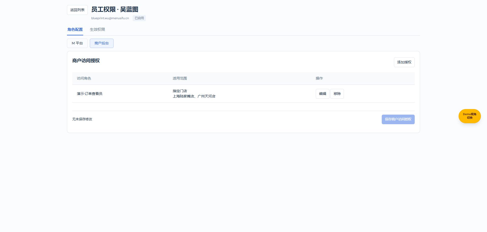

| 元素 | 逻辑说明 |
| --- | --- |
| 返回列表 | 位于标题左；真正离开当前员工时检查全部维度草稿，不因为当前面板没有修改就忽略隐藏维度 |
| 标题 / 邮箱 / 启停 | 标题为员工权限及姓名；账号目录提供邮箱、enabled。不存在提示员工不存在；停用角色配置保留，但生效权限不可访问 |
| 工作方式 | 角色配置、生效权限。仅切换当前内容，不提交、不丢草稿、不弹离开提示；维持当前 M / 商户维度 |
| 权限维度 | M 平台、商户后台。独立保存；有草稿的维度标注未保存，切换后标记仍保留；支持左右箭头及 Home / End 焦点和选择 |
| 生效提示 | 任一维草稿存在且正在看生效权限时显示“存在未保存的修改，当前仅展示已保存的生效权限。”；没有草稿或返回配置时不展示 |
| 内容与滚动 | 一次只展示当前组合；生效页左树和右详情各自滚动，避免把所有菜单/操作纵向平铺到页面底部 |

### M 平台角色配置与独立保存

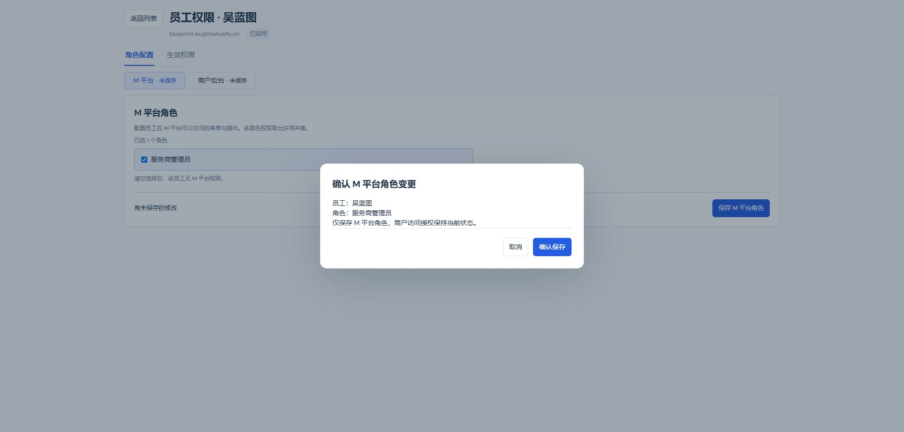
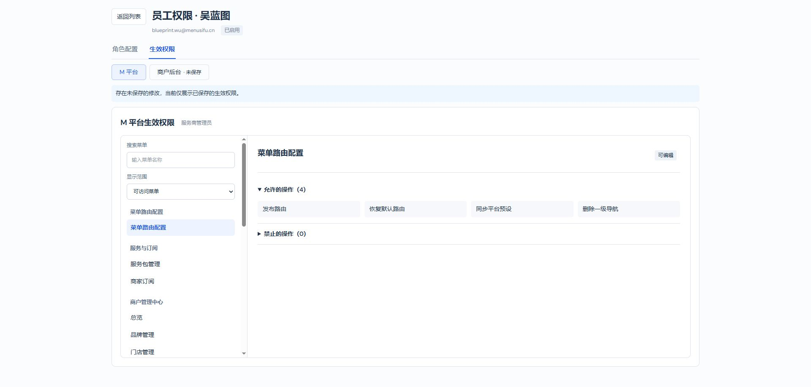

| 字段 / 操作 | 逻辑说明 |
| --- | --- |
| 角色多选 | 回填已保存 M roleIds，默认 []；已选数为当前草稿 ID 数。清空后该员工无 M 平台权限，不删除商户绑定 |
| 搜索角色 | 角色数超过 5 个才展示，按名称匹配；筛选不清除未显示的已选角色。无匹配显示没有匹配角色。本版本没有构造超过 5 个角色的浏览器截图 |
| 保存与状态 | 每维一个保存按钮；无变更显示无未保存修改并禁用。无 staff/assign 时只读、不显示可保存按钮。确认弹框沿用员工、待保存角色及保存范围说明 |
| 成功 | saveMState 仍校验当前操作者、revision、授权上限及最后管理员；仅更新 M 保存快照、revision、日志、脏状态。切回生效页读取新保存结果 |
| 取消 / 失败 | 原取消、并发冲突、最后管理员、持久化错误规则保留，草稿不丢、不把失败标成已保存；其弹框本版本截图待补，不将上一版截图冒充本版 |

### 商户角色、品牌 / 门店范围与独立保存

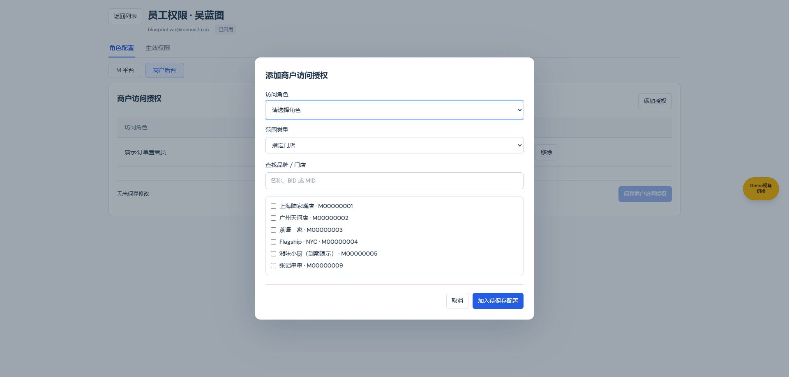
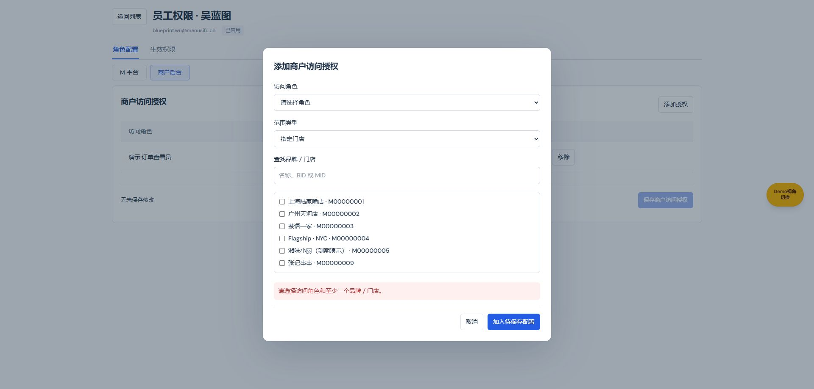
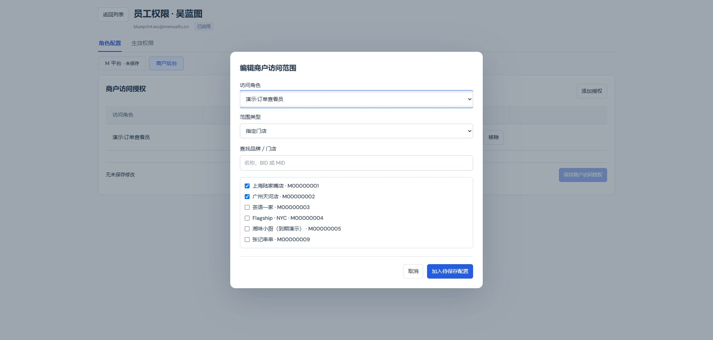
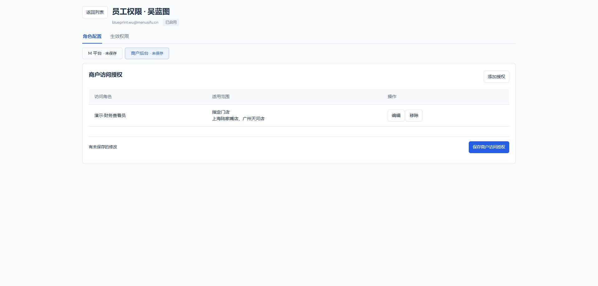

添加授权位于区域标题右。继续要求一个有效访问角色和至少一个当前操作者可授权的品牌/门店；空选提示请选择访问角色和至少一个品牌／门店。编辑保持原绑定 ID、scope.mode、scope.ids 的回填；加入待保存配置不直接生效。范围搜索、切换清空确认和取消弹框沿用原规则。

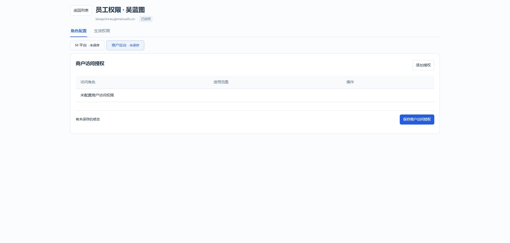
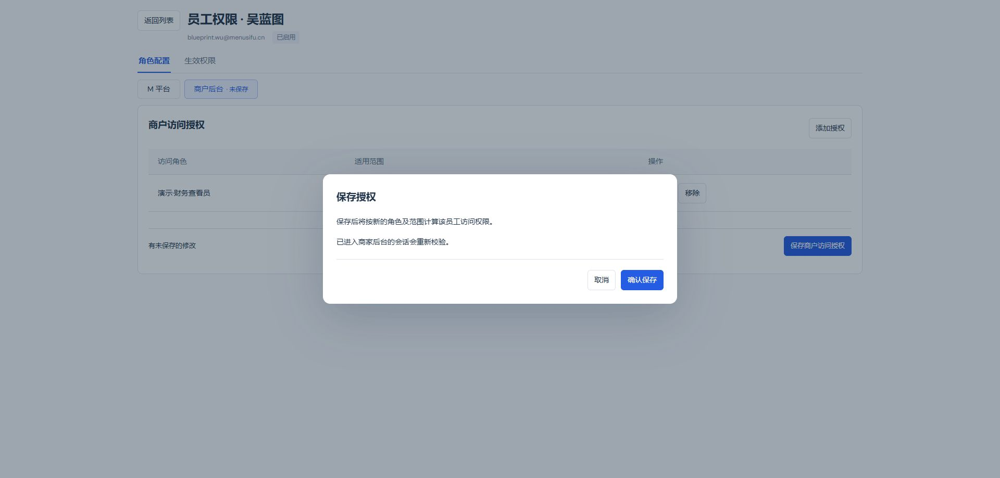

移除仍只修改本维草稿；在保存前，生效页继续取原绑定。保存沿用 saveProviderState 的 manage 动作、revision、目标和菜单上限、系统兼容 ID 及有效角色校验，原会话重校验与日志写入不变。只影响商户源，不能清除 M 草稿。已保存后再次切入生效页显示新角色；失败/取消保留草稿，当前版本异常截图待补。

系统兼容员工显示全部品牌/门店、按商户菜单上限访问；不显示添加或保存商户授权按钮。普通只读用户也不显示可保存按钮；没有 provider-roles 查看权限不读取/挂载商户明细，只显示无查看权限说明。不因选择 M 管理员角色自动获得系统兼容商户身份。

### 生效权限：保存快照与草稿隔离

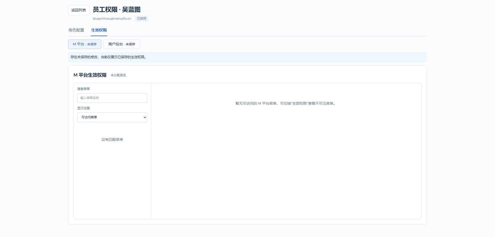

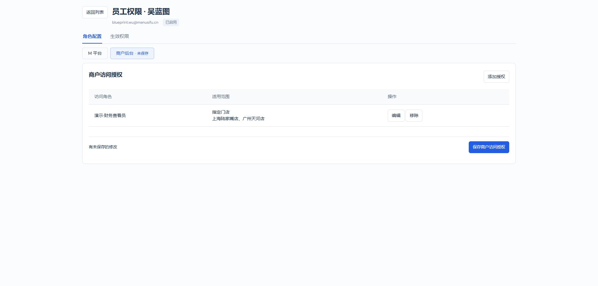

角色配置的两个 DOM 和草稿在页签间保留；生效页不接收配置草稿。每次从角色配置切入生效权限，重新取已保存快照；同一轮生效页内换维度不重建已挂载预览，不丢其搜索/选择。生效页读取新版本不能覆盖配置区的并发基线，返回配置后仍按原 revision 保存，冲突时仍拒绝覆盖。

### M 生效权限：菜单树、搜索与详情

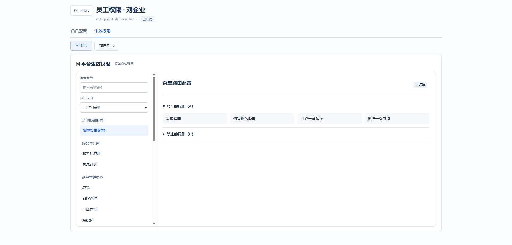
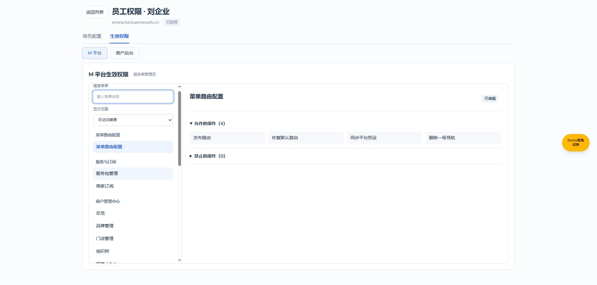

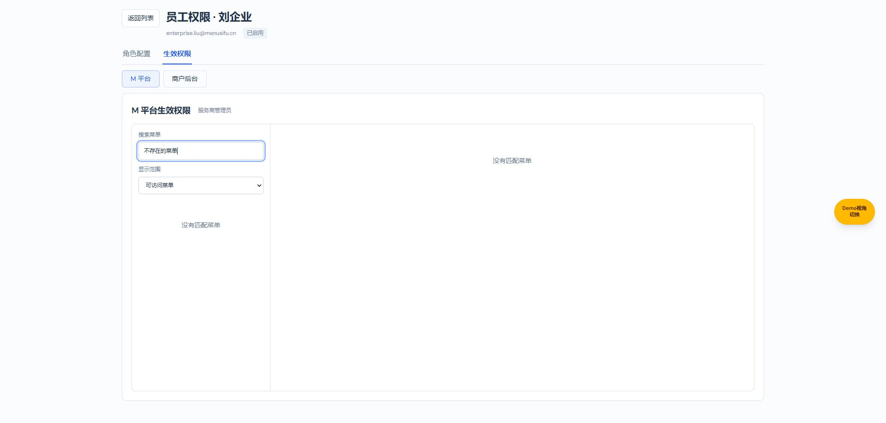
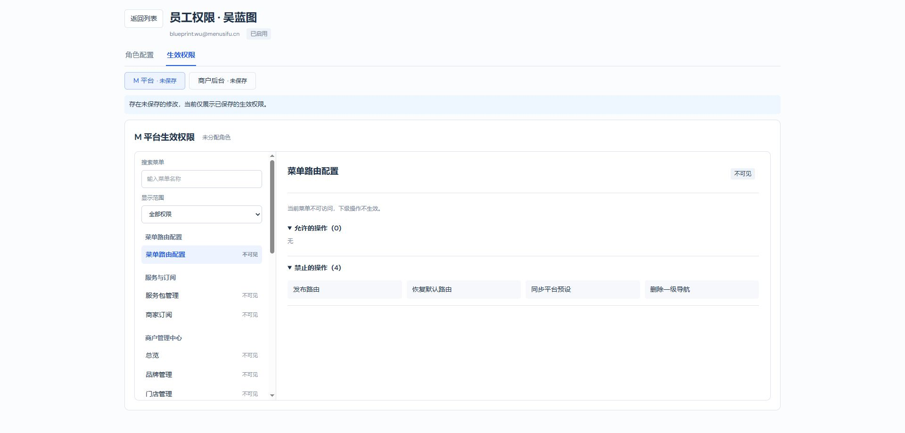
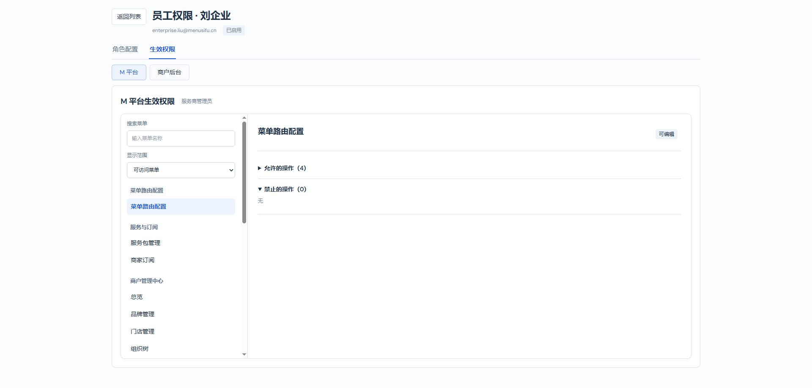

| 元素 | 逻辑说明 |
| --- | --- |
| 角色摘要 | 仅取已保存员工 M 角色名称；没有显示未分配角色，不读取勾选草稿 |
| 搜索菜单 | 按模块名、菜单名匹配，不改变授权；没有匹配显示空态，清空恢复当前显示范围的菜单 |
| 显示范围 | 默认可访问菜单，即 mResolve 页面结果非 hidden；全部权限包含不可见菜单。切换不新增授权 |
| 菜单树 | 按 M 模块分组，点击叶子在右侧显示菜单，当前项高亮；过滤导致原选择消失时选择第一个匹配菜单 |
| 详情状态 | 用已保存角色并集、上级门槛与 enabled 计算可编辑/可查看/不可见。隐藏菜单说明下级操作不生效，无独立操作时给出说明 |
| 允许 / 禁止操作 | 每项按 mResolve(action) 是否 edit 分组，允许默认展开，禁止默认收起；显示组内数量，可展开/收起，空组显示无。仍允许页面只读但获独立输出动作（如导出）的既有规则 |

### 商户生效权限：范围和目标菜单上限

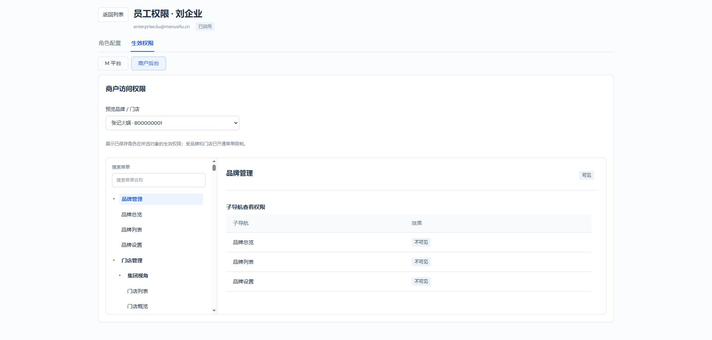

复用商户权限菜单树与详情。预览目标同时满足员工已保存范围和当前操作者可访问范围；展示当前目标匹配的已保存角色（去重），系统兼容身份显示系统管理员。切换目标重新计算角色并集与品牌 ceiling、门店 enabledKeys 映射资源集的交集。停用、无匹配范围、未开通菜单均不能产生可访问结果；截图中演示订单/财务角色受目标菜单上限限制为空态，不为演示开放权限。

### 真正离开员工：一次确认、保留保存结果

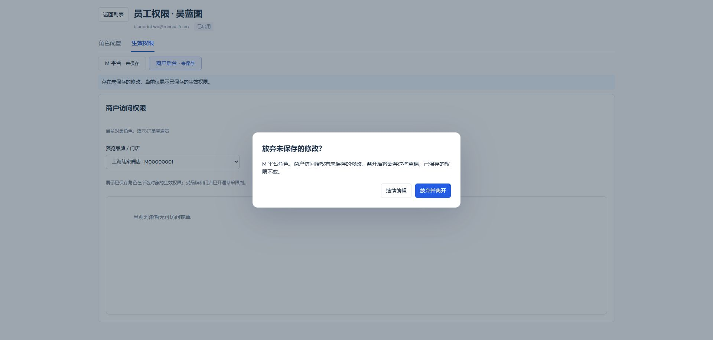

普通页签切换不提示。返回列表、进入其他员工或其他实际 hash 路由时，如存在任一维草稿，统一工作台弹框列出受影响维度。继续编辑留在原页签和地址、保留全部草稿；放弃并离开清除离开拦截后执行原目标导航，只丢未保存内容，不回退已保存的角色、范围或日志，也不再连弹第二个维度确认。刷新/关闭仍使用浏览器 beforeunload，当前原生层截图待补。

### 旧入口与当前地址

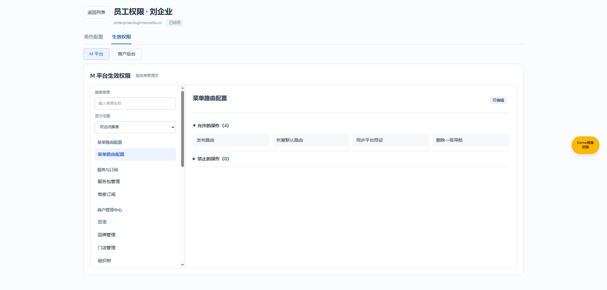

/roles 默认角色配置＋M；/roles/preview 与旧 /staff/:id 默认生效权限＋M；旧 /merchant-access 默认角色配置＋商户；surface=merchant 定位商户维度。内部页签通过 replaceState 更新同员工地址，不触发 hashchange 或重挂配置区；更新离开保护的返回地址。真实导航、刷新与关闭继续受草稿保护，旧链接原路由可见性检查不放宽。

### 当前验证状态与边界

类型检查与员工路由/摘要、M 菜单及动作分组（含只读页独立输出动作）、停用/未知员工、快照不可变测试通过；原演示数据保护、M 角色、商户访问 16 项及集中日志隔离回归通过。外部 Chrome 实测四种组合、键盘维度切换、两类草稿跨页签、生效只取保存数据、保存刷新、两维标记、系统只读无保存、树搜索/空态/全部过滤、操作折叠、目标切换、统一离开取消/放弃与旧入口。当前测试未覆盖项见清单；不把前端演示验证等同于生产服务端鉴权或部署验证。

## 历史布局：员工统一角色与权限配置（EMPLOYEE-ACCESS-CONFIG-20261103-01）

本节记录 V1.13 历史布局；当前页签、保存态预览和离开提示以 EMPLOYEE-WORKBENCH-20261103-01 为准。原角色与范围规则保留。既有两类角色、员工绑定、演示数据及授权校验继续有效，不迁移或合并存储。共同基线 main@a0ed2503，功能分支 codex/employee-role-config-20261103，外部 Chrome 功能验收端口 5317；用户已授权提交并合并本地 main，未授权推送；实际结果以 Git 交付核验为准。

图注统一：2026-11-03 当前功能分支，外部 Chrome 真实截图；独立端口的本地演示数据，不是真实商户授权操作。测试中的临时 M 角色和商户绑定已恢复，保留测试操作的本地审计记录。

### 本次逐操作覆盖清单

| 操作 | 入口 → 操作界面 → 结果 | 验证情况 |
| --- | --- | --- |
| 配置角色与权限 | staff → config / final-config | 两维同页、员工与原绑定回填 |
| 查看权限 / 权限预览 | config → preview / m-admin-preview | 已保存状态，只读，两维独立 |
| 切换预览对象 | preview → preview-target | 仅员工与当前操作者可访问目标，两家门店切换 |
| 勾选 / 取消 M 角色 | config → both-dirty | M 草稿独立，清空后无 M 权限 |
| 保存 M 角色，取消确认 | both-dirty → m-confirm → m-cancel | 不写入，保留两类草稿 |
| 保存 M 角色，确认 | m-confirm → m-saved-provider-dirty | 仅 M 维度已保存，商户草稿仍在 |
| 添加商户授权，必填校验 | brand → binding-add → binding-required | 空角色/范围不能加入草稿 |
| 编辑商户授权，取消 | config → binding-edit → binding-cancel | 回填角色与两门店，取消不修改绑定 |
| 编辑商户授权，加入草稿 | binding-edit → both-dirty | 待保存，不立即生效 |
| 移除商户绑定 | brand → binding-remove-draft | 仅草稿移除，保存前原授权继续生效 |
| 保存商户授权，取消确认 | both-dirty → provider-confirm → provider-cancel | 不写入，保留两类草稿 |
| 保存商户授权，确认 | provider-confirm → provider-saved-m-dirty | 仅商户维度已保存，M 草稿仍在 |
| M 保存失败：最后管理员 | m-confirm → last-admin-error | 拒绝保存，保留草稿 |
| M 保存失败：并发冲突 | m-confirm → concurrent-error → concurrent-draft | 拒绝覆盖，取消弹框后草稿仍在 |
| 商户草稿离开：取消 / 放弃 | binding-remove-draft → provider-leave → provider-stay / returned-list | 取消留页，放弃丢草稿并返回 |
| M 草稿离开：取消 | M 角色修改 → 系统确认框 | 已验证不跳转；原生层截图待补 |
| 返回列表 / 返回配置 | config → returned-list；preview → config | 页面与目标员工保持正确 |
| 旧商户授权链接 | 旧 merchant-access URL → legacy | 进入同一统一页面 |

覆盖边界：本次没有补齐旧模块全部操作截图。受限员工真实登录、账号停用画面、存储损坏/写入失败、商户保存并发失败、范围搜索与切换确认的异常截图待补；其既有规则保留。原生确认框无法用网页截图代替，未声称全部操作或全部异常截图完整。

### 员工列表：双维摘要与统一入口

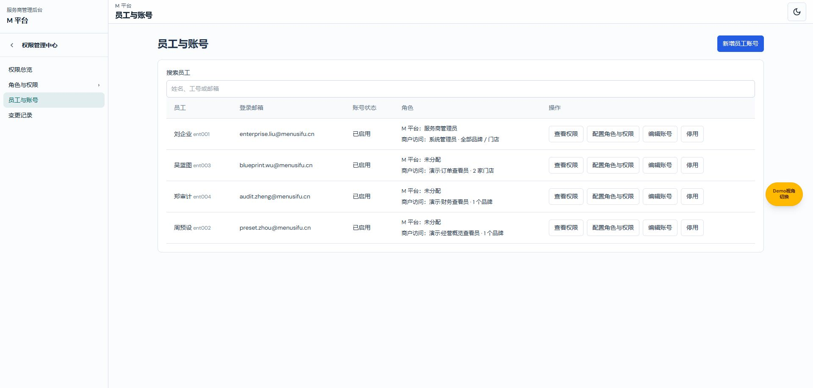

| 元素 | 逻辑说明 |
| --- | --- |
| 角色摘要 / M 平台 | 来源为 MState.employees.roleIds，通过角色 ID 映射名称；无角色显示未分配，失效引用显示失效角色；不根据商户授权推导 M 角色 |
| 角色摘要 / 商户访问 | 来源为该员工每条 ProviderBinding，逐条显示访问角色名和 scope.ids.length；brands 单位为个品牌，stores 为家门店，多条用分号连接，不将不同范围合成一个总数量 |
| 系统员工摘要 | systemEmployeeIds 中的员工显示“系统管理员 · 全部品牌／门店”，仍受商户菜单上限限制 |
| 空值与异常 | 无绑定显示未配置；无商户角色页权限显示无查看权限，不读取该明细；数据解析失败显示数据读取失败，保留独立 M 维度 |
| 配置角色与权限 | 替换旧分配角色按钮和独立商户访问授权链接；导航到 /m-platform/permissions/staff/:id/roles；员工页可见即可进入查看，各维写操作另校验 |
| 查看权限 | 旧 /staff/:id 继续可用，展示双维只读预览，不能编辑或将草稿当作已生效权限 |

### 配置页：M 平台角色与商户访问授权

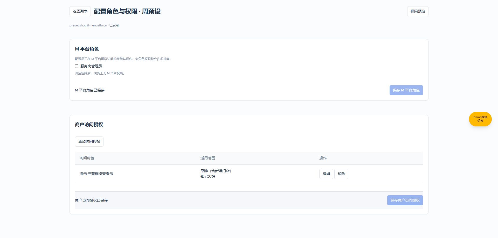

| 元素 / 字段 | 逻辑说明 |
| --- | --- |
| 返回列表 / 标题 / 权限预览 | 返回在页面标题左，权限预览在右；返回员工列表，预览带当前 employeeId。存在任一维草稿均先执行离开保护 |
| 员工信息 | 由既有员工账号目录按 ID 查询姓名、邮箱、enabled。不存在则提示员工不存在；停用显示全部权限不生效，不删除原角色与范围 |
| M 平台角色 | string[] 角色 ID，多选，默认已保存 roleIds 或 []；清空即无 M 角色。仅 staff/assign 可编辑。角色并集、上级菜单约束与最后管理员保护沿用 |
| 商户授权区域 | provider-roles 页不可见时仅显示无查看权限，不调用商户编辑器或读取该区域明细；可见但无 manage 动作时只读。系统兼容员工不显示可修改绑定 |
| 商户访问角色 | 每条绑定一个有效商户角色 roleId；配置入口不修改角色本身的菜单定义 |
| 品牌 / 门店范围 | 保持 scope.mode=brands 或 stores、非空且不重复的 scope.ids，角色与范围必须同时指定。品牌含新增门店，指定门店不自动包含新门店，也不能提升为品牌访问 |
| 两类保存与状态 | 每区独立按钮、独立已保存/未保存状态。无变更或无对应动作权限时禁用。成功仅更新本区快照、revision、日志并解除本区脏状态；另一维草稿保留 |

### M 平台角色：勾选、保存、取消与失败

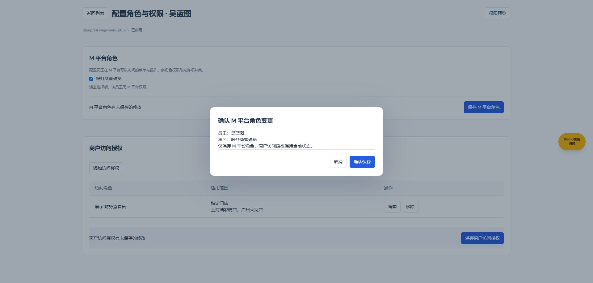

确认弹框列员工和待保存角色，空选择显示未分配。取消仅关闭弹框，不写存储；确认调用 saveMState，gate=staff/assign，沿用授权上限、有效账号、revision 与最后一名启用管理员检查。保存对象为员工 ID，日志动作沿用分配角色，不含账号凭据。成功无跨维事务，不保存商户草稿。

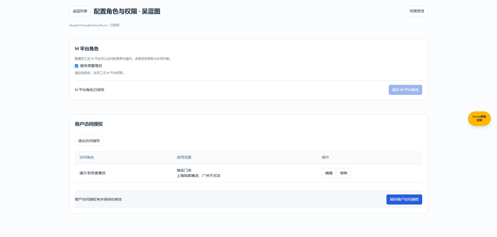
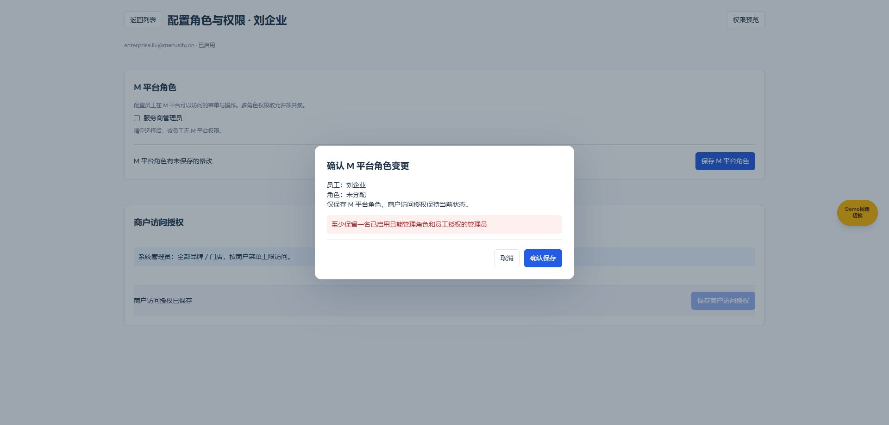
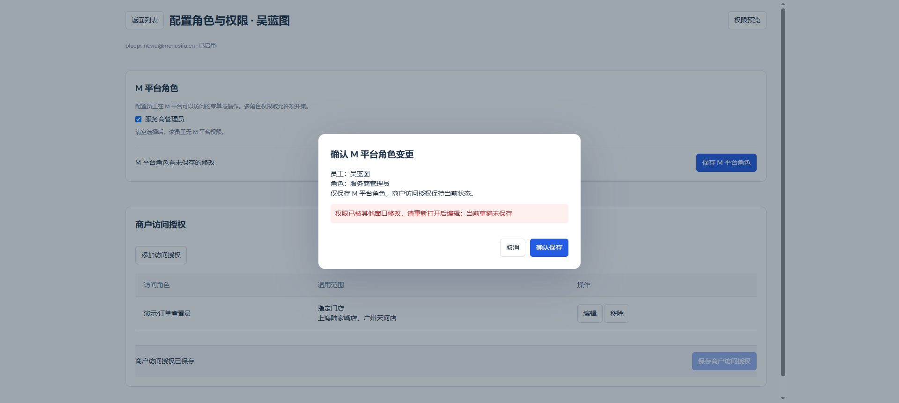
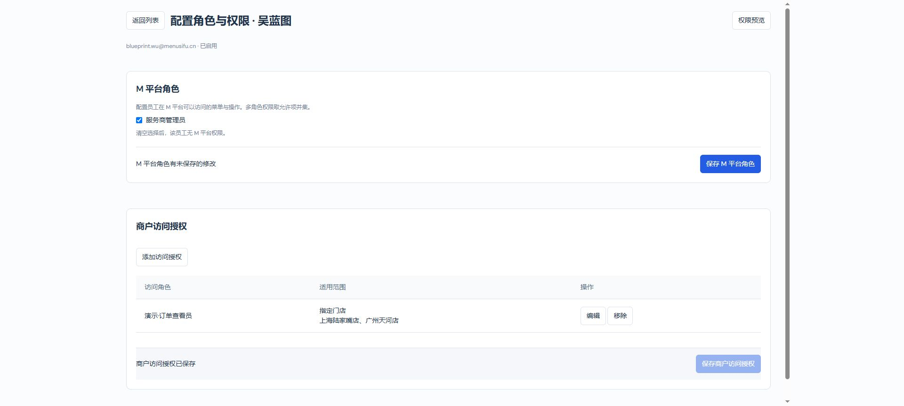

失败不关闭弹框，不更新本区保存状态、不写入成功日志，保留勾选。并发失败须重新打开获取新快照后复核，不自动覆盖其他窗口，不自动合并未确认配置。

### 商户授权：添加、编辑、取消与移除

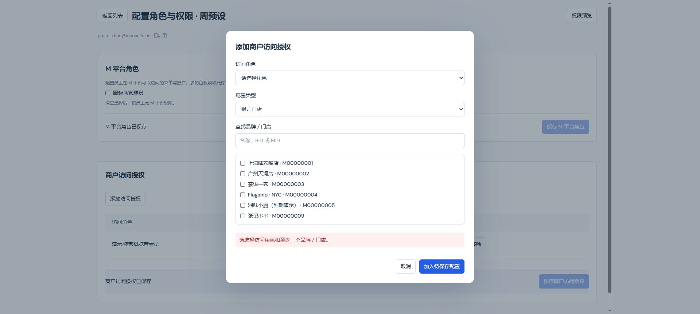

新增默认指定门店、未选择角色/对象；至少选择一个有效角色和一个当前操作者可授权品牌/门店。失败提示“请选择访问角色和至少一个品牌／门店。”，留在弹框，不增加绑定。范围搜索、切换时清空确认沿用原交互，无新增范围语义。

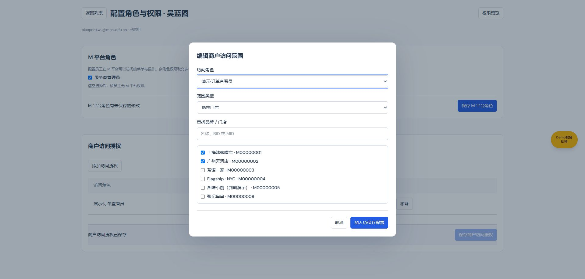
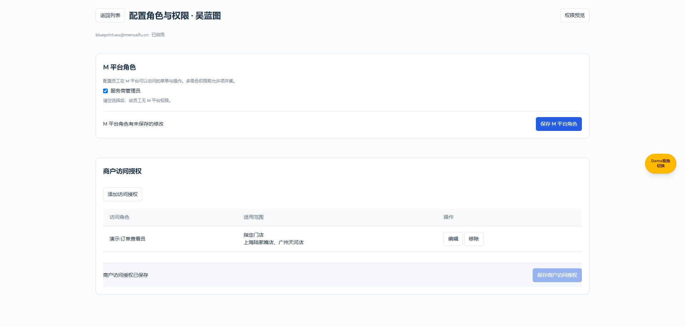

编辑复用原绑定 ID；加入待保存配置仅更新商户草稿。取消只关闭，不修改已有绑定，也不清空 M 草稿。

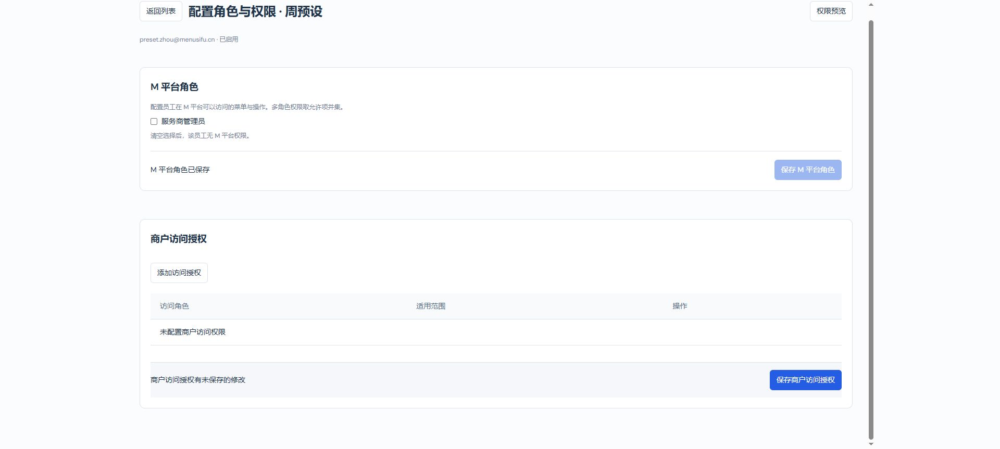

移除只影响本区草稿；提交前原保存绑定有效。要恢复可放弃本区草稿并重新进入，不在点击移除时直接写日志。

### 商户授权：保存确认、取消及独立结果

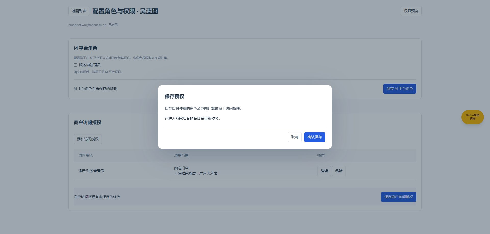
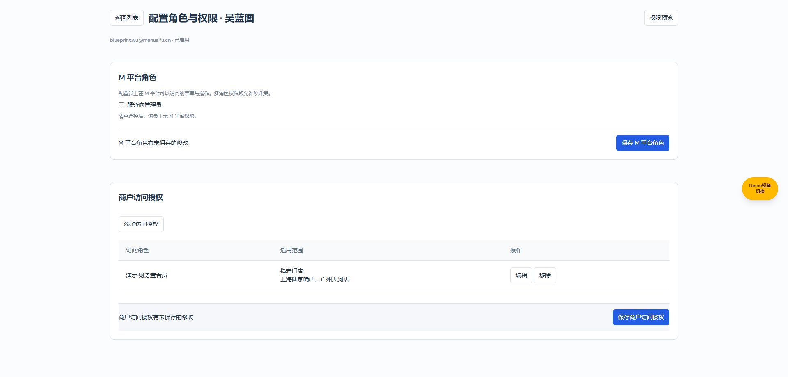

确认仍调用 saveProviderState，校验 provider-roles/manage、当前操作者、expected revision、有效角色和目标、可授权对象与菜单上限、系统兼容 ID 不变。成功更新商户源 revision 和日志，动作沿用更新商户访问范围，触发既有会话重校验。失败保留草稿并展示原错误，不修改 M 状态；写入失败与商户并发错误截图待补。正常保存后的两个状态见下图。

### 离开保护、返回及旧链接

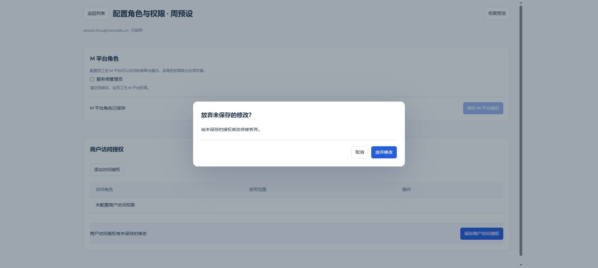
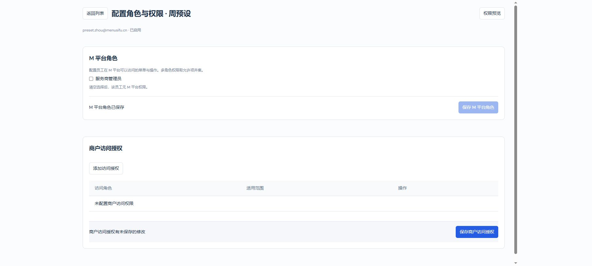
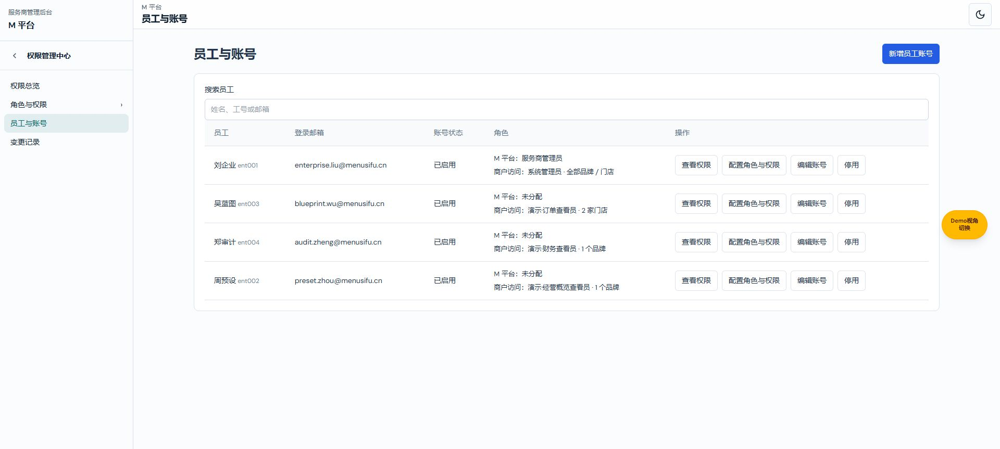

任一维未保存都阻止直接跳走。M 草稿使用既有浏览器原生确认，准确文案“M 平台角色有未保存的修改，确定放弃并离开？”；取消留页，确认继续检查另一维。商户草稿沿用自定义放弃弹框，取消留页；确认放弃后仅丢未保存内容并执行原目标导航。已保存内容与记录不回退；刷新/关闭页签仍有 beforeunload 保护。M 原生确认的真实截图待补。

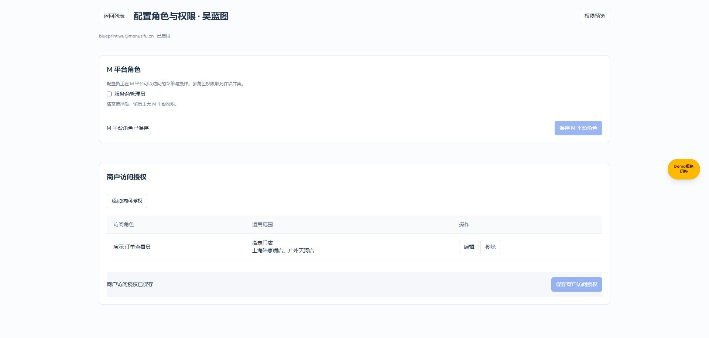

旧地址兼容到统一配置实现，不进行数据迁移；旧链接仍保留原路由权限检查。角色定义入口仍在角色与权限菜单，不并入员工账号编辑。

### 权限预览与切换目标

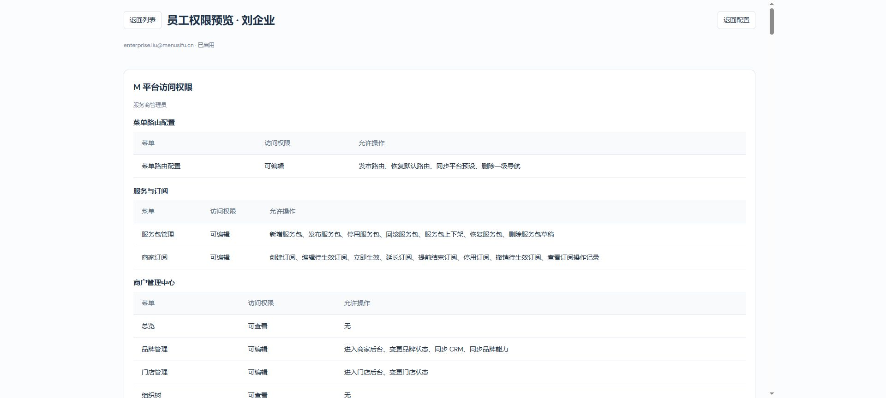

| 元素 / 计算 | 逻辑说明 |
| --- | --- |
| M 平台访问权限 | 仅取已保存 M 角色并集及账号 enabled，用 mResolve 计算菜单与动作；隐藏菜单不列出，无允许动作显示无，无菜单显示暂无可访问的 M 平台菜单 |
| 预览品牌／门店 | 对象必须同时匹配员工已保存绑定与当前操作者可访问范围；指定门店绑定不出现品牌层目标，不出现未授权门店；默认第一个有效目标，无目标显示暂无可预览范围 |
| 商户访问权限 | providerRoleAccess 的角色并集与所选品牌 ceiling、门店 enabledKeys 映射资源集求交；账号停用、范围不匹配或任一上限不含该资源均不可见。不把预览结果自动作为 M 入口或代登录动作授权 |
| 空态 | 角色有配置但目标菜单未开通时显示当前对象暂无可访问菜单；不为演示强行开放。截图中两店订单角色受实际菜单上限限制出现此状态 |
| 只读与保存源 | 预览没有保存按钮、不写日志；未保存修改须先保存或明确放弃才能离开配置页。两类配置各自成功后才进入各自已保存预览源 |
| 返回配置 | 回到同一员工的 /roles，不重置另一员工数据 |

### 实现与验证记录

复用 m-platform-store.ts 与 provider-access-store.ts，不改变存储键、schema、日志来源或系统兼容 ID。新 employee-access-ui.ts 组合两区及离开保护；provider-access-ui.ts 增加嵌入和员工只读预览；employee-access-domain.ts 负责路由解析、摘要与员工权限/上限交集。

类型检查、统一/旧路由、摘要、范围与双上限、停用预览测试通过；M 平台角色与动作回归、商户访问 16 项、预设演示数据保护、集中日志隔离回归通过。外部 Chrome 实测双向保存隔离、确认取消、最后管理员拒绝、双窗口并发拒绝且草稿保留、添加必填、编辑回填、移除草稿与放弃、旧链接、预览目标切换。未验证项见覆盖清单，不宣称生产服务鉴权或全部异常截图完成。

## 员工商户访问授权演示数据（PROVIDER-EMP-DEMO-20261103-01）

演示数据规则继续有效；本节独立授权页截图与入口属于历史，当前统一配置入口见 EMPLOYEE-ACCESS-CONFIG-20261103-01。

基线本地 main@8505040b；分支 codex/provider-employee-demo-20261103；外部 Chrome 功能验收端口 5316。用户已授权提交并合并本地 main；未授权推送，实际提交与合并结果以 Git 交付核验为准。本次在尚无保存授权数据的演示环境补充员工绑定，不覆盖已有角色、员工范围或日志，不修改员工的 M 平台内部角色。

### 逐操作覆盖清单

| 页面 / 操作 | 入口与结果图片 | 状态 |
| --- | --- | --- |
| 员工列表进入商户访问授权 | staff → ent002 / ent003 / ent004 | 三位员工各自页面已验证 |
| 编辑已有演示绑定 | ent003 → edit-binding | 角色、范围类型和两店选中状态已验证 |
| 取消编辑 | edit-binding → ent003 | 保留原绑定，未产生保存日志 |
| 刷新授权页 | ent003 → ent003-refresh | 内容保留，无真实草稿提示 |
| 查看角色关联人数 | role-members | 三个角色各 1 人 |
| 查看集中日志 | logs | 6 条演示记录 |
| 按订单角色查看日志 | role-members → role-logs | 角色预设与员工授权预设共 2 条 |

图注统一为 2026-11-03 当前功能分支外部 Chrome 真实截图。所有带“演示”的角色和记录为本地测试数据，不代表真实授权操作历史。本次未新增页面操作，其他保存、删除和异常交互沿用；未对历史全量操作截图作完整性结论。

### 员工与账号入口

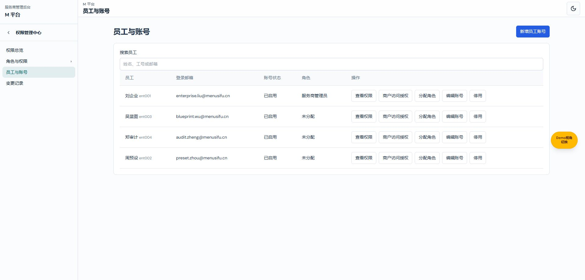

点击员工行“商户访问授权”查看其访问角色与品牌/门店范围。列表“角色”仍为 M 平台内部角色，不因本次商家访问绑定自动分配 M 平台角色、代登录动作或其他菜单权限。

### 周预设的品牌授权

| 字段 | 逻辑说明 |
| --- | --- |
| 员工 | 周预设，ent002 |
| 访问角色 | 演示·经营概览查看员，仅查看权限 |
| 适用范围 | 品牌（含新增门店）：默认演示目录的张记火锅 |
| 数据来源 | 仅匹配现有启用的系统演示账号 acct-ent002；不存在、被替换或停用时不生成该预设绑定 |

### 吴蓝图的指定门店授权

| 字段 | 逻辑说明 |
| --- | --- |
| 员工 | 吴蓝图，ent003 |
| 访问角色 | 演示·订单查看员 |
| 适用范围 | 指定门店：上海陆家嘴店 M00000001、广州天河店 M00000002 |
| 范围边界 | 仅所选门店；不自动包含新门店，不提供品牌层访问；仍受目标菜单上限和既有入口权限约束 |

### 郑审计的另一品牌授权

| 字段 | 逻辑说明 |
| --- | --- |
| 员工 | 郑审计，ent004 |
| 访问角色 | 演示·财务查看员 |
| 适用范围 | 品牌（含新增门店）：茶语一家，与周预设的品牌分离 |
| 管理员边界 | ent001 既有系统兼容范围不变，不创建新系统管理员 |

### 编辑回填与取消

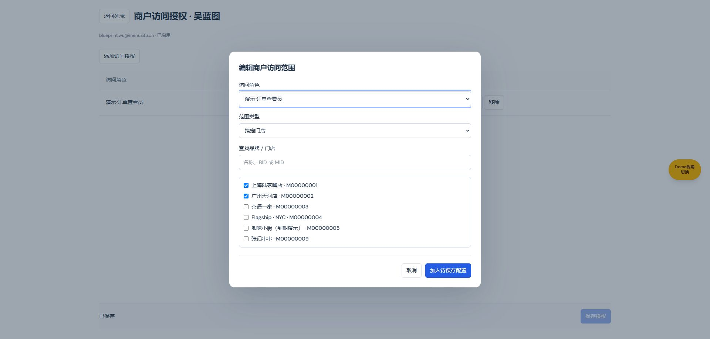

角色回填订单查看员，范围类型为指定门店，两家对应门店选中，其余未选。原校验及“加入待保存配置→保存授权”流程不变。

取消不变更草稿、绑定或记录。仅查看页面也不产生真实授权日志。

### 刷新、关联人数与日志

初始演示环境中，每个角色关联 1 位员工。更新角色描述，移除旧“未关联员工”表述；既有删除时绑定校验仍生效，不能直接删除仍有员工绑定的演示角色。

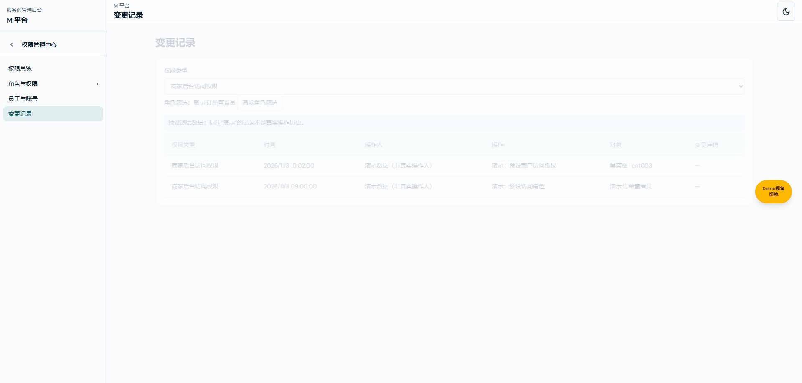

| 字段 / 初始化规则 | 逻辑说明 |
| --- | --- |
| 初始化边界 | 仅 provider-merchant-access:v1 存储键不存在时生成；已有合法空/非空快照原样读取，损坏数据仍报错，不追加演示授权 |
| 有效对象 | 从默认演示企业 enterprise-miju 的现有目录按 BID 排序取前两个品牌；门店按 MID 取前两店；仅绑定 ent002/003/004 的既有启用系统演示账号。目录缺失时跳过对应空范围，不虚构品牌或门店 |
| 角色权限 | 继续使用现有三个演示查看角色，不授予 action 或 setting 编辑权限；员工绑定只声明对象范围 |
| 日志数量 | 原 3 条角色预设，加 3 条员工授权预设，共 6 条；具体数量随有效演示账号和目录是否存在而减少 |
| 授权预设日志 | 固定演示时间 2026-11-03 10:01 / 10:02 / 10:03（UTC+8），操作“演示：预设商户访问授权”，操作人“演示数据（非真实操作人）”，对象为员工姓名及 ID |
| 前后快照 | 只含角色与员工绑定；按样例顺序记录加入绑定前后的员工数组，不含账号密码 |
| 持久化 | 初始化和查看不写授权存储，revision 保持 0；后续用户正常保存仍经原授权、并发版本和目标范围校验 |
| 无自动迁移 | 已有保存数据不会被本次样例扩展，包括曾保存空授权的账号；不自动将之前保存的零员工状态改成已授权 |

### 验证结果

类型检查通过；领域测试覆盖 3 员工/6 日志、品牌隔离、指定门店与新增门店边界、只读权限、缺失账号/目标跳过、既有快照不迁移；原授权 16 项与集中日志隔离回归通过。浏览器验证三位员工详情、编辑回填/取消、刷新、三个角色各 1 人、集中 6 条及单角色 2 条。生产身份服务、CI/部署、受限员工真实登录及保存失败路径未验证。

## 商家访问权限编辑标题栏统一（PROVIDER-EDITOR-HEADER-20261103-01）

基线本地 main@fb1f7bc8；分支 codex/provider-editor-heading-20261103；外部 Chrome 预览 5315。按用户授权提交并合并本地 main，不推送远端；实际提交号以 Git 交付核验为准。范围仅为商家访问角色编辑、预览及共用员工商户授权页的标题栏，不修改 M 平台自身编辑页面或其他业务模块的返回入口。

### 编辑页面标题栏

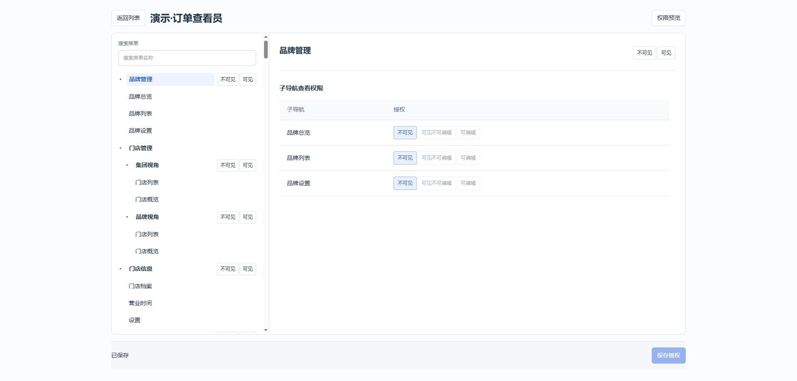

图注：2026-11-03，当前功能分支真实画面，演示·订单查看员，无员工绑定。旧截图中返回入口位于右上、预览按钮位于标题下的布局不再作为当前要求。

| 元素 | 逻辑说明 |
| --- | --- |
| 返回列表 | 放在页面标题左侧，保留原链接样式和文字；角色页返回商家访问角色列表，员工授权页返回员工与账号 |
| 标题 | 跟随返回入口显示在左侧一组，名称仍使用当前角色或员工名称 |
| 权限预览 | 放在同一标题栏右侧；沿用 data-provider-preview 和原切换逻辑，不保存或修改授权 |
| 返回编辑 | 预览后在相同右侧位置替换按钮文案，不占用左侧返回列表的位置 |
| 预览对象 | 保留在预览内容区；原目标范围和权限计算不变 |
| 保存与草稿 | 底部保存授权按钮、原禁用规则和未保存离开保护沿用；本次不增加确认流程 |

### 点击权限预览 / 返回编辑

点击权限预览切换为原只读预览，右侧按钮变为返回编辑，左侧返回列表始终保持。预览对象筛选仍位于内容区。

点击返回编辑恢复原编辑状态；仅切换视图，不改变草稿和保存状态。

### 点击返回列表

返回仍使用现有列表地址。无修改时直接返回；真实未保存修改仍按原离开保护处理，该异常分支本次未改动或重测。

### 共用员工授权页返回

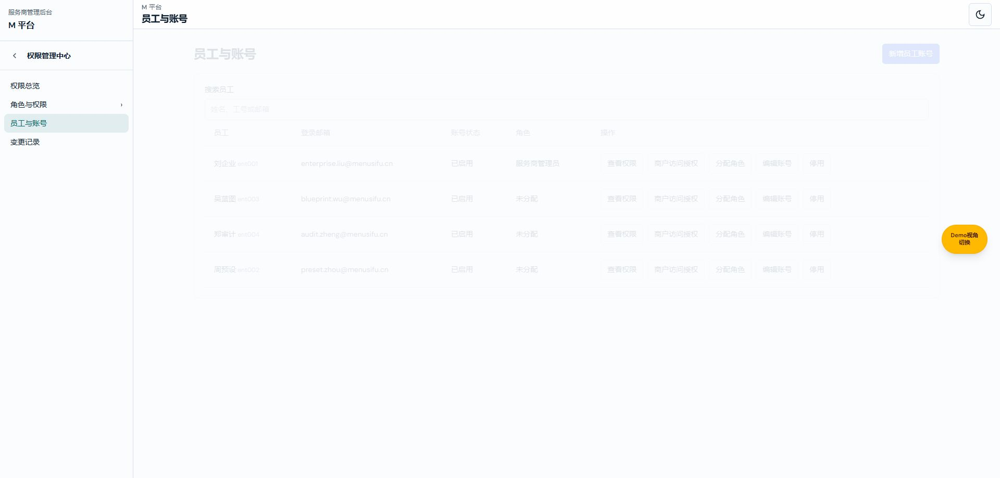

共用标题栏将原返回列表入口同样左置。员工页不新增权限预览按钮，不修改员工范围绑定。

### 本次操作覆盖与验证

| 操作 | 前后图片 | 状态 |
| --- | --- | --- |
| 查看标题栏 | edit.png | 实测返回在标题左侧，预览在右侧且同行 |
| 权限预览 | edit.png → preview.png | 已验证 |
| 返回编辑 | preview.png → edit.png | 已验证 |
| 角色返回列表 | edit.png → list.png | 已验证 |
| 员工授权返回列表 | employee-access.png → staff-list.png | 已验证 |

TypeScript 与差异检查通过。验证期间未保存授权、未产生未保存提示；原权限计算、范围、真实草稿放弃确认和保存异常未重测，不对历史全部操作截图完整性作结论。

## 历史：演示数据接回统一角色导航（PROVIDER-DEMO-FIX-20261103-01）

本节保留历史。无员工绑定与三条初始日志的口径已由 PROVIDER-EMP-DEMO-20261103-01 替代；已有存储保护仍沿用。

基线 main@39a417fb；分支 codex/provider-demo-fix-20261103；外部 Chrome 预览 5313。修正前，演示数据代码只留在未合并分支，主线缺少初始化逻辑；本次将其接回最新导航与集中记录，不回退导航、不复制旧文档覆盖新版。本次按用户授权提交并合并本地 main，不推送远端；实际提交号以 Git 交付核验为准。

### 本次操作覆盖清单

| 页面 / 操作 | 入口与结果截图 | 完成状态 |
| --- | --- | --- |
| 进入商家后台访问角色 | before-empty → roles | 已验证，3 个演示角色 |
| 从角色查看记录 | roles → role-log | 已验证，带入对应角色和商家类型 |
| 清除角色条件 | role-log → provider-logs | 已验证，恢复 3 条 |
| 类型选全部 | provider-logs → all-logs | 已验证 |
| 类型选 M 平台权限 | all-logs → m-logs-empty | 已验证，演示商家记录不混入 M 来源 |
| 类型选商家后台访问权限 | m-logs-empty → provider-logs | 已验证 |
| 刷新记录页 | provider-logs → provider-logs | 已验证，仍为 3 条，筛选保留 |

本次均为读取或筛选，无保存、确认或取消弹框；原权限编辑操作沿用，不纳入本次截图完整性结论。存储损坏仍由既有错误流程处理，自动测试覆盖不回退演示；未采集损坏数据的浏览器截图，不声称异常截图完整。

### 进入商家后台访问角色

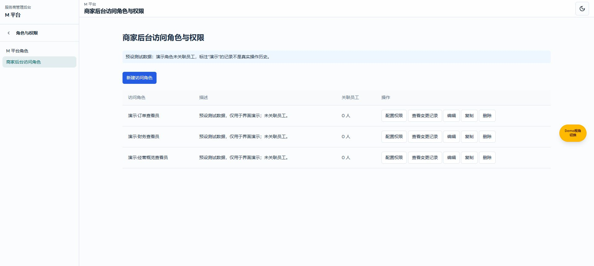

图注：2026-11-03，外部 Chrome，修正分支真实画面；演示角色不是实际员工权限。

| 元素 / 规则 | 逻辑说明 |
| --- | --- |
| 初始化条件 | 仅 localStorage 的 menusifu:provider-merchant-access:v1 不存在时生成演示状态；已有合法数据优先，包括已经保存的空列表，不增补或覆盖 |
| 角色 | 演示·订单查看员 / 演示·财务查看员 / 演示·经营概览查看员；ID 分别 provider-demo-orders / provider-demo-finance / provider-demo-dashboard，3 个普通非系统角色 |
| 权限配置 | 对应模块现有目录的非 action、非 setting、非兼容隐藏资源预设 read；不预设操作或设置编辑权限 |
| 关联员工 | 全部 0；employees 为空，不给任何员工绑定角色或目标，不改变 ent001 既有系统兼容范围 |
| 描述 / 提示 | 角色描述及记录演示标识保留；列表顶部提示已按 PROVIDER-HEADER-20261103-01 删除，集中记录页提示保留 |
| 持久化 | 查看、刷新不写存储，初始化 revision=0；用户后续正常保存仍走既有授权和并发校验 |
| 既有记录 | 已有角色、员工、日志、revision 与系统兼容范围均原样读取；已删除演示角色不会因刷新补回 |
| 损坏数据 | JSON 解析或结构校验失败仍报错，保留原值，不静默用演示覆盖 |

### 从角色查看记录

使用现有查看变更记录入口，进入集中页并带 type=provider 与角色 ID。三个角色各自对应一条预设事件，不新增独立日志页面或权限。

| 字段 | 逻辑说明 |
| --- | --- |
| 类型 | 商家后台访问权限 |
| 时间 | 固定 2026-11-03 09:00 / 08:00 / 07:00（UTC+8），按浏览器本地格式展示，不声称为当前操作时间 |
| 操作人 | 演示数据（非真实操作人） |
| 操作 | 演示：预设访问角色 |
| 对象 | 对应三个演示角色名，按时间倒序 |
| 快照 | 每条 before 为角色与员工空数组；after 为对应演示角色和空员工数组；不含密码 |

### 清除角色条件 / 类型筛选

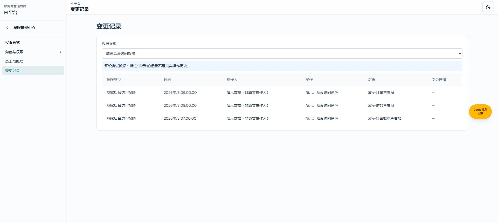

清除仅去掉角色条件，保留商家类型，显示 3 条；统一记录页就近提示演示性质。

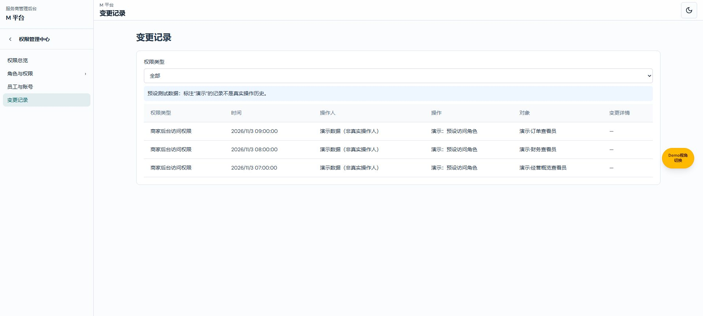

全部仍遵守原来源查看权限；本隔离上下文 M 来源无记录，商家演示记录不混入该类型。选回商家后台访问权限恢复上方三条画面。

### 刷新记录页

保留 URL 类型筛选；未保存上下文从固定演示状态重建，仍有 3 条，时间不漂移。不产生真实审计。

### 验证

RED：外部 Chrome 主线演示角色数为 0，空态可见。GREEN：修正预览 3 角色、关联员工均 0；角色条件 1 条，清除及刷新后 3 条；类型隔离正常。领域测试覆盖无员工授权、无动作/设置授权、独立副本、已有空/非空状态保留、损坏 JSON 不降级；原访问授权 16 项和集中日志隔离回归通过。生产接口、CI/部署未验证。

## 角色与权限统一入口（ROLE-HUB-20261103-01）

当前有效结构：权限管理中心 → 权限总览 / 角色与权限 / 员工与账号 / 变更记录；“角色与权限”下并列为“M 平台角色”“商家后台访问角色”。两类角色、员工绑定和权限资源独立，未迁移或合并数据。基线 main@1e84e5e9，功能分支 codex/role-permission-hub-20261103，端口 5312；按用户授权提交、合并 main 并推送，实际提交号及远端状态以 Git 交付核验为准。演示初始化已由 PROVIDER-DEMO-FIX-20261103-01 接回，原角色与记录授权规则不变。

### 本次逐操作覆盖清单

| 操作 | 入口及结果图片 | 状态 |
| --- | --- | --- |
| 点击角色与权限 | permission-parent → m-roles | 已验证，默认 M 平台角色 |
| 切换商家后台访问角色 | m-roles → provider-roles | 已验证 |
| 切换 M 平台角色 | provider-roles → m-roles | 已验证 |
| 返回上一级 | m-roles → back-parent | 已验证，只退一层 |
| 点击独立变更记录 | permission-parent → audit-all | 已验证 |
| 选择 M 平台权限 | audit-all → audit-m | 已验证 |
| 选择商家后台访问权限 | audit-all → audit-provider | 已验证 |
| 选择全部 | audit-provider → audit-all | 已验证 |
| M 角色查看变更记录 | m-roles → m-role-audit | 已验证，含无匹配记录状态 |
| 商家角色查看变更记录 | provider-roles → provider-role-audit | 已验证 |
| 清除角色筛选 | provider-role-audit → audit-provider | 已验证 |
| 展开 / 收起前后值 | audit-m ↔ audit-details | 已验证，沿用 M 日志明细 |
| 旧地址访问 | legacy-audit | 已验证，兼容商家日志类型 |
| 无权限类型 / 读取异常 | 待补页面图片 | 权限隔离领域测试通过；受限账号与损坏数据浏览器截图未采集，不声称异常截图完整 |

截图均为 2026-11-03 功能分支实际画面；“导航验收·M空白角色”“导航验收·商家空白角色”为本地隔离验收数据，无权限、无员工绑定；不代表生产操作历史。本次导航及筛选不写数据，无保存、确认或取消弹框。原角色编辑等完整操作截图不在本次调整范围内。

### 点击角色与权限 / 切换两类角色

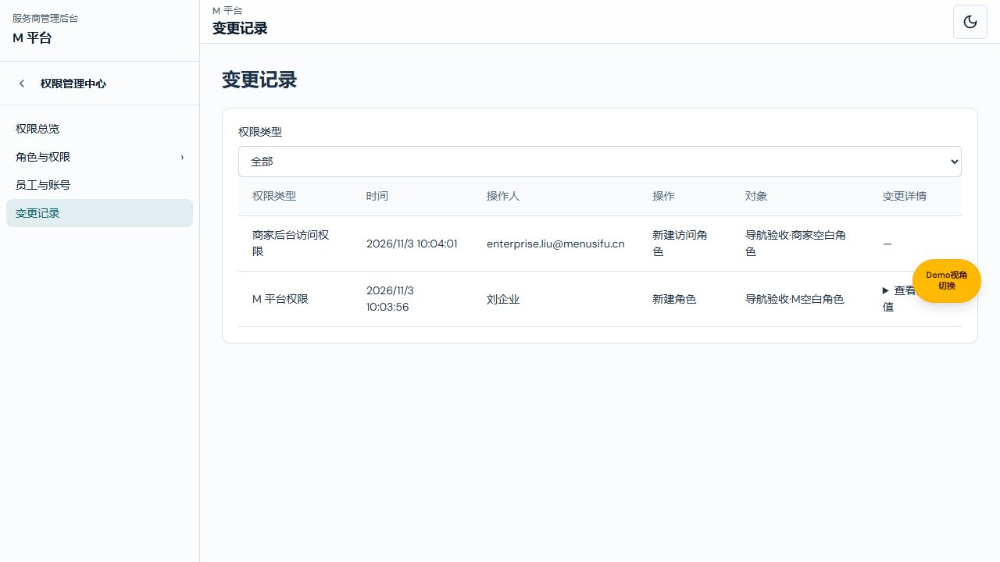

| 元素 | 逻辑说明 |
| --- | --- |
| 角色与权限 | 父菜单整行点击进入公共子导航滑层，默认进入现有 `/m-platform/permissions/roles`；仅有商家角色权限时回落到可访问的商家角色页 |
| M 平台角色 | 页内标题“M 平台角色与权限”；配置服务商员工在 M 平台内的菜单和操作，沿用 roles 页面、动作权限 |
| 商家后台访问角色 | 页内标题“商家后台访问角色与权限”；沿用 provider-roles 地址及动作权限；不将品牌、门店范围合并进 M 平台角色 |
| 当前项 | 切换、直接访问与刷新后恢复子导航并高亮；角色配置的既有草稿保护沿用 |

点击“M 平台角色”返回上方 M 角色列表；不修改任一类角色或关联员工。

### 返回上一级

只返回一层侧栏，保留当前业务内容；再次返回主层沿用公共逻辑。

### 独立变更记录 / 类型筛选

| 字段 / 操作 | 逻辑说明 |
| --- | --- |
| 地址 | `/m-platform/permissions/change-log`；支持 type=all、m、provider 及 role 参数；默认 all |
| 权限类型 | 全部 / M 平台权限 / 商家后台访问权限；仅列出原有权限允许的类型，不读取无权来源。全部是允许来源的并集 |
| M 日志查看权 | 沿用 permission-log 页面可见权限；拥有角色编辑权限不自动获得 M 日志查看权 |
| 商家日志查看权 | 沿用 provider-roles 页面可见权限；不增加新授权资源或默认赋权 |
| 切换类型 | 即时重新筛选并清除角色条件，URL 同步，不写日志或授权 |
| 权限类型列 | 标识记录原始来源，两个来源相同 id 不去重，不混淆 |
| 时间列 | 沿用 at 字段，以浏览器本地时间格式展示；合并后按时间倒序 |
| 操作人列 | 沿用 actor 字段，不改为当前浏览者 |
| 操作列 / 对象列 | 沿用 action、object，分别展示并 HTML 转义 |
| 变更详情 | M 来源保留前后值折叠；商家来源保持原展示范围，仅显示摘要，不新增原始快照入口 |
| 空值 / 失败 | 无匹配时“暂无匹配变更记录”；无权请求类型不给记录并提示；某来源解析失败单独提示，保留存储，其他有权来源继续展示 |

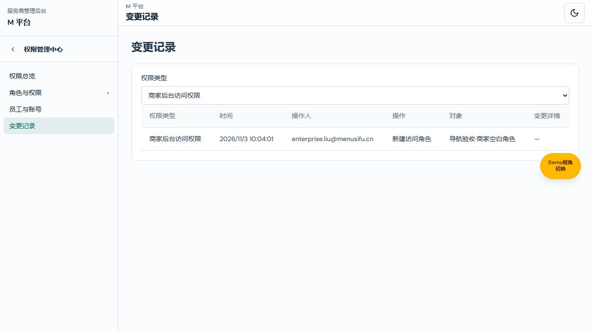

切回“全部”恢复上方全部类型画面，仅恢复当前允许来源。原权限总览的“最近变更”仍为原 M 权限摘要，本次未扩大范围。

### 从角色查看记录 / 清除角色条件

M 角色行入口仅在具备原 M 日志权限时展示，带入 type=m、role=角色 ID。

商家角色带入 type=provider。优先依据前后快照中对应角色的变化或关联员工的角色绑定变化匹配；旧摘要记录可按当前角色名称与对象精确匹配。已删除角色若无可识别快照或名称依据，不猜测关联记录。无匹配仍显示空态，不回退展示全部。

清除按钮仅移除 role 条件，保留类型；筛选不是编辑，不触发未保存提示。

### 展开 / 收起前后值

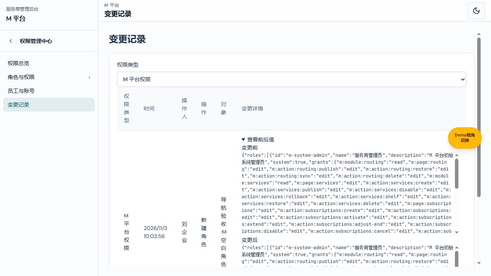

只展开当前 M 记录的原始前后值，不新增快照存储；再次点击原位置收起。

### 旧地址兼容

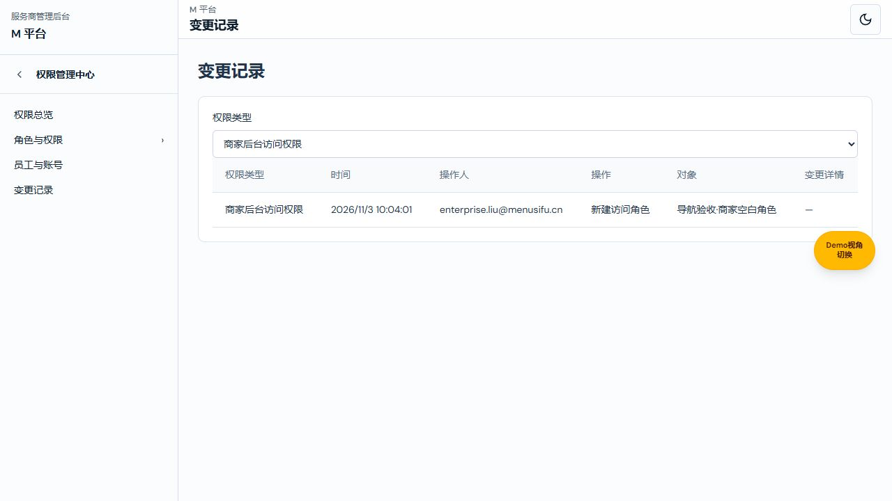

`/m-platform/permissions/provider-roles/change-log` 继续按商家来源权限进入统一记录界面，默认 type=provider；旧侧栏独立商家日志菜单移除。正常入口统一到权限中心“变更记录”。

### 验证与边界

类型检查、公共导航回归、原商户访问授权 16 项断言、M 平台权限回归、统一日志来源隔离/角色匹配/同 ID/排序测试通过。浏览器验证正常列表、切换、带参、清除、空态、旧地址与明细收起展开。生产服务端、CI/部署、受限账号和损坏数据的浏览器路径尚未验证。

## 历史：商家后台访问角色子导航（M-ACCESS-NAV-20261102-02）

本节为历史版本，导航与日志入口已由 ROLE-HUB-20261103-01 替代，不作为现行导航要求。

本次范围：权限管理中心内的商家后台访问角色拆为两个子菜单。沿用 provider-roles 可见权限和原管理动作；不新增权限资源、不迁移角色或员工绑定。当前功能分支 codex/merchant-access-nav-20261102；main 基线 8b9b3837，端口 5194；按 2026-11-03 用户授权提交、合并 main 并推送，实际提交号和远端核验见 Git 交付记录。

### 操作覆盖清单（本次变更）

| 操作 | 入口 / 后续状态 | 图片 | 状态 |
| --- | --- | --- | --- |
| 打开商家后台访问角色 | 权限中心 → 子导航，默认角色访问设置 | permission-parent / settings-rows | 已验证 |
| 点击角色访问设置 | 日志页 → 角色列表 | logs-rows / settings-rows | 已验证 |
| 点击变更记录 | 设置页 → 独立日志页 | settings-rows / logs-rows、logs-empty | 已验证，有数据及空态 |
| 子层返回 | 商家访问子层 → 权限中心层 | logs-rows / permission-parent | 已验证，只退一层 |
| 权限中心返回 | 权限中心 → 主层 | permission-parent / root | 已验证 |
| M 平台权限变更记录 | 权限中心 → M 平台内部权限记录 | permission-parent / m-platform-logs | 已验证，不混入访问角色日志 |

本清单仅覆盖本次新增或调整的导航操作；历史角色编辑、复制、删除等操作截图完整性不在本次验收结论内。导航无确认或取消弹框；无网络写入，因此不存在新增的保存成功/失败状态。

### 打开商家后台访问角色 / 默认角色访问设置

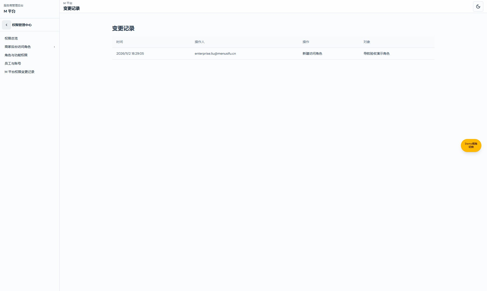

图注：2026-11-02，5194 功能分支真实截图；“导航验收演示角色”为隔离演示数据，无授权、无员工绑定，不代表真实操作历史。

点击父菜单整行，公共子导航滑层覆盖权限中心层；默认进入角色访问设置，原地址 `/m-platform/permissions/provider-roles` 沿用。新建、配置权限、编辑、复制、删除仍沿用原校验与草稿保护。列表底部不再显示折叠日志。

### 点击变更记录

图注：同一隔离演示分支；记录来自通过现有新建入口保存空白角色的实际操作。

| 字段 / 操作 | 逻辑说明 |
| --- | --- |
| 菜单名称 | 变更记录，仅指商家后台访问角色及商户访问范围的授权变更 |
| 地址 | `/m-platform/permissions/provider-roles/change-log`；刷新和直接访问均恢复商家访问子导航，当前项高亮 |
| 权限 | 继承现有 provider-roles 页面可见性；不可见者不能因拆分菜单获得访问权 |
| 时间 | 原日志 at 字段，由浏览器本地时间格式展示，不改存储值 |
| 操作人 | 原 actor 字段，沿用真实记录，不替换为当前浏览者 |
| 操作 | 原 action 字段，不改变日志事件类型 |
| 对象 | 原 object 字段，HTML 转义，不显示密码 |
| 数量与顺序 | 展示原保存日志数组全部记录，沿用其顺序，不再截取前 30 条；不新增分页或筛选 |

没有记录时显示“暂无商家后台访问角色变更记录”，不生成示例日志。浏览页面不写入日志或授权。

### 点击角色访问设置

切换后显示现有角色列表，保留两项子菜单并高亮设置项；不修改角色数据。

### 子层返回 / 权限中心返回

只切换侧栏层级，保留当前内容。继续点击返回到主层；原业务草稿离开保护沿用。

### 点击 M 平台权限变更记录

原 `/m-platform/permissions/change-log` 地址与 permission-log 权限资源不变，仅入口和页面标题改名。数据仍为 M 平台内部角色、员工权限日志，不混入商家后台访问角色日志。

## 授权业务口径

M 平台角色管理软件服务商员工的平台功能；商户访问绑定管理其品牌／门店范围和后台角色；品牌菜单、门店菜单、商家内部角色、收费服务权益分别保留。

权限计算先匹配当前目标的绑定，再合并角色。品牌范围允许品牌入口及关联门店；门店范围仅允许明确 MID，不提升为品牌管理权限。多角色允许并集仍受有效祖先、依赖和商户菜单上限限制。多店操作需逐店满足所需权限，任一目标无权时整体拒绝。

例如，客服甲绑定订单支持→广州店，财务乙绑定财务查看→广州店，两人进入同店看到不同菜单；甲再绑定财务查看→上海店，并不因此在广州店获得财务权限。品牌未开通的菜单，即使角色配置也不显示；已开通收费菜单仍遵守服务权益的可见与可用规则。

生产账号、服务端对象隔离及接口鉴权尚未接入，见[交付缺口与验证记录](../verification/provider-merchant-access-20261102/README.md)。此处定义不将本地存储视为生产安全边界。

## 商户授权入口

### 商家后台访问角色

图注：本地功能分支，访问角色列表。

访问角色独立于 M 平台角色；新建默认空白，复制不复制员工绑定，删除需先解除全部员工绑定。编辑及授权管理需要独立动作，不因拥有商户查看权限自动开放。

### 员工商户访问范围

图注：同员工跨店绑定不同访问角色。

每条授权同时选择角色与范围；品牌范围含新增门店，指定门店仅限勾选 MID。保存前显示影响并确认，撤销绑定后有效会话重新校验。新员工和普通旧员工默认无商户访问；系统兼容身份受账号启停、M 进入动作与商户上限共同限制。

逐字段、弹框和取消行为见[个人规范 V1.16](M平台内部权限需求文档（个人规范版）.md#服务商员工商户访问授权)；字段、执行链和测试见[研发交付 V1.16](M平台内部权限业务规格说明书（研发交付版）.md#商户访问授权字段与执行链)。

## 系统使用分析独立权限目录

图注：2026-10-29，codex/usage-analysis-entry-20261029，main@f30e8451起始，5257实采；角色编辑中系统使用分析与商户管理中心分别设置模块门槛。

入口：权限管理中心 → 角色与功能权限 → 编辑权限。

| 字段／操作 | 逻辑说明 |
| --- | --- |
| 系统使用分析模块 | m:module:activity-analysis，可见／不可见；独立于m:module:merchants。导航、角色目录与实际资源树一致。 |
| 门店活跃分析 | m:page:merchant-activity，可见／不可见，无业务写操作；父资源为系统使用分析模块。 |
| 设备活跃分析 | m:page:device-activity，可见／不可见；与门店活跃分析分别授权，共用分析模块门槛。 |
| 详情中的使用情况 | 品牌或门店详情权限与门店活跃分析权限同时满足才可进入；单有商户管理编辑权不代表可读分析。 |
| 仅分析角色 | 可查看本人获准范围内的全局分析；无商户管理权限时不显示品牌/门店管理跳转，也不能直达管理详情的使用情况页。 |
| 多角色与停用 | 保留角色允许并集及祖先门槛；停用账号、缺页权和缺模块权均拒绝。浏览期间撤权后下次交互/重渲染不继续访问。 |
| 历史角色兼容 | 缺目录版本标记的旧记录，按角色复制原商户模块门槛到缺失的新分析模块门槛，不新增或修改任何分析页grant。已显式配置的新门槛（包括不可见）不覆盖。 |
| 新角色 | 默认不可见；不因商户管理可见而自动拥有分析权限。 |
| 旧路由 | /m-platform/merchants/activity与device-activity及原明细地址继续使用；地址保留不表示权限仍归商户中心。 |

### M 平台外壳返回入口（M-PERM-EXIT-20261022-05）

图注：2026-10-22，V1.4 功能分支，实际页面验证截图；此前截图中的右上角、左下角返回商家按钮为历史展示。

| 元素 | 规则与验收 |
| --- | --- |
| 右上角返回商家后台 | 从 M 平台公共页头移除，主题切换保留 |
| 左下角返回商家后台 | 从侧栏移除整个按钮及底部容器，不留空白边框 |
| 子菜单返回箭头 | 保持返回上一级菜单，父菜单名与箭头同行 |
| 权限与数据 | 本次不改变授权、角色、数据加载或业务路由；无权页原有返回链接沿用 |

验证：实际页面两处按钮均不存在；主题切换和侧栏导航仍可操作。TypeScript 与公共递归导航回归通过。本次 V1.3/V1.4 修改按用户授权提交、合并 main 并推送；实际提交号和远端核验结果以 Git 交付记录为准。

## 1. 本次确认与范围

用户要求参照商家权限中心，控制服务商内部哪些角色、哪些员工能够访问、查看、设置 M 平台哪些菜单。用户明确不采用员工个人例外，并要求开发。因此采用唯一的角色授权路径：员工绑定一个或多个角色，功能权限由角色合并，不提供个人额外允许、禁止或恢复继承。

M 平台资源目录及独立动作以 src/permissions/m-platform-catalog.ts 为准；服务商商家后台访问角色使用独立授权存储，复用统一商家资源目录。

商户访问范围与平台菜单权限分别授权，服务商员工按匹配目标的后台角色进入商户；品牌内部账号与服务权益规则保持独立。真实邀请、跨服务商生产隔离与后端 API 不在本地原型交付范围。

### 默认演示账号（M-PERM-DEFAULT-20261022-02）

用户明确要求 M 平台默认能够看到数据。默认登录账号 `demo.menusifu.cn` 进入 M 平台时，使用现有初始服务商管理员 `ent001` 的账号状态和角色绑定，因此默认可查看已有数据并配置权限，无需另换企业账号。不新增员工个人例外，不改写已保存角色或员工绑定；其他真实员工、未知账号不走此回退。初始管理员停用或其角色调整后，演示视图也遵守相应结果。

图注：2026-10-22，功能分支 V1.1，用户当前内置浏览器使用默认账号登录后，品牌列表恢复展示张记火锅、杭城小笼、米聚甄选等既有数据。未清理缓存或重建业务数据。

## 2. 权限结构

| 对象 | 完整可选状态 | 生效含义 |
|---|---|---|
| 导航目录 | 不可见／可见 | 不可见时该目录内页面和动作均不生效；下级配置保留 |
| 可设置的页面 | 不可见／可见不可编辑／可编辑 | 控制页面进入和一般编辑；可编辑不自动开放独立动作 |
| 纯查看页面 | 不可见／可见 | 不制造不存在的编辑能力 |
| 独立操作 | 禁止／允许 | 发布、同步、删除、账号操作等逐项控制；修改型动作还要求所属页面可编辑 |

按角色先取允许并集，再应用有效父级门禁。例如角色 A 允许页面只读、角色 B 允许同页编辑，则最终可编辑；如果没有角色允许上级目录可见，页面仍不可访问。导出设备属于独立输出动作，页面可查看且导出允许即可执行，无须制造页面编辑权限。缺失、未知资源及无角色员工默认拒绝。停用账号使全部权限不生效。

所有权限通过角色授予；不存在员工个人例外。新建角色默认为空白权限，复制只复制名称以外的描述和权限，不复制员工绑定。系统管理员作为当前演示环境的明确初始系统角色绑定既有 ent001 员工；不把旧商家权限或 enterprise selection 转换为新目录权限。其余员工初始未分配本模型角色。

## 3. 页面与操作

### 3.1 角色与功能权限

图注：功能分支本地原型，2026-10-22，含验收用“客服只读”角色；示例数据不是生产岗位预置。

角色列表字段、人数查看、操作名称与顺序统一见本文“两类角色列表”；无权操作与系统／员工绑定删除保护仍有效。角色名称去首尾空格后必填，最多 30 字，同名忽略大小写判重；描述可空，最多 160 字。

编辑权限进入全屏页面，隐藏外层导航，左侧按 M 平台真实菜单组织，右侧显示选中页面及真实独立操作。搜索与查看不产生草稿。效果预览只显示当前角色草稿允许的菜单，不保存。保存前显示权限差异及影响员工数；确认成功后生效，取消保留草稿。存储失败与版本冲突保留当前草稿并报错。修改后恢复原值不再提示未保存。

### 3.2 员工与账号

图注：功能分支本地原型，2026-10-22，已为一名演示员工绑定验收角色。

统一列表展示工号、姓名、邮箱、启停状态和角色；支持工号、姓名、邮箱的即时包含搜索。分配角色为多选，保存后重新计算最终权限；清空选择则无访问权限，但保留账号。查看权限只读展示有效菜单和操作，不提供个人例外。账号管理、分配角色分别鉴权。

新增账号默认启用且无角色；账号邮箱和密码沿用现有企业账号约束，不新增邮箱域或密码规则。编辑账号的密码留空保留原密码。停用账号保留角色绑定；启用后按当前角色重新计算。至少保留一名启用且能够编辑角色与分配员工角色的管理员，禁止停用最后管理员或移除其关键权限。账号数据沿用既有本地演示存储，不代表生产凭据管理已交付。

### 3.3 权限总览与记录

图注：功能分支本地原型，2026-10-22，统计为当前浏览器保存数据。

总览只读显示角色数、员工账号数、已绑定角色员工数、可授权页面数及最近变更。员工数包含停用账号，已授权员工数按具有非空角色绑定的员工 ID 去重，不代表每人实际有可见页面。变更记录保存操作时间、操作人、对象及前后值；账号审计不保存密码。

## 4. 访问与交互验收

### 主层删除重复平台标题（M-PERM-LABEL-20261022-04）

图注：2026-10-22，功能分支 V1.3，主层菜单直接从“菜单路由配置”开始。旧截图中的主层重复标题不作为现行展示依据。

删除菜单路由配置上方、菜单主层内部重复的“M 平台”文案。左上角“服务商管理后台 / M 平台”品牌标题、页面顶栏、子层父级菜单名以及所有菜单入口均保留。主层不留标题占位；其余样式、顺序、权限过滤、地址及返回行为不变。

### 导航头部对齐商家后台（M-PERM-NAV-20261022-03）

图注：2026-10-22，功能分支 V1.2，员工与账号页面；权限管理中心名称位于返回箭头右侧，同一行展示。此前页面截图沿用历史业务状态，侧栏样式以本图为准。

所有 M 平台有子菜单的目录共用该头部：移除可见的“返回”文字，仅保留箭头按钮，其右侧为当前父级菜单名。参照商家后台，标题栏高 56px，按钮 40×40px，箭头 18px，菜单名 14px、字重 600；保留商家后台的圆角、悬停、键盘焦点及分隔线样式。辅助技术仍通过“返回上一级菜单”识别按钮用途。点击箭头只返回一层；点击页面保留当前子层及高亮。权限过滤、授权、保存和业务数据均不变。

- M 平台角色目录只包含平台资源；商家后台访问角色独立配置商家菜单，不混入 M 平台角色目录。
- 侧栏过滤不可见页面和空目录；仍有一个可访问子菜单的目录保留父子滑层，不平铺替代父目录。子层覆盖菜单区，返回一层，叶子点击后保持当前子层并高亮。
- 未授权直接地址显示“暂无 M 平台访问权限”，不挂载业务页面；配置页只读允许进入并查看设置，禁用设置修改及发布。
- 动作默认禁止，页面可编辑不会自动允许发布、同步或删除；服务包管理路径虽然含 permissions，仍归属服务包模块。
- 服务商账号正常登录后直接进入首个获准 M 平台页面；无菜单时进入无权提示，不要求完成商家首次业态向导。停用企业账号不能回退到演示登录校验。
- 页面、角色保存使用当前授权复核；跨窗口账号停用下一次鉴权即拒绝。权限保存比较 revision，拒绝覆盖新版本。

## 5. 交付与边界

实现为现有 Vite 原型内的本地授权和前端拦截；localStorage 可被使用者修改，不能作为生产安全边界。生产接口必须依据服务商、员工、角色、资源和目标业务对象再次鉴权；本次未接入后端，也不宣称完成跨服务商数据隔离。旧商家与 enterprise-rbac 数据原样保留，不自动迁移授权。未修改 eMenu 子包，无需其嵌入包发布。

验证：TypeScript、纯领域回归、真实浏览器角色新增/编辑/绑定/预览、受限菜单与只读设置，以及持久化失败/并发版本/最后管理员/停用登录回归。具体结果见研发版。V1.1 及之前的功能已提交并合并本地 main；V1.2 导航样式调整也已提交并合并本地 main；本次 V1.3/V1.4 按用户授权提交、合并并推送；未将推送视为 CI 或部署通过。

## 6. 版本记录

- V1.16（2026-11-03，EMPLOYEE-WORKBENCH-20261103-01）：三份配对版本均为 V1.16。改为同员工双层页签，保留草稿、保存快照预览、M 菜单树及分组操作、系统只读无保存、统一离开确认；附逐操作截图和未覆盖项。

- V1.13（2026-11-03，EMPLOYEE-ACCESS-CONFIG-20261103-01）：三份配对版本均 V1.13，统一员工配置入口、双维摘要、独立保存与双维已保存权限预览；附当前逐操作截图及边界验证。

- V1.12（2026-11-03，PROVIDER-EMP-DEMO-20261103-01）：三份配对版本均为 V1.12。补充三位员工品牌/门店演示绑定及授权预设记录，保留已有保存快照，附当前操作截图与验证结果。

| 版本 | 变更编号 | 内容 |
|---|---|---|
| V1.3 | M-PERM-LABEL-20261022-04 | 删除菜单主层重复 M 平台标题，保留品牌标题；配对研发和个人 V1.3 |
| V1.2 | M-PERM-NAV-20261022-03 | 返回箭头与父级菜单名同排，尺寸与商家后台一致；配对研发和个人 V1.2 |
| V1.1 | M-PERM-DEFAULT-20261022-02 | 恢复默认演示账号的 M 平台管理员视图；复用初始角色、保留真实员工限制；配对研发和个人 V1.1 |
| V1.0 | M-PERM-20261022-01 | 建立 M 平台独立目录与仅角色授权；四入口及权限执行接入；配对研发和个人版 V1.0 |

本轮独立分析模块的验证及未闭合项见[USAGE-ENTRY-20261029-62](../verification/usage-analysis-entry-20261029/README.md)。
