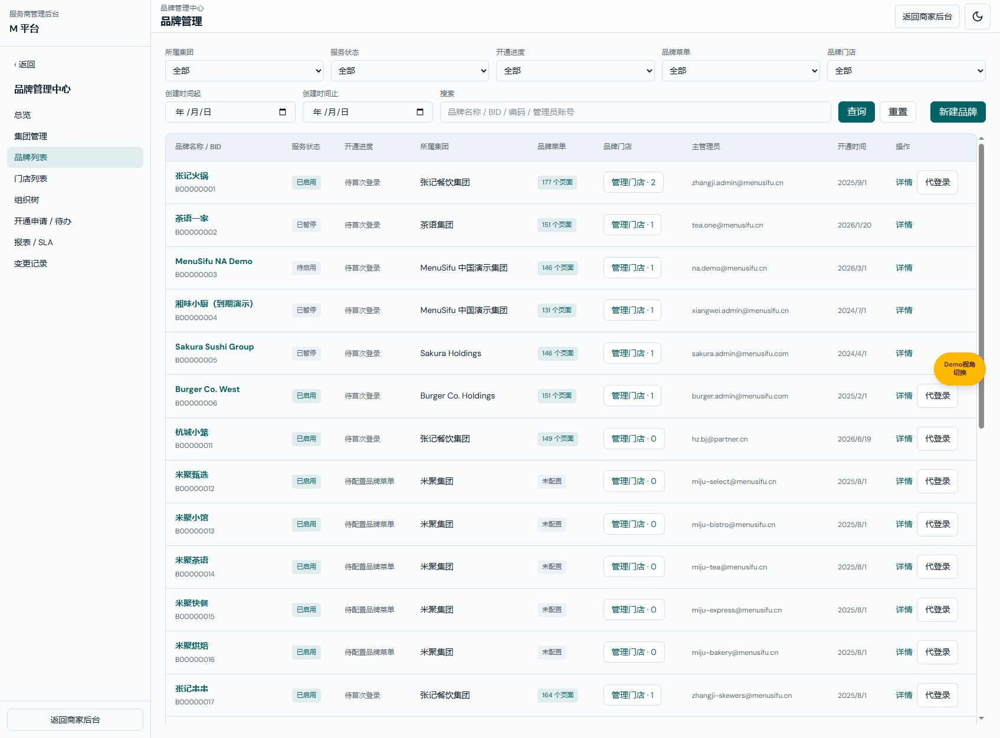
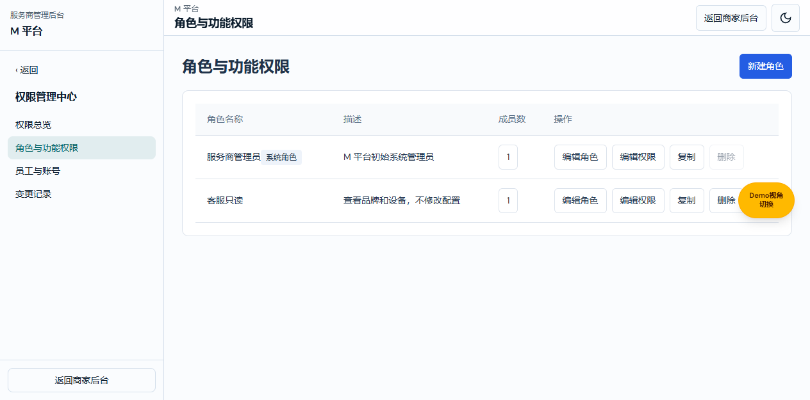
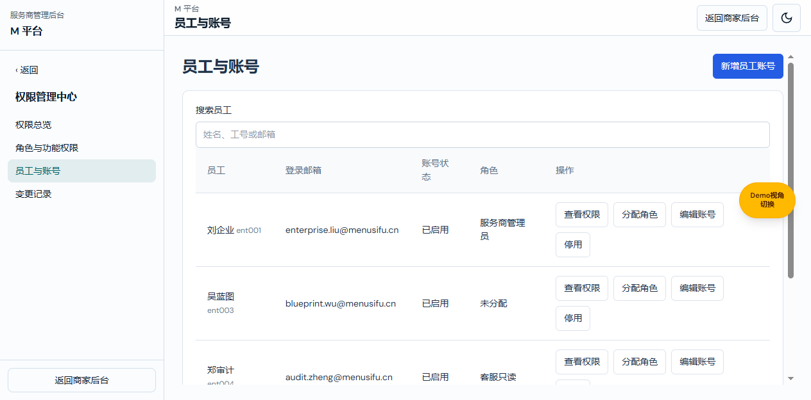
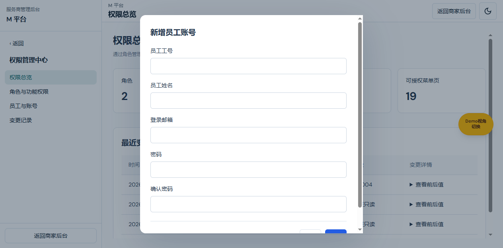
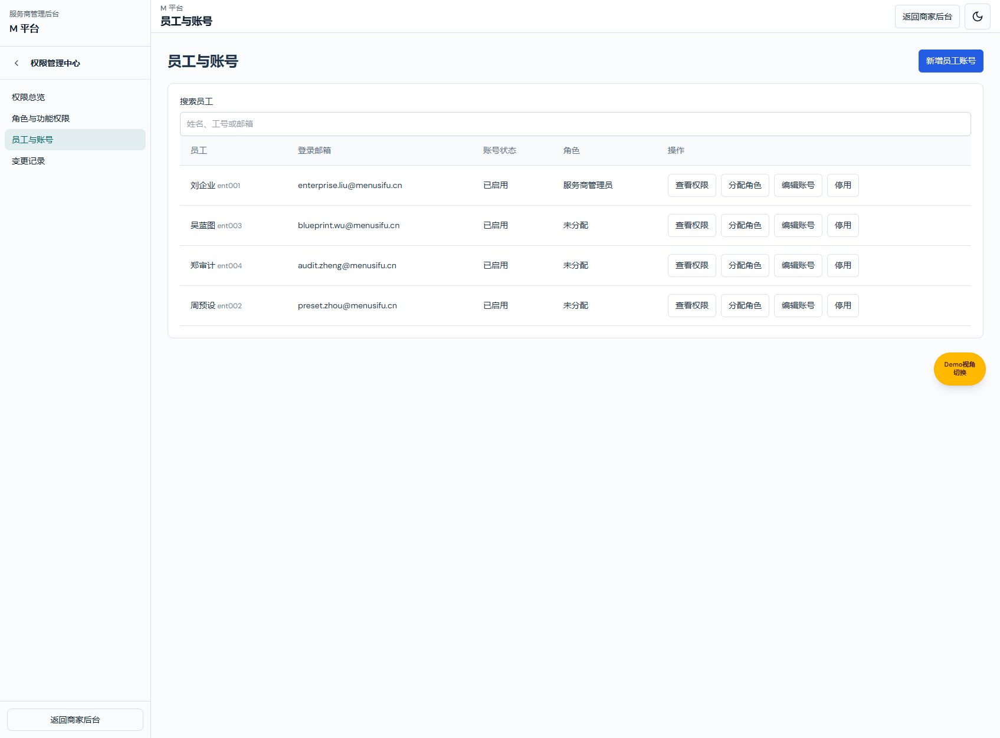

# M 平台内部权限产品权威需求文档

版本：V1.2；日期：2026-10-22；变更编号：M-PERM-NAV-20261022-03。
共同基线：main@70a4b717 + codex/m-platform-nav-header-20261022 工作区。
配套：[产品权威 V1.2](M平台内部权限产品权威需求文档.md) · [研发交付 V1.2](M平台内部权限业务规格说明书（研发交付版）.md) · [个人规范 V1.2](M平台内部权限需求文档（个人规范版）.md)。
状态：按本次确认实现的本地原型；生产服务端鉴权、真实账号服务尚未接入。三份采用同一业务定义。

本文件负责产品范围、已确认规则与验收依据；商家后台权限中心文档继续负责商家权限，不由本文件覆盖。

## 1. 本次确认与范围

用户要求参照商家权限中心，控制服务商内部哪些角色、哪些员工能够访问、查看、设置 M 平台哪些菜单。用户明确不采用员工个人例外，并要求开发。因此采用唯一的角色授权路径：员工绑定一个或多个角色，功能权限由角色合并，不提供个人额外允许、禁止或恢复继承。

本次覆盖 M 平台自己的菜单、页面、独立操作及员工登录账号。共 6 个模块、19 个页面、28 个独立操作；完整清单由 src/permissions/m-platform-catalog.ts 登记，并同时供侧栏及编辑器读取。

不扩展商户数据范围模型、商家后台授权、服务包业务规则、真实邀请、跨服务商多租户隔离或后端 API。原有商户管理数据范围不由“菜单可见”替代；本次不声称实现了逐商户数据过滤。

### 默认演示账号（M-PERM-DEFAULT-20261022-02）

用户明确要求 M 平台默认能够看到数据。默认登录账号 `demo.menusifu.cn` 进入 M 平台时，使用现有初始服务商管理员 `ent001` 的账号状态和角色绑定，因此默认可查看已有数据并配置权限，无需另换企业账号。不新增员工个人例外，不改写已保存角色或员工绑定；其他真实员工、未知账号不走此回退。初始管理员停用或其角色调整后，演示视图也遵守相应结果。

图注：2026-10-22，功能分支 V1.1，用户当前内置浏览器使用默认账号登录后，品牌列表恢复展示张记火锅、杭城小笼、米聚甄选等既有数据。未清理缓存或重建业务数据。

## 2. 权限结构

| 对象 | 完整可选状态 | 生效含义 |
|---|---|---|
| 导航目录 | 不可见／可见 | 不可见时该目录内页面和动作均不生效；下级配置保留 |
| 可设置的页面 | 不可见／可见不可编辑／可编辑 | 控制页面进入和一般编辑；可编辑不自动开放独立动作 |
| 纯查看页面 | 不可见／可见 | 不制造不存在的编辑能力 |
| 独立操作 | 禁止／允许 | 发布、同步、删除、账号操作等逐项控制；修改型动作还要求所属页面可编辑 |

按角色先取允许并集，再应用有效父级门禁。例如角色 A 允许页面只读、角色 B 允许同页编辑，则最终可编辑；如果没有角色允许上级目录可见，页面仍不可访问。导出设备属于独立输出动作，页面可查看且导出允许即可执行，无须制造页面编辑权限。缺失、未知资源及无角色员工默认拒绝。停用账号使全部权限不生效。

所有权限通过角色授予；不存在员工个人例外。新建角色默认为空白权限，复制只复制名称以外的描述和权限，不复制员工绑定。系统管理员作为当前演示环境的明确初始系统角色绑定既有 ent001 员工；不把旧商家权限或 enterprise selection 转换为新目录权限。其余员工初始未分配本模型角色。

## 3. 页面与操作

### 3.1 角色与功能权限

图注：功能分支本地原型，2026-10-22，含验收用“客服只读”角色；示例数据不是生产岗位预置。

列表展示角色名称、描述、成员数和操作。新增、编辑角色、编辑权限、复制、删除直接可见；无权操作禁用。系统角色不可删除，绑定员工的角色必须先处理绑定才能删除。角色名称去首尾空格后必填，最多 30 字，同名忽略大小写判重；描述可空，最多 160 字。

编辑权限进入全屏页面，隐藏外层导航，左侧按 M 平台真实菜单组织，右侧显示选中页面及真实独立操作。搜索与查看不产生草稿。效果预览只显示当前角色草稿允许的菜单，不保存。保存前显示权限差异及影响员工数；确认成功后生效，取消保留草稿。存储失败与版本冲突保留当前草稿并报错。修改后恢复原值不再提示未保存。

### 3.2 员工与账号

图注：功能分支本地原型，2026-10-22，已为一名演示员工绑定验收角色。

统一列表展示工号、姓名、邮箱、启停状态和角色；支持工号、姓名、邮箱的即时包含搜索。分配角色为多选，保存后重新计算最终权限；清空选择则无访问权限，但保留账号。查看权限只读展示有效菜单和操作，不提供个人例外。账号管理、分配角色分别鉴权。

新增账号默认启用且无角色；账号邮箱和密码沿用现有企业账号约束，不新增邮箱域或密码规则。编辑账号的密码留空保留原密码。停用账号保留角色绑定；启用后按当前角色重新计算。至少保留一名启用且能够编辑角色与分配员工角色的管理员，禁止停用最后管理员或移除其关键权限。账号数据沿用既有本地演示存储，不代表生产凭据管理已交付。

### 3.3 权限总览与记录

图注：功能分支本地原型，2026-10-22，统计为当前浏览器保存数据。

总览只读显示角色数、员工账号数、已绑定角色员工数、可授权页面数及最近变更。员工数包含停用账号，已授权员工数按具有非空角色绑定的员工 ID 去重，不代表每人实际有可见页面。变更记录保存操作时间、操作人、对象及前后值；账号审计不保存密码。

## 4. 访问与交互验收

### 导航头部对齐商家后台（M-PERM-NAV-20261022-03）

图注：2026-10-22，功能分支 V1.2，员工与账号页面；权限管理中心名称位于返回箭头右侧，同一行展示。此前页面截图沿用历史业务状态，侧栏样式以本图为准。

所有 M 平台有子菜单的目录共用该头部：移除可见的“返回”文字，仅保留箭头按钮，其右侧为当前父级菜单名。参照商家后台，标题栏高 56px，按钮 40×40px，箭头 18px，菜单名 14px、字重 600；保留商家后台的圆角、悬停、键盘焦点及分隔线样式。辅助技术仍通过“返回上一级菜单”识别按钮用途。点击箭头只返回一层；点击页面保留当前子层及高亮。权限过滤、授权、保存和业务数据均不变。

- 角色目录是 M 平台自身 6 模块，不出现商家后台团队、薪资等菜单作为服务商员工授权对象；平台预设业务编辑器展示商家模板内容不改变此边界。
- 侧栏过滤不可见页面和空目录；仍有一个可访问子菜单的目录保留父子滑层，不平铺替代父目录。子层覆盖菜单区，返回一层，叶子点击后保持当前子层并高亮。
- 未授权直接地址显示“暂无 M 平台访问权限”，不挂载业务页面；配置页只读允许进入并查看设置，禁用设置修改及发布。
- 动作默认禁止，页面可编辑不会自动允许发布、同步或删除；服务包管理路径虽然含 permissions，仍归属服务包模块。
- 服务商账号正常登录后直接进入首个获准 M 平台页面；无菜单时进入无权提示，不要求完成商家首次业态向导。停用企业账号不能回退到演示登录校验。
- 页面、角色保存使用当前授权复核；跨窗口账号停用下一次鉴权即拒绝。权限保存比较 revision，拒绝覆盖新版本。

## 5. 交付与边界

实现为现有 Vite 原型内的本地授权和前端拦截；localStorage 可被使用者修改，不能作为生产安全边界。生产接口必须依据服务商、员工、角色、资源和目标业务对象再次鉴权；本次未接入后端，也不宣称完成跨服务商数据隔离。旧商家与 enterprise-rbac 数据原样保留，不自动迁移授权。未修改 eMenu 子包，无需其嵌入包发布。

验证：TypeScript、纯领域回归、真实浏览器角色新增/编辑/绑定/预览、受限菜单与只读设置，以及持久化失败/并发版本/最后管理员/停用登录回归。具体结果见研发版。V1.1 及之前的功能已提交并合并本地 main；本次 V1.2 导航样式调整已获授权提交并合并本地 main；未获授权推送，未运行 CI/部署。

## 6. 版本记录

| 版本 | 变更编号 | 内容 |
|---|---|---|
| V1.2 | M-PERM-NAV-20261022-03 | 返回箭头与父级菜单名同排，尺寸与商家后台一致；配对研发和个人 V1.2 |
| V1.1 | M-PERM-DEFAULT-20261022-02 | 恢复默认演示账号的 M 平台管理员视图；复用初始角色、保留真实员工限制；配对研发和个人 V1.1 |
| V1.0 | M-PERM-20261022-01 | 建立 M 平台独立目录与仅角色授权；四入口及权限执行接入；配对研发和个人版 V1.0 |
