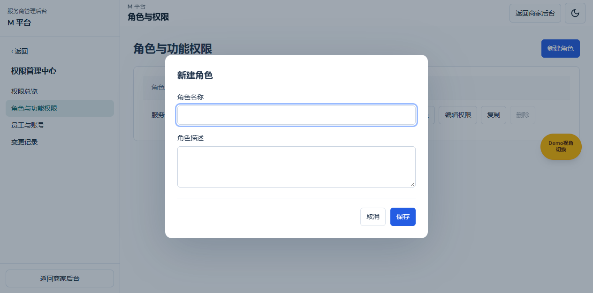
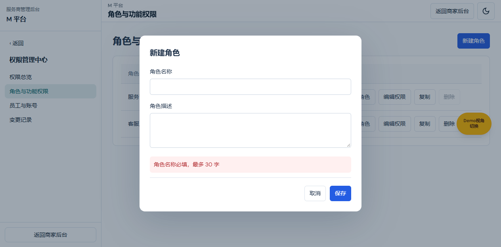
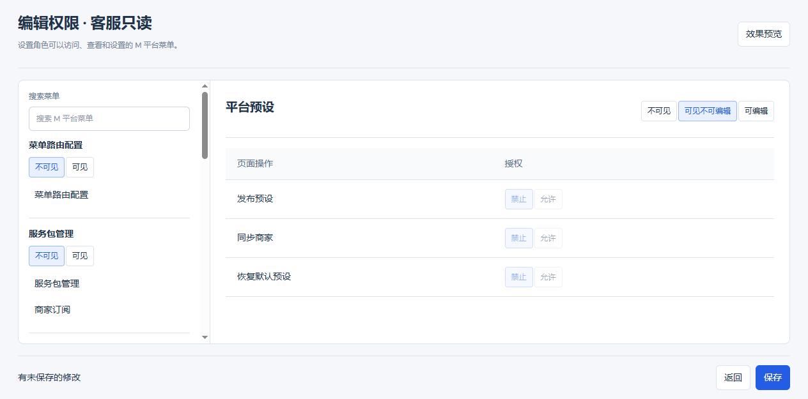
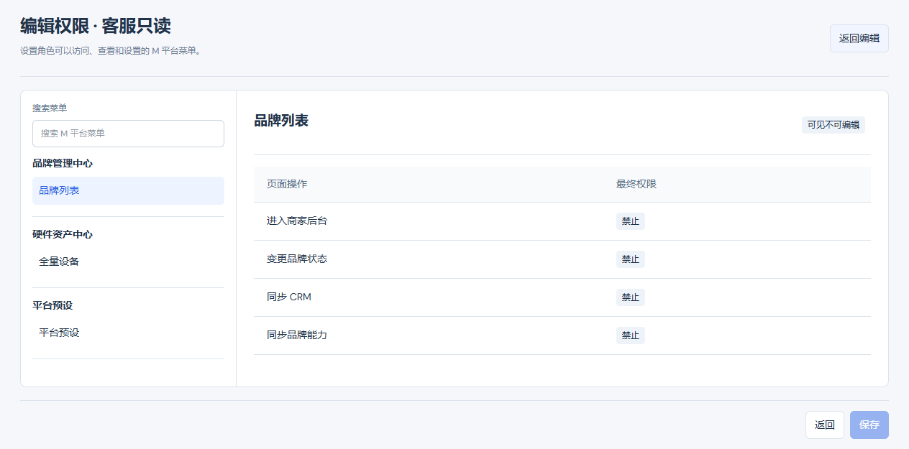
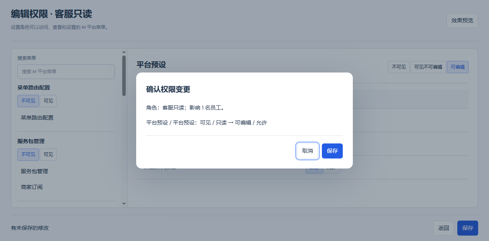
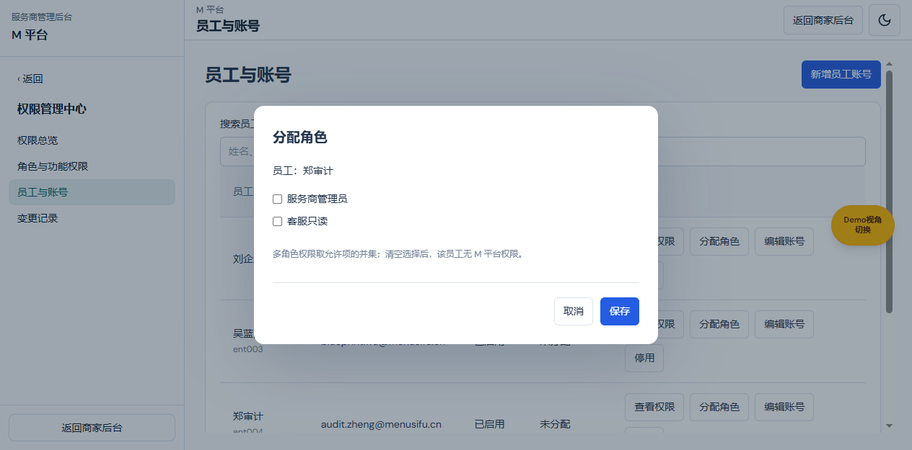
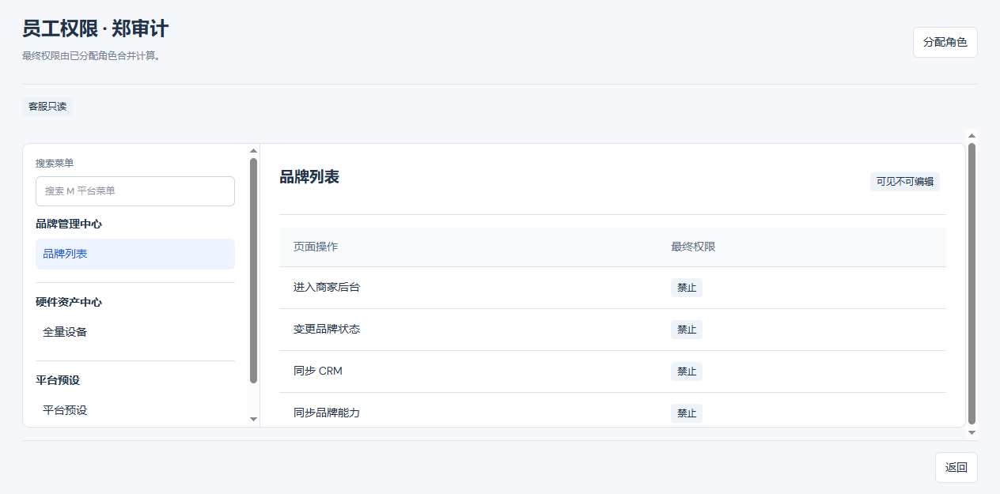
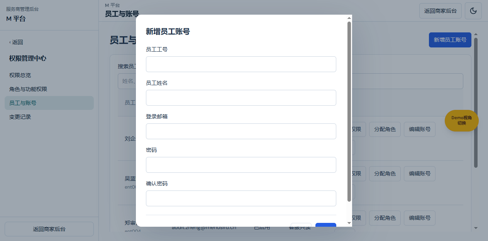
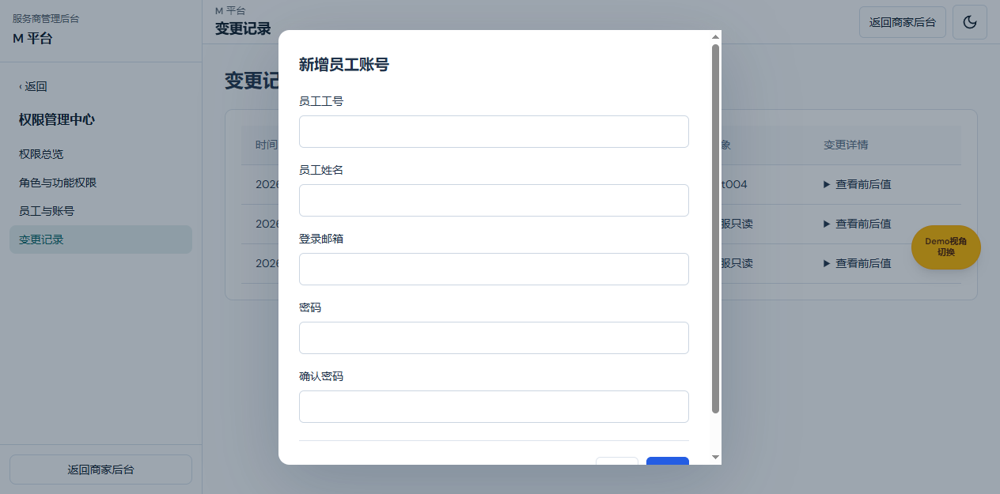

# M 平台内部权限需求文档（个人规范版）

版本：V1.5；日期：2026-10-29；变更编号：USAGE-ENTRY-20261029-62。
共同基线：系统使用分析独立权限目录；起始main@f30e8451。
配套：[产品权威 V1.5](M平台内部权限产品权威需求文档.md) · [研发交付 V1.5](M平台内部权限业务规格说明书（研发交付版）.md) · [个人规范 V1.5](M平台内部权限需求文档（个人规范版）.md)。
状态：按本次确认实现的本地原型；生产服务端鉴权、真实账号服务尚未接入。三份采用同一业务定义。

本文件按页面、图片、区域与元素说明交互，用于页面评审和验收；不独立新增业务决策。

## 系统使用分析独立权限目录

图注：2026-10-29，codex/usage-analysis-entry-20261029，main@f30e8451起始，5257实采；角色编辑中系统使用分析与商户管理中心分别设置模块门槛。

入口：权限管理中心 → 角色与功能权限 → 编辑权限。

| 字段／操作 | 逻辑说明 |
| --- | --- |
| 系统使用分析模块 | m:module:activity-analysis，可见／不可见；独立于m:module:merchants。导航、角色目录与实际资源树一致。 |
| 门店活跃分析 | m:page:merchant-activity，可见／不可见，无业务写操作；父资源为系统使用分析模块。 |
| 设备活跃分析 | m:page:device-activity，可见／不可见；与门店活跃分析分别授权，共用分析模块门槛。 |
| 详情中的使用情况 | 品牌或门店详情权限与门店活跃分析权限同时满足才可进入；单有商户管理编辑权不代表可读分析。 |
| 仅分析角色 | 可查看已授权全局分析；无商户管理权限时不显示品牌/门店管理跳转，也不能直达管理详情的使用情况页。 |
| 多角色与停用 | 保留角色允许并集及祖先门槛；停用账号、缺页权和缺模块权均拒绝。浏览期间撤权后下次交互/重渲染不继续访问。 |
| 历史角色兼容 | 缺目录版本标记的旧记录，按角色复制原商户模块门槛到缺失的新分析模块门槛，不新增或修改任何分析页grant。已显式配置的新门槛（包括不可见）不覆盖。 |
| 新角色 | 默认不可见；不因商户管理可见而自动拥有分析权限。 |
| 旧路由 | /m-platform/merchants/activity与device-activity及原明细地址继续使用；地址保留不表示权限仍归商户中心。 |

### M 平台外壳返回入口（M-PERM-EXIT-20261022-05）

图注：2026-10-22，V1.4 功能分支，实际页面验证截图；此前截图中的右上角、左下角返回商家按钮为历史展示。

| 元素 | 规则与验收 |
| --- | --- |
| 右上角返回商家后台 | 从 M 平台公共页头移除，主题切换保留 |
| 左下角返回商家后台 | 从侧栏移除整个按钮及底部容器，不留空白边框 |
| 子菜单返回箭头 | 保持返回上一级菜单，父菜单名与箭头同行 |
| 权限与数据 | 本次不改变授权、角色、数据加载或业务路由；无权页原有返回链接沿用 |

验证：实际页面两处按钮均不存在；主题切换和侧栏导航仍可操作。TypeScript 与公共递归导航回归通过。本次 V1.3/V1.4 修改按用户授权提交、合并 main 并推送；实际提交号和远端核验结果以 Git 交付记录为准。

## 0. 默认演示登录与数据

图注：2026-10-22，功能分支 V1.1，当前内置浏览器默认登录后已有品牌数据可见。

用途／入口：保留登录页已填充的 demo.menusifu.cn，点击登录，进入 M 平台后打开品牌管理中心 → 品牌列表。

| 字段／操作 | 逻辑说明 |
|---|---|
| 默认演示账号 | demo.menusifu.cn；仍需点击登录；无需切换为其他企业邮箱才可访问 M 平台 |
| 默认角色身份 | 使用已有初始服务商管理员 ent001 的账号状态和角色绑定；不新增员工个人授权，也不重写授权存储 |
| 品牌列表数据 | 展示现有业务数据源，正常默认状态能看到已有品牌；不清理缓存、不重建数据、不借此改变数据范围 |
| 真实员工 | 继续按自己绑定的角色计算，无角色不继承演示管理员权限 |
| 停用与角色调整 | 初始管理员停用或角色受限时，演示视图同样遵守；不提供无条件绕过 |

## 1. 公共导航与权限状态

图注：2026-10-22，V1.3 功能分支；主层菜单上方不再重复显示 M 平台，品牌区保留。旧图中主层重复标题不作为现行要求。

| 字段／操作 | 逻辑说明 |
|---|---|
| 品牌区平台标题 | 保留左上角服务商管理后台下的 M 平台，位置与内容不变 |
| 菜单主层标题 | 删除菜单路由配置上方的重复 M 平台节点，不留空白占位 |
| 主层首项 | 直接展示菜单路由配置，其他 5 个入口继续按原顺序展示并沿用权限过滤 |
| 子层父级标题 | 保留箭头后同排的当前目录名称，不因删除主层标题而隐藏 |

图注：2026-10-22，功能分支 V1.2，权限管理中心子层。返回箭头与菜单名同一行展示；其他章节历史截图用于业务说明，导航头部以本图为准。

入口：登录服务商员工账号后进入首个可访问 M 平台页面；管理员通过权限管理中心配置角色和员工。

| 字段／操作 | 逻辑说明 |
|---|---|
| 一级目录 | 来源为 M 平台目录；只有目录可见且至少一个页面可见时展示。品牌、硬件等有子菜单的条目点击整行进入覆盖式滑层 |
| 返回箭头 | 无可见“返回”文字；40×40px 圆角按钮，18px 箭头；保留辅助技术名称“返回上一级菜单”。点击仅退出一层，不改变业务页、授权或草稿 |
| 子层标题 | 当前父级目录名称，位于箭头右侧同一行；字号 14px、字重 600，标题栏高 56px，样式和间距与商家后台相同；过长名称单行省略 |
| 子菜单 | 只展示有效可见页面；点击进入原业务地址，子层保持且当前项高亮 |
| 不可见／可见 | 目录及纯查看页的配置选项；不可见阻断直接访问，不删除下级配置 |
| 不可见／可见不可编辑／可编辑 | 可设置页面的配置选项；一般编辑需可编辑，独立动作另行允许 |
| 禁止／允许 | 独立动作选项；默认禁止，修改型动作还需要页面可编辑 |
| 公共返回商家按钮 | 页头右上角和侧栏左下角均不展示；无权页链接见对应章节 |

### 无权访问状态

图注：功能分支 2026-10-22，受限员工直接输入角色管理地址。

| 字段／操作 | 逻辑说明 |
|---|---|
| 暂无 M 平台访问权限 | 当前员工无页面权限、账号停用或权限数据不可用时展示；原业务页不挂载 |
| 说明 | 普通无权提示联系管理员分配角色；账号停用时明确提示停用 |
| 返回商家后台 | 退出无权页的既有导航，不保存或改变任何授权 |

## 2. 权限总览

图注：功能分支 2026-10-22，含验收角色的当前浏览器数据。

用途／入口：权限管理中心 → 权限总览，只读查看配置规模和最近变更。

| 字段／操作 | 逻辑说明 |
|---|---|
| 角色 | 当前保存 roles 数量，整数；无角色为 0；不含未保存的新建输入 |
| 员工账号 | 当前企业账号数量，包含停用账号，不含商家账号 |
| 已授权员工 | roleIds 非空的员工按 ID 去重计数；不等同于实际可访问页面人数 |
| 可授权菜单页 | 当前 M 目录页面数，当前 19；不统计每个动作，也不统计商家模板内部页面 |
| 最近变更 | 共用变更记录数据源，新记录在前；无记录显示“暂无变更记录”；统计卡不可作为跳转按钮 |

## 3. 角色与功能权限列表

图注：功能分支 2026-10-22，服务商管理员和验收用客服角色；示例不是生产预置岗位。

用途／入口：权限管理中心 → 角色与功能权限。

| 字段／操作 | 逻辑说明 |
|---|---|
| 角色名称 | 保存名称；系统角色同时显示系统标签；改名不改变 ID 或员工绑定 |
| 描述 | 保存描述；空值显示“—” |
| 成员数 | 绑定该角色的员工 ID 去重数；包含停用账号；点击展示成员姓名，缺账号时保留员工 ID |
| 新建角色 | 需要新建动作允许；打开空白角色弹框；默认不带任何权限 |
| 编辑角色 | 需要编辑角色动作允许；打开该行名称与描述；不改变权限或成员 |
| 编辑权限 | 打开该角色全屏权限页；仅有查看权限时配置控件只读 |
| 复制 | 需要新建动作允许；名称留空，复制描述和权限；不复制员工绑定，仍受操作者授权上限约束 |
| 删除 | 系统角色禁用；有成员时提示先解除绑定；确认删除空成员自建角色并记录审计；取消不写入 |

待补页面图片：删除角色的浏览器原生确认框；已有成员时的阻止提示。

### 3.1 新建／编辑／复制角色弹框

图注：功能分支 2026-10-22，新建空白角色；编辑和复制沿用该弹框布局及各自标题、默认值。

用途：从列表对应操作打开，始终携带当前行角色 ID 或新建上下文。

| 字段／操作 | 逻辑说明 |
|---|---|
| 标题 | 根据入口为新建角色、编辑角色或复制角色 |
| 角色名称 | 必填，最多 30 字；保存去首尾空格；忽略大小写判重；新建及复制默认空，编辑回填保存值 |
| 角色描述 | 可空，最多 160 字；编辑与复制回填原值；新建默认空 |
| 保存 | 校验名称、描述、当前动作权限、版本和授权上限；成功关闭、刷新列表并增加审计；失败保留输入 |
| 取消／关闭 | 关闭弹框，不写角色、不新增成员、不保存输入 |

图注：功能分支 2026-10-22，空名称提交后显示必填错误，弹框保留。

## 4. 全屏角色权限编辑

图注：功能分支 2026-10-22，验收角色的预设页只读配置，尚未保存。

用途／入口：角色列表 → 编辑权限。隐藏外层导航，返回后仍为角色列表。

| 区域内字段／操作 | 逻辑说明 |
|---|---|
| 对象标题 | 显示编辑权限及角色名称；未知或已删除角色显示不存在 |
| 搜索菜单 | 即时按模块名称或页面名称包含匹配；默认空；仅影响菜单展示，不改变授权、不产生草稿 |
| 目录状态 | 每个 M 平台模块的不可见／可见；父级隐藏后保留下级配置并阻断生效 |
| 页面条目 | 点击切换右侧；保留左侧滚动位置，不保存、不标脏 |
| 页面状态 | 按公共状态选择；上级不可见时控件禁用，并显示上级门禁说明 |
| 页面操作名称 | 来源为该页面已登记的真实业务操作；无独立动作时明确说明，不补造按钮 |
| 操作允许状态 | 独立禁止／允许；修改型操作在页面只读时禁用；导出类输出动作只要求页面可见 |
| 效果预览 | 切换预览视图；使用当前角色草稿计算，不写存储；只显示获准菜单和最终操作结果 |
| 返回 | 无真实差异直接返回；有差异由浏览器确认放弃，取消离开保留编辑页和草稿 |
| 未保存提示 | 仅相对保存值确有差异时出现；再次选择原状态、恢复全部原值不提示 |
| 保存 | 无差异时禁用；有差异打开确认弹框；失败保留原编辑及草稿 |

待补页面图片：真实草稿离开时的浏览器原生确认框；存储失败与跨窗口版本冲突提示。

### 4.1 效果预览

图注：功能分支 2026-10-22，验收角色仅可见品牌、设备和预设三个页面。

| 字段／操作 | 逻辑说明 |
|---|---|
| 可见菜单 | 按草稿角色有效权限过滤，空模块不显示 |
| 页面权限标签 | 显示最终不可见、只读或可编辑；不允许在预览中修改 |
| 独立操作结果 | 显示允许或禁止，受上级和页面门禁计算 |
| 返回编辑 | 恢复编辑状态，原草稿保留，不自动保存 |

### 4.2 确认权限变更

图注：功能分支 2026-10-22，预设页由只读改为可编辑的真实草稿确认；本次验收取消该改动。

| 字段／操作 | 逻辑说明 |
|---|---|
| 角色 | 当前编辑角色名称 |
| 影响人数 | 当前绑定角色的员工数，包含停用账号；不等于当前在线人数 |
| 变更差异 | 每个与保存值不同的资源逐项列出业务名称、原状态、目标状态 |
| 保存 | 重新校验动作权限、revision 和最后管理员；成功写入权限及审计，清除草稿并刷新 |
| 取消／关闭 | 不写入，返回原草稿；后续仍可继续调整或重新保存 |

## 5. 员工与账号列表

图注：功能分支 2026-10-22，企业账号数据源；验收员工已绑定角色。

用途／入口：权限管理中心 → 员工与账号；旧员工登录账号地址兼容进入此页。

| 字段／操作 | 逻辑说明 |
|---|---|
| 搜索员工 | 默认空；姓名、工号或邮箱忽略大小写包含匹配；即时刷新列表；不修改角色或账号 |
| 员工 | 企业账号姓名及工号；工号绑定后不可在账号编辑中修改 |
| 登录邮箱 | 当前企业账号邮箱；不显示密码 |
| 账号状态 | enabled 为真显示已启用，否则已停用；停用保留角色但阻断权限和登录 |
| 角色 | 来自新 M 权限模型的角色名称；空集合显示未分配；不把旧 enterprise selection 自动转换为授权 |
| 查看权限 | 打开该员工有效权限全屏页，携带 employeeId |
| 分配角色 | 单独需要分配动作；打开多选弹框，默认回填当前绑定 |
| 新增员工账号 | 单独需要账号管理动作；打开新建账号表单；保存成功默认启用、无角色 |
| 编辑账号 | 单独需要账号管理动作；打开该行账号信息，密码不回显 |
| 停用／启用 | 单独需要账号管理动作；二次确认后切换 enabled；最后管理员停用被阻止；取消不写入 |

待补页面图片：启用／停用账号的浏览器原生确认框。

### 5.1 分配角色弹框

图注：功能分支 2026-10-22，验收员工首次分配前的空选择状态。

| 字段／操作 | 逻辑说明 |
|---|---|
| 员工 | 当前操作对象姓名，缺失账号时保留 ID |
| 角色复选项 | 来源为当前全部角色，多选；保存时校验角色有效和操作者可授予上限，不可通过分配角色越权 |
| 多角色说明 | 告知允许并集；不提供个人例外；全部清空等于无 M 平台权限 |
| 保存 | 写当前员工 roleIds，其他员工不变；重新计算有效权限并写审计；移除最后管理员关键授权时拒绝 |
| 取消／关闭 | 保留原绑定，不保存此次勾选 |

### 5.2 员工最终权限

图注：功能分支 2026-10-22，郑审计继承验收角色后的只读最终结果。

| 字段／操作 | 逻辑说明 |
|---|---|
| 员工标题 | 当前 employeeId 对应的企业账号姓名 |
| 角色标签 | 当前绑定角色名称；没有绑定时显示尚未分配角色 |
| 停用提示 | 当前账号停用时显示，全部权限按无权处理，绑定仍保留 |
| 菜单与操作 | 只显示最终可访问菜单及独立操作状态，不提供直接修改入口或个人例外 |
| 分配角色 | 打开本员工角色绑定弹框，成功后刷新最终权限 |
| 返回 | 返回员工列表，不写权限 |

### 5.3 新增员工账号

图注：功能分支 2026-10-22，空表单；图中不包含凭据。

| 字段／操作 | 逻辑说明 |
|---|---|
| 员工工号 | 必填，保存去首尾空格，不能与现有企业账号重复；成功后作为角色绑定标识 |
| 员工姓名 | 必填，最多 30 字；保存去首尾空格 |
| 登录邮箱 | 必填，仅现有 Menusifu 企业邮箱域 cn/com；忽略大小写归一化和判重 |
| 密码 | 新建必填，至少 6 位，沿用现有演示账号规则；不会写进权限审计 |
| 确认密码 | 必须与密码一致；不独立持久化 |
| 保存 | 校验账号管理权限、字段和重复身份；账号启用但不分配任何角色；写入失败显示错误并保留表单，不污染账号缓存 |
| 取消／关闭 | 不创建账号，不创建授权 |

### 5.4 编辑员工账号

图注：功能分支 2026-10-22，既有员工编辑态，新密码及确认密码不回显。

| 字段／操作 | 逻辑说明 |
|---|---|
| 员工工号 | 回填并只读，不改变员工身份或绑定 |
| 员工姓名 | 回填，可修改，约束与新增一致 |
| 登录邮箱 | 回填，可修改，排除自身后判重；修改自己的登录邮箱成功后同步会话邮箱 |
| 新密码 | 默认空；留空保留旧密码，填写时按新增长度规则校验 |
| 确认密码 | 修改密码时必须一致；不保存到权限日志 |
| 保存 | 成功更新当前账号并记录脱敏审计；不改变其角色绑定；失败保留输入和原授权 |
| 取消／关闭 | 不修改账号或角色 |

## 6. 变更记录

图注：功能分支 2026-10-22，角色创建、权限配置与员工绑定的真实验收记录。

用途／入口：权限管理中心 → 变更记录；总览使用同一记录源。

| 字段／操作 | 逻辑说明 |
|---|---|
| 时间 | 保存成功时产生的时间；按浏览器本地时区显示；新记录在前 |
| 操作人 | 本次服务商企业账号姓名快照 |
| 操作 | 新建、复制、编辑、删除角色、编辑角色权限、分配角色、账号修改或启停 |
| 对象 | 当前角色名称或员工身份；未成功保存不写成功记录 |
| 查看前后值 | 展开本次保存前后快照；账号记录只含工号、姓名、邮箱、启停及是否修改密码，不包含密码 |
| 空状态 | 没有记录时显示暂无变更记录，不把读取失败显示为无数据 |

## 7. 只读设置与交付边界

图注：功能分支 2026-10-22，受限员工进入既有 POS 配置预设页，允许浏览分类，禁止修改及发布。

| 字段／操作 | 逻辑说明 |
|---|---|
| 只读说明 | 可设置页面仅 read 时展示“当前页面为只读，暂无修改权限。” |
| 导航、搜索、筛选 | 允许正常查看；不因无编辑权全部禁用 |
| 设置复选框与编辑控件 | 禁用；即使位于可点击分类按钮内部，也不能继承分类导航的放行条件 |
| 发布、同步、恢复、删除 | 按动作独立鉴权，修改型动作还要求页面 edit；无权禁用 |
| 设备导出 | 页面可见且独立导出允许才可用；不把只读页面自动视为可导出 |

边界：当前为单服务商浏览器原型，未接入生产服务端鉴权、真实凭据服务、跨服务商隔离或新的商户数据范围。不修改商家权限规则、原始旧授权存储或 eMenu 子包。生产安全不能依赖前端 localStorage。

配图覆盖本次新增页面和主要弹框。停用二次确认、离开确认采用浏览器原生确认框，待补其独立图片；存储配额失败、跨窗口版本冲突已脚本验证，待补对应错误态图片，不宣称异常态图片覆盖完整。

## 8. 版本记录

V1.3，M-PERM-LABEL-20261022-04：删除主层重复平台标题，保留品牌和子层标题；配对产品/研发 V1.3。

V1.2，M-PERM-NAV-20261022-03：导航返回去可见文字，父级标题置于箭头后同排；配对产品、研发 V1.2。

V1.1，M-PERM-DEFAULT-20261022-02：默认登录可见 M 平台既有数据；配对产品与研发 V1.1。

V1.0，M-PERM-20261022-01：与产品和研发 V1.0 同步；逐元素说明仅角色授权、四入口及操作后果。

本轮独立分析模块的验证及未闭合项见[USAGE-ENTRY-20261029-62](../verification/usage-analysis-entry-20261029/README.md)。
