# M 平台内部权限需求文档（个人规范版）

版本：V1.14；日期：2026-11-03；变更编号：EMPLOYEE-WORKBENCH-20261103-01。
共同基线：员工权限工作台双层页签与保存态生效预览；起始本地 main@750b4cb3。
配套：[产品权威 V1.14](M平台内部权限产品权威需求文档.md) · [研发交付 V1.14](M平台内部权限业务规格说明书（研发交付版）.md) · [个人规范 V1.14](M平台内部权限需求文档（个人规范版）.md)。
状态：按本次确认实现的本地原型；生产服务端鉴权、真实账号服务尚未接入。三份采用同一业务定义。

本文件按页面、图片、区域与元素说明交互，用于页面评审和验收；不独立新增业务决策。

## 员工权限工作台（EMPLOYEE-WORKBENCH-20261103-01）

共同基线：本地 main@750b4cb3，功能分支 codex/employee-access-tabs-20261103，外部 Chrome 功能预览 5318。用户已授权提交并合并本地 main，未授权推送；实际提交和合并结果以 Git 核验为准。本节替代 V1.13 上下双区及独立预览跳转的交互定义；两类角色、范围、保存校验和演示数据不迁移。

截图来源统一为 2026-11-03 当前功能分支、外部 Chrome、5318 端口的隔离本地演示数据。临时角色和范围修改用于验收，已恢复原配置，保留本地测试日志，不代表真实商户授权历史。

### 逐操作覆盖清单

| 页面 / 操作 | 入口 → 界面 / 结果截图 | 当前结果 |
| --- | --- | --- |
| 员工工作台入口 | returned-list → config-m / legacy-merchant | 身份、状态、两组页签定位正确 |
| 切换角色配置 / 生效权限 | both-drafts → merchant-saved-snapshot / m-saved-snapshot → m-draft-retained / merchant-draft-retained | 两类草稿保留，预览只取保存快照 |
| 切换 M / 商户维度 | cross-dimension-draft / both-drafts / effective-m / effective-merchant | 四种组合，保留当前工作方式 |
| 键盘右箭头切换维度 | M 草稿 → remove-draft | 已实测；Home / End / 左箭头未单独截图 |
| M 角色勾选及取消 | config-m → m-draft-retained；returned-list 显示恢复结果 | 已选数量、未保存标记正确 |
| M 角色保存确认 | m-draft-retained → m-save-confirm → m-saved-refreshed | 只更新 M；商户草稿仍在 |
| 商户添加授权 | config-merchant → add-binding → required-binding | 标题右侧入口，空角色/范围不能加入草稿 |
| 商户编辑授权 | config-merchant → edit-binding → both-drafts | 原角色、两门店回填；加入待保存配置后才成为草稿 |
| 商户移除 | config-merchant → remove-draft | 只移除草稿，保存快照仍可预览 |
| 商户保存确认 | merchant-draft-retained → merchant-save-confirm → merchant-saved-refreshed | 保存后再次切入预览取新角色 |
| 系统管理员商户区 | config-m → system-merchant | 只读说明，不显示添加/保存按钮 |
| 点击菜单 | effective-m → menu-detail | 详情随所选菜单更新 |
| 搜索菜单 | effective-m → menu-search / menu-search-empty | 定位菜单与无匹配空态；清空恢复列表 |
| 显示全部权限 | m-saved-snapshot → all-permissions | 含不可见菜单和禁止操作 |
| 展开 / 收起操作组 | effective-m → action-groups / all-permissions | 允许默认展开，禁止默认收起，状态可切换 |
| 切换商户目标 | merchant-saved-snapshot → target-switch | 仅所授权两店，目标角色与菜单上限联动 |
| 返回列表 / 继续编辑 | remove-draft → leave-confirm → leave-cancel | 单一双维提示，取消留页保留草稿 |
| 返回列表 / 放弃并离开 | leave-confirm → returned-list | 一次确认后离开，已保存授权未变 |
| 旧链接 | merchant-access → legacy-merchant；旧 staff/:id → final-workbench | 商户配置 / M 生效的默认定位正确 |

本次没有全量重跑历史模块的每项异常操作；缺少本版本的多角色（超过 5 个）搜索截图、受限员工真实登录、停用画面、保存取消/并发/写入失败和原生刷新关闭确认截图，保留原规则并登记为截图缺口，不声明全部操作或异常截图完整。

### 工作台身份与双层页签

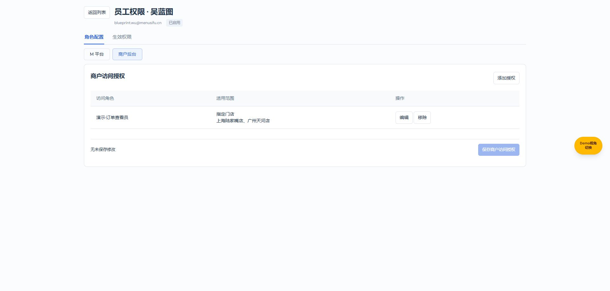

| 元素 | 逻辑说明 |
| --- | --- |
| 返回列表 | 位于标题左；真正离开当前员工时检查全部维度草稿，不因为当前面板没有修改就忽略隐藏维度 |
| 标题 / 邮箱 / 启停 | 标题为员工权限及姓名；账号目录提供邮箱、enabled。不存在提示员工不存在；停用角色配置保留，但生效权限不可访问 |
| 工作方式 | 角色配置、生效权限。仅切换当前内容，不提交、不丢草稿、不弹离开提示；维持当前 M / 商户维度 |
| 权限维度 | M 平台、商户后台。独立保存；有草稿的维度标注未保存，切换后标记仍保留；支持左右箭头及 Home / End 焦点和选择 |
| 生效提示 | 任一维草稿存在且正在看生效权限时显示“存在未保存的修改，当前仅展示已保存的生效权限。”；没有草稿或返回配置时不展示 |
| 内容与滚动 | 一次只展示当前组合；生效页左树和右详情各自滚动，避免把所有菜单/操作纵向平铺到页面底部 |

### M 平台角色配置与独立保存

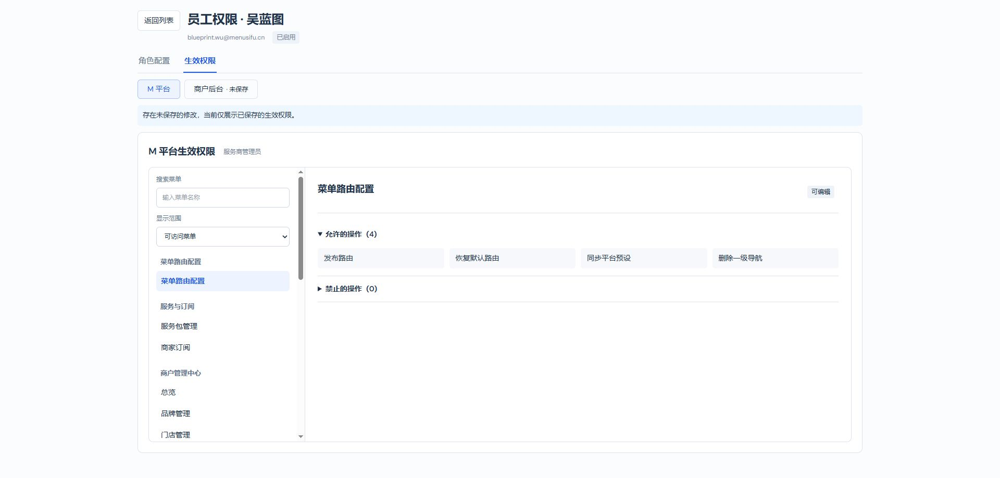

| 字段 / 操作 | 逻辑说明 |
| --- | --- |
| 角色多选 | 回填已保存 M roleIds，默认 []；已选数为当前草稿 ID 数。清空后该员工无 M 平台权限，不删除商户绑定 |
| 搜索角色 | 角色数超过 5 个才展示，按名称匹配；筛选不清除未显示的已选角色。无匹配显示没有匹配角色。本版本没有构造超过 5 个角色的浏览器截图 |
| 保存与状态 | 每维一个保存按钮；无变更显示无未保存修改并禁用。无 staff/assign 时只读、不显示可保存按钮。确认弹框沿用员工、待保存角色及保存范围说明 |
| 成功 | saveMState 仍校验当前操作者、revision、授权上限及最后管理员；仅更新 M 保存快照、revision、日志、脏状态。切回生效页读取新保存结果 |
| 取消 / 失败 | 原取消、并发冲突、最后管理员、持久化错误规则保留，草稿不丢、不把失败标成已保存；其弹框本版本截图待补，不将上一版截图冒充本版 |

### 商户角色、品牌 / 门店范围与独立保存

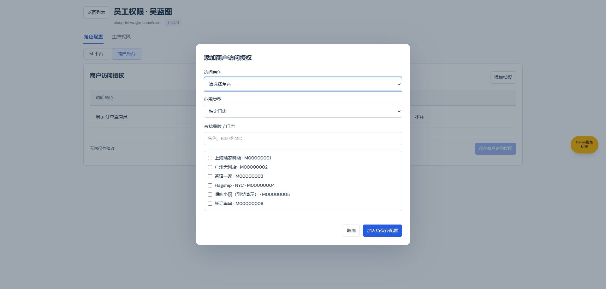
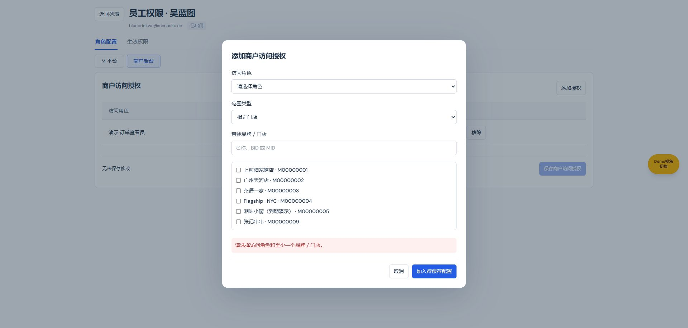
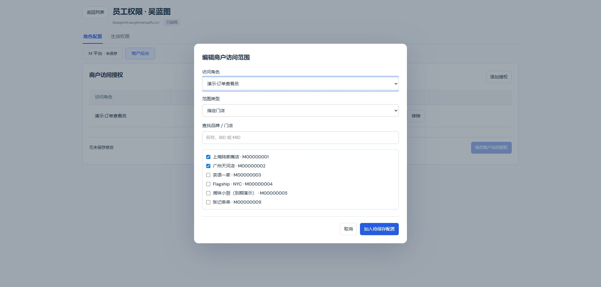
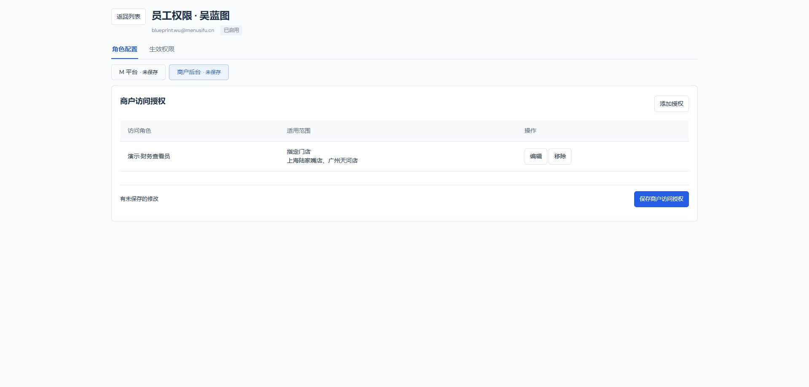

添加授权位于区域标题右。继续要求一个有效访问角色和至少一个当前操作者可授权的品牌/门店；空选提示请选择访问角色和至少一个品牌／门店。编辑保持原绑定 ID、scope.mode、scope.ids 的回填；加入待保存配置不直接生效。范围搜索、切换清空确认和取消弹框沿用原规则。

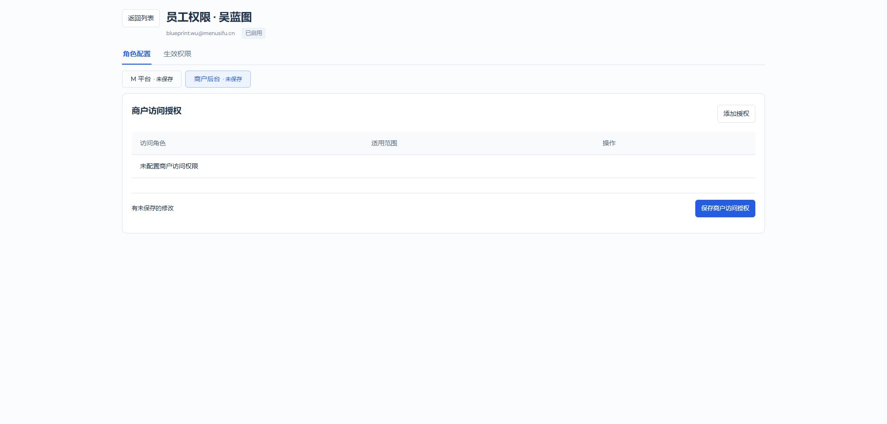
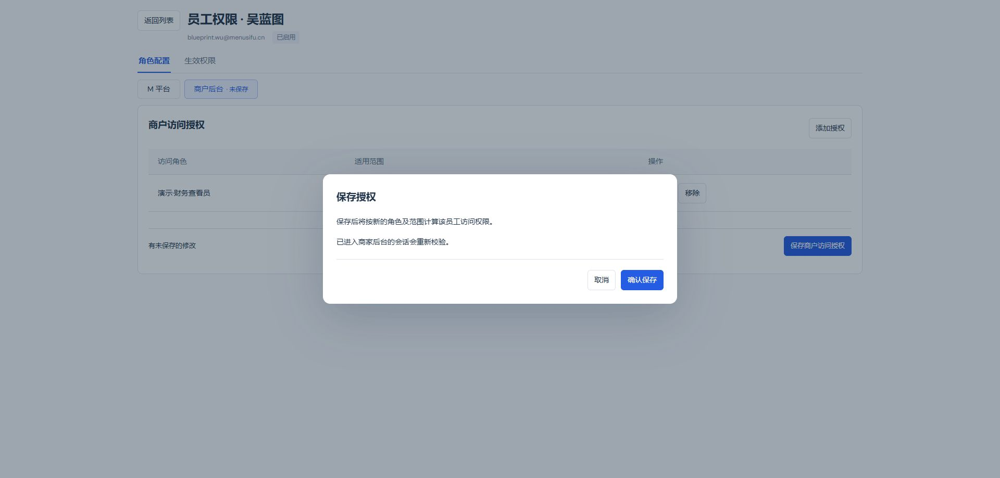

移除仍只修改本维草稿；在保存前，生效页继续取原绑定。保存沿用 saveProviderState 的 manage 动作、revision、目标和菜单上限、系统兼容 ID 及有效角色校验，原会话重校验与日志写入不变。只影响商户源，不能清除 M 草稿。已保存后再次切入生效页显示新角色；失败/取消保留草稿，当前版本异常截图待补。

系统兼容员工显示全部品牌/门店、按商户菜单上限访问；不显示添加或保存商户授权按钮。普通只读用户也不显示可保存按钮；没有 provider-roles 查看权限不读取/挂载商户明细，只显示无查看权限说明。不因选择 M 管理员角色自动获得系统兼容商户身份。

### 生效权限：保存快照与草稿隔离

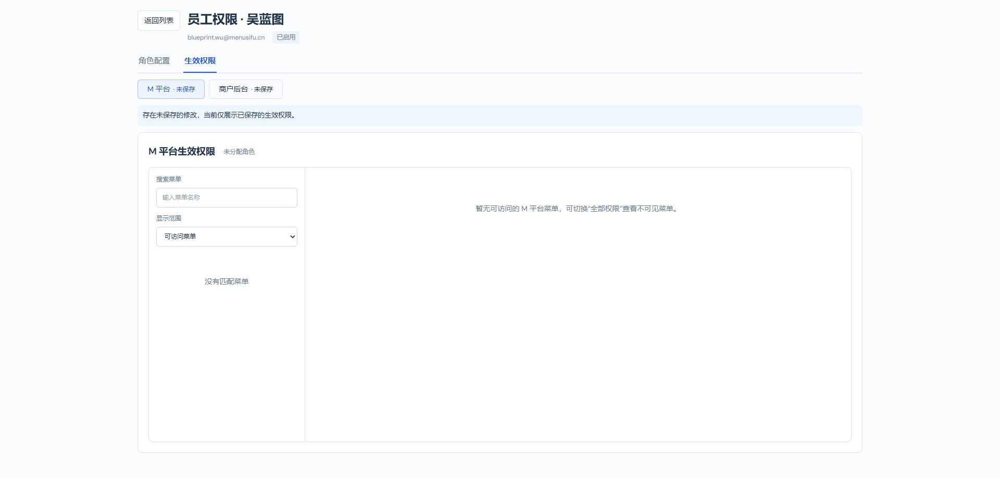

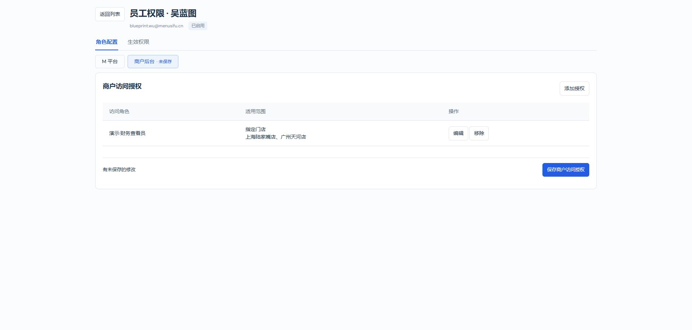

角色配置的两个 DOM 和草稿在页签间保留；生效页不接收配置草稿。每次从角色配置切入生效权限，重新取已保存快照；同一轮生效页内换维度不重建已挂载预览，不丢其搜索/选择。生效页读取新版本不能覆盖配置区的并发基线，返回配置后仍按原 revision 保存，冲突时仍拒绝覆盖。

### M 生效权限：菜单树、搜索与详情

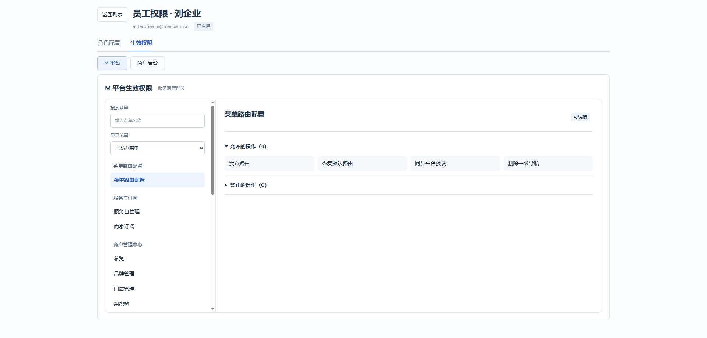
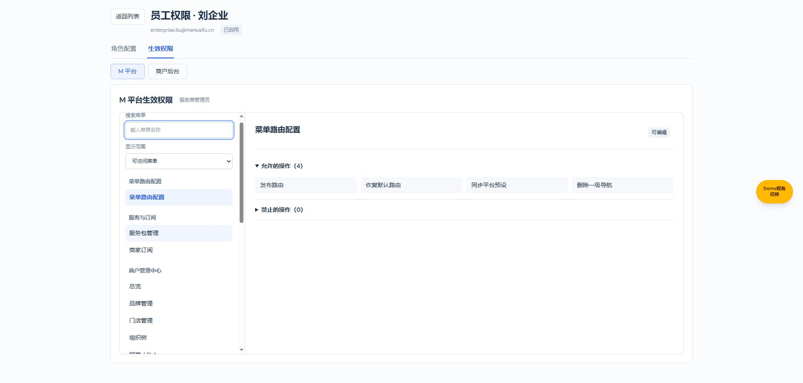

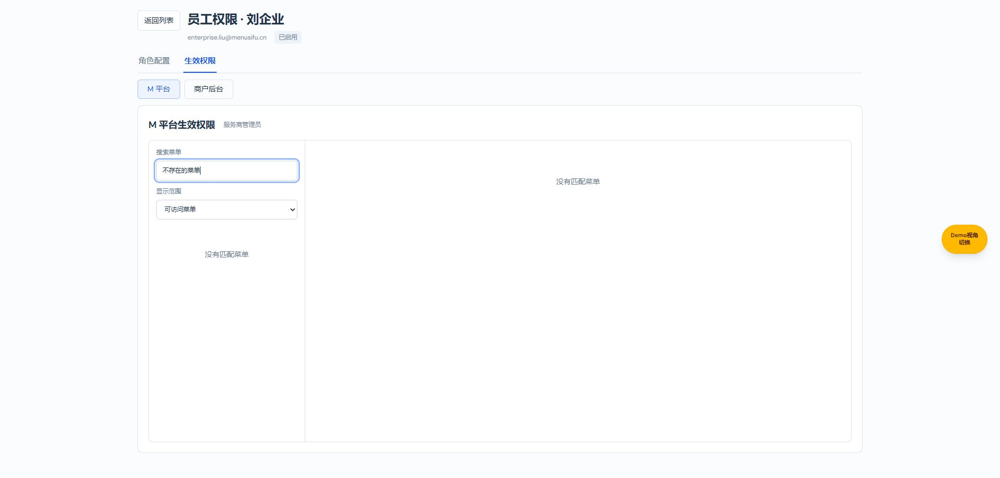
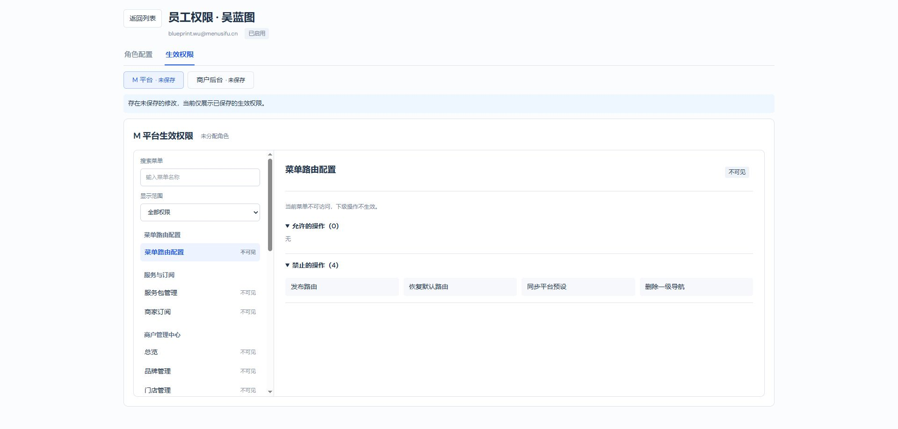
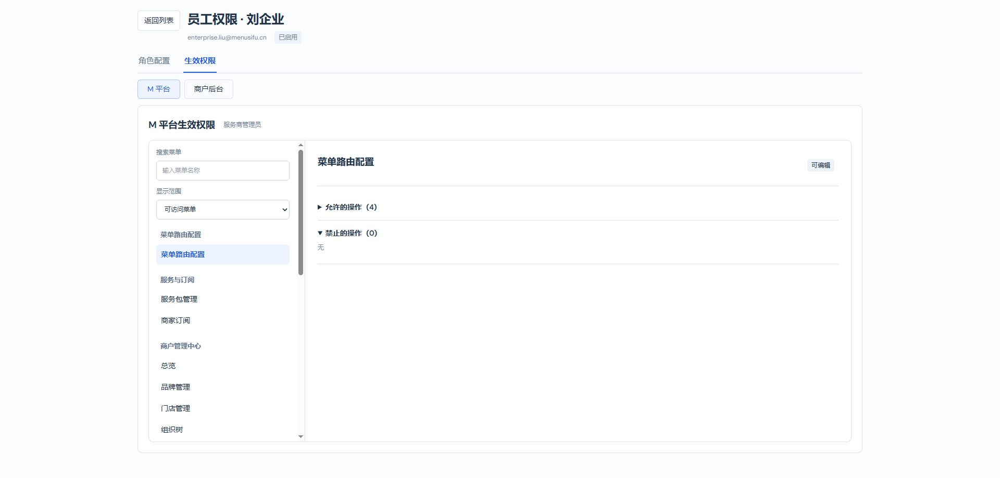

| 元素 | 逻辑说明 |
| --- | --- |
| 角色摘要 | 仅取已保存员工 M 角色名称；没有显示未分配角色，不读取勾选草稿 |
| 搜索菜单 | 按模块名、菜单名匹配，不改变授权；没有匹配显示空态，清空恢复当前显示范围的菜单 |
| 显示范围 | 默认可访问菜单，即 mResolve 页面结果非 hidden；全部权限包含不可见菜单。切换不新增授权 |
| 菜单树 | 按 M 模块分组，点击叶子在右侧显示菜单，当前项高亮；过滤导致原选择消失时选择第一个匹配菜单 |
| 详情状态 | 用已保存角色并集、上级门槛与 enabled 计算可编辑/可查看/不可见。隐藏菜单说明下级操作不生效，无独立操作时给出说明 |
| 允许 / 禁止操作 | 每项按 mResolve(action) 是否 edit 分组，允许默认展开，禁止默认收起；显示组内数量，可展开/收起，空组显示无。仍允许页面只读但获独立输出动作（如导出）的既有规则 |

### 商户生效权限：范围和目标菜单上限

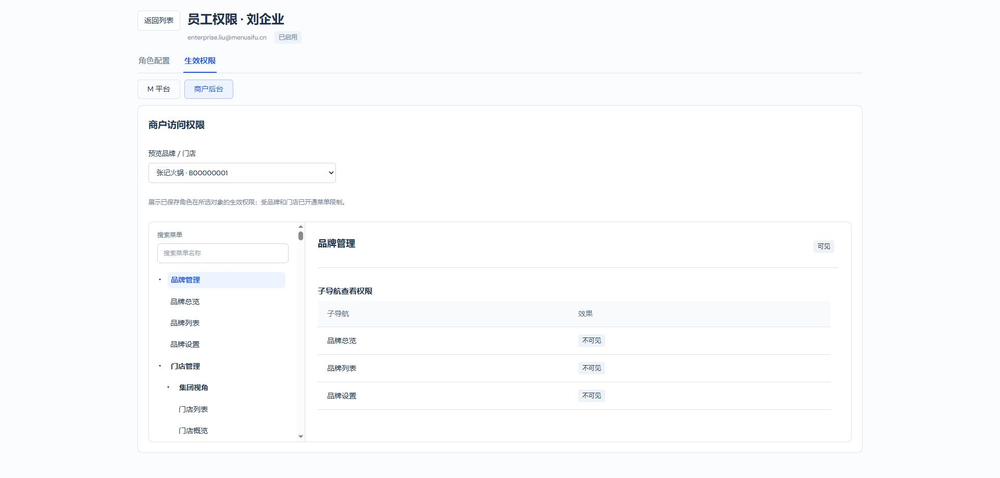

复用商户权限菜单树与详情。预览目标同时满足员工已保存范围和当前操作者可访问范围；展示当前目标匹配的已保存角色（去重），系统兼容身份显示系统管理员。切换目标重新计算角色并集与品牌 ceiling、门店 enabledKeys 映射资源集的交集。停用、无匹配范围、未开通菜单均不能产生可访问结果；截图中演示订单/财务角色受目标菜单上限限制为空态，不为演示开放权限。

### 真正离开员工：一次确认、保留保存结果

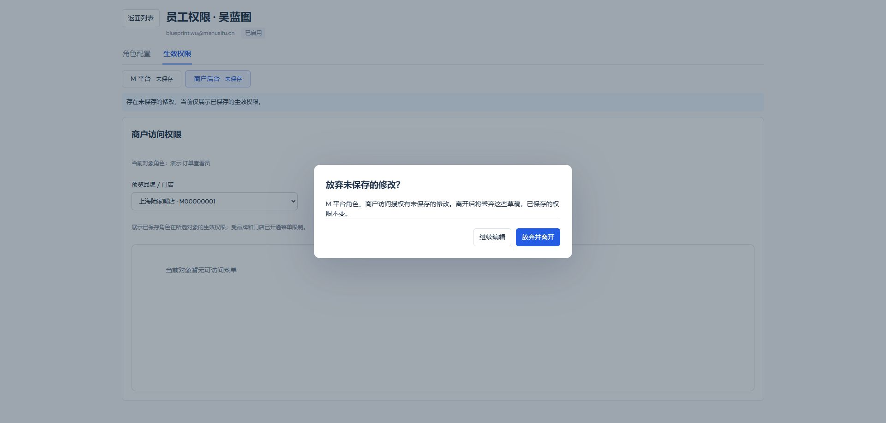

普通页签切换不提示。返回列表、进入其他员工或其他实际 hash 路由时，如存在任一维草稿，统一工作台弹框列出受影响维度。继续编辑留在原页签和地址、保留全部草稿；放弃并离开清除离开拦截后执行原目标导航，只丢未保存内容，不回退已保存的角色、范围或日志，也不再连弹第二个维度确认。刷新/关闭仍使用浏览器 beforeunload，当前原生层截图待补。

### 旧入口与当前地址

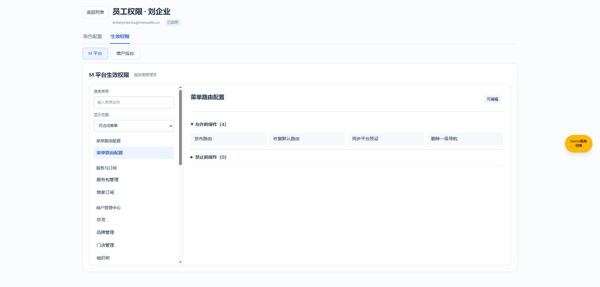

/roles 默认角色配置＋M；/roles/preview 与旧 /staff/:id 默认生效权限＋M；旧 /merchant-access 默认角色配置＋商户；surface=merchant 定位商户维度。内部页签通过 replaceState 更新同员工地址，不触发 hashchange 或重挂配置区；更新离开保护的返回地址。真实导航、刷新与关闭继续受草稿保护，旧链接原路由可见性检查不放宽。

### 当前验证状态与边界

类型检查与员工路由/摘要、M 菜单及动作分组（含只读页独立输出动作）、停用/未知员工、快照不可变测试通过；原演示数据保护、M 角色、商户访问 16 项及集中日志隔离回归通过。外部 Chrome 实测四种组合、键盘维度切换、两类草稿跨页签、生效只取保存数据、保存刷新、两维标记、系统只读无保存、树搜索/空态/全部过滤、操作折叠、目标切换、统一离开取消/放弃与旧入口。当前测试未覆盖项见清单；不把前端演示验证等同于生产服务端鉴权或部署验证。

## 历史布局：员工统一角色与权限配置（EMPLOYEE-ACCESS-CONFIG-20261103-01）

本节记录 V1.13 历史布局；当前页签、保存态预览和离开提示以 EMPLOYEE-WORKBENCH-20261103-01 为准。原角色与范围规则保留。既有两类角色、员工绑定、演示数据及授权校验继续有效，不迁移或合并存储。共同基线 main@a0ed2503，功能分支 codex/employee-role-config-20261103，外部 Chrome 功能验收端口 5317；用户已授权提交并合并本地 main，未授权推送；实际结果以 Git 交付核验为准。

图注统一：2026-11-03 当前功能分支，外部 Chrome 真实截图；独立端口的本地演示数据，不是真实商户授权操作。测试中的临时 M 角色和商户绑定已恢复，保留测试操作的本地审计记录。

### 本次逐操作覆盖清单

| 操作 | 入口 → 操作界面 → 结果 | 验证情况 |
| --- | --- | --- |
| 配置角色与权限 | staff → config / final-config | 两维同页、员工与原绑定回填 |
| 查看权限 / 权限预览 | config → preview / m-admin-preview | 已保存状态，只读，两维独立 |
| 切换预览对象 | preview → preview-target | 仅员工与当前操作者可访问目标，两家门店切换 |
| 勾选 / 取消 M 角色 | config → both-dirty | M 草稿独立，清空后无 M 权限 |
| 保存 M 角色，取消确认 | both-dirty → m-confirm → m-cancel | 不写入，保留两类草稿 |
| 保存 M 角色，确认 | m-confirm → m-saved-provider-dirty | 仅 M 维度已保存，商户草稿仍在 |
| 添加商户授权，必填校验 | brand → binding-add → binding-required | 空角色/范围不能加入草稿 |
| 编辑商户授权，取消 | config → binding-edit → binding-cancel | 回填角色与两门店，取消不修改绑定 |
| 编辑商户授权，加入草稿 | binding-edit → both-dirty | 待保存，不立即生效 |
| 移除商户绑定 | brand → binding-remove-draft | 仅草稿移除，保存前原授权继续生效 |
| 保存商户授权，取消确认 | both-dirty → provider-confirm → provider-cancel | 不写入，保留两类草稿 |
| 保存商户授权，确认 | provider-confirm → provider-saved-m-dirty | 仅商户维度已保存，M 草稿仍在 |
| M 保存失败：最后管理员 | m-confirm → last-admin-error | 拒绝保存，保留草稿 |
| M 保存失败：并发冲突 | m-confirm → concurrent-error → concurrent-draft | 拒绝覆盖，取消弹框后草稿仍在 |
| 商户草稿离开：取消 / 放弃 | binding-remove-draft → provider-leave → provider-stay / returned-list | 取消留页，放弃丢草稿并返回 |
| M 草稿离开：取消 | M 角色修改 → 系统确认框 | 已验证不跳转；原生层截图待补 |
| 返回列表 / 返回配置 | config → returned-list；preview → config | 页面与目标员工保持正确 |
| 旧商户授权链接 | 旧 merchant-access URL → legacy | 进入同一统一页面 |

覆盖边界：本次没有补齐旧模块全部操作截图。受限员工真实登录、账号停用画面、存储损坏/写入失败、商户保存并发失败、范围搜索与切换确认的异常截图待补；其既有规则保留。原生确认框无法用网页截图代替，未声称全部操作或全部异常截图完整。

### 员工列表：双维摘要与统一入口

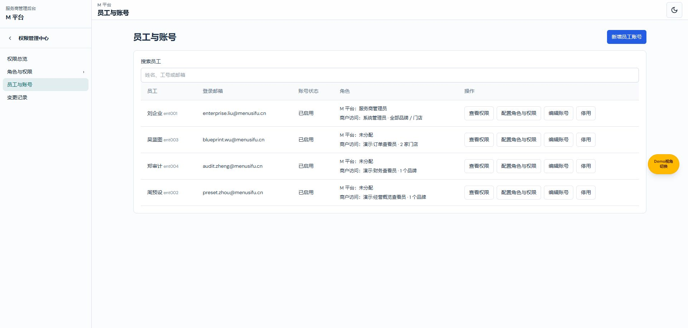

| 元素 | 逻辑说明 |
| --- | --- |
| 角色摘要 / M 平台 | 来源为 MState.employees.roleIds，通过角色 ID 映射名称；无角色显示未分配，失效引用显示失效角色；不根据商户授权推导 M 角色 |
| 角色摘要 / 商户访问 | 来源为该员工每条 ProviderBinding，逐条显示访问角色名和 scope.ids.length；brands 单位为个品牌，stores 为家门店，多条用分号连接，不将不同范围合成一个总数量 |
| 系统员工摘要 | systemEmployeeIds 中的员工显示“系统管理员 · 全部品牌／门店”，仍受商户菜单上限限制 |
| 空值与异常 | 无绑定显示未配置；无商户角色页权限显示无查看权限，不读取该明细；数据解析失败显示数据读取失败，保留独立 M 维度 |
| 配置角色与权限 | 替换旧分配角色按钮和独立商户访问授权链接；导航到 /m-platform/permissions/staff/:id/roles；员工页可见即可进入查看，各维写操作另校验 |
| 查看权限 | 旧 /staff/:id 继续可用，展示双维只读预览，不能编辑或将草稿当作已生效权限 |

### 配置页：M 平台角色与商户访问授权

| 元素 / 字段 | 逻辑说明 |
| --- | --- |
| 返回列表 / 标题 / 权限预览 | 返回在页面标题左，权限预览在右；返回员工列表，预览带当前 employeeId。存在任一维草稿均先执行离开保护 |
| 员工信息 | 由既有员工账号目录按 ID 查询姓名、邮箱、enabled。不存在则提示员工不存在；停用显示全部权限不生效，不删除原角色与范围 |
| M 平台角色 | string[] 角色 ID，多选，默认已保存 roleIds 或 []；清空即无 M 角色。仅 staff/assign 可编辑。角色并集、上级菜单约束与最后管理员保护沿用 |
| 商户授权区域 | provider-roles 页不可见时仅显示无查看权限，不调用商户编辑器或读取该区域明细；可见但无 manage 动作时只读。系统兼容员工不显示可修改绑定 |
| 商户访问角色 | 每条绑定一个有效商户角色 roleId；配置入口不修改角色本身的菜单定义 |
| 品牌 / 门店范围 | 保持 scope.mode=brands 或 stores、非空且不重复的 scope.ids，角色与范围必须同时指定。品牌含新增门店，指定门店不自动包含新门店，也不能提升为品牌访问 |
| 两类保存与状态 | 每区独立按钮、独立已保存/未保存状态。无变更或无对应动作权限时禁用。成功仅更新本区快照、revision、日志并解除本区脏状态；另一维草稿保留 |

### M 平台角色：勾选、保存、取消与失败

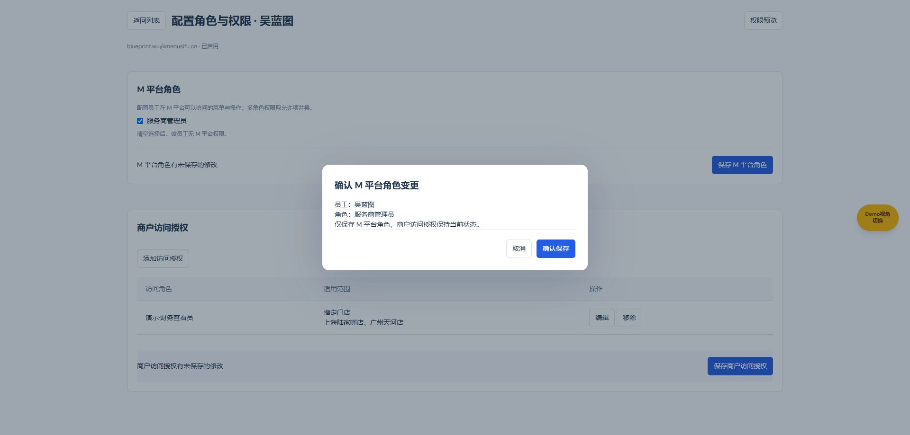

确认弹框列员工和待保存角色，空选择显示未分配。取消仅关闭弹框，不写存储；确认调用 saveMState，gate=staff/assign，沿用授权上限、有效账号、revision 与最后一名启用管理员检查。保存对象为员工 ID，日志动作沿用分配角色，不含账号凭据。成功无跨维事务，不保存商户草稿。

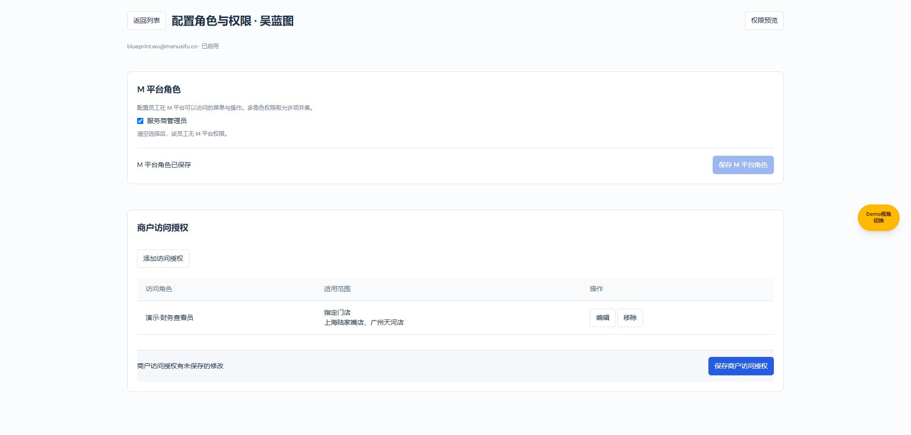
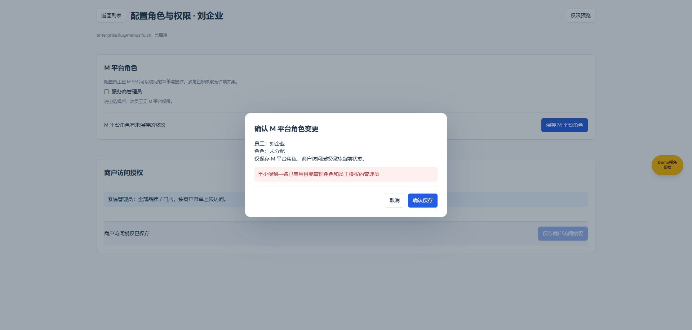
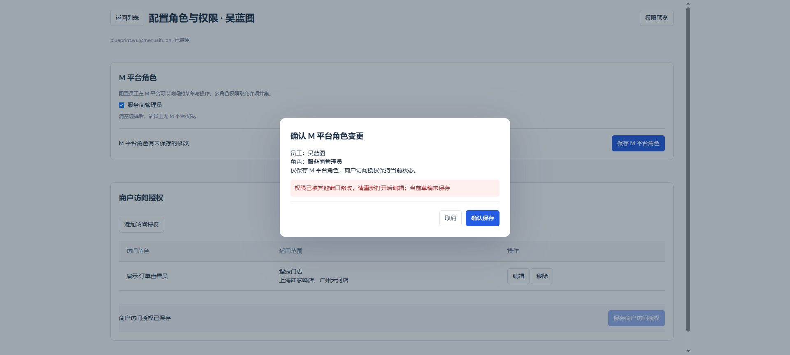

失败不关闭弹框，不更新本区保存状态、不写入成功日志，保留勾选。并发失败须重新打开获取新快照后复核，不自动覆盖其他窗口，不自动合并未确认配置。

### 商户授权：添加、编辑、取消与移除

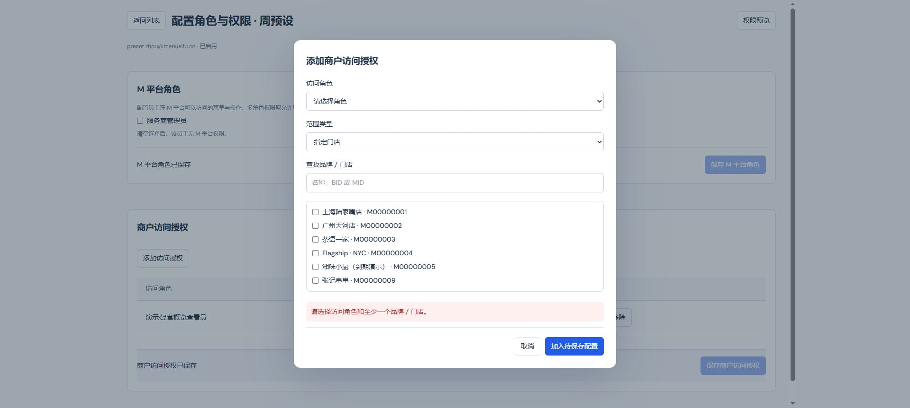

新增默认指定门店、未选择角色/对象；至少选择一个有效角色和一个当前操作者可授权品牌/门店。失败提示“请选择访问角色和至少一个品牌／门店。”，留在弹框，不增加绑定。范围搜索、切换时清空确认沿用原交互，无新增范围语义。

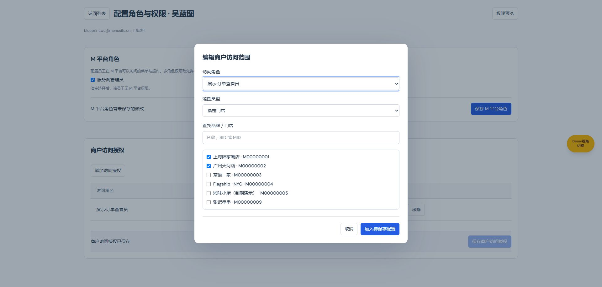
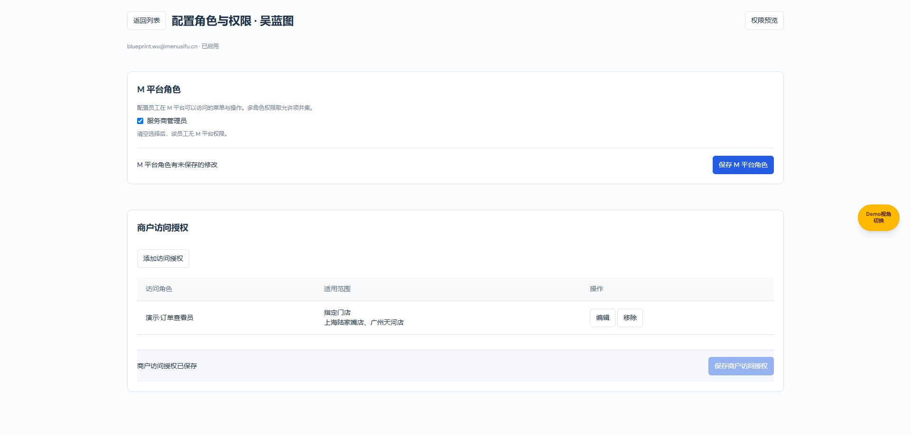

编辑复用原绑定 ID；加入待保存配置仅更新商户草稿。取消只关闭，不修改已有绑定，也不清空 M 草稿。

移除只影响本区草稿；提交前原保存绑定有效。要恢复可放弃本区草稿并重新进入，不在点击移除时直接写日志。

### 商户授权：保存确认、取消及独立结果

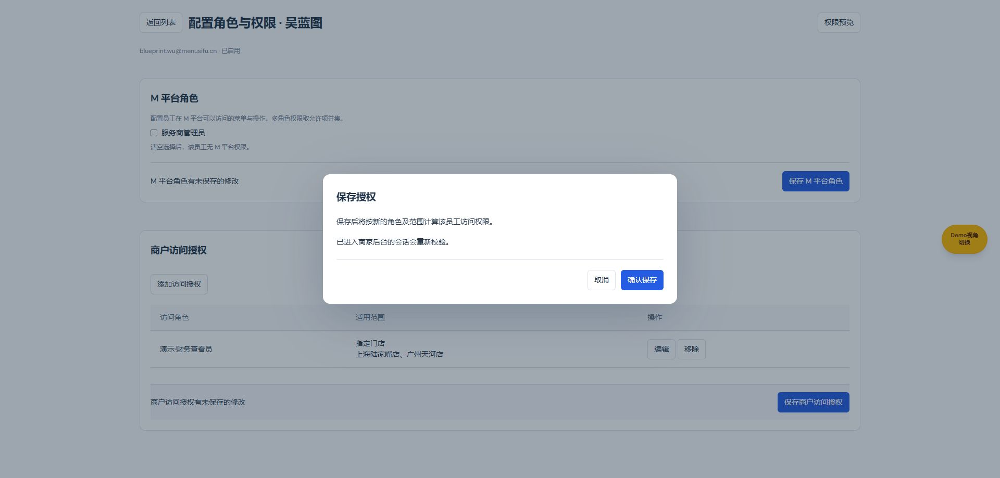
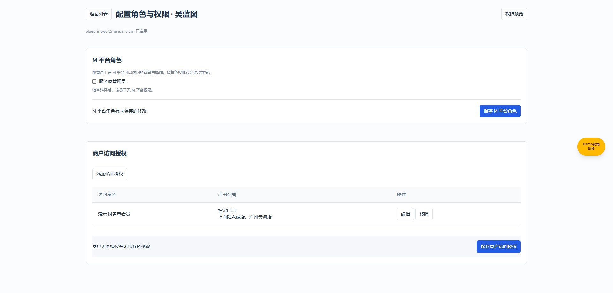

确认仍调用 saveProviderState，校验 provider-roles/manage、当前操作者、expected revision、有效角色和目标、可授权对象与菜单上限、系统兼容 ID 不变。成功更新商户源 revision 和日志，动作沿用更新商户访问范围，触发既有会话重校验。失败保留草稿并展示原错误，不修改 M 状态；写入失败与商户并发错误截图待补。正常保存后的两个状态见下图。

### 离开保护、返回及旧链接

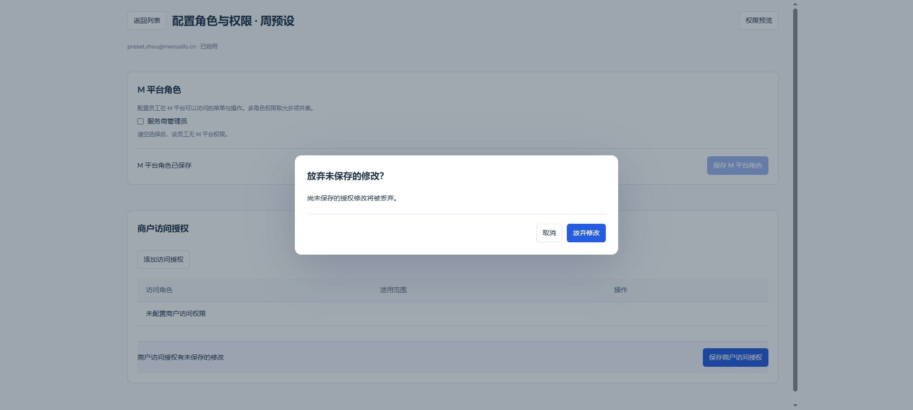

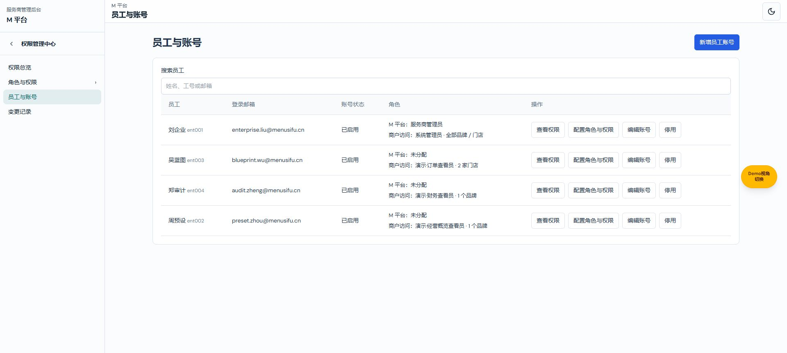

任一维未保存都阻止直接跳走。M 草稿使用既有浏览器原生确认，准确文案“M 平台角色有未保存的修改，确定放弃并离开？”；取消留页，确认继续检查另一维。商户草稿沿用自定义放弃弹框，取消留页；确认放弃后仅丢未保存内容并执行原目标导航。已保存内容与记录不回退；刷新/关闭页签仍有 beforeunload 保护。M 原生确认的真实截图待补。

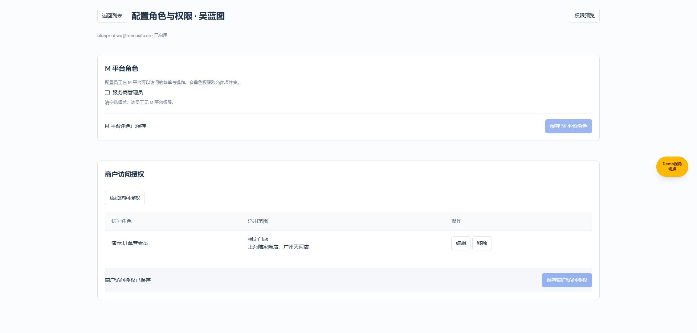

旧地址兼容到统一配置实现，不进行数据迁移；旧链接仍保留原路由权限检查。角色定义入口仍在角色与权限菜单，不并入员工账号编辑。

### 权限预览与切换目标

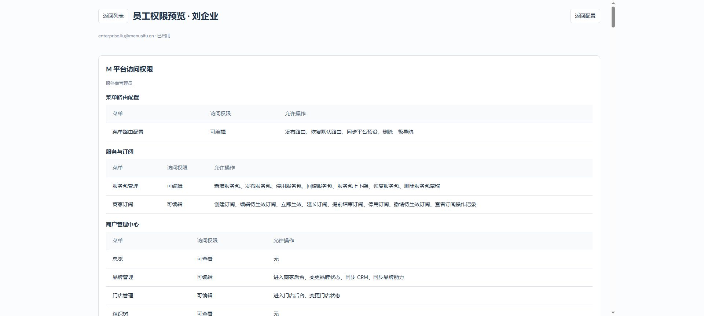

| 元素 / 计算 | 逻辑说明 |
| --- | --- |
| M 平台访问权限 | 仅取已保存 M 角色并集及账号 enabled，用 mResolve 计算菜单与动作；隐藏菜单不列出，无允许动作显示无，无菜单显示暂无可访问的 M 平台菜单 |
| 预览品牌／门店 | 对象必须同时匹配员工已保存绑定与当前操作者可访问范围；指定门店绑定不出现品牌层目标，不出现未授权门店；默认第一个有效目标，无目标显示暂无可预览范围 |
| 商户访问权限 | providerRoleAccess 的角色并集与所选品牌 ceiling、门店 enabledKeys 映射资源集求交；账号停用、范围不匹配或任一上限不含该资源均不可见。不把预览结果自动作为 M 入口或代登录动作授权 |
| 空态 | 角色有配置但目标菜单未开通时显示当前对象暂无可访问菜单；不为演示强行开放。截图中两店订单角色受实际菜单上限限制出现此状态 |
| 只读与保存源 | 预览没有保存按钮、不写日志；未保存修改须先保存或明确放弃才能离开配置页。两类配置各自成功后才进入各自已保存预览源 |
| 返回配置 | 回到同一员工的 /roles，不重置另一员工数据 |

### 实现与验证记录

复用 m-platform-store.ts 与 provider-access-store.ts，不改变存储键、schema、日志来源或系统兼容 ID。新 employee-access-ui.ts 组合两区及离开保护；provider-access-ui.ts 增加嵌入和员工只读预览；employee-access-domain.ts 负责路由解析、摘要与员工权限/上限交集。

类型检查、统一/旧路由、摘要、范围与双上限、停用预览测试通过；M 平台角色与动作回归、商户访问 16 项、预设演示数据保护、集中日志隔离回归通过。外部 Chrome 实测双向保存隔离、确认取消、最后管理员拒绝、双窗口并发拒绝且草稿保留、添加必填、编辑回填、移除草稿与放弃、旧链接、预览目标切换。未验证项见覆盖清单，不宣称生产服务鉴权或全部异常截图完成。

## 员工商户访问授权演示数据（PROVIDER-EMP-DEMO-20261103-01）

演示数据规则继续有效；本节独立授权页截图与入口属于历史，当前统一配置入口见 EMPLOYEE-ACCESS-CONFIG-20261103-01。

基线本地 main@8505040b；分支 codex/provider-employee-demo-20261103；外部 Chrome 功能验收端口 5316。用户已授权提交并合并本地 main；未授权推送，实际提交与合并结果以 Git 交付核验为准。本次在尚无保存授权数据的演示环境补充员工绑定，不覆盖已有角色、员工范围或日志，不修改员工的 M 平台内部角色。

### 逐操作覆盖清单

| 页面 / 操作 | 入口与结果图片 | 状态 |
| --- | --- | --- |
| 员工列表进入商户访问授权 | staff → ent002 / ent003 / ent004 | 三位员工各自页面已验证 |
| 编辑已有演示绑定 | ent003 → edit-binding | 角色、范围类型和两店选中状态已验证 |
| 取消编辑 | edit-binding → ent003 | 保留原绑定，未产生保存日志 |
| 刷新授权页 | ent003 → ent003-refresh | 内容保留，无真实草稿提示 |
| 查看角色关联人数 | role-members | 三个角色各 1 人 |
| 查看集中日志 | logs | 6 条演示记录 |
| 按订单角色查看日志 | role-members → role-logs | 角色预设与员工授权预设共 2 条 |

图注统一为 2026-11-03 当前功能分支外部 Chrome 真实截图。所有带“演示”的角色和记录为本地测试数据，不代表真实授权操作历史。本次未新增页面操作，其他保存、删除和异常交互沿用；未对历史全量操作截图作完整性结论。

### 员工与账号入口

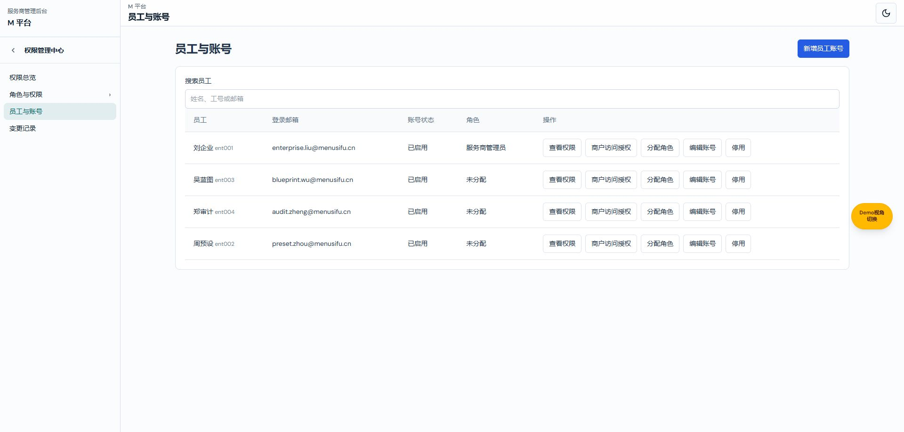

点击员工行“商户访问授权”查看其访问角色与品牌/门店范围。列表“角色”仍为 M 平台内部角色，不因本次商家访问绑定自动分配 M 平台角色、代登录动作或其他菜单权限。

### 周预设的品牌授权

| 字段 | 逻辑说明 |
| --- | --- |
| 员工 | 周预设，ent002 |
| 访问角色 | 演示·经营概览查看员，仅查看权限 |
| 适用范围 | 品牌（含新增门店）：默认演示目录的张记火锅 |
| 数据来源 | 仅匹配现有启用的系统演示账号 acct-ent002；不存在、被替换或停用时不生成该预设绑定 |

### 吴蓝图的指定门店授权

| 字段 | 逻辑说明 |
| --- | --- |
| 员工 | 吴蓝图，ent003 |
| 访问角色 | 演示·订单查看员 |
| 适用范围 | 指定门店：上海陆家嘴店 M00000001、广州天河店 M00000002 |
| 范围边界 | 仅所选门店；不自动包含新门店，不提供品牌层访问；仍受目标菜单上限和既有入口权限约束 |

### 郑审计的另一品牌授权

| 字段 | 逻辑说明 |
| --- | --- |
| 员工 | 郑审计，ent004 |
| 访问角色 | 演示·财务查看员 |
| 适用范围 | 品牌（含新增门店）：茶语一家，与周预设的品牌分离 |
| 管理员边界 | ent001 既有系统兼容范围不变，不创建新系统管理员 |

### 编辑回填与取消

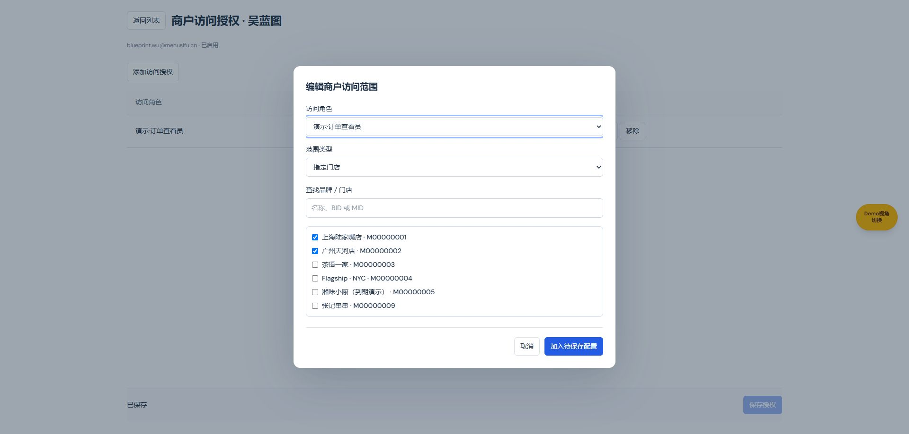

角色回填订单查看员，范围类型为指定门店，两家对应门店选中，其余未选。原校验及“加入待保存配置→保存授权”流程不变。

取消不变更草稿、绑定或记录。仅查看页面也不产生真实授权日志。

### 刷新、关联人数与日志

初始演示环境中，每个角色关联 1 位员工。更新角色描述，移除旧“未关联员工”表述；既有删除时绑定校验仍生效，不能直接删除仍有员工绑定的演示角色。

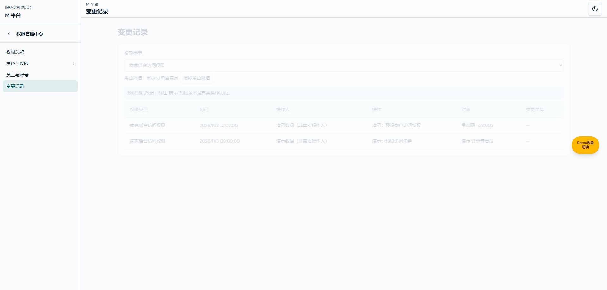

| 字段 / 初始化规则 | 逻辑说明 |
| --- | --- |
| 初始化边界 | 仅 provider-merchant-access:v1 存储键不存在时生成；已有合法空/非空快照原样读取，损坏数据仍报错，不追加演示授权 |
| 有效对象 | 从默认演示企业 enterprise-miju 的现有目录按 BID 排序取前两个品牌；门店按 MID 取前两店；仅绑定 ent002/003/004 的既有启用系统演示账号。目录缺失时跳过对应空范围，不虚构品牌或门店 |
| 角色权限 | 继续使用现有三个演示查看角色，不授予 action 或 setting 编辑权限；员工绑定只声明对象范围 |
| 日志数量 | 原 3 条角色预设，加 3 条员工授权预设，共 6 条；具体数量随有效演示账号和目录是否存在而减少 |
| 授权预设日志 | 固定演示时间 2026-11-03 10:01 / 10:02 / 10:03（UTC+8），操作“演示：预设商户访问授权”，操作人“演示数据（非真实操作人）”，对象为员工姓名及 ID |
| 前后快照 | 只含角色与员工绑定；按样例顺序记录加入绑定前后的员工数组，不含账号密码 |
| 持久化 | 初始化和查看不写授权存储，revision 保持 0；后续用户正常保存仍经原授权、并发版本和目标范围校验 |
| 无自动迁移 | 已有保存数据不会被本次样例扩展，包括曾保存空授权的账号；不自动将之前保存的零员工状态改成已授权 |

### 验证结果

类型检查通过；领域测试覆盖 3 员工/6 日志、品牌隔离、指定门店与新增门店边界、只读权限、缺失账号/目标跳过、既有快照不迁移；原授权 16 项与集中日志隔离回归通过。浏览器验证三位员工详情、编辑回填/取消、刷新、三个角色各 1 人、集中 6 条及单角色 2 条。生产身份服务、CI/部署、受限员工真实登录及保存失败路径未验证。

## 商家访问权限编辑标题栏统一（PROVIDER-EDITOR-HEADER-20261103-01）

基线本地 main@fb1f7bc8；分支 codex/provider-editor-heading-20261103；外部 Chrome 预览 5315。按用户授权提交并合并本地 main，不推送远端；实际提交号以 Git 交付核验为准。范围仅为商家访问角色编辑、预览及共用员工商户授权页的标题栏，不修改 M 平台自身编辑页面或其他业务模块的返回入口。

### 编辑页面标题栏

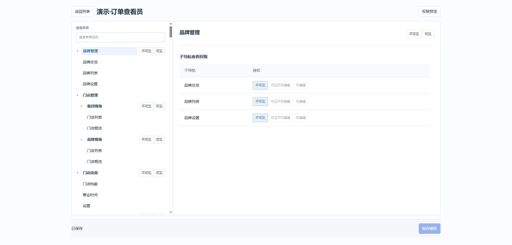

图注：2026-11-03，当前功能分支真实画面，演示·订单查看员，无员工绑定。旧截图中返回入口位于右上、预览按钮位于标题下的布局不再作为当前要求。

| 元素 | 逻辑说明 |
| --- | --- |
| 返回列表 | 放在页面标题左侧，保留原链接样式和文字；角色页返回商家访问角色列表，员工授权页返回员工与账号 |
| 标题 | 跟随返回入口显示在左侧一组，名称仍使用当前角色或员工名称 |
| 权限预览 | 放在同一标题栏右侧；沿用 data-provider-preview 和原切换逻辑，不保存或修改授权 |
| 返回编辑 | 预览后在相同右侧位置替换按钮文案，不占用左侧返回列表的位置 |
| 预览对象 | 保留在预览内容区；原目标范围和权限计算不变 |
| 保存与草稿 | 底部保存授权按钮、原禁用规则和未保存离开保护沿用；本次不增加确认流程 |

### 点击权限预览 / 返回编辑

点击权限预览切换为原只读预览，右侧按钮变为返回编辑，左侧返回列表始终保持。预览对象筛选仍位于内容区。

点击返回编辑恢复原编辑状态；仅切换视图，不改变草稿和保存状态。

### 点击返回列表

返回仍使用现有列表地址。无修改时直接返回；真实未保存修改仍按原离开保护处理，该异常分支本次未改动或重测。

### 共用员工授权页返回

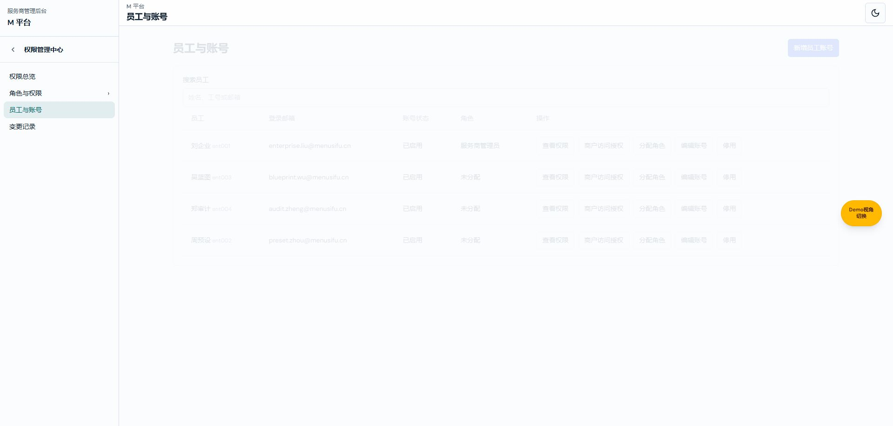

共用标题栏将原返回列表入口同样左置。员工页不新增权限预览按钮，不修改员工范围绑定。

### 本次操作覆盖与验证

| 操作 | 前后图片 | 状态 |
| --- | --- | --- |
| 查看标题栏 | edit.png | 实测返回在标题左侧，预览在右侧且同行 |
| 权限预览 | edit.png → preview.png | 已验证 |
| 返回编辑 | preview.png → edit.png | 已验证 |
| 角色返回列表 | edit.png → list.png | 已验证 |
| 员工授权返回列表 | employee-access.png → staff-list.png | 已验证 |

TypeScript 与差异检查通过。验证期间未保存授权、未产生未保存提示；原权限计算、范围、真实草稿放弃确认和保存异常未重测，不对历史全部操作截图完整性作结论。

## 商家访问角色列表标题栏调整（PROVIDER-HEADER-20261103-01）

基线本地 main@1aa5da44（包含未推送的演示数据修正）；分支 codex/provider-role-heading-20261103。外部 Chrome 功能预览 5314；按用户授权提交并合并本地 main，不推送远端，实际提交号以 Git 交付核验为准。本次只调整列表标题栏与一条提示，不改权限、角色或日志。

### 页面标题与新建入口

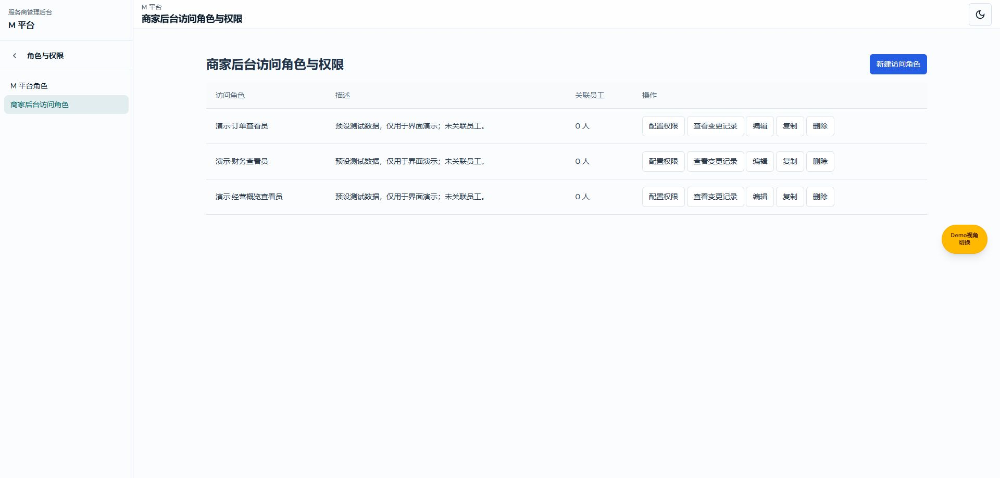

图注：2026-11-03，当前功能分支真实页面，演示角色仍保留。旧章节截图中的顶部测试提示和标题下方新建按钮为历史布局，以此图为准。

| 元素 | 逻辑说明 |
| --- | --- |
| 标题 | 商家后台访问角色与权限，保持左对齐 |
| 新建访问角色 | 放到同一标题栏右侧，复用公共 pc-heading 布局；沿用原按钮样式、data-provider-new、管理动作权限和禁用状态 |
| 列表顶部提示 | 删除“预设测试数据：演示角色未关联员工，标注‘演示’的记录不是真实操作历史。”对应的顶部提示容器，不留空占位 |
| 演示数据 | 3 个演示角色、描述、关联员工数和演示记录继续保留；集中记录页的演示提示不在本次删除范围 |

### 点击新建访问角色 / 取消

点击仍打开既有角色名称、描述和保存/取消弹框；必填、长度、重复名称、权限及保存失败行为均沿用。本次未新增保存分支，不对历史完整操作截图作新增完整性声明。

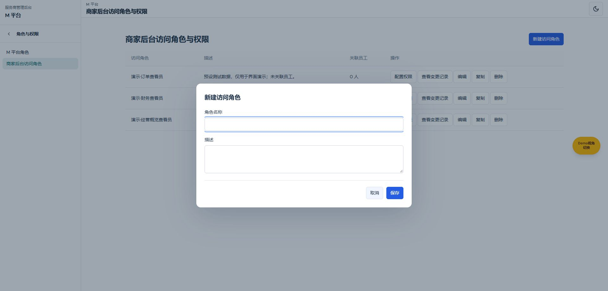

取消关闭弹框，不新增角色、不写授权或日志。

### 本次逐操作覆盖与验证

| 操作 / 状态 | 截图 | 验证 |
| --- | --- | --- |
| 查看标题栏 | list.png | 标题与按钮同行，按钮在右；指定提示不展示；3 个演示角色保留 |
| 点击移动后的新建按钮 | list.png → create-dialog.png | 原弹框正常打开 |
| 取消 | create-dialog.png → after-cancel.png | 回到原列表，数据不变 |

TypeScript 与 diff 格式检查通过。未触及构建边界，无额外业务测试；权限保存等既有异常路径未重测。

## 历史：演示数据接回统一角色导航（PROVIDER-DEMO-FIX-20261103-01）

本节保留历史。无员工绑定与三条初始日志的口径已由 PROVIDER-EMP-DEMO-20261103-01 替代；已有存储保护仍沿用。

基线 main@39a417fb；分支 codex/provider-demo-fix-20261103；外部 Chrome 预览 5313。修正前，演示数据代码只留在未合并分支，主线缺少初始化逻辑；本次将其接回最新导航与集中记录，不回退导航、不复制旧文档覆盖新版。本次按用户授权提交并合并本地 main，不推送远端；实际提交号以 Git 交付核验为准。

### 本次操作覆盖清单

| 页面 / 操作 | 入口与结果截图 | 完成状态 |
| --- | --- | --- |
| 进入商家后台访问角色 | before-empty → roles | 已验证，3 个演示角色 |
| 从角色查看记录 | roles → role-log | 已验证，带入对应角色和商家类型 |
| 清除角色条件 | role-log → provider-logs | 已验证，恢复 3 条 |
| 类型选全部 | provider-logs → all-logs | 已验证 |
| 类型选 M 平台权限 | all-logs → m-logs-empty | 已验证，演示商家记录不混入 M 来源 |
| 类型选商家后台访问权限 | m-logs-empty → provider-logs | 已验证 |
| 刷新记录页 | provider-logs → provider-logs | 已验证，仍为 3 条，筛选保留 |

本次均为读取或筛选，无保存、确认或取消弹框；原权限编辑操作沿用，不纳入本次截图完整性结论。存储损坏仍由既有错误流程处理，自动测试覆盖不回退演示；未采集损坏数据的浏览器截图，不声称异常截图完整。

### 进入商家后台访问角色

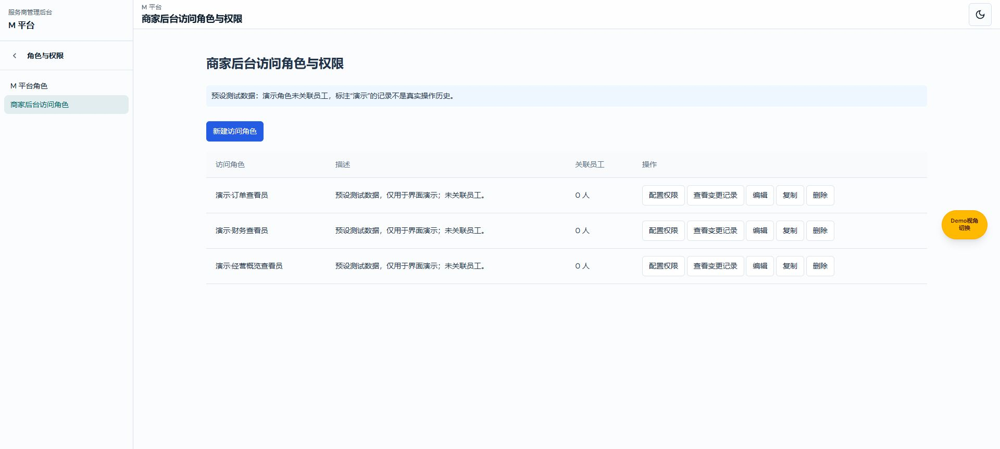

图注：2026-11-03，外部 Chrome，修正分支真实画面；演示角色不是实际员工权限。

| 元素 / 规则 | 逻辑说明 |
| --- | --- |
| 初始化条件 | 仅 localStorage 的 menusifu:provider-merchant-access:v1 不存在时生成演示状态；已有合法数据优先，包括已经保存的空列表，不增补或覆盖 |
| 角色 | 演示·订单查看员 / 演示·财务查看员 / 演示·经营概览查看员；ID 分别 provider-demo-orders / provider-demo-finance / provider-demo-dashboard，3 个普通非系统角色 |
| 权限配置 | 对应模块现有目录的非 action、非 setting、非兼容隐藏资源预设 read；不预设操作或设置编辑权限 |
| 关联员工 | 全部 0；employees 为空，不给任何员工绑定角色或目标，不改变 ent001 既有系统兼容范围 |
| 描述 / 提示 | 角色描述及记录演示标识保留；列表顶部提示已按 PROVIDER-HEADER-20261103-01 删除，集中记录页提示保留 |
| 持久化 | 查看、刷新不写存储，初始化 revision=0；用户后续正常保存仍走既有授权和并发校验 |
| 既有记录 | 已有角色、员工、日志、revision 与系统兼容范围均原样读取；已删除演示角色不会因刷新补回 |
| 损坏数据 | JSON 解析或结构校验失败仍报错，保留原值，不静默用演示覆盖 |

### 从角色查看记录

使用现有查看变更记录入口，进入集中页并带 type=provider 与角色 ID。三个角色各自对应一条预设事件，不新增独立日志页面或权限。

| 字段 | 逻辑说明 |
| --- | --- |
| 类型 | 商家后台访问权限 |
| 时间 | 固定 2026-11-03 09:00 / 08:00 / 07:00（UTC+8），按浏览器本地格式展示，不声称为当前操作时间 |
| 操作人 | 演示数据（非真实操作人） |
| 操作 | 演示：预设访问角色 |
| 对象 | 对应三个演示角色名，按时间倒序 |
| 快照 | 每条 before 为角色与员工空数组；after 为对应演示角色和空员工数组；不含密码 |

### 清除角色条件 / 类型筛选

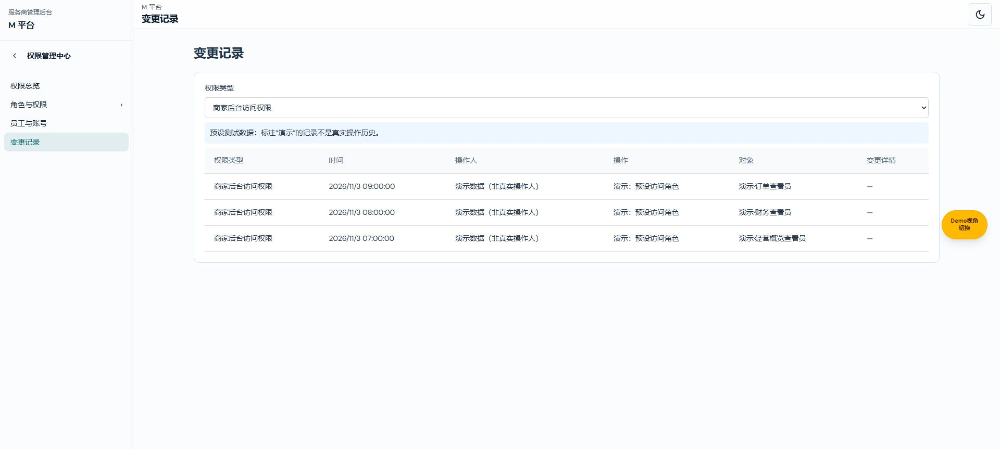

清除仅去掉角色条件，保留商家类型，显示 3 条；统一记录页就近提示演示性质。

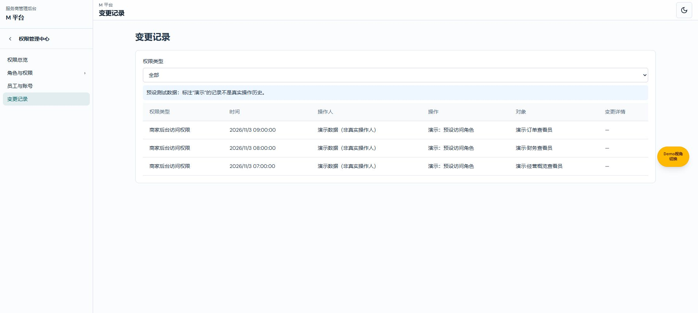

全部仍遵守原来源查看权限；本隔离上下文 M 来源无记录，商家演示记录不混入该类型。选回商家后台访问权限恢复上方三条画面。

### 刷新记录页

保留 URL 类型筛选；未保存上下文从固定演示状态重建，仍有 3 条，时间不漂移。不产生真实审计。

### 验证

RED：外部 Chrome 主线演示角色数为 0，空态可见。GREEN：修正预览 3 角色、关联员工均 0；角色条件 1 条，清除及刷新后 3 条；类型隔离正常。领域测试覆盖无员工授权、无动作/设置授权、独立副本、已有空/非空状态保留、损坏 JSON 不降级；原访问授权 16 项和集中日志隔离回归通过。生产接口、CI/部署未验证。

## 角色与权限统一入口（ROLE-HUB-20261103-01）

当前有效结构：权限管理中心 → 权限总览 / 角色与权限 / 员工与账号 / 变更记录；“角色与权限”下并列为“M 平台角色”“商家后台访问角色”。两类角色、员工绑定和权限资源独立，未迁移或合并数据。基线 main@1e84e5e9，功能分支 codex/role-permission-hub-20261103，端口 5312；按用户授权提交、合并 main 并推送，实际提交号及远端状态以 Git 交付核验为准。演示初始化已由 PROVIDER-DEMO-FIX-20261103-01 接回，原角色与记录授权规则不变。

### 本次逐操作覆盖清单

| 操作 | 入口及结果图片 | 状态 |
| --- | --- | --- |
| 点击角色与权限 | permission-parent → m-roles | 已验证，默认 M 平台角色 |
| 切换商家后台访问角色 | m-roles → provider-roles | 已验证 |
| 切换 M 平台角色 | provider-roles → m-roles | 已验证 |
| 返回上一级 | m-roles → back-parent | 已验证，只退一层 |
| 点击独立变更记录 | permission-parent → audit-all | 已验证 |
| 选择 M 平台权限 | audit-all → audit-m | 已验证 |
| 选择商家后台访问权限 | audit-all → audit-provider | 已验证 |
| 选择全部 | audit-provider → audit-all | 已验证 |
| M 角色查看变更记录 | m-roles → m-role-audit | 已验证，含无匹配记录状态 |
| 商家角色查看变更记录 | provider-roles → provider-role-audit | 已验证 |
| 清除角色筛选 | provider-role-audit → audit-provider | 已验证 |
| 展开 / 收起前后值 | audit-m ↔ audit-details | 已验证，沿用 M 日志明细 |
| 旧地址访问 | legacy-audit | 已验证，兼容商家日志类型 |
| 无权限类型 / 读取异常 | 待补页面图片 | 权限隔离领域测试通过；受限账号与损坏数据浏览器截图未采集，不声称异常截图完整 |

截图均为 2026-11-03 功能分支实际画面；“导航验收·M空白角色”“导航验收·商家空白角色”为本地隔离验收数据，无权限、无员工绑定；不代表生产操作历史。本次导航及筛选不写数据，无保存、确认或取消弹框。原角色编辑等完整操作截图不在本次调整范围内。

### 点击角色与权限 / 切换两类角色

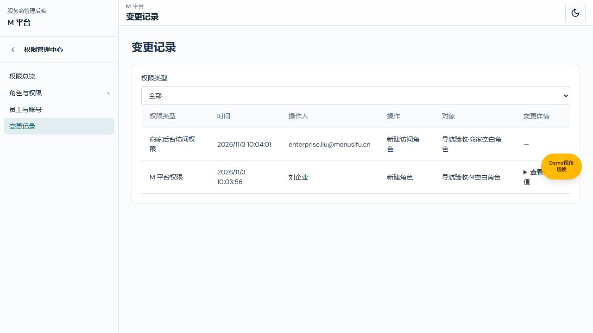

| 元素 | 逻辑说明 |
| --- | --- |
| 角色与权限 | 父菜单整行点击进入公共子导航滑层，默认进入现有 `/m-platform/permissions/roles`；仅有商家角色权限时回落到可访问的商家角色页 |
| M 平台角色 | 页内标题“M 平台角色与权限”；配置服务商员工在 M 平台内的菜单和操作，沿用 roles 页面、动作权限 |
| 商家后台访问角色 | 页内标题“商家后台访问角色与权限”；沿用 provider-roles 地址及动作权限；不将品牌、门店范围合并进 M 平台角色 |
| 当前项 | 切换、直接访问与刷新后恢复子导航并高亮；角色配置的既有草稿保护沿用 |

点击“M 平台角色”返回上方 M 角色列表；不修改任一类角色或关联员工。

### 返回上一级

只返回一层侧栏，保留当前业务内容；再次返回主层沿用公共逻辑。

### 独立变更记录 / 类型筛选

| 字段 / 操作 | 逻辑说明 |
| --- | --- |
| 地址 | `/m-platform/permissions/change-log`；支持 type=all、m、provider 及 role 参数；默认 all |
| 权限类型 | 全部 / M 平台权限 / 商家后台访问权限；仅列出原有权限允许的类型，不读取无权来源。全部是允许来源的并集 |
| M 日志查看权 | 沿用 permission-log 页面可见权限；拥有角色编辑权限不自动获得 M 日志查看权 |
| 商家日志查看权 | 沿用 provider-roles 页面可见权限；不增加新授权资源或默认赋权 |
| 切换类型 | 即时重新筛选并清除角色条件，URL 同步，不写日志或授权 |
| 权限类型列 | 标识记录原始来源，两个来源相同 id 不去重，不混淆 |
| 时间列 | 沿用 at 字段，以浏览器本地时间格式展示；合并后按时间倒序 |
| 操作人列 | 沿用 actor 字段，不改为当前浏览者 |
| 操作列 / 对象列 | 沿用 action、object，分别展示并 HTML 转义 |
| 变更详情 | M 来源保留前后值折叠；商家来源保持原展示范围，仅显示摘要，不新增原始快照入口 |
| 空值 / 失败 | 无匹配时“暂无匹配变更记录”；无权请求类型不给记录并提示；某来源解析失败单独提示，保留存储，其他有权来源继续展示 |

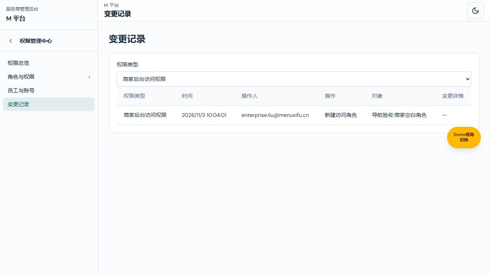

切回“全部”恢复上方全部类型画面，仅恢复当前允许来源。原权限总览的“最近变更”仍为原 M 权限摘要，本次未扩大范围。

### 从角色查看记录 / 清除角色条件

M 角色行入口仅在具备原 M 日志权限时展示，带入 type=m、role=角色 ID。

商家角色带入 type=provider。优先依据前后快照中对应角色的变化或关联员工的角色绑定变化匹配；旧摘要记录可按当前角色名称与对象精确匹配。已删除角色若无可识别快照或名称依据，不猜测关联记录。无匹配仍显示空态，不回退展示全部。

清除按钮仅移除 role 条件，保留类型；筛选不是编辑，不触发未保存提示。

### 展开 / 收起前后值

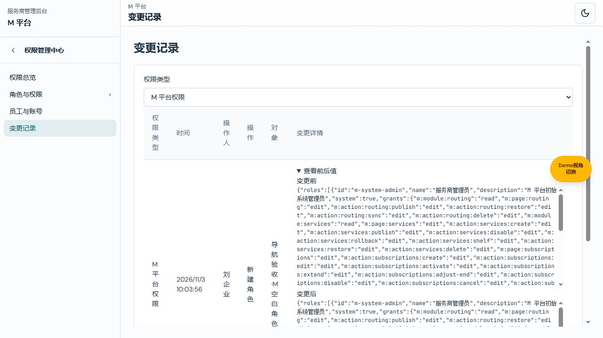

只展开当前 M 记录的原始前后值，不新增快照存储；再次点击原位置收起。

### 旧地址兼容

`/m-platform/permissions/provider-roles/change-log` 继续按商家来源权限进入统一记录界面，默认 type=provider；旧侧栏独立商家日志菜单移除。正常入口统一到权限中心“变更记录”。

### 验证与边界

类型检查、公共导航回归、原商户访问授权 16 项断言、M 平台权限回归、统一日志来源隔离/角色匹配/同 ID/排序测试通过。浏览器验证正常列表、切换、带参、清除、空态、旧地址与明细收起展开。生产服务端、CI/部署、受限账号和损坏数据的浏览器路径尚未验证。

## 历史：商家后台访问角色子导航（M-ACCESS-NAV-20261102-02）

本节为历史版本，导航与日志入口已由 ROLE-HUB-20261103-01 替代，不作为现行导航要求。

本次范围：权限管理中心内的商家后台访问角色拆为两个子菜单。沿用 provider-roles 可见权限和原管理动作；不新增权限资源、不迁移角色或员工绑定。当前功能分支 codex/merchant-access-nav-20261102；main 基线 8b9b3837，端口 5194；按 2026-11-03 用户授权提交、合并 main 并推送，实际提交号和远端核验见 Git 交付记录。

### 操作覆盖清单（本次变更）

| 操作 | 入口 / 后续状态 | 图片 | 状态 |
| --- | --- | --- | --- |
| 打开商家后台访问角色 | 权限中心 → 子导航，默认角色访问设置 | permission-parent / settings-rows | 已验证 |
| 点击角色访问设置 | 日志页 → 角色列表 | logs-rows / settings-rows | 已验证 |
| 点击变更记录 | 设置页 → 独立日志页 | settings-rows / logs-rows、logs-empty | 已验证，有数据及空态 |
| 子层返回 | 商家访问子层 → 权限中心层 | logs-rows / permission-parent | 已验证，只退一层 |
| 权限中心返回 | 权限中心 → 主层 | permission-parent / root | 已验证 |
| M 平台权限变更记录 | 权限中心 → M 平台内部权限记录 | permission-parent / m-platform-logs | 已验证，不混入访问角色日志 |

本清单仅覆盖本次新增或调整的导航操作；历史角色编辑、复制、删除等操作截图完整性不在本次验收结论内。导航无确认或取消弹框；无网络写入，因此不存在新增的保存成功/失败状态。

### 打开商家后台访问角色 / 默认角色访问设置

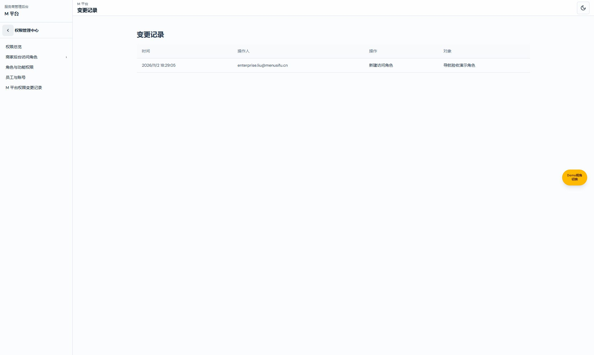

图注：2026-11-02，5194 功能分支真实截图；“导航验收演示角色”为隔离演示数据，无授权、无员工绑定，不代表真实操作历史。

点击父菜单整行，公共子导航滑层覆盖权限中心层；默认进入角色访问设置，原地址 `/m-platform/permissions/provider-roles` 沿用。新建、配置权限、编辑、复制、删除仍沿用原校验与草稿保护。列表底部不再显示折叠日志。

### 点击变更记录

图注：同一隔离演示分支；记录来自通过现有新建入口保存空白角色的实际操作。

| 字段 / 操作 | 逻辑说明 |
| --- | --- |
| 菜单名称 | 变更记录，仅指商家后台访问角色及商户访问范围的授权变更 |
| 地址 | `/m-platform/permissions/provider-roles/change-log`；刷新和直接访问均恢复商家访问子导航，当前项高亮 |
| 权限 | 继承现有 provider-roles 页面可见性；不可见者不能因拆分菜单获得访问权 |
| 时间 | 原日志 at 字段，由浏览器本地时间格式展示，不改存储值 |
| 操作人 | 原 actor 字段，沿用真实记录，不替换为当前浏览者 |
| 操作 | 原 action 字段，不改变日志事件类型 |
| 对象 | 原 object 字段，HTML 转义，不显示密码 |
| 数量与顺序 | 展示原保存日志数组全部记录，沿用其顺序，不再截取前 30 条；不新增分页或筛选 |

没有记录时显示“暂无商家后台访问角色变更记录”，不生成示例日志。浏览页面不写入日志或授权。

### 点击角色访问设置

切换后显示现有角色列表，保留两项子菜单并高亮设置项；不修改角色数据。

### 子层返回 / 权限中心返回

只切换侧栏层级，保留当前内容。继续点击返回到主层；原业务草稿离开保护沿用。

### 点击 M 平台权限变更记录

原 `/m-platform/permissions/change-log` 地址与 permission-log 权限资源不变，仅入口和页面标题改名。数据仍为 M 平台内部角色、员工权限日志，不混入商家后台访问角色日志。

## 服务商员工商户访问授权

共同变更编号：M-MERCHANT-ACCESS-20261102-01；功能分支 codex/provider-merchant-access-20261102，起始 main@ecc540bf。截图来自端口 5301 的独立 Edge 验收上下文，不代表生产数据。

### 商家后台访问角色列表

图注：访问角色列表，新建角色成功状态。

入口：权限管理中心 → 角色与权限 → 商家后台访问角色。作用对象是软件服务商员工的商家后台访问角色，与 M 平台角色、品牌内部角色分别存储。

| 字段／操作 | 逻辑说明 |
| --- | --- |
| 访问角色 | 名称去首尾空格，1–30 字，忽略大小写判重；新角色默认空白权限。 |
| 描述 | 0–160 字，可为空。 |
| 关联员工 | 按绑定该角色的员工 ID 去重；同员工多条范围绑定仍计 1 人。 |
| 新建访问角色 | 需要独立的管理商户访问授权动作；填写后保存角色元数据，不自动授予员工或目标商户。 |
| 配置权限 | 全屏打开该角色，编辑统一商家资源目录中的菜单与操作。 |
| 编辑 | 修改名称和描述；失败保留弹框内容，取消不写入。 |
| 复制 | 复制描述和资源授权，不复制名称、员工绑定或系统兼容授权。 |
| 删除 | 已有员工绑定时拒绝，先解除绑定；无绑定时确认后删除，取消不变。 |
| 变更记录入口 | 已集中到权限中心独立变更记录，按权限类型及角色筛选，详见 ROLE-HUB-20261103-01；记录不替代商户业务操作审计。 |

### 访问角色权限编辑

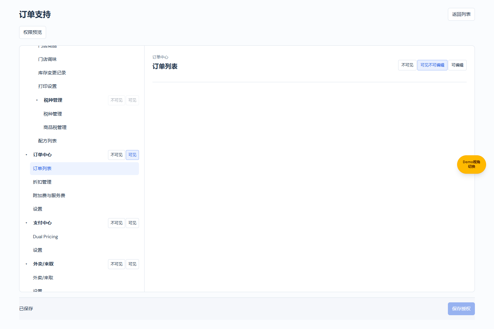

图注：全屏编辑，订单中心处于可见不可编辑状态。

| 字段／操作 | 逻辑说明 |
| --- | --- |
| 菜单树 | 复用商家权限中心统一资源目录，菜单结构与路由对应；失效资源不生效。 |
| 搜索菜单 | 按菜单名即时筛选，不修改授权草稿。 |
| 目录可见性 | 不可见阻断下级；关闭时保留下级配置，重新开放仍按有效祖先和依赖计算。 |
| 页面权限 | 不可见、可见不可编辑、可编辑；沿用已有页面级控制、内容、分类和字段规则，不制造不存在的操作。 |
| 独立操作 | 默认禁止；页面可见不自动允许编辑、导出等动作。角色匹配后仍需满足资源依赖。 |
| 保存授权 | 显示影响员工数并确认；复核管理权限、授权上限和 revision，成功后写入授权及审计，再通知有效会话重算。 |
| 返回列表 | 无修改直接返回；有修改显示独立放弃确认，可取消继续编辑。 |
| 只读访问 | 可查看，保存及修改操作禁用；保存函数也拒绝无管理动作的调用。 |

### 目标菜单预览

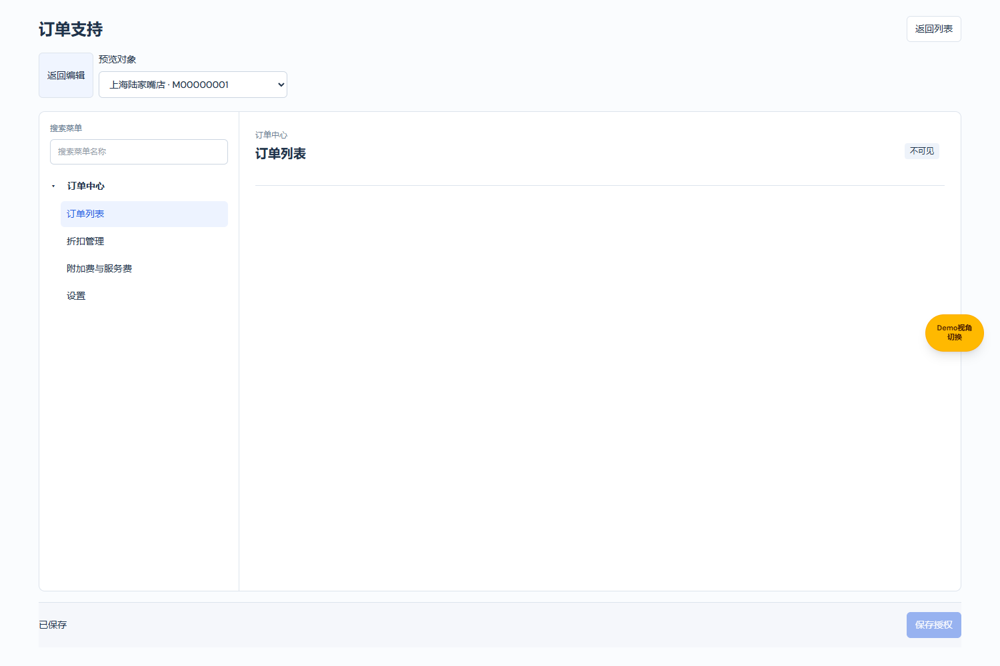

图注：角色权限预览，指定门店状态。

| 字段／操作 | 逻辑说明 |
| --- | --- |
| 权限预览 | 只查看当前角色草稿，不保存，不实际进入商户。 |
| 预览对象 | 可选仅角色、本人获准品牌或门店；指定对象后叠加品牌菜单上限，门店还叠加门店上限。 |
| 预览结果 | 只展示有效菜单和操作示意；商业权益是否允许实际使用继续由既有服务规则判定，不将预览等同于开通服务。 |
| 返回编辑 | 保留角色草稿及页面上下文。 |

### 员工商户访问授权

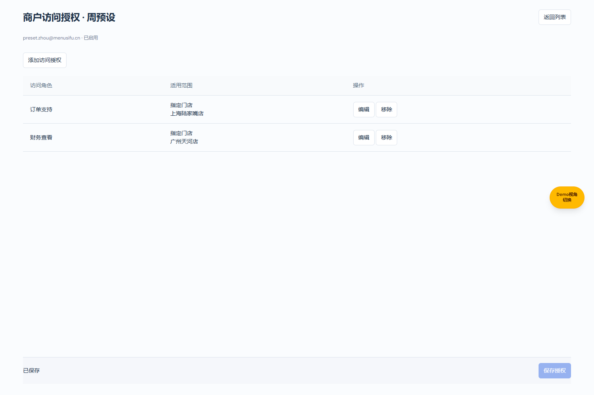

图注：同一员工分别绑定两家门店和两个访问角色。

入口：员工与账号 → 商户访问授权。账号启停与 M 平台角色沿用原有管理方式；此页只编辑商户访问绑定。

| 字段／操作 | 逻辑说明 |
| --- | --- |
| 员工 | 展示姓名、登录邮箱及启停状态；来自服务商员工账号，不创建品牌内部员工。 |
| 访问角色 | 当前绑定的商家后台访问角色；角色失效不产生允许权限。 |
| 适用范围 | 每条绑定独立关联角色和品牌／门店范围；不能把不同绑定的角色与范围交叉组合。 |
| 添加访问授权 | 打开范围弹框；加入草稿后，仍需保存授权才生效。 |
| 编辑绑定 | 修改该条角色或范围，保留其他绑定。 |
| 移除绑定 | 加入待保存草稿；保存空绑定列表表示撤销全部商户访问，账号本身不删除。 |
| 系统兼容授权 | 既有演示系统身份 ent001 明确保留全部品牌／门店范围及完整目录；受账号、M 平台动作和商户菜单上限限制，不能复制给普通员工。 |
| 保存授权 | 确认后生效；失败及版本冲突保留草稿，不显示假成功。 |
| 新员工／普通旧员工 | 默认无商户访问授权；不推断旧 enterprise-rbac、品牌 Admin 或员工个人例外。 |

### 添加／编辑范围弹框

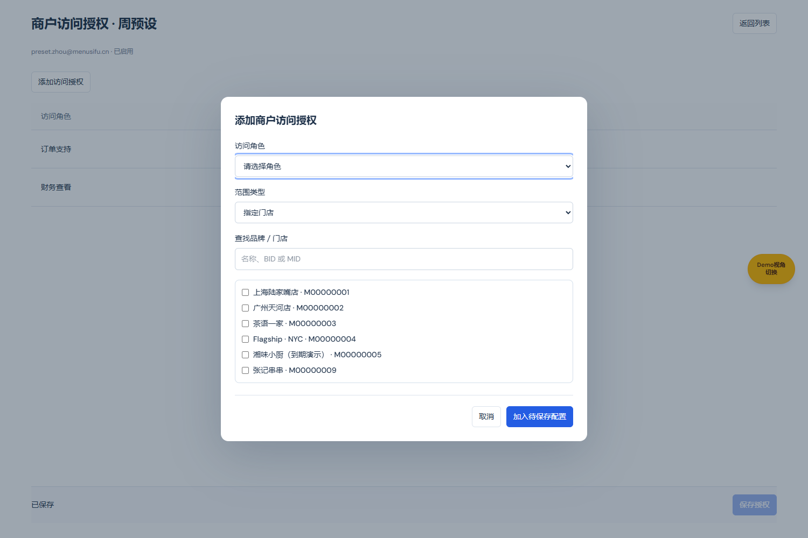

图注：指定门店范围弹框，尚未选中对象状态。

| 字段／操作 | 逻辑说明 |
| --- | --- |
| 访问角色 | 必选单选，来源为服务商商家后台访问角色。 |
| 范围类型 | 指定品牌或指定门店，默认指定门店；编辑时使用原值。切换已选范围前提示清空，取消切换保留原选项。 |
| 查找品牌／门店 | 名称、BID／MID 即时包含搜索；过滤列表不丢失已勾选对象。 |
| 指定品牌 | 多选，仅能授予自己有权的品牌；动态包含该品牌后续新增门店，界面明确标注。 |
| 指定门店 | 多选，仅包含所选 MID；不自动提升为整个品牌权限。 |
| 加入待保存配置 | 角色和对象至少各选 1 项；通过后加入父页面草稿，尚未持久化。 |
| 取消／Esc | 关闭本弹框，不将本弹框内容加入父页面草稿。 |

### 保存确认

图注：角色权限变更的保存确认弹框。

| 字段／操作 | 逻辑说明 |
| --- | --- |
| 影响说明 | 角色变更显示关联员工数；员工范围变更仅影响该员工。已进入后台的有效会话会重新校验。 |
| 确认保存 | 同一持久化写入包含 revision、授权和审计；成功后发出变更事件。存储失败不写假审计。 |
| 取消 | 关闭确认，保留父页面草稿。 |

### 商户列表与访问边界

图注：仅获准一家门店的服务商员工。

| 字段／操作 | 逻辑说明 |
| --- | --- |
| 品牌／门店列表 | M 页面权限和目标范围同时满足；只授权门店时可显示必要的所属品牌名称、BID，但不能直接进入品牌完整详情或品牌代管。 |
| 统计与候选项 | 商户统计、门店分析、订阅主体和硬件设备数据按获准目标过滤；未知归属不当作公开数据。 |
| 进入商家后台 | 品牌和门店分别有独立访问动作；允许只读 M 管理页员工在动作获准时进入，不要求给其品牌编辑权限。 |
| 菜单上限 | 已发布目录、品牌已开通菜单、门店视角上限、当前目标匹配角色共同限制菜单；收费服务的可用性再按服务权益判定。 |
| 身份 | 保留真实服务商 employeeId／邮箱和代管会话 ID，不再借用品牌主管理员邮箱作为权限主体。 |
| 撤权 | 停用、撤销目标范围或进入动作后，已进入会话停止访问，退回首个可访问 M 页面并显示失效提示。菜单收窄时导航和直接地址重新计算，不自动保存旧草稿。 |
| 管理权限 | 授权管理、商户访问和商户业务操作分别判断；不能授予超过本人范围或角色权限的授权。普通商家账号保持原授权链路。 |

## 系统使用分析独立权限目录

图注：2026-10-29，codex/usage-analysis-entry-20261029，main@f30e8451起始，5257实采；角色编辑中系统使用分析与商户管理中心分别设置模块门槛。

入口：权限管理中心 → 角色与功能权限 → 编辑权限。

| 字段／操作 | 逻辑说明 |
| --- | --- |
| 系统使用分析模块 | m:module:activity-analysis，可见／不可见；独立于m:module:merchants。导航、角色目录与实际资源树一致。 |
| 门店活跃分析 | m:page:merchant-activity，可见／不可见，无业务写操作；父资源为系统使用分析模块。 |
| 设备活跃分析 | m:page:device-activity，可见／不可见；与门店活跃分析分别授权，共用分析模块门槛。 |
| 详情中的使用情况 | 品牌或门店详情权限与门店活跃分析权限同时满足才可进入；单有商户管理编辑权不代表可读分析。 |
| 仅分析角色 | 可查看本人获准范围内的全局分析；无商户管理权限时不显示品牌/门店管理跳转，也不能直达管理详情的使用情况页。 |
| 多角色与停用 | 保留角色允许并集及祖先门槛；停用账号、缺页权和缺模块权均拒绝。浏览期间撤权后下次交互/重渲染不继续访问。 |
| 历史角色兼容 | 缺目录版本标记的旧记录，按角色复制原商户模块门槛到缺失的新分析模块门槛，不新增或修改任何分析页grant。已显式配置的新门槛（包括不可见）不覆盖。 |
| 新角色 | 默认不可见；不因商户管理可见而自动拥有分析权限。 |
| 旧路由 | /m-platform/merchants/activity与device-activity及原明细地址继续使用；地址保留不表示权限仍归商户中心。 |

### M 平台外壳返回入口（M-PERM-EXIT-20261022-05）

图注：2026-10-22，V1.4 功能分支，实际页面验证截图；此前截图中的右上角、左下角返回商家按钮为历史展示。

| 元素 | 规则与验收 |
| --- | --- |
| 右上角返回商家后台 | 从 M 平台公共页头移除，主题切换保留 |
| 左下角返回商家后台 | 从侧栏移除整个按钮及底部容器，不留空白边框 |
| 子菜单返回箭头 | 保持返回上一级菜单，父菜单名与箭头同行 |
| 权限与数据 | 本次不改变授权、角色、数据加载或业务路由；无权页原有返回链接沿用 |

验证：实际页面两处按钮均不存在；主题切换和侧栏导航仍可操作。TypeScript 与公共递归导航回归通过。本次 V1.3/V1.4 修改按用户授权提交、合并 main 并推送；实际提交号和远端核验结果以 Git 交付记录为准。

## 0. 默认演示登录与数据

图注：2026-10-22，功能分支 V1.1，当前内置浏览器默认登录后已有品牌数据可见。

用途／入口：保留登录页已填充的 demo.menusifu.cn，点击登录，进入 M 平台后打开品牌管理中心 → 品牌列表。

| 字段／操作 | 逻辑说明 |
|---|---|
| 默认演示账号 | demo.menusifu.cn；仍需点击登录；无需切换为其他企业邮箱才可访问 M 平台 |
| 默认角色身份 | 使用已有初始服务商管理员 ent001 的账号状态和角色绑定；不新增员工个人授权，也不重写授权存储 |
| 品牌列表数据 | 展示现有业务数据源，正常默认状态能看到已有品牌；不清理缓存、不重建数据、不借此改变数据范围 |
| 真实员工 | 继续按自己绑定的角色计算，无角色不继承演示管理员权限 |
| 停用与角色调整 | 初始管理员停用或角色受限时，演示视图同样遵守；不提供无条件绕过 |

## 1. 公共导航与权限状态

图注：2026-10-22，V1.3 功能分支；主层菜单上方不再重复显示 M 平台，品牌区保留。旧图中主层重复标题不作为现行要求。

| 字段／操作 | 逻辑说明 |
|---|---|
| 品牌区平台标题 | 保留左上角服务商管理后台下的 M 平台，位置与内容不变 |
| 菜单主层标题 | 删除菜单路由配置上方的重复 M 平台节点，不留空白占位 |
| 主层首项 | 直接展示菜单路由配置，其他 5 个入口继续按原顺序展示并沿用权限过滤 |
| 子层父级标题 | 保留箭头后同排的当前目录名称，不因删除主层标题而隐藏 |

图注：2026-10-22，功能分支 V1.2，权限管理中心子层。返回箭头与菜单名同一行展示；其他章节历史截图用于业务说明，导航头部以本图为准。

入口：登录服务商员工账号后进入首个可访问 M 平台页面；管理员通过权限管理中心配置角色和员工。

| 字段／操作 | 逻辑说明 |
|---|---|
| 一级目录 | 来源为 M 平台目录；只有目录可见且至少一个页面可见时展示。品牌、硬件等有子菜单的条目点击整行进入覆盖式滑层 |
| 返回箭头 | 无可见“返回”文字；40×40px 圆角按钮，18px 箭头；保留辅助技术名称“返回上一级菜单”。点击仅退出一层，不改变业务页、授权或草稿 |
| 子层标题 | 当前父级目录名称，位于箭头右侧同一行；字号 14px、字重 600，标题栏高 56px，样式和间距与商家后台相同；过长名称单行省略 |
| 子菜单 | 只展示有效可见页面；点击进入原业务地址，子层保持且当前项高亮 |
| 不可见／可见 | 目录及纯查看页的配置选项；不可见阻断直接访问，不删除下级配置 |
| 不可见／可见不可编辑／可编辑 | 可设置页面的配置选项；一般编辑需可编辑，独立动作另行允许 |
| 禁止／允许 | 独立动作选项；默认禁止，修改型动作还需要页面可编辑 |
| 公共返回商家按钮 | 页头右上角和侧栏左下角均不展示；无权页链接见对应章节 |

### 无权访问状态

图注：功能分支 2026-10-22，受限员工直接输入角色管理地址。

| 字段／操作 | 逻辑说明 |
|---|---|
| 暂无 M 平台访问权限 | 当前员工无页面权限、账号停用或权限数据不可用时展示；原业务页不挂载 |
| 说明 | 普通无权提示联系管理员分配角色；账号停用时明确提示停用 |
| 返回商家后台 | 退出无权页的既有导航，不保存或改变任何授权 |

## 2. 权限总览

图注：功能分支 2026-10-22，含验收角色的当前浏览器数据。

用途／入口：权限管理中心 → 权限总览，只读查看配置规模和最近变更。

| 字段／操作 | 逻辑说明 |
|---|---|
| 角色 | 当前保存 roles 数量，整数；无角色为 0；不含未保存的新建输入 |
| 员工账号 | 当前企业账号数量，包含停用账号，不含商家账号 |
| 已授权员工 | roleIds 非空的员工按 ID 去重计数；不等同于实际可访问页面人数 |
| 可授权菜单页 | 当前 M 目录页面数，当前 19；不统计每个动作，也不统计商家模板内部页面 |
| 最近变更 | 共用变更记录数据源，新记录在前；无记录显示“暂无变更记录”；统计卡不可作为跳转按钮 |

## 3. 角色与功能权限列表

图注：功能分支 2026-10-22，服务商管理员和验收用客服角色；示例不是生产预置岗位。

用途／入口：权限管理中心 → 角色与功能权限。

| 字段／操作 | 逻辑说明 |
|---|---|
| 角色名称 | 保存名称；系统角色同时显示系统标签；改名不改变 ID 或员工绑定 |
| 描述 | 保存描述；空值显示“—” |
| 成员数 | 绑定该角色的员工 ID 去重数；包含停用账号；点击展示成员姓名，缺账号时保留员工 ID |
| 新建角色 | 需要新建动作允许；打开空白角色弹框；默认不带任何权限 |
| 编辑角色 | 需要编辑角色动作允许；打开该行名称与描述；不改变权限或成员 |
| 编辑权限 | 打开该角色全屏权限页；仅有查看权限时配置控件只读 |
| 复制 | 需要新建动作允许；名称留空，复制描述和权限；不复制员工绑定，仍受操作者授权上限约束 |
| 删除 | 系统角色禁用；有成员时提示先解除绑定；确认删除空成员自建角色并记录审计；取消不写入 |

待补页面图片：删除角色的浏览器原生确认框；已有成员时的阻止提示。

### 3.1 新建／编辑／复制角色弹框

图注：功能分支 2026-10-22，新建空白角色；编辑和复制沿用该弹框布局及各自标题、默认值。

用途：从列表对应操作打开，始终携带当前行角色 ID 或新建上下文。

| 字段／操作 | 逻辑说明 |
|---|---|
| 标题 | 根据入口为新建角色、编辑角色或复制角色 |
| 角色名称 | 必填，最多 30 字；保存去首尾空格；忽略大小写判重；新建及复制默认空，编辑回填保存值 |
| 角色描述 | 可空，最多 160 字；编辑与复制回填原值；新建默认空 |
| 保存 | 校验名称、描述、当前动作权限、版本和授权上限；成功关闭、刷新列表并增加审计；失败保留输入 |
| 取消／关闭 | 关闭弹框，不写角色、不新增成员、不保存输入 |

图注：功能分支 2026-10-22，空名称提交后显示必填错误，弹框保留。

## 4. 全屏角色权限编辑

图注：功能分支 2026-10-22，验收角色的预设页只读配置，尚未保存。

用途／入口：角色列表 → 编辑权限。隐藏外层导航，返回后仍为角色列表。

| 区域内字段／操作 | 逻辑说明 |
|---|---|
| 对象标题 | 显示编辑权限及角色名称；未知或已删除角色显示不存在 |
| 搜索菜单 | 即时按模块名称或页面名称包含匹配；默认空；仅影响菜单展示，不改变授权、不产生草稿 |
| 目录状态 | 每个 M 平台模块的不可见／可见；父级隐藏后保留下级配置并阻断生效 |
| 页面条目 | 点击切换右侧；保留左侧滚动位置，不保存、不标脏 |
| 页面状态 | 按公共状态选择；上级不可见时控件禁用，并显示上级门禁说明 |
| 页面操作名称 | 来源为该页面已登记的真实业务操作；无独立动作时明确说明，不补造按钮 |
| 操作允许状态 | 独立禁止／允许；修改型操作在页面只读时禁用；导出类输出动作只要求页面可见 |
| 效果预览 | 切换预览视图；使用当前角色草稿计算，不写存储；只显示获准菜单和最终操作结果 |
| 返回 | 无真实差异直接返回；有差异由浏览器确认放弃，取消离开保留编辑页和草稿 |
| 未保存提示 | 仅相对保存值确有差异时出现；再次选择原状态、恢复全部原值不提示 |
| 保存 | 无差异时禁用；有差异打开确认弹框；失败保留原编辑及草稿 |

待补页面图片：真实草稿离开时的浏览器原生确认框；存储失败与跨窗口版本冲突提示。

### 4.1 效果预览

图注：功能分支 2026-10-22，验收角色仅可见品牌、设备和预设三个页面。

| 字段／操作 | 逻辑说明 |
|---|---|
| 可见菜单 | 按草稿角色有效权限过滤，空模块不显示 |
| 页面权限标签 | 显示最终不可见、只读或可编辑；不允许在预览中修改 |
| 独立操作结果 | 显示允许或禁止，受上级和页面门禁计算 |
| 返回编辑 | 恢复编辑状态，原草稿保留，不自动保存 |

### 4.2 确认权限变更

图注：功能分支 2026-10-22，预设页由只读改为可编辑的真实草稿确认；本次验收取消该改动。

| 字段／操作 | 逻辑说明 |
|---|---|
| 角色 | 当前编辑角色名称 |
| 影响人数 | 当前绑定角色的员工数，包含停用账号；不等于当前在线人数 |
| 变更差异 | 每个与保存值不同的资源逐项列出业务名称、原状态、目标状态 |
| 保存 | 重新校验动作权限、revision 和最后管理员；成功写入权限及审计，清除草稿并刷新 |
| 取消／关闭 | 不写入，返回原草稿；后续仍可继续调整或重新保存 |

## 5. 员工与账号列表

图注：功能分支 2026-10-22，企业账号数据源；验收员工已绑定角色。

用途／入口：权限管理中心 → 员工与账号；旧员工登录账号地址兼容进入此页。

| 字段／操作 | 逻辑说明 |
|---|---|
| 搜索员工 | 默认空；姓名、工号或邮箱忽略大小写包含匹配；即时刷新列表；不修改角色或账号 |
| 员工 | 企业账号姓名及工号；工号绑定后不可在账号编辑中修改 |
| 登录邮箱 | 当前企业账号邮箱；不显示密码 |
| 账号状态 | enabled 为真显示已启用，否则已停用；停用保留角色但阻断权限和登录 |
| 角色 | 来自新 M 权限模型的角色名称；空集合显示未分配；不把旧 enterprise selection 自动转换为授权 |
| 查看权限 | 打开该员工有效权限全屏页，携带 employeeId |
| 分配角色 | 单独需要分配动作；打开多选弹框，默认回填当前绑定 |
| 新增员工账号 | 单独需要账号管理动作；打开新建账号表单；保存成功默认启用、无角色 |
| 编辑账号 | 单独需要账号管理动作；打开该行账号信息，密码不回显 |
| 停用／启用 | 单独需要账号管理动作；二次确认后切换 enabled；最后管理员停用被阻止；取消不写入 |

待补页面图片：启用／停用账号的浏览器原生确认框。

### 5.1 分配角色弹框

图注：功能分支 2026-10-22，验收员工首次分配前的空选择状态。

| 字段／操作 | 逻辑说明 |
|---|---|
| 员工 | 当前操作对象姓名，缺失账号时保留 ID |
| 角色复选项 | 来源为当前全部角色，多选；保存时校验角色有效和操作者可授予上限，不可通过分配角色越权 |
| 多角色说明 | 告知允许并集；不提供个人例外；全部清空等于无 M 平台权限 |
| 保存 | 写当前员工 roleIds，其他员工不变；重新计算有效权限并写审计；移除最后管理员关键授权时拒绝 |
| 取消／关闭 | 保留原绑定，不保存此次勾选 |

### 5.2 员工最终权限

图注：功能分支 2026-10-22，郑审计继承验收角色后的只读最终结果。

| 字段／操作 | 逻辑说明 |
|---|---|
| 员工标题 | 当前 employeeId 对应的企业账号姓名 |
| 角色标签 | 当前绑定角色名称；没有绑定时显示尚未分配角色 |
| 停用提示 | 当前账号停用时显示，全部权限按无权处理，绑定仍保留 |
| 菜单与操作 | 只显示最终可访问菜单及独立操作状态，不提供直接修改入口或个人例外 |
| 分配角色 | 打开本员工角色绑定弹框，成功后刷新最终权限 |
| 返回 | 返回员工列表，不写权限 |

### 5.3 新增员工账号

图注：功能分支 2026-10-22，空表单；图中不包含凭据。

| 字段／操作 | 逻辑说明 |
|---|---|
| 员工工号 | 必填，保存去首尾空格，不能与现有企业账号重复；成功后作为角色绑定标识 |
| 员工姓名 | 必填，最多 30 字；保存去首尾空格 |
| 登录邮箱 | 必填，仅现有 Menusifu 企业邮箱域 cn/com；忽略大小写归一化和判重 |
| 密码 | 新建必填，至少 6 位，沿用现有演示账号规则；不会写进权限审计 |
| 确认密码 | 必须与密码一致；不独立持久化 |
| 保存 | 校验账号管理权限、字段和重复身份；账号启用但不分配任何角色；写入失败显示错误并保留表单，不污染账号缓存 |
| 取消／关闭 | 不创建账号，不创建授权 |

### 5.4 编辑员工账号

图注：功能分支 2026-10-22，既有员工编辑态，新密码及确认密码不回显。

| 字段／操作 | 逻辑说明 |
|---|---|
| 员工工号 | 回填并只读，不改变员工身份或绑定 |
| 员工姓名 | 回填，可修改，约束与新增一致 |
| 登录邮箱 | 回填，可修改，排除自身后判重；修改自己的登录邮箱成功后同步会话邮箱 |
| 新密码 | 默认空；留空保留旧密码，填写时按新增长度规则校验 |
| 确认密码 | 修改密码时必须一致；不保存到权限日志 |
| 保存 | 成功更新当前账号并记录脱敏审计；不改变其角色绑定；失败保留输入和原授权 |
| 取消／关闭 | 不修改账号或角色 |

## 6. 变更记录

图注：功能分支 2026-10-22，角色创建、权限配置与员工绑定的真实验收记录。

用途／入口：权限管理中心 → 变更记录；总览使用同一记录源。

| 字段／操作 | 逻辑说明 |
|---|---|
| 时间 | 保存成功时产生的时间；按浏览器本地时区显示；新记录在前 |
| 操作人 | 本次服务商企业账号姓名快照 |
| 操作 | 新建、复制、编辑、删除角色、编辑角色权限、分配角色、账号修改或启停 |
| 对象 | 当前角色名称或员工身份；未成功保存不写成功记录 |
| 查看前后值 | 展开本次保存前后快照；账号记录只含工号、姓名、邮箱、启停及是否修改密码，不包含密码 |
| 空状态 | 没有记录时显示暂无变更记录，不把读取失败显示为无数据 |

## 7. 只读设置与交付边界

图注：功能分支 2026-10-22，受限员工进入既有 POS 配置预设页，允许浏览分类，禁止修改及发布。

| 字段／操作 | 逻辑说明 |
|---|---|
| 只读说明 | 可设置页面仅 read 时展示“当前页面为只读，暂无修改权限。” |
| 导航、搜索、筛选 | 允许正常查看；不因无编辑权全部禁用 |
| 设置复选框与编辑控件 | 禁用；即使位于可点击分类按钮内部，也不能继承分类导航的放行条件 |
| 发布、同步、恢复、删除 | 按动作独立鉴权，修改型动作还要求页面 edit；无权禁用 |
| 设备导出 | 页面可见且独立导出允许才可用；不把只读页面自动视为可导出 |

边界：当前为单服务商浏览器原型，未接入生产服务端鉴权、真实凭据服务、跨服务商隔离或新的商户数据范围。不修改商家权限规则、原始旧授权存储或 eMenu 子包。生产安全不能依赖前端 localStorage。

配图覆盖本次新增页面和主要弹框。停用二次确认、离开确认采用浏览器原生确认框，待补其独立图片；存储配额失败、跨窗口版本冲突已脚本验证，待补对应错误态图片，不宣称异常态图片覆盖完整。

## 8. 版本记录

V1.3，M-PERM-LABEL-20261022-04：删除主层重复平台标题，保留品牌和子层标题；配对产品/研发 V1.3。

V1.2，M-PERM-NAV-20261022-03：导航返回去可见文字，父级标题置于箭头后同排；配对产品、研发 V1.2。

V1.1，M-PERM-DEFAULT-20261022-02：默认登录可见 M 平台既有数据；配对产品与研发 V1.1。

V1.0，M-PERM-20261022-01：与产品和研发 V1.0 同步；逐元素说明仅角色授权、四入口及操作后果。

本轮独立分析模块的验证及未闭合项见[USAGE-ENTRY-20261029-62](../verification/usage-analysis-entry-20261029/README.md)。
