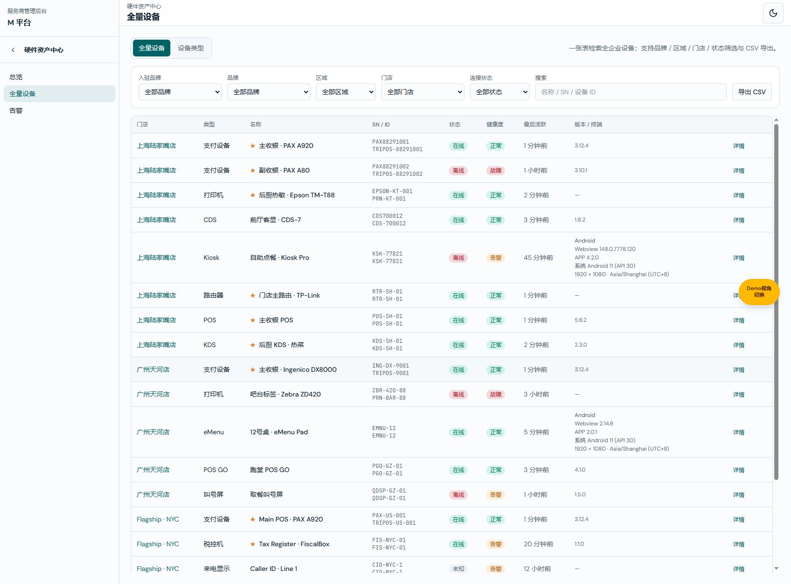

# M平台硬件资产中心需求文档（个人规范版）

版本：V1.1；变更编号：M-HW-DEFAULT-20261022-01；日期：2026-10-22。

配套：[产品权威](M平台-企业级硬件资产中心设计方案.md) · [研发交付](M平台硬件资产中心业务规格说明书（研发交付版）.md) · [个人规范](M平台硬件资产中心需求文档（个人规范版）.md)。本次仅确认全量设备默认筛选修复，原设计方案其他草案内容不因此升级为已确认需求。

## 全量设备默认筛选修复

图注：功能分支 codex/hardware-default-devices-20261022，基线 main@5b99d69e，5193 实际页面。

入口：硬件资产中心 → 全量设备；设备类型视图复用同一筛选栏。

| 字段或操作 | 逻辑说明 |
| --- | --- |
| 门店筛选 | 首项为“全部门店”，值为空字符串；默认不限制门店，转为 filter.storeId=undefined。具体门店仍使用原门店 ID；不改变授权范围 |
| 切换门店 | change 后重新查询和展示对应设备；无匹配记录仍显示“暂无匹配设备” |
| 返回全部门店 | 清除门店条件，保留其他筛选条件；设备类型视图保留当前设备类型 |
| 数据与异常 | 不清空、重置或重建已有存储。仅修复此前缺少空选项而隐式选中第一家门店的问题；不新增设备或权限 |

验证记录：修复前默认 M00000003、缺少全部选项，列表为空（RED）；修复后默认空值（GREEN），19 台设备，M00000001 为 8 台，恢复全部为 19 台。行数不含表头。构建跳过：未涉及构建边界；CI 未验证。按用户授权提交、合并 main 并推送；实际提交号与远端状态以 Git 交付核验为准。
